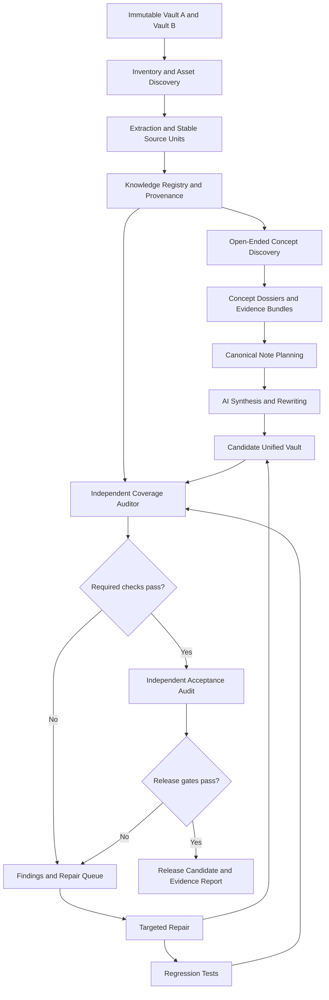

# System Architecture

## Overview

The project is a knowledge reconstruction and verification pipeline, not a file merge script.



## Architectural principles

- **Immutable inputs:** source vaults are read-only during processing.
- **Evidence before prose:** gather and map source knowledge before writing polished notes.
- **Bounded work:** operate on manageable batches and concept dossiers; never require a single model context to contain both entire vaults.
- **Persistent state:** registry, task queue, checkpoints, and reports survive session changes.
- **Stable identity:** use stable IDs and content fingerprints; line numbers alone are not durable identifiers.
- **Independent audit:** synthesis and acceptance are separate responsibilities.
- **Incremental integration:** generated notes can be accepted in batches but remain subject to cross-batch and final audits.
- **Reproducibility:** deterministic checks should be executable again from repository state.
- **No silent loss:** every source item has a disposition and evidence.
- **Change control:** global schema, editorial, and acceptance changes require documented impact analysis.

## Suggested repository layout

```text
AGENTS.md
README.md
docs/
  PROJECT_CHARTER.md
  SYSTEM_ARCHITECTURE.md
  KNOWLEDGE_AND_PROVENANCE.md
  EDITORIAL_STYLE_GUIDE.md
  VERIFICATION_SPECIFICATION.md
  OPERATING_PROTOCOL.md
  SESSION_HANDOFF.md
  MILESTONES_AND_ACCEPTANCE.md
  RISKS_AND_DECISIONS.md
  SOURCE_POLICY.md
  TOOLING_AND_SETUP.md
schemas/
state/
  registry.sqlite
  task-queue.jsonl
  current-state.json
  checkpoints/
scripts/
tests/
reports/
logs/
source-vaults/        # only if explicitly chosen; do not duplicate large inputs unnecessarily
output/Unified-Vault/
```

The first agent must inspect the real repository and source locations before creating directories. This layout is a starting point, not an excuse to duplicate documents or move source files unsafely. Store one authoritative copy of each kind of project state.

## Components and responsibilities

### Inventory and extraction
Enumerates files and assets; records hashes, formats, links, extraction status, encoding, size, and unsupported items. Extraction must preserve structural boundaries and distinguish source content from generated interpretation.

### Knowledge registry
Stores source units, source fingerprints, provenance, concept relationships, dispositions, targets, validation status, and links to reports.

### Concept discovery
Uses corpus-derived signals and semantic analysis to identify known and previously unrecognized concepts, aliases, dependencies, isolated material, and relationships. The initial taxonomy must remain open-ended.

### Concept dossier builder
Collects all relevant evidence for a concept or tightly bounded topic, including overlaps, unique details, equations, examples, contradictions, and project context. It provides a bounded evidence bundle for synthesis.

### Synthesis
Plans canonical destinations and generates new notes using the style guide. It must not silently replace source evidence with unsupported model knowledge.

### Verification
Runs deterministic, lexical, structural, semantic, technical, link, asset, editorial, and regression checks. It creates actionable findings tied to stable source-unit IDs.

### Repair
Makes bounded corrections referencing the findings and source-unit IDs. Repairs are followed by all relevant checks and regression tests.

### Session orchestrator
Selects work based on actual state, delegates bounded tasks, reviews results, persists checkpoints, and prepares handoffs.
