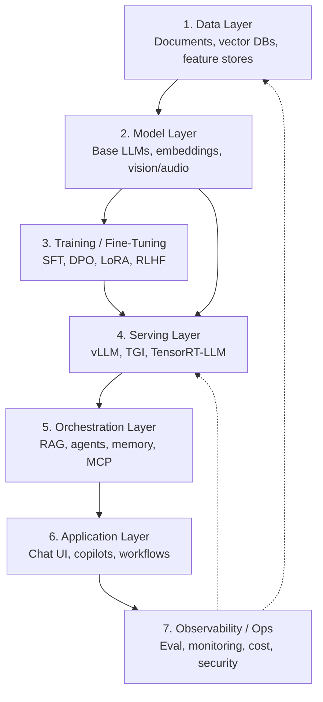

The modern AI stack is the layered architecture behind production AI systems, running from raw data up through models, training, serving, orchestration, and application logic to observability and operations. Thinking in layers makes it easier to choose tools, debug problems, and reason about cost, because each layer has its own technologies, failure modes, and cost profile. Most AI engineers work across all of the layers rather than deep in just one. This note walks through each layer, shows how they fit together in a realistic feature, and covers the concerns that cut across them.

> [!info] TL;DR
> The 2026 AI stack has ~7 layers: data → models → training → serving → orchestration → application → observability. Understanding the layers helps you choose tools, debug problems, and reason about cost. Most AI engineers work across all of them.

## The stack

The stack is best drawn as roughly seven layers, with data at the bottom and observability at the top:

The solid arrows trace the main flow: data feeds the model layer, models are adapted by training and fine-tuning or deployed straight to serving, serving powers orchestration, orchestration powers the application, and observability watches the result. The dashed arrows are the feedback loops — what monitoring and evaluation learn flows back into the data layer and the serving layer.

## Layer 1 — data

Everything starts with data. In the LLM era, "data" usually means four things: documents for RAG (PDFs, HTML, code, knowledge bases); vector embeddings — pre-computed embeddings of those documents, stored in vector DBs such as pgvector, Pinecone, Qdrant, Weaviate, and Milvus; training and fine-tuning data (instruction pairs, preference pairs, domain data); and feature stores for hybrid ML/LLM systems that combine classical features with LLM features. The key concerns at this layer are data quality, freshness, deduplication, access control, and PII handling.

## Layer 2 — models

The pretrained models that power everything else:

- **Base LLMs**: Llama 3, Mistral, Qwen, DeepSeek, GPT-4/5, Claude, Gemini.
- **Embedding models**: BGE, E5, GTE, OpenAI text-embedding-3, Cohere.
- **Vision models**: [[CLIP]], SigLIP, SAM, DINOv3.
- **Audio models**: [[Whisper]] (speech-to-text), Bark / ElevenLabs (TTS).
- **Image generation**: Stable Diffusion 3, FLUX, DALL-E.
- **Code models**: StarCoder, Code Llama, DeepSeek-Coder.

Most teams **don't train base models** — they consume pretrained ones, either via APIs or self-hosted weights. Everything above this layer is about putting those pretrained capabilities to work.

## Layer 3 — training and fine-tuning

Adapting pretrained models to specific tasks:

- **Continued pretraining**: more pretraining on domain data.
- **SFT (supervised fine-tuning)**: instruction-response pairs.
- **Preference optimization**: DPO, IPO, KTO, or [[RLHF with PPO]].
- **PEFT methods**: [[13 - Training and Adaptation/Fine-Tuning/LoRA|LoRA]], QLoRA, DoRA.
- **Distillation**: train a smaller model from a larger one's outputs.

The output of this layer is still just a set of weights; making those weights serveable at scale is the job of the next layer.

## Layer 4 — serving

Running the model in production — this is where AI engineering meets systems engineering. Three groups of technology make up the layer:

- **Serving engines**: [[14 - Inference and Production/Inference/vLLM|vLLM]], TGI, [[14 - Inference and Production/Inference/TensorRT-LLM|TensorRT-LLM]], Ollama, llama.cpp.
- **Optimizations**: [[KV Cache Mechanics|KV cache]], [[PagedAttention]], [[08 - Attention and Transformers/Efficient Attention/FlashAttention|FlashAttention]], [[Continuous Batching|continuous batching]], [[Quantization|quantization]] (INT8/INT4/FP8), [[Speculative Decoding|speculative decoding]].
- **API layers**: OpenAI-compatible APIs, OpenRouter, custom gateways.

## Layer 5 — orchestration

The patterns that make models useful. RAG pipelines follow a retrieve → rerank → ground → cite shape; agents come as ReAct loops, planner-executor designs, or multi-agent systems; memory splits into short-term (the context window) and long-term (vector DBs, knowledge graphs); tool use means function calling and MCP servers; and workflows are predefined multi-step pipelines. These patterns are the raw material that the application layer turns into product features.

## Layer 6 — application

The user-facing product:

- **Chat UIs**: ChatGPT, Claude.ai, custom internal tools.
- **Copilots**: GitHub Copilot, Cursor, Cline, Claude Code.
- **Search**: Perplexity, Glean, internal enterprise search.
- **Workflow automation**: customer support bots, code review assistants, document processing.
- **API features**: classification, extraction, summarization embedded in larger apps.

Most "AI engineer" jobs live here — taking orchestration patterns and turning them into product features.

## Layer 7 — observability and ops

Running AI in production reliably pulls together six practices:

- **Evaluation**: offline (benchmarks), online (A/B tests, LLM-as-judge).
- **Monitoring**: latency, cost, error rates, drift, hallucination.
- **Tracing**: every LLM call, tool call, retrieval in a request.
- **Cost control**: token budgets, model routing, caching.
- **Security**: prompt injection defense, PII redaction, supply chain.
- **LLMOps**: model registries, prompt management, deployment pipelines.

[[LLM-as-Judge Evaluation]], [[Production Monitoring]], [[LLM Security and Prompt Injection]], and [[LLMOps vs MLOps]] each go deeper on one of these practices.

## How the layers fit together

A typical production AI feature involves all seven layers. Take a "chat with your docs" feature:

1. **Data**: ingest customer PDFs → chunk → embed → store in [[Vector Storage with pgvector|pgvector]].
2. **Models**: use OpenAI text-embedding-3 for embeddings, Llama 3 70B for chat.
3. **Training**: maybe LoRA fine-tune Llama on past support transcripts.
4. **Serving**: serve Llama 70B with vLLM on 2× H100.
5. **Orchestration**: RAG pipeline with hybrid search ([[BM25]] + vector) + cross-encoder reranker.
6. **Application**: web chat UI with source citations.
7. **Observability**: trace every retrieval + LLM call, monitor answer faithfulness, alert on cost spikes.

Each step maps to exactly one layer, which is what makes the stack a debugging aid as much as an architecture diagram: when the feature misbehaves, the layers tell you where to look.

## Cross-cutting concerns

Some concerns cut across all layers. Cost shows up at every level — token costs at the model layer, GPU costs at serving, infra costs at the orchestration layer — so what matters is end-to-end cost per user request, not any single layer's spend. Latency is similarly additive: prefill time + retrieval time + generation time, with each layer contributing its share. Reliability has to be planned for failures at every layer, because model APIs fail, vector DBs go down, and agents loop. And security is a whole-stack property: every layer can be attacked — prompt injection (orchestration), data leakage (data), model supply chain (model), infra compromise (serving).

## Why this matters

Three consequences follow from the layered view:

- The stack is **wide** — no one is an expert in all layers. Pick your depth.
- Most AI engineering bugs come from **layer boundaries**: data has wrong format for the embedding model; orchestration sends too-long context to the model; serving can't handle the load pattern; observability can't trace across layers.
- Choosing tools per layer is **consequential** — switching serving engines or vector DBs is expensive. Pick carefully based on your workload.

## Production implications

For teams building on the stack, three rules of thumb:

- **Don't build all layers yourself.** Use managed services for layers you don't want to own (e.g., Pinecone for vectors, OpenAI for models, Datadog for monitoring).
- **Pick the layer where you add value.** Most product differentiation happens at the orchestration and application layers — that's where to invest.
- **Understand the full stack even if you specialize.** A serving-layer bug can manifest as an application-layer failure. You need to know enough to debug across layers.

## See also

- [[Foundations MOC]]
- [[What Is AI Engineering]]
- [[AI vs ML vs DL]]
- [[01 - Foundations/AI ML and DL Hierarchy/Applications of Deep Learning|Applications of Deep Learning]]
- [[History and Evolution of AI]]
- [[Roles and Careers in Data and AI]]
