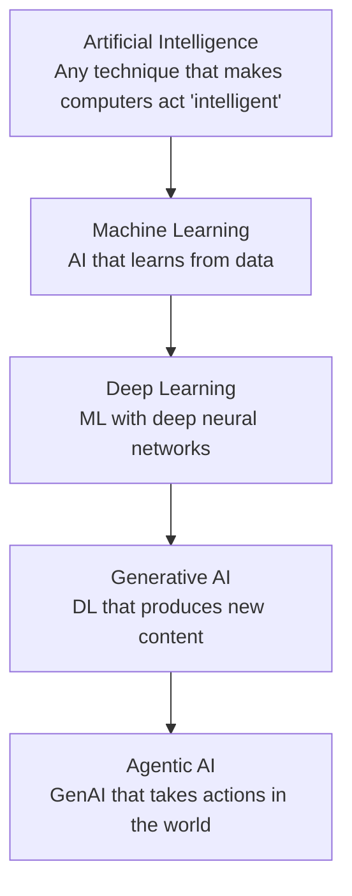
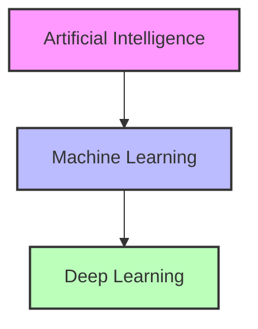
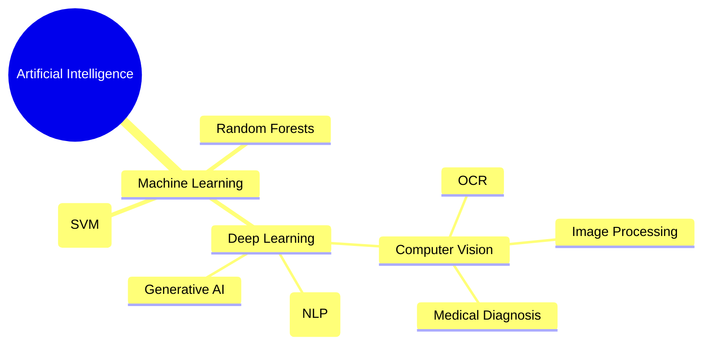
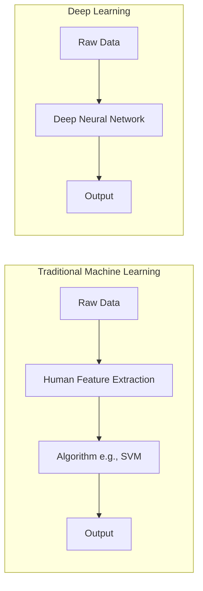
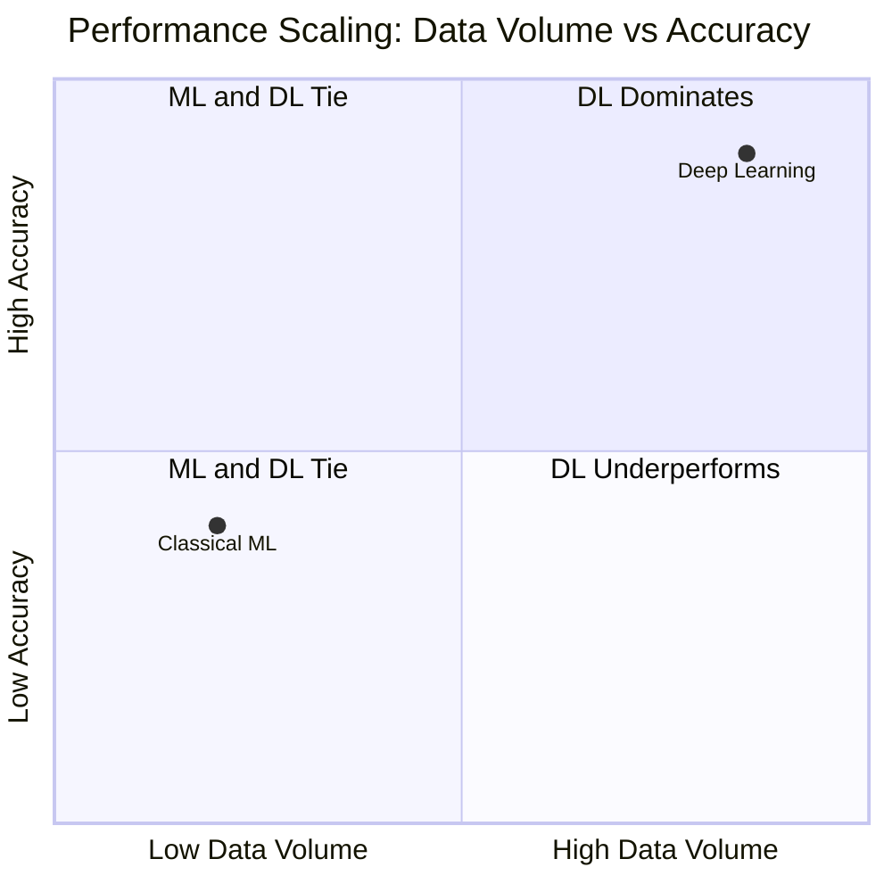
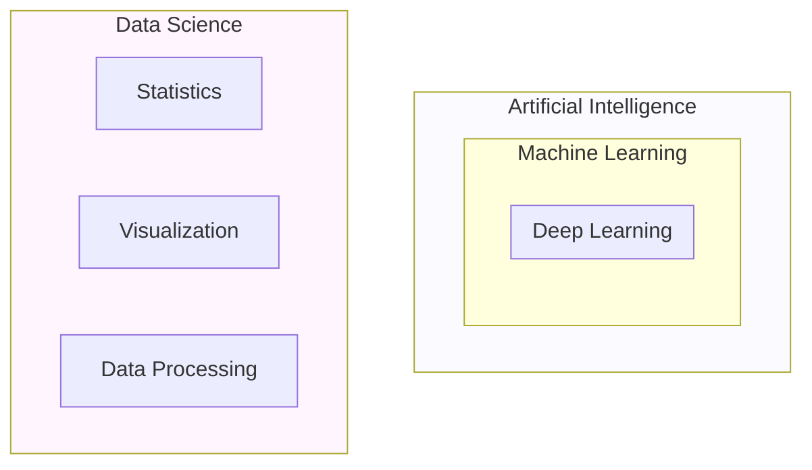

Artificial intelligence, machine learning and deep learning are not three competing technologies but nested disciplines: every deep learning system is a machine learning system, and every machine learning system sits under the AI umbrella. Around that core sit two more rings — generative AI and agentic AI on the inside, data science, business intelligence and big data on the outside — and the terms get used interchangeably in marketing, journalism and job postings even though they imply very different tools, costs and risks. This note fixes the vocabulary: the nesting, the definitions, the detailed classical-ML-versus-deep-learning comparison, the common misconceptions, guidance on when to use which, and scenario drills that map real situations onto the right domain and the right professional role.

> [!info] TL;DR
> These terms are nested but commonly confused. **AI** is the umbrella. **ML** is AI that learns from data. **DL** is ML with deep neural networks. **GenAI** is DL that produces new content. **Agentic AI** is GenAI that takes actions in the world. Each is a subset of the previous. The sections below cover the nesting, the definitions, common misconceptions, a brief historical timeline, when to use which, and production implications.

## The nesting

The five modern terms form a strict containment chain, from the broadest umbrella to the most specialized capability:

Each inner circle is a specialization of the outer one. All agentic AI is GenAI; all GenAI is DL; all DL is ML; all ML is AI. But not all AI is ML (some is rule-based), not all ML is DL (some is classical), not all DL is GenAI (some is discriminative), and not all GenAI is agentic (some is purely generative).

The classic textbook view draws only the three innermost levels as concentric boxes:

And within machine learning, the landscape of techniques fans out into classical algorithms alongside deep learning and its application fields:

Deep learning is not an isolated concept; it is a highly specialized subset within the broader field of computer science, and visualizing the containment hierarchy is the fastest way to see where it fits.

### Key distinctions at a glance

| Concept | Scope | Key Characteristic | Examples |
| :--- | :--- | :--- | :--- |
| **AI** | Broadest | Any technique mimicking human intelligence | Logic rules, decision trees, expert systems |
| **ML** | Subset of AI | Statistical learning from data | SVMs, Random Forests, Linear Regression |
| **DL** | Subset of ML | Deep neural networks learning from raw data | CNNs, RNNs, Transformers |

## Definitions

### Artificial intelligence

Artificial intelligence is the broadest term: any technique that makes a computer act "intelligently" — including symbolic rule systems, expert systems, search algorithms, optimization, and modern machine learning. It encompasses any technique that enables computers to mimic human intelligence, using logic, if-then rules, decision trees, and machine learning, and its scope covers robotics, computer vision, NLP and logic. Under this definition a chess program from 1990 is "AI". So is a thermostat (in some definitions).

The term was coined by John McCarthy at the 1956 Dartmouth Conference. The original goal was to build machines that could reason, learn, and solve problems like humans.

Historically, AI has had several sub-fields:

- **Symbolic AI** (GOFAI — "Good Old-Fashioned AI"): logic, rules, knowledge representation. Dominant 1950s-1980s.
- **Search and planning**: A*, minimax, constraint satisfaction. Still used in games and robotics.
- **Expert systems**: rule-based systems that encode expert knowledge (MYCIN, DENDRAL).
- **Machine learning**: learning from data (the modern dominant paradigm).
- **Robotics**: embodied AI (often combined with ML).

In practice, in 2026, "AI" almost always means "ML/DL-based AI", but the umbrella term persists. When someone says "AI", they usually mean "ML/DL", but technically the umbrella includes non-ML approaches.

### Machine learning

Machine learning is a subset of AI that includes statistical algorithms — like support vector machines, random forests and linear regression — that allow computers to learn from data without being explicitly programmed for every scenario. It uses statistical methods to enable machines to improve with experience: instead of programming rules explicitly (`if x then y`), the machine learns the rules by looking at examples. The formal definition (Tom Mitchell, 1997): "A computer program is said to learn from experience E with respect to some class of tasks T and performance measure P, if its performance at tasks in T, as measured by P, improves with experience E."

ML comes in several sub-types:

- **Supervised learning**: learn from (input, output) pairs. Classification, regression.
- **Unsupervised learning**: learn from inputs only. Clustering, dimensionality reduction, density estimation.
- **Reinforcement learning**: learn from reward signals. Game-playing, robotics, control.
- **Semi-supervised learning**: small labeled set + large unlabeled set.
- **Self-supervised learning**: learn from data structure (e.g., next-token prediction). The dominant paradigm for modern LLMs.

The classical ML algorithms — linear regression, logistic regression, decision trees, random forests, gradient boosting (XGBoost, LightGBM), SVMs, k-means, PCA — are still widely used in production; not every problem needs a neural network. See [[Introduction to Machine Learning]] and [[Types of Learning]] for the full treatment of these families.

Classical ML is usually the right call when:

- Data is tabular/structured.
- Training data is limited (<10K samples).
- Interpretability is required.
- Latency and compute budgets are low.
- Strong baselines exist (XGBoost for tabular).

ML is also a tool used *by* data science, alongside statistics, visualization and data processing — a relationship explored in detail below.

### Deep learning

Deep learning (apprentissage profond) is a specialized sub-domain of machine learning, which itself is a sub-domain of artificial intelligence. Its defining characteristic is the use of artificial neural networks (ANNs) that possess multiple hidden layers — "deep" architectures. The "deep" refers to depth (number of layers), typically ≥3 hidden layers; it does not refer to a profound understanding, but to the number of successive layers of representation. These deep architectures enable the model to learn highly complex, hierarchical representations directly from raw, unstructured data — pixels, audio waves, raw text characters — without human intervention, progressively extracting higher-level features from the raw input.

Deep learning excels at:

- **Perceptual tasks**: vision (image classification, object detection), speech (ASR).
- **Sequence tasks**: text (NLP), time series, audio.
- **Tasks where feature engineering is hard**: DL learns features automatically.
- **Large-data regimes**: DL outperforms classical ML when data is abundant.

The key DL architectures are:

- **CNNs** (convolutional neural networks): vision. ResNet, EfficientNet.
- **RNNs/LSTMs**: sequence modeling (pre-Transformer).
- **Transformers**: text, vision, audio, multimodal. The dominant architecture since 2017.
- **Diffusion models**: image, video, audio generation.
- **State space models** (Mamba, etc.): emerging alternative to Transformers.

Deep learning became dominant starting around 2012 (AlexNet for image classification) and accelerated with Transformers (2017). The key drivers: more data, more compute (GPUs), better algorithms (backprop, batch norm, attention).

### How deep learning learns representations

In traditional machine learning, humans must manually engineer features (e.g., extracting edges from an image to detect a face). In deep learning, the network performs **representation learning** — it automatically discovers the representations needed for feature detection or classification from raw data.

The power of deep learning comes from its layered architecture, where each layer transforms the representation of the data into something slightly more abstract and composite:

- **Layer 1** might learn to detect raw edges (simple gradients, lines).
- **Layer 2** might combine edges to detect shapes (like eyes, noses, or corners).
- **Layer 3** might combine shapes to detect whole objects (like faces, cars, or animals).

This automated, hierarchical feature extraction is what makes deep learning so powerful for unstructured data like images, audio, and text. Instead of relying on a human domain expert to manually define which features matter, the network discovers the optimal feature hierarchy on its own through the training process.

> [!info] Important reminder
> Deep learning is not a completely new paradigm separate from machine learning; it is a specific technique *within* machine learning. All deep learning is machine learning, but not all machine learning is deep learning. This distinction is critical: the mathematical foundations (gradient descent, loss functions, optimization — see [[Gradients and Gradient Descent]]) are shared across both, but deep learning's architectural depth enables it to tackle problems that are intractable for traditional ML methods.

### Generative AI

Generative AI is a subset of deep learning focused on **generating new content** — text, images, audio, video, code. The model doesn't just classify or predict; it produces novel outputs.

GenAI spans many modalities:

- **Text**: GPT, Llama, Claude, Mistral, Qwen. (LLMs.)
- **Images**: Stable Diffusion, DALL-E, Midjourney, FLUX.
- **Audio (TTS)**: ElevenLabs, OpenAI TTS.
- **Audio (music)**: Suno, Udio.
- **Video**: Sora, Runway, Pika.
- **Code**: Copilot, Codex, StarCoder.
- **3D**: emerging (text-to-3D, image-to-3D).

GenAI exploded with GPT-2/3 (text generation, 2019–2020), Stable Diffusion and DALL-E (image generation, 2022), ChatGPT (consumer text generation, 2022), and Sora (video generation, 2024).

The distinction from discriminative deep learning matters:

- Discriminative DL: input → label (e.g., image classification). The model learns to map inputs to discrete categories.
- GenAI: input (or noise) → new content (e.g., text, image). The model learns the data distribution and can sample from it.

Most pre-2018 DL was discriminative. Most post-2022 DL is generative.

### Agentic AI

Agentic AI is a subset of GenAI where the model **takes actions in the world** via tools — calling APIs, running code, browsing the web, controlling software. The model isn't just producing text; it's executing workflows.

Four characteristics define agentic systems:

- **Tool use**: the model can call external tools (search, calculator, code execution, APIs).
- **Multi-step reasoning**: the model plans and executes a sequence of steps.
- **Observation**: the model observes the results of its actions and adjusts.
- **Goal-directed**: the model works toward a goal, not just producing a single response.

Agentic AI became prominent in 2023–2024 with frameworks like ReAct, LangChain agents, and AutoGPT, and matured in 2025–2026 with production frameworks like LangGraph, the OpenAI Agents SDK, and PydanticAI.

Its sub-types:

- **Tool-using agents**: single LLM with tools (ReAct pattern).
- **Multi-agent systems**: multiple specialized agents coordinating.
- **Autonomous agents**: long-running agents that operate without continuous human oversight.
- **Human-in-the-loop agents**: agents that pause for human approval at critical points.

## Machine learning versus deep learning

Understanding when to use standard machine learning versus deep learning is a critical skill for any data scientist or AI engineer. The differences span data requirements, human intervention, hardware, and performance scaling.

### Feature engineering: the core difference

The most fundamental difference lies in **feature extraction**.

- **Machine learning (traditional):** requires **feature engineering**. A human expert must manually identify and extract features from raw data to feed into the model. _Example: For a self-driving car, a human writes code to find edges, circles (wheels), and colors. For a spam detector, a human might manually create features like "contains the word 'FREE'" or "number of exclamation marks."_
- **Deep learning:** features are learned automatically. The network is fed raw data (pixels) and learns on its own what features (edges, shapes, objects) are important to make the final decision. The neural network figures out which combinations of pixels form edges, which edges form shapes, and which shapes form objects. No human intervention is needed for feature design — the model performs **end-to-end learning** directly from raw input to final output.

### Data volume and performance scaling

The performance of ML and DL scales differently with the amount of data, and this is one of the most important practical distinctions:

- **ML:** performance plateaus early. After a certain amount of data, traditional algorithms (like SVMs or random forests) stop improving significantly. No matter how much more data you feed them, their accuracy stays roughly the same.
- **DL:** performance continues to scale with more data. Given massive datasets (Big Data), deep learning models continuously improve, eventually far surpassing classical ML models. This is why the era of Big Data has been so beneficial to deep learning — the more data, the better the model.

In practice: if you have a small dataset (hundreds or a few thousand examples), classical ML may match or even outperform DL. But as your dataset grows into the millions, DL will pull ahead dramatically.

### Hardware and computational complexity

- **ML:** can often be trained efficiently on standard CPUs (central processing units). Training times range from seconds to hours. The computational demands are modest because the models have relatively few parameters and the mathematical operations are straightforward.
- **DL:** involves millions or billions of matrix multiplications. Training on a CPU would take months or years. DL requires GPUs (graphics processing units) or TPUs (tensor processing units) to parallelize these calculations. A GPU can perform thousands of matrix operations simultaneously, which is exactly what neural network training demands. While training is extremely slow and computationally expensive, **inference** (making predictions on new data) is very fast — a trained neural network can classify an image in milliseconds.

### Side-by-side comparison

Understanding the exact logistical differences is crucial for project planning. Below is a comprehensive comparison covering all major dimensions:

| Characteristic              | Machine Learning (Traditional)                    | Deep Learning                                   |
| :-------------------------- | :------------------------------------------------ | :---------------------------------------------- |
| **Type of Learning**        | Supervised or Unsupervised                        | Supervised, Semi-supervised, Reinforcement      |
| **Human Intervention**      | **High to Medium** (Feature Engineering required) | **Low** (Features learned automatically)        |
| **Input Data Type**         | Structured or Unstructured (Tabular)              | **Strictly Unstructured** (Pixels, Audio, Text) |
| **Output Data Type**        | Numerical Values                                  | Numerical, Text, Image, Voice, Video            |
| **Data Volume Needed**      | Low to Medium (Thousands)                         | **Extremely High** (Millions/Billions)          |
| **Data Quality Importance** | **Very High** (Garbage in = Garbage out)          | High                                            |
| **Training Duration**       | Short (Minutes/Hours)                             | **Long** (Days/Weeks/Months)                    |
| **Compute Power**           | Low to Medium (**CPUs**)                          | Strong (**GPUs/TPUs**)                          |
| **Interpretability**        | High (White-box, e.g., Decision Trees)            | Low (Black-box, hard to explain decisions)      |
| **Best Use Case**           | Structured/Tabular data                           | Unstructured data (Image, Text, Audio)          |

### Nuances behind the table

Several rows of that table deserve elaboration, because the naive reading misses the practical subtleties:

- **Learning type:** DL uniquely benefits from **semi-supervised learning** (using a small amount of labeled data with a large amount of unlabeled data) and **reinforcement learning** (learning through rewards and penalties), which are far less common in traditional ML.
- **Input data type:** while ML can technically handle unstructured data, it requires extensive human preprocessing first. DL excels precisely because it processes raw, unstructured data directly — pixels, audio waveforms, or raw text characters — without any manual feature extraction step.
- **Data quality importance:** ML is extremely sensitive to data quality because the features are human-defined — if the features are poorly chosen, the model will fail regardless of algorithm choice ("garbage in, garbage out"). DL is somewhat more tolerant because it learns its own features, but it still requires clean, representative training data.
- **Interpretability:** this is a major concern. A decision tree in ML can tell you exactly *why* it made a decision (you can trace the path through the tree). A deep neural network with 100 million parameters is essentially a "black box" — it gives you the right answer, but explaining *why* is extremely difficult. This matters in domains like medicine or finance where explainability is legally required.

> [!warning] Common pitfall
> Students often think deep learning is always better. It is **not**. If you have tabular data (like an Excel sheet with house prices), algorithms like Random Forest or XGBoost will often beat deep learning, train much faster, and be much easier to explain. Save deep learning for images, text, and audio. DL shines when data is raw, unstructured, and massive.

### Framework dominance

To build these applications, two software frameworks dominate:

- **PyTorch (Facebook/Meta):** currently dominates academic research. It is highly flexible, dynamic, and Pythonic. Paper-implementation repositories show PyTorch holding ~60% of code repositories. It is the undisputed standard in **research** and academia.
- **TensorFlow (Google):** highly robust, with comprehensive deployment tools. Historically the standard in **production/industry**, though its research share has dropped to ~2%. PyTorch is rapidly catching up in the production space as well.

## Data science, business intelligence and big data

The terms AI, ML, data science and BI are often used interchangeably, but they represent distinct concepts with specific relationships.

### How the fields overlap

The diagram makes the partial overlap explicit: data science is not a superset or subset of AI. It *contains* machine learning as one of its tools, alongside statistics, visualization and data processing, while AI contains ML (and within it DL) plus non-ML approaches.

### Data science and business intelligence

**Data science** is an interdisciplinary field focused on extracting insights from data. It *uses* ML as a tool to make predictions, but data science also includes things that are *not* ML, such as data cleaning, dashboarding, and statistical testing — the territory covered in [[Data Science Definition and Philosophy]].

**Business intelligence** is the strategies and technologies used for data analysis of business information. The sharpest contrast between the two:

- **BI** looks at the **past**: "What happened last month?" (reporting).
- **DS** looks at the **future**: "What will happen next month?" (prediction).

### Big data versus data science

**Big data** refers to the **volume, velocity, and variety** of data. It is the *material*. Its characteristic technologies are Hadoop, Spark, and NoSQL. **Data science** refers to the **methods** used to analyze that data. It is the *process*.

> [!summary] Analogy
> A useful mental model for how the three layers relate:
> - **Big data** is the crude oil.
> - **Data science** is the refinery process.
> - **AI/ML** are the specialized engines that run on the refined fuel.

## Why the confusion matters

These terms are often used interchangeably in marketing and journalism, which causes real confusion:

- A journalist writing "AI is taking jobs" might mean any of the five — very different implications.
- A startup calling itself "an AI company" might just be using an off-the-shelf LLM API.
- A job posting for "AI Engineer" might be ML engineering, LLM application development, or research — completely different skill sets.
- A regulator writing "AI regulation" might be regulating anything from rule-based systems to autonomous agents.

When precision matters (job descriptions, technical docs, contracts, regulations), use the specific term. [[What Is AI Engineering]] unpacks one of the roles this ambiguity creates.

### The fraud detection example

"The company uses AI for fraud detection." This could mean:

- A rule-based system (symbolic AI) that flags transactions matching known fraud patterns.
- A gradient boosting model (classical ML) that scores transactions by fraud probability.
- A neural network (DL) that learns fraud patterns from transaction sequences.
- An LLM-based agent (agentic AI) that investigates flagged transactions by calling APIs.

Each is very different in capability, cost, and risk. The vague term "AI" obscures which.

## Common misconceptions

### AI is not just LLMs

No. LLMs are one type of DL model. Classical ML (XGBoost, random forests) is still the right tool for many tabular-data problems. Computer vision uses CNNs and ViTs, not LLMs. Reinforcement learning powers game-playing AI and robotics.

### Generative AI is not just LLMs

No. GenAI includes image generation (Stable Diffusion, DALL-E, Midjourney), audio (ElevenLabs, Suno), video (Sora, Runway), and code (Copilot). LLMs are text GenAI.

### Agentic AI is not the same as autonomous AI

No. Most production agents are bounded — they execute a specific task within guardrails, not operate autonomously for hours. Truly autonomous agents (Devin, AutoGPT) are still research-grade.

### Deep learning has not replaced classical machine learning

No. Classical ML is alive and well. For structured/tabular data with limited samples, gradient boosting (XGBoost, LightGBM) usually beats deep learning. DL dominates unstructured data (text, images, audio) and large-data regimes.

### A bigger model is not always better

Not always. A 70B model is better than a 7B model on most benchmarks, but for a specific task, a fine-tuned 7B may outperform a general 70B. And a 1B model fine-tuned for a narrow task may beat both. The right model depends on the task.

### AI is not objective

No. ML models learn from data, which reflects human biases. Models can be racist, sexist, or otherwise biased. "Objective AI" is a myth; the question is which biases the model has and whether they're acceptable.

### AI is not intelligent in the human sense

Depends on the definition of "intelligent". LLMs are very good at pattern matching and text generation, but they don't have understanding, consciousness, or intent in the human sense. "Intelligent" is a loaded term; "capable" is more accurate.

## A brief historical timeline

| Era                | Dominant Paradigm                       | Example                          |
|--------------------|-----------------------------------------|----------------------------------|
| 1950s–1970s        | Symbolic AI, expert systems             | Logic Theorist, MYCIN            |
| 1980s–1990s        | Classical ML, neural nets (shallow)     | Decision trees, backprop revival |
| 2000s              | Statistical ML                          | SVM, random forests, CRF         |
| 2010s              | Deep learning                           | AlexNet, ResNet, BERT, GPT-2     |
| 2020–2022          | Generative AI                           | GPT-3, Stable Diffusion          |
| 2023–present       | Agentic AI, reasoning models            | ChatGPT, o1, R1, agentic frameworks |

Key milestones along that arc: 1950, Turing Test proposed; 1956, Dartmouth Conference coins "AI"; 1958, Perceptron (Rosenblatt); 1986, backpropagation (Rumelhart, Hinton, Williams); 1997, Deep Blue beats Kasparov at chess; 2012, AlexNet wins ImageNet (the DL era begins); 2014, GANs (Goodfellow); 2017, the Transformer paper (Vaswani et al.); 2018, BERT and GPT-1; 2020, GPT-3; 2022, ChatGPT and Stable Diffusion; 2023, GPT-4, Llama 2, and agents (ReAct, Reflexion); 2024, Sora, Llama 3, Claude 3.5, and reasoning models (o1); 2025, DeepSeek-R1, mature agentic frameworks, Gemini 2.5; 2026, continued scaling, multimodal-native models, and production agents. [[History and Evolution of AI]] tells the full story, era by era.

## When to use which

### When to use symbolic AI

Use rules when the logic is well-understood and can be written as rules, when interpretability is critical (regulatory, medical), when the problem is combinatorial (constraint satisfaction), or when data is scarce but domain knowledge is rich. Examples: tax preparation software, medical diagnosis checklists, scheduling.

### When to use classical machine learning

Use classical ML when data is tabular/structured, training data is limited, interpretability is required, or latency and compute budgets are low. Examples: fraud detection (XGBoost), customer churn (logistic regression), recommendation (collaborative filtering).

### When to use deep learning

Use DL when data is unstructured (text, images, audio), large training sets are available, performance matters more than interpretability, or feature engineering is hard. Examples: image classification (ResNet), speech recognition (Whisper), translation (Transformer). [[01 - Foundations/AI ML and DL Hierarchy/Applications of Deep Learning|Applications of Deep Learning]] surveys where DL is deployed today.

### When to use generative AI

Use GenAI when you need to generate new content, when the task is creative or open-ended, or when a discriminative model can't capture the output distribution. Examples: text generation (LLMs), image generation (diffusion), code generation (Copilot), summarization, translation.

### When to use agentic AI

Use agentic AI when the task requires multiple steps, when tool use is needed (search, code execution, APIs), when the model needs to adapt based on observations, or when a single LLM call is insufficient. Examples: research agents, coding agents, customer support agents, autonomous task execution.

### When not to use AI at all

Reach for something simpler when a simple rule-based system works, when the problem is well-understood and deterministic, when the cost of AI exceeds the value, or when the risk of errors is unacceptable. Not every problem needs AI. Sometimes a SQL query is the right tool.

## Why the distinctions matter

Using the right term signals you understand the field — saying "AI" when you mean "LLM" in a technical context is a tell. Choosing the right tool requires knowing what category of tool you need: not every problem needs an LLM; some need a classifier, some a search engine, some a rule-based system. The progression AI → ML → DL → GenAI → agentic AI isn't just historical — it's the path most learners follow, learning classical ML before deep learning before LLMs before agents. Understanding the distinctions also helps you communicate with stakeholders, who may not know the difference but need to make informed decisions, and it is a precondition for meaningful regulatory and ethical discussions — "AI regulation" that conflates symbolic AI with autonomous agents produces bad policy.

## Production implications

The terminology maps directly onto engineering and budget decisions, and the recurring theme is that capability, cost and risk escalate as you move inward through the nesting:

- **Don't default to LLMs.** For classification on tabular data, gradient boosting is faster, cheaper, and often more accurate.
- **GenAI features are expensive.** Image generation costs ~$0.04 per image; LLM calls cost $0.001–$0.06 per query. Cost adds up fast at scale.
- **Agentic features multiply cost.** An agent that makes 10 LLM calls to answer one user query costs 10× a single-call approach. Make sure the value justifies it.
- **Choose the right tool for the job.** A startup building a recommendation engine should use collaborative filtering, not an LLM. A company automating data entry should use OCR + rules, not a multimodal agent.
- **Mix and match.** Production systems often combine classical ML, DL, GenAI, and agentic AI. A fraud detection system might use XGBoost for scoring + an LLM for investigation + rules for known patterns.
- **Skill sets differ.** An ML engineer (classical ML) and an AI engineer (LLMs/agents) have different skills. Hire for the right role — see [[Roles and Careers in Data and AI]].

## Interview questions

These distinctions are a staple of interview screens, and the expected answers show that the candidate can move between the vocabulary and the practical trade-offs:

- **Q: What's the difference between AI and ML?**
  A: AI is the umbrella (any technique for intelligent behavior). ML is a subset where the system learns from data. Not all AI is ML (rule-based systems are AI but not ML).

- **Q: When would you use classical ML instead of deep learning?**
  A: For tabular data with limited samples, gradient boosting usually beats DL. Classical ML is also better when interpretability is required, compute is limited, or the problem is well-suited to existing algorithms.

- **Q: What makes AI "agentic"?**
  A: The ability to take actions in the world via tools, observe results, and iterate. A pure LLM is GenAI but not agentic. An LLM with tool use and multi-step reasoning is agentic.

- **Q: Is an LLM "intelligent"?**
  A: Depends on the definition. LLMs are very capable at pattern matching and text generation, but they don't have understanding, consciousness, or intent. "Capable" is more accurate than "intelligent".

- **Q: Why is "AI regulation" complicated?**
  A: Because "AI" spans everything from rule-based systems to autonomous agents. Regulating a chess program differently from a self-driving car requires precise definitions. Conflating them produces bad policy.

## Identifying domains and roles in practice

The fastest way to internalize these distinctions is to drill mapping real-world scenarios to the correct data domain and the correct professional role.

### Mapping scenarios to domains

Decide which domain — data science, ML, AI, big data, or BI — fits each scenario best:

| Scenario | Best fit | Reasoning |
| :--- | :--- | :--- |
| A dashboard shows last year's sales trends | **Business Intelligence (BI)** | Descriptive analysis of historical data ("last year") to report on what happened. |
| An app recommends products based on user behavior | **Machine Learning (ML)** | The system is "learning" user preferences from data to make predictions (recommendations). This is a recommender system. |
| Storing and processing terabytes of sensor data from IoT devices | **Big Data** | The keywords are "terabytes" (volume) and "sensor data" (velocity/variety). This is an infrastructure/storage challenge. |
| An AI agent plays chess and learns strategies over time | **AI / Reinforcement Learning** | The agent is making autonomous decisions to achieve a goal (winning) and simulating intelligent behavior. |
| A company wants to predict customer churn using historical data | **Data Science (predictive analytics)** | The full lifecycle: cleaning data, analyzing it, and building a model to predict a future outcome (churn). |

### Assigning roles in a hospital project

Scenario: a hospital wants to predict heart disease risk. Assign each task to the correct role — data analyst, data scientist, data engineer, ML engineer, or business analyst:

| Task | Role | Reasoning |
| :--- | :--- | :--- |
| Collect patient records from multiple hospital databases and prepare them for use | **Data Engineer** | Building pipelines (ETL), connecting to databases, and handling data infrastructure/architecture. |
| Build a predictive model using patient data to estimate heart disease risk | **Data Scientist** | The core modeling task — selecting features, choosing algorithms, and training the model. |
| Create a dashboard to show current statistics about patient risk factors | **Data Analyst** | Descriptive statistics and visualization to report on the *current state* of the data. |
| Deploy the predictive model so doctors can access it via a web application | **ML Engineer** | Taking the theoretical model and putting it into **production** (deployment, scalability, API integration). |
| Define the business question: "How can we reduce the number of undetected high-risk patients?" | **Business Analyst** | Bridges the gap between hospital stakeholders and the tech team, translating business needs into data requirements. |

### Data engineer versus ML engineer

Why can't a data engineer and an ML engineer simply replace each other? A **data engineer** is focused on the **flow and storage** of data (SQL, pipelines, warehousing). They build the roads. An **ML engineer** is focused on the **deployment and optimization** of models (software engineering, APIs, latency). They build the cars that drive on the roads. While both code, their daily tools and objectives are fundamentally different (database architecture vs. model serialization and serving).

## See also

- [[Foundations MOC]]
- [[History and Evolution of AI]]
- [[Introduction to Machine Learning]]
- [[Types of Learning]]
- [[01 - Foundations/AI ML and DL Hierarchy/Applications of Deep Learning|Applications of Deep Learning]]
- [[The Modern AI Stack]]
- [[What Is AI Engineering]]
- [[Data Science Definition and Philosophy]]
- [[Roles and Careers in Data and AI]]
- [[Gradients and Gradient Descent]]
- [[04 - Machine Learning/Regression/Linear Regression|Linear Regression]]
- [[04 - Machine Learning/Regression/Logistic Regression|Logistic Regression]]
