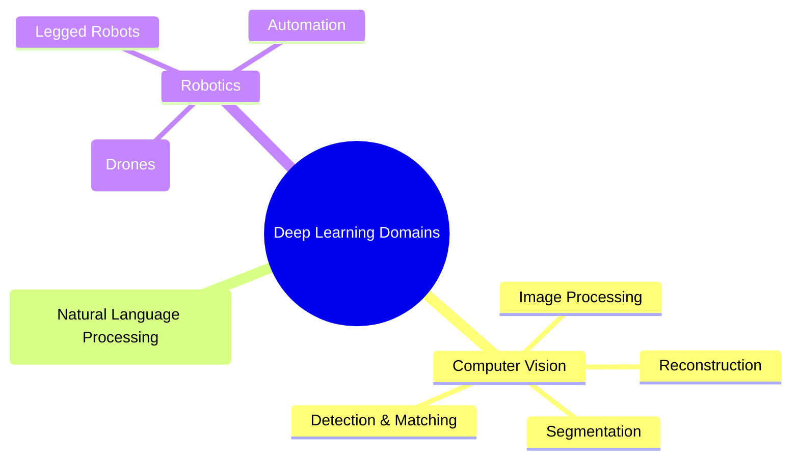

Deep learning has achieved superhuman performance in domains where data is unstructured and highly complex, and it is preferred because it demonstrates unparalleled performance in image recognition, speech recognition, and natural language processing. It has transformed entire industries by enabling machines to perceive, understand, and generate content in ways that were previously impossible. This note surveys where deep learning is actually deployed: the distinct tasks that make up computer vision, the natural language and speech stack, and the industry-specific applications spanning transport, agri-food, security, marketing, banking, manufacturing, and medicine.

## Computer vision (image and video)

This is the domain where deep learning first proved its dominance, via AlexNet in 2012. While "computer vision" is a broad umbrella term, deep learning breaks it down into highly specific, distinct tasks. A model built for one task usually cannot perform the other without architectural changes — understanding these distinct tasks is essential because each requires a different network architecture and training approach.

### The four pillars of image analysis

| Task | Output | Typical architectures |
| :--- | :--- | :--- |
| Classification | One label for the whole image | CNN with a final fully-connected layer and Softmax |
| Retrieval | Compact embeddings for similarity search | Encoders producing feature vectors |
| Detection | Class label + bounding-box coordinates per object | YOLO, SSD, Faster R-CNN |
| Segmentation | A class prediction for every pixel | cU-Net, DeepLab, FCN |

#### Classification

The goal is to assign a single label to an entire image. The network processes the entire image and outputs a single category label — it answers the question "What is in this image?" with one answer. A typical example is looking at an image and outputting "Grille" (grill), "Mushroom", or "Madagascar Cat"; this was the primary focus of the 2012 ImageNet challenge, where AlexNet classified images into 1000 categories. Architecturally, classification typically uses CNNs with a final fully-connected layer outputting a probability distribution over all classes via Softmax.

#### Retrieval (content association)

Given a reference image, the goal is to search a massive database to find visually or semantically similar images. The network encodes images into compact feature vectors (embeddings); similar images will have similar embeddings, allowing fast similarity search across millions of images. Uploading a picture of a specific flower and having the system return 10 images of the exact same flower species from different angles is the canonical example. Applications include reverse image search (Google Images) and product recommendation — finding similar products from a photo.

#### Detection (object detection)

Detection goes beyond classification: it locates specific objects within an image and draws a **bounding box** around them, identifying not only *what* objects are present but *where* they are. The network outputs both a class label and a set of coordinates (x, y, width, height) for each detected object, and multiple objects can be detected in a single image. A typical result identifies a person, a horse, and a dog in the same image, drawing a colored rectangle around each and labeling them (e.g., using the _Faster R-CNN_ architecture). Detection is used heavily in **autonomous vehicles** to detect pedestrians, roads, and other cars simultaneously. It relies on specialized detection architectures like YOLO (You Only Look Once), SSD, or Faster R-CNN that combine region proposal with classification.

#### Segmentation (semantic segmentation)

Segmentation is the most complex of the four tasks: it classifies _every single pixel_ in the image, creating a precise, color-coded mask of the objects. Instead of a box around an object, you get the exact pixel-level outline. The network outputs a class prediction for every pixel in the input image, producing a dense prediction map rather than a single label or bounding box. Instead of a box around a car, the exact outline of the car, the road, the sky, and pedestrians are highlighted pixel-by-pixel (e.g., in the work of _Farabet et al._). Segmentation is used in **medical imaging** to precisely outline tumors or pneumothorax in X-rays. Architecturally it uses encoder–decoder architectures like cU-Net, DeepLab, or FCN (fully convolutional networks).

### Adjacent vision applications

Beyond the four pillars, additional CV applications include **facial recognition** for security, authentication, and social media tagging.

Computer vision also often intersects heavily with robotics (for navigation) and NLP (for generating image captions). _A self-driving car, for instance, uses CV to perceive the world, NLP to understand voice commands, and robotics to control the vehicle._ [[Deep Learning for Imaging]], [[Hierarchical Feature Extraction]], and [[Detection and Segmentation]] develop the vision side of this stack in depth.

## Natural language processing (text and audio)

- **Machine translation:** translating languages contextually (Google Translate). Modern translation systems use Transformer architectures that can understand the full context of a sentence, not just translate word-by-word.
- **Sentiment analysis:** determining if a review is positive or negative (marketing). This has enormous commercial value for brands monitoring social media and customer feedback.
- **Chatbots and LLMs:** ChatGPT, Gemini, summarizing documents, generating code. These models can engage in multi-turn conversations, answer questions, write essays, and even write functional software code.
- **Speech recognition and synthesis:** converting voice to text (Siri, Alexa) and text to realistic speech. Modern systems can handle multiple languages, accents, and even emotional intonation.

The language side of the stack is covered from the modeling perspective in [[Attention and Transformers MOC]] and [[NLP and Language Models MOC]].

## Industry-specific applications

### Transport

**Autonomous vehicles** use deep learning to identify elements in the physical environment with precision — roads, sidewalks, pedestrians, other cars. This is perhaps the most demanding CV application because it requires real-time processing with extremely high reliability: a missed pedestrian can be fatal. **Sensor fusion** underpins navigation, fusing multi-source data — camera images, GPS, and LiDAR point clouds — to ensure safety and civil liability. No single sensor type is sufficient; the power comes from combining them intelligently.

### Agri-food

**Quality control:** visual recognition technologies identify potential debris or contaminants in food during production. The high accuracy of deep networks provides reliability that QA professionals depend on, replacing slow, error-prone manual inspection on fast-moving production lines.

### Security

**Surveillance:** object recognition is widely used to secure public spaces (airports, subways, concert halls). Modern systems can track multiple individuals across multiple camera feeds simultaneously. **Risk detection:** cameras detect risky situations such as stampedes, fights, crowd movements, or the presence of dangerous objects (weapons). These systems can alert security personnel in real time before situations escalate.

### Marketing and commerce

**Contextualization:** social networks use deep learning to identify objects, locations, people, logos, and the context of shared images. This allows platforms to understand what content users are posting and consuming. **Targeting:** this visual analysis allows networks to contextualize users to optimize targeted advertising — if a user frequently posts images of hiking gear, the system can infer their interests and serve relevant ads.

### Banking and finance

**Document processing:** automating document handling (e.g., automated check deposits via mobile apps or ATMs) eliminates the need for manual data entry and reduces processing time from days to seconds. **OCR (optical character recognition):** deep learning reads handwritten text on checks, extracting the content to determine deposit parameters without human operator intervention — handwriting recognition is a particularly challenging CV task because handwriting varies enormously between individuals. **Fraud detection and algorithmic trading:** automated pattern recognition in financial data can detect anomalous transactions that may indicate fraud, and high-frequency trading algorithms use deep learning to predict short-term price movements.

### Manufacturing industry

**Robotics and logistics:** autonomous navigation of robots in warehouses significantly accelerates the supply chain and production volume — Amazon warehouses use thousands of DL-powered robots to move inventory. **Quality assurance:** automated visual inspection of manufactured parts. DL models can detect microscopic defects that human inspectors would miss, operating 24/7 without fatigue.

### Medicine

**Non-invasive diagnostics:** automated analysis of medical images (X-rays, MRIs, regular photos) to diagnose pathologies like skin diseases without invasive procedures. In some studies, DL models have matched or exceeded the diagnostic accuracy of specialist physicians, particularly in dermatology and radiology.

## See also

- [[Foundations MOC]]
- [[AI vs ML vs DL]]
- [[History and Evolution of AI]]
- [[06 - Computer Vision/CNN Foundations and Philosophy/Introduction and Foundations of CNNs|Introduction and Foundations of CNNs]]
- [[Hierarchical Feature Extraction]]
- [[Deep Learning for Imaging]]
- [[Detection and Segmentation]]
- [[Attention and Transformers MOC]]
- [[NLP and Language Models MOC]]
- [[Swin Transformer]]
