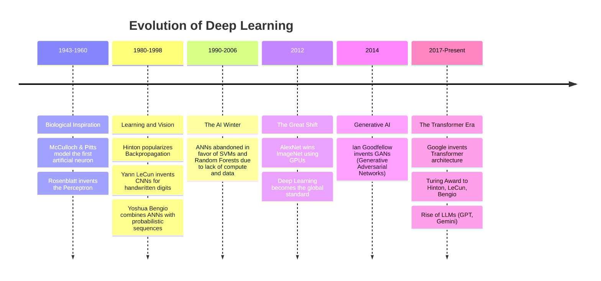

Deep learning looks like an overnight success, but its evolution spans more than 80 years, marked by "AI winters" and explosive revivals, and the field around it — symbolic AI, classical machine learning, the Transformer era, and today's reasoning and agentic frontier — has cycled through paradigms the same way. Understanding this history explains why certain techniques exist and why the field developed the way it did. This note walks the full arc: the neural-network timeline from McCulloch and Pitts to the Transformer era, the broader symbolic-to-statistical-to-deep history, the modern 2024–2026 developments, and the practical lessons each era teaches.

> [!info] TL;DR
> AI has had several "winters" and "summers" since the 1950s. The current Transformer-based era is just the latest peak. Understanding the history explains why the field looks the way it does — and helps you spot when today's hype resembles past bubbles. The coverage runs through the 2024–2026 frontier: reasoning models, hybrid attention architectures, MCP, and multimodal-native models, plus the lessons each era teaches.

## The timeline of neural networks

## The major eras

### The origins: biological inspiration (1943–1960)

The initial goal was to mimic the human brain. Warren McCulloch and Walter Pitts created the first mathematical model of a neuron — a simplified computational unit that could perform logical operations. This was purely theoretical, but it proved that simple computational units could be combined to perform complex reasoning.

Frank Rosenblatt later invented the **Perceptron** (1958), the first algorithmic neural network that could actually learn weights from data. The Perceptron was a breakthrough: it was a machine that could improve its own performance through experience, adapting its internal parameters based on the data it saw.

### Symbolic AI and the first AI winter (1950s–1980s)

While neural networks stumbled, the first dominant wave of AI was symbolic: hand-coded rules, if-then chains, logic programming, and expert systems. Famous early systems include:

- **Logic Theorist** (1956) — proved theorems from Whitehead & Russell's *Principia*.
- **General Problem Solver** (1957) — meant to solve any formalized problem.
- **ELIZA** (1966) — a simple pattern-matching chatbot that fooled people into thinking it understood them.
- **MYCIN** (1970s) — diagnosed bacterial infections from rules elicited from doctors.
- **Expert systems** (1980s) — large rule databases for specific domains (loan approval, equipment diagnosis).

Symbolic AI's foundational assumption was that intelligence could be captured by explicit symbolic reasoning — a program that manipulates symbols according to logical rules. This produced impressive demonstrations in narrow domains (MYCIN's diagnostic accuracy rivaled human doctors on bacterial infections), but the approach hit fundamental walls as practitioners tried to scale it.

The walls were threefold. First, knowledge acquisition: every rule had to be elicited from a human expert, a slow and expensive process that didn't scale. Second, ambiguity: real-world data is noisy, ambiguous, and context-dependent, but symbolic systems require precise inputs. Third, combinatorial explosion: as rule databases grew, the inference engine's search space exploded exponentially. By the late 1980s, expert systems had failed to deliver on their commercial promises, triggering the second AI winter (1987–1993). The lesson: intelligence can't be fully captured by hand-coded rules; the world is too messy.

For neural networks specifically, the collapse came earlier and harder. Researchers realized the Perceptron could only solve **linearly separable** problems (like AND/OR functions) but failed on non-linear ones (like the XOR problem). Marvin Minsky and Seymour Papert published a book in 1969 proving that a single-layer Perceptron was fundamentally incapable of solving XOR. This mathematical proof caused funding and interest to collapse entirely, and the field entered what is often counted as the first AI winter — a period of stagnation, reduced funding, and skepticism about neural networks. The irony is that multi-layer networks (which we now call MLPs) _could_ solve XOR, but at the time there was no efficient algorithm to train them. The technology simply wasn't ready.

### The backpropagation revival (1986)

Geoffrey Hinton and colleagues popularized the **backpropagation** algorithm in 1986, allowing multi-layered networks (MLPs) to learn by propagating errors backward through the network's layers. This was a monumental breakthrough — it provided the missing training algorithm that made deep networks feasible.

Yann LeCun later used backpropagation to build **convolutional neural networks (CNNs)** for reading handwritten zip codes at the US Postal Service — one of the first real-world, commercial applications of neural networks. Yoshua Bengio advanced sequence models and attention mechanisms, laying groundwork for the NLP revolution that would come decades later.

### Classical machine learning (1990s–2000s)

The 1990s and 2000s were the era of the shift from "program the rules" to "learn from data". Key algorithms: **decision trees** (CART, 1984; C4.5, 1993), **support vector machines** (1995), **random forests** (2001), and **gradient boosting** (XGBoost, 2000s–2014). Statistical methods dominated: logistic regression, naive Bayes, hidden Markov models, conditional random fields. The web era created large labeled datasets (search logs, click data) that made ML commercially viable. Spam filtering, recommendation systems, ad click prediction, and search ranking were the killer applications — billions of dollars of economic value, mostly invisible to users.

This era taught the field a critical lesson: **simple models on lots of data beat complex models on little data**. The "unreasonable effectiveness of data" (Halevy, Norvig, Perreira, 2009) became the dominant paradigm. Microsoft's Peter Norvig famously said: "All of us in AI research have been doing the same thing — we just have more data and more compute now." This insight set up the deep learning explosion: if more data beats better algorithms, then models that can scale to use massive data (deep neural networks) would inevitably win.

### The second winter for neural networks (1990s–2006)

Despite backpropagation being theoretically sound, computers were too slow and datasets too small for deep networks to show their potential. Training a network with more than 2–3 layers could take weeks on the hardware of the era, and the results were often no better than simpler methods. Simpler, mathematically grounded algorithms like SVMs and random forests dominated because they were faster to train, more reliable on small data, and had strong theoretical guarantees. Neural networks were largely abandoned by the mainstream AI community during this period — the timeline's stark entry for 1990–2006: ANNs abandoned in favor of SVMs and random forests due to lack of compute and data.

### The ImageNet revolution (2012)

The ILSVRC (ImageNet Large Scale Visual Recognition Challenge) required classifying 1.4 million images into 1000 categories — an enormous, unprecedented dataset that traditional methods struggled with. Alex Krizhevsky, Ilya Sutskever, and Geoffrey Hinton created **AlexNet**, a deep CNN that crushed the competition, reducing the error rate by nearly half compared to the previous year's winner. This was the watershed moment that convinced the entire AI community that deep learning was the future.

**The secret weapons:**

1. **Big data:** the massive ImageNet dataset provided enough examples for deep networks to learn meaningful representations. Without sufficient data, deep networks simply overfit.
2. **GPUs:** Hinton's brilliant idea to use graphics cards (originally designed for rendering video games) to parallelize the massive matrix multiplications required by neural networks. A single GPU could perform thousands of operations simultaneously, reducing training time from months to days.

The convergence of three factors made deep learning practical: (1) **GPUs** (especially NVIDIA CUDA, originally developed for gaming, proved ideal for matrix multiplication), (2) **ImageNet** (Fei-Fei Li's dataset, started 2009, reached 14M labeled images by 2012 — the first dataset large enough to train deep models), and (3) **large labeled datasets** (web-scale click data, social media images, search logs). AlexNet's 2012 ImageNet victory was the inflection point: 15.3% top-5 error vs. the next-best 26.2% — a 10-point margin that signaled deep learning had arrived.

The next five years saw rapid architecture innovation: VGG (2014), GoogLeNet (2014), ResNet (2015, with residual connections enabling 100+ layer networks — see [[06 - Computer Vision/Architecture and Connectivity/The Degradation Problem and Residual Connections|The Degradation Problem and Residual Connections]]), and DenseNet (2017); [[06 - Computer Vision/Architecture and Connectivity/Evolution of CNN Architectures|Evolution of CNN Architectures]] traces that race in detail. Beyond vision, **Word2Vec** (2013) showed unsupervised learning could produce useful word embeddings, **Seq2Seq** (2014) introduced encoder–decoder RNNs for translation, and **Bahdanau attention** (2014) fixed the Seq2Seq bottleneck (see [[08 - Attention and Transformers/Attention Mechanism/Bahdanau Attention|Bahdanau Attention]]). For sequence modeling, LSTM (1997) and GRU (2014) dominated until the Transformer arrived. The deep learning era taught the field that **depth + scale + data** could solve perceptual tasks that symbolic AI and classical ML couldn't.

### The Transformer era (2017–2022)

Vaswani et al. published *Attention Is All You Need* in 2017. The Transformer replaced RNNs and dominated NLP:

- **Transformer** (2017) — the self-attention architecture that dispensed with recurrence (see [[Self-Attention]]).
- **BERT** (2018) — bidirectional encoder for NLU; set SOTA on 11 NLP tasks (see [[08 - Attention and Transformers/Transformer Architecture/BERT|BERT]]).
- **GPT-2** (2019) — 1.5B parameter decoder; OpenAI initially deemed it "too dangerous to release".
- **GPT-3** (2020) — 175B parameters; demonstrated few-shot in-context learning. The paper that defined the LLM era.
- **Vision Transformer** (2020) — Transformers work for images too (see [[ViT Architecture]] and [[Swin Transformer]] for the hierarchical vision variant).
- **CLIP** (2021) — shared image-text embedding space; foundation for multimodal AI.

The Transformer's key innovation was eliminating recurrence entirely. RNNs (LSTM, GRU) process tokens one at a time, carrying hidden state forward — this sequential bottleneck made training slow and prevented parallelism. The Transformer replaced this with self-attention: every token attends to every other token in parallel. This enabled (1) massively parallel training on GPUs, (2) scaling to much longer contexts, and (3) the "scaling laws" empirical discovery.

Scaling laws (Kaplan 2020, Chinchilla 2022) showed that bigger models + more data + more compute = better performance, predictably. This drove the model-size race. The Chinchilla correction (2022) was crucial: it showed most pre-Chinchilla models were undertrained — they had too many parameters for their training data. The optimal ratio is ~20 tokens per parameter. This insight redirected the field from "bigger is better" to "right-sized is better".

### The generative era: from recognition to creation (2014–present)

- **2014:** Ian Goodfellow creates GANs (generative adversarial networks), allowing AI to generate realistic images for the first time. GANs pit two networks against each other — a generator that creates fake data and a discriminator that tries to detect it — resulting in increasingly convincing synthetic outputs (see [[The Adversarial Game]]).
- **2017:** Google publishes "Attention is All You Need", introducing the **Transformer** architecture, which eschews recurrence for attention mechanisms. This architecture would revolutionize NLP and eventually become the foundation for all modern language models.
- **2018:** Hinton, LeCun, and Bengio win the Turing Award (the "Nobel of Computing") for their foundational contributions to deep learning.
- **2020+:** the era of large language models like GPT-3, ChatGPT, and Gemini, bringing deep learning into everyday life and demonstrating that scaled-up Transformer models can achieve remarkable general-purpose intelligence.

Generative AI went mainstream in 2022–2023: **Stable Diffusion** (Aug 2022) for open-source image generation; **ChatGPT** (Nov 2022) as the consumer LLM interface, reaching 100M users in 2 months; **GPT-4** (Mar 2023), multimodal with much stronger reasoning; **Llama 1** (Feb 2023), Meta's open weights that kicked off the open-source LLM ecosystem; and **Llama 2** (Jul 2023), with a commercial-use license that became the foundation for most fine-tunes. The consumerization of GenAI was the inflection point that made "AI" a mainstream topic. ChatGPT's 100M users in 2 months made it the fastest-growing consumer application in history (until Threads briefly surpassed it in 2023). This created enormous commercial pressure: every Fortune 500 company suddenly needed an "AI strategy", and the demand for AI engineers exploded. Stable Diffusion's open-source release was equally important — it demonstrated that open-weights GenAI was viable, kicking off the open-source LLM ecosystem that Llama would later dominate.

> [!info] Key takeaway
> Deep learning did not emerge from a vacuum. It required three simultaneous breakthroughs: **big data** (the internet created massive datasets), **compute** (GPUs provided the necessary processing power), and **algorithms** (backpropagation, ReLU, and later Transformers provided the mathematical framework). Missing any one of these three pillars, deep learning would not exist as we know it today.

### Alignment and chat models (2022–2024)

Pretrained base models aren't useful chatbots — they need alignment. Alignment is the process of making a model follow instructions, refuse harmful requests, and behave like a helpful assistant rather than a text completer.

- **InstructGPT / RLHF** (2022) — fine-tune with human preferences via PPO. The recipe: SFT → reward model → PPO.
- **Constitutional AI** (Anthropic, 2022) — RLAIF, replacing human labels with model labels.
- **DPO** (2023) — a simpler alternative to PPO; democratized alignment.

Aligned models became the norm: ChatGPT, Claude, Gemini, Llama-Instruct, and so on. The 2023–2024 alignment landscape saw rapid innovation: DPO replaced PPO as the default for most use cases (simpler, 10× cheaper); SimPO (2024) added length normalization; GRPO (2025, DeepSeek-R1) became the standard for reasoning models. Each method simplified alignment while maintaining quality, making it accessible to smaller labs and individual researchers.

### Agentic AI and reasoning models (2024–2026)

The current era has two parallel threads.

**Agents** — LLMs that take actions via tools:

- **ReAct** (2022), **Reflexion** (2023) — foundational agent patterns.
- **OpenAI Assistants API** (2023), **function calling** (Jun 2023) — production tool use.
- **LangGraph**, **AutoGen**, **CrewAI**, **PydanticAI** (2023–2024) — agent frameworks.
- **MCP** (Anthropic, 2024) — a standard protocol for tools.
- **OpenAI Agents SDK**, **Anthropic Computer Use** (2024–2025) — frontier agentic systems.

**Reasoning models** — LLMs that "think" before answering:

- **OpenAI o1** (Sep 2024) — test-time compute scaling; long internal chain-of-thought.
- **DeepSeek-R1** (Jan 2025) — open-source reasoning model with verifiable-reward RL.
- **Claude 3.7 with extended thinking** (Feb 2025).
- **Gemini 2.5** (Mar 2025) — "thinking" mode.

The frontier of 2026 combines these: agents that reason, that plan, that use tools, and that operate over hours or days. The 2026 frontier is also defined by architectural convergence: every frontier model uses MoE + hybrid attention + reasoning training + multimodal fusion (see [[Mixture of Experts]]).

## Modern developments (2024–2026)

### Hybrid attention goes mainstream

The 2024–2026 frontier has converged on hybrid attention (linear + softmax, ~7:1 ratio). Pure softmax attention is becoming the exception, not the rule, at frontier scale. Models using hybrid attention include Jamba (2024), Kimi K2 (2025), MiniMax-01 (2025), GLM-4.5 (2025), and Qwen 3 (2025).

### Reasoning models become commodity

DeepSeek-R1 (Jan 2025) demonstrated that the reasoning model recipe (RL on verifiable rewards) is open and reproducible. By 2026, every major lab has released a reasoning model: o1 (OpenAI), R1 (DeepSeek), Qwen3-Thinking (Alibaba), Kimi K1.5 (Moonshot), GLM-Z1 (Zhipu), MiniMax-M1, Claude 3.7+ extended thinking (Anthropic), and Gemini 2.5 thinking (Google).

### Speculative decoding as default

By 2026, EAGLE-3 speculative decoding (4–6× speedup) is no longer optional in production serving — it's the default. Major serving engines (vLLM, TensorRT-LLM, SGLang) ship with EAGLE-3 support out of the box.

### MCP standardizes tool use

The Model Context Protocol (MCP, Anthropic 2024) is becoming the standard protocol for connecting LLMs to external tools. By 2026, most production agent systems support MCP servers, and an MCP marketplace has emerged for publishing and discovering tools.

### Multimodal-native becomes default

Gemini pioneered native multimodality (text + image + audio + video from training start). By 2026, GPT-4o, Claude 4 (inferred), and likely Qwen 3.8 / MiniMax 3 follow. Stitched multimodal (LLaVA-style) is becoming legacy.

## Why history matters

### Hype cycles are real

Every AI summer has been followed by a winter. Symbolic AI (1970s), expert systems (1980s), neural nets (1990s), and now deep learning have all been declared "the future of computing". Some were right eventually; some weren't. The current LLM wave may be the real thing, but assume some of today's hype will look silly in 5 years. Specifically: today's excitement about reasoning models (o1, R1) resembles the 2017 excitement about Transformers — both are real breakthroughs, but the specific implementations will look primitive in 5 years.

### Capabilities compound

Each era built on the previous. Deep learning needed GPUs (developed for gaming) and large datasets (created by the web). Transformers needed the deep-learning ecosystem. Agents need LLMs. None of this was sudden — each layer took 5–10 years to mature. The 2026 reasoning model era builds on: (1) the 2017 Transformer architecture, (2) the 2022 RLHF alignment recipe, (3) the 2023 open-weights ecosystem (Llama), and (4) the 2024 verifiable-reward RL technique (R1). Each was a 1–2 year project; together they enable reasoning models.

### Old techniques don't die

Classical ML (XGBoost, random forests) is still widely used in production. Symbolic AI survives in specific niches (constraint solvers, rule-based compliance). Don't assume a new technique replaces all old ones — they usually coexist. The 2026 production stack includes: XGBoost for tabular data, BERT for embeddings, Llama 3 for chat, R1 for reasoning, CNNs for some vision tasks, and rule-based systems for compliance. Different tools for different jobs.

## Production implications

History is not just context — it dictates what you should ship today, and the recurring guidance is to decouple your architecture from whichever model happens to be state of the art:

- **Don't bet everything on the latest model.** Capabilities shift fast; what's SOTA today is mediocre in 6 months. Build architectures that can swap models easily.
- **Track research, but ship proven tech.** Research advances are exciting but often don't survive production. Use what's been validated. As of 2026, the proven stack: Llama 3 / Qwen 3 for chat, R1 for reasoning, [[14 - Inference and Production/Inference/vLLM|vLLM]] for serving, pgvector for retrieval, LangGraph for agents.
- **Old techniques are still useful.** For many problems, gradient boosting or even logistic regression is the right answer. Don't reach for an LLM when simpler tools work. Specifically: for tabular classification, XGBoost beats LLMs on every dimension (cost, latency, accuracy). For retrieval, BM25 + vector hybrid beats pure LLM-based retrieval. For rule-following, deterministic code beats LLM judgment.

## Common mistakes

The same history also flags the traps that engineers repeatedly fall into when they ignore it:

- **Assuming the current paradigm will last.** The Transformer era (2017–present) is 9 years old. Symbolic AI lasted ~30 years; classical ML lasted ~20. The Transformer era may have 5–10 more years, or it may be replaced by hybrid SSM-Transformer architectures (which are already emerging).
- **Confusing research demos with production capability.** A paper showing 90% accuracy on a benchmark doesn't mean the technique is production-ready. Most research takes 2–3 years to mature into production.
- **Ignoring alignment.** Base models are not chatbots. Skipping SFT/DPO/RLHF produces systems that are dangerous or unusable. Every production LLM needs alignment.
- **Forgetting about cost.** Reasoning models are 10–100× more expensive than standard LLMs. Most production use cases don't need them. Use a router: easy queries → standard LLM; hard queries → reasoning model.

## Interview questions

1. **Q: What caused the AI winters, and could they happen again?**
   A: Two main causes. (1) **Overpromising**: each AI summer promised more than could be delivered (symbolic AI promised general intelligence; expert systems promised to replace experts). When promises weren't kept, funding collapsed. (2) **Technical walls**: each paradigm hit fundamental limits (symbolic AI's knowledge acquisition bottleneck; classical ML's manual feature engineering). Could it happen again? Possibly — if reasoning models or agentic AI fail to deliver commercial value, investment could collapse. But the current wave is more grounded: most production AI is boring (classification, retrieval, recommendation) and works well. The frontier (reasoning, agents) may disappoint, but the base is solid.

2. **Q: Why did deep learning take off in 2012 and not earlier?**
   A: Three converging factors. (1) **GPUs**: NVIDIA CUDA (2007) made GPU programming accessible; by 2012, GPUs were 100× faster than CPUs for matrix multiplication. (2) **ImageNet**: Fei-Fei Li's dataset (started 2009, 14M labeled images by 2012) was the first dataset large enough to train deep models. (3) **Algorithmic advances**: ReLU activation (2010, solved vanishing gradient for deep nets), dropout (2012, prevented overfitting), and AlexNet's architecture (deep CNN, GPU-optimized). Earlier attempts at deep learning (1980s-2000s) lacked all three.

3. **Q: What's the most important lesson from AI history for 2026 engineers?**
   A: **Don't bet everything on the current paradigm.** Every era (symbolic, classical ML, deep learning, Transformers) was eventually supplemented, not replaced. The 2026 frontier (MoE + hybrid attention + reasoning) will likely be supplemented by test-time learning (Titans) or some other new paradigm in 2–5 years. Build architectures that can swap components easily; don't hard-code assumptions about specific models or techniques.

## Further reading

- Russell & Norvig, *Artificial Intelligence: A Modern Approach* — the canonical textbook, covers all eras.
- Chris Nicholson's AI history sketches (Skymind / Pathmind blogs).
- Anthropic's interpretability research — shows where the field is going next.
- *The Master Algorithm* (Pedro Domingos, 2015) — popular history of ML paradigms.
- *Genius Makers* (Cade Metz, 2021) — popular history of deep learning.
- *The Alignment Problem* (Brian Christian, 2021) — popular history of alignment.

## See also

- [[Foundations MOC]]
- [[AI vs ML vs DL]]
- [[01 - Foundations/AI ML and DL Hierarchy/Applications of Deep Learning|Applications of Deep Learning]]
- [[The Modern AI Stack]]
- [[What Is AI Engineering]]
- [[06 - Computer Vision/Architecture and Connectivity/Evolution of CNN Architectures|Evolution of CNN Architectures]]
- [[06 - Computer Vision/Architecture and Connectivity/The Degradation Problem and Residual Connections|The Degradation Problem and Residual Connections]]
- [[08 - Attention and Transformers/Attention Mechanism/Bahdanau Attention|Bahdanau Attention]]
- [[08 - Attention and Transformers/Transformer Architecture/BERT|BERT]]
- [[Self-Attention]]
- [[ViT Architecture]]
- [[Swin Transformer]]
- [[Mixture of Experts]]
- [[The Adversarial Game]]
- [[The Encoder-Decoder Pattern]]
- [[Word2Vec GloVe and FastText]]
- [[14 - Inference and Production/Inference/vLLM|vLLM]]
