Machine Learning (ML) — *Apprentissage Automatique* in French — is the sub-field of artificial intelligence concerned with programming computers so that they can learn from data, rather than being explicitly programmed for specific tasks. Nearly everything in the discipline flows from a single operation: learning a mapping from inputs $X$ to outputs $Y$, and then applying that mapping to data nobody has labeled yet. This note builds the concept from the ground up — the definition and philosophy of ML, the $X \to Y$ process, the role of the human expert, the taxonomy of learning algorithms, and the evaluation machinery (data splitting, validation, cross-validation, confusion-matrix metrics, and hyperparameter tuning) that makes learned models trustworthy. See [[Foundations MOC]] for the surrounding area and [[AI vs ML vs DL]] for where ML sits inside the broader AI landscape.

## What machine learning is

**Machine Learning (ML)** is a fundamental branch — a sub-field — of **Artificial Intelligence (AI)**. Its primary goal is to provide computers with the ability to learn from data without being explicitly programmed for a specific task; more formally, it is the science of programming computers so that they can learn from data. Where classical programming hard-codes the rules by hand, machine learning derives the rules from examples.

### The "intelligence" distinction

A crucial conceptual point, and a common misconception, is where the "intelligence" actually resides. To understand ML, one must distinguish between the hardware and the software, between the machine and the mathematical logic:

1. **The computer (hardware):** is **not** intelligent. It is merely a calculator, capable of executing instructions at high speed.
2. **The algorithm (software/math):** this is where the "intelligence" resides. It uses mathematical models — statistics, calculus, linear algebra — to identify patterns in data.

Nothing mysterious happens inside the processor. The apparent intelligence of an ML system is entirely a property of the algorithm's mathematical models applied to data at high speed.

> [!INFO] Scientific terminology
> You will often hear **Machine Learning** and **Statistical Learning** used interchangeably.
> - **Machine Learning** tends to focus on algorithms and prediction.
> - **Statistical Learning** tends to focus on inference and the statistical properties of the data.
>
> In practice the two are treated as the same discipline: methods and algorithms for automated learning from data.

## The general process ($X \to Y$)

The fundamental flow of any machine learning process is transforming inputs into outputs based on learned patterns. More precisely, the fundamental operation of almost all supervised machine learning is finding a mapping function $f$ that transforms inputs into outputs. In its barest form, the pipeline is a box that turns input data into an output:

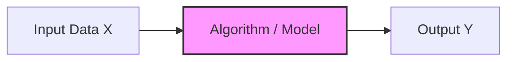

Making the learned transformation explicit, the model embodies the function $f$, and its output is a prediction:

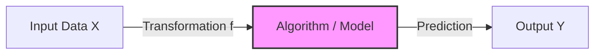

### The data structure

Data is typically organized in a structured tabular format — the dataset, or **BDD** (*Base de Données*, French for database). Two vectors make up such a table:

1. **Vector $X$ (inputs):** also known as **descriptors**, **features**, **explanatory variables**, or **independent variables**. This is the information we observe and measure — a patient's blood sugar level or iron level in blood, the pixel intensity of an image, the square footage of a house.
2. **Vector $Y$ (outputs):** also known as **labels**, **targets**, **responses**, or **dependent variables** — the "correct response" we want the machine to predict. Examples: the diagnosis (Sick/Healthy), the object name (Cat/Dog), the price of the house, the disease type.

## The role of the human expert

In the initial phase of creating a dataset — specifically for supervised learning — humans play a critical role. The "ground truth" is established by humans: the machine does not create knowledge from thin air, it mimics human expertise. The workflow of knowledge transfer runs as follows:

1. **Observation:** we collect raw data (e.g., X-ray images, medical symptoms).
2. **Labeling:** an **expert** (e.g., a radiologist or a doctor) analyzes the data and assigns the correct label ($Y$) — the correct diagnosis.
3. **Database creation:** the labeled data forms the BDD (Base de Données) or dataset used to train the descriptor and algorithm.
4. **Training:** the algorithm analyzes the pairs $(X, Y)$ to learn the logic used by the expert.
5. **Prediction:** the algorithm applies that logic to new $X$ data where the expert is not present.

> [!TIP] Exam insight
> Never forget that the "ground truth" — the correct answers in a training set — comes from human experts initially; the machine only tries to mimic this expert logic. The quality of a machine learning model is capped by the quality of the data labeled by the expert: if the expert makes mistakes, the model will learn those mistakes. This is often referred to as "Garbage In, Garbage Out."

## The taxonomy of learning algorithms

Machine learning is strictly categorized based on the *nature of the data* available during the training phase. The two principal families — supervised and unsupervised learning — and their main sub-categories are summarized below; [[Types of Learning]] develops this taxonomy in full detail.

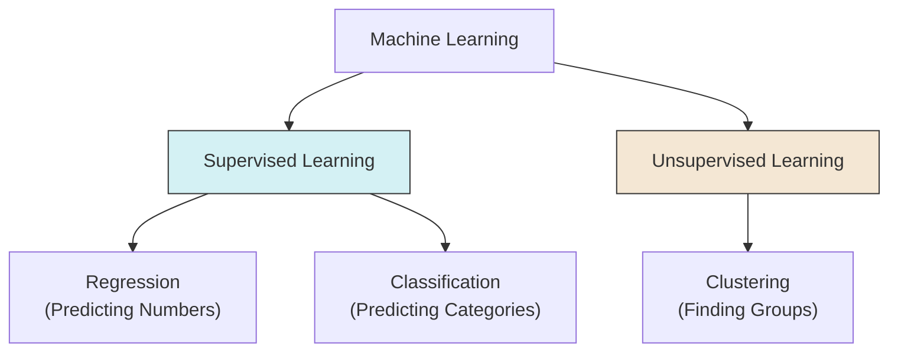

### Supervised learning (apprentissage supervisé)

In supervised learning, the model is trained on a **labeled dataset**. This is akin to a student learning with a teacher who provides the answer key. The key characteristics are:

- **Input ($X$):** known.
- **Output ($Y$):** **known** and provided during training.
- **Goal:** learn the mapping $Y \approx f(X)$ to predict $Y$ for future unseen $X$.

Supervised learning splits into two sub-categories according to the type of output being predicted.

#### Regression

- **Output:** a continuous numerical value (quantitative).
- **Examples:** predicting temperature ($24.5^\circ C$), predicting a house price ($350,000), predicting stock market value.
- **Algorithms:** Linear Regression, Non-Linear Regression, Neural Networks (output layer linear).

#### Classification

- **Output:** a discrete class or category (qualitative).
- **Examples:** Spam vs. Not Spam, Benign vs. Malignant, handwriting recognition (0-9).
- **Algorithms:** Logistic Regression, SVM, KNN, Neural Networks (output layer Softmax).

### Unsupervised learning (apprentissage non supervisé)

In unsupervised learning, the model is trained on an **unlabeled dataset**. There is no teacher, and there are no "correct answers." The key characteristics are:

- **Input ($X$):** known.
- **Output ($Y$):** **unknown / non-existent**.
- **Goal:** discovery of structure. The algorithm looks for patterns, groupings, or densities within $X$.

The primary task is **clustering** (*regroupement*): grouping data points such that points in the same group are more similar to each other than to points in other groups. The classic algorithm example is **K-Means**, and the process is that the algorithm *proposes* the groups ($Y$) based on data proximity — the grouping itself is the output the machine invents.

### The medical diagnosis example

To fully grasp the difference between the two families, consider a medical table containing patient data:

| Descriptors ($X$) | | | Label ($Y$) |
| :--- | :---: | :---: | :--- |
| **Sugar Level** | **Iron Level** | ... | **Disease Type** |
| High | Low | ... | *Sick (Type A)* |
| Normal | Normal | ... | *Healthy* |
| High | High | ... | *Sick (Type B)* |

The two approaches read this table in fundamentally different ways:

1. **Supervised view (classification):** during training you feed the computer the **Sugar**, **Iron**, AND the **Disease Type**. The computer learns the logic: *"If Sugar is High and Iron is Low, the output should be Type A."* The use case: a new patient arrives, we measure Sugar/Iron, and the model predicts "This patient has Type A."
2. **Unsupervised view (clustering):** during training you feed the computer **only** the **Sugar** and **Iron** levels — you **hide** the Disease Type column. The computer analyzes the data geometry and says: *"I noticed that Patient 1 and Patient 3 have very similar strange blood levels. I will put them in 'Group 1'. Patient 2 looks different, so they go in 'Group 2'."* The result: it discovers distinct groups of patients, but it cannot name the disease — it just knows the groups are mathematically similar.

> [!WARNING] Common pitfall
> Do not confuse **Clustering** with **Classification**.
> - **Classification:** you define the classes beforehand (e.g., "Cats" and "Dogs").
> - **Clustering:** the machine invents the classes based on similarity (e.g., "Group 1" and "Group 2").

## Data management and generalization

The ultimate goal of machine learning is not to memorize data, but to **generalize**. Generalization is the ability of a model to perform accurately on new, unseen data. Everything in this section — splitting, overfitting control, cross-validation — exists to measure and protect that ability.

### The dataset split strategy

To ensure a model can generalize, we never train and test on the same data. This would be like giving a student the exam questions to study: they would score 100% but learn nothing (memorization). We typically split the full dataset into three distinct subsets:

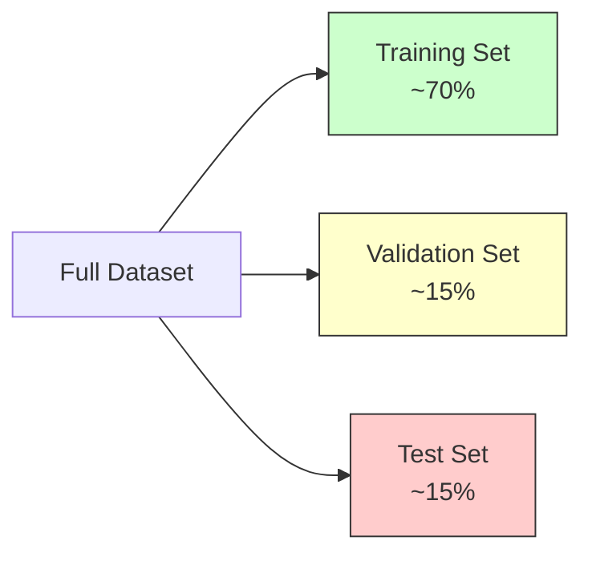

1. **Training set (70%):** used to "teach" the model. The algorithm sees $X$ and $Y$, calculates errors, and updates its internal parameters (weights/biases).
2. **Validation set (15%):** used for **model selection** and **hyperparameter tuning**. It is used *during* training to check performance: if the model does well on training but badly on validation, we are overfitting. We use this set to choose parameters like $K$ in KNN or the learning rate in neural networks.
3. **Test set (15%):** used for final evaluation. It is used **only once** at the very end, acting as the "final exam" to report the real-world accuracy of the model.

> [!DANGER] Critical rule
> **Never** use the test set for training or tuning. If you peek at the test set to adjust your model, you commit **Data Leakage**, and your reported accuracy will be fake.

### Overfitting vs. underfitting (the bias-variance tradeoff)

Two failure modes bracket good generalization:

- **Underfitting (high bias):** the model is too simple to capture the underlying structure of the data. Symptoms: poor performance on training data AND poor performance on validation data. Example: trying to fit a complex curve with a straight line. Solution: use a more complex model (e.g., add layers to an ANN, use polynomial regression).
- **Overfitting (high variance):** the model is too complex. It memorizes the "noise" and random fluctuations in the training data rather than the pattern. Symptoms: amazing performance on training data (near 100%), but terrible performance on validation data. Example: connecting every single dot in a scatter plot with a jagged line. Solution: get more data, simplify the model, use regularization, or stop training earlier (early stopping).

The deeper theory behind this tension lives in [[Bias Variance Tradeoff]], and the remedies in [[Regularization Techniques]].

### Cross-validation for robust evaluation

When the dataset is small, splitting off 30% for validation/testing might leave too little data for training. Cross-validation solves this. **K-fold cross-validation** works as follows:

1. Divide the dataset into $K$ equal parts (folds).
2. **Iteration 1:** train on Folds 1-4, test on Fold 5.
3. **Iteration 2:** train on Folds 1, 2, 3, 5, test on Fold 4.
4. ...Repeat $K$ times.
5. **Result:** the final score is the **average** of all $K$ iterations.

This ensures that every data point has been used for testing exactly once, providing a statistically robust estimate of model performance.

## The train-validation-test split

In supervised learning, datasets are commonly split into **three disjoint parts**, each serving a distinct purpose in the model development process. The typical proportions are visualized below.

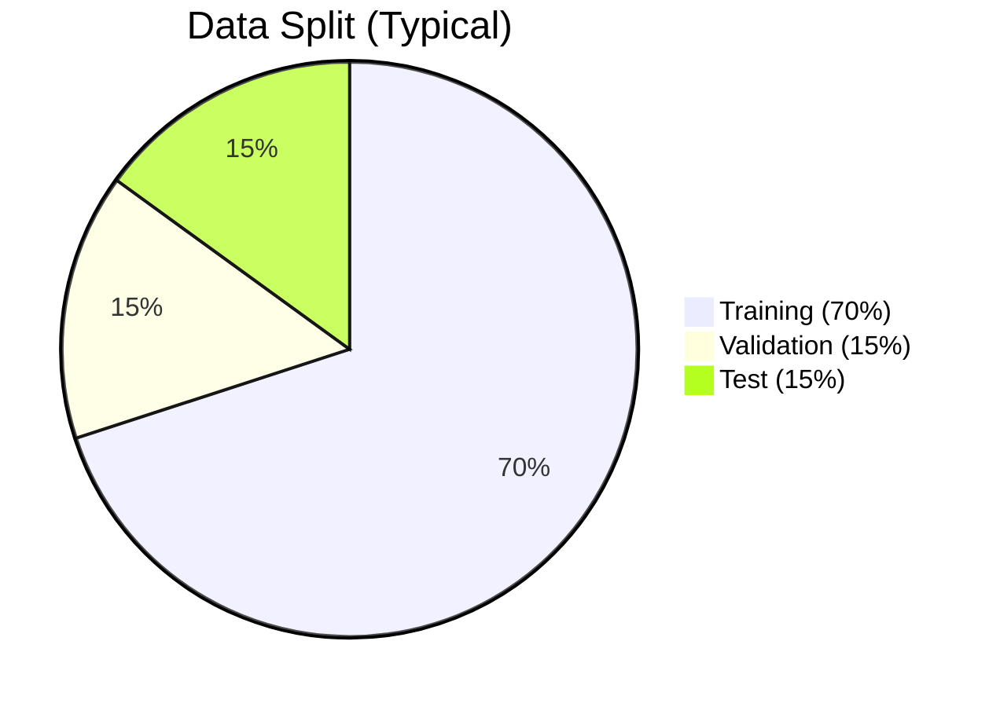

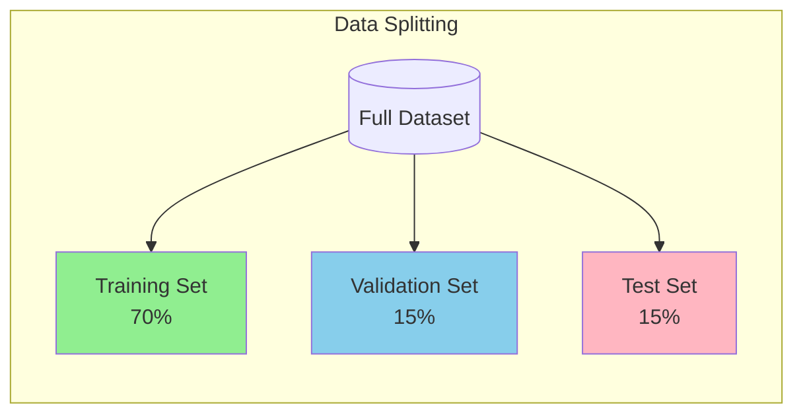

### The training set (70%)

The training set is where learning actually happens, one batch at a time:

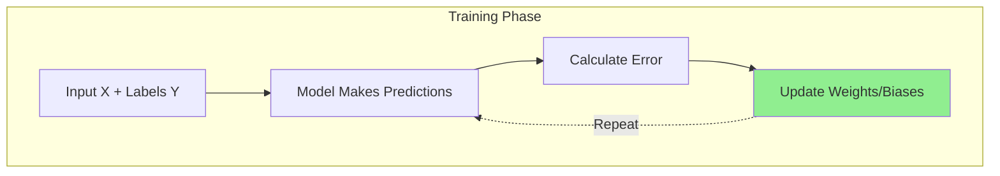

| Aspect | Details |
|--------|---------|
| **Purpose** | Used to "teach" the model |
| **Action** | Algorithm sees X and Y, calculates errors, updates parameters |
| **What It Does** | The model **learns** patterns from this data |

**Key point:** this is where the model's weights and biases are adjusted through optimization (like [[Gradient Descent]]).

### The validation set (15%)

The validation set is consulted during training, and its readings drive decisions:

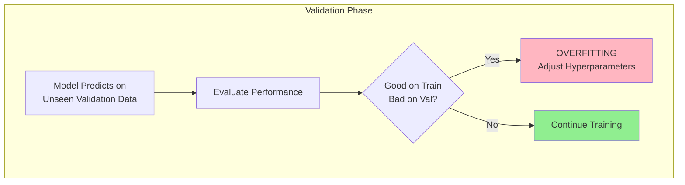

| Aspect | Details |
|--------|---------|
| **Purpose** | **Model Selection** and **Hyperparameter Tuning** |
| **Action** | Used *during* training to check performance |
| **What It Does** | Detects overfitting, guides hyperparameter choices |

The classic overfitting signature is a large train/validation gap:

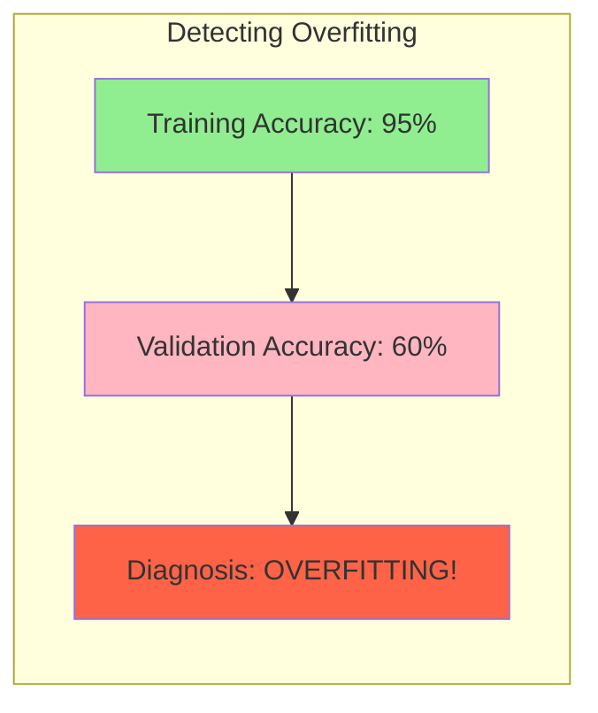

**If model performs well on Training but poorly on Validation → OVERFITTING.**

Concretely, validation is where hyperparameter candidates get compared:

| Hyperparameter | Example Values to Try |
|----------------|----------------------|
| K in KNN | 3, 5, 7, 9, 11 |
| Learning Rate | 0.001, 0.01, 0.1 |
| Number of Trees (Random Forest) | 50, 100, 200 |
| Max Depth | 5, 10, 20, None |
| Number of Epochs | Early stopping when val loss increases |

### The test set (15%) and the golden rule

The test set is touched exactly once, after training is complete:

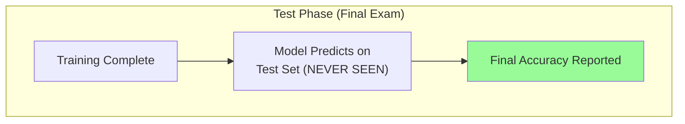

| Aspect | Details |
|--------|---------|
| **Purpose** | **Final Evaluation** |
| **Action** | Used **only once** at the very end |
| **What It Does** | Acts as the "Final Exam" for real-world accuracy |

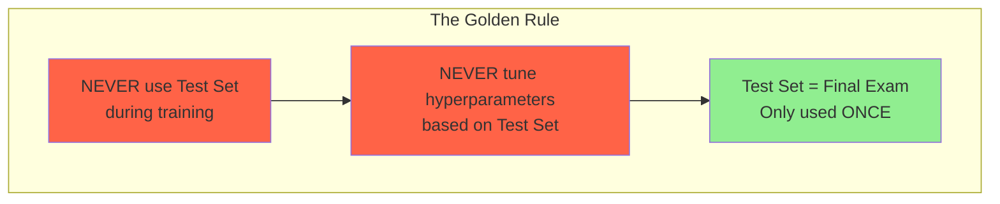

**If you use the test set to tune your model, you're cheating!** The test set should represent truly unseen data.

## The validation step

### What the validation step is

The **validation step** is the phase where the current version of the trained model is evaluated on unseen data (the validation set) **without updating parameters**:

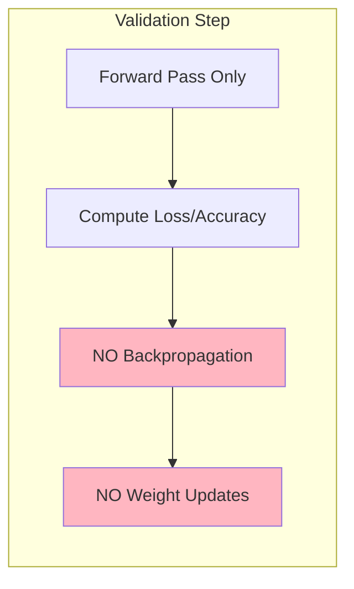

**Formally:**

- No backpropagation
- No weight updates
- No gradient computation
- Only forward pass + metric computation

**Its role is diagnostic and regulatory, not learning.** It is not part of learning the weights; it is part of **learning how to train the model correctly**.

### What happens during each epoch

A full training epoch pairs the two phases:

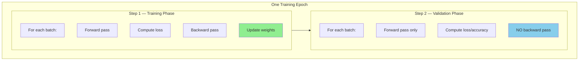

After every epoch, you get:

- Training Loss
- Training Accuracy
- Validation Loss
- Validation Accuracy

These values are tracked over time.

### Why the validation step exists

#### Detecting overfitting

The canonical overfitting pattern shows training loss falling while validation loss climbs:

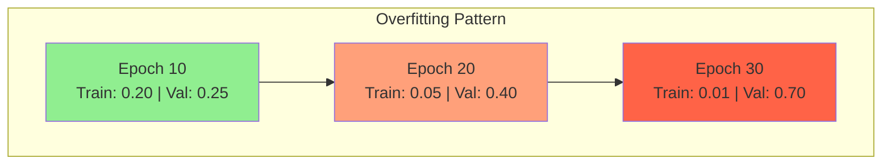

| Epoch | Train Loss | Val Loss | Interpretation |
|-------|------------|----------|----------------|
| 10 | 0.20 | 0.25 | Good |
| 20 | 0.05 | 0.40 | Starting to overfit |
| 30 | 0.01 | 0.70 | Severe overfitting |

**Interpretation:**

- Model keeps improving on training
- Gets worse on validation
- Means: **memorizing, not generalizing**

**Without validation, you would never see this.**

#### Hyperparameter selection

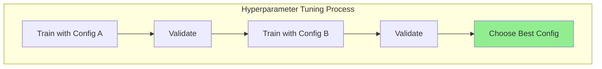

**Hyperparameters cannot be learned by gradient descent.** They must be chosen by an outer loop around training:

| Hyperparameter | What It Controls |
|----------------|------------------|
| Learning Rate | Step size in optimization |
| Batch Size | Samples per gradient update |
| Number of Layers | Network depth |
| K in KNN | Number of neighbors |
| Regularization Strength | Penalty on complexity |
| Dropout Rate | Fraction of neurons to drop |

**Process:**

1. Train model with config A → Validate
2. Train model with config B → Validate
3. Choose best config based on validation performance

**Validation set decides.**

#### Early stopping

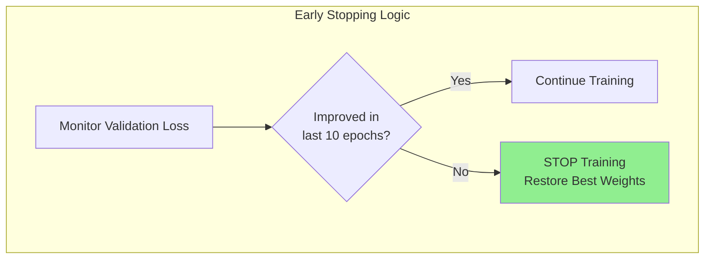

**Rule example:** if validation loss does not improve for 10 epochs, stop training. This prevents over-training and automatically selects the best epoch.

### Training vs. validation vs. test

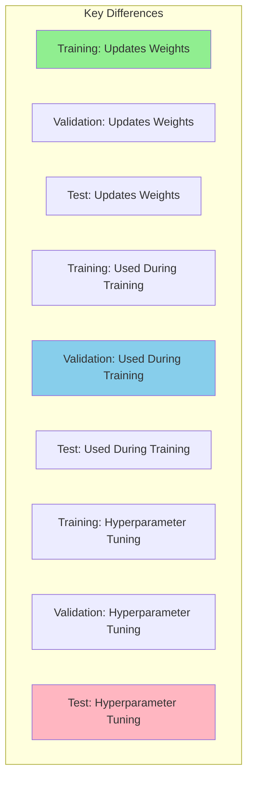

| Property | Training | Validation | Test |
|----------|----------|------------|------|
| **Updates Weights** | Yes | No | No |
| **Used During Training** | Yes | Yes | No |
| **Hyperparameter Tuning** | No | Yes | No |
| **Performance Reporting** | No | No | Yes |
| **Seen by Model** | Yes | Indirectly | Never |

**Important:** the model **never learns directly from validation**, but training decisions depend on it.

### The mathematical view

Let:

- θ = model parameters (weights)
- λ = hyperparameters

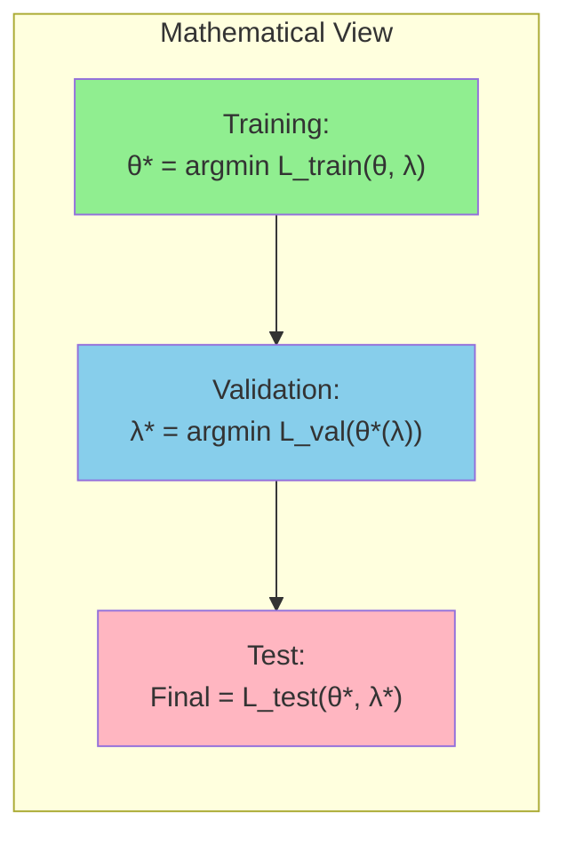

**Meaning:**

- **Training** optimizes θ (weights)
- **Validation** optimizes λ (hyperparameters)
- **Test** evaluates the final model

### Cross-validation vs. a fixed validation set

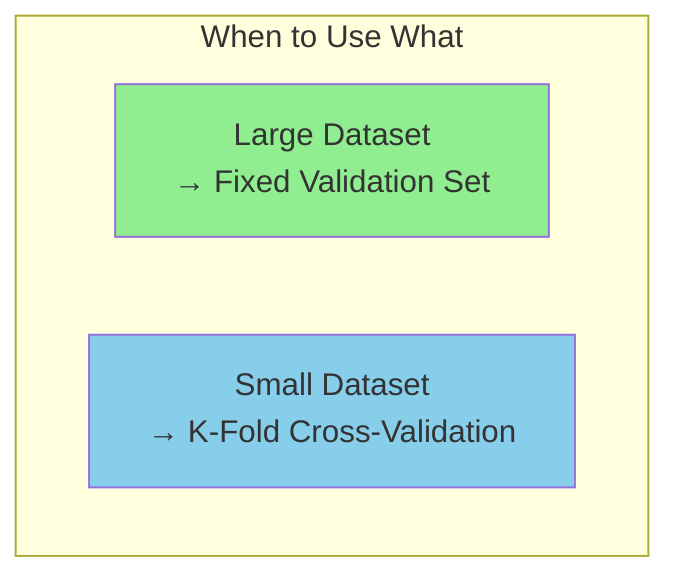

When you don't have enough data, instead of a fixed validation set, use **K-fold cross-validation**: split the data into K folds, rotate which fold is validation, and average the results across all folds. This replaces a static validation set when data is limited.

### Common mistakes

**Mistake 1: tuning on the test set.**

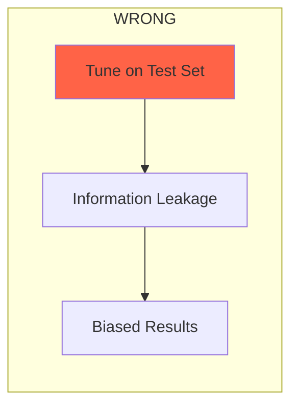

If you tune using test data, you leak information, the result is biased, and it is not publishable.

**Mistake 2: training on validation later.** Sometimes people merge train + validation after tuning. This is allowed **only after all decisions are finished**.

```mermaid
flowchart LR
    subgraph Caution[" Caution"]
        C1["Merging Train + Val<br/>after tuning"]
        C2["Allowed ONLY after<br/>ALL decisions finished"]
    end
    
    C1 --> C2
    
    style C2 fill:#FFA07A
```

**Mistake 3: ignoring validation curves.**

```mermaid
flowchart TB
    subgraph Always[" Always Plot"]
        A1["Train vs Val Loss"]
        A2["Train vs Val Accuracy"]
    end
    
    style A1 fill:#90EE90
    style A2 fill:#90EE90
```

Only looking at final accuracy hides overfitting. **Always plot curves over time.**

### Mental model and analogies

```mermaid
mindmap
    root((ML Process))
        Training
            Learning
            Updates weights
            Like studying
        Validation
            Supervision
            Checks if learning correctly
            Like practice exams
        Test
            Certification
            Final proof
            Like final exam
```

| Phase | Analogy | Purpose |
|-------|---------|---------|
| **Training** | Learning / Studying | Makes you better |
| **Validation** | Supervision / Practice Exams | Checks if you're learning correctly |
| **Test** | Certification / Final Exam | Proves your ability |

The same analogy in student terms:

| Set | Student Analogy |
|-----|-----------------|
| **Training** | Textbook, notes, practice problems (student learns from these) |
| **Validation** | Practice exams (check understanding, adjust study methods) |
| **Test** | Final exam (never seen before, real measure of knowledge) |

### Why validation matters

> Validation is one of the most underestimated parts of ML.

Many "good" models are actually:

- Overfit models with bad validation discipline
- Poorly tuned models with no early stopping
- Models optimized on leaked test data

**A clean validation pipeline matters more than fancy architectures.** **If validation is wrong, your results are meaningless.**

A compact side-by-side summary:

| Set | Purpose | When Used | Can Model "See" It? |
|-----|---------|-----------|---------------------|
| **Training** | Learn patterns | Throughout training | Yes (weights updated) |
| **Validation** | Tune & detect overfitting | During training | No (only evaluation) |
| **Test** | Final evaluation | Once at the end | No (final exam) |

### Common split ratios

| Ratio | When to Use |
|-------|-------------|
| **70/15/15** | Standard, balanced approach |
| **80/10/10** | Large datasets, less need for validation |
| **60/20/20** | Small datasets, need more validation reliability |
| **98/1/1** | Very large data (millions of samples) |

### The complete workflow

```mermaid
flowchart TB
    subgraph Workflow["ML Development Workflow"]
        Start[("Full Dataset")]
        
        Start --> Split["Split Data<br/>70/15/15"]
        
        Split --> Train["Training Set"]
        Split --> Val["Validation Set"]
        Split --> Test["Test Set"]
        
        Train --> Learn["Train Model<br/>(Update Weights)"]
        Val --> Check["Validate<br/>(Check Overfitting)"]
        
        Check --> Tune["Tune Hyperparameters"]
        Tune --> Learn
        
        Learn --> Done["Training Complete"]
        Done --> Final["Evaluate on Test Set<br/>(Final Score)"]
    end
    
    style Final fill:#90EE90
```

And the quick memory aid:

| Set | Purpose | Remember As |
|-----|---------|-------------|
| **Training** | Learn | "Textbook" - model learns here |
| **Validation** | Tune | "Practice Exam" - adjust hyperparameters |
| **Test** | Evaluate | "Final Exam" - used ONCE for final score |

**Training = Learn | Validation = Tune | Test = Final Score**

## Cross-validation (K-fold)

**Cross-validation** is a technique to evaluate model performance by splitting data into multiple training/validation sets.

### The K-fold visual

```mermaid
block-beta
    columns 5
    
    block:fold1
        A1["TEST"]
        A2["TRAIN"]
        A3["TRAIN"]
        A4["TRAIN"]
        A5["TRAIN"]
    end
    
    block:fold2
        B1["TRAIN"]
        B2["TEST"]
        B3["TRAIN"]
        B4["TRAIN"]
        B5["TRAIN"]
    end
    
    block:fold3
        C1["TRAIN"]
        C2["TRAIN"]
        C3["TEST"]
        C4["TRAIN"]
        C5["TRAIN"]
    end
    
    block:fold4
        D1["TRAIN"]
        D2["TRAIN"]
        D3["TRAIN"]
        D4["TEST"]
        D5["TRAIN"]
    end
    
    block:fold5
        E1["TRAIN"]
        E2["TRAIN"]
        E3["TRAIN"]
        E4["TRAIN"]
        E5["TEST"]
    end
```

**Final Score = Average of all 5 fold scores**

### How it works

```mermaid
flowchart LR
    A[Full Dataset] --> B[Split into K parts]
    B --> C[Train on K-1 folds]
    C --> D[Validate on 1 fold]
    D --> E[Repeat K times]
    E --> F[Average all scores]
    
    style F fill:#90EE90
```

1. **Split data into K equal parts** (folds)
2. **Train on K-1 folds**, validate on 1 fold
3. **Repeat K times**, each fold used as validation once
4. **Average all K scores** for final evaluation

### Why use cross-validation?

| Benefit | Explanation |
|---------|-------------|
| **More Reliable Evaluation** | Uses all data for validation eventually |
| **Detects Overfitting** | High variance across folds indicates overfitting |
| **Better for Small Data** | Maximizes use of limited data |
| **Hyperparameter Tuning** | More robust than single train/test split |

### Choosing K

```mermaid
graph LR
    K5["K=5<br/> Recommended"] --- K10["K=10<br/>More thorough"]
    K10 --- KN["K=N<br/>Leave-One-Out"]
    
    style K5 fill:#90EE90
    style K10 fill:#98FB98
    style KN fill:#FFA07A
```

| K Value | Use Case |
|---------|----------|
| **K=5** | Standard choice, good balance |
| **K=10** | More thorough, more computation |
| **K=N** (Leave-One-Out) | Maximum accuracy, very expensive |

### Stratified K-fold

For **imbalanced datasets**, use Stratified K-Fold to maintain class distribution:

```mermaid
flowchart TB
    subgraph Regular["Regular K-Fold (Imbalanced Data)"]
        R1["Fold 1: 80% Class A, 20% Class B"]
        R2["Fold 2: 60% Class A, 40% Class B"]
        R3["Fold 3: 90% Class A, 10% Class B"]
    end
    
    subgraph Stratified["Stratified K-Fold (Balanced)"]
        S1["Fold 1: 70% Class A, 30% Class B"]
        S2["Fold 2: 70% Class A, 30% Class B"]
        S3["Fold 3: 70% Class A, 30% Class B"]
    end
    
    Regular --> Stratified
    
    style R2 fill:#FFA07A
    style R3 fill:#FFB6C1
    style S1 fill:#90EE90
    style S2 fill:#90EE90
    style S3 fill:#90EE90
```

### Python example

```python
from sklearn.model_selection import cross_val_score, KFold
from sklearn.ensemble import RandomForestClassifier

# Set up K-Fold
kf = KFold(n_splits=5, shuffle=True, random_state=42)

# Perform cross-validation
model = RandomForestClassifier()
scores = cross_val_score(model, X, y, cv=kf, scoring='accuracy')

print(f"Fold scores: {scores}")
print(f"Mean accuracy: {scores.mean():.3f}")
print(f"Standard deviation: {scores.std():.3f}")
```

Stratified version:

```python
from sklearn.model_selection import StratifiedKFold

skf = StratifiedKFold(n_splits=5, shuffle=True, random_state=42)
scores = cross_val_score(model, X, y, cv=skf)
```

### Cross-validation vs. a single split

```mermaid
flowchart TB
    subgraph Single["Single Train/Test Split"]
        ST[One evaluation] --> SR["Result may be lucky/unlucky"]
    end
    
    subgraph CV["K-Fold Cross-Validation"]
        CT[K evaluations] --> CR["Reliable average score"]
    end
    
    style SR fill:#FFA07A
    style CR fill:#90EE90
```

**Cross-validation** = Rotate test data → Reliable scores → Use K=5 or K=10

## Evaluation metrics and the confusion matrix

In classification problems, "accuracy" is often a misleading metric. To truly understand how a model performs, we use the **confusion matrix**.

### The confusion matrix structure

The matrix compares the **predicted class** against the **actual class** (ground truth). Scenario: detecting a disease (Positive = Sick, Negative = Healthy).

| | **Predicted: Positive (1)** | **Predicted: Negative (0)** |
| :--- | :---: | :---: |
| **Actual: Positive (1)** | **TP** (True Positive) | **FN** (False Negative) |
| **Actual: Negative (0)** | **FP** (False Positive) | **TN** (True Negative) |

- **TP (True Positive):** the patient is Sick, and the model correctly predicted Sick (success).
- **TN (True Negative):** the patient is Healthy, and the model correctly predicted Healthy (success).
- **FP (False Positive):** the patient is Healthy, but the model predicted Sick. Also known as **Type 1 Error** ("False Alarm").
- **FN (False Negative):** the patient is Sick, but the model predicted Healthy. Also known as **Type 2 Error** ("Missed Detection").

> [!TIP] Danger of errors
> In medicine, a **Type 2 Error (FN)** is usually more dangerous than a Type 1 Error. Missing a sick patient means they don't get treatment. Falsely diagnosing a healthy patient (FP) just leads to more tests.

### Calculated metrics

From the four values in the matrix, we derive specific metrics.

**Accuracy** — how often is the model correct overall?

- **Formula:** $\frac{TP + TN}{Total}$
- **Flaw:** if 99% of patients are healthy, a model that *always* predicts "Healthy" has 99% accuracy but is useless at finding sick people.

**Precision** — when the model claims a patient is sick, how confident can we be?

- **Formula:** $\frac{TP}{TP + FP}$
- **Focus:** minimizing false positives.
- **Use case:** email spam filters (you don't want to lose important emails in the spam folder).

**Recall (sensitivity)** — out of all the actually sick people, what percentage did we find?

- **Formula:** $\frac{TP}{TP + FN}$
- **Focus:** minimizing false negatives.
- **Use case:** cancer detection, security screenings.

**F1-score** — the harmonic mean of precision and recall.

- **Formula:** $2 \times \frac{Precision \times Recall}{Precision + Recall}$
- **Usage:** the go-to metric when you have **imbalanced classes**. It punishes the model if *either* precision or recall is low.

**Specificity** — the ability to correctly reject healthy patients.

- **Formula:** $\frac{TN}{TN + FP}$

### Multi-class extension

If you have 3 classes (Cat, Dog, Horse), the logic remains the same but is calculated per class. To calculate precision for "Dog":

1. **TP:** actual Dog predicted as Dog.
2. **FP:** Cat or Horse predicted as Dog.
3. **FN:** actual Dog predicted as Cat or Horse.
4. Apply the standard formulas.

A much deeper treatment of these metrics — and the ROC, calibration, and ranking diagnostics beyond them — lives in [[Model Evaluation Metrics]].

## Hyperparameter tuning

### What is a hyperparameter?

A **hyperparameter** is a configuration setting that is set **before** the training process begins and is **not learned** from the data. Unlike model parameters (like weights and biases in neural networks), hyperparameters control the learning process itself.

| Aspect | Parameter | Hyperparameter |
|--------|-----------|----------------|
| **When Set** | During training | Before training |
| **Learned From** | Data | Not learned from data |
| **Examples** | Weights, biases | Learning rate, K in KNN |
| **Control** | Model behavior | Learning process |

### Common hyperparameters by algorithm

**K-Nearest Neighbors (KNN):**

- **K** (number of neighbors)
- Distance metric (Euclidean, Manhattan)

**Support Vector Machines (SVM):**

- **C** (regularization parameter)
- **Gamma** (kernel coefficient)
- Kernel type (linear, RBF, polynomial)

**Neural networks:**

- **Learning rate**
- Number of hidden layers
- Number of neurons per layer
- Batch size
- Number of epochs
- Dropout rate
- Activation functions

**Decision trees & random forests:**

- Max depth
- Min samples split
- Number of trees (for Random Forest)

For the neural-network specifics in context, see [[05 - Neural Network Foundations/Training Dynamics and Stability/Hyperparameters and Network Configuration|Hyperparameters and Network Configuration]].

### Why tuning matters

The choice of hyperparameters significantly impacts:

1. **Model performance:** poor choices lead to underfitting or overfitting.
2. **Training speed:** some settings affect convergence time.
3. **Generalization:** proper tuning helps the model work well on unseen data.

### Tuning methods

**Grid search** exhaustively tries all combinations of hyperparameter values from a predefined grid:

```python
from sklearn.model_selection import GridSearchCV

param_grid = {
    'n_estimators': [50, 100, 200],
    'max_depth': [None, 10, 20]
}

grid_search = GridSearchCV(model, param_grid, cv=5)
grid_search.fit(X_train, y_train)
```

**Random search** randomly samples hyperparameter combinations from specified distributions:

```python
from sklearn.model_selection import RandomizedSearchCV

param_distributions = {
    'n_estimators': [50, 100, 200, 500],
    'max_depth': [None, 10, 20, 30, 50]
}

random_search = RandomizedSearchCV(model, param_distributions, n_iter=10, cv=5)
random_search.fit(X_train, y_train)
```

**Bayesian optimization** uses probabilistic models to guide the search toward promising hyperparameter regions. It is more efficient than grid/random search and learns from previous evaluations. Tools: Optuna, Hyperopt, Ray Tune.

**Manual tuning** is domain knowledge-based selection and iterative refinement.

### Best practices

1. **Use cross-validation:** always evaluate hyperparameters using CV to avoid overfitting.
2. **Start simple:** begin with a coarse grid, then refine.
3. **Prioritize:** focus on hyperparameters with the most impact first.
4. **Track experiments:** use tools like MLflow, Weights & Biases.
5. **Consider compute:** balance thoroughness with computational resources.

### Example: learning rate impact

| Learning Rate | Effect |
|---------------|--------|
| Too High | Overshooting, divergence |
| Too Low | Slow convergence, stuck in local minima |
| Optimal | Fast, stable convergence |

In summary: hyperparameters are pre-training configuration settings; they **control** how the model learns, not what it learns; tuning is the process of finding optimal values; and the main methods are grid search, random search, and Bayesian optimization.

## See also

- [[Foundations MOC]]
- [[Types of Learning]]
- [[AI vs ML vs DL]]
- [[History and Evolution of AI]]
- [[01 - Foundations/AI ML and DL Hierarchy/Applications of Deep Learning|Applications of Deep Learning]]
- [[Data Science Definition and Philosophy]]
- [[Probability and Statistics for ML]]
- [[Mathematical Notation]]
- [[Machine Learning MOC]]
- [[04 - Machine Learning/Regression/Linear Regression|Linear Regression]]
- [[04 - Machine Learning/Regression/Logistic Regression|Logistic Regression]]
- [[K-Nearest Neighbors]]
- [[Support Vector Machines]]
- [[Decision Trees]]
- [[Random Forests and Bagging]]
- [[Clustering]]
- [[Model Evaluation Metrics]]
- [[Bias Variance Tradeoff]]
- [[Regularization Techniques]]
- [[Gradient Descent]]
- [[Loss Functions]]
- [[Artificial Neural Networks]]
- [[05 - Neural Network Foundations/Training Dynamics and Stability/Hyperparameters and Network Configuration|Hyperparameters and Network Configuration]]
