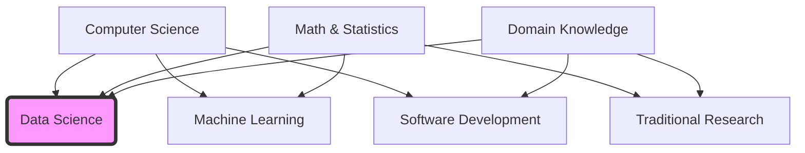

Data science is an interdisciplinary field that uses scientific methods, processes, algorithms, and systems to extract knowledge and insights from data — whatever form that data arrives in. This note gives the core definition, the three-domain intersection the field sits on, the structured/unstructured data distinction every practitioner must handle, and the four question levels that define the discipline's goal. It anchors [[Foundations MOC]] within the data-science foundations subfamily and sets up the workflow, pillars, and skills notes that follow.

## Core definition

**Data science** is an interdisciplinary field that utilizes scientific methods, processes, algorithms, and systems to extract knowledge and insights from data. It accepts data in various forms — both **structured** (e.g., database tables, Excel sheets) and **unstructured** (e.g., text, images, video) — and transforms it into actionable intelligence.

> [!info] Formal definition
> "Data science is the study of the generalizable extraction of knowledge from data."
> — Dhar, V. (2013). *Data science and prediction.*

At its core, data science is about **automating insight**. It moves beyond simple observation ("What happened?") to prediction and prescription ("What will happen?" and "What should we do?").

## The interdisciplinary intersection

Data science is not a standalone subject; it sits at the intersection of three primary domains. The relationship is often visualized using a Venn diagram:

Each parent domain contributes something the others cannot:

1. **Computer science** provides the tools for data storage, processing speed, algorithmic efficiency, and software engineering.
2. **Math and statistics** provide the theoretical rigor, probability models, and inference techniques required to validate findings.
3. **Domain knowledge** provides contextual understanding of the specific industry (e.g., Healthcare, Finance) to ensure the analysis is relevant and actionable.

The diagram also shows the neighboring intersections: computer science plus math and statistics yields machine learning (see [[Introduction to Machine Learning]]); math and statistics plus domain knowledge is the territory of traditional research; computer science plus domain knowledge is software development. Data science is the region where all three overlap — the same three-way split that [[The Four Pillars of Data Science]] expands into a four-pillar competency model.

## Structured vs unstructured data

A data scientist must be comfortable working with two fundamental types of data:

| Feature | **Structured Data** | **Unstructured Data** |
| :--- | :--- | :--- |
| **Format** | Highly organized, rows & columns (Tabular). | No pre-defined format. |
| **Storage** | Relational Databases (SQL), CSV, Excel. | Data Lakes, NoSQL, Folders (Images/PDFs). |
| **Examples** | Transaction logs, sensor readings, patient records. | Emails, social media posts, X-rays, audio files. |
| **Analysis Difficulty** | Low (Easy to query). | High (Requires advanced extraction techniques). |

Structured data is the tabular world — highly organized rows and columns living in relational databases, CSVs, and Excel sheets, which is exactly the shape that [[DataFrames]] are built to manipulate. It is easy to query, which is why its analysis difficulty is low. Unstructured data has no pre-defined format: emails, social media posts, X-rays, and audio files live in data lakes, NoSQL stores, or plain folders, and getting value out of them requires advanced extraction techniques. Real datasets mix both kinds — a hospital's patient records (structured) sit alongside its X-rays and clinical notes (unstructured).

## The goal of data science

The ultimate objective is not just to "process data," but to support **decision-making and automation**. That goal spans four question levels:

| Level | Question |
|---|---|
| **Descriptive** | What is the state of the world? |
| **Diagnostic** | Why did this happen? |
| **Predictive** | What will happen in the future? |
| **Prescriptive** | How can we make the best outcome happen? |

Descriptive and diagnostic work looks at the present and the past; predictive and prescriptive work looks forward and recommends action. The decision focus is what separates data science from plain reporting, and it is developed further in [[Data-Driven Decision Making]].

## See also

- [[Foundations MOC]]
- [[The Four Pillars of Data Science]]
- [[The Data Science Workflow]]
- [[Data-Driven Decision Making]]
- [[AI vs ML vs DL]]
- [[Introduction to Machine Learning]]
- [[Essential Skills for Data Science]]
