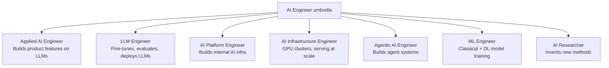

Data science is a team sport. Real projects are delivered by specialists whose skills overlap but whose missions, outputs, and daily tools differ — and the same job title can mean very different things at different companies. This note maps the profession at two levels and anchors [[Foundations MOC]] within the data-science foundations subfamily: first the classical data-ecosystem roles (analyst, scientist, engineer, ML engineer, business analyst), then the modern AI-engineer specialization map that splits the umbrella title "AI Engineer" into applied, LLM, platform, infrastructure, agentic, and research tracks. A worked exercise ties the maps to practice by matching scenarios to disciplines and project tasks to roles.

## Roles in the data ecosystem

A data project involves several specialized roles, each with a distinct focus. While the skills overlap, the primary responsibilities differ, and the fastest way to see how is side by side:

| Role | Focus Area | Primary Output | Key Tools |
| :--- | :--- | :--- | :--- |
| **Data Analyst** | Descriptive Analysis (Past/Present) | Dashboards, Reports, Insights | Excel, SQL, Tableau, Power BI |
| **Data Scientist** | Predictive Analysis (Future) | Models, Predictions, Algorithms | Python, R, Scikit-Learn, TensorFlow |
| **Data Engineer** | Infrastructure & Pipelines | Clean, Reliable Data flow | SQL, Spark, Hadoop, AWS/Azure |
| **ML Engineer** | Production & Scalability | Deployed APIs, Optimized Models | Docker, Kubernetes, MLOps, PyTorch |
| **Business Analyst** | Requirements & Strategy | Business Questions, KPIs | SQL, Excel, PowerPoint |

The nicknames attached to each role capture its center of gravity: one looks backward at what already happened, one looks forward to what will happen, one builds the pipes, one ships the model, and one translates between the business and the technical team.

### The data analyst, "the historian"

The analyst's mission is to answer "What happened?" and "Why did it happen?" — descriptive work on the past and present state of the business. A typical task is analyzing last quarter's sales to identify which region had the lowest performance. The output is dashboards, reports, and insights, built with tools such as Excel, SQL, Tableau, and Power BI.

### The data scientist, "the soothsayer"

The scientist's mission is to answer "What will happen?" and to use advanced math to find hidden patterns. A typical task is building a churn prediction model that identifies the customers likely to cancel their subscription next month. The output is models, predictions, and algorithms, developed in Python or R with libraries such as Scikit-Learn and TensorFlow.

### The data engineer, "the architect"

The engineer's mission is to build the "pipes" that move data from source to storage. They ensure the data is clean, available, and fast. A typical task is creating an automated pipeline (ETL) that pulls data from the website every hour and saves it to a data warehouse. The output is the clean, reliable data flow every other role depends on, built with SQL, Spark, Hadoop, and cloud platforms such as AWS or Azure.

### The machine learning engineer, "the builder"

The ML engineer's mission is to take the model built by the data scientist and make it work in the real world — production. A typical task is optimizing the churn model so it can process 1 million users in under 1 second and deploying it to a cloud server. The output is deployed APIs and optimized models, using Docker, Kubernetes, MLOps practices, and PyTorch.

### The business analyst, "the translator"

The business analyst's mission is to bridge the gap between the technical team and the business stakeholders. A typical task is translating the CEO's goal ("We need more money") into a data problem ("We need to increase customer retention by 5%"). The output is business questions and KPIs, worked out with SQL, Excel, and PowerPoint.

> [!info] The unicorn
> You may hear the term "Unicorn Data Scientist." This refers to a (rare) person who is expert in **all** of these areas: engineering, math, coding, and business strategy. Most companies hire teams rather than hunting for unicorns.

## Matching scenarios to disciplines

Before assigning roles, it helps to be able to tell the disciplines themselves apart — a dashboard is not a recommender system, and neither is a sensor fleet. The boundaries between Data Science, ML, AI, Big Data, and BI are drawn in [[AI vs ML vs DL]]; the drill is to decide which domain fits each scenario best:

| Scenario | Best fit | Reasoning |
|---|---|---|
| A dashboard shows last year's sales trends | Business Intelligence (BI) | It focuses on *descriptive* analysis of historical data ("last year") to report on what happened. |
| An app recommends products based on user behavior | Machine Learning (ML) | The system is "learning" user preferences from data to make predictions (recommendations). This is a recommender system. |
| Storing and processing terabytes of sensor data from IoT devices | Big Data | The keywords are "terabytes" (Volume) and "sensor data" (Velocity/Variety). This is an infrastructure/storage challenge. |
| An AI agent plays chess and learns strategies over time | Artificial Intelligence (AI) / Reinforcement Learning | The agent is making autonomous decisions to achieve a goal (winning) and simulating intelligent behavior. |
| A company wants to predict customer churn using historical data | Data Science (Predictive Analytics) | This involves the full lifecycle: cleaning data, analyzing it, and building a model to predict a future outcome (churn). |

## Assigning roles on a project

The same mapping skill applies at the role level. Take a hospital that wants to predict heart disease risk, and assign each task to the role that owns it — Data Analyst, Data Scientist, Data Engineer, ML Engineer, or Business Analyst. The tasks trace the full project arc described in [[The Data Science Workflow]]:

| Task | Role | Reasoning |
|---|---|---|
| Collect patient records from multiple hospital databases and prepare them for use | **Data Engineer** | This involves building pipelines (ETL), connecting to databases, and handling data infrastructure/architecture. |
| Build a predictive model using patient data to estimate heart disease risk | **Data Scientist** | This is the core modeling task — selecting features, choosing algorithms, and training the model. |
| Create a dashboard to show current statistics about patient risk factors | **Data Analyst** | This involves descriptive statistics and visualization to report on the *current state* of the data. |
| Deploy the predictive model so doctors can access it via a web application | **ML Engineer** | This involves taking the theoretical model and putting it into **production** (deployment, scalability, API integration). |
| Define the business question: "How can we reduce the number of undetected high-risk patients?" | **Business Analyst** | This role bridges the gap between hospital stakeholders and the tech team, translating business needs into data requirements. |

### Why a data engineer and an ML engineer cannot simply replace each other

Both roles write code, so it is tempting to treat them as interchangeable — they are not. A data engineer is focused on the **flow and storage** of data (SQL, pipelines, warehousing): they build the roads. An ML engineer is focused on the **deployment and optimization** of models (software engineering, APIs, latency): they build the cars that drive on those roads. While both code, their daily tools and objectives are fundamentally different — database architecture on one side, model serialization and serving on the other.

## The AI engineer umbrella

> [!info] TL;DR
> "AI Engineer" is an umbrella title covering several distinct specializations: Applied AI Engineer, LLM Engineer, AI Platform Engineer, AI Infrastructure Engineer, Agentic AI Engineer, ML Engineer, and AI Researcher. Knowing which one you're aiming for focuses your learning.

Where the ecosystem map above describes a classical project team, hiring in AI today is organized around a different split. "AI Engineer" is the umbrella, and underneath it sit specializations with genuinely different day-to-day work. The context for these titles — what the field and the stack they work on look like — is covered in [[What Is AI Engineering]] and [[The Modern AI Stack]].

### Applied AI engineer

Applied AI engineers build product features on top of LLMs — chatbots, copilots, RAG systems, classification, extraction, summarization. It is glue work between models, data, and product. The skills: Python, prompting, RAG, function calling, basic fine-tuning, evaluation, and full-stack awareness. The tools: LangChain/LangGraph, LlamaIndex, the OpenAI SDK, vector DBs, and HuggingFace. They work at almost every company adding AI features — startups, SaaS, and enterprise.

### LLM engineer

LLM engineers focus on the LLM itself — choosing models, fine-tuning (with [[13 - Training and Adaptation/Fine-Tuning/LoRA|LoRA]] and DPO), evaluating, and deploying. They go deeper on the model layer than the applied track. The skills: everything from applied, plus LoRA/QLoRA, DPO/RLHF, evaluation design, vLLM/TGI serving, and quantization. The tools: HuggingFace Transformers, PEFT, TRL, vLLM, and weights & biases. They work at AI-focused startups, model labs (Anthropic, OpenAI, Mistral), and large enterprises running custom models.

### AI platform engineer

Platform engineers build the internal platform that other AI engineers use — model registries, fine-tuning pipelines, evaluation infra, prompt management, model routing, and cost controls. The skills: distributed systems, Python, ML basics, Kubernetes, infrastructure-as-code, and API design. The tools: Kubernetes, Ray, BentoML, MLflow, and internal frameworks. They work at larger companies with many AI teams that need shared infrastructure.

### AI infrastructure engineer

Infrastructure engineers operate the GPU clusters and the serving infrastructure. Their problems sound like: how do we serve 50 concurrent Llama 70B requests on 8 H100s? How do we batch training jobs across nodes? The skills: CUDA, distributed systems, Linux, networking, GPU profiling, and deep PyTorch. The tools: the internals of [[14 - Inference and Production/Inference/vLLM|vLLM]], [[14 - Inference and Production/Inference/TensorRT-LLM|TensorRT-LLM]], Megatron, DeepSpeed, NCCL, and Triton. They work at AI labs, cloud providers (AWS, GCP, Azure), and GPU-as-a-service companies (Together, Modal, Replicate).

### Agentic AI engineer

Agentic engineers build systems where LLMs take actions via tools — customer support agents, coding assistants, research agents, and autonomous workflows. The skills: everything from applied, plus agent frameworks (LangGraph, OpenAI Agents SDK, PydanticAI, AutoGen), tool design, state management, and multi-agent patterns. The tools: LangGraph, the OpenAI Agents SDK, PydanticAI, CrewAI, MCP servers, and evaluation harnesses. They work at startups building agent products, enterprises automating workflows, and AI labs with agent teams.

### ML engineer

In this map, the ML engineer builds models for non-LLM tasks — recommendation systems, fraud detection, forecasting, computer vision, speech. LLMs may be included, but the focus is typically classical plus deep learning. The skills: classical ML (XGBoost and the like), deep learning (CNNs, RNNs, Transformers), feature engineering, model evaluation, and deployment. The tools: scikit-learn, XGBoost, PyTorch, TensorFlow, MLflow, and SageMaker. They work at tech companies, in finance, healthcare, and e-commerce — anywhere with structured-data ML.

Note the contrast with the ecosystem table earlier on this page: there, the ML engineer is the production and deployment specialist who takes the scientist's model to the real world; here, the ML engineer is the model builder for non-LLM problems, and serving at scale belongs to the platform and infrastructure tracks. Both usages are real — job titles are simply inconsistent across companies, which is exactly why the description matters more than the title.

### AI researcher

Researchers invent new methods — new architectures, training techniques, and alignment methods. They publish papers and may not ship products. The skills: math, ML theory, reading and writing papers, PyTorch, experimentation, and computational research. The tools: PyTorch, JAX, custom training frameworks, and papers with code. They work at AI labs (DeepMind, FAIR, OpenAI, Anthropic) and academic labs.

## Skill matrix

The specializations share one skill pool but weight it very differently. A rough matrix, where ● = aware, ●● = competent, ●●● = expert:

| Skill                       | Applied | LLM  | Platform | Infra | Agentic | ML   | Research |
|-----------------------------|---------|------|----------|-------|---------|------|----------|
| Python                      | ●●●     | ●●●  | ●●●      | ●●●   | ●●●     | ●●●  | ●●●      |
| Prompting                   | ●●●     | ●●●  | ●●       | ●     | ●●●     | ●    | ●        |
| RAG pipelines               | ●●●     | ●●   | ●●       | -     | ●●●     | -    | -        |
| Fine-tuning (LoRA/DPO)      | ●●      | ●●●  | ●●       | ●     | ●●      | ●●●  | ●●●      |
| Agent frameworks            | ●●      | ●    | ●●       | -     | ●●●     | -    | -        |
| Distributed systems         | ●       | ●    | ●●●      | ●●●   | ●       | ●    | ●        |
| CUDA / GPU internals        | -       | ●    | ●●       | ●●●   | -       | ●    | ●        |
| Math (LA / prob / calc)     | ●       | ●●   | ●        | ●     | ●       | ●●●  | ●●●      |
| ML theory                   | ●       | ●●   | ●        | ●     | ●       | ●●●  | ●●●      |
| Evaluation design           | ●●●     | ●●●  | ●●       | ●     | ●●●     | ●●●  | ●●       |
| Production / on-call        | ●●●     | ●●   | ●●●      | ●●●   | ●●      | ●●   | -        |

Python is the one expert-level skill across every track. Everything else is a matter of emphasis: prompting and RAG dominate the applied and agentic columns; distributed systems and CUDA/GPU internals dominate platform and infra; math and ML theory dominate the ML and research columns. Evaluation design is expert-level in the applied, LLM, agentic, and ML tracks, and production/on-call responsibility peaks in the applied, platform, and infra tracks — and is absent from research.

## Which role should you aim for

The right entry point depends on where you're starting from. A software engineer moving into AI should aim for **Applied AI Engineer**: it is the natural on-ramp — build on your existing SWE skills, then add prompting, RAG, and basic fine-tuning. An ML engineer moving into LLMs should aim for **LLM Engineer**: you already know ML, so the gap is the LLM-specific stack (LoRA, DPO, vLLM, eval). If you love distributed systems and performance, aim for **AI Infrastructure Engineer** — high demand and high pay, but it requires deep systems knowledge. If you love product and want to build cool stuff, **Applied AI Engineer** or **Agentic AI Engineer** gives maximum product impact. And if you love math and research, **AI Researcher** is the target — noting that most research jobs require a PhD or equivalent research experience.

## A day in the life

Three vignettes make the specializations concrete.

### Applied AI engineer at a SaaS startup

The morning starts with reviewing eval results from last night's model swap. Midday is spent adding a new tool to the support agent (function calling plus tests). The afternoon is pairing with product on a new "summarize thread" feature — building the prompt, the eval set, and the cost estimate.

### LLM engineer at a model lab

The morning is a DPO training run on a new preference dataset. Midday is spent debugging why the eval pipeline is producing noisy results. The afternoon is reading a new paper on a DPO variant and designing an experiment to test it.

### AI infra engineer at a cloud provider

The morning is spent investigating a multi-GPU training crash (an NCCL timeout). Midday is profiling vLLM serving on a new H100 cluster. The afternoon is writing a kernel-fusion patch for a quantized attention path.

## Why role clarity matters

Three observations about the market follow from the map. Job titles are inconsistent across companies, so always read the job description, not just the title. Specialization pays: "AI Engineer" is generalist, and specialists (infra, agentic, LLM) command higher compensation. And the field is moving fast — today's specialty can become table stakes, so keep breadth while deepening one area.

The implications for hiring and team composition are symmetric. When hiring, be precise about which specialization you need — "AI Engineer" is too vague. Most teams need a mix: at least one Applied engineer plus one LLM or Infra engineer for a serious AI product. Cross-training is valuable in both directions — an Applied engineer who understands infra can debug serving issues, and an Infra engineer who understands agents can build better serving for them.

## See also

- [[Foundations MOC]]
- [[What Is AI Engineering]]
- [[The Modern AI Stack]]
- [[Essential Skills for Data Science]]
- [[AI vs ML vs DL]]
- [[The Data Science Workflow]]
- [[Data-Driven Decision Making]]
- [[Introduction to Machine Learning]]
