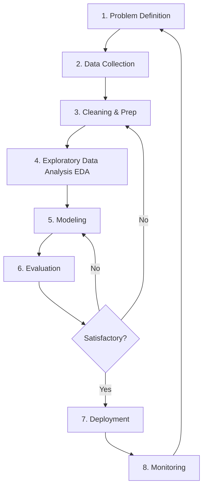

Data science is not a random exploration; it follows a systematic, iterative lifecycle often referred to as **CRISP-DM** (Cross-Industry Standard Process for Data Mining) or the generic Data Science Lifecycle. This note walks all eight steps of that lifecycle — problem definition, data collection, cleaning and preparation, exploratory data analysis, modeling, evaluation, deployment, and monitoring — with a running healthcare example and the feedback loops that make the process iterative rather than linear. It anchors [[Foundations MOC]] alongside [[Data Science Definition and Philosophy]] and [[The Four Pillars of Data Science]].

## The lifecycle at a glance

The flow is not a straight line. Evaluation is a gate rather than a finish line: if the results are not satisfactory, the loop returns either to cleaning and preparation or to modeling. And deployment is not the end either — monitoring watches the live system, and what monitoring learns feeds back into a new round of problem definition.

## Step-by-step breakdown

### Problem definition

The goal is to clearly identify the business or research question. The key question is simple: what are we trying to solve? An example: "We want to reduce the number of patients returning to the hospital within 30 days of discharge." Everything downstream inherits its shape from this step.

### Data collection

The goal is to gather the raw materials. Sources include databases (SQL), APIs, web scraping, IoT sensors, and surveys. In the hospital example, this means extracting Electronic Health Records (EHR) and demographic data.

### Data cleaning and preparation

Also called wrangling, this step converts raw data into a usable format — and it often takes 60–80% of the project time. The tasks are handling missing values (NaN), removing duplicates, correcting data types, and dealing with outliers. In the running example: filling missing "Blood Pressure" values with the average, or removing duplicate patient IDs. Each of these tasks has its own toolbox, developed in [[Missing Data and Imputation]], [[Duplicate Detection and Record Linkage]], and [[Outlier Detection and Treatment]].

### Exploratory data analysis

EDA is where you learn the data's "personality." The tasks are visualization (histograms, scatter plots), correlation analysis, and descriptive statistics (mean, median). The example: plotting patient age against readmission rate to see whether older patients return more often. Plotting libraries such as [[Matplotlib]] and [[Seaborn]] are the standard instruments at this step.

### Modeling

The goal is to build the mathematical engine. This means selecting algorithms (e.g., [[04 - Machine Learning/Regression/Logistic Regression|Logistic Regression]] or [[Decision Trees]]) and splitting the data into train/test sets. The example: training a model to predict the probability of readmission (0 to 100%).

### Evaluation

The goal is to validate the model's accuracy by comparing predictions against actual historical outcomes, using metrics like Accuracy, Precision, Recall, or RMSE. The example bar to clear: "The model correctly identifies 90% of high-risk patients." The metric families behind these numbers are collected in [[Model Evaluation Metrics]].

### Deployment

The goal is to put the model into production by integrating it into an app, dashboard, or API. In the example, when a doctor discharges a patient, the software alerts them: "High Risk of Readmission."

### Monitoring

The goal is to ensure longevity. The core task is checking for "data drift" — when real-world data changes compared to the training data. The example: retraining the model if patient demographics change significantly over a year. Monitoring a live model is a discipline of its own, covered from the production side in [[Production Monitoring]].

## See also

- [[Foundations MOC]]
- [[Data Science Definition and Philosophy]]
- [[The Four Pillars of Data Science]]
- [[Roles and Careers in Data and AI]]
- [[Data-Driven Decision Making]]
- [[Essential Skills for Data Science]]
