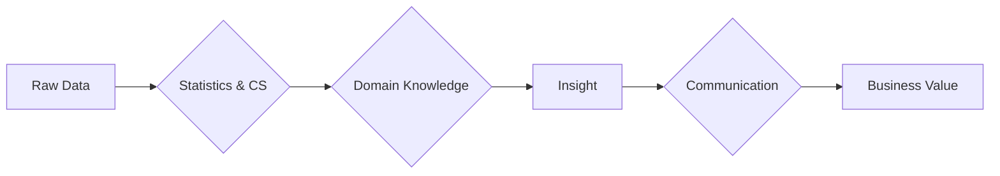

To be effective, a data science project must rest on four solid pillars: statistics and mathematics, computer science, domain knowledge, and communication. Weakness in any one pillar can lead to model failure or incorrect business conclusions — the math can be flawless and the project still worthless if the domain framing is wrong or the results never reach a decision maker. This note develops each pillar and shows how they combine to turn raw data into business value; it anchors [[Foundations MOC]] alongside [[Data Science Definition and Philosophy]] and [[Essential Skills for Data Science]].

## Pillar one: statistics and mathematics

This is the **foundation of truth**. Without statistics, "insights" are just coincidences. Four areas carry most of the weight:

- **Probability** — understanding the likelihood of events.
- **Hypothesis testing** — determining if a result is statistically significant or just random noise.
- **Linear algebra** — the math behind arrays and matrices, essential for machine learning algorithms.
- **Calculus** — used for optimization (e.g., gradient descent) to train models.

These are not abstract requirements: probability and inference are developed in [[Probability and Statistics for ML]] and [[Hypothesis Testing]], the array and matrix machinery in [[Linear Algebra Fundamentals]], and the optimization engine in [[Gradients and Gradient Descent]].

## Pillar two: computer science

This is the **infrastructure**. It provides the tools to execute the math at scale:

- **Programming** (Python, R) to write the logic.
- **Algorithms** — efficient ways to sort, search, and process data.
- **Databases** (SQL, NoSQL) to store and retrieve data efficiently.
- **Distributed computing** (Spark, Hadoop) for processing data that is too large for a single computer (Big Data).

Together with pillar one, this pillar forms the technical half of the discipline: statistics and mathematics say what to compute, and computer science makes computing it feasible at the scale real data arrives.

## Pillar three: domain knowledge

This is the **context**. Data does not exist in a vacuum. Two things domain knowledge provides:

- **Relevance** — a data scientist in Finance needs to understand "Credit Scoring" to build a risk model; a scientist in Biology needs to understand "Gene Expression."
- **Feature engineering** — knowing which variables actually matter. For example, in real estate pricing, domain knowledge tells you that "Location" is often more important than "Square Footage."

Domain knowledge is what keeps the work grounded: it is the difference between a technically sound analysis of the wrong thing and an analysis the business can act on.

## Pillar four: communication

This is the **bridge to value**:

- **Translation** — converting complex mathematical results (e.g., "The AUC is 0.85") into business language (e.g., "This model captures 85% of fraudulent transactions"). AUC and its metric siblings are covered in [[Model Evaluation Metrics]].
- **Visualization** — creating charts that allow stakeholders to grasp trends instantly; the craft that [[Matplotlib]], [[Seaborn]], and [[Plotly]] support.
- **Actionability** — ensuring the insight leads to a specific decision.

## How the pillars combine

Raw data becomes insight only after passing through statistics and computer science together; the insight becomes business value only after domain knowledge has shaped it and communication has delivered it. Skip a stage and the chain breaks: without statistics the "insight" is a coincidence, without computer science it does not scale, without domain knowledge it answers the wrong question, and without communication it changes nothing.

## See also

- [[Foundations MOC]]
- [[Data Science Definition and Philosophy]]
- [[Essential Skills for Data Science]]
- [[The Data Science Workflow]]
- [[Roles and Careers in Data and AI]]
- [[Data-Driven Decision Making]]
