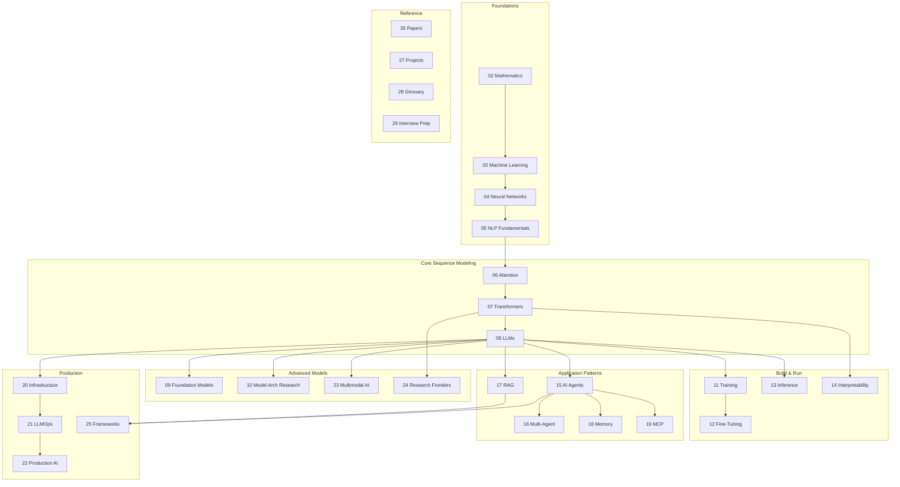

This map of content is the entry point to the Foundations area: what AI engineering actually is, how the subfields of AI relate to one another, the data-science context the field grew out of, and the mathematics you need before anything else. It also carries the field map — a picture of how the areas of the discipline connect, with reading paths tuned to different goals. Read this once to anchor your mental model, and come back to it whenever you finish an area and want to see where you are.

> [!info] The orientation area. Defines the field, the roles, and the modern AI stack. Read this first if you're new to AI engineering.

## Reading order

The area has nineteen content notes in four subfamilies: the AI-engineering orientation pair, the AI/ML/DL hierarchy notes, the data-science foundations notes, and the mathematical-prerequisites notes.

| # | Note | Subfamily | Purpose |
|---|---|---|---|
| 01 | [[What Is AI Engineering]] | AI Engineering | Defines the discipline and its scope, and how it differs from adjacent fields. |
| 02 | [[The Modern AI Stack]] | AI Engineering | The end-to-end stack you'll be working in, from data to observability. |
| 03 | [[AI vs ML vs DL]] | Hierarchy | Disambiguates the umbrella terms — the nesting of AI, ML, DL, GenAI and agentic AI, plus data science and BI distinctions. |
| 04 | [[History and Evolution of AI]] | Hierarchy | How we got here: symbolic → connectionist → agents, from the AI winters to the deep-learning era. |
| 05 | [[Introduction to Machine Learning]] | Hierarchy | What machine learning is and its philosophy. |
| 06 | [[Types of Learning]] | Hierarchy | The supervised/unsupervised taxonomy: regression, classification, clustering. |
| 07 | [[01 - Foundations/AI ML and DL Hierarchy/Applications of Deep Learning\|Applications of Deep Learning]] | Hierarchy | Where deep learning is applied: vision, speech and NLP domains. |
| 08 | [[Data Science Definition and Philosophy]] | Data Science | Definition and interdisciplinary philosophy of data science. |
| 09 | [[Data-Driven Decision Making]] | Data Science | The motivation and importance of making decisions from data. |
| 10 | [[The Data Science Workflow]] | Data Science | The complete end-to-end data-science workflow. |
| 11 | [[The Four Pillars of Data Science]] | Data Science | The four-pillar competency model of data science. |
| 12 | [[Essential Skills for Data Science]] | Data Science | Technical and soft skills needed for data science. |
| 13 | [[Roles and Careers in Data and AI]] | Data Science | The job titles and what each one actually does — which one you're aiming for. |
| 14 | [[Mathematical Notation]] | Mathematical Foundations | The notation reference — symbols used across regression and neural networks. |
| 15 | [[Linear Algebra Fundamentals]] | Mathematical Foundations | The standalone linear-algebra primer for ML. |
| 16 | [[Derivatives and the Chain Rule]] | Mathematical Foundations | Differential calculus: derivatives, partials and the chain rule. |
| 17 | [[Gradients and Gradient Descent]] | Mathematical Foundations | Gradients and the gradient-descent update rule. |
| 18 | [[01 - Foundations/Mathematical Foundations/Jacobians and Hessians\|Jacobians and Hessians]] | Mathematical Foundations | Multivariate calculus: Jacobians and Hessians. |
| 19 | [[Probability and Statistics for ML]] | Mathematical Foundations | The probability and statistics primer for machine learning. |

## Why this area matters

Before learning any math or any model, you need to know:

- What "AI engineering" actually is (vs. ML engineering, data science, software engineering).
- How the subfields (ML, DL, GenAI, agentic AI) relate.
- What the end-to-end AI stack looks like.
- What roles exist and which one you're aiming for.

This area answers those questions in about thirty minutes of reading. Then you can dive into [[Mathematics MOC|Mathematics]] with full context.

## The field at a glance

The map below is the big picture of how the parts of the discipline relate to each other — foundations feeding sequence modeling, sequence modeling feeding the foundation-model era, and everything eventually feeding the build-and-run and production layers. The labels use the field's conventional chapter-sized partitioning; the notes of this vault regroup those same topics into its own areas, but the dependency structure is the one drawn here.

## Reading paths through the field

Different goals justify different routes through the dependency graph. The paths below are the six canonical ones; wherever the target topic exists as an area of this vault, the link points at it.

### Path A — the full curriculum (beginner → researcher)

Start at [[Mathematics MOC|Mathematics]] and work your way right and down through the map. Expect roughly twelve to eighteen months part-time.

### Path B — the applied engineer (build products fast)

1. [[NLP and Language Models MOC|NLP and Language Models]] (just tokenization)
2. [[Large Language Models MOC|LLMs]] (sampling, KV cache)
3. [[Inference and Production MOC|Inference]] (serving)
4. Build a RAG pipeline
5. Add agents
6. Expose tools (MCP)
7. Ship it — production AI

### Path C — the model specialist (train and tune)

1. [[Mathematics MOC|Mathematics]] (full)
2. [[Attention and Transformers MOC|Attention and Transformers]] (full)
3. [[Training and Adaptation MOC|Training]] (pretraining, scaling laws, distributed)
4. [[Training and Adaptation MOC|Fine-Tuning]] (LoRA, DPO, RLHF)
5. [[Inference and Production MOC|Inference]] (serving what you trained)
6. Per-model deep dives

### Path D — the infrastructure engineer (run models at scale)

1. [[Inference and Production MOC|Inference]] (full)
2. AI infrastructure (full)
3. LLMOps and MLOps (full)
4. Production AI (full)
5. Frameworks and serving tools

### Path E — the researcher (frontier)

1. [[Mathematics MOC|Mathematics]] through [[Attention and Transformers MOC|Attention and Transformers]] (foundations)
2. Research frontiers (SSMs, hybrids, reasoning)
3. Per-model deep dives
4. Read landmark papers
5. Interpretability (understand what models learn)

### Path F — the interview candidate (fastest path to hired)

1. Interview prep
2. The glossary
3. [[Attention and Transformers MOC|Attention]] + [[Attention and Transformers MOC|Transformers]] (most-asked)
4. [[Inference and Production MOC|Inference]] (KV cache, quantization)
5. [[Training and Adaptation MOC|Fine-Tuning]] (LoRA, DPO)
6. RAG + agents
7. Production AI (system design)

## Chapter dependency summary

The same graph, expressed as a table for quick lookup:

| Chapter | Depends On | Enables |
|---------|------------|---------|
| 02 Math | (nothing) | 03, 04, 06 |
| 03 ML | 02 | 04, 11, 12 |
| 04 NN | 02, 03 | 05, 06 |
| 05 NLP | 04 | 06, 08 |
| 06 Attn | 04, 05 | 07, 08, 13 |
| 07 Tx | 06 | 08, 09, 10, 13, 14, 23 |
| 08 LLM | 07 | 11, 12, 13, 15, 17 |
| 11 Train | 07, 08 | 12 |
| 12 FT | 08, 11 | (production deployment) |
| 13 Inf | 06, 07, 08 | 20, 21, 22 |
| 15 Agents | 08 | 16, 19, 25 |
| 17 RAG | 05, 08 | 18, 22 |

## Cross-cutting themes

Some themes appear in multiple parts of the map — keep them in mind as you traverse it:

- **Attention** appears in the mechanism itself, the Transformer, LLMs, per-model architecture, the KV cache, and linear attention.
- **Memory** appears in the KV cache, agent memory, and neural memory.
- **Tools** appear in tool calling, MCP, and frameworks.
- **Embeddings** appear in Word2Vec, token embeddings, RAG, memory, and multimodal AI.
- **Reasoning** appears in CoT and ReAct, reasoning models, and test-time compute.
- **Cost** appears in serving, LLMOps, and production.

## Why this matters for AI

- The map gives you a **spatial sense** of the field. When someone mentions "GQA", you know it's a model-architecture / inference topic. When someone says "DPO", you know it's fine-tuning.
- The dependency graph tells you **what to learn before what**. Don't read fine-tuning before you understand LLMs.
- The reading paths tell you **which parts matter for your goal**. An applied engineer skips the research frontiers; a researcher skips LLMOps.

## Production implications

- When evaluating a candidate's resume, look for breadth across the map. Single-chapter specialists are common; cross-chapter generalists are rare and valuable.
- When hiring, know which parts your role needs. A production AI engineer needs inference + infrastructure + LLMOps + production; a research engineer needs mathematics + attention + Transformers + research frontiers + papers.
- When debugging production issues, the place where the symptom appears is often not the place where the cause lives. Trace across layers.

## Where to go next

- **Beginner path**: → [[Mathematics MOC|Mathematics]] for foundations, or [[Python Language Overview|Python and data tooling]] if you want the programming prerequisites first.
- **Already-ML-literate path**: → [[Attention and Transformers MOC|Attention and Transformers]] to jump to the modern era.
- **Engineer path**: → [[Large Language Models MOC|LLMs]] → [[Inference and Production MOC|Inference and Production]] → agents.

## See also

- [[Mathematics MOC]] — the mathematical foundations area this map points at first.
- [[Python Language Overview]] — the programming and data-tooling area.
- [[Machine Learning MOC]] — where the ML notes apply these foundations.
- [[Neural Network Foundations MOC]] — neural networks build directly on the math prerequisites here.
