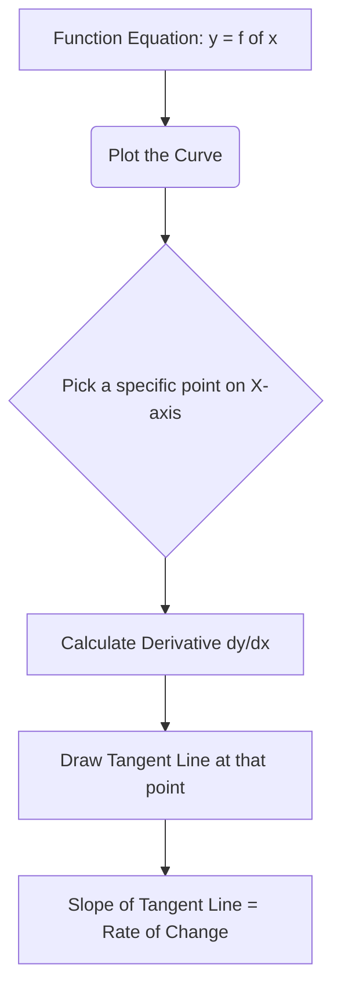
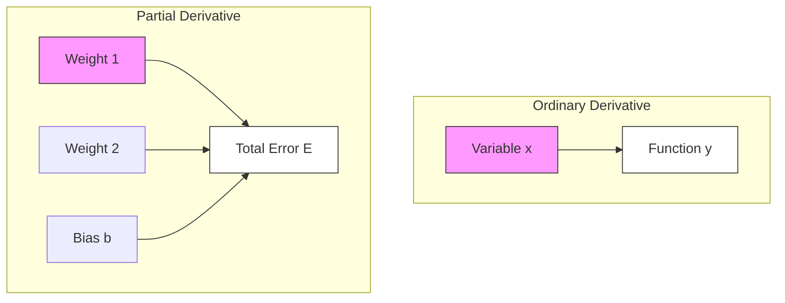
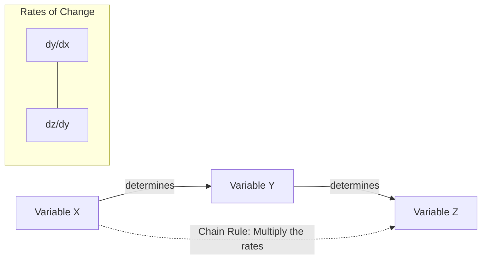
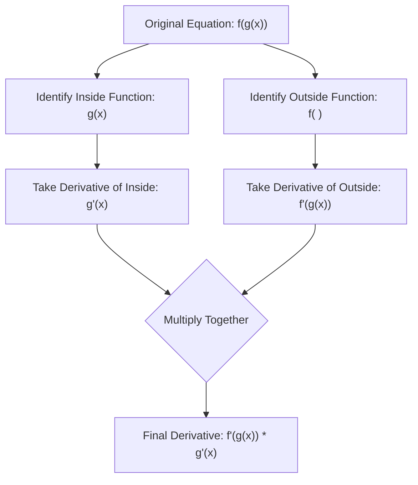
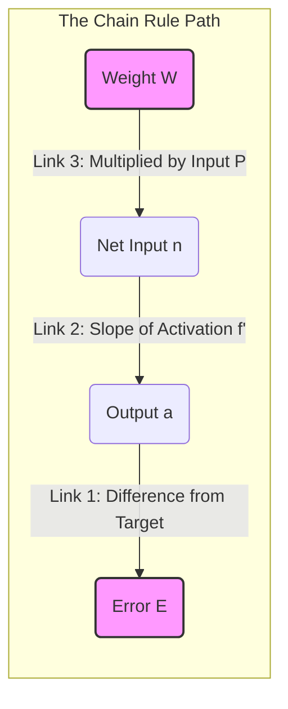
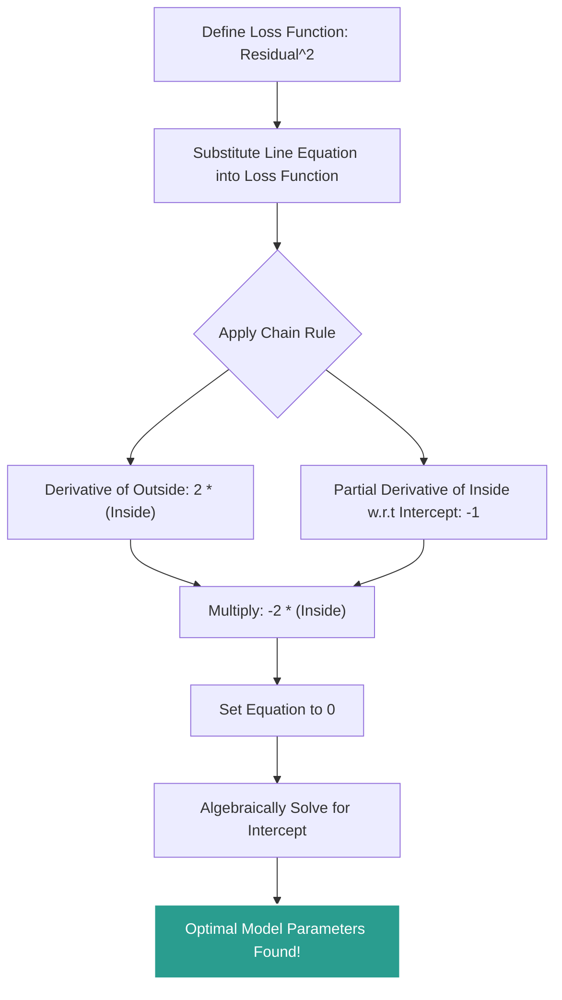
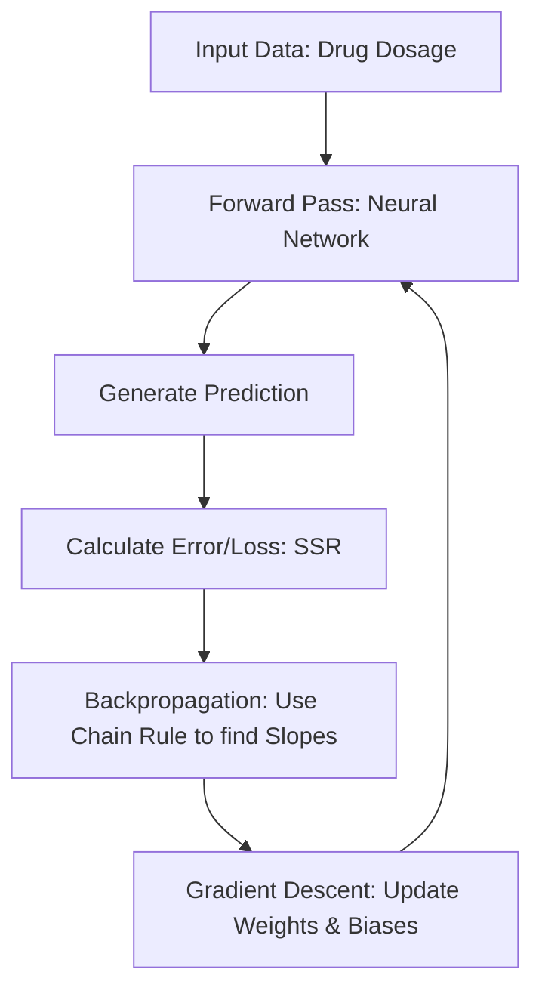
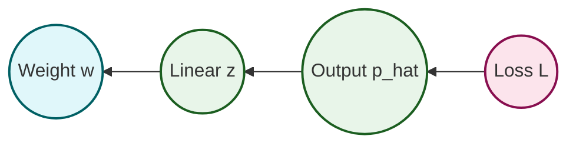

A derivative measures the instantaneous rate of change of a function — the slope of its tangent line at a point — and the chain rule extends that idea to composite functions, where one quantity influences another only through a chain of intermediate steps. Together they form the mathematical engine of backpropagation: every weight update in a neural network is a chain-rule product of small effects multiplied out link by link. Confusion about "wrt" (with respect to) and the chain rule is often the single biggest stumbling block in understanding neural networks, so this note builds the ideas in plain English first and in symbols second: what a derivative is and how to read its notation, how ordinary and partial derivatives differ, the power rule shortcut, the chain rule on linear and non-linear composites, and finally the chain rule applied to loss functions and to full networks.

## What a derivative is

### The conceptual definition

In calculus, a derivative represents the **instantaneous rate of change** of a function with respect to one of its variables. Imagine a graph where the x-axis represents how much people like a subject (say, "Likes StatQuest") and the y-axis represents the "Awesomeness" of that subject. If we plot data points and draw a curve through them, the relationship might not be a straight line — it might be a parabola, meaning the "Awesomeness" grows at an accelerating rate as "Likes" increase.

The **derivative** of the equation representing this curve tells us the **slope of the tangent line** at any specific point along that curve.

- **Tangent line:** A straight line that just barely touches the curve at exactly one point without crossing it at that moment.
- **Slope:** How steeply that line is pointing up or down.

### Why the slope matters

The slope of the tangent line tells us exactly how quickly "Awesomeness" is changing *at that exact moment* relative to a change in "Likes." If the slope is steep, a tiny increase in "Likes" results in a massive explosion of "Awesomeness." If the slope is shallow, an increase in "Likes" only yields a minor bump in "Awesomeness." The journey from a function's equation to its rate of change follows a fixed pipeline:

### Leibniz notation

You will frequently see derivatives written in **Leibniz notation** as $\frac{dy}{dx}$.

- **$d$** stands for "a tiny change in."
- So, $\frac{dy}{dx}$ literally translates to: "A tiny change in $y$ divided by a tiny change in $x$."
- In the context of our example, this is written as: $\frac{d\text{Awesomeness}}{d\text{Likes}}$.

### "wrt" — with respect to

**"wrt"** stands for **"With Respect To"**. In calculus and machine learning, we are always measuring **change**, but things depend on many different factors. "With respect to" tells you specifically which factor we are looking at right now.

Imagine you are driving a car:

- If you press the gas pedal harder, the car goes faster.
  - Math: The change in **Speed** *with respect to* **Gas Pedal Pressure**.
- If the road goes uphill, the car slows down.
  - Math: The change in **Speed** *with respect to* **Road Incline**.

In gradient descent the question becomes: "How does the **Error ($E$)** change **with respect to** the **Weight ($W$)**?"

- Notation: $\frac{\partial E}{\partial W}$
- Meaning: If I wiggle this weight $W$ just a tiny bit, how much does the Error $E$ go up or down?

### Terminology reference

Before diving into the calculus rules, it helps to fix the precise meaning of each foundational term you will meet throughout this material:

| Term | Meaning | Type | Visual / Intuition |
| --- | --- | --- | --- |
| **Function (f(x))** | The original curve; gives value of output for each input | Curve | The shape on a graph; e.g., $x^3$ is a cubic curve |
| **Slope** | Rate of change of function; how steep it is | Number at a point | Tangent line steepness at a point |
| **Gradient** | Another word for slope; often used for multivariable functions | Number at a point | How fast the function rises at that exact point |
| **Derivative (f'(x))** | Function that tells the gradient at **every point** | Function | A new curve; e.g., for $x^3$, $f'(x) = 3x^2$ (parabola) |
| **Derivative at a point** | The value of the derivative at one x | Number | Slope of the tangent line at that point |
| **Tangent line** | Straight line that touches the curve at a point, with same slope | Line | Just touches the curve at one point |
| **Second derivative (f''(x))** | Derivative of the derivative; shows change of slope | Function | Curvature; positive = concave up, negative = concave down |
| **Integral / anti-derivative** | Reverses the derivative; recovers original function | Function | Curve reconstructed from slope function |

## Ordinary versus partial derivatives

The distinction between the standard derivative symbol ($d$) and the "curly d" symbol ($\partial$) is crucial for understanding why backpropagation formulas look the way they do.

### The symbols

- **$d$ (Ordinary Derivative):** Used when a function depends on **only one** variable.
  - Example: $y = f(x)$. If $x$ changes, $y$ changes. There is no other factor.
- **$\partial$ (Partial Derivative):** Used when a function depends on **multiple** variables.
  - Example: $z = f(x, y)$. The value of $z$ depends on both $x$ and $y$.
  - Pronounced "Del", "Partial", or "Curly D".

### Why neural networks use $\partial$

The Total Error ($E$) of a network doesn't depend on just one weight. It depends on **hundreds or thousands** of weights ($W_{11}, W_{12}, W_{21}...$) and biases ($b_1, b_2...$). Because the Error is a function of *many* variables, we cannot use a normal derivative — we must use **partial derivatives**.

> [!info] The intuitive meaning
> When we write $\frac{\partial E}{\partial W_{ij}}$, we are asking:
>
> **"If I change *only* this specific weight ($W_{ij}$) by a tiny amount, while holding ALL other weights completely frozen (constant), how much does the Error ($E$) change?"**
>
> This allows us to isolate the "blame" (or contribution) of a single connection without worrying about the rest of the network for that specific calculation.

### The constant trick

The mechanics of calculating a partial derivative are exactly the same as a normal derivative, with one **critical rule**:

**Rule:** When calculating the partial derivative with respect to one variable (e.g., $x$), treat **all other variables (e.g., $y, z$) as if they are just numbers (constants).**

Imagine a function:

$$ f(x, y) = x^2 + 3xy + y^2 $$

**Scenario A: find $\frac{\partial f}{\partial x}$** (change in the function relative to $x$):

1. Treat $y$ as a constant (like the number 5).
2. Derivative of $x^2$ is $2x$.
3. Derivative of $3xy$: since $3$ and $y$ are constants, they stay. Derivative of $x$ is 1. Result: $3y$.
4. Derivative of $y^2$: since $y$ is a constant, $y^2$ is a constant (like 25). Derivative of a constant is **0**.

$$ \frac{\partial f}{\partial x} = 2x + 3y $$

**Scenario B: find $\frac{\partial f}{\partial y}$** (change in the function relative to $y$):

1. Treat $x$ as a constant.
2. Derivative of $x^2$ is **0** (it's a constant now).
3. Derivative of $3xy$: $3x$ is constant. Derivative of $y$ is 1. Result: $3x$.
4. Derivative of $y^2$ is $2y$.

$$ \frac{\partial f}{\partial y} = 3x + 2y $$

### Applying the rule to the net input

Inside a chain-rule expansion for a neural network you meet the term

$$ \frac{\partial n_i}{\partial W_{ij}} $$

Recall the formula for the Net Input ($n_i$):

$$ n_i = W_{i1} \cdot x_1 + W_{i2} \cdot x_2 + W_{i3} \cdot x_3 + ... + b $$

If we want to find the gradient for Weight 1 ($W_{i1}$):

$$ \frac{\partial n_i}{\partial W_{i1}} $$

1. We look at the first term $W_{i1} \cdot x_1$. The derivative with respect to $W_{i1}$ is just **$x_1$**.
2. We look at the second term $W_{i2} \cdot x_2$. Since we are focusing on $W_{i1}$, **$W_{i2}$ is treated as a constant**. The whole term becomes 0.
3. The bias $b$ is treated as a constant. It becomes 0.

**Result:**

$$ \frac{\partial n_i}{\partial W_{ij}} = x_j \quad (\text{or } P_j \text{ in your notes}) $$

This is why the complicated sum formula disappears and leaves only the specific input connected to that weight — when the input pattern is written $P_j$, the result of this link is simply that input value.

### Visualizing the difference

- **Left side (ordinary):** One path. Changing $x$ accounts for 100% of the change in $y$.
- **Right side (partial):** Many paths. Changing "Weight 1" only accounts for a *part* of the change in $E$. We use $\partial$ to signify we are ignoring the contributions of Weight 2 and the bias for a moment.

For the full multivariable treatment — how these partial derivatives stack into Jacobians and Hessians — see [[02 - Mathematics/Calculus/Jacobians and Hessians|Jacobians and Hessians]].

### Exam summary

- **Symbol:** $\partial$ means "Partial Derivative".
- **When to use:** When calculating Error in a neural network (because Error depends on many weights).
- **How to solve:** Pretend every variable except the one you are calculating for is a plain number (constant).
  - If the term doesn't contain your variable, it becomes **zero**.
  - If the term is multiplied by your variable, only the multipliers remain.

## The power rule

### Definition and steps

Calculating the derivative of a function from scratch using limits is tedious. Luckily, mathematics provides us with shortcuts, and the most fundamental shortcut in calculus is the **Power Rule**. It states that for any function $f(x) = x^n$, the derivative is:

$$ \frac{d}{dx} x^n = n \cdot x^{n-1} $$

**Step-by-step execution:**

1. Take the exponent ($n$).
2. Bring it down to the front and multiply it by the variable.
3. Subtract $1$ from the original exponent.

### Worked example

Let's look at the equation from our introductory dataset:

$$ \text{Awesomeness} = (\text{Likes StatQuest})^2 $$

We want to find the derivative of Awesomeness with respect to Likes.

$$ \frac{d\text{Awesomeness}}{d\text{Likes}} = \frac{d}{d\text{Likes}} (\text{Likes})^2 $$

**Applying the Power Rule:**

1. The power is $2$. Bring it to the front to multiply: $2 \times \text{Likes}$
2. Subtract $1$ from the power: $2 - 1 = 1$.
3. The new power is $1$.

$$ = 2 \times (\text{Likes})^1 $$

### Common pitfalls

- **The hidden "1":** Any variable raised to the power of 1 is just the variable itself. $x^1 = x$. Therefore, $2 \times (\text{Likes})^1$ is simply written as $2 \times \text{Likes}$.
- **The hidden "0":** If you have a linear term like $f(x) = 5x$, the $x$ has an implicit power of 1. Bringing the 1 down gives $1 \times 5x^{1-1} = 5x^0$. Anything to the power of 0 is 1, so the derivative of $5x$ is simply $5$.
- **Constants:** The derivative of a constant number (e.g., $f(x) = 7$) is always $0$. Constants do not change, so their rate of change is zero.

## The chain rule

### Why composite functions need it

The Power Rule works perfectly for simple functions like $x^2$. But what happens when functions are nested inside one another? This is where **The Chain Rule** is required. The Chain Rule is used to find the derivative of a **composite function** (a function within a function).

Because a neural network is essentially one massive nested mathematical function — weights feed into sums, sums feed into activation functions, activations feed into more sums — the Chain Rule allows us to unpack it layer by layer. It is the fundamental engine that powers backpropagation. As a formula reminder: if $y = f(g(x))$, then $\frac{dy}{dx} = f'(g(x)) \times g'(x)$.

### The domino effect

Think of the Chain Rule as a domino effect or a gear system.

- If turning Gear A causes Gear B to turn...
- And turning Gear B causes Gear C to turn...
- You can determine how turning Gear A affects Gear C by **multiplying the transfer rates** of the gears together.

In mathematical terms, if variable $Z$ depends on variable $Y$, and variable $Y$ depends on variable $X$, you can find how $Z$ changes with respect to $X$ by tracking the chain of dependencies.

### Formal notation

$$ \frac{dz}{dx} = \frac{dz}{dy} \times \frac{dy}{dx} $$

Notice how algebraically, the $dy$ in the numerator and denominator appear to "cancel out," leaving you with $\frac{dz}{dx}$. This is exactly how the Chain Rule works.

> [!tip] The "cancel out" trick
> To remember whether you set up the Chain Rule correctly, imagine the terms are fractions. If you cross-cancel the intermediate variable from the numerator and denominator, you should be left with exactly what you started with.

## The chain rule with linear functions

To understand the Chain Rule without getting bogged down in complex algebra, let's observe how it works with straight lines. We will track a chain of physical measurements: **Weight → Height → Shoe Size**.

### Step 1: weight to height

Imagine we find a linear relationship between Weight and Height.

- For every $1$ unit increase in Weight, there is a $2$ unit increase in Height.
- Slope = $\frac{2}{1} = 2$.
- Derivative: $\frac{d\text{Height}}{d\text{Weight}} = 2$
- Equation: $\text{Height} = 2 \times \text{Weight}$

### Step 2: height to shoe size

- For every $1$ unit increase in Height, there is a $\frac{1}{4}$ unit increase in Shoe Size.
- Derivative: $\frac{d\text{ShoeSize}}{d\text{Height}} = \frac{1}{4}$
- Equation: $\text{ShoeSize} = \frac{1}{4} \times \text{Height}$

### Step 3: applying the chain rule (weight → shoe size)

We know Weight predicts Height, and Height predicts Shoe Size. By the Chain Rule:

$$ \frac{d\text{ShoeSize}}{d\text{Weight}} = \frac{d\text{ShoeSize}}{d\text{Height}} \times \frac{d\text{Height}}{d\text{Weight}} = \frac{1}{4} \times 2 = \frac{1}{2} $$

**Conclusion:** For every 1 unit increase in Weight, there is a $\frac{1}{2}$ unit increase in Shoe Size.

> [!info] Intercepts through the origin
> You might notice the equations look like $y = mx$, without the $+ b$ (y-intercept). This is because, in this specific example, the lines pass directly through the origin $(0,0)$: if someone weighs 0, their height is 0. This simplifies the math to let us focus purely on the rates of change (slopes).

## The chain rule with non-linear composite functions

In the real world, relationships are rarely perfectly straight lines. Let's look at a non-linear chain involving Time, Hunger, and Craving Ice Cream. This example teaches the **"Outside-Inside" technique** for the Chain Rule.

### Establishing the relationships

1. **Time → Hunger:** $\text{Hunger} = \text{Time}^2 + \frac{1}{2}$
2. **Hunger → Craves Ice Cream:** $\text{Craving} = \sqrt{\text{Hunger}}$

### Creating the composite function

Substituting "Hunger" into the Craving equation:

$$ \text{Craving} = \sqrt{\text{Time}^2 + \frac{1}{2}} $$

Taking the derivative of this all at once is intimidating. The Chain Rule shines here.

### The outside-inside method

**Rule:** Derivative of the OUTSIDE function (leaving the inside alone) × Derivative of the INSIDE function.

**Step 1: identify "outside" and "inside"**

- The stuff INSIDE: $\text{Time}^2 + \frac{1}{2}$
- The OUTSIDE function: $\sqrt{\text{Stuff Inside}}$

**Step 2: derivative of the "inside"**

Using the Power Rule on $\text{Time}^2 + \frac{1}{2}$:

- $\frac{d}{d\text{Time}} (\text{Time}^2) = 2 \times \text{Time}$
- $\frac{d}{d\text{Time}} (\frac{1}{2}) = 0$
- **Result:** $2 \times \text{Time}$

**Step 3: derivative of the "outside"**

We are finding the derivative of $\sqrt{\text{Inside}}$ with respect to "Inside".

> **Crucial math trick #1:** Remember that a square root is identical to the power of $\frac{1}{2}$. So, $\sqrt{\text{Inside}} = (\text{Inside})^{1/2}$.

Apply the Power Rule: bring $\frac{1}{2}$ to the front, subtract $1$ from the power.

$$ \frac{1}{2} - 1 = -\frac{1}{2} $$

> **Crucial math trick #2:** A negative exponent means the term moves to the denominator. $x^{-1/2} = \frac{1}{x^{1/2}} = \frac{1}{\sqrt{x}}$.

- **Result:** $\frac{1}{2 \times \sqrt{\text{Inside}}}$

**Step 4: multiply them together (the Chain Rule)**

$$ \frac{d\text{Craving}}{d\text{Time}} = \frac{1}{2\sqrt{\text{Time}^2 + \frac{1}{2}}} \times 2 \times \text{Time} = \frac{\text{Time}}{\sqrt{\text{Time}^2 + \frac{1}{2}}} $$

## The chain rule as the blame game

The Chain Rule is used when two things are connected, but not directly. This is exactly the situation inside a trained network, and viewing the rule as a "blame game" makes the standard backpropagation formulas readable.

### The problem

You want to know how the **Weight ($W$)** affects the **Error ($E$)**. But the Weight doesn't touch the Error directly — there are steps in between.

### The flow of the network

1. The **Weight ($W$)** determines the strength of the signal entering the neuron (Net Input $n$).
2. The **Net Input ($n$)** determines what the neuron outputs (Activation $a$).
3. The **Output ($a$)** is compared to the target to calculate the **Error ($E$)**.

$$ \text{Weight } W \rightarrow \text{Net Input } n \rightarrow \text{Output } a \rightarrow \text{Error } E $$

### The formula in English

If we want to know the relationship between the first item ($W$) and the last item ($E$), we have to multiply the relationships of every step in between:

$$ (\text{Effect of } W \text{ on } E) = (\text{Effect of } W \text{ on } n) \times (\text{Effect of } n \text{ on } a) \times (\text{Effect of } a \text{ on } E) $$

### Dissecting the three links

In symbols, the chain that connects a weight to the error is written:

$$ \frac{\partial E}{\partial W_{ij}} = \frac{\partial E}{\partial a_i} \cdot \frac{\partial a_i}{\partial n_i} \cdot \frac{\partial n_i}{\partial W_{ij}} $$

(Sometimes $y$ is used instead of $a$, and $e$ instead of $E$, but the structure is identical.)

**Link 1: $\frac{\partial E}{\partial a_i}$ (Error wrt Output)**

- **Question:** If the Output changes, how much does the Error change?
- **Calculation:** The Error is usually $(Target - Output)$. So if Output goes up, Error goes down.
- **Result:** This gives us the term $e_i$ (or strictly $-e_i$, but the negative is handled in the update rule).

**Link 2: $\frac{\partial a_i}{\partial n_i}$ (Output wrt Net Input)**

- **Question:** If the incoming signal (Net Input) changes, how much does the actual Output change?
- **Context:** This depends on the **Activation Function** (like Sigmoid, Tanh, or ReLU).
- **Calculation:** This is the slope (derivative) of the activation curve.
- **Result:** This gives us the term $f'(n)$.

**Link 3: $\frac{\partial n_i}{\partial W_{ij}}$ (Net Input wrt Weight)**

- **Question:** If we change the Weight, how much does the Net Input change?
- **Calculation:** Since $n = W \cdot P$ (Weight $\times$ Input), the derivative is just the Input $P$.
- **Result:** This gives us the term $P_j$ (the input value).

### Summary diagram

Here is how the Chain Rule connects the "Start" (Weight) to the "End" (Error):

### The weight update

When the three links are multiplied together, the weight adjustment reads:

$$ \Delta W = \eta \cdot e_i \cdot f'(n) \cdot P_j $$

It is simply multiplying the three links of the chain together so we know exactly how to adjust the weight to fix the error. The symbol conventions ($\eta$, $e_i$, $f'(n)$, $P_j$) are laid out in [[Mathematical Notation]].

## Optimizing a loss function with the chain rule

### Why the chain rule matters in machine learning

Machine learning models measure their own accuracy using a **Loss Function**. A very common loss function is the **Residual Sum of Squares (RSS)** or **Sum of Squared Residuals (SSR)**.

### What a residual is

A residual is the mathematical distance between reality and the prediction:

$$ \text{Residual} = \text{Observed} - \text{Predicted} $$

### Why square the residual

1. **Positive values:** Squaring ensures all errors are positive, so positive and negative errors don't cancel out when summed.
2. **Punishing bad errors:** Squaring penalizes large errors exponentially more than small errors.
3. **Differentiability:** The resulting equation creates a smooth, convex parabola with a distinct minimum, allowing us to use calculus to find it.

### Visualizing the goal

If we graph the Squared Residuals against the line's Intercept, we get a parabola (a U-shaped curve). The lowest point on this U-curve represents the Intercept value that gives us the smallest possible error. To find this absolute minimum point, we need to find where the **slope of the tangent line is exactly 0** — and to find the slope, we need the derivative.

### Constructing the composite equation

1. **Predicted equation:** $\text{Predicted} = \text{Intercept} + (1 \times \text{Weight})$ (slope locked at 1 for simplicity)
2. **Squared residual equation:** $\text{Residual}^2 = (\text{Observed} - \text{Predicted})^2$

Combining them:

$$ \text{Residual}^2 = (\text{Observed} - (\text{Intercept} + (1 \times \text{Weight})))^2 $$

### Applying the chain rule (outside-inside method)

We want the derivative with respect to the **Intercept**. All other variables are treated as constants (partial derivative).

> [!info] Partial derivatives while optimizing
> Because we are taking the derivative with respect to the *Intercept*, we treat all other variables (Observed Height, Weight) as if they are constant numbers. Their rates of change are zero.

**Step 1: identify inside and outside**

- Inside: $\text{Observed} - (\text{Intercept} + (1 \times \text{Weight}))$
- Outside: $(\text{Inside})^2$

**Step 2: derivative of the outside**

$$ 2 \times (\text{Inside}) $$

**Step 3: derivative of the inside (with respect to Intercept)**

$$ -1 $$

**Step 4: multiply them together**

$$ \frac{d\text{Residual}^2}{d\text{Intercept}} = 2 \times (\text{Observed} - (\text{Intercept} + \text{Weight})) \times (-1) = -2 \times (\text{Observed} - (\text{Intercept} + \text{Weight})) $$

> [!warning] Don't ignore the "times 1"
> Mathematically, multiplying by 1 changes nothing, and you might be tempted to erase it. However, in neural networks you should leave it there conceptually. Why? Because if we were optimizing a *different* parameter (like a Weight), that second part would *not* be 1. Leaving it in reminds us that backpropagation is fundamentally built on the Chain Rule and consists of distinct parts chained together.

### Solving for the minimum

To find the lowest point on the error curve, we set this derivative equal to zero:

$$ -2 \times (\text{Observed} - (\text{Intercept} + (1 \times \text{Weight}))) = 0 $$

Now, assume our data point is: $\text{Observed Height} = 2$, and $\text{Weight} = 1$. Let's plug those numbers in to solve for the best Intercept.

$$ -2 \times (2 - (\text{Intercept} + (1 \times 1))) = 0 $$
$$ -2 \times (2 - \text{Intercept} - 1) = 0 $$
$$ -2 \times (1 - \text{Intercept}) = 0 $$

Divide both sides by $-2$:

$$ 1 - \text{Intercept} = 0 $$
$$ 1 = \text{Intercept} $$

**Conclusion:** By utilizing the Chain Rule to find the derivative of our composite loss function, we have mathematically proven that an Intercept of **1** will minimize our squared residual, granting us the best-fitting line for our machine learning model.

## The chain rule in neural networks

### Essential prerequisites

To fully understand backpropagation and the Chain Rule's role in it, you must be comfortable with three concepts. These are the "engines" under the hood of neural networks:

1. **Neural networks (inside the black box):** You must understand how data moves forward through a network (Input → Weights/Biases → Activation Function → Output). Activation functions (like the Softplus function) allow the network to bend and warp data to fit complex, non-linear shapes.
2. **The Chain Rule (calculus):** The Chain Rule is used to take the derivative of composite functions (functions inside of functions). Because a neural network is essentially one massive nested mathematical function, the Chain Rule allows us to unpack it layer by layer.
3. **Gradient descent:** Once backpropagation uses the Chain Rule to find the *slope* (derivative) of the error at a given point, Gradient Descent is the algorithm that takes a "step" down that slope to find the minimum error.

> [!warning] What students often miss
> Backpropagation and Gradient Descent are **not** the same thing.
> - **Backpropagation** only calculates the derivatives (the slopes).
> - **Gradient Descent** uses those derivatives to physically update the weights and biases.
>
> They work together as a two-part team: Backpropagation computes the compass direction; Gradient Descent takes the step.

### Feedforward and backpropagation

**Feedforward** is the process of moving data *forward* (from left to right) through the network to get a guess. **Backpropagation** is the process of moving the error *backward* (from right to left) through the network to update the weights. You cannot have backpropagation without first doing a feedforward pass. The full training loop looks like this:

### The grand-scale chain rule

In a neural network, we apply the Chain Rule on a much grander scale. A weight deep in the network affects the loss through a long chain of intermediate computations:

$$ \frac{\partial L}{\partial w} = \frac{\partial L}{\partial \hat{p}} \cdot \frac{\partial \hat{p}}{\partial z} \cdot \frac{\partial z}{\partial w} $$

We read this visually right-to-left (backwards): to find how a weight affects the loss, we multiply the gradients along the path from the weight to the loss.

> [!info] Key insight
> Backpropagation is simply the Chain Rule applied systematically to every weight in the network, computed layer-by-layer from output back to input. The beauty is that once you calculate a gradient at one layer, you **reuse** it for the next layer going backward — just like gears passing motion to each other.

## See also

- [[Foundations MOC]]
- [[Mathematical Notation]]
- [[Gradients and Gradient Descent]]
- [[Linear Algebra Fundamentals]]
- [[Probability and Statistics for ML]]
- [[Gradient and Chain Rule]]
- [[02 - Mathematics/Calculus/Jacobians and Hessians|Jacobians and Hessians]]
- [[Backpropagation]]
- [[05 - Neural Network Foundations/Backpropagation/Backpropagation and Gradient Flow in CNNs|Backpropagation and Gradient Flow in CNNs]]
