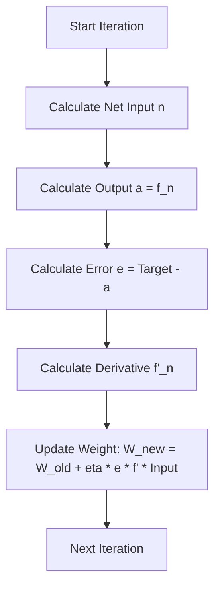

Machine learning formulas look intimidating largely because of their notation: every subfamily of the field has its own dialect of symbols, and misreading a single one (a superscript that is an index, not an exponent) can make an entire derivation unreadable. This note is a vocabulary guide for the two symbol systems you meet first: the linear-regression notation used for data, parameters, cost, and the normal equation, and the neural-network notation used for weights, errors, and learning-rate updates. Each symbol is defined generically, illustrated with an everyday analogy, and then placed in its machine-learning context.

## Data and indexing symbols

### The index and the count: $i$ and $n$

$$i = 1..n$$

- **Name:** Index and Limit.
- **General definition:** $n$ usually represents the total count of items. $i$ is a counter variable used to point to a specific item in a list.
- **Off-context example:** If you have a shopping list with 5 items, $n=5$. If you are pointing to the 3rd item (Milk), then $i=3$.
- **In linear regression context:**
  - **$n$**: The total number of examples in your dataset (the "sample size").
  - **$i$**: The specific row number currently being looked at.
  - **The operation:** When the formula says $\sum_{i=1}^n$, it means "Do this operation for every single student in the dataset, from the first one ($1$) to the last one ($n$)."

### Superscript indexing: $x^{(i)}$ and $y^{(i)}$

$$(x^{(i)}, y^{(i)})$$

- **Name:** Superscript Indexing (NOT Exponentiation).
- **General definition:** In machine learning notation, a number in parentheses up high like $^{(i)}$ is a label/tag, not a mathematical power. It does *not* mean "squared" or "cubed".
- **Off-context example:** Imagine a file cabinet. `File(1)` is the first file. `File(2)` is the second file. It does not mean `File * File`.
- **In linear regression context:**
  - **$x^{(i)}$**: The **input** value (feature) for the $i$-th student. For example, the study hours of student #3.
  - **$y^{(i)}$**: The **actual output** value (target) for the $i$-th student. For example, the actual test score student #3 got.
  - **The operation:** This notation distinguishes the *specific data point* from the generic variables $x$ and $y$.

## Model parameters and prediction

### Theta: $\theta$

$$\theta_0, \theta_1$$

- **Name:** Theta (Greek letter).
- **General definition:** In math and science, $\theta$ is often used to represent an angle, but in statistics, it represents an unknown **parameter**.
- **Off-context example:** If you are tuning a radio, the knobs you turn to get a clear signal are the parameters.
- **In linear regression context:**
  - These are the "knobs" of your linear model.
  - **$\theta_0$ (Intercept/Bias):** The value of $y$ when $x=0$. (Where the line starts on the vertical axis).
  - **$\theta_1$ (Slope/Weight):** How much $y$ increases for every 1 unit increase in $x$.
  - **The goal:** The entire purpose of the math is to find the best numbers for $\theta_0$ and $\theta_1$.

### Y-hat: $\hat{y}$

$$\hat{y} = \theta_0 + \theta_1 x$$

- **Name:** y-hat.
- **General definition:** The "hat" symbol usually indicates an **estimate** or a **prediction**, rather than a perfectly known real value.
- **Off-context example:** $y$ is the actual weather (it rained). $\hat{y}$ is the weather forecast (it might rain).
- **In linear regression context:**
  - This is the value the **line predicts** the student will get.
  - **The operation:** You plug an $x$ (hours) into the equation using your current $\theta$s, and the result is $\hat{y}$. Ideally, $\hat{y}$ should be very close to the real $y$.

## Loss and summation symbols

### The cost function: $J$

$$J(\theta_0, \theta_1)$$

- **Name:** Cost Function (or Loss Function / Objective Function).
- **General definition:** A mathematical function that outputs a "score" representing how *bad* a system is performing.
- **Off-context example:** In golf, the score is a Cost Function. You want the number to be as low as possible. High number = bad performance.
- **In linear regression context:**
  - $J$ calculates the average squared difference between the predictions ($\hat{y}$) and the real answers ($y$).
  - **The operation:** We mathematically manipulate $\theta$ to make $J$ equal to 0 (or as close as possible).

### Sigma: $\sum$

$$\sum_{i=1}^n$$

- **Name:** Sigma (Summation).
- **General definition:** A loop command. It means "Add up all the results of the following formula."
- **Off-context example:** A cash register receipt. The register calculates the price of item 1, item 2, item 3... and creates a `Total`.
- **In linear regression context:**
  - It sums up the errors for every single student.
  - **$\frac{1}{n}\sum$**: When you sum everything up and divide by the count ($n$), you are calculating the **Average** (Mean).

## Calculus and optimization symbols

### The partial derivative: $\partial$

$$\frac{\partial J}{\partial \theta_1}$$

- **Name:** Partial Derivative (pronounced "del" or "partial").
- **General definition:** In calculus, a derivative measures rate of change (slope). A *partial* derivative asks: "How does the function output change if I move **only this one variable**, while freezing all other variables perfectly still?"
- **Off-context example:** Imagine you are on a hill.
  - $\frac{\partial}{\partial \text{North}}$ means: "If I take one step North, do I go up or down?" (Ignoring East/West).
  - $\frac{\partial}{\partial \text{East}}$ means: "If I take one step East, do I go up or down?" (Ignoring North/South).
- **In linear regression context:**
  - **The operation:** It calculates the slope of the Error ($J$) specifically regarding the slope parameter ($\theta_1$).
  - **Coordinate descent:** This relates to the "One at a Time" method. We calculate $\frac{\partial J}{\partial \theta_1}$, set it to 0, and solve it. This finds the perfect $\theta_1$ *assuming $\theta_0$ doesn't change*.

The mechanics of computing such partials — treating every other variable as a constant — are developed in [[Derivatives and the Chain Rule]].

## Matrix notation and the normal equation

### Matrices and vectors: $X$ and $y$

$$X = \begin{bmatrix} ... \end{bmatrix}, \quad y = \begin{bmatrix} ... \end{bmatrix}$$

- **Name:** Matrices and Vectors.
- **General definition:**
  - Capital letters ($X$) usually denote a **Matrix** (a simplified spreadsheet or grid of numbers).
  - Lowercase bold letters ($y$ or $\theta$) usually denote a **Vector** (a single column of numbers).
- **In linear regression context:**
  - **$X$ (Design Matrix):** A grid containing all the input data for all students at once.
    - *Note:* It usually has a column of 1s added to it. This is a math trick to handle the $\theta_0$ (intercept) automatically.
  - **$y$ (Target Vector):** A column containing all the exam scores for all students.
  - **The operation:** Instead of using a `for loop` ($\sum$) to calculate errors one by one, we treat the whole dataset as a single mathematical object ($X$) to solve everything in one step.

### The squared norm: $||\cdot||^2$ or $|\cdot|^2$

$$||X\theta - y||^2$$

- **Name:** L2 Norm Squared (or Euclidean Norm Squared).
- **General definition:** In vector math, the "Norm" ($||v||$) measures the **length** (magnitude) of an arrow/vector. Squaring it removes square roots.
- **Off-context example:** Calculating the distance between two points on a map using the Pythagorean theorem ($a^2 + b^2 = c^2$).
- **In linear regression context:**
  - $X\theta$ creates a vector of predictions.
  - $y$ is the vector of real answers.
  - $(X\theta - y)$ creates a vector of **errors** (how far off each prediction was).
  - **The operation:** The norm squared takes that list of errors, squares them all, and adds them up. It is the Vector version of $\sum (\hat{y} - y)^2$.

### Nabla: $\nabla$

$$\nabla_\theta J$$

- **Name:** Nabla (Gradient).
- **General definition:** A vector that contains *all* the partial derivatives at once.
- **Off-context example:** Back to the hill analogy. The Gradient is a compass arrow pointing in the direction of the steepest hill climb.
- **In linear regression context:**
  - Instead of asking "What is the slope for $\theta_0$?" and "What is the slope for $\theta_1$?" separately...
  - **The operation:** $\nabla_\theta J$ asks: "Which direction should I change the **entire list** of parameters ($\theta$) to increase the error the fastest?"
  - Setting $\nabla_\theta J = 0$ means: "Find the spot where the slope is zero in ALL directions." That spot is the bottom of the valley (the minimum error).

### The transpose: $X^T$

$$X^T$$

- **Name:** Transpose.
- **General definition:** Flipping a matrix over its diagonal. Rows become columns, and columns become rows.
- **Off-context example:** Taking a phone from Portrait mode (vertical) and turning it to Landscape mode (horizontal).
- **In linear regression context:**
  - **The operation:** To multiply matrices, their dimensions must match (e.g., width of the first must equal height of the second). Transposing $X$ is a required step to allow the math to "click" together to solve the Normal Equation.

### The matrix inverse: $(X^T X)^{-1}$

$$(X^T X)^{-1}$$

- **Name:** Matrix Inverse.
- **General definition:** Division for matrices. In normal numbers, $5^{-1}$ is $1/5$. In matrices, you cannot "divide," so you multiply by the Inverse.
- **Off-context example:** If multiplication is "tying a knot," the inverse is "untying the knot."
- **In linear regression context:**
  - We want to isolate $\theta$. The equation looks like: $A \cdot \theta = B$.
  - To get $\theta$ alone, we move $A$ to the other side. Since we can't divide, we multiply by $A^{-1}$.
  - **The operation:** $(X^T X)^{-1} X^T y$ is the formula that, in one single calculation, gives you the perfect values for $\theta_0$ and $\theta_1$ without any guessing or looping.

## Coordinate descent versus the normal equation

The symbols above belong to two different solution strategies for the same fitting problem, and it is worth seeing them side by side:

| Approach | Symbols used | Theory | Why it works |
| --- | --- | --- | --- |
| Coordinate Descent ("One at a Time") | $\sum$, $\partial$ (partial derivatives), $i$ indexing | You have two knobs. You freeze knob 1, turn knob 2 until the sound is perfect. Then you freeze knob 2, and turn knob 1. You repeat this. | "Closed form per parameter": when knob 1 is frozen, the math for knob 2 is simple algebra (quadratic/parabola) that can be solved instantly. |
| Normal Equation ("Two at a Time") | $X$, $\nabla$ (gradient), $T$ (transpose), $^{-1}$ (inverse) | You use 3D geometry to see exactly where the lowest point of the valley is, and you teleport there instantly using matrix algebra. | "Global solution": it calculates all $\theta$ values simultaneously in one line of code. |

## Neural network symbols

The second symbol system appears in the gradient-descent derivation for a single neuron. Before solving the equations, we must define the "vocabulary" — if you misunderstand a symbol, the math will not make sense.

- **$W_{ij}$ (Weight):** The strength of the connection between input neuron $j$ and output neuron $i$. This is what the network "learns" by changing.
- **$k$ (Iteration):** Time step. $W(k)$ is the weight now; $W(k+1)$ is the weight after the update.
- **$P_j$ (Input Pattern):** The input data entering the neuron (e.g., a pixel value or a feature).
- **$n_i$ (Net Input):** The weighted sum calculated inside the neuron before activation.

$$ n_i = \sum (W_{ij} \cdot P_j) + \text{bias} $$

- **$a_i$ or $y_i$ (Output):** The final result coming out of the neuron after the activation function is applied.
- **$d_i$ or $g_i$ (Target):** The "desired" or correct answer we want the network to produce.
- **$e_i$ (Error Signal):** The difference between the Target and the Output.

$$ e_i = d_i - a_i $$

- **$\eta$ (Eta — Learning Rate):** A small number (e.g., 0.01) that controls how big our steps are.

## The gradient descent equations

The section below consolidates what the course presented as a five-part series — `1. Mathematical Notation and Symbols.md`, `2. The Core Logic - Gradient Descent.md`, `3. Deriving the Gradient via Chain Rule.md`, `4. The Final Update Equation.md` and `5. Detailed Example - Tanh Function.md` — so those filenames, when cited in course discussions, map onto the parts that follow.

### The goal

We want to minimize the **Total Error ($E$)**. To do this, we must adjust the weights ($W$). The question is: **"In which direction do we move $W$, and by how much?"**

### The update formula

This is the fundamental equation of learning:

$$ W(k+1) = W(k) + \Delta W(k) $$

- **$W(k)$**: The old weight.
- **$\Delta W(k)$**: The adjustment (Delta).

### Calculating the delta

To find the adjustment, we use the derivative. We want to move *against* the slope of the error:

$$ \Delta W = - \eta \cdot \frac{\partial E}{\partial W} $$

- **The negative sign ($-$):** Meaning "Go downhill" (minimize error).
- **$\frac{\partial E}{\partial W}$**: The Gradient. This reads as "The change in Error **with respect to** the change in Weight."

### Expanding the gradient with the chain rule

We want to calculate $\frac{\partial E}{\partial W}$ (change in Error wrt Weight). However, $W$ is deep inside the equation:

1. $W$ affects the Net Input ($n$).
2. $n$ affects the Output ($a$).
3. $a$ affects the Error ($E$).

We must multiply the derivatives of these three steps. This is the **Chain Rule**:

$$ \frac{\partial E}{\partial W_{ij}} = \frac{\partial E}{\partial a_i} \cdot \frac{\partial a_i}{\partial n_i} \cdot \frac{\partial n_i}{\partial W_{ij}} $$

Breaking down each of the three terms (Links):

**Link 1: $\frac{\partial E}{\partial a_i}$ (Error wrt Output)**

- **Concept:** How much does the total error change if the output changes?
- **Math:**
  - Assume $E = \frac{1}{2}(Target - Output)^2$.
  - The derivative moves the 2 down, canceling the $\frac{1}{2}$.
  - We are left with $-(Target - Output)$, which is the negative Error ($-e_i$).
- **Result:** This term represents the **Error Magnitude**.

**Link 2: $\frac{\partial a_i}{\partial n_i}$ (Output wrt Net Input)**

- **Concept:** How much does the output change if the sum inside the neuron changes?
- **Math:** This depends entirely on the Activation Function used (Sigmoid, Tanh, ReLU).
- **Result:** This is the slope of the activation function, written as **$f'(n)$**.

**Link 3: $\frac{\partial n_i}{\partial W_{ij}}$ (Net Input wrt Weight)**

- **Concept:** How much does the internal sum change if we tweak one weight?
- **Math:**
  - Formula for Net Input: $n_i = W_{i1}P_1 + W_{i2}P_2 + \dots$
  - If we differentiate with respect to $W_{ij}$, all other terms disappear except the input $P_j$ attached to that weight.
- **Result:** This is simply the **Input Value ($P_j$)**.

### The grand formula

Now we combine the links from the chain rule:

$$ \frac{\partial E}{\partial W} = (-e_i) \cdot (f'(n_i)) \cdot (P_j) $$

Substitute this back into our Delta formula ($\Delta W = -\eta \cdot \text{Gradient}$). The two negative signs cancel out ($-\eta \times -e_i$).

The result is the grand formula — the one to memorize:

$$ \Delta W_{ij} = \eta \cdot \underbrace{e_i}_{\text{Error}} \cdot \underbrace{f'(n_i)}_{\text{Slope}} \cdot \underbrace{P_j}_{\text{Input}} $$

**In simple English:** "To update a weight, multiply the **Learning Rate** by the **Error**, multiply that by the **steepness of the curve**, and multiply that by the **Input** that came through that connection."

## The tanh worked example

### The activation function

The Hyperbolic Tangent (Tanh) maps inputs to a range between -1 and 1:

$$ f(n) = \tanh(n) = \frac{e^{n} - e^{-n}}{e^{n} + e^{-n}} $$

### The derivative

We need $f'(n)$ for our update formula. A full derivation would involve grinding through exponentials, but there is a famous trigonometric identity for the derivative of Tanh:

$$ \frac{d}{dn} \tanh(n) = 1 - \tanh^2(n) $$

Since the output of the neuron $a_i = \tanh(n)$, we can substitute:

$$ f'(n) = 1 - a_i^2 $$

> [!note] Why this is cool
> We don't need to do complex calculus during the computer simulation. We just take the current output ($a_i$), square it, and subtract it from 1. That gives us the slope!

### The tanh update rule

Substituting $(1 - a_i^2)$ into the Grand Formula:

$$ \Delta W_{ij} = \eta \cdot e_i(k) \cdot \underbrace{[1 - a_i(k)^2]}_{\text{Derivative term}} \cdot P_j(k) $$

### Where the factor of 2 comes from

Some presentations of the same update rule write it as:

$$ \Delta W_{ij}(k) = 2 \cdot \eta \cdot e_i(k) \dots $$

*Wait — where did the 2 come from?* Sometimes the Sigmoid or Tanh definitions vary slightly (e.g., using $2n$ instead of $n$):

- If $f(n) = \tanh(n)$, the derivative is $1 - a^2$.
- If $f(n) = \tanh(2n)$, the derivative is $2(1 - a^2)$.

**Key takeaway for exams:** Look closely at the formula provided in the exam question.

1. Identify the activation function.
2. Find its derivative.
3. Plug it into the slot: $\Delta W = \eta \cdot \text{Error} \cdot \mathbf{Derivative} \cdot \text{Input}$.

### The update loop

The whole per-iteration calculation, from net input to weight update, flows as follows:

How those repeatedly applied updates roll downhill is the subject of [[Gradients and Gradient Descent]].

## See also

- [[Foundations MOC]]
- [[Derivatives and the Chain Rule]]
- [[Gradients and Gradient Descent]]
- [[Linear Algebra Fundamentals]]
- [[Matrix Multiplication]]
- [[04 - Machine Learning/Regression/Linear Regression|Linear Regression]]
- [[Neural Network Architecture and Notation]]
