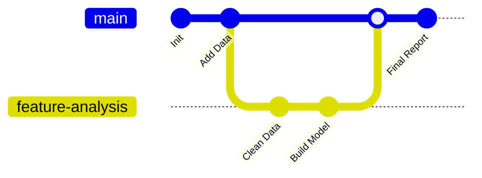

**Git** is a distributed version control system (DVCS) that tracks changes in source code during software development. Paired with a remote host such as GitHub, it gives a project history, collaboration, and backup. This note covers why version control matters, the distinction between Git and GitHub, the basic commit workflow, what should never be committed (and the `.gitignore` file that enforces it), and how `requirements.txt` shares an environment that Git deliberately ignores. It anchors [[Python Language Overview]] alongside [[Virtual Environments and Package Management]] and [[Project Structure and Best Practices]].

## Why version control?

Three capabilities justify the tooling. **History** means you can undo mistakes by reverting to a previous state. **Collaboration** means multiple people can work on the same file without overwriting each other. **Backup** means code is stored remotely, in the cloud.

## Git versus GitHub

The two names are not interchangeable. **Git** is the software installed on your computer (local); **GitHub** is a website that hosts Git repositories (remote). Other examples of Git repository hosts include GitLab and Bitbucket.

## The basic workflow

A typical data-project history branches: work happens on a feature branch, then merges back into the main line.



### The happy path commands

1.  **Init:** turn a folder into a Git repository.
    ```bash
    git init
    ```
2.  **Status:** check which files have changed.
    ```bash
    git status
    ```
3.  **Add:** move changes to the "staging area" (prepare them to be saved).
    ```bash
    git add filename.py    # Add specific file
    git add .              # Add ALL changed files
    ```
4.  **Commit:** save the snapshot with a message.
    ```bash
    git commit -m "Fixed bug in data cleaning function"
    ```
5.  **Push:** upload the commit to GitHub.
    ```bash
    git push origin main
    ```

## The .gitignore file

The critical concept: you should **never** commit certain files to Git. Four categories matter:

1. **Sensitive data:** passwords, API keys, credentials.
2. **Large data:** CSVs larger than 100MB — Git is for code, not data storage.
3. **System files:** `.DS_Store`, `__pycache__`.
4. **Virtual environments:** the `env/` folder contains thousands of files; you should re-install them using `requirements.txt` instead.

You create a file named `.gitignore` and list these items inside. Git will then completely ignore them — which is why the standard project layout described in [[Project Structure and Best Practices]] carries a `.gitignore` from the start.

## Requirements files

Since the virtual environment is ignored, how do we share the setup? The answer is to generate a **requirements.txt** file:

- **Export:** `pip freeze > requirements.txt` — saves the list of installed libraries.
- **Install:** `pip install -r requirements.txt` — installs the libraries from the list.

Anyone who receives the repository can recreate the environment from that list, as covered in [[Virtual Environments and Package Management]]. Editors matter here too: VS Code ships with built-in source-control management, as noted in [[IDEs and Development Environments]].

## See also

- [[Python Language Overview]]
- [[Virtual Environments and Package Management]]
- [[Project Structure and Best Practices]]
- [[IDEs and Development Environments]]
- [[Installation and Distributions]]
