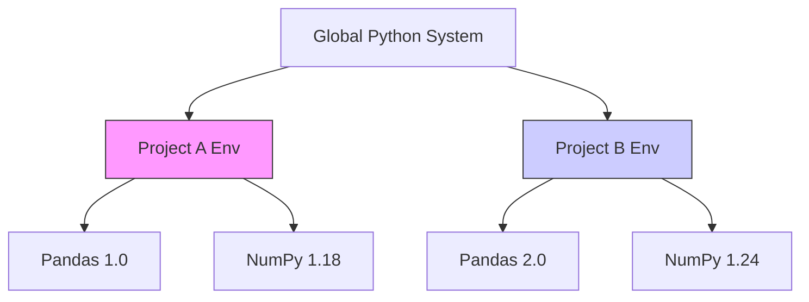

One of the most critical skills in Python development is **environment isolation**: giving every project its own interpreter and its own set of installed libraries. Without it, projects on the same machine fight over a single global installation — the situation known as **dependency hell**. This note explains the problem, shows how virtual environments solve it, and walks through the two dominant toolchains: `venv` with `pip`, and `conda`. It anchors [[Python Language Overview]] alongside [[Installation and Distributions]] and [[Project Structure and Best Practices]].

## The problem: dependency hell

Imagine you are working on two projects. **Project A** is an older project built in 2021 using `pandas 1.0`; **Project B** is a brand-new project requiring features from `pandas 2.0`. If you install Python globally on your computer, you can only have **one version** of pandas installed at a time. Updating pandas for Project B will **break** Project A.

## The solution: virtual environments

A **virtual environment** is a self-contained directory tree that contains a specific Python installation for a specific project. Project A gets its own box with pandas 1.0, Project B gets its own box with pandas 2.0, and the global system remains untouched:

The diagram shows each environment carrying its own library set — Project A pairs pandas 1.0 with NumPy 1.18, while Project B pairs pandas 2.0 with NumPy 1.24 — so neither project's dependencies can touch the other's.

## Managing environments

There are two main tools for this: **venv** (built into standard Python) and **conda** (bundled with Anaconda — see [[Installation and Distributions]]).

### venv (standard Python)

venv uses `pip` for packages. The workflow:

1. **Create:** `python -m venv myenv`
2. **Activate (Windows):** `.\myenv\Scripts\activate`
3. **Activate (Mac/Linux):** `source myenv/bin/activate`
4. **Install packages:** `pip install pandas`
5. **Deactivate:** `deactivate`

### conda (Anaconda)

conda uses `conda` for both packages and environments:

1. **Create:** `conda create --name myenv python=3.10`
2. **Activate:** `conda activate myenv`
3. **Install packages:** `conda install pandas`
4. **List envs:** `conda env list`

## pip versus conda

The two package managers overlap in purpose but are not interchangeable:

| Feature | **pip** | **conda** |
| :--- | :--- | :--- |
| **Scope** | Python packages only. | Any software (Python, R, C libraries). |
| **Source** | PyPI (Python Package Index). | Anaconda Repository. |
| **Relationships** | Installs packages. Does not manage environments itself (needs venv). | Manages **both** packages and environments. |
| **Compiled binaries** | Sometimes compiles from source (can be slow/error-prone). | Always installs pre-compiled binaries (faster/safer for science libs). |

> [!warning]
> If you installed Anaconda, stick to `conda` commands. Mixing `pip` and `conda` in the same environment can sometimes corrupt dependencies.

## See also

- [[Python Language Overview]]
- [[Installation and Distributions]]
- [[Project Structure and Best Practices]]
- [[Version Control with Git and GitHub]]
- [[IDEs and Development Environments]]
- [[Pandas]]
- [[NumPy]]
