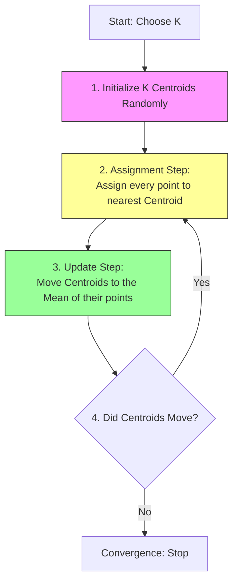

**Clustering** (or *Regroupement*) is the unsupervised learning task of dividing a population of data points into groups such that points in the same group are more similar to each other than to points in other groups. Unlike classification, the groups are not predefined — they are discovered by the algorithm, which makes clustering one of the two pillars of unsupervised learning alongside dimensionality reduction (see [[Principal Component Analysis]] and [[t-SNE and UMAP]]). Both pillars are essential for exploration, visualization, and as preprocessing for downstream models. This note develops the logic of clustering, the K-Means algorithm with its WCSS objective and the elbow method, K-Means' limitations and failure modes, and the DBSCAN and hierarchical alternatives.

## What clustering is

**Clustering** (or *Regroupement*) is the task of dividing a population or data points into a number of groups such that data points in the same groups are more similar to other data points in the same group than those in other groups. Unlike **Classification** (Supervised Learning), where the classes are predefined (e.g., "Cat" vs. "Dog"), in **Clustering** (Unsupervised Learning), the groups are **discovered** by the algorithm. Unsupervised learning more broadly finds structure in unlabeled data: clustering groups similar examples, while dimensionality reduction projects high-dim data to a lower-dim space that preserves structure.

### The goal: discovery of structure

The objective is to minimize the **Intra-Cluster Distance** (distance between points inside a group) and maximize the **Inter-Cluster Distance** (distance between the groups themselves). Tight, well-separated groups are the signature of a good clustering.

> [!INFO] Analogy: The Library
> *   **Classification:** A librarian receives a book with a sticker that says "Science Fiction" and puts it on the Sci-Fi shelf.
> *   **Clustering:** A librarian receives a pile of books with no covers or stickers. They must read the summaries and organize them into piles based on similarity (e.g., "These books talk about spaceships," "These books talk about history"). The librarian names the piles *after* grouping them.

### The geometric intuition

Clustering relies entirely on the concept of **Distance** in a vector space. If two data points are close together in the feature space (e.g., in a graph of $X_1$ vs $X_2$), they likely share similar properties. The algorithm assumes that **Proximity = Similarity** — the same geometric assumption that underlies [[K-Nearest Neighbors]] in the supervised setting.

A classic medical diagnosis example makes this concrete:

*   **Input:** Patient data (Blood Sugar, Iron Levels).
*   **Label:** None.
*   **Result:** The algorithm notices distinct "clouds" of data points.
    *   *Cloud A:* High Sugar, Low Iron.
    *   *Cloud B:* Normal Sugar, Normal Iron.
*   It assigns them to "Cluster 1" and "Cluster 2". It is up to the human expert to later look at Cluster 1 and name it "Type A Diabetes."

The clusters are mathematically real but semantically unnamed until a human interprets them — which is also why cluster labels are arbitrary: cluster 0 is not "better" than cluster 1.

### The families of clustering methods

While K-Means is the most popular, it is part of a broader family of methods:

1.  **Partitioning Methods (K-Means):** Divide data into $K$ distinct, non-overlapping groups.
2.  **Hierarchical Methods:** Create a tree of clusters (Dendrogram), grouping small clusters into larger ones.
3.  **Density-Based Methods (DBSCAN):** Find areas of high density and separate them from areas of low density (outliers).

## The K-Means algorithm

**K-Means** is an iterative algorithm that partitions a dataset into $K$ pre-defined distinct non-overlapping subgroups (clusters). It is the simplest and most-used clustering algorithm — the default first choice. Two core concepts govern everything:

*   **$K$:** The number of clusters (a hyperparameter you must choose).
*   **Centroid ($\mu$):** The center point of a cluster. It is the arithmetic mean of all data points belonging to that cluster.

### The algorithm cycle

The process loops through two main steps (Assignment and Update) until it converges. Stated compactly: pick $K$ random initial centroids, assign each point to the nearest centroid, recompute centroids as the mean of their assigned points, and repeat until assignments stop changing.



**Step 1: Initialization.** We select $K$ points in the data space to act as the initial centroids. These can be random points or actual data points selected at random.

**Step 2: Cluster Assignment (Expectation).** For every data point $x_i$ in the dataset, we calculate its distance to every centroid $\mu_j$. We typically use **Euclidean Distance**: $d(x, \mu) = ||x - \mu||^2$. The point is assigned to the cluster of the closest centroid.

**Step 3: Move Centroids (Maximization).** Once all points are assigned, the centroid position is usually no longer in the center of its cluster. We calculate the new position of centroid $\mu_j$ by taking the **Average (Mean)** of all points $x$ currently assigned to cluster $j$:

$$ \mu_j = \frac{1}{|S_j|} \sum_{x \in S_j} x $$

*(Where $S_j$ is the set of points in cluster $j$).*

**Step 4: Convergence.** Steps 2 and 3 are repeated. The algorithm stops when:

1.  The centroids no longer change position (Stability).
2.  No points change their cluster assignment.
3.  A maximum number of iterations is reached.

The algorithm's **objective** is to minimize the sum of squared distances from points to their cluster centroids (the inertia, formalized below as WCSS). Its **pros** are that it is simple, fast ($O(NK)$ per iteration), and scales well; its **cons** are that it assumes spherical clusters of similar size, is sensitive to initialization, and requires choosing $K$.

### Worked numerical example

Imagine 1D data: `[2, 3, 10, 11, 12]` and $K=2$.

1.  **Init:** Random centroids $\mu_1 = 2$, $\mu_2 = 12$.
2.  **Assign:**
    *   `2` is close to $\mu_1$.
    *   `3` is close to $\mu_1$.
    *   `10` is close to $\mu_2$.
    *   `11` is close to $\mu_2$.
    *   `12` is close to $\mu_2$.
    *   Cluster 1: `{2, 3}`, Cluster 2: `{10, 11, 12}`.
3.  **Update:**
    *   New $\mu_1 = \text{Average}(2, 3) = 2.5$.
    *   New $\mu_2 = \text{Average}(10, 11, 12) = 11$.
4.  **Repeat:** The process continues with centroids $2.5$ and $11$.

## Choosing K: WCSS and the elbow method

One of the biggest challenges in K-Means is answering the question: **"How many clusters ($K$) should I choose?"** Unlike Classification, where we know the classes (e.g., Dog/Cat means $K=2$), in Clustering, we often don't know the answer.

### Evaluating cluster quality (inertia)

To evaluate how "good" a clustering is, we measure how tightly grouped the clusters are. We use a metric called **WCSS (Within-Cluster Sum of Squares)**, also known as **Inertia**:

$$ WCSS = \sum_{j=1}^{K} \sum_{x_i \in Cluster_j} ||x_i - \mu_j||^2 $$

The **logic**: we sum the squared distances between every point $x_i$ and its assigned centroid $\mu_j$. The **goal**: lower WCSS is better (it means points are very close to their centroids). But there is a **trap**: if we set $K = N$ (number of data points), WCSS will be 0, because every point is its own centroid — but this is useless. We want a small WCSS *and* a small $K$.

### The elbow method

To balance "Goodness of Fit" (Low WCSS) with "Simplicity" (Low $K$), we use the Elbow Method (Method of the Elbow). The procedure:

1.  Run the K-Means algorithm for a range of $K$ values (e.g., $K=1$ to $K=10$).
2.  For each $K$, calculate the final WCSS (Inertia).
3.  Plot **$K$** on the X-axis and **WCSS** on the Y-axis.

The curve will look like a bent arm. At the **start**, as $K$ increases from 1 to 2, WCSS drops massively (huge gain). In the **middle**, as $K$ increases further, the drop becomes smaller (diminishing returns). The **elbow point** — the value of $K$ where the curve starts to flatten out — is the optimal $K$.


> [!TIP] Practical Application
> If the plot is a smooth curve with no clear elbow, the data might not be naturally clustered. In that case, the choice of $K$ depends on the business context (e.g., "We have budget for 3 marketing campaigns, so set $K=3$").

The elbow is a heuristic rather than a verdict. In practice you should triangulate it with the silhouette score (see [[Clustering Evaluation Metrics]]) and with domain knowledge before committing to a $K$.

## Limitations and failure modes

While K-Means is fast and popular, it is not perfect. It is essential to understand its weaknesses to avoid incorrect conclusions.

### The initialization trap (local minima)

K-Means is sensitive to the starting position of the centroids. The **problem**: if you initialize centroids poorly (e.g., two centroids in the same data cloud), the algorithm might get stuck in a **Local Minimum**. It will converge, but the result will be suboptimal. Two standard remedies exist:

*   **Solution 1 (Standard):** Run the algorithm multiple times (e.g., `n_init=10` in Scikit-Learn) with different random seeds and pick the result with the lowest WCSS.
*   **Solution 2 (K-Means++):** A smarter initialization algorithm that spreads the initial centroids far apart from each other, ensuring a better global result.

### Sensitivity to outliers

Since K-Means relies on the **Mean** (Average), it is highly sensitive to outliers. Imagine a cluster of 100 people with average income \$50k. If you add one billionaire (\$1B income), the "Centroid" (Average) will shift massively towards the billionaire, effectively destroying the cluster logic. The **fix**: remove outliers before running K-Means, or use **K-Medians** (uses the median instead of the mean).

The same sensitivity cuts both ways. Once clusters are fitted, points that sit far from every centroid are precisely the anomalies you may want to flag, which is why clustering also serves as an anomaly-detection tool (see the production implications below).

### The "spherical" assumption

K-Means assumes that clusters are:

1.  **Spherical (Round):** It uses Euclidean distance, which radiates in a circle.
2.  **Similar Size:** It struggles if one cluster is tiny and tight while another is huge and sparse.
3.  **Linearly Separable:** It cannot handle complex shapes (e.g., "Concentric Circles" or "Moon shapes").

> [!WARNING] Visual Trap
> If your data looks like a "Banana" shape or a "Donut," K-Means will fail to detect it. It will try to cut the banana in half with a straight line. For these complex shapes, use **DBSCAN** or **Spectral Clustering**.

## DBSCAN: density-based clustering

DBSCAN takes a fundamentally different view of what a cluster is: a cluster is a region of high density separated from other clusters by low-density regions. This single change of perspective buys a lot. There is no need to choose $K$ at all, and the algorithm handles non-spherical clusters naturally. Points that fall in low-density regions are marked as noise (outliers), so DBSCAN doubles as an outlier detector. The price is sensitivity to its two parameters, `eps` (the neighborhood radius) and `min_samples`, which must be tuned to the data's density scale.

## Hierarchical clustering

Hierarchical clustering builds a tree of clusters (a **dendrogram**) instead of a flat partition. It comes in two flavors: **agglomerative** (bottom-up: merge the closest clusters repeatedly) or **divisive** (top-down: split clusters recursively). You don't need to choose $K$ upfront — you cut the dendrogram at the desired level and read off the partition, and the tree itself is an interpretable hierarchy of cluster structure. The drawback is cost: $O(N^2)$ or worse, so it doesn't scale to large datasets.

## Choosing a clustering algorithm

The three families trade off scale, shape flexibility, and interpretability, so the choice follows your data and your goal:

- **K-means**: large data, roughly spherical clusters, know K.
- **DBSCAN**: arbitrary cluster shapes, want outlier detection.
- **Hierarchical**: small data, want to understand cluster structure.

## Clustering and dimensionality reduction

Dimensionality reduction is the companion pillar of unsupervised learning: it projects high-dimensional data to a lower-dimensional space while preserving structure. [[Principal Component Analysis]] is the linear approach — a linear projection to the directions of maximum variance that is fast, deterministic, has no hyperparameters (except the number of components), and serves as a good baseline and preprocessing step, though it only captures linear structure. [[t-SNE and UMAP]] are the non-linear approaches: t-SNE is a nonlinear reduction optimized for **visualization** (2D or 3D) that preserves local structure (nearby points stay nearby) but does NOT preserve global structure (cluster distances are meaningless), is slow on large data — use it for visualization, not as model input — and is stochastic, so different runs give different plots; UMAP is the modern alternative that is faster, better preserves global structure, can be used as a preprocessing step (unlike t-SNE) because it generalizes to new points, and has meaningful hyperparameters (`n_neighbors`, `min_dist`). Autoencoders complete the family as the neural alternative: networks trained to reconstruct their input through a low-dimensional "bottleneck" layer (the bottleneck is the reduced representation), which can capture highly nonlinear structure and be trained end-to-end with the rest of a model, with variants such as VAE (variational, generative), denoising AE (robust), and contractive AE (explicit regularization).

The two pillars interact in practice. Running PCA before K-means can speed up clustering on high-dim data, but it loses interpretability. And the standard way to inspect a clustering — or any high-dimensional dataset — is to project it to 2D with UMAP or t-SNE and look at it. For method selection across the reduction family: **visualization** → UMAP or t-SNE; **preprocessing for downstream ML** → PCA or UMAP; **nonlinear structure, end-to-end training** → autoencoders; **generative modeling** → VAEs.

## Worked example

The full unsupervised toolkit in scikit-learn — clustering with K-Means and DBSCAN, plus the dimensionality reduction methods that pair with them:

```python
from sklearn.cluster import KMeans, DBSCAN
from sklearn.decomposition import PCA
from sklearn.manifold import TSNE
import umap

# K-means
kmeans = KMeans(n_clusters=5).fit(X)
labels = kmeans.labels_

# PCA
X_pca = PCA(n_components=2).fit_transform(X)

# t-SNE (visualization)
X_tsne = TSNE(n_components=2, perplexity=30).fit_transform(X)

# UMAP
X_umap = umap.UMAP(n_components=2).fit_transform(X)
```

## Why this matters for AI

Clustering and dimensionality reduction are not academic exercises — they show up all over modern AI systems:

- **Embedding visualization**: UMAP / t-SNE on text or image embeddings reveals clusters, outliers, structure. Essential for inspecting embedding models.
- **Vector DB indexing**: many ANN indexes (e.g., IVF) cluster vectors with k-means for fast retrieval.
- **Data exploration**: before training any model, cluster and visualize to understand the data.
- **Anomaly detection**: cluster outliers or low-density points flag anomalies.
- **Feature compression**: PCA / autoencoders reduce feature dim, speeding downstream training.

## Production implications

A few rules of thumb survive contact with production:

- **Always visualize embeddings with UMAP** before deploying. If the visualization doesn't match your intuition about the data, something is wrong.
- **For real-time clustering**, use mini-batch k-means (sklearn `MiniBatchKMeans`).
- **PCA before K-means** can speed up clustering on high-dim data, but loses interpretability.
- **Anomaly detection with clustering**: compute distance to nearest cluster centroid; flag points with distance > threshold.

## Common pitfalls

The classic mistakes span the whole clustering-and-dimensionality-reduction family:

- **Using t-SNE distances for analysis** — they're meaningless. Use it only for visualization.
- **Not standardizing features before PCA** — features with large scale dominate.
- **Choosing K wrong** — elbow method is heuristic; check silhouette scores too.
- **Forgetting that clustering is unsupervised** — labels are arbitrary; cluster 0 isn't "better" than cluster 1.
- **UMAP hyperparameters matter** — `n_neighbors` and `min_dist` dramatically affect results; don't use defaults blindly.

## Further reading

The canonical references for this area of unsupervised learning:

- Hastie et al., *ESL*, Chapter 14 (unsupervised learning).
- McInnes et al. (2018), *UMAP: Uniform Manifold Approximation and Projection*.
- van der Maaten & Hinton (2008), *Visualizing Data using t-SNE*.

## See also

Related notes in the vault:

- [[Machine Learning MOC]]
- [[Principal Component Analysis]]
- [[t-SNE and UMAP]]
- [[Clustering Evaluation Metrics]]
- [[K-Nearest Neighbors]]
- [[Bias Variance Tradeoff]]
