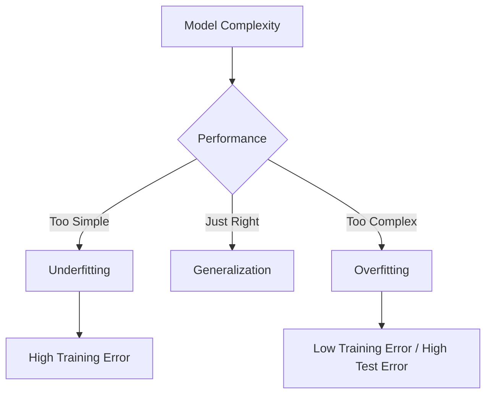
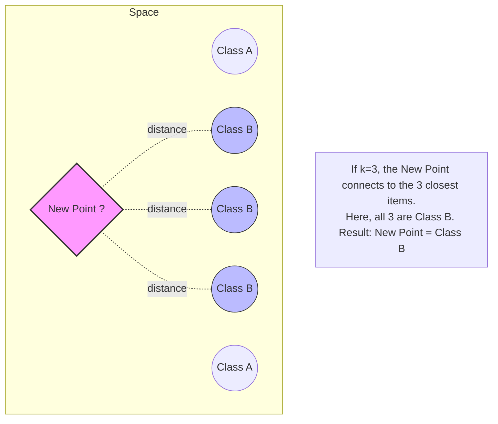
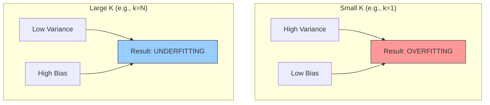
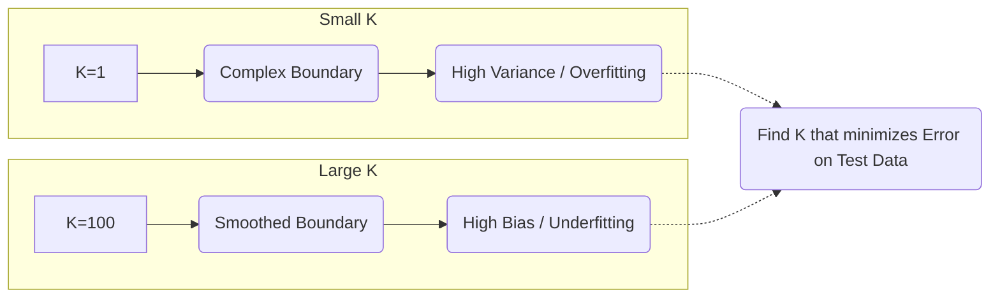
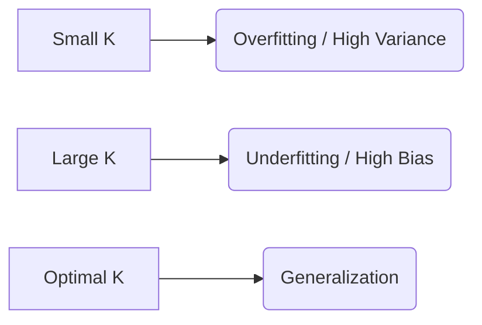
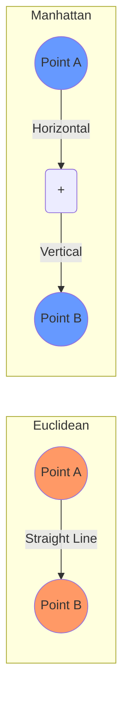
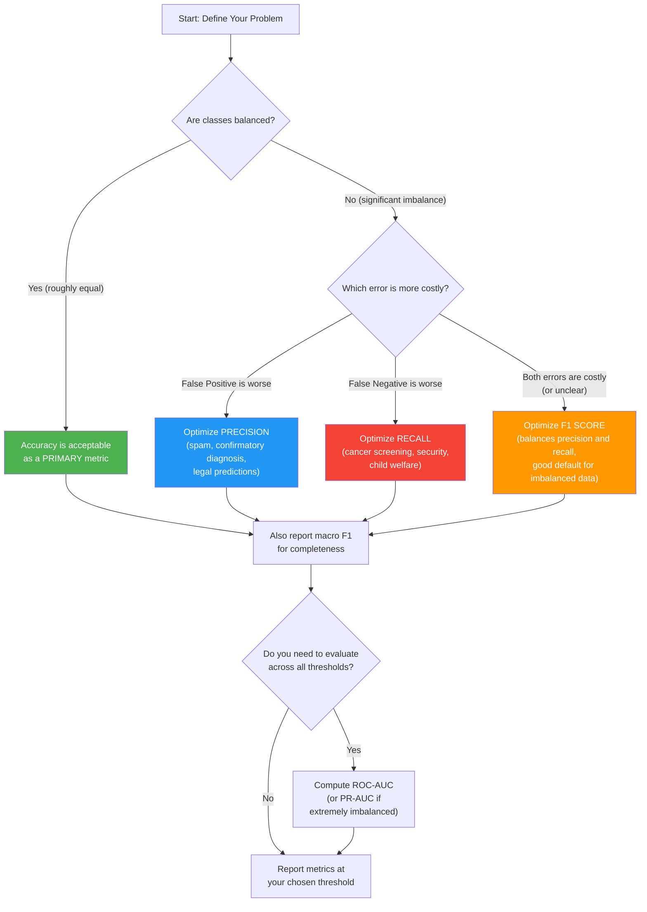

Evaluation metrics are how a trained model answers the only question that ultimately matters: how well will it perform on data it has never seen? This reference collects the full toolkit — the data-splitting discipline that makes measurement honest, the confusion matrix and the accuracy, precision, recall, and F1 family built on top of it, threshold behaviour and the ROC/AUC diagnostics, calibration, ranking and regression metrics, and the decision frameworks for choosing among them. Choosing the right metric is as important as choosing the right model: most production machine-learning failures are evaluation failures, caused by optimizing the wrong quantity for the business objective. [[K-Nearest Neighbors]] serves as the running example throughout, because its single hyperparameter $K$ makes the mechanics of validation and model selection unusually visible; the same ideas apply whether the model is a KNN classifier, a [[Support Vector Machines|support vector machine]], a [[Decision Trees|decision tree]], or a neural network. See [[Machine Learning MOC]] for the surrounding map.

A useful distinction to hold in mind: the same formulas often play two roles. Mean squared error and log loss are differentiable training objectives that [[Gradient Descent]] can optimize directly (see [[Loss Functions]]), and they are also evaluation metrics used to judge a finished model. The two roles may diverge — a model is frequently trained on a smooth surrogate loss but judged on a non-differentiable business metric such as precision at a fixed recall — and when they diverge you must track what you optimize separately from what you report.

## Foundations of honest evaluation

Before any metric is computed, the measurement itself must be trustworthy. A common and costly mistake is testing a model on the same data it learned from, which leads to false confidence: the model has memorized rather than learned. The goal of machine learning is **generalization** — the ability to perform well on new, unseen data, not just the data it memorized — and every evaluation procedure is designed to estimate that quantity without contaminating it.

### The three data subsets

In regression and classification problems, the dataset is generally divided into three distinct subsets:

| Subset | Typical share | Purpose | Analogy |
| :--- | :--- | :--- | :--- |
| **Training set** | ~70% | "Teach" the model. The algorithm looks at input $X$ and output $Y$ in this set to learn patterns (weights, boundaries, and so on). | The textbook problems you practice with for homework. |
| **Validation set** | ~15% | *Tune* the model during training: adjust hyperparameters (like choosing $K$ in KNN), check for overfitting, and decide when to **stop** training (early stopping) so the model does not memorize the noise. | The practice quiz you take before the exam to see what you need to study more. |
| **Test set** | ~15% | Used **only once**, at the very end, to evaluate the final model on completely unseen data and estimate its real-world performance. | The final exam. |

The test set is "locked": touching it during development turns your estimate of generalization into a measurement of memorization.

> [!WARNING] Important Rule
> Never train your model on the **Test Set**. If you do, your accuracy metrics will be high, but the model will fail in the real world. This is called **Data Leakage**.

### Generalization: overfitting versus underfitting

Two failure modes define the boundaries of good generalization. **Underfitting (high bias)** means the model is too simple to capture the underlying structure of the data: it shows high error on training data *and* high error on validation data — for example, fitting a straight line ([[04 - Machine Learning/Regression/Linear Regression|Linear Regression]]) to data that forms a parabola. **Overfitting (high variance)** means the model is too complex and learns the **noise** and random fluctuations in the training data instead of the actual pattern: it shows very low error on training data but high error on validation data — like a student who memorizes the answers to the homework but fails the test because the questions were slightly different.



The deeper treatment of this complexity dial, and the techniques (such as those in [[Regularization Techniques]]) that manage it, live in [[Bias Variance Tradeoff]]; for evaluation purposes the key symptom to watch is the *gap* between training and validation performance.

### Cross-validation When you don't have enough data to "waste" 30% on testing, or to ensure the model isn't just lucky with a specific split, cross-validation is the answer.

Splitting data into just one train/test split can be risky if your dataset is small or unlucky — for example, if all the "hard" examples happen to land in the test set, or when you cannot afford to "waste" 30% of the data on testing. Cross-validation is the standard remedy and the small-data alternative to a single split.

**K-fold cross-validation** works as follows: split the dataset into $K$ equal-sized "folds" (parts); train the model $K$ times; in each iteration use **one fold** for testing and the remaining $K-1$ folds for training; average the performance results. Common choices are $K=5$ or $K=10$. The final score is the **average** of the scores from all $K$ iterations.

Two variants matter in practice. **Stratified K-fold** ensures each fold has the same percentage of samples for each class as the complete set — if the original data is 60% cats and 40% dogs, every fold will also be 60/40 — which prevents one fold from containing only cats and no dogs, and prevents bias from uneven class representation. **LOOCV (Leave-One-Out Cross-Validation)** is the extreme case: train on all data points except one, test on that single left-out point, and repeat $N$ times for every data point. It uses almost all of the data for training, but it is extremely computationally expensive for large datasets.

Cross-validation is also the workhorse of hyperparameter selection, as the KNN example below illustrates in detail.

## Accuracy and its limits

Accuracy is the most intuitive and commonly reported evaluation metric: it is simply the fraction of predictions that are correct.

$$ \text{Accuracy} = \frac{\text{correct predictions}}{\text{total predictions}} $$

Equivalently, in confusion-matrix terms:

$$ \text{Accuracy} = \frac{TP + TN}{\text{Total Instances}} $$

$$Accuracy = \frac{TP + TN}{TP + TN + FP + FN} = \frac{\text{Total Correct}}{\text{Total Data}}$$

Accuracy is perfectly adequate for balanced datasets where every class is equally represented and all types of errors are equally costly. The fundamental problem is that accuracy treats every correct prediction as equally valuable and every incorrect prediction as equally costly, which is rarely true in real-world applications. A first hint of the danger: if 95% of the data is class A, a model that *always* guesses "A" has 95% accuracy but is useless. A spam filter that always says "not spam" gets 99% accuracy if 1% of emails are spam — and is useless.

### The accuracy trap on imbalanced data

Consider a medical diagnosis scenario that illustrates the problem vividly. Imagine a dataset of 1,000 patients being screened for a rare but deadly disease: 990 healthy patients and only 10 diseased patients. A "model" that simply predicts "healthy" for every single patient, regardless of any input features, correctly identifies all 990 healthy patients and misses all 10 diseased patients. Its accuracy is:

$$\text{Accuracy} = \frac{\text{Correct Predictions}}{\text{Total Predictions}} = \frac{990}{1000} = 99\%$$

Ninety-nine percent accuracy sounds impressive, but this model is clinically worthless — it fails to detect a single case of the disease. In a real medical setting, this would mean 10 patients with a deadly disease are sent home without treatment. The high accuracy is entirely driven by the overwhelming majority class, and it completely obscures the model's catastrophic failure on the minority class that actually matters.

This example is not contrived — it reflects a common reality in many domains. Credit card fraud detection (99.8% legitimate transactions), rare disease screening (99.9% healthy), security intrusion detection (99.99% normal traffic), and manufacturing defect detection (99.5% non-defective) all exhibit extreme class imbalance where accuracy becomes dangerously misleading, sometimes to the point of uselessness — a meaningless metric. In all these cases, a model that always predicts the majority class achieves deceptively high accuracy while being completely useless for its intended purpose.

> [!warning] The Accuracy Trap
> Whenever you encounter a dataset with imbalanced classes — and most real-world datasets are imbalanced — accuracy alone cannot tell you whether your model is actually performing well. A model with 99% accuracy on a dataset that is 99% one class tells you NOTHING about the model's ability to detect the important minority class. Always look beyond accuracy to metrics that account for class imbalance and the relative costs of different types of errors.

The same degenerate majority-prediction pattern recurs wherever a single aggregate number is dominated by the most frequent label — most notably **pixel accuracy** in image segmentation, where a model that predicts the majority class everywhere can score well while failing on the rare classes that matter. Detection and segmentation metrics built on IoU avoid this trap; see [[Computer Vision Evaluation Metrics]].

## The confusion matrix

The confusion matrix is a table that provides a complete breakdown of a classifier's performance by comparing predicted labels against true labels. For a binary classification problem it is a 2×2 table with four cells, each representing a different type of prediction outcome, and every other classification metric — precision, recall, F1, specificity, and more — is derived from these four counts. Understanding the confusion matrix is therefore the prerequisite for understanding all other metrics. For classification problems, accuracy alone is not enough: we need to know *how* the model is failing.

Consider detecting pictures of **dogs**, where positive (1) means "is a dog" and negative (0) means "is not a dog" (a cat, say):

| | **Predicted: Dog (Positive)** | **Predicted: Not Dog (Negative)** |
| :--- | :---: | :---: |
| **Actual: Dog (Positive)** | **True Positive (TP)**<br>(Correctly identified as Dog) | **False Negative (FN)**<br>(Missed the Dog / Type 2 Error) |
| **Actual: Not Dog (Negative)** | **False Positive (FP)**<br>(False Alarm / Type 1 Error) | **True Negative (TN)**<br>(Correctly ignored) |

Each cell has a precise definition and a clear interpretation in the medical analogy:

**True Positive (TP)**: the patient HAS the disease AND the model predicts "disease." This is the ideal outcome for a diseased patient — the disease is correctly detected and the patient can receive treatment. In general terms, a true positive is a correctly identified instance of the positive class.

**False Negative (FN)**: the patient HAS the disease BUT the model predicts "healthy." This is the most dangerous type of error in medical diagnosis — a sick patient is incorrectly told they are healthy, the disease goes untreated, potentially with life-threatening consequences. In general terms, the model missed a positive instance.

**False Positive (FP)**: the patient is HEALTHY BUT the model predicts "disease." This is a false alarm — a healthy patient is incorrectly told they might be sick, with consequences including unnecessary stress, additional invasive tests, wasted medical resources, and potential harm from unnecessary treatment. In general terms, the model incorrectly flagged a negative instance as positive.

**True Negative (TN)**: the patient is HEALTHY AND the model predicts "healthy." The ideal outcome for a healthy patient — no unnecessary worry or treatment; a correctly identified instance of the negative class.

> [!note] Memory Trick for TP, TN, FP, FN
> The first word (True/False) tells you whether the prediction was correct or incorrect. The second word (Positive/Negative) tells you what the model PREDICTED. So "False Positive" = the prediction was FALSE (wrong) and the model predicted POSITIVE; "False Negative" = the prediction was FALSE (wrong) and the model predicted NEGATIVE. As unforgettable examples: a False Positive (Type 1) is telling a man he is pregnant — you predicted YES, but it was NO; a False Negative (Type 2) is telling a pregnant woman she is not pregnant — you predicted NO, but it was YES.

### Type I and Type II errors

The two types of classification errors correspond to two classical statistical concepts with important real-world implications beyond machine learning.

A **Type I Error** occurs when the model incorrectly rejects the null hypothesis — in classification terms, when it predicts "positive" for an actually negative instance. The Type I Error Rate is:

$$\text{Type I Error Rate} = \frac{FP}{FP + TN} = \frac{FP}{\text{All Actual Negatives}}$$

This is also called the **False Positive Rate (FPR)**. It measures the fraction of actual negatives that are incorrectly classified as positives — in the medical analogy, the fraction of healthy patients incorrectly diagnosed as diseased. Real-world implications: in spam detection, a legitimate email is classified as spam and the user loses an important message; in fraud detection, a legitimate transaction is flagged as fraudulent, the customer's card is unnecessarily frozen, causing frustration and potential financial harm; in security screening, an innocent person is flagged as a threat, resulting in unnecessary investigation and violation of privacy.

A **Type II Error** occurs when the model fails to reject the null hypothesis when it should — in classification terms, when it predicts "negative" for an actually positive instance. The Type II Error Rate is:

$$\text{Type II Error Rate} = \frac{FN}{FN + TP} = \frac{FN}{\text{All Actual Positives}}$$

This is also called the **False Negative Rate (FNR)**. It measures the fraction of actual positives incorrectly classified as negatives — the fraction of diseased patients incorrectly diagnosed as healthy. Real-world implications: in cancer detection, a cancer patient is told they are cancer-free, the cancer goes untreated and may become terminal; in security, an intrusion is not detected and the attacker remains inside the system; in quality control, a defective product passes inspection and reaches the consumer. In all these cases, the cost of a missed positive far exceeds the cost of a false alarm.

> [!DANGER] Type 1 vs Type 2 Errors
> - **Type 1 Error (FP):** The model cries "Wolf!" when there is no wolf.
> - **Type 2 Error (FN):** The model sleeps while the wolf attacks. In medical diagnosis, Type 2 is often more dangerous.

> [!info] The Asymmetry of Error Costs
> In most real-world applications, the cost of Type I and Type II errors is NOT symmetric. Medical diagnosis heavily penalizes Type II errors (missed disease), while spam detection heavily penalizes Type I errors (legitimate email lost). This asymmetry is the fundamental reason why we need metrics beyond accuracy — accuracy treats all errors equally, but real applications do not.

### Worked example: ten animal images

Suppose we have 10 images of animals and want to identify dogs. The actual labels are D, D, D, ND, D, ND, D, D, ND, ND (6 dogs, 4 not-dogs), and the model predicted D, ND, D, ND, D, D, D, D, ND, ND. Tallying the four outcomes:

1. **TP (True Positive):** actual D, predicted D — count = 5.
2. **TN (True Negative):** actual ND, predicted ND — count = 3.
3. **FP (False Positive):** actual ND, predicted D — count = 0 (no not-dogs were called dogs).
4. **FN (False Negative):** actual D, predicted ND — count = 1 (one dog was missed).

The resulting matrix:

$$
\begin{bmatrix}
TP=5 & FN=1 \\
FP=0 & TN=3
\end{bmatrix}
$$

From these four counts, the core metrics follow immediately. Accuracy — how often the classifier is correct overall — is $(5+3)/10 = 0.8$, or **80%**. Precision — when the model predicts "positive," how often is it right (the quality of the positive result) — is $5 / (5 + 0) = 1.0$, or **100%**, perfect here precisely because there were no false alarms. Recall — out of all the *actual* positive cases, how many did we find (the quantity of the positive result) — is $5 / (5 + 1) = 0.833$, or **83.3%**, because one dog was missed. The F1-score is $2 \times \frac{1 \times 0.833}{1 + 0.833} \approx 0.91$, as developed below. Notice how the single number "80% accurate" hid both the perfect precision and the missed dog.

### Multiclass confusion matrices

With multiple classes (cat, dog, horse), the matrix expands to 3×3:

| Predicted $\rightarrow$ <br> Actual $\downarrow$ | Cat | Dog | Horse |
| :--- | :---: | :---: | :---: |
| **Cat** | **TP (for Cat)** | FP | FP |
| **Dog** | FN | **TP (for Dog)** | FP |
| **Horse** | FN | FN | **TP (for Horse)** |

The **diagonal elements** are correct predictions and the **off-diagonal** cells are errors. Reading a multiclass matrix follows two rules: to calculate precision for "Dog," take $TP_{dog}$ divided by the sum of the "Dog" **column**; to calculate recall for "Dog," take $TP_{dog}$ divided by the sum of the "Dog" **row**. Equivalently, you treat the class of interest as a "one vs all" problem: TP is an actual dog predicted as dog; FP is a cat or horse predicted as dog; FN is an actual dog predicted as cat or horse; TN is a cat or horse predicted as cat or horse. For a quick overall figure, if 10 instances contain 8 correctly classified, accuracy is $8/10$:

$$Accuracy = \frac{8}{10} = 0.8 \text{ or } 80\%$$

## The precision, recall, and F1 family

Once the confusion matrix is in hand, the metric family derived from it answers four different questions about performance. High precision means few false positives; high recall means few false negatives — which one matters depends on the cost of each error type.

| Metric | Question it answers | Formula | Optimize when |
| :--- | :--- | :--- | :--- |
| **Accuracy** | How often is the classifier correct overall? | $\frac{TP + TN}{\text{Total}}$ | Classes balanced, errors equally costly |
| **Precision** | Of predicted positives, how many are actually positive? | $\frac{TP}{TP + FP}$ | Cost of a false positive is high |
| **Recall (sensitivity)** | Of actual positives, how many did we catch? | $\frac{TP}{TP + FN}$ | Cost of a false negative is high |
| **Specificity** | Of actual negatives, how many did we correctly identify? | $\frac{TN}{TN + FP}$ | False positives on the negative class are costly |
| **F1 score** | Are precision and recall *both* high? | $2 \cdot \frac{P \cdot R}{P + R}$ | Both error types matter; imbalanced data |

### Precision

$$ Precision = \frac{TP}{TP + FP} $$

Precision answers the question: "When the model says 'positive,' how often is it right?" It is the fraction of predicted positives that are actually positive. A precision of 0.90 means that 90% of the time the model predicts "positive," it is correct, and 10% of positive predictions are false alarms.

Precision is the metric to optimize when the **cost of a False Positive is high** relative to the cost of a False Negative — when you want to be very confident that a positive prediction is correct, even at the price of missing some actual positives.

**Spam detection**: when the filter classifies a message as spam, that message is moved to a spam folder the user rarely checks. If a legitimate email from your boss, a client, or a university is incorrectly classified as spam, you might miss critical information. The cost of a false positive (lost legitimate email) is much higher than the cost of a false negative (spam in your inbox, which you can simply delete), so spam filters should optimize for high precision.

**Fraud detection in financial services**: when a credit card transaction is flagged as fraudulent, the card is typically frozen and the customer must call to verify. A false positive means a legitimate purchase is blocked — embarrassment at checkout, potential financial hardship, customer dissatisfaction. While undetected fraud (FN) is also costly, inconveniencing many honest customers can be even more costly in churn and reputation, so banks tune fraud systems toward high precision.

**Legal and criminal justice**: in predictive policing or recidivism prediction, a false positive means an innocent person is flagged as high-risk, potentially leading to unjust surveillance, denial of parole, or wrongful detention. The cost of violating an innocent person's rights is considered, in most legal frameworks, far higher than the cost of failing to flag a potentially dangerous individual. High precision is essential.

### Recall (sensitivity, true positive rate)

$$ Recall = \frac{TP}{TP + FN} $$

Recall answers the question: "Of all the actual positives, what fraction did the model correctly identify?" A recall of 0.90 means the model catches 90% of all actual positive cases but misses 10%. The complement of recall is the False Negative Rate: $\text{FNR} = 1 - \text{Recall}$.

Recall is the metric to optimize when the **cost of a False Negative is high** — when you want to catch as many actual positives as possible, even if it means generating some false alarms.

**Cancer detection and medical screening**: a false negative means a patient with cancer is told they are cancer-free; the cancer continues to grow untreated, potentially becoming terminal by the time it is detected. A false positive, while stressful, leads to additional tests that can rule out cancer — emotional distress and additional medical expenses, but not loss of life. Cancer screening should optimize for high recall, even if some healthy patients undergo unnecessary follow-up tests.

**Security and intrusion detection**: a false negative means an intrusion goes undetected — the attacker remains inside the system, potentially exfiltrating data, planting malware, or causing damage for days or weeks. A false positive means normal activity is flagged, leading to an investigation that finds nothing: the cost is analyst time and temporary heightened alertness. Better to investigate a few false alarms than to miss a real attack.

**Child welfare screening**: a false negative means an at-risk child is not flagged for intervention, potentially leaving them in a dangerous situation. A false positive means a family is unnecessarily investigated — stressful and intrusive, but with safeguards. Child welfare systems prioritize recall to avoid missing children in genuine danger.

### Specificity (true negative rate)

$$ Specificity = \frac{TN}{TN + FP} $$

Specificity answers the question: "Of all the actual negatives, what fraction did the model correctly identify as negative?" A specificity of 0.95 means 95% of actual negatives are correctly classified and 5% are false positives. The complement of specificity is the False Positive Rate: $\text{FPR} = 1 - \text{Specificity}$. Specificity is the ability to find the negatives.

Specificity is important when the **cost of a False Positive is high** — similar to precision, but from the perspective of the negative class. The two are related but not identical: specificity measures performance on *actual negatives*, while precision measures performance on *predicted positives*.

**Medical rule-out tests**: some tests are designed to confidently determine that a patient does NOT have a condition — D-dimer tests, for example, are used to rule out blood clots. A high-specificity test ensures that when it says "negative," the patient truly is negative, avoiding unnecessary follow-up procedures; a low-specificity test would generate too many false positives, leading to unnecessary invasive and expensive follow-ups.

**Drug testing**: in workplace drug testing, a false positive means an employee who did not use drugs tests positive, potentially losing their job or facing disciplinary action. Confirmatory tests (like GC-MS) are used specifically because they have very high specificity (>99.99%), even if their sensitivity is slightly lower.

### F1 score and the harmonic mean

$$ F1 = 2 \times \frac{Precision \times Recall}{Precision + Recall} $$

The F1 score combines precision and recall into a single number using the harmonic mean. It ranges from 0 to 1, where 1 indicates perfect precision and recall, and 0 indicates that either precision or recall is zero. If you have high precision but low recall (or vice versa), the F1 score will be low — it forces the model to be good at both. This is exactly what you want under class imbalance: if 99% of the data is class A, accuracy is misleading, and F1 forces both precision and recall to be high for the class that matters.

Why the harmonic mean rather than the arithmetic mean? Because the harmonic mean heavily penalizes extreme imbalance between precision and recall. Consider a model with Precision = 1.0 and Recall = 0.01: every positive prediction is correct, but it only catches 1% of actual positives — it almost never makes a positive prediction, and when it does it is always right, but it misses 99% of the positive cases. This is clearly a terrible model for most applications.

- **Arithmetic Mean** = $(1.0 + 0.01) / 2 = 0.505$ — suggests the model is "about 50% good," completely misleading for a model that misses 99% of positive cases.
- **Harmonic Mean (F1)** = $2 \times (1.0 \times 0.01) / (1.0 + 0.01) = 0.02 / 1.01 \approx 0.0198$ — correctly indicates the model is nearly useless, because the harmonic mean is dominated by the smaller value.

The mathematical reason for this behavior is that the harmonic mean of two numbers is always closer to the smaller of the two. Formally, for $a, b > 0$:

$$\text{Harmonic Mean} = \frac{2ab}{a+b} \leq \min(a, b) \leq \frac{a+b}{2} = \text{Arithmetic Mean}$$

The F1 score can therefore never exceed either precision or recall, and it is pulled toward whichever is smaller. A high F1 requires BOTH high precision AND high recall — you cannot achieve a good F1 by excelling at one while neglecting the other.

> [!note] F1 vs. Fβ Scores
> The F1 Score gives equal weight to precision and recall. If your application values one more than the other, use the more general $F_\beta$ Score:
>
> $$F_\beta = (1 + \beta^2) \cdot \frac{\text{Precision} \cdot \text{Recall}}{\beta^2 \cdot \text{Precision} + \text{Recall}}$$
>
> The parameter $\beta$ controls the relative weight: $\beta > 1$ weights recall more heavily (use when false negatives are more costly), $\beta < 1$ weights precision more heavily (use when false positives are more costly), and $\beta = 1$ reduces to the standard F1 Score. Common choices are $F_2$ (weights recall 2× more than precision, used in medical screening) and $F_{0.5}$ (weights precision 2× more than recall, used in information retrieval).

## Thresholds and the precision-recall trade-off

Precision and recall are fundamentally in tension: improving one usually comes at the expense of the other. The trade-off arises because the classification threshold — the probability above which the model predicts "positive" — affects precision and recall in opposite directions.

A binary classifier typically outputs a probability $p$ that the input belongs to the positive class. The model predicts "positive" if $p > \text{threshold}$ and "negative" if $p \leq \text{threshold}$. The default threshold is 0.5, but you can adjust it to trade off precision and recall.

**Lowering the threshold** (say from 0.5 to 0.3): more samples are classified as positive (a lower probability suffices); TP increases (actual positives with probabilities between 0.3 and 0.5 are now caught); FP also increases (some actual negatives in that band are now flagged); **recall increases** (more actual positives caught); **precision decreases** (positive predictions are diluted with more false positives).

**Raising the threshold** (say from 0.5 to 0.7): fewer samples are classified as positive (only the most confident predictions remain); TP decreases (actual positives between 0.5 and 0.7 are missed); FP also decreases (fewer actual negatives exceed 0.7); **recall decreases**; **precision increases** (the remaining positive predictions are more likely correct).

A concrete example with numbers makes the mechanics tangible. Consider a model screening 200 patients for a disease, of which 50 actually have the disease and 150 are healthy:

| Threshold | TP | FP | FN | TN | Precision | Recall |
|---|---|---|---|---|---|---|
| 0.3 | 48 | 45 | 2 | 105 | 48/(48+45) = 0.52 | 48/(48+2) = 0.96 |
| 0.5 | 42 | 15 | 8 | 135 | 42/(42+15) = 0.74 | 42/(42+8) = 0.84 |
| 0.7 | 35 | 5 | 15 | 145 | 35/(35+5) = 0.88 | 35/(35+15) = 0.70 |
| 0.9 | 20 | 1 | 30 | 149 | 20/(20+1) = 0.95 | 20/(20+30) = 0.40 |

At threshold 0.3, the model catches nearly all diseased patients (recall = 0.96) but at the cost of many false alarms (precision = 0.52 — almost half of positive predictions are wrong). At threshold 0.9, the model is very confident when it predicts disease (precision = 0.95), but it misses 60% of actual disease cases (recall = 0.40). The choice of threshold depends entirely on the relative costs of false positives versus false negatives in your specific application.

> [!tip] Choosing the Right Threshold
> There is no universally "correct" threshold — the right choice depends on your application. For cancer screening, use a LOW threshold (high recall, accept some false positives). For spam detection, use a HIGH threshold (high precision, accept some spam in the inbox). The threshold is a business decision, not a machine learning decision, and it should be made in consultation with domain experts who understand the costs of different error types.

## ROC curve and AUC

The Receiver Operating Characteristic (ROC) curve is a graphical method for evaluating a binary classifier's performance across ALL possible classification thresholds simultaneously. Rather than choosing a single threshold and computing precision/recall there, the ROC curve sweeps the threshold from its maximum value (where no samples are classified as positive) to its minimum value (where all samples are classified as positive), plotting two quantities at each threshold:

- **X-axis**: False Positive Rate (FPR) = $1 - \text{Specificity} = \frac{FP}{FP + TN}$
- **Y-axis**: True Positive Rate (TPR) = Recall = $\frac{TP}{TP + FN}$

Each point on the curve is the (FPR, TPR) pair at a specific threshold. The curve starts at the origin (0, 0), corresponding to a threshold so high that no sample is classified as positive (TP = 0, FP = 0, so TPR = 0 and FPR = 0), and ends at (1, 1), corresponding to a threshold so low that every sample is classified as positive (all actual positives are TP, all actual negatives are FP, so TPR = 1 and FPR = 1).


### AUC: area under the ROC curve

The Area Under the ROC Curve (AUC-ROC) is a single scalar that summarizes the curve. It has a clean probabilistic interpretation: **AUC is the probability that the model assigns a higher score to a randomly chosen positive example than to a randomly chosen negative example.**

- **AUC = 1.0**: perfect classifier — the model always assigns higher scores to positives than to negatives. The ROC curve reaches the top-left corner (0, 1), meaning TPR = 1 at FPR = 0 (perfect recall with zero false positives).
- **AUC = 0.5**: random classifier — the model's scores are no better than random guessing. The ROC curve follows the diagonal from (0,0) to (1,1), meaning TPR = FPR at every threshold (catching more positives always incurs proportionally more false positives).
- **AUC < 0.5**: worse than random — the model's scores are inversely correlated with the true labels. This is rare and usually indicates a bug in the model or the evaluation code.

AUC is **threshold-independent** — useful when you have not picked a threshold yet — and **insensitive to class imbalance**, which makes it useful for comparing models on imbalanced data and when the class distribution may change at deployment time (disease prevalence, for example, varies across populations).

ROC-AUC is most useful when: (1) you want to evaluate the model's *ranking ability* (does it assign higher scores to positives than negatives?) rather than its performance at a specific threshold; (2) the class distribution may change at deployment; or (3) you are comparing multiple models and want a single number summarizing overall discriminative ability.

It is less useful when: (1) the dataset is extremely imbalanced (say 99.9% negative), because the FPR axis is compressed — the Precision-Recall curve and PR-AUC are more informative because they focus on the positive class; and (2) you need calibrated probabilities for cost-sensitive decision-making, because AUC only measures ranking, not the absolute values of the predicted probabilities.

### ROC-AUC versus PR-AUC on imbalanced data

> [!info] ROC-AUC vs. PR-AUC for Imbalanced Data
> For severely imbalanced datasets, the Precision-Recall curve is often more informative than the ROC curve. The reason is that the ROC curve's x-axis (FPR) is dominated by the large number of true negatives: even a large number of false positives produces a small FPR when there are many true negatives. The PR curve's x-axis (Recall) and y-axis (Precision) both focus on the positive class, making it more sensitive to performance on the rare class. As a rule of thumb: if the positive class is less than 10% of the data, prefer PR-AUC over ROC-AUC.

## Multi-class averaging: macro, micro, and weighted

All of the metrics above are inherently binary — they measure a single positive/negative distinction. For multi-class problems with $C$ classes, three standard approaches extend them, each with a different interpretation and use case.

**Macro-averaging** computes the metric independently for each class and then takes the unweighted average:

$$\text{Precision}_{\text{macro}} = \frac{1}{C}\sum_{i=1}^{C} \text{Precision}_i$$

$$\text{Recall}_{\text{macro}} = \frac{1}{C}\sum_{i=1}^{C} \text{Recall}_i$$

$$F_{1,\text{macro}} = \frac{1}{C}\sum_{i=1}^{C} F_{1,i}$$

Macro-averaging treats all classes equally — a rare class's performance carries the same weight in the macro-average as a common class's, regardless of size: performance on a rare class (a disease affecting 1% of patients) has the same influence as performance on a common class (healthy patients making up 90% of the data). It is appropriate when you care about ALL classes equally, including rare ones — medical diagnosis where every disease category matters, or any balanced evaluation where you do not want majority classes dominating the metric. This is why macro-averaged metrics are the standard companion to report on imbalanced data: they expose rare-class performance that aggregate numbers hide.

**Micro-averaging** aggregates the TP, FP, and FN counts across ALL classes before computing the metric:

$$\text{Precision}_{\text{micro}} = \frac{\sum_{i=1}^{C} TP_i}{\sum_{i=1}^{C} TP_i + \sum_{i=1}^{C} FP_i}$$

$$\text{Recall}_{\text{micro}} = \frac{\sum_{i=1}^{C} TP_i}{\sum_{i=1}^{C} TP_i + \sum_{i=1}^{C} FN_i}$$

For multi-class classification (where each sample belongs to exactly one class), micro-averaged precision, recall, and F1 are all equal to overall accuracy: every misclassification contributes exactly one FP (to the predicted class) and one FN (to the true class), and every correct classification contributes one TP. Micro-averaging is therefore not very informative for multi-class problems — it essentially reduces to accuracy and is dominated by the majority class, favoring larger classes.

**Weighted averaging** computes the metric per class and then takes a support-weighted average, where each class's weight is proportional to its number of true instances $n_i$:

$$\text{Precision}_{\text{weighted}} = \frac{\sum_{i=1}^{C} n_i \cdot \text{Precision}_i}{\sum_{i=1}^{C} n_i}$$

Weighted averaging gives more influence to larger classes while still considering all of them — a compromise between macro (which ignores class size) and micro (which is dominated by it). Use it when you want an overall metric that reflects the class distribution of your data.

| Averaging Method | How It Works | When to Use | Sensitive to Class Imbalance? |
|---|---|---|---|
| **Macro** | Average metric across classes, unweighted | When every class matters equally (medical, rare event detection) | Yes—rare classes have equal influence |
| **Micro** | Aggregate TP/FP/FN before computing metric | When overall performance matters more than per-class performance | No—dominated by majority class |
| **Weighted** | Average metric across classes, weighted by support | When you want an overall metric that reflects class distribution | Partially—larger classes have more influence |

One further multi-class metric deserves mention: **top-k accuracy**, the fraction of examples where the true class is among the top-k predictions. It is common for ImageNet-style evaluation, where top-5 accuracy is the classic reported figure.

## Probabilistic metrics and calibration

### Log loss (cross-entropy)

$$
\text{Log Loss} = -\frac{1}{N} \sum_i \left[ y_i \log \hat{p}_i + (1 - y_i) \log(1 - \hat{p}_i) \right]
$$

Log loss evaluates the *predicted probabilities* themselves, not just the hard decisions: it penalizes confident wrong predictions heavily, and lower is better. It is the standard loss for classification — the cross-entropy objective, intimately related to the material in [[Loss Functions]] — which makes it a prime example of one formula serving as both training loss and evaluation metric. A model can rank perfectly (AUC = 1.0) yet still have poor log loss if its probabilities are miscalibrated, which is exactly the gap the next topic addresses.

### Calibration: do predicted probabilities match reality?

A model is **calibrated** if predicted probabilities match empirical frequencies. If the model says "80% chance of spam" 100 times, about 80 of those should actually be spam. Calibration matters whenever downstream decisions consume the probability rather than the label — cost-sensitive decisions, risk pricing, chaining model outputs into other systems.

The **reliability diagram** is the diagnostic: bin predictions by predicted probability and plot predicted versus empirical frequency; a calibrated model's curve lies on the diagonal. **Expected Calibration Error (ECE)** summarizes it as the average distance from the diagonal in the reliability diagram.

Modern neural networks are notoriously miscalibrated — they are overconfident (Guo et al., 2017). A model's "90%" might really mean "70%". Three standard fixes exist:

- **Temperature scaling**: divide the logits by a learned scalar $T$. Cheap and effective — it takes about five minutes and prevents overconfident wrong predictions, so it is almost always worth applying before deployment.
- **Platt scaling**: fit a logistic regression on the logits.
- **Isotonic regression**: a nonparametric calibration.

Note the division of labor: AUC measures ranking quality and ignores the absolute probability values, so a model can have excellent AUC and terrible calibration. The two diagnostics answer different questions and are both worth checking.

## Model selection: tuning hyperparameters with validation data

Hyperparameters are settings the algorithm cannot learn from the training data — you, the designer, must choose them: $K$ in KNN, the learning rate in neural networks (see [[Optimizers and Learning Rate Schedulers]]), regularization strength, tree depth. The validation set and cross-validation exist precisely to make that choice empirically. KNN is the ideal illustration because it has exactly one such knob.

### The KNN recipe: majority vote in feature space

K-Nearest Neighbors is a supervised algorithm usable for both classification and regression, built on the **similarity principle**: data points close to each other in the feature space are likely to share the same properties or labels — "tell me who your neighbors are, and I'll tell you who you are." Given a new, unknown point $X_{new}$, the algorithm (1) calculates the distance between $X_{new}$ and **every** point in the stored training database, (2) sorts the distances, (3) picks the top $K$ nearest points, and (4) aggregates them: **classification** takes the majority vote — the most frequent label (the mode) among the $K$ neighbors — while **regression** takes the mean of their values. If $k=3$ and the neighbors are [Cat, Cat, Dog], the new point is classified as Cat; if the neighbors' values are [10, 12, 14], the prediction is $\frac{10+12+14}{3} = 12$.



KNN is a **lazy learner** (an instance-based learner), in contrast with eager learners such as neural networks or regression models:

| | Eager learners (ANN, regression) | Lazy learner (KNN) |
| :--- | :--- | :--- |
| **Training phase** | Long: analyze data to find weights $W$ and a function $f$ | Practically zero: simply stores (memorizes) the dataset |
| **Prediction phase** | Fast: plug the new $X$ into the formula | Slow: compute distances to every stored point |
| **Memory** | Can throw away the training data once built | Must keep the entire dataset in RAM |

KNN is also **non-parametric** — it makes no assumptions about the underlying data distribution (unlike [[04 - Machine Learning/Regression/Linear Regression|Linear Regression]], which assumes linearity). The advantage is that it can learn highly complex, irregular decision boundaries; the disadvantage is sensitivity to noise and outliers. The majority-vote idea itself is not unique to KNN — it reappears when ensembles of trees vote on a prediction, as in [[Random Forests and Bagging]] and [[Gradient Boosting]]-style ensembles.

### Small K versus large K: a bias-variance story

The choice of $K$ directly impacts performance and generalization.

**Small $K$ (e.g., $K=1$ or $K=3$):** the decision boundary is jagged and complex, trying to fit every single point including outliers. The risk is **overfitting** (high variance) — the model is sensitive to noise, and changing the training data slightly can change the prediction completely. Accuracy is high on training data and low on new test data. The analogy: memorizing the answers to a test instead of understanding the subject.

**Large $K$ (e.g., $K=N$):** the decision boundary becomes smooth — eventually a straight line or simple curve — ignoring local nuances. The risk is **underfitting** (high bias): the model considers everyone a neighbor and will likely just predict the majority class of the entire dataset every time. Accuracy is low on both training and test data. The analogy: guessing "C" on every multiple-choice question because "C" is the most common answer.





Two tie-breaking rules matter for the vote itself. First, for binary classification always choose an **odd number** for $K$ (3, 5, 7, …): an even $K$ can produce a tie (2 votes versus 2), while an odd $K$ guarantees a clear majority winner. Second, **weighted voting** refines the simple vote by giving closer neighbors more weight — a neighbor 0.1 units away should count more than one 5 units away.

### Finding the optimal K

There is no "magic number" for $K$; it is found empirically with cross-validation. Try $K = 1, 3, 5, 7, \dots$, plot the **error rate** for each value, and choose the $K$ with the lowest error on the **validation set**.

> [!TIP] How to find the perfect K?
> There is no "magic number." The best $k$ is found by using **Cross-Validation** — testing error rates for $k=1, 3, 5, \dots$ and picking the one with the lowest error on the validation set.



### Worked example: crocodiles versus alligators

The classic examination exercise makes KNN — and the sensitivity of model selection — concrete. The task: distinguish **crocodiles** from **alligators** using two descriptors, head length and total body size, given a training database of 8 animals and one new animal to classify (entry 1 below, with head = 0.17 and size = 2.84). The distance column is the Euclidean distance from the new animal to each training row:

| ID | Head Length | Size | Class | Distance (calculated) |
| :--- | :--- | :--- | :--- | :--- |
| **1 (New)** | **0.17** | **2.84** | **???** | **0.00** |
| 2 | 0.24 | 3.82 | Alligator | 0.811 |
| 3 | 0.29 | 3.39 | Alligator | 0.482 |
| 4 | 0.25 | 2.6 | Alligator | 0.072 |
| 5 | 0.35 | 4.21 | Crocodile | 1.310 |
| 6 | 0.47 | 4.64 | Alligator | 1.752 |
| 7 | 0.47 | 4.48 | Crocodile | 1.584 |
| 8 | 0.49 | 4.9 | Crocodile | 2.012 |

**Step 1 — calculate distances.** For each training row, apply the Euclidean formula $d = \sqrt{(x_{new} - x_i)^2 + (y_{new} - y_i)^2}$. For row 4 (head 0.25, size 2.6):

$$ d = \sqrt{(0.25 - 0.17)^2 + (2.6 - 2.84)^2} $$
$$ d = \sqrt{(0.08)^2 + (-0.24)^2} $$
$$ d = \sqrt{0.0064 + 0.0576} = \sqrt{0.064} \approx \mathbf{0.253} $$

(The exercise table lists 0.072 for this row, which implies the underlying notes used different raw values or normalized data not explicitly shown — but the logic is exactly the same: calculate, then sort. Other renditions of this same exercise also circulate with slightly different numbers — a head length of 0.77 for the new animal, a distance of 9.310 for one training row, or 1.594 in place of 1.584 for one crocodile — without changing the procedure.)

**Step 2 — sort by distance.** The rows were not pre-sorted, so sort them explicitly:

| Neighbor Rank | Distance | Class |
| :--- | :--- | :--- |
| **1st (Closest)** | 0.072 | Alligator |
| **2nd** | 0.482 | Alligator |
| **3rd** | 0.811 | Alligator |
| 4th | 1.310 | Crocodile |

**Step 3 — vote with $K=3$.** The three nearest neighbors (points at distances 0.072, 0.482, 0.811) are all alligators: 3 alligators versus 0 crocodiles, so the new animal is classified as an **alligator**.

**Step 4 — the hypothetical $K=9$.** The exercise then asks what happens with $K=9$. Strictly, there are only 8 data points, and usually you cannot have $K > N$; treated as a hypothetical over a slightly larger database, the tally becomes 4 alligators and 5 crocodiles — so the majority flips and the new animal is classified as a **crocodile**.

> [!IMPORTANT] Lesson from this Exercise
> Changing $K$ changed the answer!
> - **K=3:** Alligator (based on local neighborhood — physical similarity).
> - **K=9:** Crocodile (based on global count / prior probability).
>
> This proves that **selecting the right K is essential**. A K that is too large just votes for the most common class in the whole database, ignoring local features.

> [!WARNING] Common Student Pitfall
> Do not just pick the first 3 rows! You must sort the table by the **Distance** column first. In this exercise the rows were not perfectly sorted by distance (point 3 is closer than point 2), so you must check the values carefully.

> [!info] Data Normalization Reminder
> In this exercise, "Size" (e.g., 4.9) is much larger than "Head Length" (e.g., 0.49). In real-world KNN, you **must normalize** your data (scale everything to 0-1). If you don't, the "Size" variable will dominate the Euclidean distance calculation because the numbers are bigger, rendering "Head Length" irrelevant.

> [!TIP] Lab Reminder
> In practice, `KNeighborsClassifier` from sklearn defaults to $K=5$ and Euclidean distance unless you specify otherwise.

### Distance metrics and feature scaling

Because KNN — and any distance-based evaluation — relies on "closeness," the choice of mathematical distance and the scale of the features are critical.

**Euclidean distance ($L^2$ norm)** is the default and most common metric: the straight-line, "as-the-crow-flies" distance (the Pythagorean theorem). In 2D:

$$ d(P_1, P_2) = \sqrt{(x_2 - x_1)^2 + (y_2 - y_1)^2} $$

and in general for $n$ dimensions:

$$ d(x, y) = \sqrt{\sum_{i=1}^{n} (x_i - y_i)^2} $$

It is best for continuous numerical data where straight-line proximity makes sense, and works well when dimensions are correlated.

**Manhattan distance ($L^1$ norm, "city block" or "taxicab")** is the distance if you can only travel along a grid, moving horizontally or vertically:

$$ d(P_1, P_2) = |x_2 - x_1| + |y_2 - y_1| + |z_2 - z_1| + ... $$

$$ L_1 = \sum_{i=1}^{n} |x_i - y_i| $$

It is preferred in high-dimensional spaces, for discrete data where diagonal movement is impossible, or when the input variables are not similar in type (age versus income, say).



> [!important] Background Knowledge: Norms
> - **$L^1$ Norm:** the sum of absolute differences (Manhattan).
> - **$L^2$ Norm:** the square root of the sum of squared differences (Euclidean).
>
> In most standard KNN libraries (like Python's scikit-learn), **Euclidean** is the default.

Two further metrics complete the family: **Minkowski distance**, a generalized formula that becomes Euclidean or Manhattan depending on a parameter $p$; and **cosine similarity**, which measures the **angle** between two vectors rather than the distance — often used in text mining and recommendation systems. The same distance definitions reappear throughout machine learning wherever "closeness" in feature space matters, from [[Clustering]] algorithms to kernel methods ([[Kernel Trick]], [[Support Vector Machines]]).

**Data normalization is mandatory.** Because distances aggregate raw feature values, the *scale* of your features matters immensely — this is the number one mistake with distance-based methods. Imagine a dataset with income on the range [20,000 to 100,000] and age on [18 to 80]: a difference of \$1,000 in income will completely overwhelm a difference of 40 years in age, so income dictates the distance and age is ignored. The fix is feature scaling — scale all features to the same range (usually 0 to 1) with **min-max scaling**:

$$ X_{scaled} = \frac{X - X_{min}}{X_{max} - X_{min}} $$

> [!DANGER] Rigorous Rule
> If you do not normalize your data, KNN is mathematically invalid because it treats 1 unit of "Salary" as equal to 1 unit of "Age," which is nonsensical.

The crocodile exercise illustrates the trap: if body size were recorded in centimeters (284) and head length in meters (0.77), the distance formula would be dominated by body size. Always normalize before running — or evaluating — a distance-based model.

## Regression metrics

When the target is continuous, the confusion-matrix family does not apply, and a parallel family of metrics takes over. These are summarized here for completeness; the full treatment lives in [[Regression Evaluation Metrics]], with the underlying modeling in [[Regression Fundamentals]] and [[04 - Machine Learning/Regression/Linear Regression|Linear Regression]].

**Mean Squared Error (MSE)** penalizes large errors heavily (quadratic penalty) and is sensitive to outliers; it is the default loss for regression:

$$
\text{MSE} = \frac{1}{N} \sum_i (y_i - \hat{y}_i)^2
$$

**Mean Absolute Error (MAE)** applies a linear penalty instead, making it more robust to outliers and easier to interpret ("the average error is \$5"):

$$
\text{MAE} = \frac{1}{N} \sum_i |y_i - \hat{y}_i|
$$

**Root Mean Squared Error (RMSE)** puts MSE back in the target's units, which makes it easier to interpret than MSE itself:

$$
\text{RMSE} = \sqrt{\text{MSE}}
$$

**R² (coefficient of determination)** is the fraction of variance explained: 1 is perfect, 0 means the model is no better than predicting the mean, and values below 0 mean it is worse than the mean:

$$
R^2 = 1 - \frac{\sum (y_i - \hat{y}_i)^2}{\sum (y_i - \bar{y})^2}
$$

**Huber loss** is a smooth combination of MSE (for small errors) and MAE (for large errors): robust to outliers while remaining differentiable, which is why it is often used as the regression loss in deep learning.

Notice again the loss-versus-metric duality: MSE and Huber are simultaneously training objectives (see [[Loss Functions]]) and evaluation metrics, and the choice between a quadratic and a linear penalty is the regression-side echo of the precision-versus-recall question — how much should rare large errors dominate the verdict?

## Ranking metrics

For search, recommendation, and retrieval problems, yet another family applies. **NDCG** (Normalized Discounted Cumulative Gain) rewards relevant items at the top of a ranking and discounts by rank. **MRR** (Mean Reciprocal Rank) takes the reciprocal of the rank of the first relevant item. **MAP** (Mean Average Precision) averages precision across all relevant items. **Hit Rate@K** is the fraction of queries where any relevant item appears in the top K. Precision@K and mAP are the standard primary metrics for information-retrieval-style problems where showing irrelevant results is annoying but missing relevant ones is tolerable.

One terminology warning: ranking **MAP** ("mean average precision" over ranked lists) collides by name with the detection metric **mAP@IoU** used in computer vision, which averages precision over IoU thresholds and classes. The two are different constructions that happen to share a name — see [[Computer Vision Evaluation Metrics]] for the detection family.

## Related metric families

Unsupervised methods need their own evaluation machinery because there are no labels to compare against. Clustering quality is judged by internal metrics such as the silhouette coefficient and the Davies-Bouldin index (cohesion versus separation) and by agreement scores such as ARI and NMI when reference groupings exist — all covered in [[Clustering Evaluation Metrics]], with the algorithms themselves in [[Clustering]]. Vision tasks add IoU-based and pixel-level metrics beyond the scope of this note; see [[Computer Vision Evaluation Metrics]]. The unifying theme across every family is the same one that runs through this note: no single number tells the whole story, and the right metric is the one that mirrors the real-world cost of each kind of mistake.

## Computing metrics in practice

`sklearn.metrics` is the standard tool for computing evaluation metrics, and it pairs naturally with PyTorch (or any framework) for inference: run the model over the held-out set, collect labels, predictions, and probabilities, then hand them to sklearn. The complete workflow below computes every metric discussed above — confusion matrix, per-class and averaged precision/recall/F1, and ROC-AUC (binary directly, multi-class via one-vs-rest).

```python
# =============================================================================
# COMPLETE EVALUATION PIPELINE: COMPUTING ALL METRICS
# =============================================================================

import torch                                       # Core PyTorch library
import torch.nn as nn                              # Neural network module
import numpy as np                                 # NumPy for array operations
from sklearn.metrics import (                      # Import all metric functions from sklearn
    accuracy_score,                                # Overall accuracy: fraction of correct predictions
    precision_score,                               # Precision for each class or averaged
    recall_score,                                  # Recall for each class or averaged
    f1_score,                                      # F1 score for each class or averaged
    confusion_matrix,                              # Full confusion matrix
    classification_report,                         # Comprehensive text report with all metrics
    roc_auc_score,                                 # Area under the ROC curve
    roc_curve,                                     # Points on the ROC curve for plotting
)

# --- Step 1: Set up the model for evaluation ---
model.eval()                                        # Set model to evaluation mode
                                                    # This disables Dropout and makes BatchNorm use running stats
                                                    # CRITICAL: always call model.eval() before evaluation!

device = torch.device("cuda" if torch.cuda.is_available() else "cpu")

# --- Step 2: Run inference on the validation/test set ---
all_labels = []                                     # List to collect all true labels
all_preds = []                                      # List to collect all predicted class indices
all_probs = []                                      # List to collect all predicted probabilities (for ROC-AUC)

with torch.no_grad():                               # Disable gradient computation (saves memory, speeds up)
                                                    # No gradients needed because we are only doing inference
    
    for images, labels in test_loader:              # Loop over all batches in the test set
        images = images.to(device)                  # Move images to GPU/CPU
        labels = labels.to(device)                  # Move labels to GPU/CPU
        
        logits = model(images)                      # Forward pass: get raw logits from the model
                                                    # Shape: (batch_size, num_classes)
        
        probs = torch.softmax(logits, dim=1)        # Convert logits to probabilities using Softmax
                                                    # dim=1: apply Softmax along the class dimension
                                                    # Shape: (batch_size, num_classes), each row sums to 1
        
        preds = torch.argmax(probs, dim=1)          # Get the class with highest probability
                                                    # dim=1: find the argmax along the class dimension
                                                    # Shape: (batch_size,), integer class indices
        
        all_labels.extend(labels.cpu().numpy())     # Move labels to CPU and convert to NumPy, add to list
        all_preds.extend(preds.cpu().numpy())       # Move predictions to CPU and convert to NumPy, add to list
        all_probs.extend(probs.cpu().numpy())       # Move probabilities to CPU and convert to NumPy, add to list

# Convert lists to NumPy arrays for sklearn
all_labels = np.array(all_labels)                   # Shape: (N,), integer class indices
all_preds = np.array(all_preds)                     # Shape: (N,), integer class indices
all_probs = np.array(all_probs)                     # Shape: (N, num_classes), float probabilities

# --- Step 3: Compute the confusion matrix ---
cm = confusion_matrix(all_labels, all_preds)        # Compute the C×C confusion matrix
                                                    # cm[i][j] = number of samples with true class i predicted as class j
print("Confusion Matrix:")
print(cm)                                           # Print the raw confusion matrix

# For binary classification, extract TP, TN, FP, FN from the 2x2 matrix
if cm.shape == (2, 2):                              # Check if this is a binary classification problem
    tn, fp, fn, tp = cm.ravel()                     # Unpack the 2x2 matrix into 4 scalars
                                                    # cm.ravel() returns [TN, FP, FN, TP] in this order
    print(f"\nTrue Positives (TP):  {tp}")
    print(f"True Negatives (TN):  {tn}")
    print(f"False Positives (FP): {fp}")
    print(f"False Negatives (FN): {fn}")
    print(f"Precision:  {tp/(tp+fp):.4f}")
    print(f"Recall:     {tp/(tp+fn):.4f}")
    print(f"Specificity:{tn/(tn+fp):.4f}")
    print(f"F1 Score:   {2*tp/(2*tp+fp+fn):.4f}")

# --- Step 4: Compute all metrics using sklearn ---
print("\n" + "="*60)
print("DETAILED CLASSIFICATION REPORT")
print("="*60)

# classification_report provides a comprehensive summary with per-class and averaged metrics
report = classification_report(
    all_labels,                                     # True labels
    all_preds,                                      # Predicted labels
    target_names=['Cat', 'Dog', 'Bird'],           # Human-readable class names (replace with your classes)
    digits=4,                                       # Number of decimal places in the output
    zero_division=0                                 # What to return when a metric is undefined (e.g., precision when TP+FP=0)
                                                    # zero_division=0 returns 0 instead of raising a warning
)
print(report)                                       # Print the full classification report

# --- Step 5: Compute specific averaged metrics ---
# Macro-averaged: treats all classes equally
precision_macro = precision_score(all_labels, all_preds, average='macro', zero_division=0)
recall_macro = recall_score(all_labels, all_preds, average='macro', zero_division=0)
f1_macro = f1_score(all_labels, all_preds, average='macro', zero_division=0)

# Weighted-averaged: weights by class support
precision_weighted = precision_score(all_labels, all_preds, average='weighted', zero_division=0)
recall_weighted = recall_score(all_labels, all_preds, average='weighted', zero_division=0)
f1_weighted = f1_score(all_labels, all_preds, average='weighted', zero_division=0)

print(f"\nMacro    — Precision: {precision_macro:.4f}, Recall: {recall_macro:.4f}, F1: {f1_macro:.4f}")
print(f"Weighted — Precision: {precision_weighted:.4f}, Recall: {recall_weighted:.4f}, F1: {f1_weighted:.4f}")

# --- Step 6: Compute ROC-AUC (for binary or multi-class) ---
num_classes = all_probs.shape[1]                    # Get the number of classes from the probability matrix

if num_classes == 2:                                # Binary classification: one ROC-AUC score
    # For binary classification, use the probability of the positive class (class 1)
    roc_auc = roc_auc_score(all_labels, all_probs[:, 1])  # Use the second column (positive class probability)
    print(f"\nROC-AUC: {roc_auc:.4f}")
    
    # Compute ROC curve points for plotting
    fpr, tpr, thresholds = roc_curve(all_labels, all_probs[:, 1])  # Compute FPR, TPR at all thresholds
    print(f"ROC curve computed: {len(thresholds)} threshold points")
    
else:                                               # Multi-class: one ROC-AUC per class (One-vs-Rest)
    # For multi-class, compute ROC-AUC using the One-vs-Rest strategy
    roc_auc_ovr = roc_auc_score(
        all_labels,                                 # True labels (integer class indices)
        all_probs,                                  # Probability matrix: shape (N, C)
        multi_class='ovr',                          # One-vs-Rest: treat each class as a binary problem
        average='macro'                             # Average across classes (macro-averaged AUC)
    )
    print(f"\nMacro-averaged ROC-AUC (OvR): {roc_auc_ovr:.4f}")
```

Visualization completes the workflow — a normalized confusion matrix and the ROC curve against the random-classifier diagonal:

```python
# =============================================================================
# VISUALIZATION: CONFUSION MATRIX AND ROC CURVE
# =============================================================================

import matplotlib.pyplot as plt                     # Plotting library
from sklearn.metrics import ConfusionMatrixDisplay  # Built-in confusion matrix plotter

# --- Plot 1: Confusion Matrix ---
fig, ax = plt.subplots(figsize=(8, 6))             # Create a figure and axes for the plot
ConfusionMatrixDisplay.from_predictions(
    all_labels,                                    # True labels
    all_preds,                                     # Predicted labels
    display_labels=['Cat', 'Dog', 'Bird'],         # Class names for axis labels
    cmap='Blues',                                  # Color map: blue shades (darker = more samples)
    normalize='true',                              # Normalize by true class (rows sum to 1)
                                                   # This shows percentages, making it easier to compare
                                                   # classes with different sizes
    ax=ax,                                         # Plot on the axes we created
    values_format='.2%',                           # Display values as percentages with 2 decimal places
)
plt.title('Normalized Confusion Matrix')           # Add a title
plt.tight_layout()                                 # Adjust layout to prevent label overlap
plt.savefig('confusion_matrix.png', dpi=150)       # Save the figure to a file
plt.show()                                         # Display the figure

# --- Plot 2: ROC Curve (binary classification) ---
if num_classes == 2:
    fig, ax = plt.subplots(figsize=(8, 6))         # Create a figure for the ROC curve
    
    # Plot the ROC curve
    ax.plot(fpr, tpr, color='darkorange', lw=2,    # Plot FPR vs TPR with orange line, width 2
            label=f'ROC curve (AUC = {roc_auc:.3f})')  # Label with AUC value
    
    # Plot the diagonal (random classifier baseline)
    ax.plot([0, 1], [0, 1], color='navy', lw=2,    # Diagonal from (0,0) to (1,1)
            linestyle='--',                         # Dashed line style
            label='Random classifier (AUC = 0.5)') # Label for the baseline
    
    ax.set_xlim([0.0, 1.0])                        # X-axis range: FPR from 0 to 1
    ax.set_ylim([0.0, 1.05])                       # Y-axis range: TPR from 0 to 1.05 (slight padding)
    ax.set_xlabel('False Positive Rate (1 - Specificity)')  # X-axis label
    ax.set_ylabel('True Positive Rate (Recall)')   # Y-axis label
    ax.set_title('Receiver Operating Characteristic (ROC) Curve')  # Title
    ax.legend(loc='lower right')                   # Place legend in the lower-right corner
    ax.grid(True, alpha=0.3)                       # Add a light grid for readability
    plt.tight_layout()
    plt.savefig('roc_curve.png', dpi=150)
    plt.show()
```

A minimal worked example shows the whole toolkit in a few lines, with the expected outputs as comments — note how accuracy (0.8) alone would hide the recall of 0.667:

```python
from sklearn.metrics import (
    accuracy_score, precision_score, recall_score, f1_score,
    roc_auc_score, log_loss, mean_squared_error, r2_score
)

# Binary classification
y_true = [1, 0, 1, 1, 0]
y_pred = [1, 0, 1, 0, 0]
y_prob = [0.9, 0.1, 0.8, 0.4, 0.2]  # predicted probabilities

print(accuracy_score(y_true, y_pred))   # 0.8
print(precision_score(y_true, y_pred))  # 1.0
print(recall_score(y_true, y_pred))     # 0.667
print(f1_score(y_true, y_pred))         # 0.8
print(roc_auc_score(y_true, y_prob))    # 1.0
print(log_loss(y_true, y_prob))         # 0.36
```

## Choosing a metric: a decision framework

Choosing the right metric should be driven by the business context and the relative costs of different types of errors — not by convention or convenience. The framework below maps common problem types to the recommended primary metric:

| Problem Type | Class Balance | Cost of FP vs. FN | Primary Metric | Threshold Strategy | Example |
|---|---|---|---|---|---|
| **Medical Screening** | Imbalanced (few diseased) | FN >> FP (missed disease is catastrophic) | **Recall** (or $F_2$) | Low threshold (catch as many as possible) | Cancer detection, HIV screening |
| **Medical Diagnosis** (confirmatory) | Imbalanced | FP >> FN (unnecessary treatment is harmful) | **Precision** (or $F_{0.5}$) | High threshold (only diagnose when confident) | Biopsy confirmation, confirmatory lab test |
| **Spam Detection** | Imbalanced (most emails are not spam) | FP >> FN (lost legitimate email is worse than spam in inbox) | **Precision** | High threshold (only flag when very confident) | Email spam filter |
| **Fraud Detection** | Extremely imbalanced (99.8% legitimate) | FN > FP (missed fraud is costly, but FP is also costly) | **F1** or **PR-AUC** | Moderate threshold (balance catching fraud with customer experience) | Credit card fraud detection |
| **Security Intrusion** | Extremely imbalanced | FN >> FP (the cost of a missed intrusion is a data breach — it is catastrophic) | **Recall** | Low threshold (catch every possible intrusion) | Network intrusion detection |
| **Manufacturing QC** | Imbalanced (few defects) | Depends on product | **F1** or **Recall** | Low threshold if defects are dangerous | Automotive part inspection |
| **Image Classification** (balanced) | Balanced | FP ≈ FN (all errors equally costly) | **Accuracy** (or macro F1) | Default (0.5) | CIFAR-10, ImageNet |
| **Information Retrieval** | Imbalanced (few relevant docs) | FP > FN (showing irrelevant docs is annoying) | **Precision@K** or **mAP** | Varies by rank | Search engine, recommendation system |

The same logic as a step-by-step decision process:



> [!tip] The One-Paragraph Metric Selection Guide
> If your classes are balanced and all errors cost the same, use accuracy. If your classes are imbalanced and false negatives are worse (you cannot afford to miss positives), optimize recall. If false positives are worse (you cannot afford false alarms), optimize precision. If both error types matter, optimize F1. Always compute and report the full confusion matrix and classification report — no single number tells the whole story. For imbalanced datasets (>10:1 ratio), supplement with PR-AUC instead of ROC-AUC. For multi-class problems, report macro-averaged metrics alongside weighted-averaged metrics to reveal performance on rare classes.

In short: accuracy is a necessary but insufficient metric; the confusion matrix provides the complete picture of a classifier's behavior; from its four counts we derive precision, recall/sensitivity, specificity, and F1; the choice of which to optimize is fundamentally a business decision driven by the relative costs of false positives versus false negatives, made in consultation with domain experts; macro-averaging treats all classes equally while weighted averaging reflects class distribution; and ROC-AUC evaluates ranking quality across all thresholds, with PR-AUC preferred for extremely imbalanced datasets. Always look beyond accuracy and report a comprehensive set of metrics that reflects the true performance characteristics of the model.

## Production guidance and common pitfalls

Several practices separate reliable evaluation from vanity metrics. **Pick the metric before the model** — if you cannot articulate what "good" looks like in business terms, you are not ready to train. **Track multiple metrics**: accuracy alone hides precision/recall trade-offs, and F1 alone hides calibration. **Always evaluate on held-out data**, and use cross-validation when data is small. **For imbalanced data, prefer PR-AUC and macro F1 over accuracy.** **Calibrate before deploying** — temperature scaling takes five minutes and prevents overconfident wrong predictions. **For high-stakes decisions, track the cost matrix directly** (FP and FN have different costs) rather than aggregate metrics.

The recurring pitfalls are the mirror image of these practices. Using accuracy on imbalanced data is almost always misleading. Optimizing ROC-AUC when you actually need precision at a fixed recall optimizes the wrong objective. Forgetting that probabilities need calibration means your model's "90%" might mean "70%". Test set leakage — feature engineering fitted on the whole dataset, or ignoring time-based splits — invalidates the held-out estimate entirely. And reporting only the best metric across hyperparameter sweeps overstates performance; use nested cross-validation to correct for the selection bias.

Why all of this matters, in one thought: a model with 99% accuracy can be worthless if the 1% of errors are catastrophic, and most machine-learning mistakes are in fact evaluation mistakes — leaking test data, optimizing the wrong metric, ignoring calibration, or evaluating on a non-representative sample. The same concepts propagate outward to newer domains: language-model evaluation inherits most of them (precision/recall for classification benchmarks, log loss behind perplexity, calibration for probability outputs).

For deeper study, three references stand out: Hastie, Tibshirani, and Friedman's *The Elements of Statistical Learning*, Chapter 7 (model assessment); Guo et al. (2017), *On Calibration of Modern Neural Networks*; and Washburn et al. (2023), *A Note on ML Evaluation Metrics*, a good survey.


Beyond supervised metrics, retrieval systems (including RAG pipelines) are scored with their own retrieval-specific metrics — rank-aware measures such as precision@k, recall@k, MRR and NDCG — which follow the same held-out evaluation discipline.

## See also

- [[Machine Learning MOC]]
- [[K-Nearest Neighbors]]
- [[Regression Evaluation Metrics]]
- [[Clustering Evaluation Metrics]]
- [[Computer Vision Evaluation Metrics]]
- [[Loss Functions]]
- [[Bias Variance Tradeoff]]
- [[Regularization Techniques]]
- [[Regression Fundamentals]]
- [[Support Vector Machines]]
- [[Decision Trees]]
- [[Random Forests and Bagging]]
- [[Gradient Boosting]]
- [[Kernel Trick]]
- [[Clustering]]
- [[Gradient Descent]]
- [[Optimizers and Learning Rate Schedulers]]
- [[Entropy Cross-Entropy and KL Divergence]]
- [[Agents and Tooling MOC]]
