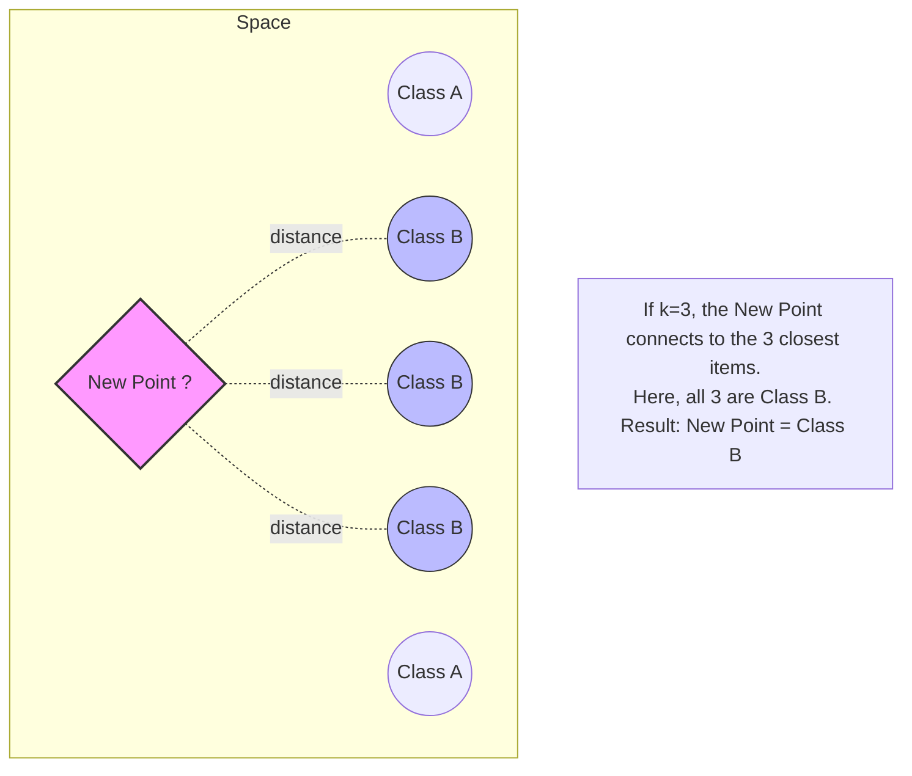
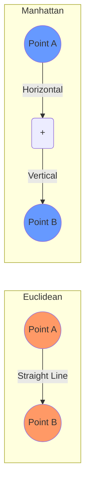
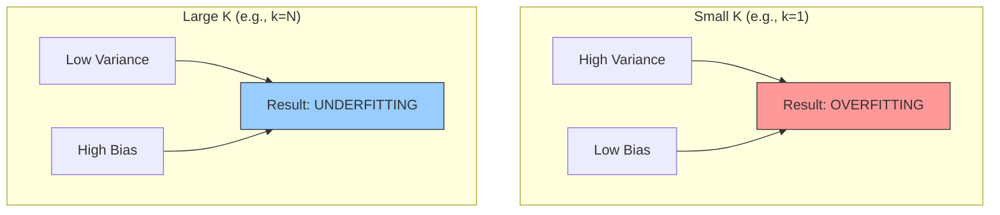
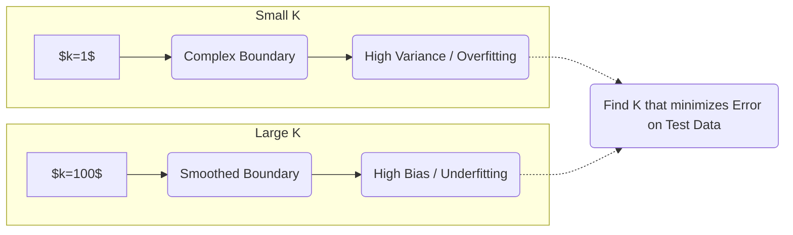
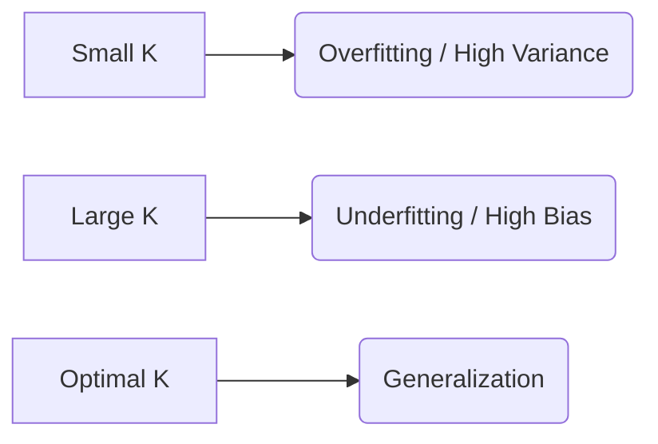
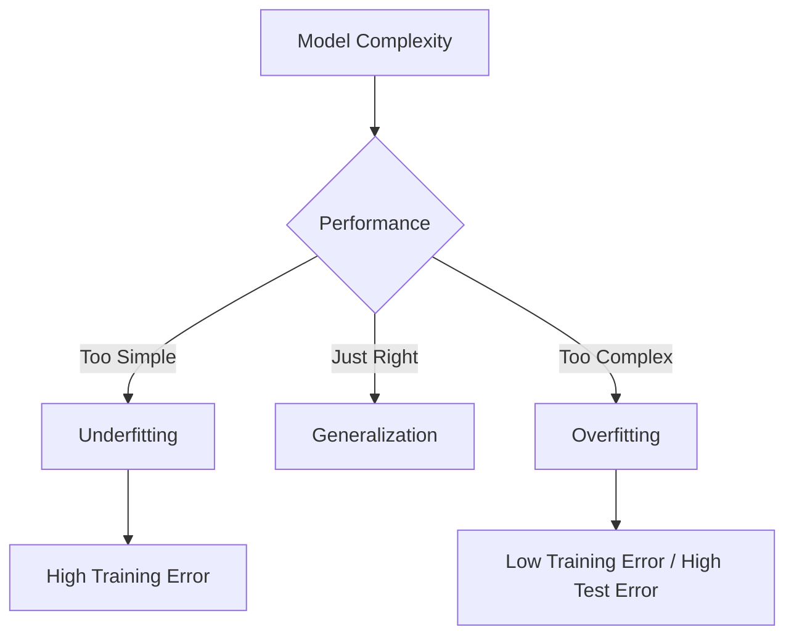

K-Nearest Neighbors (KNN) is one of the simplest and most intuitive algorithms in supervised machine learning: to label or value a new point, it finds the $K$ closest examples in the training set and lets them decide the answer by majority vote or by averaging. Because it is a lazy, non-parametric learner — it memorizes data instead of fitting a model — it is essentially free to set up but expensive at prediction time, and it is highly sensitive to feature scale and to the choice of $K$. This note covers how KNN works, the distance metrics that define closeness, how to choose $K$, a fully worked crocodile-versus-alligator classification exercise, and the dataset-management and evaluation ideas (train/validation/test splits, cross-validation, the confusion matrix and its metrics) that arise naturally when tuning a KNN model. It anchors the nearest-neighbors area of the [[Machine Learning MOC]].

## What is K-Nearest Neighbors

**K-Nearest Neighbors (KNN)** is a simple, versatile, and highly intuitive algorithm used in supervised machine learning, for both **classification** and **regression**. It is often referred to as a **"Lazy Learner"** because it does not learn a discriminative function from the training data during a training phase — there are no weights to find, unlike the weights $W$ fitted in neural networks. Instead, it memorizes the dataset and makes predictions at the exact moment a query is made.

The algorithm operates on the principle of **similarity**. It assumes that similar things exist in close proximity to each other — formally, that data points close to each other in the feature space are likely to share the same properties or labels. The core logic fits in one sentence: *"Tell me who your neighbors are, and I'll tell you who you are."*

Concretely, a KNN prediction decomposes into three parts:

- **Input:** a new data point (an unknown sample).
- **Process:** identify the $k$ data points in the training set that are closest to the new point.
- **Output:** assign a value or class based on those neighbors.

### Non-parametric nature

KNN is **non-parametric**, meaning it makes no assumptions about the underlying distribution of the data — it does not assume the data follows a bell curve or a straight line, unlike [[04 - Machine Learning/Regression/Linear Regression|Linear Regression]], which assumes linearity. This makes KNN very useful for real-world data that doesn't follow a strict mathematical pattern.

The property cuts both ways. The advantage is that KNN can learn highly complex, irregular decision boundaries that a straight line could never capture. The disadvantage is that it is very sensitive to "noise" and outliers — a theme that returns throughout this note, from the choice of $K$ to the mandatory normalization step.

## Lazy learning versus eager learning

KNN is categorized as a **Lazy Learner** (or **Instance-Based Learner**), which distinguishes it from the "Eager Learners" such as neural networks (ANN) and regression models.

**Eager learners (e.g., ANN, regression):**

- **Training phase:** they spend a lot of time analyzing data to find weights ($W$) and a mathematical function ($f$).
- **Prediction phase:** very fast — they just plug the new $X$ into the formula.
- **Memory:** they can throw away the training data once the model is "built."

**Lazy learners (KNN):**

- **Training phase:** practically zero — the algorithm simply **stores** (memorizes) the entire training dataset.
- **Prediction phase:** very slow — every time a new prediction is needed, the algorithm must calculate distances to every single point in its memory.
- **Memory:** it must keep the entire dataset in RAM at all times.

This is the essential computational trade-off of KNN. Instead of paying an expensive training cost once and then predicting cheaply forever, KNN pays nothing up front and then pays the full distance-computation cost on every single query. The memorized dataset *is* the model.

## Modes of operation

KNN can be used for both major types of supervised learning problems, and the only thing that changes between them is how the neighbors' answers are combined.

### Classification

When the target variable is categorical (e.g., "Cat" vs. "Dog"), the mechanism is **voting**. The algorithm looks at the $k$ nearest neighbors and assigns the **most frequent label** (the mode) among them to the new data point. For example, if $k=3$ and the neighbors are [Cat, Cat, Dog], the new point is classified as **Cat**.

### Regression

When the target variable is continuous or numerical (e.g., predicting house prices), the mechanism is **averaging**. The algorithm looks at the values of the $k$ nearest neighbors and calculates the **average (mean)** of their values. For example, if $k=3$ and the neighbors have values [10, 12, 14], the prediction is $\frac{10+12+14}{3} = 12$. KNN thereby extends the ideas of [[Regression Fundamentals]] to a memorization-based setting, with no coefficients or functional form to interpret.

### Visual intuition

Below is a diagram illustrating how a new point is classified based on its neighbors.

## Distance metrics

To find the "nearest" neighbors, we must mathematically define what "near" means. Distance metrics calculate the similarity between the new point and the existing points in the dataset, and since KNN relies entirely on "closeness," the choice of mathematical distance is the most critical part of the algorithm. The same notion of proximity powers unsupervised methods like [[Clustering]], but in KNN it directly determines which labeled examples get to vote.

### Euclidean distance ($L^2$ norm)

This is the default and most common metric. It represents the straight-line, "as-the-crow-flies" (shortest path) distance between two points — the Pythagorean theorem at work. It is the standard for continuous data.

For two points $P_1(x_1, y_1)$ and $P_2(x_2, y_2)$:

$$ d(P_1, P_2) = \sqrt{(x_2 - x_1)^2 + (y_2 - y_1)^2} $$

Written compactly in two dimensions:

$$ d = \sqrt{(x_2 - x_1)^2 + (y_2 - y_1)^2} $$

**General form (for $n$ dimensions):**

$$ d(x, y) = \sqrt{\sum_{i=1}^{n} (x_i - y_i)^2} $$

Euclidean distance is the standard use case for continuous variables, it works well when the dimensions are correlated, and it is best for continuous numerical data where "straight-line" proximity makes sense. In norm notation, Euclidean distance is the $L_2$ norm and Manhattan is the $L_1$ norm — two members of the $L_p$ (Minkowski) family.

### Manhattan distance ($L^1$ norm)

Also known as "City Block" or "Taxicab" distance, this is the distance if you could only travel along grid-like paths (like city streets or distinct city blocks), moving only horizontally or vertically:

$$ d(P_1, P_2) = |x_2 - x_1| + |y_2 - y_1| + |z_2 - z_1| + ... $$

**General form:**

$$ L_1 = \sum_{i=1}^{n} |x_i - y_i| $$

which is the same metric written as

$$ d(x, y) = \sum_{i=1}^{n} |x_i - y_i| $$

Manhattan distance is useful in high-dimensional spaces, and it is preferred when the input variables are not similar in type (e.g., age vs. income), or for discrete data where diagonal movement is physically or logically impossible.

The two metrics differ geometrically:

> [!important] Background knowledge: norms
> - **$L^1$ norm:** the sum of absolute differences. (Manhattan)
> - **$L^2$ norm:** the square root of the sum of squared differences. (Euclidean)
>
> In most standard KNN libraries (like Python's Scikit-Learn), **Euclidean** is the default.

### Other distance metrics

Two further metrics are worth knowing. **Minkowski distance** is a generalized formula that can become Euclidean or Manhattan depending on a parameter $p$. **Cosine similarity** measures the **angle** between two vectors rather than the distance; it is often used in text mining and recommendation systems.

### Data normalization is mandatory

This is the **number one mistake** students make with KNN. Because KNN uses distance, the **scale** of your features matters immensely.

**The problem.** Imagine a dataset with two features: **Income**, with a range of 20,000 to 100,000, and **Age**, with a range of 18 to 80. If you calculate Euclidean distance, a difference of \$1,000 in income will completely overwhelm a difference of 40 years in age. The "Income" feature will dictate the distance, and "Age" will be ignored.

**The solution: feature scaling.** Before running KNN, you **must** scale all features to the same range (usually 0 to 1) using **Min-Max Scaling**:

$$ X_{scaled} = \frac{X - X_{min}}{X_{max} - X_{min}} $$

> [!DANGER] Rigorous rule
> If you do not normalize your data, KNN is mathematically invalid because it treats 1 unit of "Salary" as equal to 1 unit of "Age," which is nonsensical.

## Choosing the value of K

The choice of $K$ is crucial. The variable $K$ is a **hyperparameter**: the algorithm cannot "learn" the best $K$ on its own — you, the designer, must choose it. It is the most critical decision in the KNN algorithm, directly impacting the model's performance and its ability to generalize, and it is a textbook instance of the [[Bias Variance Tradeoff]]. Where an eager learner manages its complexity through [[Regularization Techniques]], KNN's only complexity dial is $K$.

### Small K: overfitting and high variance

If $K$ is too small (e.g., $k=1$ or $k=2$), the model considers very few neighbors and becomes overly sensitive to the data points in its immediate vicinity.

- **Behavior:** the decision boundary is very jagged and complex. It tries to capture every single detail of the training data, including outliers — visually, the boundary is jagged and chaotic.
- **Risk:** **overfitting**.
- **Why:** the model is sensitive to "noise" (outliers). If one red dot is accidentally placed in a blue zone, a small $k$ will incorrectly classify that specific small area as red.
- **Accuracy:** high on training data, low on new testing data.
- **Analogy:** memorizing the answers to a test instead of understanding the subject.

"High variance" is the formal name for this fragility: if you change the training data slightly, the prediction might change completely.

### Large K: underfitting and high bias

At the other extreme, $k=20$ or $k=100$ smooths the boundary so aggressively that local structure disappears and the model underfits — the majority class dominates every neighborhood.

If $K$ is too large (e.g., $K=20$ or $K=100$), the model considers a large portion of the dataset — and in the extreme case $K=N$ (the total number of samples), everyone is a neighbor.

- **Behavior:** the decision boundary becomes very smooth and flat — eventually a straight line or a simpler curve — and it ignores local nuances and local details.
- **Risk:** **underfitting**.
- **Why:** the model ignores local structure. It averages out the details too much, potentially missing the actual boundary between classes, and it will likely just predict the majority class of the entire dataset every time.
- **Accuracy:** low on both training and testing data (too simple).
- **Analogy:** guessing "C" on every multiple-choice question because "C" is the most common answer.

### Visualizing the tradeoff

The bias-variance structure of the two regimes is summarized in the following diagrams:

### Tie-breaking: odd K and weighted voting

For binary classification (two classes), it is highly recommended to choose an **odd number** for $K$ (e.g., 3, 5, 7) to avoid **ties** in the voting process. The reason is arithmetic: if you have 2 classes and choose $K=4$, you might get a 2-vs-2 tie (one vote for class A, one for class B); choosing $K=3$ or $K=5$ guarantees a clear majority winner.

A second refinement is **weighted voting**: instead of a simple vote, you can give more "weight" to neighbors that are closer. A neighbor that is 0.1 units away should count more than a neighbor that is 5 units away.

### Finding the optimal K with cross-validation

There is no "magic number" for $K$. We usually find the best $k$ by using **cross-validation**: we test error rates for $k=1, 3, 5, ...$ (and $K=1, 3, 5, 7, \dots$ more generally), plot the **error rate** for each $K$, and pick the one with the lowest error on the **validation set**. This discipline of honest, held-out measurement is the same one that underpins [[Model Evaluation Metrics]].

## The prediction workflow

With a distance metric chosen and $K$ fixed, a KNN prediction is a strict procedure. From the point of view of the stored dataset:

1. You have a dataset of points with known labels.
2. A new point $X_{new}$ arrives.
3. Calculate the **distance** between $X_{new}$ and **every** point in the database.
4. Sort the distances and pick the top **K** nearest points.
5. **Classification:** the label is the "majority vote" (the most frequent class among the K neighbors).
6. **Regression:** the output is the **average** value of the K neighbors.

When a new, unknown data point $X_{new}$ arrives, the same logic is executed as five rigorous steps:

1. **Select $K$:** choose the number of neighbors to consider (e.g., $K=3$).
2. **Calculate distances:** compute the distance between $X_{new}$ and **every single point** in the training database.
3. **Sort:** rank all training points based on their distance to $X_{new}$, from closest to furthest.
4. **Pick top $K$:** identify the $K$ points with the smallest distances.
5. **Vote (classification) or average (regression):** for classification, look at the labels of the $K$ neighbors — the majority label wins; for regression, take the mean (average) of the $K$ neighbors' values.

Nothing here happens before the query arrives: the stored dataset plus this procedure *is* the entire model, which is why the workflow is identical whether you run it by hand on eight animals (as in the exercise below) or inside a library.

## Strengths and weaknesses

Compared with model-fitting classifiers such as [[Support Vector Machines]] or [[Decision Trees]], KNN makes a distinctive trade: it spends nothing on training and everything at query time.

**Strengths.** KNN is simple, versatile, and highly intuitive; it works for both classification and regression; and its "training" cost is essentially zero. Because it is non-parametric, it can learn highly complex, irregular decision boundaries that a straight line could never capture, which makes it very useful for real-world data that doesn't follow a strict mathematical pattern.

**Weaknesses.** The same properties cut the other way. Being non-parametric and memorization-based, KNN is very sensitive to "noise" and outliers. Predictions are slow — every query requires computing distances to every stored point — and the entire dataset must be kept in RAM at all times. The model is only as good as its distance metric, which makes normalization mandatory (on unscaled features, KNN is mathematically invalid). Finally, its behavior hinges on a hyperparameter $K$ that must be tuned externally, with small $K$ overfitting and large $K$ underfitting.

## Worked example: crocodiles versus alligators

The classic "Exo Examen" exercise demonstrates how KNN is calculated manually during an exam, and how changing $k$ changes the final prediction. The goal is to classify a new animal as either a **crocodile** or an **alligator** based on two physical features.

### The problem

We want to distinguish between two species: **Crocodiles** and **Alligators**. We have two descriptors (features):

1. **Size:** total length.
2. **Head:** head length.

We have a training database of 8 animals and a **New Animal** — with features $X_{new}$ = [Head: 0.17, Size: 2.84] — that we want to classify, using $K=3$.

### The data

We are provided with a labeled dataset of 8 animals (training data) and their respective features. In the canonical version of the table, entry #1 is the "New" point being tested and entries 2–8 are the training data:

| ID | Head Length | Size | Class | Distance (calculated) |
| :--- | :--- | :--- | :--- | :--- |
| **1 (New)** | **0.17** | **2.84** | **???** | **0.00** |
| 2 | 0.24 | 3.82 | Alligator | 0.811 |
| 3 | 0.29 | 3.39 | Alligator | 0.482 |
| 4 | 0.25 | 2.6 | Alligator | 0.072 |
| 5 | 0.35 | 4.21 | Crocodile | 1.310 |
| 6 | 0.47 | 4.64 | Alligator | 1.752 |
| 7 | 0.47 | 4.48 | Crocodile | 1.584 |
| 8 | 0.49 | 4.9 | Crocodile | 2.012 |

The 'Distance' column represents the Euclidean distance between point 1 (the new animal) and the specific row.

### Step 1: calculate the distances

We calculate the Euclidean distance between the new point (Head = 0.17, Size = 2.84) and every row — for example, point 4 (Head = 0.25, Size = 2.6):

$$ \text{Distance} = \sqrt{(0.25 - 0.17)^2 + (2.6 - 2.84)^2} $$
$$ \text{Distance} = \sqrt{(0.08)^2 + (-0.24)^2} $$
$$ \text{Distance} = \sqrt{0.0064 + 0.0576} = \sqrt{0.064} \approx 0.25 $$

The exam notes list the distance as `0.072`. This implies the handwritten notes might have different raw data values, or used normalized data not explicitly shown, but the **logic** remains exactly the same: Calculate $\to$ Sort.

### Step 2: sort the neighbors by distance

Ranking the distances provided for the new point relative to the database:

1. **0.072** (Point 4 - Alligator)
2. **0.482** (Point 3 - Alligator)
3. **0.811** (Point 2 - Alligator)
4. **1.310** (Point 5 - Crocodile)
5. **1.584** (Point 7 - Crocodile)
6. **1.752** (Point 6 - Alligator)
7. **2.012** (Point 8 - Crocodile)

Condensed to the four nearest rows, the ranking looks like this:

| Neighbor Rank | Distance | Class |
| :--- | :--- | :--- |
| **1st (Closest)** | 0.072 | Alligator |
| **2nd** | 0.482 | Alligator |
| **3rd** | 0.811 | Alligator |
| 4th | 1.310 | Crocodile |

### Step 3: vote with $k = 3$

Using **3-Nearest Neighbors**, we select the three closest samples (smallest distances): Point 4 (Dist $d = 0.072$) $\to$ **Alligator**, Point 3 (Dist $d = 0.482$) $\to$ **Alligator**, and Point 2 (Dist $d = 0.811$) $\to$ **Alligator**. The next closest is Sample 5 with $d=1.310$, which is excluded because we only want the top 3.

**Vote:** 3 Alligators vs. 0 Crocodiles.
**Result:** the new animal is classified as an **Alligator**.

### Step 4: the $k = 9$ scenario

The notes then ask: *"Si on prend K=9"* — "if we take K=9". There are only 8 data points (the seven training rows plus the query itself), and usually you cannot have $K > N$ (the number of data points). However, the notes suggest a hypothetical result: *"we find 4 Alligators and 5 Crocodiles."* The implied reading is a slightly larger dataset, or a scenario where the neighbor search is expanded to include all points and Crocodiles are the more numerous class — this part of the exercise illustrates a crucial concept about class imbalance.

**Vote:** 5 Crocodiles > 4 Alligators.
**Result:** the new animal is classified as a **Crocodile**.

### What the K-shift teaches

> [!IMPORTANT] Lesson from this exercise
> Changing $K$ changed the answer!
> - **K=3:** Alligator (based on local neighborhood).
> - **K=9:** Crocodile (based on global count/prior probability).
>
> This proves that **selecting the right K is essential**. A K that is too large just votes for the most common class in the whole database, ignoring local features.

The exercise highlights the **instability** of KNN regarding the choice of $k$:

1. **Local context ($k=3$):** locally, the new animal is surrounded by Alligators. It looks like an Alligator.
2. **Global context ($k=9$):** globally, there might be more Crocodiles in the swamp. If $k$ is too large, the dominant class (the one with the most total samples) tends to win, regardless of actual similarity.

KNN is not "absolute truth." The prediction depends entirely on the **locality** ($K$) you choose: $K=3$ focused on the immediate physical similarity, while $K=9$ was overwhelmed by the global population count.

> [!WARNING] Takeaway
> If $K$ is too large (approaching the size of the dataset $N$), the model ignores the input features and simply predicts the **majority class** of the entire dataset. This is a form of **underfitting**.

### Alternate transcriptions of the exam table

The exam notes transcribe this exercise more than once, with small differences between the versions — worth comparing, because they show how much the manual procedure depends on getting the raw numbers right.

A second transcription lists eight training samples directly, with the rightmost column the pre-calculated Euclidean distance between each training sample and the new animal:

| Sample No | Head Length | Size | Class (Label) | Distance to New |
| :--- | :--- | :--- | :--- | :--- |
| **1** | 0.17 | 2.84 | **Alligator** | **0.072** |
| **2** | 0.24 | 3.82 | **Alligator** | **0.811** |
| **3** | 0.29 | 3.39 | **Alligator** | **0.482** |
| **4** | 0.25 | 2.6 | **Alligator** | 9.310 |
| **5** | 0.35 | 4.21 | **Crocodile** | 1.310 |
| **6** | 0.47 | 4.64 | **Crocodile** | 1.752 |
| **7** | 0.47 | 4.48 | **Crocodile** | 1.594 |
| **8** | 0.49 | 4.9 | **Crocodile** | 2.012 |

Here the three smallest distances belong to sample 1 (0.072), sample 3 (0.482), and sample 2 (0.811) — all Alligators, with the next smallest (1.310) larger than these three — so the $K=3$ conclusion is identical. Note the differences from the first table: sample 1 is a labeled Alligator rather than the query, sample 4's distance is 9.310 rather than 0.072, sample 7's distance is 1.594 rather than 1.584, and the 0.47/4.64 animal is labeled a Crocodile rather than an Alligator.

A third variant names the features explicitly — feature 1 ($x_1$): head length; feature 2 ($x_2$): body size (total length); target ($y$): class (Alligator or Crocodile) — and differs again on two raw values (sample 1's head length is 0.77 and sample 5's is 0.85):

| Sample No ($i$) | Head Length ($x_1$) | Body Size ($x_2$) | Class ($y$) | Calculated Distance ($d$) |
| :--- | :--- | :--- | :--- | :--- |
| **1** | 0.77 | 2.84 | Alligator | **0.072** |
| **2** | 0.24 | 3.82 | Alligator | **0.811** |
| **3** | 0.29 | 3.39 | Alligator | **0.482** |
| **4** | 0.25 | 2.60 | Alligator | 9.310 |
| **5** | 0.85 | 4.21 | Crocodile | 1.310 |
| **6** | 0.47 | 4.64 | Crocodile | 1.752 |
| **7** | 0.47 | 4.48 | Crocodile | 1.584 |
| **8** | 0.49 | 4.90 | Crocodile | 2.012 |

> [!NOTE] Context on distance
> The "Distance" column in the table represents the **Euclidean distance** between a *new unknown animal* (not explicitly shown in the table but implied) and each of the 8 training samples. In a full problem, you would calculate this using:
> $$d = \sqrt{(x_{new} - x_i)^2 + (y_{new} - y_i)^2}$$

Once more, the three smallest distances (0.072, 0.482, 0.811) all belong to Alligators, so the vote is unchanged. The worked distance calculation is also transcribed twice, with the same three-line derivation carried one digit further:

$$ d = \sqrt{(0.25 - 0.17)^2 + (2.6 - 2.84)^2} $$
$$ d = \sqrt{(0.08)^2 + (-0.24)^2} $$
$$ d = \sqrt{0.0064 + 0.0576} = \sqrt{0.064} \approx \mathbf{0.253} $$

In every version, the logic is identical: calculate, sort, then vote.

### Pitfalls and practical reminders

> [!WARNING] Common student pitfall
> Do not just pick the first 3 rows! You must sort the table by the **Distance** column first. In this exercise, the rows were not perfectly sorted by distance (e.g., sample 3 was closer than sample 2), so you must check the values carefully.

> [!info] Data normalization reminder
> In this exercise, the "Size" (e.g., 4.9) is much larger than "Head Length" (e.g., 0.49). In real-world KNN, you **must normalize** your data (scale everything to 0-1). If you don't, the "Size" variable will dominate the Euclidean distance calculation because the numbers are bigger, rendering "Head Length" irrelevant.

A unit mismatch makes the same point from another direction: if "Body Size" were measured in centimeters (e.g., 284 cm) and "Head Length" in meters (e.g., 0.77 m), the distance formula would be dominated by Body Size. Always normalize data (scale to 0-1) before running KNN.

To keep the exam essentials in one place:

1. **Choose an odd number for $K$ (Impaire).** In binary classification, an even value such as $k=2$ can lead to a tie (one vote for class A, one vote for class B). Always select $K = 3, 5, 7, \dots$ to ensure a clear majority winner.
2. **Classification vs. regression.** The output is the **mode** (most frequent class) for classification, and the **mean** (average value) of the neighbors for regression.
3. **Data normalization is key.** Distances are sensitive to scale, as above.

> [!TIP] Lab reminder
> In Python Lab 5, you will use `KNeighborsClassifier` from `sklearn`. Remember that it defaults to $K=5$ and Euclidean distance unless you specify otherwise.

## Data management and model evaluation

KNN has no training curve to watch and no loss going down, so data management and honest measurement are the whole quality story: split the data before touching it, tune $K$ on data the final test set has never seen, and judge the resulting classifier with more than raw accuracy. This section covers the evaluation concepts that arise directly in the KNN workflow; for the consolidated reference on the metrics themselves, see [[Model Evaluation Metrics]].

### Why evaluation matters

Before applying any algorithm (like KNN), it is critical to understand how to manage data. A common mistake in machine learning is testing a model on the same data it learned from. This leads to false confidence. To solve this, we split the dataset into distinct subsets.

### The three data subsets

In regression and classification problems, the dataset is generally divided as follows:

1. **Training set (~70%)**
    - **Purpose:** used to "teach" the model. The algorithm looks at input $X$ and output $Y$ in this set to learn patterns (weights, boundaries, etc.).
    - **Analogy:** the textbook problems you practice with for homework.
2. **Validation set (~15%)**
    - **Purpose:** used to *tune* the model during the training process. It evaluates the model to check for overfitting and to adjust hyperparameters — like choosing $K$ in KNN.
    - **Key function:** it helps decide when to **stop** training (early stopping) to prevent the model from memorizing the noise.
    - **Analogy:** the practice quiz you take before the exam to see what you need to study more.
3. **Test set (~15%)**
    - **Purpose:** used **only once** at the very end. It evaluates the final model on completely unseen data to estimate its real-world performance.
    - **Analogy:** the final exam.

> [!WARNING] Important rule
> Never train your model on the **Test Set**. If you do, your accuracy metrics will be high, but the model will fail in the real world. This is called **data leakage**.

### Generalization: overfitting and underfitting

The goal of ML is **generalization**: the ability of the model to perform well on new, unseen data, not just the data it memorized.

**1. Underfitting (high bias).** The model is too simple; it cannot capture the underlying structure of the data. Symptoms: high error on training data *and* high error on validation data. Example: trying to fit a straight line (linear regression) to data that forms a curve (parabola). The French annotation in the notes says it plainly: *"pas suffisant"* — not sufficient.

**2. Overfitting (high variance).** The model is too complex; it learns the **noise** and random fluctuations in the training data instead of the actual pattern. Symptoms: very low error on training data *but* high error on validation data. Example: a student who memorizes the answers to the homework but fails the test because the questions were slightly different.

For KNN specifically, this is exactly the small-$K$ / large-$K$ story told above: overfitting is what happens as $K$ shrinks toward 1, and underfitting is what happens as $K$ grows toward $N$.

### Cross-validation

Splitting data into just one train/test set can be risky if your dataset is small or unlucky (e.g., all "hard" examples end up in the test set). **K-fold cross validation** is the better way:

1. Split the dataset into $K$ equal-sized "folds" (parts).
2. Train the model $K$ times.
3. In each iteration, use **one fold** for testing and the remaining $K-1$ folds for training.
4. Average the performance results.

Two methodologies:

- **Standard K-fold:** split randomly.
- **Stratified K-fold (important):** ensures each fold has the same percentage of samples for each class as the complete set (e.g., if the original data is 60% Cats and 40% Dogs, every fold will also be 60/40). This prevents bias.

This is precisely the procedure used to sweep $K = 1, 3, 5, \dots$ when hunting for the optimal neighbor count.

### The confusion matrix

For classification problems, "accuracy" is not enough — we need to know *how* the model is failing. The confusion matrix is a table used to evaluate the performance of a classification model. Consider the scenario of detecting pictures of **Dogs**: positive (1) means "is a Dog"; negative (0) means "is NOT a Dog" (e.g., a Cat).

| | **Predicted: Dog (Positive)** | **Predicted: Not Dog (Negative)** |
| :--- | :---: | :---: |
| **Actual: Dog (Positive)** | **True Positive (TP)** (Correctly identified as Dog) | **False Negative (FN)** (Missed the Dog / Type 2 Error) |
| **Actual: Not Dog (Negative)** | **False Positive (FP)** (False Alarm / Type 1 Error) | **True Negative (TN)** (Correctly ignored) |

> [!TIP] Memory trick
> - **True/False** refers to whether the model was *right or wrong*.
> - **Positive/Negative** refers to *what the model predicted*.
> - **False Positive (Type 1):** you predicted YES, but it was NO. (Telling a man he is pregnant.)
> - **False Negative (Type 2):** you predicted NO, but it was YES. (Telling a pregnant woman she is not pregnant.)

When the classified instances are images, these are exactly the quantities tracked by [[Computer Vision Evaluation Metrics]]; the regression side of evaluation is covered in [[Regression Evaluation Metrics]], and the label-free, clustering side in [[Clustering Evaluation Metrics]].

### Worked example: ten animal images

We have 10 images of animals, and we want to identify **Dogs**.

- **Actual:** D, D, D, ND, D, ND, D, D, ND, ND (total: 6 Dogs, 4 Not Dogs).
- **Predicted:** D, ND, D, ND, D, D, D, D, ND, ND.

The analysis:

1. **TP (true positive):** actual = D, predicted = D. Count = 5.
2. **TN (true negative):** actual = ND, predicted = ND. Count = 3.
3. **FP (false positive):** actual = ND, predicted = D. Count = 0 (no "Not Dogs" were called Dogs).
4. **FN (false negative):** actual = D, predicted = ND. Count = 1 (one Dog was missed).

The resulting matrix:

$$
\begin{bmatrix}
TP=5 & FN=1 \\
FP=0 & TN=3
\end{bmatrix}
$$

### Performance metrics

Once we have the confusion matrix, we calculate metrics.

**1. Accuracy** — how often is the classifier correct overall?

$$ \text{Accuracy} = \frac{TP + TN}{\text{Total Instances}} $$

From the example: $(5+3)/10 = 0.8$, or **80%**.

**2. Precision** — when the model predicts "Positive", how often is it right? (Quality of the positive result.)

$$ \text{Precision} = \frac{TP}{TP + FP} $$

From the example: $5 / (5 + 0) = 1.0$, or **100%**.

**3. Recall (sensitivity)** — out of all the *actual* positive cases, how many did we find? (Quantity of the positive result.)

$$ \text{Recall} = \frac{TP}{TP + FN} $$

From the example: $5 / (5 + 1) = 0.833$, or **83.3%**.

**4. F1-score** — the harmonic mean of precision and recall.

$$ F1 = 2 \times \frac{\text{Precision} \times \text{Recall}}{\text{Precision} + \text{Recall}} $$

From the example: $2 \times \frac{1 \times 0.833}{1 + 0.833} \approx 0.91$.

Why use F1? If you have a class imbalance (e.g., 99% of the data is class A), accuracy is misleading. The F1-score forces both precision and recall to be high — a direct concern for KNN, whose large-$K$ failure mode is precisely to vote for the majority class.

**5. Specificity** — the ability to find the negatives.

$$ \text{Specificity} = \frac{TN}{TN + FP} $$

### Multiclass confusion matrices

When you have multiple classes (e.g., Cat, Dog, Horse), the matrix expands (3x3):

| Predicted $\rightarrow$   Actual $\downarrow$ | Cat | Dog | Horse |
| :--- | :---: | :---: | :---: |
| **Cat** | **TP (for Cat)** | FP | FP |
| **Dog** | FN | **TP (for Dog)** | FP |
| **Horse** | FN | FN | **TP (for Horse)** |

- **Diagonal elements:** correct predictions.
- **Off-diagonal:** errors.
- To calculate **precision for "Dog"**: take $TP_{dog}$ divided by the sum of the "Dog" **column**.
- To calculate **recall for "Dog"**: take $TP_{dog}$ divided by the sum of the "Dog" **row**.

## Historical note

This comprehensive treatment consolidates what originally shipped as four separate course files — `5. Introduction to KNN.md`, `5. Distance Metrics.md`, `5. Hyperparameter K and Overfitting.md`, and `5. Exercise - Classification of Animals.md` — later merged into a single note; their content survives here in full.

## See also

- [[Machine Learning MOC]] — the map of machine learning topics.
- [[Model Evaluation Metrics]] — consolidated treatment of the confusion matrix, accuracy, precision, recall, F1 and specificity.
- [[Bias Variance Tradeoff]] — the general theory behind the small-K / large-K behavior.
- [[Clustering]] — unsupervised neighbors: the same distance metrics, without labels.
- [[Support Vector Machines]] — another boundary-forming classifier, trained rather than memorized.
- [[Regression Fundamentals]] — background for the averaging (regression) mode of KNN.
- [[Regularization Techniques]] — how eager learners control the complexity that KNN controls through $K$.
- [[Decision Trees]], [[Random Forests and Bagging]], [[Gradient Boosting]] — alternative classifiers to compare against KNN.
- [[t-SNE and UMAP]] — neighbor-based methods for visualizing high-dimensional data.
