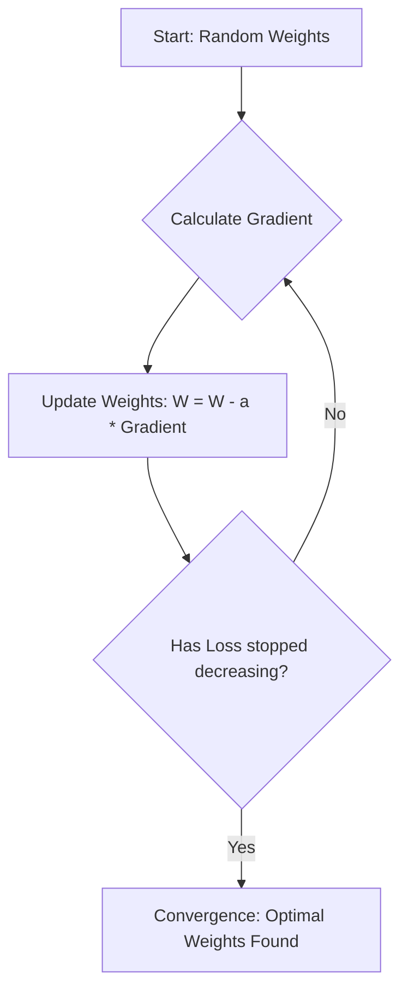
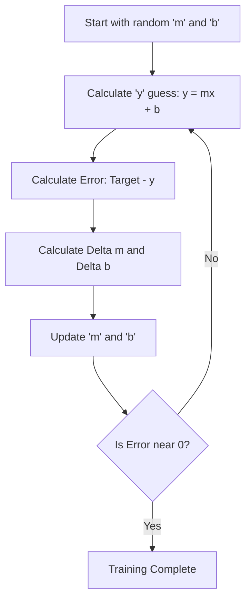
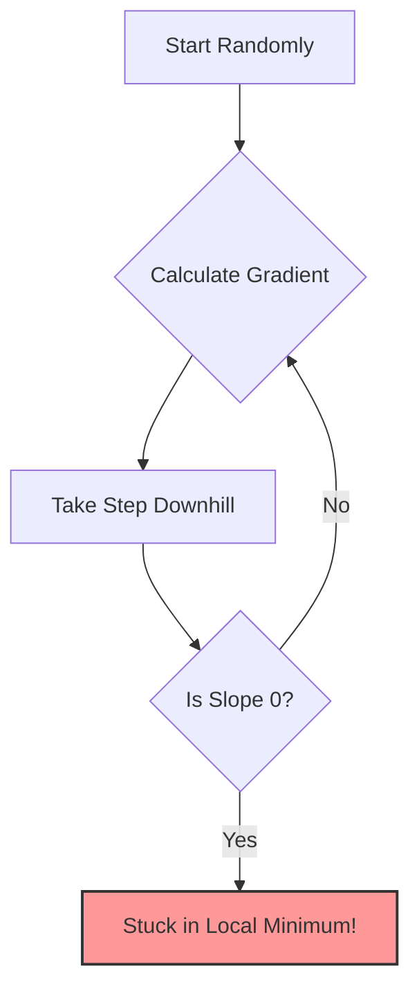
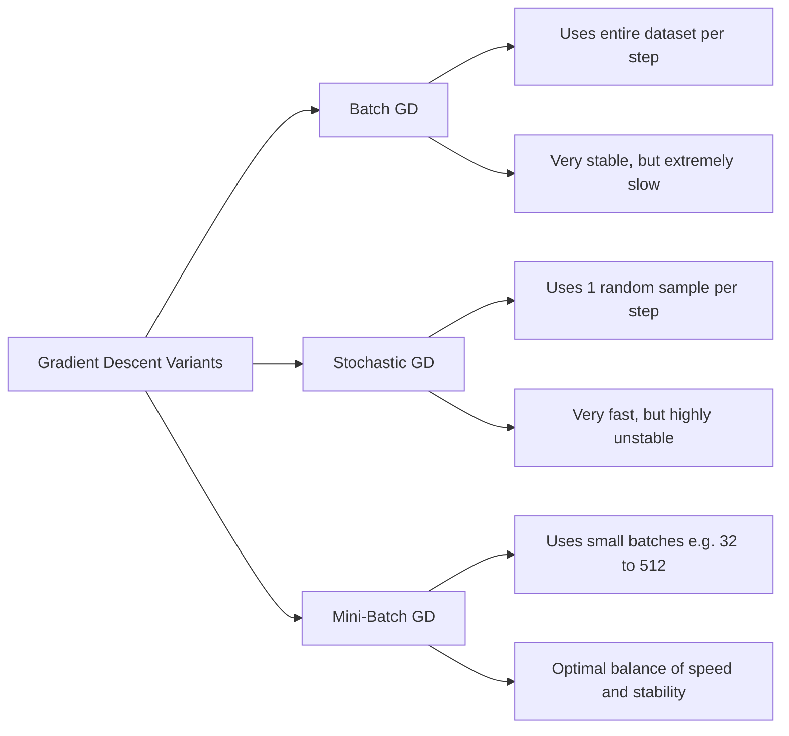
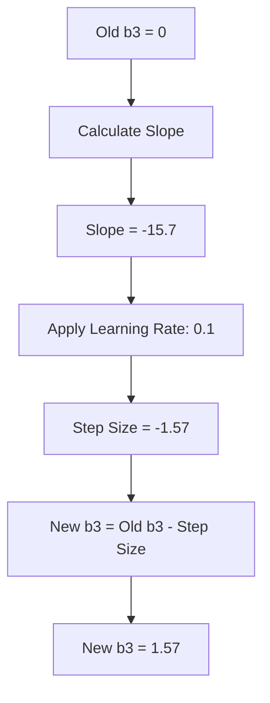
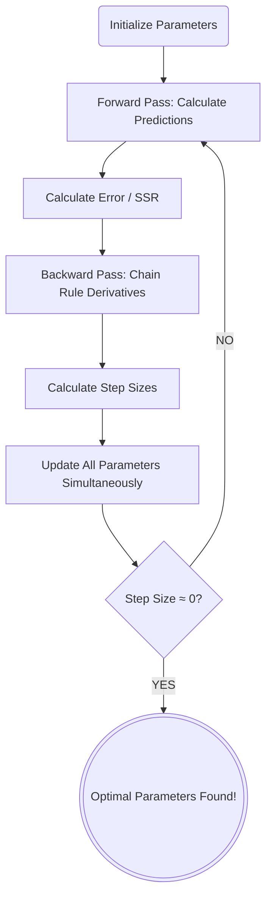

Gradient Descent (Descente de Gradient) is the absolute backbone of Deep Learning: an iterative optimization algorithm used to find the minimum of a differentiable function—specifically, the Loss Function (Cost Function). Every neural network, from the simplest Perceptron to the largest Transformer, relies on gradient descent (or a variant of it) to learn. This note develops the algorithm in teaching order: what gradient descent is and why we need it, the update rule and its learning rate, the geometry of the loss surface, the batch/stochastic/mini-batch family, and finally convergence behavior—local minima, saddle points, stopping criteria—and practical guidance for real training runs.

## What is gradient descent

### The optimization problem

In machine learning, we want our model to make accurate predictions. To achieve this, we define a **Loss Function** $J(\theta)$, which measures how "wrong" our model is (see [[Loss Functions]]). The goal of training is to find the parameters (weights and biases) that minimize this loss function. Gradient descent is the mechanism by which we systematically search for those optimal parameters.

Optimization, in this setting, is the process of minimizing a **differentiable and convex** function; in deep learning, this function is the loss function (how wrong our model is). The canonical intuition is physical: imagine a blindfolded person trying to walk down to the bottom of a valley. They feel the slope of the ground under their feet and take a step in the direction where the slope goes downward the steepest. The slope is the **Gradient**, and the size of the step is the **Learning Rate**.

### Why we cannot just solve it directly

Imagine we want to minimize a simple function $f(x) = x^2 - x + 1$.

- **Analytical solution:** We calculate the derivative, set it to 0 ($f'(x) = 0$), and ensure the second derivative is positive ($f''(x) > 0$).
  - $f'(x) = 2x - 1 = 0 \Rightarrow x^* = 1/2$.
  - $f''(x) = 2 > 0$, so this is indeed a minimum.
  - This gives us the exact answer in one step.
- **The deep learning reality:** In deep learning, our function has millions of parameters ($x$). An analytical solution is impossible because:
  1. Setting the gradient to zero gives us a system of millions of equations with millions of unknowns.
  2. The equations are highly non-linear (due to activation functions and nested compositions).
  3. The computation is too expensive to solve directly even if it were possible.

We must therefore use an **iterative approximation**: gradient descent.

### The algorithm in four steps

1. **Initialize** parameters randomly (e.g., $x_0$). The starting point is arbitrary — we simply begin somewhere and move toward better values.
2. **Calculate the gradient:** Find the derivative of the function at the current point, $f'(x_t)$. The gradient points in the direction of the steepest ascent. This tells us which direction makes the function increase the fastest.
3. **Update parameters:** Move in the **opposite** direction of the gradient. Since the gradient points uphill, going the opposite direction takes us downhill — toward the minimum.
4. **Repeat** until convergence (when the gradient is zero or very close to zero). At the minimum, the slope is flat, so there's no direction to move.

The overall loop looks like this:



**Stopping criterion:** We stop when we reach convergence. This happens when the number of iterations reaches a fixed limit, or when the difference between successive values $|| \nabla f(x_t) ||$ or $|f(x_i) - f(x_{i+1})|$ is infinitesimally small. In practice, we often set a maximum number of epochs and monitor the loss curve for plateau behavior.

## The update rule

### The linear regression analogy

To understand how a neural network updates its weights, it is highly beneficial to look at a simpler, 2-dimensional problem: [[04 - Machine Learning/Regression/Linear Regression|Linear Regression]] (foundations in [[Regression Fundamentals]]). Imagine a scatter plot of data points on an X-Y graph. Linear regression is the mathematical process of drawing a single straight line that best fits the trend of those points. The equation for a straight line is:

$$ y = mx + b $$

Where $m$ = slope (weight), $b$ = y-intercept (bias), $x$ = input, $y$ = output.

A single artificial neuron (a perceptron) doing a simple task is functionally identical to linear regression. It takes an input ($x$), multiplies it by a weight ($m$), adds a bias ($b$), and generates an output ($y$). If the line doesn't fit well, we have a high Error. The only "knobs" we can turn to adjust the line are $m$ (weight) and $b$ (bias). We cannot change $x$ (the data is the data) or $y$ (it is just the result of the math).

### Gradient descent in 2D

We denote the change in weights and biases as $\Delta m$ and $\Delta b$:

$$ m_{new} = m_{old} + \Delta m $$
$$ b_{new} = b_{old} + \Delta b $$

How do we find $\Delta m$?

$$ \Delta m = \text{Learning Rate} \times \text{Error} \times x $$
$$ \Delta b = \text{Learning Rate} \times \text{Error} $$

- **Error:** Tells us *which direction* to move and *how far* we are from the goal.
- **$x$ (input):** Tells us the magnitude of the contribution of this specific input to the error.
- **Learning rate ($\alpha$):** A tiny scalar number (e.g., $0.01$). It acts as a speed limit. If we change $m$ by the raw error, the line will jump wildly across the graph and miss the optimal fit. The learning rate ensures we take tiny, calculated steps down the error curve until we reach the bottom (the minimum error).

> [!info] Why do we need the Learning Rate?
> If we subtract the raw derivative from our parameters, our "step" might be so massive that we overshoot the bottom of the error curve entirely, bouncing wildly back and forth. The learning rate forces the network to take small, cautious steps toward the minimum. Without it, gradient descent becomes unstable and may never converge.

The full 2D procedure is a loop:



### The general update rule

**The Update Rule:**

$$ x_{t+1} = x_t - \alpha \nabla f(x_t) $$

- $x_0$: The starting point (initialized randomly).
- $x$: The parameter we are trying to optimize.
- $\alpha$ (Alpha / Learning Rate, formerly called $\eta$ 'eta'): The step size. It is a hyperparameter that modulates the size of the correction.
- $\nabla f(x_t)$: The gradient (slope/derivative) evaluated at the current point.

### Reading the partial derivative of the loss

We have $N$ parameters (weights and biases), randomly initialized. We have a Loss Function ($L$). We want to minimize $L$. **Gradient Descent** is an iterative algorithm that answers the question: *"If I tweak this specific weight by a tiny amount, how will the overall Loss change?"* We express this mathematically using partial derivatives:

$$\frac{\partial L}{\partial w}$$

This is read as: "The partial derivative of the Loss with respect to weight $w$."

- If $\frac{\partial L}{\partial w}$ is **positive**, increasing the weight *increases* the error → *decrease* the weight.
- If $\frac{\partial L}{\partial w}$ is **negative**, increasing the weight *decreases* the error → *increase* the weight.

Once we compute the gradient for all parameters, we update them simultaneously using a learning rate ($\alpha$):

$$w_{new} = w_{old} - \alpha \frac{\partial L}{\partial w}$$

The minus sign ensures we step in the *opposite* direction of the gradient. The gradient always points towards the steepest ascent (maximum error); we want the steepest *descent* (minimum error).

### Why the minus sign

**Why subtract?**

1. If $f'(x_i) > 0$, the function is increasing at $x_i$. To find the minimum, we must move left (decrease $x$).
2. Subtracting a positive number decreases $x$.
3. If $f'(x_i) < 0$, the function is decreasing. We must move right (increase $x$).
4. Subtracting a negative number increases $x$.
5. This elegant mathematical rule ensures we always move downhill regardless of which side of the minimum we are on.

### Partial derivatives and the gradient vector

In practice, machine learning models never have just one parameter. Consider minimizing a function $f(w, b)$ with two parameters (e.g., weight and bias). We cannot use a simple derivative; we must use **Partial Derivatives**.

- The partial derivative with respect to $w$, denoted $\frac{\partial f}{\partial w}$, measures the steepness in the $w$-direction (keeping $b$ constant). It tells us how much the function changes when we nudge $w$ slightly while holding $b$ fixed.
- The partial derivative with respect to $b$, denoted $\frac{\partial f}{\partial b}$, measures the steepness in the $b$-direction (keeping $w$ constant). It tells us how much the function changes when we nudge $b$ slightly while holding $w$ fixed.

The **Gradient** $\nabla f$ is the vector of these partial derivatives: $\nabla f = \left[ \frac{\partial f}{\partial w}, \frac{\partial f}{\partial b} \right]^T$. The gradient always points in the direction of steepest ascent. By moving in the opposite direction, we descend toward the minimum.

The update rules become:

$$w_{i+1} = w_i - \alpha \cdot \frac{\partial f}{\partial w}$$
$$b_{i+1} = b_i - \alpha \cdot \frac{\partial f}{\partial b}$$

### Scaling to matrices and high dimensions

Neural networks do not operate in a 2D space. Instead of one input $x$, there might be hundreds of inputs ($x_1, x_2, x_3, \dots$). Instead of one weight $m$, there is a matrix of weights ($m_1, m_2, m_3, \dots$).

$$ Y = (m_1x_1 + m_2x_2 + m_3x_3 + \dots + m_nx_n) + b $$

> [!info] The Curse of Dimensionality
> As we add dimensions (inputs and neurons), the volume of the space we are trying to search for the perfect weights grows exponentially. This is why we cannot just use "random guessing" or brute-force search. We absolutely require the calculus-backed directionality of Gradient Descent to navigate this hyper-dimensional haystack.

The mapping from the regression picture to a neural network is direct:

| Linear Regression | Neural Network |
| --- | --- |
| $m$ (slope) | $W$ (Weight Matrix) |
| $b$ (y-intercept) | $B$ (Bias Vector) |
| $x$ (input) | $I$ (Input Vector) or $H$ (Hidden Layer Vector) |

Because we are dealing with matrices, we must use Matrix Multiplication (the dot product):

$$ Y = W \cdot X + B $$

We are no longer just looking for $\Delta m$ and $\Delta b$. We are looking for **$\Delta W$** (a matrix of weight changes) and **$\Delta B$** (a vector of bias changes), calculated using Matrix Calculus.

## The learning rate

The learning rate is arguably the most important hyperparameter in deep learning, and choosing it correctly is critical because it fails in two opposite directions:

> [!TIP] Understanding the Learning Rate ($\alpha$)
> The learning rate is arguably the most important hyperparameter in deep learning. Choosing it correctly is critical:
> - **Too small:** The algorithm will take tiny steps. It will eventually find the minimum, but it will take an eternity. The convergence is agonizingly slow and may get stuck in local minima because the steps are too small to escape them.
> - **Too large:** The algorithm will take giant steps, overshooting the minimum entirely. It might bounce back and forth across the valley and even diverge (the loss increases to infinity). The loss will bounce wildly or even diverge to infinity.

Between these two failure modes lies the entire practical art of tuning: the step size must be large enough to make measurable progress toward the minimum, yet small enough that each update lands closer to the bottom of the valley instead of flying over it.

### The shift in notation: from alpha to eta

In classical optimization, the step size is denoted $\alpha$ (alpha). In the context of Neural Networks and Deep Learning, this parameter is referred to as the **Learning Rate** and is denoted by $\eta$ (eta). It is the most critical **hyperparameter** in Deep Learning. This shift in notation reflects the conceptual difference: in optimization, $\alpha$ is simply a step size, but in deep learning, $\eta$ controls the entire dynamics of learning — too fast and the model becomes unstable, too slow and it never converges.

### Taming the learning rate

Because picking the perfect $\alpha$ is incredibly difficult, we use two families of remedies:

1. **Learning Rate Schedulers:** Start with a high rate to encourage exploration and escape local minima, then gradually reduce it to fine-tune convergence. This mimics the behavior of a ball that bounces around at first but gradually settles to the bottom of the valley as it loses energy.
2. **Adaptive Optimizers:** Instead of a fixed learning rate $\alpha$, modern Deep Learning uses algorithms like **Adam, RMSProp, or Adagrad** that automatically adjust the learning rate independently for _every single parameter_, navigating complex landscapes effortlessly. These algorithms track historical gradient information for each parameter and use it to determine appropriate step sizes — parameters with large, consistent gradients get smaller steps, while parameters with small or infrequent gradients get larger steps.

Both strategies are treated in depth in [[Optimizers and Learning Rate Schedulers]].

## The loss surface: convexity and non-convexity

The behavior of gradient descent depends fundamentally on the shape of the loss landscape.

### Convex functions

- **Convex Function:** Looks like a single, smooth bowl (a U-shape). It has only one global minimum. Linear regression loss (MSE, see [[Regression Evaluation Metrics]]) is convex.
- A function $f$ is convex on an interval $I$ if its derivative $f'$ is **strictly increasing** on $I$.
- _Reminder:_ A function itself is increasing when its derivative is positive.
- On a convex landscape, gradient descent is guaranteed to find the global minimum regardless of the starting point. It will roll straight to the bottom of the bowl.

### Non-convex functions

- **Non-Convex Function:** Looks like a mountain range with multiple valleys. It has **Local Minima** (a small valley) and a **Global Minimum** (the deepest valley). Neural Network loss functions are highly non-convex.
- **Concave Function:** A function $f$ is concave on an interval $I$ if its derivative $f'$ is **strictly decreasing** on $I$.

> [!WARNING] The Danger of Non-Convexity
> If you use MSE (a convex function) on a Linear model, you get a convex landscape. If you use MSE on a [[04 - Machine Learning/Regression/Logistic Regression|Logistic Regression]] (Sigmoid) model, the resulting landscape is non-convex.
>
> A non-convex function has multiple "valleys." The algorithm will follow the slope down into the _nearest_ valley (Minimum local) and stop, completely missing the true lowest point (Minimum global). In non-convex landscapes, Gradient Descent can get stuck in a **Local Minimum**—a valley that is low, but not the lowest possible valley. It converges prematurely.
>
> This is why the choice of loss function matters so much: using MSE for classification results in a non-convex landscape with many local minima, making training nearly impossible. Using Cross-Entropy instead restores convexity.

The failure mode is easy to draw: an algorithm that only asks "is the slope 0?" can halt in a local minimum while believing it is done:



## Batch, stochastic, and mini-batch gradient descent

Because calculating the gradient across an entire massive dataset (millions of images) is impossible due to RAM limits, we use variations of the algorithm:



### Batch gradient descent

Uses the _entire dataset_ for one update. It calculates the true gradient by averaging over all training examples, then takes one step.

- **Advantage:** The gradient is exact and stable. The path to the minimum is smooth and direct.
- **Disadvantage:** Extremely slow and memory-heavy. Computing the gradient over millions of images at once is impossible for GPU VRAM. One single update can take hours.

### Stochastic gradient descent

Uses a _single data point_ for one update. It picks one random training example, computes the gradient based on that single example, and updates immediately.

- **Advantage:** Very fast — weights are updated after every single example. The model starts learning immediately.
- **Disadvantage:** Highly chaotic and erratic. The gradient based on one example is very noisy — the loss curve will look like a seismograph reading, bouncing wildly, even though the overall trend is downward.

### Mini-batch gradient descent

The gold standard. Uses a small chunk of data (e.g., 32, 64, or 512 samples) for each update. It perfectly balances speed, memory usage, and stability.

| Characteristic         | Batch GD (Standard) | Stochastic GD (SGD) | Mini-batch GD                    |
| :--------------------- | :------------------ | :------------------ | :------------------------------- |
| **Data per Iteration** | All data            | A single sample     | A small group (e.g., 32 to 512)  |
| **Speed**              | Slow                | Very Fast           | Fast                             |
| **Stability**          | Very Stable         | Noisy / Chaotic     | Medium (Stable enough)           |
| **Memory (RAM) Usage** | Very High           | Low                 | Medium                           |
| **Primary Usage**      | Small datasets      | Massive datasets    | **The Industry Standard for DL** |

### The magic of mini-batches

Mini-batches introduce a slight "noise" or "stochasticity" to the gradient. This noise is actually a good thing in deep learning! It acts like a slight earthquake that can shake the algorithm out of a shallow **local minimum** so it can continue rolling down into the true **global minimum**.

> [!NOTE] The 3 Hidden Benefits of Mini-Batches
>
> 1.  **Stagnation Prevention (Escape from Local Minima):** Because it uses a subset of data, it introduces _stochastic noise_. This noise causes slight oscillations that help the algorithm "jump" out of shallow local minima or saddle points. Pure Batch GD would get permanently stuck in these shallow valleys.
> 2.  **RAM Management (Memory Efficiency):** Calculating gradients on millions of images simultaneously is impossible for GPU VRAM. Mini-batches allow processing massive datasets on standard hardware by only loading a small chunk at a time. Cannot fit millions of images in RAM/GPU memory at once — mini-batches fit nicely in VRAM.
> 3.  **Update Latency (Faster Convergence):** In Batch GD, weights are updated only _once_ per epoch (after seeing all data). Mini-batches allow weights to be updated thousands of times per epoch, drastically accelerating global convergence. The model starts learning immediately rather than waiting to process the whole dataset.

### The deep mechanics of mini-batch gradient descent

When training neural networks on millions of images, standard Batch Gradient Descent (using the entire dataset) is impossible. Mini-Batch GD (using subsets of 32 to 512 samples) is the default. Here is the exhaustive breakdown of the deep mechanics behind why mini-batch gradient descent works so well.

#### Escaping local minima via stochastic noise

Batch GD calculates the exact, true gradient of the entire dataset. The path is smooth and deterministic. If it enters a shallow local minimum, the gradient is exactly zero, and it gets stuck forever — there is no force to push it out.

Mini-Batch GD calculates an *approximation* of the true gradient using only a small subset of data. This introduces **stochastic noise** (variance) into the gradient estimate. The trajectory is bumpy and irregular. This bumpiness is a feature, not a bug: the oscillations allow the algorithm to "jump" over the walls of shallow local minima or escape saddle points, continuing the search for the global minimum. The noise acts as an implicit regularizer that prevents the algorithm from settling into suboptimal solutions.

#### RAM and VRAM constraints

To compute the gradient over 1 million images, the computation graph and activations for all 1 million images must be held in memory simultaneously. This vastly exceeds the RAM of any CPU or the VRAM of any GPU. Even with 128GB of RAM, the memory requirements for large models and datasets can be prohibitive.

Mini-batches (e.g., 64 images) easily fit into GPU VRAM, allowing for massive parallelization via matrix multiplication. A single GPU with 24GB of VRAM can comfortably process a batch of 64 images through a ResNet-50 model. This is why mini-batches are not just a theoretical optimization — they are a practical necessity imposed by hardware constraints.

#### Latency and update frequency

In Batch GD, you must process all 1,000,000 samples before making a *single* update to the weights. That is a long wait before the model learns anything. If each epoch takes 1 hour, the model only gets one weight update per hour.

In Mini-Batch GD with batch size 64, the model updates its weights after every 64 samples. It makes roughly 15,625 updates in the same time Batch GD makes 1. Learning begins instantly, leading to much faster empirical convergence. The model starts improving from the very first mini-batch rather than waiting to see the entire dataset.

### The critical batch size trade-off

The choice of batch size has profound implications for both training speed and model quality:

- **Small Batch Sizes (e.g., 16-32):** More noise, better generalization (prevents overfitting — see [[Bias Variance Tradeoff]]), excellent at escaping local minima. The stochastic noise acts as an implicit regularizer (see [[Regularization Techniques]]), preventing the model from converging to sharp minima that don't generalize well to unseen data. However, they cannot fully utilize GPU parallel architecture, making the computation per epoch slower because the GPU is often idle waiting for the next batch.
- **Large Batch Sizes (e.g., 512-2048):** Less noise, very stable gradient estimates, highly efficient GPU utilization (faster computation per epoch). However, they tend to converge to "sharp" minima that generalize poorly to unseen test data, and they are more likely to get stuck in local minima because the gradient estimates are too smooth to escape them. The stable gradient means less exploration of the loss landscape.

> [!WARNING] Student Pitfall: Bigger Batch Size ≠ Better Model
> Students often think a larger batch size is always better because it uses the GPU fully and reduces epoch time. While epoch time decreases, the model often converges to a worse minimum that generalizes poorly. The "noise" of small batches acts as an implicit regularizer that helps the model find flatter, more robust minima. In practice, batch sizes of 32-128 tend to produce the best generalization performance, even though larger batches are computationally faster per epoch.

## Convergence and pathologies

### A worked example: optimizing a bias

The classic StatQuest walkthrough makes the mechanics concrete. Picture a small network fit to three data points, with its prediction drawn as a fitted curve (the "green squiggle"); a bias $b_3$ sits at the very end of the network, shifting that curve up or down. We optimize $b_3$ by gradient descent on the Sum of Squared Residuals (SSR). With $b_3 = 0$ and observed values (0, 1, 0):

**Calculating the current slope (iteration 1):**

We plug our actual data into the derivative formula to find the slope when $b_3 = 0$:

$$ \text{Slope} = \sum_{i=1}^{3} -2 \times (\text{Observed}_i - \text{Predicted}_i) \times 1 $$

We know our observed values (0, 1, 0) and our predicted values from the green squiggle when $b_3 = 0$:
1. Data point 1: $-2 \times (0 - (-2.6)) \times 1 = -5.2$
2. Data point 2: $-2 \times (1 - (-1.61)) \times 1 = -5.22$
3. Data point 3: $-2 \times (0 - (-2.61)) \times 1 = -5.22$

Adding them together: $-5.2 - 5.22 - 5.22 = -15.7$

**The slope of the SSR curve at $b_3 = 0$ is $-15.7$.**

**Iteration 1:**
- Slope = $-15.7$
- Step Size = $-15.7 \times 0.1 = -1.57$
- New $b_3 = 0 - (-1.57) = 1.57$

> [!tip] Why do we subtract a negative?
> A negative slope means the error curve is sloping downwards to the right. To find the minimum (the bottom of the valley), we *want* to move to the right (increase our $b_3$ value). Subtracting a negative number results in addition, moving us perfectly in the correct direction!



**Iteration 2:**
- Slope = $-6.26$
- Step Size = $-6.26 \times 0.1 = -0.626$
- New $b_3 = 1.57 - (-0.626) = 2.19$

**Convergence:** At $b_3 = 2.61$, the slope ≈ 0, and the parameter stops changing.

### A worked example: optimizing a weight

Assume the Chain Rule math gives a derivative of $1.26$ for $w_3$, with a learning rate of $0.1$:

1. **Calculate Step Size:** $1.26 \times 0.1 = 0.126$
2. **Calculate New Weight:** $0.36\ (\text{old}) - 0.126\ (\text{step size}) = 0.234$

Our new weight $w_3$ is $0.234$. We perform this exact operation simultaneously for $w_4$ and $b_3$.

> [!info] Conceptual Check
> Notice what happened here: The gradient for a weight ($w_3$) is scaled directly by the activation output of the node it connects to ($y_{1,i}$). If the top node outputs a very small number (inactive), then $w_3$ won't be updated very much, because that node didn't contribute much to the error! This is exactly how neural networks assign "blame" for incorrect predictions.

> [!success] Critical Shortcut — Reusing Derivatives
> Because the output layer node combines all parameters to form the prediction, the derivative $\frac{d(SSR)}{d(Predicted)}$ is exactly the same for all parameters connected to this output node. We calculate this *once* and reuse it for $w_3, w_4,$ and $b_3$. This concept of reusing calculated gradients is the secret to why Backpropagation is computationally efficient!

### The full training loop (an epoch)

One full loop of this process is called an **Epoch**. The steps are:

1. **Forward Pass:** Use the current parameters to calculate the Predicted values for all data points.
2. **Calculate Error:** Compute the SSR / Loss.
3. **Backward Pass (Backpropagation):** Use the Chain Rule formulas to calculate the gradient for every parameter.
4. **Update Parameters:** Use Gradient Descent to subtract the (Derivative × Learning Rate) from the old parameters.

A more granular breakdown of the training cycle:

1. **Initialize parameters** — Set weights (random) and biases (zero).
2. **Run a Forward Pass** — Feed data through the network to get Predictions.
3. **Calculate the SSR (Error)** — Quantify how wrong the predictions are.
4. **Use the Chain Rule** — Calculate the derivatives for all parameters.
5. **Multiply derivatives by the Learning Rate** — Get Step Sizes.
6. **Update all parameters simultaneously** — Subtract Step Sizes from current values.
7. **Repeat** steps 2–6 until convergence.

> [!info] Why Subtract?
> If the derivative (slope) is positive, it means the Error is increasing as the weight increases. Therefore, we want to decrease the weight (go in the opposite direction). Subtracting a positive step size decreases the value. If the derivative is negative, subtracting a negative number adds to the value, moving us in the correct direction.

When does it stop? We repeat this cycle until we hit a stopping criterion:

1. **Convergence:** The parameters stop changing significantly. The step size becomes so close to $0$ that the predictions no longer improve. We have found the bottom of the error curve.
2. **Maximum Steps:** We reach a predefined limit (e.g., 10,000 epochs) to prevent infinite loops if the model struggles to converge.

Once the loop stops, the parameters are considered **optimized**, and the neural network has successfully learned to fit the data.



### The iterative process

Backpropagation and Gradient Descent are not "one and done" operations. They form a loop. With every iteration:

1. **The Green Squiggle Shifts:** Because $b_3$ is added to the end of the network, changing its value physically pushes the entire green squiggle up (or down) the Y-axis.
2. **The Residuals Shrink:** Because the green squiggle moved closer to our observed data points, the residuals (the gaps between prediction and reality) get smaller.
3. **The SSR Drops:** Squaring and summing these smaller residuals results in a much lower total error.
4. **The Slope Changes:** Because we have moved further down the error curve, the slope is no longer as steep as it was.

After $b_3$ changes from `0` to `1.57`, everything in the network changes. We run the exact same math again with the new $b_3$ value:
- We plug the new predictions into the derivative formula.
- We calculate the new slope (which comes out to $-6.26$).
- We calculate the new Step Size: $-6.26 \times 0.1 = -0.626$.
- We update $b_3$: $1.57 - (-0.626) = 2.19$.

Changing $b_3$ to `2.19` shifts the green squiggle up even further, shrinking the residuals even more. As we reach the bottom of the error curve, the slope gets flatter and flatter (approaching 0). When the slope approaches 0, the Step Size becomes so microscopic that the parameter basically stops changing. At this point, we have achieved **Convergence**.

$$ \text{Step Size} \approx 0 \times \text{Learning Rate} = 0 $$
$$ \text{New Parameter} = \text{Old Parameter} - 0 = \text{Old Parameter} $$

> [!summary] The Ultimate Takeaway
> The main idea behind Backpropagation is simple:
> 1. When a parameter is unknown, we use the **Chain Rule** to find the derivative of the loss function with respect to that specific parameter.
> 2. We initialize the parameter with a guess.
> 3. We use **Gradient Descent** (informed by the Chain Rule slope) to repeatedly update the parameter until the step size reaches zero.

### Stopping criteria in detail

How does the algorithm know when to stop? We do not run it forever. We stop when one of the following conditions is met:

1. **The gradient is near zero:** $|f'(x_i)| < \epsilon$ where $\epsilon$ is a small threshold (e.g., $10^{-6}$). At the bottom of the valley, the slope is flat, so the gradient is essentially zero. This means we have reached a stationary point — either a minimum, maximum, or saddle point.
2. **The step size is infinitesimal:** $|f(x_i) - f(x_{i+1})| < \epsilon$. If moving further does not significantly change the loss, the algorithm has converged and further iterations would be wasted computation.
3. **Maximum iterations reached:** A practical safeguard. We set a maximum number of iterations (e.g., 10,000) to prevent infinite loops, even if convergence has not been achieved.

The choice of $\epsilon$ matters: too large and we stop prematurely (before reaching the minimum), too small and we waste computation on negligible improvements.

### Local minima and saddle points in high dimensions

In 1D or 2D calculus, a point where the gradient is zero is usually a minimum or a maximum. In deep learning, however, a critical phenomenon appears: **"The local minima in one dimension is not shared with the other dimensions."**

Because Neural Networks have millions of dimensions (parameters):
- A point might be a local minimum in Dimension A.
- But in Dimension B, it is still a downward slope.
- This creates a **Saddle Point** (Point de selle) — a point that is a minimum in some directions but a maximum in others.

A local minimum in 1 dimension is rarely a local minimum in a 1,000-dimension space; it is usually a **Saddle Point**. This mathematical reality explains why Neural Networks actually work on highly complex problems: true, inescapable local minima are mathematically exceedingly rare in multi-million dimensional spaces. There is almost always a path downwards in _some_ dimension.

The practical picture is therefore split by dimensionality. In low-dimensional non-convex landscapes (like the MSE-on-sigmoid case above), the genuine danger is the true local minimum, into which the algorithm settles and stops prematurely. In high-dimensional network landscapes, the dominant stationary points are saddle points — and these the stochastic noise of mini-batches is well suited to escape, since its oscillations push the parameters through the flat region along a direction that still descends.

## Practical guidance

### A vectorized python implementation

A concrete mathematical example demonstrates gradient descent in action: minimize $f(x,y) = (x-2)^2 + 2(y-3)^2$.

This is a convex quadratic function with its minimum at the point (2, 3). Let's work through the complete implementation step by step.

**1. Calculate the Gradients (Derivatives):**

We need the partial derivatives with respect to each variable:
- $\frac{\partial f}{\partial x} = 2(x-2) = 2x - 4$
- $\frac{\partial f}{\partial y} = 2 \cdot 2(y-3) = 4y - 12$

The gradient vector combines these:
- Gradient Vector $\nabla f(X) = \begin{bmatrix} 2x - 4 \\ 4y - 12 \end{bmatrix}$

**2. The Python Code (Vectorized):**

```python
import numpy as np

# 1. Define the gradient function
def gradient(X):
    return np.array([2*X[0]-4, 4*X[1]-12])

# 2. Starting Point (x_0 = 30, y_0 = 20)
# We start far from the minimum to demonstrate convergence
X = np.array([30, 20])

# 3. Step size (Learning Rate)
# 0.05 is small enough for stable convergence
alpha = 0.05

# 4. Iterative Gradient Descent Loop
for x in range(0, 200):
    X = X - alpha * gradient(X)

print("Result:", X)
# Expected output converges exactly to [2.0, 3.0]
```

_Visual Proof:_ The contour maps show the algorithm taking curved, gradually shrinking steps perpendicular to the contour lines, spiraling directly into the exact center (2, 3). The path is not a straight line — it curves because the function is steeper in the y-direction (coefficient 2) than in the x-direction (coefficient 1), creating an elongated elliptical contour pattern. This is exactly why feature scaling matters in practice: unscaled features create these elongated bowls that make gradient descent inefficient.

### Rules of thumb

The theory above condenses into a handful of working habits. Default to mini-batch gradient descent: it is the industry standard for deep learning, with batch GD reserved for small datasets and pure SGD for massive ones. Favor batch sizes of 32-128 for the best generalization, resisting the temptation to enlarge the batch purely to shorten epoch time. Do not hand-tune a single fixed learning rate forever — pair a reasonable starting value with a scheduler that decays it over training, or adopt an adaptive optimizer such as Adam, RMSProp, or Adagrad that rescales the step per parameter. Scale your features so the loss surface is a round bowl rather than an elongated ellipse, and always set a maximum-iteration safeguard while monitoring the loss curve for plateau behavior to decide whether convergence has genuinely been reached.

## See also

- [[Machine Learning MOC]]
- [[Loss Functions]]
- [[Optimizers and Learning Rate Schedulers]]
- [[04 - Machine Learning/Regression/Linear Regression|Linear Regression]]
- [[04 - Machine Learning/Regression/Logistic Regression|Logistic Regression]]
- [[Regression Fundamentals]]
- [[Regression Evaluation Metrics]]
- [[Bias Variance Tradeoff]]
- [[Regularization Techniques]]
