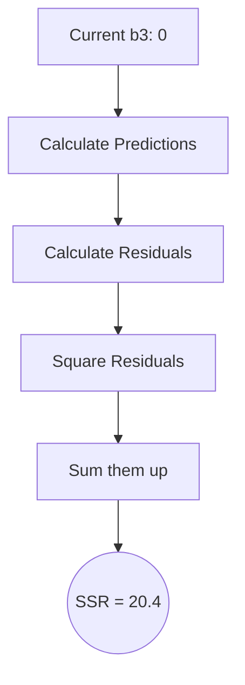
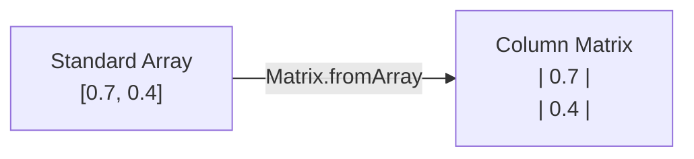

A loss function (also called a cost function or objective function) measures how far a model's predictions $\hat{y}$ are from the actual ground truth $y$, condensing all of that disagreement into a single scalar value that training exists to minimize. The choice of loss function dictates how a network learns: it determines the shape of the optimization landscape, the stability of training, and ultimately whether the model can converge to a good solution at all. This note builds the idea from the ground up — from the simplest error signal, through the regression losses (MSE, MAE, Huber) and their tradeoffs, to the classification losses built on logarithms (binary and categorical cross-entropy, hinge, focal loss) — and closes with how a chosen loss interacts with the optimizers that descend it.

## What a loss function does

The loss function (or cost function) is the mathematical formula that calculates how far off our predictions ($\hat{y}$) are from the actual ground truth ($y$). The goal of training is to minimize this function. Training a neural network is, at its core, the process of iteratively adjusting the model's parameters to minimize this loss value. If the loss function is poorly chosen, the model will optimize for the wrong objective and produce useless predictions, no matter how sophisticated the architecture or how abundant the data — which is why understanding loss functions deeply is foundational rather than optional.

The loss function serves several critical roles in the training process. First, it provides the gradient signal that drives parameter updates: the partial derivatives $\frac{\partial L}{\partial w_i}$ tell each weight $w_i$ which direction and how much to change. Second, it defines what "good" means for your specific problem — classification accuracy, regression precision, ranking quality, or any other objective. Third, it provides a monitoring signal during training: a decreasing training loss indicates that the model is fitting the data, while a diverging loss indicates a problem with the learning rate, the data, or the architecture.

> [!note] Loss vs. metric: they are not the same thing
> The loss function is different from the evaluation metric. The loss function must be differentiable (so that gradients can be computed) and is used to drive training. The evaluation metric (e.g., accuracy, F1 score) measures real-world performance but may not be differentiable. For example, accuracy is not differentiable because a small change in a weight may not change any prediction, making the gradient zero everywhere except at decision boundaries. We train using a surrogate loss (like cross-entropy) that is differentiable and correlates well with our true metric (like accuracy), but we evaluate using the metric that actually matters for our application — a distinction explored further in [[Model Evaluation Metrics]] and [[Regression Evaluation Metrics]].

### Error in supervised learning

The mechanism of backpropagation operates specifically within the paradigm of supervised learning, where the network is trained using a dataset that acts like an answer key:

1. The network is given an input (e.g., an image).
2. The network makes a prediction, which we call the **guess**.
3. We, acting as the "teacher," know the actual, correct **answer** (the target label).
4. We compare the guess to the answer to calculate the **error**.

Once the error is calculated at the final output layer, backpropagation allows us to take that error and feed it backwards through the network, layer by layer, adjusting the weights as we go.

### The data split strategy

When training a network, datasets are rigorously split into three categories:

1. **Training data:** the data with known labels used to adjust the network's weights.
2. **Test/validation data:** data with known labels that is *hidden* from the network during training, used to test whether the network is actually learning underlying patterns or just memorizing.
3. **Unknown/production data:** completely new data the network will encounter in the real world once deployed.

If you feed all data to the network at once, it will simply memorize the data (**overfitting**) and fail completely when presented with unseen data — a phenomenon examined in detail in [[Bias Variance Tradeoff]]. The validation split also becomes the quantity that adaptive training techniques monitor, as discussed in [[#Where the optimizer takes over|loss landscapes and the optimization interface]].

## From raw error to a training objective

### The simplest error: target minus guess

The most intuitive way to calculate the error is a simple subtraction:

$$ \text{Error} = \text{Target Answer} - \text{Network Guess} $$

For example, if the target is `1.0` and the network outputs `0.7`:

$$ \text{Error} = 1.0 - 0.7 = 0.3 $$

The error tells us two critical things. **Magnitude:** the network is off by 0.3, which represents how *much* we need to adjust our weights. **Direction:** the error is positive, meaning our guess was too low and we need to "nudge" our weights higher; if the guess had been 1.2, the error would be $-0.2$, meaning we would need to nudge the weights lower.

> [!tip] Target − guess vs. guess − target
> Standard convention dictates $Target - Output$ so that a positive error implies we need to increase our weights, and a negative error implies we need to decrease them. In many cost functions (like MSE), we square the error, so the order doesn't matter for the raw *magnitude*. However, when we perform calculus to find the direction, the sign determines which direction to step.

### Residuals and the sum of squared residuals

A residual is the mathematical distance between what the model predicted and what actually happened in the real world:

$$ \text{Residual} = (\text{Observed Value}) - (\text{Predicted Value}) $$

For example, if the observed value is `0` and our network predicted `-2.6`, the residual is:

$$ 0 - (-2.6) = 2.6 $$

This tells us our prediction was `2.6` units below the actual data point.

**Why square the residual?** If we simply added the raw residuals together, positive and negative errors would cancel each other out, falsely suggesting the model is accurate. Squaring achieves three critical things:

1. **Removes negative signs (positive values):** if a prediction is off by $+2$ and another is off by $-2$, summing them without squaring would result in $0$ error, tricking the model into thinking it is perfect. Squaring ensures all errors are positive — no cancellation.
2. **Punishes large errors (outliers):** squaring an error of $5$ results in $25$; squaring an error of $10$ results in $100$. This forces the network to aggressively fix predictions that are wildly incorrect, since $4^2 = 16$ is much bigger than $2^2 = 4$.
3. **Differentiability:** the resulting equation creates a smooth, convex parabola (a U-shape). This U-shape has a distinct bottom (minimum), which allows us to use calculus (derivatives) to find the exact bottom of the curve.

For $n$ data points, the sum of squared residuals (SSR) is:

$$ \text{SSR} = \sum_{i=1}^{n} (\text{Observed}_i - \text{Predicted}_i)^2 $$

Breaking down the notation: $\sum$ is the summation symbol, $i=1$ is the starting index, $n$ is the total number of data points, and $(\text{Observed}_i - \text{Predicted}_i)^2$ is the squared residual for the $i$-th data point. Before using summation notation, it is instructive to write out every single term explicitly for a 3-data-point example:

$$ \text{SSR} = (\text{Obs}_1 - \text{Pred}_1)^2 + (\text{Obs}_2 - \text{Pred}_2)^2 + (\text{Obs}_3 - \text{Pred}_3)^2 $$

Writing it this way makes it crystal clear that we are calculating each residual individually, squaring it, and then adding them all together.

> [!tip] Understanding "predicted" in the equation
> Never forget what "predicted" actually is. It is not just a simple number; it is the entire mathematical output of the neural network. Using the Blue/Orange Curve notation from StatQuest:
> $$ \text{Predicted}_i = (\text{Blue Curve}_i) + (\text{Orange Curve}_i) + b_3 $$
> Or equivalently, using the weight notation:
> $$ \text{Predicted}_i = (y_{1,i} \times w_3) + (y_{2,i} \times w_4) + b_3 $$
> This substitution will be vital when we start taking derivatives!

> [!warning] Parameters hide inside "predicted"
> Do not forget that the $Predicted_i$ term in this equation *contains* our unknown parameters $w_3, w_4,$ and $b_3$. If we expand the equation, it looks like this:
> $$SSR = \sum (Observed_i - [(y_{1,i} \times w_3) + (y_{2,i} \times w_4) + b_3])^2$$
> This is why changing $w_3$ directly changes the SSR — the parameter is embedded inside the loss function!

Visualizing the SSR landscape for our initial network where $b_3 = 0$, doing the math yields an SSR of 20.4:



### The one-half convention

In calculus-based derivations, the error function for the entire dataset of $N$ examples is often defined as the L2 norm squared:

$$ L = \sum_{i=1}^{N} \frac{1}{2} (\hat{p}_i - y_i)^2 $$

Breaking this formula down part by part: $N$ is the total number of training examples; $i$ is the index of the current training example; $\hat{p}_i$ is our network's predicted probability (a number between 0 and 1); $y_i$ is the ground truth label (either exactly 0 or exactly 1); $(\hat{p}_i - y_i)$ is the raw error; and $(\hat{p}_i - y_i)^2$ is the squaring that ensures negative and positive errors don't cancel out and heavily penalizes large errors.

**The magic of the $\frac{1}{2}$:** why is there a $\frac{1}{2}$ in front of the formula? It is purely for mathematical convenience during calculus. When we take the derivative of $(x)^2$, the power rule brings the 2 to the front: $2 \cdot x$. By putting a $\frac{1}{2}$ in the loss function, the derivative becomes $\frac{1}{2} \cdot 2 \cdot x = x$. The constants cancel out beautifully, making the math cleaner — and it does not change where the minimum of the function is located.

When performing backpropagation, we usually calculate the gradient for one specific training example at a time:

$$ L_i = \frac{1}{2}(\hat{p}_i - y_i)^2 $$

### Professional cost functions

While simple subtraction works for intuition, professional neural networks usually use more complex cost functions (or loss functions) because they provide cleaner mathematical derivatives for the calculus steps. The most common for simple regressions is the mean squared error (MSE). The goal of training a neural network is singular: **minimize the cost function** — we want to find the exact combination of millions of weights and biases that results in the lowest possible error.

### Error calculation in code

When constructing a neural network class, we require a dedicated `train(inputs, targets)` method, where **`inputs`** is the raw data being fed into the network and **`targets`** is the known, correct answers (labels) we want the network to eventually produce. In JavaScript, the initial step of the training function looks like this:

```javascript
train(inputs, targets) {
    // Step 1: Generate the neural network's guess
    let outputs = this.feedforward(inputs);
    
    // Future steps will go here...
}
```

> [!warning] Common pitfall: what does `feedforward` return?
> Students often forget the data types being passed around in custom neural network libraries. In this specific implementation, the user passes in standard JavaScript `Arrays` (e.g., `[1, 0]`). However, internally, neural networks rely on linear algebra. Here, the `feedforward` function processes the data using internal `Matrix` objects, but it ends with `return output.toArray();`. **Reminder:** at this stage, `outputs` is a standard 1-dimensional array, *not* a Matrix object. We will have to deal with this data type conversion shortly to perform our error calculations.

Both our `targets` (passed in by the user) and our `outputs` (returned by the feedforward function) are standard 1D JavaScript arrays. To perform neural network mathematics efficiently, we must convert these 1D arrays into **single-column matrices** (vectors):



The training function then converts both operands and computes the error with a matrix subtraction:

```javascript
train(inputs, targets) {
    let outputs = this.feedforward(inputs);

    // Convert arrays to Matrix objects
    outputs = Matrix.fromArray(outputs);
    targets = Matrix.fromArray(targets);
    
    // Calculate the error
    let output_errors = Matrix.subtract(targets, outputs);
}
```

> [!tip] Naming conventions
> Notice how the instructor reassigns `outputs = Matrix.fromArray(outputs)`. While this saves memory, it can sometimes be confusing while debugging because the variable type changes from `Array` to `Matrix` midway through the function. A safer trick for beginners is to use distinct variable names, such as `outputs_matrix = Matrix.fromArray(outputs_array)`. However, keeping them as the same name is standard practice in optimizing lightweight libraries.

This brings up a critical programming distinction that students often miss:

- **Instance method:** `matrixA.add(matrixB)` — this modifies `matrixA` *in place*.
- **Static method:** `Matrix.subtract(matrixA, matrixB)` — this takes two matrices, leaves them completely untouched, and returns a **brand new** Matrix containing the result.

For error calculation, we *must* use a static method because we do not want to destroy our original target or output matrices — we might need them later! Here is the rigorous, step-by-step implementation of matrix subtraction:

```javascript
class Matrix {
    // ... other methods ...

    static subtract(a, b) {
        // Step 1: Create a new blank matrix with the exact same dimensions
        let result = new Matrix(a.rows, a.cols);
        
        // Step 2: Loop through every row
        for (let i = 0; i < result.rows; i++) {
            // Step 3: Loop through every column
            for (let j = 0; j < result.cols; j++) {
                // Step 4: Subtract the element in matrix 'b' from matrix 'a'
                result.data[i][j] = a.data[i][j] - b.data[i][j];
            }
        }
        
        // Step 5: Return the brand new matrix
        return result;
    }
}
```

> [!danger] Crucial error check missing!
> For brevity, an implementation like the one above may skip error checking — but it *should* include it. **Important reminder:** matrix subtraction is only mathematically valid if Matrix A and Matrix B have the **exact same dimensions**. You cannot subtract a $3 \times 1$ matrix from a $2 \times 1$ matrix. A robust library would include a check at the top:
> `if (a.rows !== b.rows || a.cols !== b.cols) { throw new Error("Columns and Rows must match!"); }`

## Regression losses

Regression losses are used when predicting continuous values (e.g., house prices, temperature). They measure the distance between the predicted number and the true number.

### Mean squared error

Mean squared error calculates the average of the squared differences between predicted and actual values. We use the method of least squares, formulated as MSE, and it is the standard loss function for [[04 - Machine Learning/Regression/Linear Regression|Linear Regression]]:

$$ MSE = \frac{1}{n} \sum_{i=1}^{n} (y_i - \hat{y}_i)^2 $$

- **Pros:** punishes large errors heavily (because of the square). An error of 10 contributes 100 to the loss, while an error of 1 contributes only 1. This makes the model strongly motivated to avoid large mistakes.
- **Cons:** very sensitive to outliers. A single extreme outlier (e.g., a data point that is 100x larger than expected) will dominate the loss and pull the entire model toward it.

Because the error is squared, large errors are penalized disproportionately: an error of 4 is penalized $4^2 = 16$ times more than an error of 1, which is penalized $1^2 = 1$. This quadratic penalty means the model will prioritize fixing the largest errors first, which is desirable when all data points are reliable. However, a single extreme outlier (e.g., a data point that is 100x larger than expected) will contribute $100^2 = 10,000$ to the loss, completely dominating the optimization and pulling the entire model toward fitting that one outlier at the expense of all other data points.

**When to use MSE:** it is the standard for regression, provided there are no severe outliers. MSE is the optimal loss function when the noise in your data follows a Gaussian (normal) distribution, which is a common assumption in many real-world scenarios. MSE and MAE also serve as evaluation metrics, discussed in [[Regression Evaluation Metrics]] and [[Regression Fundamentals]].

In modern deep-learning frameworks the same loss appears in its batch form: when the target is a continuous value rather than a discrete class (e.g., predicting house prices, temperature, or age), MSE is the standard loss function, and for a batch of $N$ samples with predictions $\hat{y}_i$ and targets $y_i$ it is written:

$$L_{\text{MSE}} = \frac{1}{N}\sum_{i=1}^{N}(\hat{y}_i - y_i)^2$$

MSE penalizes larger errors more heavily than smaller ones due to the squaring operation, which is precisely what makes it sensitive to outliers — if robustness to outliers is needed, MAE or Huber loss may be preferred. In PyTorch, use `nn.MSELoss()`.

> [!warning] The 1/2m trick
> Some formulations use $\frac{1}{2m}$ instead of just $\frac{1}{m}$:
> $$ J(\theta_0, \theta_1) = \frac{1}{2m} \sum_{i=1}^{m} (h_\theta(x^{(i)}) - y^{(i)})^2 $$
> This is a deliberate mathematical convenience, not a change in the optimization problem. When we calculate the derivative of this function (to find the gradient), the exponent $2$ from the square drops down. The $2$ cancels out the $1/2$, leaving a very clean, simple equation without lingering constants. The minimizer is identical either way.

### Mean absolute error

Mean absolute error calculates the average of the absolute differences:

$$ MAE = \frac{1}{n} \sum_{i=1}^{n} |y_i - \hat{y}_i| $$

- **Pros:** robust to outliers. An error of 10 contributes exactly 10 to the loss, not 100. Outliers have a proportional (not squared) influence.
- **Cons:** the gradient is constant (either +1 or -1) regardless of the magnitude of the error. This means the model takes steps of equal size whether it's very close to the optimum or far away, which can cause instability near convergence — the model oscillates around the minimum rather than settling into it.

The gradient magnitude of MAE is constant (either -1 or +1), regardless of how large or small the error is. Near the minimum, this causes the model to oscillate back and forth rather than settling precisely — the step size does not decrease as the error decreases, so the model overshoots repeatedly. This is fundamentally different from MSE, where the gradient naturally decreases as the model approaches the optimum (because the error itself decreases).

**When to use MAE:** when the dataset contains many outliers. MSE would force the model to overcompensate for outliers; MAE remains robust because each outlier contributes only linearly (not quadratically) to the total loss.

### Huber loss

MSE is heavily skewed by outliers (because errors are squared). MAE ignores outliers but has a gradient that doesn't decrease as it approaches zero, causing instability at the end of training. **Huber loss** combines the best of both: it acts like MSE when the error is small (smooth convergence near the minimum), and acts like MAE when the error is large (ignoring extreme outliers). It is controlled by a threshold parameter $\delta$:

$$ L_\delta(y, \hat{y}) = \begin{cases} \frac{1}{2}(y - \hat{y})^2 & \text{for } |y - \hat{y}| \le \delta \\ \delta |y - \hat{y}| - \frac{1}{2}\delta^2 & \text{otherwise} \end{cases} $$

**How to read this formula:**

- When the error $|y - \hat{y}|$ is small (below the threshold $\delta$), we use the quadratic (MSE-like) formula $\frac{1}{2}(y - \hat{y})^2$. This gives a smooth, well-behaved gradient that decreases as we approach zero — perfect for fine-tuning near the optimum.
- When the error is large (above $\delta$), we switch to the linear (MAE-like) formula $\delta(|y - \hat{y}| - \frac{1}{2}\delta)$. This prevents outliers from exerting disproportionate influence.

The original course material wrote the same definition with French condition labels — worth recognizing because it is the form the exercise notes use:

$$ L_\delta(y, \hat{y}) = \begin{cases} \frac{1}{2}(y - \hat{y})^2 & \text{si } |y - \hat{y}| \le \delta \\ \delta(|y - \hat{y}| - \frac{1}{2}\delta) & \text{sinon} \end{cases} $$

where *si* means "if" and *sinon* means "otherwise".


- The parameter $\delta$ controls the transition point. A small $\delta$ makes the model more robust to outliers (switches to linear sooner), while a large $\delta$ makes it behave more like MSE.

The Huber loss is a piecewise function that transitions between MSE and MAE at the threshold $\delta$, which is often set to 1.0. Below the threshold it acts like MSE: smooth, differentiable at zero, with a gradient that naturally decreases as the error shrinks — perfect for fine-tuning near the optimum. Above the threshold, it acts like MAE: a linear penalty that does not let outliers dominate. The $-\frac{1}{2}\delta^2$ term ensures the function is continuous and differentiable at the transition point $\delta$.

**When to use Huber loss:** when you have a regression problem with occasional outliers and need both robustness (from MAE) and smooth convergence (from MSE). It is particularly useful in robotics and control systems, where sensor noise can produce occasional extreme readings.

The three regression losses therefore trade off along two axes. MSE offers the best-behaved gradient near the optimum but grants outliers quadratic influence; MAE caps outlier influence at the cost of a constant gradient that oscillates near the minimum; Huber interpolates between them via $\delta$, retaining differentiability at the switch point.

## Classification losses

While cross-entropy and binary cross-entropy cover the vast majority of classification tasks, other loss functions are important for specific scenarios. Classification losses in general are used when predicting discrete categories (e.g., Cat vs. Dog), and they are fundamentally different from regression losses because they must handle probabilities, not raw distances.

### Why probabilities need logarithms

In classification, our model outputs a probability between 0 and 1 — predictions $\hat{y}$ are probabilities. This is a critical distinction from regression:

- If $y=1$ (true) and the model predicts $\hat{y} = 0.99$, then $-\log(0.99) \approx 0.01$ (very low loss). The model is confident and correct — minimal penalty.
- If $y=1$ (true) and the model predicts $\hat{y} = 0.01$, then $-\log(0.01) \approx 4.6$ (huge penalty!). The log of 0.01 approaches $-\infty$, and we add a negative sign to the formula to make this a massive positive penalty (high loss). The model is confidently wrong — it deserves severe punishment.
- If $y=1$ and the model predicts $\hat{y} \to 0$, then $-\log(0) \to +\infty$ (infinite penalty — the model is absolutely certain about the wrong answer).

The log function punishes being confidently wrong with an exponentially increasing penalty. A model that predicts 0.001 when the truth is 1 gets punished far more than a model that predicts 0.4 when the truth is 1. This creates a strong incentive for the model to be both correct *and* confident, not just barely correct. The contrast with MSE is stark: a prediction of 0.01 when the truth is 1 gives an MSE penalty of $(1-0.01)^2 = 0.98$ — a mild slap on the wrist compared to the 4.6 penalty from log loss, which is over 400 times larger.

### Why MSE fails for classification

Using MSE on a sigmoid output creates a non-convex landscape riddled with local minima. Log loss, by contrast, guarantees a convex landscape for logistic models (see [[04 - Machine Learning/Regression/Logistic Regression|Logistic Regression]]), ensuring gradient descent can find the global minimum.

> [!warning] MSE for classification — never do this!
> Using MSE for classification results in a non-convex landscape with many local minima, making training nearly impossible. When you plug a sigmoid activation into MSE, the resulting loss surface has hills and valleys — gradient descent will get trapped in local minima and fail to find the optimal solution. Always use cross-entropy for classification!

### Binary cross-entropy and log loss

Binary cross-entropy (BCE), also called log loss, is used for binary classification (2 classes). It is the standard loss function whenever your model must distinguish between two categories:

$$ BCE = -\frac{1}{n} \sum_{i=1}^{n} [y_i \log(\hat{y}_i) + (1 - y_i) \log(1 - \hat{y}_i)] $$

**Breaking down the formula:**

- When $y_i = 1$: the term $(1 - y_i) \log(1 - \hat{y}_i)$ becomes 0, and we're left with $-\log(\hat{y}_i)$. We want $\hat{y}_i$ to be close to 1, making $-\log(\hat{y}_i)$ close to 0.
- When $y_i = 0$: the term $y_i \log(\hat{y}_i)$ becomes 0, and we're left with $-\log(1 - \hat{y}_i)$. We want $\hat{y}_i$ to be close to 0, making $-\log(1 - \hat{y}_i)$ close to 0.

#### Log loss asymptotic behavior

For binary cross-entropy (log loss), the cost can be defined piecewise to understand its behavior:

$$ Cost(h(x), y) = \begin{cases} -\log(h(x)) & \text{if } y = 1 \\ -\log(1 - h(x)) & \text{if } y = 0 \end{cases} $$

- **When $y = 1$:** the graph shows a curve starting high at $x=0$ and plunging to $0$ as $x \to 1$. If the model predicts $0$ (completely wrong), the penalty approaches $+\infty$. If the model predicts $1$ (correct), the penalty is $0$.
- **When $y = 0$:** the graph is mirrored. The penalty is $0$ at $x=0$, and approaches $+\infty$ as the model's prediction approaches $1$ (confidently wrong).

This mathematical property guarantees that the cost function strongly punishes confident, incorrect predictions. The loss goes to infinity when the model is absolutely certain about the wrong answer, creating a powerful gradient signal that pulls the model back toward the correct prediction.

### Categorical cross-entropy

Categorical cross-entropy (CCE) is used for multi-class classification (3+ classes). It extends BCE to handle multiple categories simultaneously:

$$ CCE = -\frac{1}{n} \sum_{i=1}^{n} \sum_{j=1}^{C} y_{i,j} \log(\hat{y}_{i,j}) $$

**Breaking down the formula:** $n$ is the number of training examples; $C$ is the number of classes; $y_{i,j}$ is 1 if example $i$ belongs to class $j$, and 0 otherwise (one-hot encoding); $\hat{y}_{i,j}$ is the predicted probability that example $i$ belongs to class $j$; and only the term for the true class contributes to the loss (because all other $y_{i,j}$ are 0).

In the more detailed formulation for multi-class classification where $y$ belongs to one of $k$ classes ($k > 2$):

$$ CCE = -\sum_{i=1}^{n} \sum_{j=1}^{k} y_{ij} \log(\hat{y}_{ij}) $$

Here $n$ is the number of training examples, $k$ is the number of classes, $y_{ij}$ is 1 if sample $i$ belongs to class $j$ and 0 otherwise (one-hot encoding — only the true class has $y_{ij} = 1$, all others are 0), and $\hat{y}_{ij}$ is the predicted probability that sample $i$ belongs to class $j$. Because only the term for the true class contributes to the loss, the formula effectively reduces to $-\log(\hat{y}_{true\_class})$ for each sample. The **softmax** activation ensures all $\hat{y}_{ij}$ sum to 1, creating a valid probability distribution over the $k$ classes.

**Practical note:** in PyTorch, use `nn.CrossEntropyLoss()`, which combines LogSoftmax and NLLLoss in a single, numerically stable operation. Never apply softmax before `CrossEntropyLoss` in PyTorch — the loss function expects raw logits.

### Cross-entropy under the hood

Cross-entropy loss is by far the most commonly used loss function for multi-class classification problems. It is the default choice whenever your task involves assigning an input to one of $C$ mutually exclusive classes. PyTorch's `nn.CrossEntropyLoss` combines two operations into a single, numerically stable function:

1. **Softmax** converts the raw logits (unnormalized scores) output by the model into a probability distribution over the $C$ classes. For a vector of logits $\mathbf{z} = [z_1, z_2, \ldots, z_C]$, the softmax function computes:

$$\text{Softmax}(z_i) = \frac{e^{z_i}}{\sum_{j=1}^{C} e^{z_j}} = p_i$$

The key properties of softmax are: (a) every output $p_i$ is in the range $(0, 1)$, (b) the outputs sum to 1 ($\sum_{i=1}^{C} p_i = 1$), and (c) the outputs are monotonic in the logits — if $z_i > z_j$, then $p_i > p_j$. These properties make the softmax output a valid probability distribution that preserves the ranking of the logits.

2. **Negative log-likelihood (NLLLoss)** — given the predicted probabilities $\mathbf{p}$ and the true class $c$, NLLLoss computes:

$$\text{NLLLoss}(\mathbf{p}, c) = -\log(p_c)$$

where $p_c$ is the predicted probability for the correct class $c$. This is the negative log of the probability assigned to the true label. The negative sign ensures that the loss is positive (since $p_c \in (0, 1)$ means $\log(p_c) < 0$), and minimizing the loss is equivalent to maximizing the probability assigned to the correct class.

#### The combined formula

When we combine softmax and NLLLoss into a single expression, we get the cross-entropy loss formula. For a single sample with logits $\mathbf{z}$ and true class $c$:

$$L_{\text{CE}} = -\log\left(\frac{e^{z_c}}{\sum_{j=1}^{C} e^{z_j}}\right)$$

This can be expanded and simplified using the logarithm:

$$L_{\text{CE}} = -z_c + \log\left(\sum_{j=1}^{C} e^{z_j}\right)$$

The second form is computationally more stable because it avoids explicitly computing the exponential ratio, which can lead to numerical overflow or underflow for extreme logit values. PyTorch's implementation uses the LogSumExp trick to compute $\log\left(\sum_{j=1}^{C} e^{z_j}\right)$ in a numerically stable way by subtracting the maximum logit before exponentiating:

$$\log\left(\sum_{j=1}^{C} e^{z_j}\right) = z_{\max} + \log\left(\sum_{j=1}^{C} e^{z_j - z_{\max}}\right)$$

This ensures that the exponentials $e^{z_j - z_{\max}}$ are all $\leq 1$, preventing overflow, and since at least one term equals $e^0 = 1$, the sum is at least 1, preventing underflow in the logarithm.

#### Intuition: how cross-entropy behaves

The behavior of cross-entropy loss is best understood by considering what happens at the extremes:

- **When the model is confident and correct** ($p_c \approx 1$): the loss approaches $-\log(1) = 0$. The model is assigning nearly all probability mass to the correct class, so the loss is near zero. This is the desired outcome.
- **When the model is confident and wrong** ($p_c \approx 0$): the loss approaches $-\log(0) = +\infty$. The model is assigning nearly zero probability to the correct class, so the loss is extremely high. This provides a strong gradient signal to correct the error.
- **When the model is uncertain** ($p_c = 1/C$ for all classes): the loss is $-\log(1/C) = \log(C)$. For 10 classes, this is $\log(10) \approx 2.30$. This is the baseline loss for a model that has not learned anything useful.


### The double softmax bug

This is one of the most common and most damaging mistakes in deep learning with PyTorch. Because `nn.CrossEntropyLoss` internally applies softmax before computing the loss, you must NOT apply softmax to your model's output before passing it to the loss function. If you apply softmax twice (once manually, once inside the loss), the resulting probabilities will be distorted and the gradients will be incorrect.

**Why it fails:** if you apply softmax to logits $\mathbf{z}$ to get probabilities $\mathbf{p}$, and then pass $\mathbf{p}$ to `CrossEntropyLoss` (which applies softmax again), you are computing:

$$L = -\log\left(\frac{e^{p_c}}{\sum_{j} e^{p_j}}\right)$$

Since the probabilities $p_j$ are already in $(0, 1)$ and sum to 1, applying softmax again compresses the distribution further toward uniform. For example, if the original probabilities are $[0.7, 0.2, 0.1]$, applying softmax again might produce $[0.42, 0.32, 0.26]$ — the confident prediction has been turned into an uncertain one. The gradients computed from this distorted loss will push the model in the wrong direction, leading to slower convergence, lower final accuracy, or even divergence.

```python
# =============================================================================
# CORRECT vs. WRONG: Cross-Entropy Loss Usage
# =============================================================================

import torch                                    # Core PyTorch library
import torch.nn as nn                           # Neural network module

# Simulate a model's output: 3 samples, 5 classes
logits = torch.randn(3, 5)                      # Raw unnormalized scores from the model's final linear layer
                                                # Shape: (batch_size=3, num_classes=5)
                                                # These can be any real number (positive, negative, large, small)
labels = torch.tensor([0, 2, 4])                # True class indices for each sample in the batch
                                                # Must be integer class indices (NOT one-hot encoded)

# --- CORRECT: Pass logits directly to CrossEntropyLoss ---
criterion = nn.CrossEntropyLoss()               # This combines Softmax + NLLLoss internally
loss_correct = criterion(logits, labels)        # Pass raw logits directly — the loss function handles Softmax
print(f"Correct loss: {loss_correct.item():.4f}")  # This produces the correct loss value and correct gradients

# --- WRONG: Apply Softmax manually before CrossEntropyLoss ---
softmax = nn.Softmax(dim=1)                     # Softmax along the class dimension
probs_wrong = softmax(logits)                   # Apply Softmax to convert logits to probabilities
loss_wrong = criterion(probs_wrong, labels)     # BUG: CrossEntropyLoss applies Softmax AGAIN internally
print(f"Wrong loss:   {loss_wrong.item():.4f}")  # This produces an INCORRECT loss value and WRONG gradients
                                                # The model will learn slower or not at all

# --- CORRECT (alternative): Use LogSoftmax + NLLLoss separately ---
log_softmax = nn.LogSoftmax(dim=1)              # Compute log-softmax: log(Softmax(z)) in a numerically stable way
log_probs = log_softmax(logits)                 # Apply log-softmax to get log-probabilities
nll_loss = nn.NLLLoss()                         # Negative log-likelihood loss (expects log-probabilities as input)
loss_alt = nll_loss(log_probs, labels)          # This is mathematically identical to CrossEntropyLoss(logits, labels)
print(f"Alternative loss: {loss_alt.item():.4f}")  # Should match loss_correct exactly
```

> [!warning] The double softmax bug is silent
> The double softmax bug does NOT raise an error or a warning. PyTorch will happily compute the loss and gradients — they will just be wrong. The model may still appear to learn (because the gradients have the right sign), but convergence will be slower and the final accuracy will be lower. This makes the bug particularly insidious, because you might not notice it unless you compare with a correct implementation. Always remember: **raw logits go into `CrossEntropyLoss`, probabilities go into `NLLLoss` after `LogSoftmax`**.

### Binary cross-entropy in practice

When your classification problem has exactly two classes (e.g., spam vs. not spam, malignant vs. benign, defective vs. normal), you have two options: use `CrossEntropyLoss` with 2 output units, or use `BinaryCrossEntropyLoss` with a single output unit. The binary version is often preferred because it is simpler, uses fewer parameters, and is numerically more efficient.

Just as `CrossEntropyLoss` combines softmax + NLLLoss for multi-class problems, `BCEWithLogitsLoss` combines **sigmoid** + **binary cross-entropy** for binary problems. The sigmoid function converts a single logit into a probability:

$$\sigma(z) = \frac{1}{1 + e^{-z}} = p$$

The binary cross-entropy loss for a single sample is:

$$L_{\text{BCE}} = -\left[y \cdot \log(p) + (1 - y) \cdot \log(1 - p)\right]$$

where $y \in \{0, 1\}$ is the true label and $p = \sigma(z)$ is the predicted probability for the positive class. When $y = 1$, the first term is active and the loss reduces to $-\log(p)$ (we want $p$ to be close to 1). When $y = 0$, the second term is active and the loss reduces to $-\log(1 - p)$ (we want $p$ to be close to 0).

```python
# =============================================================================
# BINARY CROSS-ENTROPY LOSS: COMPLETE CODE
# =============================================================================

import torch                                    # Core PyTorch library
import torch.nn as nn                           # Neural network module

# Simulate model output for a binary classification task
logits = torch.randn(8)                         # Raw logits from a model with 1 output unit
                                                # Shape: (batch_size=8,) — one logit per sample
                                                # Can be any real number
labels = torch.tensor([1., 0., 1., 0., 1., 1., 0., 0.])  # True labels: 1.0 for positive, 0.0 for negative
                                                # Must be float type (not long/int) for BCEWithLogitsLoss

# --- CORRECT: Use BCEWithLogitsLoss (combines Sigmoid + BCE) ---
criterion = nn.BCEWithLogitsLoss()              # Combines Sigmoid and BCE internally (numerically stable)
loss = criterion(logits, labels)                # Pass raw logits and float labels — Sigmoid is applied internally
print(f"BCEWithLogitsLoss: {loss.item():.4f}")  # Correct loss value and gradients

# --- WRONG: Apply Sigmoid manually before BCEWithLogitsLoss ---
sigmoid = nn.Sigmoid()                          # Sigmoid activation function
probs_wrong = sigmoid(logits)                   # Apply Sigmoid to get probabilities
loss_wrong = criterion(probs_wrong, labels)     # BUG: Sigmoid is applied TWICE (once manually, once internally)
print(f"Wrong (double sigmoid): {loss_wrong.item():.4f}")  # Incorrect loss and gradients

# --- CORRECT (alternative): Use Sigmoid + BCELoss separately ---
bce_loss = nn.BCELoss()                         # Binary cross-entropy loss (expects probabilities, NOT logits)
probs_correct = sigmoid(logits)                 # Apply Sigmoid to convert logits to probabilities
loss_alt = bce_loss(probs_correct, labels)      # Pass probabilities to BCELoss
print(f"BCELoss (with manual Sigmoid): {loss_alt.item():.4f}")  # Same as BCEWithLogitsLoss (but less numerically stable)

# --- Building a binary classifier model ---
class BinaryClassifier(nn.Module):              # Define a binary classifier module
    def __init__(self, input_dim):              # Constructor: takes the input feature dimension
        super().__init__()                      # Call the parent class constructor
        self.network = nn.Sequential(           # Define the network as a sequence of layers
            nn.Linear(input_dim, 64),           # First FC layer: input_dim → 64 hidden units
            nn.ReLU(),                          # ReLU activation (introduces non-linearity)
            nn.Dropout(0.3),                    # Dropout with p=0.3 (regularization, prevents overfitting)
            nn.Linear(64, 1),                   # Output layer: 64 → 1 (single logit for binary classification)
        )
    
    def forward(self, x):                       # Forward pass: define how input flows through the network
        return self.network(x)                  # Return raw logit (do NOT apply Sigmoid here!)
                                                # BCEWithLogitsLoss handles the Sigmoid internally

model = BinaryClassifier(input_dim=20)          # Instantiate the model with 20-dimensional input
criterion = nn.BCEWithLogitsLoss()              # Use BCEWithLogitsLoss (always preferred over Sigmoid+BCELoss)
optimizer = torch.optim.Adam(model.parameters(), lr=0.001)  # Adam optimizer with standard learning rate

# Training step
x_batch = torch.randn(16, 20)                   # Simulated input batch: 16 samples, 20 features each
y_batch = torch.randint(0, 2, (16,)).float()    # Simulated binary labels: 0 or 1, converted to float

optimizer.zero_grad()                           # Clear previous gradients
logits = model(x_batch)                         # Forward pass: get raw logits (shape: (16, 1))
logits = logits.squeeze(-1)                     # Remove the last dimension: (16, 1) → (16,)
                                                # BCEWithLogitsLoss expects matching shapes
loss = criterion(logits, y_batch)               # Compute loss (Sigmoid applied internally)
loss.backward()                                 # Backward pass: compute gradients
optimizer.step()                                # Update model parameters

# Getting predictions at inference time
with torch.no_grad():                           # Disable gradient computation for inference
    test_logits = model(x_batch)                # Forward pass on test data
    test_probs = torch.sigmoid(test_logits)     # Apply Sigmoid to get probabilities (only at inference!)
    predictions = (test_probs > 0.5).float()    # Threshold at 0.5: probability > 0.5 → class 1, else class 0
```

> [!tip] Why BCEWithLogitsLoss is preferred over Sigmoid + BCELoss
> `BCEWithLogitsLoss` is numerically more stable than applying `nn.Sigmoid()` followed by `nn.BCELoss()`. The reason is that the combined implementation can use the LogSumExp trick to avoid computing $\log(\sigma(z))$ and $\log(1 - \sigma(z))$ explicitly, which can lead to numerical instability for extreme logit values. When $z$ is very large and positive, $\sigma(z) \approx 1$ and $\log(\sigma(z)) \approx 0$, but computing it naively as $\log(1/(1 + e^{-z}))$ can cause overflow in $e^{-z}$. The combined implementation avoids this by reformulating the computation algebraically. Always use `BCEWithLogitsLoss` for binary classification.

While cross-entropy and binary cross-entropy cover the vast majority of classification tasks, other loss functions matter for specific scenarios; what follows gives brief overviews of the three most commonly encountered alternatives.

### Hinge loss and margins

Hinge loss is used primarily for support vector machines and some neural networks to force a strict, clear margin of separation between classes, rather than just getting the classification right. Unlike cross-entropy, which is satisfied with correct predictions, hinge loss wants the predictions to be correct *by a margin*. In its single-sample form:

$$ \text{Hinge Loss} = \max(0, 1 - y \cdot \hat{y}) $$

and summed over a dataset (where $y \in \{-1, 1\}$):

$$ Hinge = \sum \max(0, 1 - y_i \cdot \hat{y}_i) $$

Predictions are expected to be -1 or +1, not probabilities. The key insight is that hinge loss forces the model not just to classify correctly, but to create a **margin** of separation between classes:

- If $y \cdot \hat{y} \ge 1$: the prediction is correct AND far enough from the boundary. Loss = 0.
- If $0 < y \cdot \hat{y} < 1$: the prediction is correct but too close to the decision boundary. Loss > 0, pushing the prediction further from the boundary.
- If $y \cdot \hat{y} < 0$: the prediction is wrong. Loss > 1, a significant penalty.

The loss is zero only when $y_i \cdot \hat{y}_i \ge 1$, meaning the prediction is on the correct side of the margin. If the prediction is correct but too close to the decision boundary (between 0 and 1), the loss is still positive, encouraging the model to push the prediction further from the boundary. This margin-based approach produces models that generalize better because they don't just barely classify correctly — they classify with confidence and distance from the decision boundary. The margin idea is central to [[Support Vector Machines]] and its optimization, covered in [[SVM Lagrangian Dual]].

### Focal loss for extreme class imbalance

Focal loss was introduced by Lin et al. (2017) in the RetinaNet paper to address extreme class imbalance in object detection, where background (negative) examples vastly outnumber foreground (positive) examples. It modifies the standard cross-entropy loss by adding a modulating factor $(1 - p_t)^\gamma$ that down-weights well-classified examples:

$$L_{\text{Focal}} = -(1 - p_t)^\gamma \cdot \log(p_t)$$

where $p_t$ is the predicted probability for the correct class, and $\gamma \geq 0$ is the focusing parameter. When $\gamma = 0$, focal loss reduces to standard cross-entropy. When $\gamma > 0$, the modulating factor reduces the loss contribution from easy examples (where $p_t \approx 1$) while preserving the loss from hard examples (where $p_t$ is small). This allows the model to focus its learning capacity on the difficult, rare examples rather than being overwhelmed by the easy, abundant ones. Typical values are $\gamma = 2$ (used in the original paper) and $\gamma = 0.5$ for less extreme imbalance.

> [!info] When to consider focal loss
> Consider focal loss when the class imbalance ratio exceeds 10:1 and standard techniques (oversampling, class weighting in cross-entropy) are insufficient. For most image classification tasks with moderate imbalance (up to ~10:1), using class-weighted cross-entropy (`nn.CrossEntropyLoss(weight=class_weights)`) is simpler and often equally effective.

## Loss landscapes and the optimization interface

### The gradient signal and gradient descent

All training is built on the foundation of gradient descent (see [[Gradient Descent]]). The core update rule is:

$$w_{\text{new}} = w_{\text{old}} - \eta \cdot \frac{\partial L}{\partial w}$$

where $w$ is a model parameter, $\eta$ is the learning rate (step size), and $\frac{\partial L}{\partial w}$ is the gradient of the loss with respect to the parameter. The gradient points in the direction of steepest ascent, so subtracting it moves the parameter in the direction of steepest descent — toward a lower loss. The learning rate $\eta$ controls the step size: too large and the updates overshoot minima (causing oscillation or divergence), too small and convergence is unacceptably slow.

This is where the mathematical properties of the loss function become an optimization concern. Squaring the residuals produces a smooth, convex parabola with a distinct minimum that calculus can locate exactly; log loss guarantees a convex landscape for logistic models, so gradient descent can find the global minimum; but pairing MSE with a sigmoid output produces a non-convex surface of hills and valleys where gradient descent gets trapped in local minima. The loss you choose literally shapes the terrain the optimizer must walk.

### Monitoring loss during training

The loss curve doubles as a diagnostic instrument. A decreasing training loss indicates that the model is fitting the data, while a diverging loss indicates a problem with the learning rate, the data, or the architecture. The validation loss — computed on the held-out split with known labels that the network never trains on — reveals whether the model is learning underlying patterns or merely memorizing.

Because the loss landscape changes as parameters move, the optimal learning rate is not constant throughout training. Early on, when parameters are far from a good solution, a large learning rate allows rapid progress and escape from poor local minima; later, when parameters are near a good solution, large updates would overshoot the minimum and cause oscillation. Adaptive schedulers such as `ReduceLROnPlateau` lean directly on the loss signal: they monitor a validation metric (typically validation loss, in `mode='min'`) and reduce the learning rate by a factor only when it stops improving for a set number of epochs (the patience), making them more responsive to actual training dynamics than fixed schedules. Warmup — a gradual learning rate ramp-up from a very small value over the first steps — addresses the mirror problem at the very start of training: randomly initialized parameters combined with a large learning rate can produce unstable gradient updates and cascading instability, so warming up lets the model find a stable region of the loss landscape before taking larger steps.

### Where the optimizer takes over

While the loss function defines the objective (what to minimize), the optimizer defines the method (how to minimize it). The optimizer takes the gradients computed by backpropagation and uses them to update the model's parameters, and the choice of optimizer, its hyperparameters, and its interaction with the learning rate schedule can have a dramatic impact on training speed, stability, and final model performance.

Several loss-side phenomena motivate the optimizers covered in [[Optimizers and Learning Rate Schedulers]]. Because vanilla stochastic gradient descent (SGD) computes the gradient of the loss on a mini-batch, its updates are noisy, and in ravines — narrow valleys in the loss landscape where the gradient oscillates across the valley while making slow progress along it — it struggles; SGD with momentum addresses this by accumulating an exponentially weighted velocity of past gradients that smooths the oscillations and accelerates through flat regions. Because gradient magnitudes of the loss can differ by orders of magnitude across layers (the vanishing/exploding gradient problem), Adam — the modern default optimizer — maintains first and second moments of the gradient with bias correction to compute adaptive per-parameter learning rates from its full update rules, which also makes it robust to sparse gradients and fast to converge early in training with default hyperparameter values. The research literature consistently shows that SGD with momentum and a well-tuned learning rate schedule can achieve slightly better generalization (1–2% higher accuracy) than Adam on large-scale image classification, at the cost of substantial tuning effort. The scheduler family — `StepLR` (step decay), `CosineAnnealingLR` (smooth cosine decay), and `ReduceLROnPlateau` — plus warmup for stabilizing early training complete the picture, and all of them are treated in depth in the companion note.

The through-line is that the loss function and the optimizer are the two pillars of neural network training: cross-entropy is the universal standard for classification (with raw logits, never double softmax), `BCEWithLogitsLoss` is the correct and numerically stable choice for binary classification, and the loss's curvature, outliers, and gradient scale are exactly what the optimizer machinery is designed to handle.

## Choosing a loss function

The decision procedure follows directly from the material above. First match the loss to the task type: continuous targets call for regression losses, discrete categories for probability-based classification losses. Then interrogate the data: severe or occasional outliers shift the choice from MSE toward MAE or Huber; extreme class imbalance (beyond roughly 10:1) opens the door to focal loss or class-weighted cross-entropy; a need for margin-based confidence rather than raw correctness points to hinge loss. Finally, respect the implementation contracts: raw logits into `nn.CrossEntropyLoss` and `nn.BCEWithLogitsLoss`, float labels for binary cross-entropy, and no manual softmax or sigmoid before the combined losses.

| Loss | Typical use | Key behavior | Strengths | Caveats |
|---|---|---|---|---|
| MSE | Regression (standard, linear regression) | Squares each error | Prioritizes largest errors; gradient shrinks near the optimum; optimal under Gaussian noise | Outliers dominate (a 100x outlier contributes $100^2 = 10,000$) |
| MAE | Regression with many outliers | Linear (absolute) penalty | Robust — outlier influence is proportional, not squared | Constant gradient (+1/−1) causes oscillation near convergence |
| Huber | Regression with occasional outliers | Quadratic below $\delta$, linear above | Robustness of MAE plus smooth convergence of MSE; differentiable at the transition | Requires choosing $\delta$ (often 1.0) |
| BCE / log loss | Binary classification | $-\log$ of the predicted probability of the truth | Infinite penalty for confident wrong answers; convex for logistic models | Use `BCEWithLogitsLoss` with raw logits and float labels |
| CCE | Multi-class classification | $-\log$ of the softmax probability of the true class | Valid probability distribution; $\log(C)$ baseline signals an untrained model | Never apply softmax first (the double softmax bug) |
| Hinge | SVMs, margin-based classifiers | $\max(0, 1 - y \cdot \hat{y})$ | Forces a margin of separation; better generalization | Labels are ±1, not probabilities; zero loss only beyond the margin |
| Focal | Extreme class imbalance (e.g., object detection) | $(1 - p_t)^\gamma$ modulation of cross-entropy | Down-weights easy examples to focus on hard, rare ones | Only when imbalance exceeds ~10:1 and weighting is insufficient; $\gamma = 2$ typical |

## See also

Related notes across the vault: [[Machine Learning MOC]] for the map of machine learning topics, [[Gradient Descent]] for the descent algorithm itself, and [[Optimizers and Learning Rate Schedulers]] for the full treatment of SGD, momentum, Adam, and scheduling. On the evaluation side, [[Regression Evaluation Metrics]] and [[Model Evaluation Metrics]] cover how MSE and MAE serve as metrics, and [[Computer Vision Evaluation Metrics]] connects to the detection settings where focal loss arose. For the models these losses train: [[Regression Fundamentals]], [[04 - Machine Learning/Regression/Linear Regression|Linear Regression]], [[04 - Machine Learning/Regression/Logistic Regression|Logistic Regression]], [[Support Vector Machines]] and [[SVM Lagrangian Dual]] for hinge loss and margins, plus [[Bias Variance Tradeoff]] and [[Regularization Techniques]] for the overfitting behavior that loss curves reveal.
