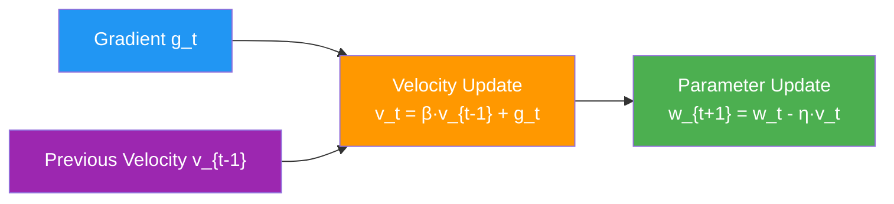
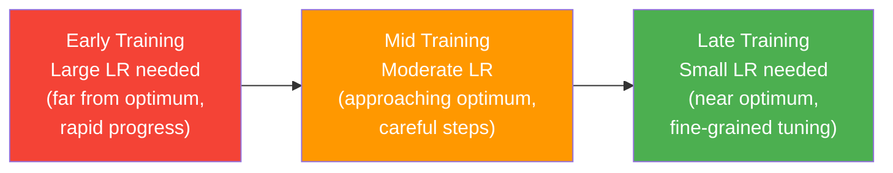

Training any model means iteratively adjusting its parameters to push a loss function downward, and the optimizer is the algorithm that performs those adjustments. This note follows the optimizer half of that story: the gradient descent update rule at the core of every method, the refinements built on top of it — mini-batch SGD, momentum, and the adaptive methods RMSProp and Adam — and the learning-rate schedulers and warmup strategies that reshape the step size as training proceeds. The question of *what* to minimize — cross-entropy, binary cross-entropy, MSE, focal loss — is treated in [[Loss Functions]], and the geometric intuition for descending a loss surface builds on [[Gradient Descent]].

## The role of the optimizer

While the loss function defines the objective (what to minimize), the optimizer defines the method (how to minimize it). The optimizer takes the gradients computed by backpropagation and uses them to update the model's parameters. The choice of optimizer, its hyperparameters, and its interaction with the learning rate schedule can have a dramatic impact on training speed, stability, and final model performance — which is why this material sits at the center of the practical [[Machine Learning MOC]] toolkit.

The loss and the optimizer meet at the gradient. The partial derivatives $\frac{\partial L}{\partial w_i}$ tell each weight $w_i$ which direction and how much to change, so a differentiable loss is what makes optimization possible at all. The loss also defines what "good" means for your specific problem — classification accuracy, regression precision, ranking quality, or any other objective — and it doubles as a monitoring signal during training: a decreasing training loss indicates that the model is fitting the data, while a diverging loss indicates a problem with the learning rate, the data, or the architecture. That last role makes the loss curve the first thing to inspect whenever an optimizer misbehaves, a point developed further in the debugging section below.

> [!note] Loss vs. Metric: They Are Not the Same Thing
> The loss function is different from the evaluation metric. The loss function must be differentiable (so that gradients can be computed) and is used to drive training. The evaluation metric (e.g., accuracy, F1 score) measures real-world performance but may not be differentiable. For example, accuracy is not differentiable because a small change in a weight may not change any prediction, making the gradient zero everywhere except at decision boundaries. We train using a surrogate loss (like cross-entropy) that is differentiable and correlates well with our true metric (like accuracy), but we evaluate using the metric that actually matters for our application.

Because the optimizer consumes gradients, it only ever "sees" the differentiable surrogate — the metric itself enters through monitoring and model selection, which is the subject of [[Model Evaluation Metrics]].

What exactly is being minimized depends on the task, and the consolidated treatments live in [[Loss Functions]]: Cross-Entropy Loss for multi-class classification; `BCEWithLogitsLoss` for binary classification, where a single output logit — the log-odds of the positive class — is squashed by a Sigmoid inside the loss; Mean Squared Error for regression targets (see [[Regression Fundamentals]] and [[04 - Machine Learning/Regression/Linear Regression|Linear Regression]]), which penalizes large errors heavily through squaring and gives way to Mean Absolute Error or Huber Loss when robustness to outliers is needed (see [[Regression Evaluation Metrics]]); and Focal Loss for extreme class imbalance (ratios beyond roughly 10:1), where it down-weights easy, abundant examples so the model can focus on hard, rare ones. Two of those losses carry usage traps that manifest as optimizer symptoms — applying Softmax or Sigmoid manually before the wrong loss silently corrupts the gradients — and are covered alongside the losses themselves.

## Gradient descent: the foundation of every optimizer

All optimizers are built on the foundation of Gradient Descent (see [[Gradient Descent]] for the full geometric treatment). The core update rule is:

$$w_{\text{new}} = w_{\text{old}} - \eta \cdot \frac{\partial L}{\partial w}$$

where $w$ is a model parameter, $\eta$ is the learning rate (step size), and $\frac{\partial L}{\partial w}$ is the gradient of the loss with respect to the parameter. The gradient points in the direction of steepest ascent, so subtracting it moves the parameter in the direction of steepest descent—toward a lower loss. The learning rate $\eta$ controls the step size: too large and the updates overshoot minima (causing oscillation or divergence), too small and convergence is unacceptably slow. Every method in this note is a different answer to the tension captured in that one sentence — momentum answers it with memory, adaptive methods answer it with per-parameter scaling, and schedulers answer it by letting $\eta$ itself change over time.

## Stochastic gradient descent

SGD applies the basic gradient descent update rule after computing the gradient on a mini-batch of training data (rather than the full dataset). The update rule is identical to vanilla Gradient Descent:

$$w_{t+1} = w_t - \eta \cdot g_t$$

where $g_t = \frac{\partial L}{\partial w}\bigg|_{w=w_t}$ is the gradient computed on the current mini-batch. The term "stochastic" refers to the noise introduced by using a mini-batch approximation rather than the exact full-dataset gradient.

Vanilla SGD has two structural problems, and every subsequent optimizer is best understood as a fix for one or both of them.

First, it uses the **same learning rate for all parameters**. Every parameter is updated with the same step size $\eta$, regardless of whether the gradient is consistently large (indicating a steep direction that might benefit from smaller steps) or consistently small (indicating a flat direction that might benefit from larger steps). This is particularly problematic for deep networks where different layers can have gradient magnitudes that differ by orders of magnitude (the "vanishing/exploding gradient" problem).

Second, it has **no memory of past gradients**. Each update depends only on the current mini-batch gradient, which is noisy. The optimizer cannot distinguish between a consistent gradient direction (indicating a reliable slope) and a noisy fluctuation (indicating a flat region with measurement noise). This leads to slow convergence in ravines — narrow valleys in the loss landscape where the gradient oscillates across the valley while making slow progress along it.

## SGD with momentum

Momentum addresses SGD's lack of gradient memory by introducing a velocity term that accumulates past gradients. The update rules are:

$$v_t = \beta \cdot v_{t-1} + g_t$$

$$w_{t+1} = w_t - \eta \cdot v_t$$

where $v_t$ is the velocity (accumulated gradient), $\beta$ is the momentum coefficient (typically $\beta = 0.9$), and $g_t$ is the current gradient. The velocity is an exponential moving average of past gradients, giving the optimizer "inertia" that helps it in two important ways.

**Momentum smooths oscillations.** In a ravine (a region where the loss surface curves much more steeply in one direction than another), the gradient oscillates back and forth across the narrow dimension. With momentum, these oscillating gradients partially cancel out in the velocity, reducing the oscillation amplitude. The standard hyperparameter $\beta = 0.9$ means that the velocity retains approximately the last 10 gradients' worth of information, which is usually sufficient to smooth out mini-batch noise and ravine oscillations.

**Momentum accelerates through flat regions.** In a flat region where gradients are consistently small and in the same direction, the velocity accumulates over multiple steps, effectively increasing the step size. This allows the optimizer to make faster progress through flat regions of the loss landscape where vanilla SGD would crawl.



> [!note] Standard Momentum Value: β = 0.9
> The value $\beta = 0.9$ is overwhelmingly the standard choice and should be your default. It means that the current gradient contributes 10% of the velocity, while past gradients contribute 90%. This provides strong smoothing without being so heavy that the optimizer cannot respond to changes in gradient direction. Values of $\beta$ in the range [0.8, 0.99] are sometimes used, but values below 0.8 provide too little smoothing and values above 0.99 make the optimizer too sluggish to respond to the current gradient.

## First and second moments

The vocabulary of *moments* recurs throughout the optimizer and loss-function literature, and the adaptive optimizers below depend on it directly, so it is worth making precise first. The **first moment** of a random variable is its expectation, $E[X]$ — the mean. The **second moment** is the expectation of its square, $E[X^2]$. The **second central moment** subtracts the mean before squaring, $E[(X - E[X])^2]$ — this is the variance, and its square root is the standard deviation. The raw and central second moments coincide exactly when the mean is zero; in general they differ by the square of the mean, $E[X^2] = \mathrm{Var}[X] + (E[X])^2$.

Adam's naming follows this vocabulary exactly. Its $m_t$ is a running estimate of the *first* moment of the gradient distribution — the mean direction in which the parameter has been moving — and its $v_t$ is a running estimate of the *second* moment of the gradient, deliberately **uncentered**: it averages $g_t^2$, not $(g_t - E[g_t])^2$. The uncentered choice is what makes the per-parameter scaling meaningful. A parameter whose gradients hover around a consistent nonzero value (say $g \approx 1.0$) has almost zero variance but a second moment near 1; the step size must be scaled by that raw magnitude, and a centered estimate would lose it entirely — dividing by the square root of a near-zero variance would explode the update. Conversely, for a parameter whose gradients oscillate around zero (say $\pm 0.1$), the mean nearly cancels while the second moment correctly captures the magnitude that should govern the step. Because $m_0$ and $v_0$ start at zero, both running averages are biased toward zero in the first steps; Adam's bias correction divides out this initialization bias, which matters most early in training.

The same terminology appears on the loss side, where variance is the second central moment of the error distribution — see [[Loss Functions]] — and in the hyperparameter guidance for tuning $\beta_1$ and $\beta_2$, which control the decay rates of the two moment estimates (the path-form link [[05 - Neural Network Foundations/Training Dynamics and Stability/Hyperparameters and Network Configuration|Hyperparameters and Network Configuration]] treats them; the mathematical background is in [[Optimization Essentials]]).

## Adaptive optimizers: RMSProp and Adam

Momentum fixed SGD's missing memory but left the other problem untouched: one global learning rate for every parameter. The adaptive family of optimizers attacks that problem by scaling the step size separately for each parameter based on that parameter's own gradient history. RMSProp's contribution was the key idea: it accumulates past squared gradients and uses that accumulated scale to adapt the learning rate per-parameter, so parameters with consistently large gradients take smaller steps and parameters with consistently small gradients take larger ones. Adam (Adaptive Moment Estimation), introduced by Kingma and Ba in 2015, combines the best ideas from two earlier optimizers: Momentum (which accumulates past gradients) and RMSProp (which accumulates past squared gradients to adapt the learning rate per-parameter). The result is an optimizer that is adaptive, fast-converging, and robust to the choice of hyperparameters—making it the default choice for most deep learning practitioners.

### Adam's full update rules

Adam maintains two moving averages for each parameter.

The **first moment** (mean of gradients), analogous to Momentum:

$$m_t = \beta_1 \cdot m_{t-1} + (1 - \beta_1) \cdot g_t$$

The **second moment** (mean of squared gradients), analogous to RMSProp:

$$v_t = \beta_2 \cdot v_{t-1} + (1 - \beta_2) \cdot g_t^2$$

Both moments are initialized to zero ($m_0 = 0$, $v_0 = 0$), which causes them to be biased toward zero in the early steps of training. Adam applies **bias correction** to compensate, producing the bias-corrected first moment:

$$\hat{m}_t = \frac{m_t}{1 - \beta_1^t}$$

and the bias-corrected second moment:

$$\hat{v}_t = \frac{v_t}{1 - \beta_2^t}$$

where $t$ is the current time step. The bias correction is most significant in the early steps (when $t$ is small) and becomes negligible as $t \to \infty$ (since $\beta^t \to 0$). For example, with $\beta_1 = 0.9$ and $t = 1$, the correction factor is $1/(1 - 0.9) = 10$, which inflates the moment to compensate for the initial zero bias.

The parameter update then combines both corrected moments:

$$w_{t+1} = w_t - \eta \cdot \frac{\hat{m}_t}{\sqrt{\hat{v}_t} + \epsilon}$$

The update is effectively: learning rate × (direction from first moment) / (scale from second moment). The division by $\sqrt{\hat{v}_t}$ adapts the effective learning rate for each parameter individually. Parameters with large past gradients (large $\hat{v}_t$) get smaller updates, while parameters with small past gradients (small $\hat{v}_t$) get larger updates. This is the key insight behind Adam's adaptive behavior.

### Why per-parameter learning rates matter

Adam's greatest strength is that it automatically adapts the learning rate for each parameter based on the history of gradients for that specific parameter. This has several important practical benefits.

**No manual learning rate tuning for different layers.** In a deep network, the gradient magnitude can vary enormously across layers—early layers may have gradients that are 100× or 1000× smaller than later layers (due to vanishing gradients). Adam automatically scales the effective learning rate for each parameter, so you do not need to manually set different learning rates for different layers (unlike SGD).

**Robustness to sparse gradients.** For parameters that receive infrequent updates (e.g., word embeddings in NLP, or features that are rare in the current batch), Adam accumulates the gradient information in the first moment and uses the second moment to appropriately scale the update. SGD with a fixed learning rate would either make updates that are too small for sparse parameters or too large for dense parameters.

**Fast initial convergence.** Adam typically converges much faster than SGD in the early stages of training because the adaptive learning rates allow it to take appropriately sized steps in all directions from the very beginning. This is particularly valuable during prototyping and experimentation, when you want to quickly test whether a model architecture or training setup is working.

## Hyperparameters and tuning

### Adam's default hyperparameters

Adam ships with defaults that work remarkably well across tasks, which is a large part of its popularity:

| Hyperparameter | Symbol | Default Value | Meaning |
|---|---|---|---|
| Learning Rate | $\eta$ | 0.001 | The global step size; controls the overall scale of updates. Unlike SGD, Adam is relatively robust to this value—0.001 works well for most tasks. |
| Beta 1 | $\beta_1$ | 0.9 | Exponential decay rate for the first moment (gradient mean). Controls how much past gradients influence the current direction. |
| Beta 2 | $\beta_2$ | 0.999 | Exponential decay rate for the second moment (squared gradient mean). Controls how much past gradient magnitudes influence the current scale. |
| Epsilon | $\epsilon$ | $10^{-8}$ | Small constant added to the denominator for numerical stability. Prevents division by zero when $\hat{v}_t$ is very small. |

Notice the asymmetry between the two decay rates: $\beta_1 = 0.9$ gives the direction a memory of roughly the last ten steps (the same effective window as momentum's $\beta = 0.9$), while $\beta_2 = 0.999$ gives the scale a much longer memory, since a stable estimate of a squared quantity needs more averaging. The $\epsilon$ in the denominator exists purely for numerical stability — it prevents division by zero when $\hat{v}_t$ is very small — and almost never needs changing.

### The SGD versus Adam trade-off

> [!tip] When to Use Adam vs. SGD
> **Use Adam** for: prototyping, NLP tasks, models with sparse gradients, when you want fast convergence, when you do not want to spend time tuning the learning rate. **Use SGD with Momentum** for: production CV models where you need the absolute best generalization, when you have time to carefully tune the learning rate schedule, when training on ImageNet-scale datasets. The research literature consistently shows that SGD with a well-tuned learning rate schedule can achieve slightly better generalization (1–2% higher accuracy) than Adam on large-scale image classification, but the tuning effort is substantial.

The full comparison:

| Property | SGD + Momentum | Adam |
|---|---|---|
| **Learning Rate** | Same $\eta$ for all parameters; must be carefully tuned per-layer | Adaptive per-parameter; $\eta = 0.001$ works well for most tasks |
| **Convergence Speed** | Slower, especially early in training | Faster, especially early in training |
| **Generalization** | Often better final generalization (1–2% higher accuracy) with proper tuning | Sometimes slightly worse generalization; may converge to sharper minima |
| **Hyperparameter Sensitivity** | High: learning rate, momentum, and schedule all need careful tuning | Low: default hyperparameters work well for most tasks |
| **Memory Usage** | 1 extra buffer per parameter (velocity) | 2 extra buffers per parameter (first and second moments) — roughly 2× the memory of SGD |
| **Sparse Gradients** | Poor: sparse parameters get the same learning rate as dense ones | Excellent: adaptive scaling handles sparse parameters naturally |
| **Recommended For** | Large-scale CV (ImageNet), production models where 1% accuracy matters | Prototyping, NLP, small/medium datasets, quick experiments |
| **Learning Rate Schedule** | Essential (step decay or cosine annealing) | Helpful but less critical (reduce-on-plateau is sufficient) |

Two rows deserve emphasis. The memory row is easy to forget: Adam's two moment buffers roughly double the optimizer state compared to SGD's single velocity buffer, which matters for very large models. The schedule row encodes a real asymmetry — SGD's fixed global learning rate makes an external schedule essential, while Adam's internal adaptivity means a simple reduce-on-plateau is usually enough. The generalization row is the reason SGD has not disappeared: on large-scale image classification benchmarks (see [[Computer Vision Evaluation Metrics]] for how that accuracy is measured), well-tuned SGD with momentum still tends to finish 1–2% ahead of Adam, at the cost of substantial tuning effort.

## Learning rate schedulers

### Why the learning rate must change during training

The optimal learning rate is not constant throughout training—it changes as the model's parameters move through the loss landscape. In the early stages of training, when the parameters are far from a good solution, a large learning rate is beneficial because it allows the optimizer to make rapid progress and escape poor local minima. In the later stages, when the parameters are near a good solution, a small learning rate is essential because large updates would overshoot the minimum and cause oscillation. A learning rate scheduler dynamically adjusts the learning rate during training to account for this changing landscape.



### StepLR: step decay

`StepLR` multiplies the learning rate by a factor $\gamma$ every `step_size` epochs. This is the simplest and most commonly used scheduler for SGD-based training.

$$\eta_t = \eta_0 \cdot \gamma^{\lfloor t / \text{step\_size} \rfloor}$$

**Example**: Starting learning rate $\eta_0 = 0.1$, `step_size = 30`, $\gamma = 0.1$:

| Epoch | Learning Rate | Explanation |
|---|---|---|
| 0–29 | 0.1 | Initial learning rate, before first decay |
| 30–59 | 0.01 | After first decay: $0.1 \times 0.1 = 0.01$ |
| 60–89 | 0.001 | After second decay: $0.01 \times 0.1 = 0.001$ |
| 90+ | 0.0001 | After third decay: $0.001 \times 0.1 = 0.0001$ |

The abrupt 10× drops are simple and effective, but they can sometimes cause temporary training instability as the optimizer re-settles after each cut — the motivation for the smooth alternative below.

```python
# =============================================================================
# StepLR: STEP DECAY SCHEDULER
# =============================================================================

import torch.optim as optim                     # Optimizer module
from torch.optim.lr_scheduler import StepLR     # Step decay scheduler

model = ...                                     # Your model (placeholder)
optimizer = optim.SGD(model.parameters(), lr=0.1, momentum=0.9)  # SGD with lr=0.1 and momentum=0.9
scheduler = StepLR(                             # Create the step decay scheduler
    optimizer,                                  # The optimizer whose learning rate will be adjusted
    step_size=30,                               # Decay the LR every 30 epochs
    gamma=0.1                                   # Multiply LR by 0.1 at each step (i.e., divide by 10)
)

num_epochs = 90                                 # Total number of training epochs
for epoch in range(num_epochs):                 # Loop over epochs
    # ... training loop here ...
    scheduler.step()                            # Update the learning rate according to the schedule
                                                # Must be called AFTER each epoch (not inside the batch loop)
```

### CosineAnnealingLR: smooth cosine decay

`CosineAnnealingLR` follows a smooth cosine curve from the initial learning rate down to a minimum value. This produces a gradual, smooth decay that avoids the abrupt drops of `StepLR`, which can sometimes cause temporary training instability.

$$\eta_t = \eta_{\min} + \frac{1}{2}(\eta_{\max} - \eta_{\min})\left(1 + \cos\left(\frac{t}{T_{\max}} \cdot \pi\right)\right)$$

where $\eta_{\max}$ is the initial learning rate, $\eta_{\min}$ is the minimum learning rate (often set to 0), $t$ is the current epoch, and $T_{\max}$ is the total number of epochs (or the period of the cosine cycle).

**Example**: Starting learning rate $\eta_{\max} = 0.1$, $\eta_{\min} = 0$, $T_{\max} = 100$:

| Epoch | Approximate LR | Explanation |
|---|---|---|
| 0 | 0.1 | Start of cosine curve (maximum) |
| 25 | 0.085 | Gradual decrease |
| 50 | 0.05 | Midpoint of cosine curve |
| 75 | 0.015 | Approaching minimum |
| 100 | 0.0 | End of cosine curve (minimum) |

The shape is the point: the decay is gentle early, fastest around the midpoint, and gentle again near the end, so the learning rate spends its time gliding between extremes rather than jumping across them.

```python
# =============================================================================
# CosineAnnealingLR: COSINE DECAY SCHEDULER
# =============================================================================

from torch.optim.lr_scheduler import CosineAnnealingLR  # Cosine decay scheduler

model = ...                                     # Your model (placeholder)
optimizer = optim.SGD(model.parameters(), lr=0.1, momentum=0.9)  # SGD optimizer
scheduler = CosineAnnealingLR(                  # Create the cosine annealing scheduler
    optimizer,                                  # The optimizer whose learning rate will be adjusted
    T_max=100,                                  # Period of the cosine curve (number of epochs for full decay)
    eta_min=0                                   # Minimum learning rate (default 0)
)

for epoch in range(100):                        # Loop over 100 epochs
    # ... training loop here ...
    scheduler.step()                            # Update the learning rate after each epoch
```

### ReduceLROnPlateau: adaptive scheduling

`ReduceLROnPlateau` is the most practical and widely used scheduler for real-world projects. Instead of following a fixed schedule, it monitors a validation metric (typically validation loss) and reduces the learning rate only when that metric stops improving. This is adaptive: if training is still making progress, the learning rate stays the same; if progress stalls, the learning rate is reduced to allow finer-grained optimization.

How it works, in three steps. After each epoch, check the monitored metric (e.g., validation loss). If the metric has not improved by at least `threshold` for `patience` consecutive epochs, multiply the learning rate by `factor`. "Improved" means the metric decreased (for loss) or increased (for accuracy) by at least `threshold`.

| Parameter | Default | Meaning |
|---|---|---|
| `mode` | "min" | "min" for loss (lower is better), "max" for accuracy (higher is better) |
| `factor` | 0.1 | Factor by which to multiply the LR when triggered (new_lr = old_lr × factor) |
| `patience` | 10 | Number of epochs with no improvement before reducing LR |
| `threshold` | 0.0001 | Minimum change to qualify as an improvement |
| `min_lr` | 0 | Lower bound on the learning rate |

Patience should match dataset scale: a shorter patience (3–5 epochs) is better for small datasets, where plateaus are reached quickly, while a longer patience (10–15 epochs) is better for large datasets, where apparent stalls often resolve on their own.

```python
# =============================================================================
# ReduceLROnPlateau: ADAPTIVE SCHEDULER (MOST PRACTICAL)
# =============================================================================

from torch.optim.lr_scheduler import ReduceLROnPlateau  # Adaptive scheduler

model = ...                                     # Your model (placeholder)
optimizer = optim.Adam(model.parameters(), lr=0.001)  # Adam optimizer with initial lr=0.001
scheduler = ReduceLROnPlateau(                  # Create the adaptive scheduler
    optimizer,                                  # The optimizer whose learning rate will be adjusted
    mode='min',                                 # Monitor validation LOSS (lower is better)
                                                # Use mode='max' if monitoring validation ACCURACY
    factor=0.1,                                 # When triggered, multiply LR by 0.1 (reduce by 10×)
                                                # So lr=0.001 → 0.0001 → 0.00001, etc.
    patience=5,                                 # Wait 5 epochs with no improvement before reducing LR
                                                # A shorter patience (3-5) is better for small datasets
                                                # A longer patience (10-15) is better for large datasets
    threshold=1e-4,                             # Minimum change in the metric to count as "improvement"
                                                # Prevents noise from triggering unnecessary LR reductions
    min_lr=1e-7                                 # Never reduce the LR below this value
)

num_epochs = 50
for epoch in range(num_epochs):
    # --- Training phase ---
    model.train()
    train_loss = 0.0
    for images, labels in train_loader:
        optimizer.zero_grad()                   # Clear gradients
        outputs = model(images)                 # Forward pass
        loss = criterion(outputs, labels)       # Compute loss
        loss.backward()                         # Backward pass
        optimizer.step()                        # Update parameters
        train_loss += loss.item()
    
    # --- Validation phase ---
    model.eval()
    val_loss = 0.0
    with torch.no_grad():                       # Disable gradient computation for validation
        for images, labels in val_loader:
            outputs = model(images)             # Forward pass only
            loss = criterion(outputs, labels)   # Compute validation loss
            val_loss += loss.item()
    
    val_loss /= len(val_loader)                 # Average validation loss for the epoch
    
    # CRITICAL: ReduceLROnPlateau.step() takes the monitored metric as an argument
    # This is DIFFERENT from StepLR and CosineAnnealingLR, which do not take arguments
    scheduler.step(val_loss)                    # Pass the validation loss to the scheduler
                                                # The scheduler will compare this to previous values
                                                # and reduce the LR if there has been no improvement
                                                # for 'patience' epochs
    
    current_lr = optimizer.param_groups[0]['lr']  # Get the current learning rate from the optimizer
    print(f"Epoch {epoch+1}, Val Loss: {val_loss:.4f}, LR: {current_lr:.6f}")
```

The full training loop shows the recurring pattern: train over the batches (zero gradients, forward, loss, backward, step), switch to `model.eval()` and `torch.no_grad()` for validation, then hand the epoch's validation loss to the scheduler and read back the learning rate the optimizer will actually use.

> [!info] ReduceLROnPlateau vs. Fixed Schedules
> The key advantage of `ReduceLROnPlateau` over `StepLR` and `CosineAnnealingLR` is that it adapts to the actual training dynamics rather than following a predetermined schedule. If your model converges faster than expected, the LR will be reduced earlier; if it converges slower, the LR will stay high longer. This makes it particularly valuable for Transfer Learning and fine-tuning, where the optimal training duration and LR schedule are difficult to predict in advance.

## Warmup: gradual learning rate ramp-up

Warmup is a technique where the learning rate is gradually increased from a very small value (often 0) to the target learning rate over the first few epochs of training, before any decay schedule is applied. This technique was popularized by the BERT paper (Devlin et al., 2019) and has since become standard practice for training with large batch sizes and for Transformer-based models.

**Why warmup is needed**: at the beginning of training, the model's parameters are randomly initialized (or only partially adapted from pre-training). A large learning rate applied to these poorly initialized parameters can cause unstable gradient updates—some parameters may receive very large gradients that push them far from their initial values, leading to a cascading instability that destroys the model's ability to learn. Warmup mitigates this by starting with a very small learning rate that allows the model to "warm up" its parameters gradually, finding a stable region of the loss landscape before taking larger steps.

The warmup schedule is typically linear:

$$\eta_t = \eta_{\text{target}} \cdot \frac{t}{T_{\text{warmup}}}$$

where $t$ is the current training step, $T_{\text{warmup}}$ is the number of warmup steps, and $\eta_{\text{target}}$ is the target learning rate. After the warmup period ($t > T_{\text{warmup}}$), the learning rate is held at $\eta_{\text{target}}$ or begins a decay schedule. Note the unit: warmup counts optimizer *steps* (batches), not epochs — if `batch_size=32` and the dataset holds 5000 images, one epoch is about 156 steps, so 500 warmup steps is roughly 3 epochs.

```python
# =============================================================================
# WARMUP: GRADUAL LEARNING RATE RAMP-UP
# =============================================================================

from torch.optim.lr_scheduler import LambdaLR  # Scheduler that uses a custom LR function

def get_warmup_scheduler(optimizer, warmup_steps, target_lr):
    """
    Create a linear warmup scheduler that increases the LR from 0 to target_lr
    over 'warmup_steps' steps, then holds it constant.
    
    Args:
        optimizer: The optimizer whose LR will be adjusted
        warmup_steps: Number of steps (batches, not epochs) for the warmup period
        target_lr: The target learning rate to reach after warmup
    
    Returns:
        A LambdaLR scheduler
    """
    # We need the initial LR to compute the warmup factor
    # LambdaLR multiplies the initial LR by the lambda function's output
    initial_lr = optimizer.param_groups[0]['lr']  # Get the initial LR from the optimizer
    
    def lr_lambda(current_step):                 # Define the LR scaling function
        if current_step < warmup_steps:          # During warmup period
            return float(current_step) / float(max(1, warmup_steps))  # Linear ramp from 0 to 1
                                                # At step 0: factor = 0 (LR = 0)
                                                # At step warmup_steps: factor = 1 (LR = initial_lr)
        return 1.0                              # After warmup: factor = 1 (LR stays at initial_lr)
    
    return LambdaLR(optimizer, lr_lambda)       # Create and return the scheduler

# --- Usage example ---
model = ...                                     # Your model (placeholder)
optimizer = optim.Adam(model.parameters(), lr=0.001)  # Target LR = 0.001
warmup_steps = 500                              # Warm up over the first 500 optimizer steps
                                                # If batch_size=32 and dataset=5000 images, 
                                                # then 1 epoch ≈ 156 steps, so warmup ≈ 3 epochs
scheduler = get_warmup_scheduler(optimizer, warmup_steps, target_lr=0.001)

global_step = 0                                 # Track the total number of optimizer steps (not epochs)
for epoch in range(num_epochs):
    for images, labels in train_loader:
        optimizer.zero_grad()
        outputs = model(images)
        loss = criterion(outputs, labels)
        loss.backward()
        optimizer.step()
        scheduler.step()                        # Update LR after EVERY optimizer step (not every epoch)
                                                # This is important for warmup, which operates on steps
        global_step += 1
```

> [!tip] When to Use Warmup
> Use warmup when: (1) training with large batch sizes (>256), where the effective learning rate (lr × batch_size) is large and early instability is a real risk; (2) fine-tuning pre-trained models, where the classifier head is randomly initialized and the pre-trained base is sensitive to large gradient perturbations; (3) training Transformer models, which are notoriously sensitive to early training dynamics. For small-batch training (batch_size ≤ 64) of CNNs from scratch, warmup is usually not necessary.

## Practical guidance and debugging

**Read the loss curve before touching anything.** The training loss is the primary diagnostic signal: a decreasing training loss indicates the model is fitting the data, while a diverging loss indicates a problem with the learning rate, the data, or the architecture. When the loss diverges or oscillates violently, suspect the learning rate first — those are the overshooting-minima symptoms predicted by the gradient descent foundation — and respond by lowering $\eta$, adding a scheduler, or adding warmup. When the loss decreases but unacceptably slowly, the learning rate is likely too small, or the optimizer is crawling through flat regions where momentum would help.

**Verify the learning rate the optimizer actually uses.** Schedulers mutate the optimizer in place, and the current value is always readable at `optimizer.param_groups[0]['lr']`. Printing it each epoch, as the ReduceLROnPlateau loop above does, confirms the schedule is actually firing. A scheduler that is constructed but never stepped, or one stepped at the wrong cadence, fails silently.

**Step the scheduler at the right cadence.** Three patterns coexist and are easy to mix up. `StepLR` and `CosineAnnealingLR` step once per epoch, after the epoch's training loop — not inside the batch loop. `ReduceLROnPlateau` also steps once per epoch, but it takes the monitored metric as an argument: `scheduler.step(val_loss)`, which is different from `StepLR` and `CosineAnnealingLR`, which take no arguments. Warmup steps after *every* optimizer step, because warmup operates on steps rather than epochs.

**Beware silent wrong-gradient bugs from loss wiring.** Applying Softmax manually before `CrossEntropyLoss`, or Sigmoid before `BCEWithLogitsLoss`, applies the squashing twice — the second application compresses the already-normalized distribution further toward uniform, so a confident prediction becomes an uncertain one. No error or warning is raised; the model may still appear to learn, but convergence is slower and the final accuracy is lower. Because these bugs show up as optimizer symptoms (slow convergence) while living in loss wiring, their full treatment sits with [[Loss Functions]].

**Separate optimization problems from generalization problems.** If the training loss will not go down, that is an optimization problem — optimizer choice, learning rate, schedule, or corrupted gradients. If the training loss is fine but validation performance is poor, that is a generalization problem, addressed through [[Regularization Techniques]] and the [[Bias Variance Tradeoff]] rather than through the optimizer. Optimizer choice does interact with generalization, as the comparison table shows: SGD with momentum often lands in flatter minima on large-scale vision benchmarks, while Adam converges quickly but sometimes to sharper ones.

## Choosing an optimizer

The loss function and the optimizer are the two pillars of neural network training: the loss defines the objective, and the optimizer defines the method for achieving it. Among optimizers, Adam is the modern default due to its adaptive per-parameter learning rates and robustness to hyperparameter choices, while SGD with momentum remains the choice for maximum generalization on large-scale vision tasks when extensive tuning is feasible. Learning rate schedulers — especially `ReduceLROnPlateau` — are essential for achieving good final performance, and warmup is a critical technique for stabilizing early training with large batch sizes or pre-trained models.

In practice, a reasonable decision procedure looks like this. Start with Adam at its defaults ($\eta = 0.001$, $\beta_1 = 0.9$, $\beta_2 = 0.999$, $\epsilon = 10^{-8}$) whenever you are prototyping, working on NLP, dealing with sparse gradients, or simply do not want to spend your budget tuning the learning rate. Switch to SGD with momentum ($\beta = 0.9$) plus a step-decay or cosine-annealing schedule when you need the absolute best generalization on ImageNet-scale vision, where the 1–2% accuracy edge is worth the tuning effort. Attach a scheduler in essentially all cases — `ReduceLROnPlateau` as the practical default, cosine annealing or step decay for SGD-based training. Add warmup when batch sizes are large (>256), when fine-tuning a pre-trained model whose base is sensitive to large gradient perturbations, or when training Transformers, which are notoriously sensitive to early training dynamics; for small-batch CNN training from scratch it is usually unnecessary.

## See also

- [[Gradient Descent]]
- [[Loss Functions]]
- [[Regularization Techniques]]
- [[Bias Variance Tradeoff]]
- [[Model Evaluation Metrics]]
- [[Computer Vision Evaluation Metrics]]
- [[Regression Evaluation Metrics]]
- [[Regression Fundamentals]]
- [[04 - Machine Learning/Regression/Linear Regression|Linear Regression]]
- [[Machine Learning MOC]]
