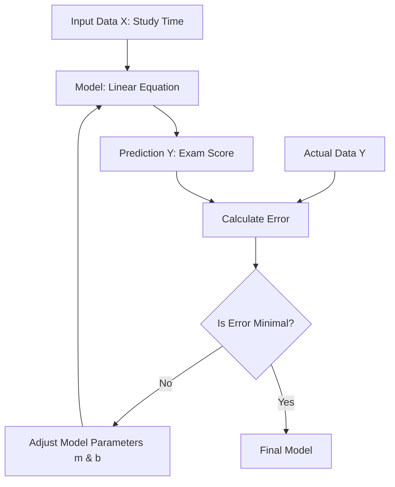

Linear regression is the foundational supervised-learning algorithm for regression tasks: it predicts a continuous numerical output as a weighted sum of input features, and every piece of its machinery — the hypothesis function, the mean squared error cost, the hand-derived gradients, and the choice between a closed-form solution and iterative optimization — reappears in every model built afterwards. It is the simplest form of predictive modeling and the conceptual basis for every neural network layer: a dense layer is nothing more than a linear regression followed by an activation. This note develops the model three complementary ways — from scratch with full calculus derivations, from the deep-learning perspective with vectorization and feature scaling, and through a complete lab that starts with scikit-learn regression and ends with a Keras MNIST classifier built from the same principles. See [[Regression Fundamentals]] for the broader regression landscape and [[Machine Learning MOC]] for the area map.

## What linear regression is

**Linear regression** is a fundamental algorithm in supervised machine learning used for **regression tasks**. A regression task involves predicting a continuous numerical output (the dependent variable) based on one or more input variables (the independent variables). Seen from the modeling side, linear regression is a supervised predictive method: we are establishing a line of best fit to determine the relationship (correlation/causality) between an **exogenous variable** $X$ (independent) and an **endogenous variable** $Y$ (dependent). Before building neural networks, we must understand the fundamental statistical models they are built upon — and this is that model.

Two vocabulary distinctions are worth fixing early. The **endogenous variable** ($Y$) is the dependent variable determined inside the model — it is what we are trying to predict. The **exogenous variable** ($X$) is the independent variable determined outside the model — it is the information we use to make predictions.

### The scenario: study time vs exam score

To understand the logic, consider a dataset of students. We have two pieces of data for each student:

1. **Study time ($x$):** the number of hours a student studied (input).
2. **Exam score ($y$):** the final score achieved on the test (output).

The goal is to find a relationship between study time and exam score so that if we know how long a new student studied, we can predict their score.

### Visualizing the data

If we plot these data points on a 2D Cartesian coordinate system, the **X-axis** represents study time and the **Y-axis** represents exam score. We will likely see a trend: as study time increases, the score generally increases. However, the points won't form a perfect straight line; there will be noise and outliers (for example, a student who studied 0 hours but got a high score, or a student who studied 100 hours but failed).

The objective of linear regression is to draw a single straight line through these data points that fits the data **"best."** "Best" is defined mathematically as minimizing the error between the line's predictions and the actual data points. The whole fitting loop looks like this:



## The linear model

Mathematically, a straight line is defined by the linear equation:

$$y = mx + b$$

where **$y$** is the dependent variable (the prediction / score), **$x$** is the independent variable (the input / study time), **$m$** is the **slope** (or weight) — it determines the steepness of the line, and in machine learning it represents the importance of the input feature — and **$b$** is the **Y-intercept** (or bias), which determines where the line crosses the Y-axis when $x = 0$ and allows the line to shift up or down.

The statistical formulation writes the same model with an explicit error term (terme d'erreur). Linear regression (régression linéaire) is a statistical approach for modeling the relationship between a dependent variable (the target, noted $y$) and one or more independent variables (the characteristics, or caractéristiques/features, noted $X$), and in the simple case the model seeks a linear relation of the form:

$$y = \beta_0 + \beta_1 x + \epsilon$$

Here $\beta_0$ (l'ordonnée à l'origine, the y-intercept) is the value of $y$ when $x$ is zero; $\beta_1$ (le coefficient, or the slope) indicates by how much $y$ increases when $x$ increases by one unit; and $\epsilon$ (the error term) represents the noise or variability that the model cannot explain.

### Simple and multiple regression

Linear regression tries to fit a straight line through a cloud of data points and predicts a continuous output $Y$ based on input $X$. Two regimes exist:

- **Simple linear regression:** one independent variable, $Y = wX + b$ (slope/weight + intercept/bias).
- **Multiple linear regression:** multiple independent variables, with the hypothesis function

$$ h(x) = \theta_0 + \theta_1 x_1 + \theta_2 x_2 ... \theta_n x_n $$

Here $\theta_0$ is the y-intercept (bias): the predicted value when all inputs are zero, shifting the line up or down. The $\theta_1, \theta_2, ...$ are the slopes (weights): each weight represents how much the output changes for a one-unit change in the corresponding input, holding all other inputs constant. In vectorized form this becomes $h(x) = \theta^T x$, where $x_0 = 1$ is the bias term.

In the lab's case (multiple regression, régression multiple, with three characteristics), the equation becomes vectorial:

$$y = \beta_0 + \beta_1 x_1 + \beta_2 x_2 + \beta_3 x_3$$

The compact modern notation used throughout deep learning writes the same model as predicting a continuous target as a linear function of features:

$$\hat{y} = \mathbf{w} \cdot \mathbf{x} + b$$

### The optimization challenge

Since we cannot change the input data ($x$) or the actual outcomes ($y$), our goal is to **tweak $m$ and $b$** until the line fits the points as closely as possible. The aim of the algorithm is to find the optimal values of the coefficients ($\beta$) that minimize the error between the model's predictions and the real data — which first requires defining "error" precisely.

### Assumptions and the limits of linearity

Linear regression assumes a linear correlation — and, for causal readings, causality — between $X$ and $Y$. If the true relationship is highly non-linear, linear regression will produce poor predictions regardless of how much data you have. The Gaussian-noise assumption behind the probabilistic reading of the cost (below) is the other key assumption: the error term $\epsilon$ is assumed to be well behaved noise, not structure the model should have captured.

## The cost function: mean squared error

To "minimize error," we first need to define what "error" is mathematically. We use the **Mean Squared Error (MSE)** — the Method of Least Squares formulated as a cost function, and the standard regression loss discussed in [[Loss Functions]].

### Why not just distance?

If we simply take the difference $(y_{actual} - y_{predicted})$, some errors will be positive (point above the line) and some negative (point below the line). If we sum them, they might cancel each other out, making a terrible line look perfect — for example, a +10 error and a −10 error sum to 0.

### Why squared error?

Squaring the residual is preferred for three reasons:

1. **Eliminates negatives:** squaring ensures all error values are positive.
2. **Penalizes large errors:** squaring disproportionately punishes outliers. An error of 10 becomes 100, while an error of 2 becomes 4. This forces the model to care more about points that are very far away.
3. **Differentiable:** the square function is smooth and convex, making it easy to use calculus to find the minimum.

### The formula

For a single point $i$, the error is the difference between the actual value $y_i$ and the predicted value $\hat{y}_i$:

$$Error_i = y_i - \hat{y}_i$$

Substituting the line equation:

$$Error_i = y_i - (mx_i + b)$$

The total error $E$ sums the squared errors for all $n$ data points and divides by $n$ to get the mean:

$$E = \frac{1}{n} \sum_{i=0}^{n} (y_i - (mx_i + b))^2$$

where $n$ is the total number of data points and $\sum$ is the summation from the first point ($i=0$) to the last ($n$). The lab states the same metric in evaluation form — $\frac{1}{n} \sum_{i=1}^{n} (y_i - \hat{y}_i)^2$, the mean of the squared errors — and the general $N$-sample version is:

$$L(\mathbf{w}, b) = \frac{1}{N} \sum_{i=1}^{N} (y_i - \hat{y}_i)^2$$

From the deep-learning perspective, the cost is written with the parameters made explicit, using the $\frac{1}{2m}$ convention:

$$ J(\theta_0, \theta_1) = \frac{1}{2m} \sum_{i=1}^{m} (h_\theta(x^{(i)}) - y^{(i)})^2 $$

The goal is to find the values of $\theta$ (weights/slope and bias/intercept) that minimize this MSE.

> [!WARNING] The 1/2m Trick
> Notice the $\frac{1}{2m}$ instead of just $\frac{1}{m}$? This is a deliberate mathematical convenience. When we calculate the derivative of this function (to find the gradient), the exponent $2$ from the square drops down as a coefficient. The $2$ cancels out the $1/2$, leaving a very clean, simple equation without lingering constants. This does not change the optimization problem — the minimum is at the same point regardless. It purely simplifies the gradient computation.

### Probabilistic interpretation: MLE = MSE

The squared loss is not an arbitrary choice. If we assume $y_i = \mathbf{w} \cdot \mathbf{x}_i + \epsilon$ with $\epsilon \sim \mathcal{N}(0, \sigma^2)$, the maximum likelihood estimator of $\mathbf{w}$ is exactly the MSE minimizer. So **MSE = MLE under Gaussian noise**: minimizing squared error is statistically optimal precisely when the unexplained noise is Gaussian.

## Fitting with gradient descent

We now have an error function $E$ that depends on two variables, $m$ and $b$, and we want the specific values of $m$ and $b$ that result in the smallest possible $E$. This is the setting of [[Gradient Descent]].

### The valley intuition

Imagine the error function as a **valley**: the height of the landscape is the error $E$, and the coordinates are $m$ and $b$. We start at a random point on a hill (random $m$ and $b$) and want to walk down to the lowest point of the valley (minimum error). Gradient descent is the algorithm for "walking down the hill": it calculates the steepest direction downwards and takes a step in that direction.

### The gradient

The gradient is a vector containing the **partial derivatives** of the error function with respect to the parameters ($m$ and $b$):

- $\frac{\partial E}{\partial m}$: how does the error change if we wiggle $m$ slightly?
- $\frac{\partial E}{\partial b}$: how does the error change if we wiggle $b$ slightly?

If the derivative is positive, the error increases as the parameter increases (so we should decrease the parameter). If it is negative, the error decreases as the parameter increases (so we should increase the parameter). Therefore, we always move in the **opposite** direction of the gradient.

### Deriving the gradient with respect to $m$

This is the most rigorous part: we must derive the formulas for $\frac{\partial E}{\partial m}$ and $\frac{\partial E}{\partial b}$ using the **chain rule**, starting from

$$E = \frac{1}{n} \sum (y_i - (mx_i + b))^2$$

We treat $b, x, y$ as constants and differentiate with respect to $m$.

1. **Apply the power rule (chain rule outer):** bring the exponent 2 down.

$$ \dots = \frac{1}{n} \sum 2(y_i - (mx_i + b))^{2-1} \cdot \frac{\partial}{\partial m}(Inner)$$

2. **Differentiate the inner function.** The inner function is $y_i - mx_i - b$: the derivative of $y_i$ (constant wrt $m$) is 0, the derivative of $-b$ (constant wrt $m$) is 0, and the derivative of $-mx_i$ with respect to $m$ is **$-x_i$**.

3. **Combine:**

$$ \frac{\partial E}{\partial m} = \frac{1}{n} \sum 2(y_i - (mx_i + b)) \cdot (-x_i) $$

4. **Simplify:** move the negative sign and the 2 to the front.

$$ \frac{\partial E}{\partial m} = -\frac{2}{n} \sum x_i(y_i - (mx_i + b)) $$

### Deriving the gradient with respect to $b$

We now treat $m, x, y$ as constants and differentiate with respect to $b$.

1. **Apply the power rule (chain rule outer):**

$$ \dots = \frac{1}{n} \sum 2(y_i - (mx_i + b)) \cdot \frac{\partial}{\partial b}(Inner)$$

2. **Differentiate the inner function.** The inner function is again $y_i - mx_i - b$: the derivative of $y_i$ is 0, the derivative of $-mx_i$ is 0, and the derivative of $-b$ with respect to $b$ is **$-1$**.

3. **Combine:**

$$ \frac{\partial E}{\partial b} = \frac{1}{n} \sum 2(y_i - (mx_i + b)) \cdot (-1) $$

4. **Simplify:**

$$ \frac{\partial E}{\partial b} = -\frac{2}{n} \sum (y_i - (mx_i + b)) $$

### The same gradients in $\theta$ notation

The deep-learning treatment derives the partial derivatives of $J(\theta)$ with respect to $\theta_0$ and $\theta_1$, and lands on the same quantities (with the residual written in the opposite order and the factor 2 absorbed by the $\frac{1}{2m}$ trick):

1. **Derivative for $\theta_0$ ($j=0$):**

$$ \frac{\partial}{\partial \theta_0} J(\theta_0, \theta_1) = \frac{1}{m} \sum_{i=1}^{m} (h_\theta(x_i) - y_i) $$

This is the average error — how much the predictions deviate from the true values, without weighting by the input. This makes sense because $\theta_0$ is the bias, which shifts all predictions equally regardless of input values.

2. **Derivative for $\theta_1$ ($j=1$):**

$$ \frac{\partial}{\partial \theta_1} J(\theta_0, \theta_1) = \frac{1}{m} \sum_{i=1}^{m} (h_\theta(x_i) - y_i) \cdot x_i $$

This weights each error by the corresponding input value. This makes sense because $\theta_1$ scales with $x$ — errors on data points with larger $x$ values have a proportionally larger effect on the gradient.

The general gradient update rule, which applies to all parameters, is:

$$ \frac{\partial J(\theta)}{\partial \theta_j} = \frac{1}{m} \sum_{i=1}^{m} (h_\theta(x^{(i)}) - y^{(i)}) x_j^{(i)} $$

The two derivations agree: the from-scratch form $-\frac{2}{n} \sum x_i(y_i - \hat{y}_i)$ is algebraically the same gradient as $\frac{1}{m} \sum (h_\theta(x_i) - y_i) x_i$, since negating the residual and carrying the minus sign out front cancel each other, and the $2$ disappears once the $\frac{1}{2m}$ convention is used.

### The update rules

Now that we have the gradients (the slope of the error landscape), we update the current $m$ and $b$ to move downhill. We use a **learning rate** ($L$) to control the size of the step we take:

$$m_{new} = m_{current} - L \times \frac{\partial E}{\partial m}$$

$$b_{new} = b_{current} - L \times \frac{\partial E}{\partial b}$$

In $\theta$ notation the same rule reads:

$$ \theta_j := \theta_j - \alpha \frac{\partial}{\partial \theta_j} J(\theta_0, \theta_1) $$

> **Important concept:** we subtract because the gradient points uphill (the direction of steepest ascent). To minimize error, we go opposite to the gradient.

### The simultaneous update rule

The gradient descent algorithm for linear regression calculates the derivatives for $\theta_0$ (bias) and $\theta_1$ (weight), and the golden rule of updates is that you **must** update $\theta_0$ and $\theta_1$ _simultaneously_. When translating mathematical formulas into code for linear and logistic regression, students often make a critical algorithmic error regarding weight updates: computing all new values based on the _old_ values before assigning any of them.

```text
temp_0 := old_theta_0 - alpha * Gradient(old_theta_0, old_theta_1)
temp_1 := old_theta_1 - alpha * Gradient(old_theta_0, old_theta_1)

theta_0 := temp_0
theta_1 := temp_1
```

> [!WARNING] The Sequential Update Error
> If you update $\theta_0$ directly, and then use that _newly updated_ $\theta_0$ to calculate the gradient for $\theta_1$, you are calculating the gradient for a point that does not exist in the current iteration step. The algorithm will follow an incorrect trajectory and fail to find the global minimum.
>
> **Concrete example:** Suppose $\theta_0 = 1, \theta_1 = 2$, and the gradient at this point is $(\frac{\partial J}{\partial \theta_0}, \frac{\partial J}{\partial \theta_1}) = (0.5, 0.5)$.
> - **Correct (simultaneous):** New $\theta_0 = 1 - \alpha(0.5)$, New $\theta_1 = 2 - \alpha(0.5)$. Both use the same gradient computed at the original point.
> - **Incorrect (sequential):** New $\theta_0 = 1 - \alpha(0.5) = 0.5$ (if $\alpha = 1$). Then you compute the gradient at $(0.5, 2)$ — a _different point_ — and use that to update $\theta_1$. This is wrong because you've moved to a different location on the loss surface before completing the update step.

## Vectorization and the matrix formulation

### Ditching the summation sign

In deep learning, looping over $m$ training examples using `for` loops is far too slow. We use **vectorization** (linear algebra) to calculate everything simultaneously. This is not just a coding convenience — it is a fundamental requirement for making deep learning computationally feasible.

Instead of writing $h(x) = \theta_0 x_0 + \theta_1 x_1 + \theta_2 x_2 ...$, we define the parameters and inputs as vectors:

$$ \theta = \begin{bmatrix} \theta_0 \\ \theta_1 \\ \theta_2 \\ \dots \\ \theta_n \end{bmatrix}, \quad x = \begin{bmatrix} x_0 \\ x_1 \\ x_2 \\ \dots \\ x_n \end{bmatrix} $$

Thus the entire hypothesis function collapses into a single dot product:

$$ h(x) = \theta^T \cdot x $$

This allows GPUs to calculate predictions for millions of parameters in a fraction of a second. A single matrix multiplication replaces millions of individual additions and multiplications, and modern hardware is specifically optimized for these operations.

### Batch prediction as one matrix product

For a dataset of $n$ samples with $m$ features, we represent the features as an $n \times m$ matrix $X$, the weights as an $m \times 1$ vector $W$, and the bias as a scalar $b$ broadcasted across the $n$ samples:

$$ \hat{Y} = XW + b $$

This is how frameworks like PyTorch compute predictions in parallel for entire batches. Instead of processing one sample at a time through a `for` loop, the entire batch of predictions is computed in a single matrix multiplication — a fundamental requirement for deep learning, since modern GPUs are specifically designed to perform matrix multiplications at massive scale.

As a concrete example: with 1,000 samples of 10 features each, $X$ is a $1000 \times 10$ matrix, $W$ is a $10 \times 1$ vector, and $\hat{Y}$ is a $1000 \times 1$ vector. The single operation $XW$ replaces 1,000 separate dot products, each involving 10 multiplications and 9 additions — that is 10,000 multiplications and 9,000 additions computed simultaneously in microseconds on a GPU.

## Feature scaling for optimization

To make gradient descent converge faster, we must scale our features so they are on a similar playing field. If variables are on completely different scales (for example, Number of Bedrooms [1-5] vs. Square Footage [500-5000]), gradient descent will create an elongated, elliptical bowl, causing the algorithm to bounce inefficiently back and forth across the narrow dimension rather than moving directly toward the minimum. Put simply: without scaling, the error landscape looks like a very long, narrow valley, making navigation difficult. In the from-scratch walkthrough the raw data values (a 20-80 range) were used as-is, but in professional machine learning, gradient descent works best when input features are on a similar scale (for example 0 to 1); normalization or standardization helps it converge faster and cleaner.

### Min-Max normalization

Scales data strictly between 0 and 1:

$$ x_{scaled} = \frac{x - x_{min}}{x_{max} - x_{min}} $$

Equivalent notation: $x_{ij} = \frac{x_{ij} - Min_j}{Max_j - Min_j}$ (forces values between $[0, 1]$). This is best used when you know the data has a fixed range and no significant outliers. It is sensitive to outliers — a single extreme value will compress all other values into a tiny range.

### Standardization (Z-score)

Centers data around a mean of 0 with a standard deviation of 1:

$$ x_{scaled} = \frac{x - \mu}{\sigma} $$

Equivalent notation: $x_{ij} = \frac{x_{ij} - \mu_j}{\sigma_j}$ (centers around 0, approximating values between $[-3\sigma, +3\sigma]$). This is more robust to outliers than Min-Max because it doesn't compress the range, and it preserves the shape of the distribution, just shifting and scaling it. It is generally preferred for deep learning, especially when paired with ReLU activation.

## Solving the model: OLS vs gradient descent

There are two fundamentally different approaches to finding the optimal weights $W$.

### Ordinary least squares (OLS): the analytical solution

We set the derivative of the MSE loss to zero and solve for $W$ algebraically using linear algebra:

$$ W = (X^T X)^{-1} X^T Y $$

This is the **normal equation**. It gives the exact, optimal solution in one step — no iteration required. For small datasets (hundreds or low thousands of samples), this is fast and elegant. In the lab's terms, the most common fitting method is that of **Ordinary Least Squares** (Moindres Carrés Ordinaires), which seeks to minimize the sum of squared deviations (the residuals, or résidus) — and this closed-form solution is exactly what scikit-learn's `LinearRegression` implements. The general form is written:

$$\hat{\mathbf{w}} = (\mathbf{X}^T \mathbf{X})^{-1} \mathbf{X}^T \mathbf{y}$$

For small problems this is the exact solution, no iteration needed. For large problems, use gradient descent (or SGD) instead, because the matrix inverse is $O(d^3)$. The closed form has three structural limitations:

- Computing the inverse of $X^T X$ has $O(m^3)$ complexity (where $m$ is the number of features). For a model with 10,000 features, this means roughly $10^{12}$ operations — prohibitively expensive.
- The matrix $X^T X$ may be singular (non-invertible) when features are highly correlated (multicollinearity), causing numerical instability.
- The entire dataset must fit in memory simultaneously, which is impossible for datasets with millions of samples.

### Gradient descent: the iterative solution

We use the update rule $W = W - \eta \cdot \nabla MSE$ to iteratively approach the optimal solution. This is preferred in deep learning because:

- It scales beautifully to arbitrarily large datasets — you never need to load all data at once (use mini-batches).
- It works with any number of features, even millions.
- It generalizes to non-linear models (neural networks) where no analytical solution exists.
- Each iteration is computationally cheap — just matrix multiplications and additions.

The trade-off: OLS gives the exact answer immediately (when feasible), while gradient descent gives an approximation that improves over time. In practice, gradient descent converges close enough to the optimum for all practical purposes, and its scalability makes it the only viable choice for large-scale deep learning.

> [!TIP] When to use which?
> - **Small dataset, few features:** OLS is faster and gives the exact answer.
> - **Large dataset or many features:** Gradient Descent is the only practical choice.
> - **Non-linear model (any neural network):** Gradient Descent is mandatory — no closed-form solution exists for neural networks.

## Regularization: ridge and lasso

Linear regression can be regularized by adding a penalty on the weights to the MSE, trading a little bias for stability and generalization — the core move discussed in [[Bias Variance Tradeoff]] and [[Regularization Techniques]].

### Ridge regression (L2 regularization)

Add an L2 penalty:

$$
L_{\text{ridge}} = \text{MSE} + \lambda \|\mathbf{w}\|^2
$$

Ridge has its own closed form: $\hat{\mathbf{w}} = (\mathbf{X}^T \mathbf{X} + \lambda \mathbf{I})^{-1} \mathbf{X}^T \mathbf{y}$. The $\lambda \mathbf{I}$ term makes the inverse always well-defined (no singularity), and shrinks weights toward zero. This is also **MAP under a Gaussian prior** on $\mathbf{w}$ — the Bayesian mirror of the MLE interpretation of plain MSE.

### Lasso (L1 regularization)

Add an L1 penalty:

$$
L_{\text{lasso}} = \text{MSE} + \lambda \|\mathbf{w}\|_1
$$

Lasso produces **sparse** solutions — many weights become exactly zero. This makes it useful for feature selection. It is MAP under a Laplace prior.

## Implementing linear regression from scratch

We will implement the algorithm without using scikit-learn's linear regression model, using `pandas` for data handling and `matplotlib` for visualization. The walkthrough below carries the full training loop, from loading the data to plotting the fitted line.

### Setup and dependencies

```python
import pandas as pd
import matplotlib.pyplot as plt

# Load dataset (assuming a CSV file with 'study_time' and 'score' columns)
data = pd.read_csv('data.csv') 

# Visualize the raw data
plt.scatter(data.study_time, data.score)
plt.show()
```

### The loss function (optional)

This function calculates the MSE. We don't technically need to run it during training (since the gradient descent math implies it), but it's useful to verify that error is actually decreasing.

```python
def loss_function(m, b, points):
    total_error = 0
    # Iterate through every point in the dataset
    for i in range(len(points)):
        x = points.iloc[i].study_time
        y = points.iloc[i].score
        # Calculate Squared Error for this point: (Actual - Predicted)^2
        total_error += (y - (m * x + b)) ** 2
    
    # Return Mean Squared Error
    return total_error / float(len(points))
```

### The gradient descent step

This is the core training loop. It calculates the derivatives and updates the weights.

```python
def gradient_descent(m_now, b_now, points, L):
    # Initialize gradients to 0
    m_gradient = 0
    b_gradient = 0
    
    n = len(points)
    
    # Iterate through all data points to calculate the sum part of the derivative formulas
    for i in range(n):
        x = points.iloc[i].study_time
        y = points.iloc[i].score
        
        # Formula: -(2/n) * x * (y - (mx + b))
        # Note: We divide by n later or accumulate it here. 
        # The implementation below effectively sums terms and divides by n at the end (conceptually)
        # However, typically we sum first then divide. Let's follow the video's mathematical structure strictly:
        
        # Accumulate the gradients using the partial derivative formulas derived earlier
        m_gradient += -(2/n) * x * (y - (m_now * x + b_now))
        b_gradient += -(2/n) * (y - (m_now * x + b_now))
        
    # Update m and b using the learning rate
    m_new = m_now - (m_gradient * L)
    b_new = b_now - (b_gradient * L)
    
    return m_new, b_new
```

### Running the training loop

We need to define two hyperparameters: **epochs** (how many times we iterate through the dataset) and the **learning rate** $L$ (how big the steps are).

```python
# Initial values
m = 0
b = 0
L = 0.0001 # Learning Rate (Small to prevent overshooting)
epochs = 1000 # Number of iterations

# Training Loop
for i in range(epochs):
    if i % 50 == 0:
        print(f"Epoch: {i}") # Progress tracker
    
    # Perform one step of gradient descent
    m, b = gradient_descent(m, b, data, L)

print(f"Final m: {m}, Final b: {b}")
```

### Visualizing the fitted line

Plot the original scatter plot and draw the calculated line $y = mx+b$ over it. We create a range of X values (for example, min to max study time) and, for every X, calculate Y using the learned $m$ and $b$.

```python
# 1. Plot the actual data points (Scatter)
plt.scatter(data.study_time, data.score, color="black")

# 2. Plot the regression line
# We create a range of X values (e.g., min to max study time)
# For every X, we calculate Y using our new m and b
x_range = list(range(20, 80)) # Range depends on your data spread
plt.plot(x_range, [m * x + b for x in x_range], color="red")

plt.show()
```

### Critical analysis: learning rate, outliers, and convergence

**Understanding the learning rate ($L$).** If $L$ is too small, the model will learn very slowly — it might take millions of epochs to reach the minimum error. If $L$ is too large, the model might **overshoot**: imagine stepping across the valley to the other side, higher up than before, so the error explodes to infinity (divergence) instead of converging to zero. Standard values are $0.01, 0.001, 0.0001$; if you get "NaN" (Not a Number) errors, your learning rate is likely too high.

**Outliers.** Because we square the error $(y-\hat{y})^2$, outliers have a massive impact: a single point far away can drag the regression line significantly toward it. If the data has many outliers, Mean Absolute Error (MAE) might be preferred over MSE, or outliers should be filtered out before training.

**Epochs vs. convergence.** In the walkthrough we essentially guessed 1000 epochs. In sophisticated implementations, we stop the loop when the change in error between epochs is smaller than a threshold (for example, $0.00001$), indicating we have reached the bottom of the valley (convergence).

## Lab: linear regression with scikit-learn

The lab (travaux pratiques) serves as a complete reference for understanding the code, the theoretical concepts, and the Python implementations for linear regression with scikit-learn — before extending the same ideas to image classification with Keras. Its first part covers simple and multiple linear regression (la régression linéaire simple et multiple) end to end.

### Setting up the environment

```python
import numpy as np
from sklearn.linear_model import LinearRegression
from sklearn.datasets import make_regression
from sklearn.metrics import mean_squared_error
```

**NumPy** (`np`) is the fundamental library for scientific computing in Python: it handles multidimensional arrays (matrices) efficiently, which is essential since the data are represented as matrices. **Scikit-learn** (`sklearn`) is the standard library for classical machine learning in Python, and three pieces are imported here: `LinearRegression`, a class that implements the least-squares algorithm; `make_regression`, a synthetic data generator useful for testing models without needing external files; and `mean_squared_error`, a mathematical function for evaluating performance.

### Generating a controlled synthetic dataset

```python
x, y = make_regression(n_samples=100, n_features=3, noise=10, random_state=42)
```

This code creates a controlled artificial dataset. `n_samples=100` generates 100 data points (rows). `n_features=3` gives each point 3 explanatory variables, so $X$ is a matrix of dimension (100, 3). `noise=10` adds Gaussian noise (bruit gaussien) to the data — without it, the relationship would be perfectly linear and the model would have 100% accuracy, which is not realistic; it simulates the imperfections of the real world. `random_state=42` fixes the random seed (graine aléatoire), guaranteeing that the generated random numbers are the same on every run of the code, which ensures reproducibility of the results.

### Instantiating and training the model

```python
model = LinearRegression()
model.fit(x, y)
```

This is the central step of machine learning. `model = LinearRegression()` creates an instance of the class; at this stage the model is an "empty shell" (coquille vide) — its internal parameters (the coefficients $\beta$) have not yet been computed. `model.fit(x, y)` launches the optimization algorithm: the code takes the matrix $X$ and the vector $y$ and mathematically computes the coefficients that minimize the overall error. Once this line has executed, the model is "trained" (entraîné).

### Predicting

```python
preds = model.predict(x)
```

We use the trained model to predict values. The algorithm applies the equation $y = \beta X + \beta_0$ using the coefficients it has just learned. Here we predict on the same data used for training, which is a simplification acceptable for an introductory lab.

### Evaluating the model: MSE and R²

```python
mse = mean_squared_error(y, preds)
score = model.score(x, y)
```

Two metrics judge the quality of the model. **MSE (Mean Squared Error)** is the mean of the squared errors, $\frac{1}{n} \sum_{i=1}^{n} (y_i - \hat{y}_i)^2$; it quantifies the average "distance" between the regression line and the data points — the lower it is, the better. The **score** ($R^2$, the coefficient of determination — coefficient de détermination) measures the proportion of the variance of the dependent variable that is explained by the independent variables: a score of 1.0 means a perfect prediction, and a score of 0.0 means the model does no better than a simple mean. Both belong to the metric families surveyed in [[Regression Evaluation Metrics]] and [[Model Evaluation Metrics]].

## Worked example: recovering known coefficients

A compact way to see the whole story is to generate a problem whose true weights are known and check that fitting recovers them. The example below creates 100 samples with 5 standard-normal features and a target built as a fixed linear combination plus a little noise; unregularized linear regression should print coefficients close to the true `[1, -2, 0.5, 0, 3]`, ridge shrinks them, and the logistic variant (included for completeness — its `C` parameter equals $1/\lambda$, the inverse regularization strength — is developed in the sibling classification note).

```python
from sklearn.linear_model import LinearRegression, LogisticRegression, Ridge
import numpy as np

X = np.random.randn(100, 5)
y_reg = X @ np.array([1, -2, 0.5, 0, 3]) + 0.1 * np.random.randn(100)
y_cls = (X @ np.array([1, -2, 0.5, 0, 3]) > 0).astype(int)

# Linear regression
lr = LinearRegression().fit(X, y_reg)
print(lr.coef_)  # ≈ [1, -2, 0.5, 0, 3]

# Ridge (L2)
ridge = Ridge(alpha=1.0).fit(X, y_reg)

# Logistic regression
logr = LogisticRegression(C=1.0).fit(X, y_cls)  # C = 1/lambda
print(logr.coef_)  # ≈ direction separating classes
```

## From linear regression to neural networks: the MNIST lab

The lab's second part moves from classical statistics to **artificial neural networks** (réseaux de neurones artificiels). This is the natural continuation of everything above: a dense layer is a linear regression plus an activation, so once the linear model, its loss, and gradient-based fitting are understood, scaling up to a network is mostly a matter of composition and engineering.

### Theory: the MNIST dataset and the multilayer perceptron

The problem changes from regression to **classification**: assigning a label (a digit from 0 to 9) to an image. The dataset is **MNIST**, the "Hello World" of deep learning: it contains 70,000 grayscale images of handwritten digits, each 28×28 pixels. The inputs ($X$) are the pixel luminosity values (between 0 and 255), and the outputs ($Y$) are the digit category (0, 1, ..., 9).

The model used is a **multilayer perceptron** (perceptron multicouche, MLP): a dense (fully connected) network in which each neuron of a layer is connected to all the neurons of the next layer. The computation performed by a single neuron is:

$$Sortie = FonctionActivation(\sum (Poids \times Entrée) + Biais)$$

Read in English: Output = ActivationFunction(Σ(Weights × Input) + Bias). This is exactly the linear-regression hypothesis (a weighted sum plus a bias) passed through a nonlinear activation function.

### Loading and splitting the data

```python
from tensorflow.keras.datasets import mnist
(train_images, train_labels), (test_images, test_labels) = mnist.load_data()
```

This step separates the data into two distinct sets, a fundamental principle in machine learning. The **training set** (ensemble d'entraînement) holds 60,000 images used by the network to adjust its weights (to learn). The **test set** holds 10,000 images that the network never sees during learning; they serve to verify that the model can generalize to new data and has not simply "learned by heart" (overfitting, or surapprentissage).

### Building the network architecture

```python
from tensorflow.keras import models, layers
network = models.Sequential()
network.add(layers.Dense(512, activation='relu', input_shape=(28 * 28,)))
network.add(layers.Dense(10, activation='softmax'))
```

`Sequential()` indicates that the model is a linear stack of layers: the data pass from one to the next in order. The **first (hidden) layer**, `Dense(512, activation='relu')`, contains 512 neurons — this is the learning capacity of the model — and `input_shape=(28 * 28,)` means it expects a flat vector of 784 values (the pixels). The `relu` (Rectified Linear Unit) activation replaces negative values with zero; it introduces non-linearity, allowing the network to learn complex shapes. The **final (output) layer**, `Dense(10, activation='softmax')`, contains 10 neurons corresponding to the 10 possible classes (digits 0 to 9). `softmax` transforms the raw outputs of the network into a probability distribution: the sum of the 10 outputs equals 1, and the neuron with the highest value designates the predicted digit.

### Compiling: optimizer, loss, and metric

```python
network.compile(optimizer='rmsprop',
                loss='categorical_crossentropy',
                metrics=['accuracy'])
```

This step configures the learning process. The **optimizer** (`rmsprop`) is the algorithm that updates the network's weights: it uses the gradient of the error to "descend" toward the optimal solution, and RMSprop is an advanced variant of gradient descent that adapts the learning rate — the family surveyed in [[Optimizers and Learning Rate Schedulers]]. The **loss** (`categorical_crossentropy`) measures the difference between the probability distribution predicted by the network and the actual distribution (the true label); this is the value the optimizer seeks to minimize, and it is the classification counterpart of the MSE role in [[Loss Functions]]. The **metric** (`accuracy`, the percentage of correct answers) is an interpretable measure for humans, used for monitoring rather than for optimization.

### Preprocessing: reshaping and normalization

```python
train_images = train_images.reshape((60000, 28 * 28))
train_images = train_images.astype('float32') / 255
```

The raw data are not compatible with the network as they are. First, the **reshape**: the images are 2D matrices (28×28) but the dense network expects 1D vectors, so each image is "flattened" into a row of 784 pixels. Second, **normalization**: the pixels are encoded as integers from 0 to 255, and neural networks converge better and faster with small floating-point values, so we divide by 255 to bring all values into the interval [0, 1] — the same feature-scaling logic that accelerates the linear-regression gradient descent.

### One-hot encoding the labels

```python
from tensorflow.keras.utils import to_categorical
train_labels = to_categorical(train_labels)
```

The labels are initially integers (for example, the digit 5), but the `categorical_crossentropy` loss expects a vector of probabilities. `to_categorical` transforms the integer 5 into the vector `[0, 0, 0, 0, 0, 1, 0, 0, 0, 0]`: only the index corresponding to the true class is 1.

### Training

```python
network.fit(train_images, train_labels, epochs=5, batch_size=128)
```

The learning process now runs. `epochs=5` means the network will see the entirety of the training dataset 5 times. `batch_size=128` means the weights are not updated after each image (too slow and unstable), nor after all the images (too heavy for memory), but after a batch (lot) of 128 images. During this phase, one generally observes the `loss` decreasing and the `accuracy` increasing.

### Final evaluation

```python
test_loss, test_acc = network.evaluate(test_images, test_labels)
```

The final model is tested on the 10,000 test images. This step is crucial for validating that the model is robust and performs well on unknown data: a high accuracy here (close to the training accuracy) confirms the success of the operation.

## Why these models matter

Linear and logistic regression are the simplest ML models — and still among the most useful. They are the conceptual basis for every neural network layer, and understanding them deeply makes the rest of ML make sense.

### They are the building blocks of neural networks

A dense layer is a linear regression + activation. A classification head is softmax regression. Every Transformer is built from these primitives. The MNIST network above is the direct demonstration: strip the activations and you are left with stacked linear regressions trained by the same gradient-descent logic derived by hand earlier in this note.

### They are strong baselines

For many problems, linear (and logistic) regression is a perfectly good model — and it's interpretable, fast, and easy to deploy. Don't reach for a neural network before trying the simple regression baseline first, ideally with solid feature engineering.

### Calibration

Probabilistic outputs from these models are **calibrated by construction** (when the model is correctly specified): the predicted probabilities mean what they say. Neural networks often need post-hoc temperature scaling to achieve the same calibration quality.

### The math generalizes

MLE → cross-entropy → backprop. Once you understand the chain from "model the data distribution" to "loss function" to "gradient descent" — first seen here as Gaussian noise → MSE → the derived update rules — you understand the conceptual core of all supervised learning.

## Classical regression vs neural networks

The choice between the two families is mostly a question of data type, scale, and requirements:

| Use classical regression when...            | Use neural networks when...                     |
|---------------------------------------------|-------------------------------------------------|
| Tabular data, small dataset (<10k rows)     | Unstructured data (text, images, audio)         |
| Interpretability is required                | Pure predictive accuracy matters                |
| Linear relationships are plausible          | Nonlinear relationships expected                 |
| Fast iteration / deployment needed          | You have lots of data and compute               |
| Need calibrated probabilities out of the box| Willing to add temperature scaling              |

For tabular data, **gradient boosting** (see [[Gradient Boosting]]) is often a better choice than both families.

## Production implications

Four lessons carry over to real deployments. Always start with a simple baseline — regression with feature engineering beats jumping straight to deep learning. For high-stakes probability estimates (credit risk, medical diagnosis), the calibration of the classical models is a real advantage. For tabular data, use XGBoost — it typically outperforms both classical regression and deep learning. And feature scaling matters for regularized linear models: standardize features before applying L1/L2 penalties.

## Common pitfalls

The recurring failure modes are:

- **Multicollinearity** — correlated features produce unstable coefficients in unregularized regression. Use ridge, whose $\lambda \mathbf{I}$ term guarantees a well-defined inverse.
- **Extrapolation** — linear models extrapolate linearly, which can be wildly wrong outside the training range.
- **Imbalanced classes in logistic regression** — the model will be biased toward the majority class. Use class weighting or resampling.
- **Forgetting that logistic regression is linear** — the decision boundary is a hyperplane. If classes aren't linearly separable (even in feature space), it won't work well.

To these, the from-scratch analysis adds the optimization-side pitfalls covered earlier: a learning rate that is too small (endless training) or too large (divergence and NaNs), outlier sensitivity of the squared loss, and stopping on a fixed epoch count instead of a convergence threshold.

## Relationship to logistic regression

The classification half of this shared material — where the linear score $\mathbf{w} \cdot \mathbf{x} + b$ is squashed through the **logistic sigmoid** model form to output a probability — is developed in the sibling note on logistic regression. Its loss is **binary cross-entropy** (log loss) rather than MSE; its probabilistic interpretation is that **MLE = cross-entropy**, since the negative log-likelihood of a Bernoulli model is exactly the binary cross-entropy; and its multiclass extension is **softmax regression**, which is the output layer of every modern LLM and pairs with the categorical cross-entropy loss seen in the MNIST compilation step above. The shared caveats flagged in the pitfalls — the linear decision boundary and imbalanced classes — apply there as well.

## Key formulas at a glance

| Concept | Mathematical Formula |
| :--- | :--- |
| **Linear Equation** | $y = mx + b$ |
| **Mean Squared Error** | $E = \frac{1}{n} \sum (y_i - (mx_i + b))^2$ |
| **Gradient (Slope) wrt $m$** | $\frac{\partial E}{\partial m} = -\frac{2}{n} \sum x_i(y_i - (mx_i + b))$ |
| **Gradient (Bias) wrt $b$** | $\frac{\partial E}{\partial b} = -\frac{2}{n} \sum (y_i - (mx_i + b))$ |
| **Update Rule** | $Parameter_{new} = Parameter_{old} - L \cdot Gradient$ |

## Further reading

- Hastie, Tibshirani, Friedman, *The Elements of Statistical Learning*, Chapter 3 (regression) and 4 (classification).
- Murphy, *Probabilistic Machine Learning*, Chapter 10–11.

## Appendix: the original French lab guide (verbatim)

The worked treatment above synthesizes and translates the original French-language lab guide that accompanied this material. Because that guide is a complete, self-contained reference — theory, code walkthrough, and the MNIST deep-learning extension in the author's own words — it is also preserved below verbatim, segment by segment in its original order: French prose runs are quoted in markdown fences and the Python blocks appear exactly as written (they are the same blocks already carried, with translations, by the sections above).

```markdown
# Guide Complet : Régression Linéaire et Deep Learning (MNIST)

Ce document sert de référence pour comprendre l'intégralité du code, des concepts théoriques et des implémentations Python réalisées dans le cadre des travaux pratiques sur la régression linéaire avec Scikit-Learn et la classification d'images avec Keras.

---

## Partie 1 : La Régression Linéaire Simple et Multiple

### 1. Théorie et Mathématiques
La régression linéaire est une approche statistique pour modéliser la relation entre une variable dépendante (cible, notée $y$) et une ou plusieurs variables indépendantes (caractéristiques ou features, notées $X$).

**L'équation mathématique :**
Dans le cas simple, le modèle cherche à établir une relation linéaire de la forme :
$$y = \beta_0 + \beta_1 x + \epsilon$$

*   $\beta_0$ (l'ordonnée à l'origine) : La valeur de $y$ lorsque $x$ est nul.
*   $\beta_1$ (le coefficient ou la pente) : Indique de combien $y$ augmente lorsque $x$ augmente d'une unité.
*   $\epsilon$ (le terme d'erreur) : Représente le bruit ou la variabilité que le modèle ne peut pas expliquer.

Dans notre cas (régression multiple avec 3 caractéristiques), l'équation devient vectorielle :
$$y = \beta_0 + \beta_1 x_1 + \beta_2 x_2 + \beta_3 x_3$$

**L'objectif de l'algorithme :**
Le but est de trouver les valeurs optimales des coefficients ($\beta$) qui minimisent l'erreur entre les prédictions du modèle et les données réelles. La méthode la plus courante est celle des **Moindres Carrés Ordinaires**, qui cherche à minimiser la somme des carrés des écarts (résidus).

### 2. Analyse du Code (Scikit-Learn)

#### Bloc 1 : Importation des bibliothèques
```

```python
import numpy as np
from sklearn.linear_model import LinearRegression
from sklearn.datasets import make_regression
from sklearn.metrics import mean_squared_error
```

```markdown
*   **NumPy (`np`)** : Bibliothèque fondamentale pour le calcul scientifique en Python. Elle permet de gérer des tableaux multidimensionnels (matrices) de manière performante, ce qui est essentiel car les données sont représentées sous forme de matrices.
*   **Scikit-Learn (`sklearn`)** : La bibliothèque standard pour le machine learning classique en Python.
    *   `LinearRegression` : Une classe qui implémente l'algorithme des moindres carrés.
    *   `make_regression` : Un générateur de données synthétiques utile pour tester des modèles sans avoir besoin de fichiers externes.
    *   `mean_squared_error` : Une fonction mathématique pour évaluer la performance.

#### Bloc 2 : Génération des données
```

```python
x, y = make_regression(n_samples=100, n_features=3, noise=10, random_state=42)
```

```markdown
Ce code crée un jeu de données artificiel contrôlé :
*   `n_samples=100` : On génère 100 points de données (lignes).
*   `n_features=3` : Chaque point possède 3 variables explicatives. $X$ est donc une matrice de dimension (100, 3).
*   `noise=10` : Ajoute un bruit gaussien aux données. Sans cela, la relation serait parfaitement linéaire et le modèle aurait une précision de 100%, ce qui n'est pas réaliste. Cela simule les imperfections du monde réel.
*   `random_state=42` : Fixe la graine aléatoire. Cela garantit que les nombres aléatoires générés sont les mêmes à chaque exécution du code, assurant la reproductibilité des résultats.

#### Bloc 3 : Initialisation et Entraînement
```

```python
model = LinearRegression()
model.fit(x, y)
```

```markdown
C'est l'étape centrale de l'apprentissage automatique.
*   `model = LinearRegression()` : On crée une instance de la classe. À ce stade, le modèle est une "coquille vide" ; ses paramètres internes (les coefficients $\beta$) ne sont pas encore calculés.
*   `model.fit(x, y)` : Cette méthode lance l'algorithme d'optimisation. Le code prend la matrice $X$ et le vecteur $y$, et calcule mathématiquement les coefficients qui minimisent l'erreur globale. Une fois cette ligne exécutée, le modèle est "entraîné".

#### Bloc 4 : Prédiction
```

```python
preds = model.predict(x)
```

```markdown
On utilise le modèle entraîné pour prédire des valeurs. L'algorithme applique l'équation $y = \beta X + \beta_0$ en utilisant les coefficients qu'il vient d'apprendre. Ici, on prédit sur les mêmes données que celles utilisées pour l'entraînement (ce qui est une simplification pour ce TP d'introduction).

#### Bloc 5 : Évaluation (MSE et Score)
```

```python
mse = mean_squared_error(y, preds)
score = model.score(x, y)
```

```markdown
Nous utilisons deux métriques pour juger la qualité du modèle :
1.  **MSE (Mean Squared Error)** : C'est la moyenne des carrés des erreurs.
    *   Formule : $\frac{1}{n} \sum_{i=1}^{n} (y_i - \hat{y}_i)^2$.
    *   Elle quantifie la "distance" moyenne entre la ligne de régression et les points de données. Plus elle est basse, mieux c'est.
2.  **Score ($R^2$ ou Coefficient de détermination)** :
    *   Il mesure la proportion de la variance de la variable dépendante qui est expliquée par les variables indépendantes.
    *   Un score de 1.0 signifie une prédiction parfaite.
    *   Un score de 0.0 signifie que le modèle ne fait pas mieux qu'une simple moyenne.

---

## Partie 2 : Introduction au Deep Learning (Classification MNIST)

### 1. Théorie et Concepts
Ici, nous passons de la statistique classique aux **Réseaux de Neurones Artificiels**. Le problème est la classification : attribuer une étiquette (un chiffre de 0 à 9) à une image.

**Le Dataset MNIST :**
C'est le "Hello World" du Deep Learning. Il contient 70 000 images de chiffres manuscrits en niveaux de gris. Chaque image fait 28x28 pixels.
*   **Entrées ($X$)** : La valeur de luminosité des pixels (entre 0 et 255).
*   **Sorties ($Y$)** : La catégorie du chiffre (0, 1, ..., 9).

**Le Perceptron Multicouche (MLP) :**
Le modèle utilisé est un réseau dense (fully connected). Chaque neurone d'une couche est connecté à tous les neurones de la couche suivante.
Le calcul effectué par un neurone est :
$$Sortie = FonctionActivation(\sum (Poids \times Entrée) + Biais)$$

### 2. Analyse du Code (Keras/TensorFlow)

#### Bloc 1 : Chargement et division des données
```

```python
from tensorflow.keras.datasets import mnist
(train_images, train_labels), (test_images, test_labels) = mnist.load_data()
```

```markdown
Cette étape sépare les données en deux ensembles distincts, un principe fondamental en Machine Learning :
1.  **Ensemble d'entraînement (Train)** : 60 000 images utilisées par le réseau pour ajuster ses poids (apprendre).
2.  **Ensemble de test (Test)** : 10 000 images que le réseau ne voit jamais pendant l'apprentissage. Elles servent à vérifier si le modèle sait généraliser sur de nouvelles données et n'a pas simplement "appris par cœur" (overfitting).

#### Bloc 2 : Architecture du Réseau
```

```python
from tensorflow.keras import models, layers
network = models.Sequential()
network.add(layers.Dense(512, activation='relu', input_shape=(28 * 28,)))
network.add(layers.Dense(10, activation='softmax'))
```

```markdown
*   `Sequential()` : Indique que le modèle est une pile linéaire de couches. Les données passent de l'une à l'autre dans l'ordre.
*   **Première couche (Cachée)** : `Dense(512, activation='relu')`.
    *   Elle contient 512 neurones. C'est la capacité d'apprentissage du modèle.
    *   `input_shape=(28 * 28,)` : Elle attend un vecteur plat de 784 valeurs (les pixels).
    *   `relu` (Rectified Linear Unit) : Fonction d'activation qui remplace les valeurs négatives par zéro. Elle introduit de la non-linéarité, permettant au réseau d'apprendre des formes complexes.
*   **Dernière couche (Sortie)** : `Dense(10, activation='softmax')`.
    *   Elle contient 10 neurones, correspondant aux 10 classes possibles (chiffres 0 à 9).
    *   `softmax` : Transforme les sorties brutes du réseau en une distribution de probabilités. La somme des 10 sorties vaudra 1. Le neurone avec la valeur la plus haute désigne le chiffre prédit.

#### Bloc 3 : Compilation
```

```python
network.compile(optimizer='rmsprop',
                loss='categorical_crossentropy',
                metrics=['accuracy'])
```

```markdown
Cette étape configure le processus d'apprentissage :
*   **Optimizer ('rmsprop')** : C'est l'algorithme qui met à jour les poids du réseau. Il utilise le gradient de l'erreur pour "descendre" vers la solution optimale. RMSprop est une variante avancée de la descente de gradient qui adapte la vitesse d'apprentissage.
*   **Loss ('categorical_crossentropy')** : La fonction de perte. Elle mesure la différence entre la distribution de probabilité prédite par le réseau et la distribution réelle (l'étiquette vraie). C'est cette valeur que l'optimiseur cherche à minimiser.
*   **Metrics ('accuracy')** : La précision (pourcentage de réponses correctes). C'est une mesure interprétable pour l'humain, utilisée pour le monitoring.

#### Bloc 4 : Prétraitement des données (Preprocessing)
```

```python
train_images = train_images.reshape((60000, 28 * 28))
train_images = train_images.astype('float32') / 255
```

```markdown
Les données brutes ne sont pas compatibles avec le réseau tel quel :
1.  **Reshape** : Les images sont des matrices 2D (28x28). Le réseau Dense attend des vecteurs 1D. On "aplatit" donc l'image en une ligne de 784 pixels.
2.  **Normalisation** : Les pixels sont encodés de 0 à 255 (entiers). Les réseaux de neurones convergent mieux et plus vite avec des petites valeurs flottantes. On divise par 255 pour ramener toutes les valeurs dans l'intervalle [0, 1].

#### Bloc 5 : Encodage des étiquettes (One-Hot Encoding)
```

```python
from tensorflow.keras.utils import to_categorical
train_labels = to_categorical(train_labels)
```

```markdown
Les étiquettes sont initialement des entiers (ex: le chiffre 5). La fonction de perte `categorical_crossentropy` attend un vecteur de probabilités.
`to_categorical` transforme l'entier 5 en vecteur : `[0, 0, 0, 0, 0, 1, 0, 0, 0, 0]`. Seul l'index correspondant à la classe vraie est à 1.

#### Bloc 6 : Entraînement
```

```python
network.fit(train_images, train_labels, epochs=5, batch_size=128)
```

```markdown
Le processus d'apprentissage démarre :
*   **Epochs=5** : Le réseau va voir l'intégralité du dataset d'entraînement 5 fois.
*   **Batch_size=128** : Les poids ne sont pas mis à jour après chaque image (trop lent et instable), ni après toutes les images (trop lourd pour la mémoire). Ils sont mis à jour après avoir vu un lot de 128 images.
Pendant cette phase, on observe généralement la `loss` diminuer et l'`accuracy` augmenter.

#### Bloc 7 : Évaluation finale
```

```python
test_loss, test_acc = network.evaluate(test_images, test_labels)
```

```markdown
On teste le modèle final sur les 10 000 images de test. Cette étape est cruciale pour valider que le modèle est robuste et performant sur des données inconnues. Une précision élevée ici (proche de celle d'entraînement) confirme le succès de l'opération.
```

## See also

- [[Machine Learning MOC]]
- [[Regression Fundamentals]]
- [[Regression Evaluation Metrics]]
- [[Loss Functions]]
- [[Gradient Descent]]
- [[Bias Variance Tradeoff]]
- [[Regularization Techniques]]
- [[Optimizers and Learning Rate Schedulers]]
- [[Model Evaluation Metrics]]
- [[Gradient Boosting]]
- [[Entropy Cross-Entropy and KL Divergence]]
