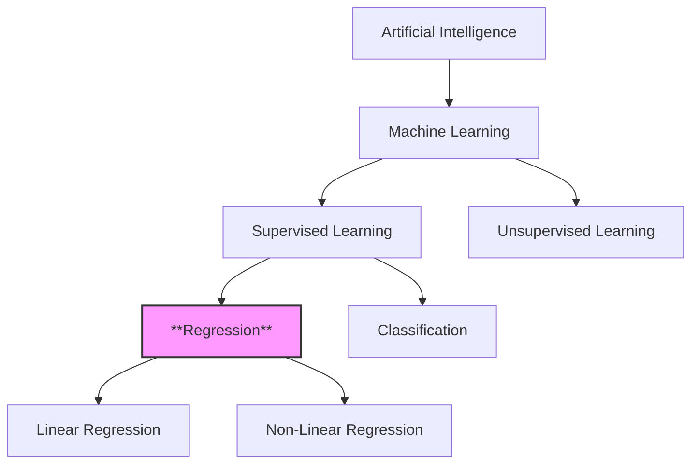
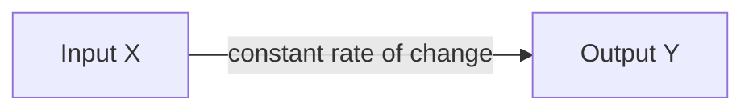
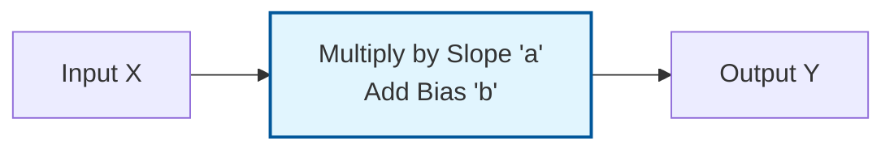
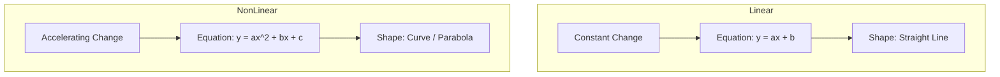

Regression is a sub-field of **supervised machine learning** in which the output variable ($Y$) is **continuous** — a number — rather than a category. Where classification predicts a label such as "Sick" or "Healthy", regression predicts quantities like a price, a temperature, a speed, or a growth rate. This note is the conceptual primer for the whole regression family: how inputs and outputs are framed, what separates linear from non-linear models, how fitting by loss minimization works at a high level, and when each flavor of regression is the right choice. The concrete fitting machinery — cost functions, gradients, and optimizers — is developed in [[04 - Machine Learning/Regression/Linear Regression|Linear Regression]], and the probability-based sibling that turns regression machinery into a classifier is [[04 - Machine Learning/Regression/Logistic Regression|Logistic Regression]].

## What regression is

Regression is a type of supervised learning where the output variable ($Y$) is **continuous** (a number), rather than a category. Unlike classification, which predicts a category (e.g., "Sick" or "Healthy"), regression is used to predict a **continuous numerical value** (e.g., price, temperature, speed, or growth). The two tasks sit side by side under the supervised-learning umbrella, and the machine learning hierarchy makes the position of regression explicit:

Regression itself then splits into two branches — **linear regression** and **non-linear regression** — and the distinction between them is entirely about the behavior of the rate of change between input and output.

## Inputs and outputs: the X and y framing

In any regression problem, we are dealing with two main components:

1. **Vector $X$ (the input):** also known as predictors, descriptors, or explanatory variables. This is the data we have.
2. **Vector $Y$ (the output):** also known as the label, target, or correct response. This is the value we want to predict.

Because $X$ is a vector, this framing covers both a single input variable and many input features at once — the goal is the same in either case.

> [!INFO] Key goal
> The goal of regression is to find a mathematical function $f(x)$ such that $f(X) \approx Y$. We want to find the relationship that explains how $Y$ changes when $X$ changes.

## Linear regression and constant variation

Linear regression attempts to model the relationship between two variables by fitting a linear equation to observed data. The defining characteristic of linearity is **constant variation**: in a linear relationship, the "step" or change between two terms is constant. If you increase the input ($x$) by a fixed amount, the output ($y$) increases (or decreases) by a fixed amount.

The cleanest illustration is an arithmetic progression — written inline as ($10, 20, 30, 40, 50...$):

$$10, 20, 30, 40, 50 \dots$$

To get from 10 to 20, you add 10; to get from 20 to 30, you add 10. The difference is constant — the variation is $r = 10$. Seen as a pipeline, a linear model simply applies this constant rate of change:

### From sequence notation to the model equation

There is a bridge to build between distinct mathematical sequences and continuous functions, and it clarifies where every symbol in the model comes from.

**Sequence notation (discrete).** For an arithmetic sequence — a list of numbers with a constant pattern — the formula is:

$$U_n = U_0 + n \cdot r$$

- $U_n$: the value at step $n$.
- $U_0$: the starting value (initial term).
- $n$: the step number.
- $r$: the constant rate of change (common difference).

Applying the running example:

$$U_n = 10 + 10n$$

If $n=0$, $U_0 = 10$. If $n=1$, $U_1 = 20$.

**Function notation (continuous ML model).** In machine learning, we translate this sequence logic into the equation of a line:

$$y = ax + b$$

- $y$ (prediction): equivalent to $U_n$.
- $x$ (input feature): equivalent to $n$.
- $a$ (slope/weight): equivalent to $r$ — it represents the constant variation.
- $b$ (bias/intercept): equivalent to $U_0$ — it represents the starting point when $x=0$.

Viewed as a processing pipeline, the model makes its two learned quantities visible:

> [!TIP] Important reminder
> A linear regression model assumes that the relationship is a **straight line**. It cannot bend. If the real-world data curves, a simple linear model will result in "Underfitting" (it's too simple to capture the pattern).

## Non-linear regression and changing variation

Non-linear regression is required when the data does not follow a straight line — when the implied relationship between $X$ and $Y$ is **not constant**. The variation changes: the difference between step 1 and step 2 is not the same as the difference between step 2 and step 3. The growth might accelerate or decelerate, and you cannot simply "add a fixed number" to get the next value.

The cleanest illustration is a geometric progression — written inline as ($2, 4, 8, 16, 32...$):

$$2, 4, 8, 16, 32 \dots$$

For changing variation the model family is the polynomial (or another higher-order function):

$$y = a_0 + a_1x + a_2x^2 + a_3x^3 \dots$$

- $4 - 2 = 2$
- $8 - 4 = 4$
- $16 - 8 = 8$

The difference doubles every time. It is not fixed.

### Exponential sequences

For a geometric sequence — where values multiply instead of add — the formula is:

$$U_n = U_0 \cdot q^n$$

- $U_n$: the value at step $n$.
- $U_0$: the starting value.
- $q$: the ratio (factor by which we multiply).

Applying the example:

$$U_n = 2 \times 2^n$$

This describes exponential growth, which is a non-linear shape.

### Polynomial models

In machine learning, we handle non-linearity by adding powers to the input features (e.g., squared, cubed). The polynomial equation is:

$$y = a_0 + a_1x + a_2x^2 + a_3x^3 + ...$$

- The $x^2$ term creates a parabola (U-shape).
- The $x^3$ term creates an S-curve shape.

By adding these terms, the line is allowed to curve to fit complex data points.

> [!failure] Common pitfall
> Students often think "Linear Regression" refers only to straight lines in 2D. Actually, "Linear" in Linear Regression technically refers to the *parameters* (weights), but in introductory treatments the distinction is usually drawn strictly on the **shape of the output**:
> - **Linear:** straight line ($y=ax+b$).
> - **Non-Linear:** curves, exponentials, parabolas.

The contrast between the two families, seen purely as shape, is stark:

## Linear versus non-linear at a glance

At the simplest level, the difference is one of shape and relationship complexity:

| Linear | Non-Linear |
| :---: | :---: |
| Straight Line | Curve (Parabola, Hyperbola, etc.) |
| Simple relationship | Complex relationship |
| $f(x) = ax+b$ | $f(x) = ax^2 + bx + c$ |

A fuller comparison across five dimensions:

| Feature | Linear Regression | Non-Linear Regression |
| :--- | :--- | :--- |
| **Variation** | Constant (The "gap" is always the same) | Changing (The "gap" grows or shrinks) |
| **Math Sequence** | Arithmetic ($U_n = U_0 + n \cdot r$) | Geometric ($U_n = U_0 \cdot q^n$) |
| **Equation Type** | $y = ax + b$ | $y = a_0 + a_1x + a_2x^2 ...$ |
| **Visual Shape** | Straight Line | Curve |
| **Complexity** | Simple, easy to interpret | Complex, fits intricate patterns |

The underlying mathematical background ties each family to the sequence that generates it.

> [!NOTE] Mathematical background
> - **Arithmetic Sequence ($U_n = U_0 + nr$):** correlates to linear regression. The "step" is always the same.
> - **Geometric Sequence ($U_n = U_0 \cdot q^n$):** correlates to non-linear behavior. The "step" grows larger as $n$ increases.

> [!example] Real world analogies
> - **Linear:** a taxi fare. It starts at $5.00 (bias) and adds $2.00 for every mile (slope). The cost per mile never changes.
> - **Non-Linear:** bacteria growth. 1 becomes 2, 2 becomes 4, 4 becomes 8. The population explosion accelerates over time.

## How fitting works: a preview of loss minimization

Every regression model — linear or not — contains free parameters whose values are not given but learned: the slope $a$ and intercept $b$ of a line, or the coefficients $a_0, a_1, a_2, a_3, \dots$ of a polynomial. **Fitting** the model means choosing those values so that the model's predictions track the observed outputs $Y$ as closely as possible across the training data. This is formalized as an optimization problem: define a loss (cost) function that aggregates prediction error over the dataset, then search for the parameter values that minimize it. For linear regression the classic choice is a squared-error cost, which can be minimized either exactly, through a closed-form solution, or iteratively, with an optimizer such as gradient descent that nudges the parameters downhill on the cost surface — the full development, including the calculus, lives in [[04 - Machine Learning/Regression/Linear Regression|Linear Regression]], and the general concepts live in [[Loss Functions]] and [[Gradient Descent]].

The model family you choose constrains what fitting can achieve. A straight line cannot bend, so if the data curves, no choice of $a$ and $b$ will capture the pattern. Conversely, polynomial models fit intricate patterns but give up the easy interpretation of "slope and intercept" — the tension between a model too simple for the pattern and one complex enough to trace it is the subject of the [[Bias Variance Tradeoff]], and the toolset for keeping richer models well-behaved is covered in [[Regularization Techniques]]. How well a fitted model actually performs is judged by the metric families surveyed in [[Regression Evaluation Metrics]].

## Assumptions and pitfalls

The central assumption of linear regression is the **straight-line assumption**: the model can only express a relationship of constant variation. When that assumption is violated, the failure mode is underfitting. If your data looks like a curve (e.g., bacterial growth, a stock market explosion), using a **linear** model ($y=ax+b$) will result in high errors — the model is too simple to capture the pattern — and you must choose a **non-linear** model (like a polynomial) to fit the data correctly. This is a model-family mistake, not a parameter mistake: no amount of fitting rescues the wrong family.

A second, subtler pitfall is terminological. As the callout above warns, "linear" in linear regression technically refers to the *parameters*, while the practical distinction used throughout introductory material is the **shape of the output**. Keeping both readings in mind prevents confusion when more advanced treatments call a polynomial model "linear in its parameters."

Finally, there is a complexity trade-off to manage. Linear models are simple and easy to interpret; non-linear models fit intricate patterns at the cost of that interpretability. Choosing the family by looking at the rate of change of the data — stable versus value-dependent — is the practical diagnostic, and the exercise below makes it concrete.

## When to use regression

Reach for regression whenever the target you want to predict is a continuous number — a price, a temperature, a speed, a growth measurement. If the target is instead a category, you need classification, whose regression-flavored workhorse is [[04 - Machine Learning/Regression/Logistic Regression|Logistic Regression]] (which, despite its name, predicts class probabilities rather than numbers).

Within regression, the choice of family follows the rate of change. If the rate of change of the output is stable as the inputs vary — the taxi-fare situation, where every mile costs the same — a linear model ($y = ax + b$) is appropriate. If the rate of change depends on the current value — "growth is 10% of current size," the bacteria situation — you need a non-linear model such as an exponential or polynomial form.

While the explicit math exercises are in the neural-network material, the regression notes imply a specific exercise in identifying patterns.

## A pattern-recognition exercise

A quick way to internalize the distinction is to identify the type of regression needed for a given data sequence. **Task:** identify the type of regression needed for the following data sequences.

**Data A:** `[10, 20, 30, 40]`

1. **Check differences:**
   - $20 - 10 = 10$
   - $30 - 20 = 10$
   - $40 - 30 = 10$
2. **Conclusion:** the difference is constant.
3. **Model:** linear regression ($y = 10x + 10$).

**Data B:** `[2, 4, 8, 16]`

1. **Check differences:**
   - $4 - 2 = 2$
   - $8 - 4 = 4$
   - $16 - 8 = 8$
2. **Conclusion:** the difference is NOT constant (it is changing).
3. **Model:** non-linear regression (exponential/geometric).

> [!note] Critical takeaway
> If asked to distinguish between the two, look at the **rate of change**. If the rate of change is stable, use linear. If the rate of change depends on the current value (e.g., "growth is 10% of current size"), use non-linear.

## See also

- [[Machine Learning MOC]]
- [[04 - Machine Learning/Regression/Linear Regression|Linear Regression]]
- [[04 - Machine Learning/Regression/Logistic Regression|Logistic Regression]]
- [[Loss Functions]]
- [[Gradient Descent]]
- [[Regression Evaluation Metrics]]
- [[Bias Variance Tradeoff]]
- [[Regularization Techniques]]
