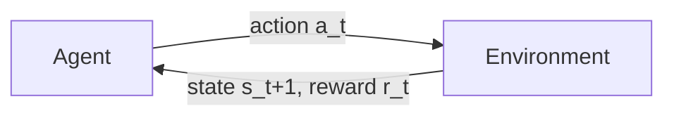

Reinforcement learning (RL) is learning by trial and error to maximize long-term reward, and the formal framework for that problem is the **Markov Decision Process (MDP)**: states, actions, transitions, and rewards. The Bellman equations define the value functions that every RL algorithm tries to estimate, turning the vague goal of "accumulate reward" into concrete, computable quantities. This note develops the formalism from the agent–environment loop through policies, value functions, and the Bellman expectation and optimality equations, then surveys the three families of algorithms that solve MDPs and the practical tensions — discounting and exploration — that shape all of them. It is the foundation for the sibling notes [[Q-Learning and Deep Q Networks]], [[Policy Gradients and Actor Critic]], and [[Proximal Policy Optimization]].

## The reinforcement learning setup

An agent interacts with an environment over discrete time:

At each step $t$ the loop turns once: the agent observes the state $s_t$; it chooses an action $a_t$ via its policy; the environment transitions to $s_{t+1}$ and emits a reward $r_t$; and the process repeats. Everything the agent can ever learn about the world arrives through this narrow channel of states and rewards, and everything it can ever do to change the world flows back through actions.

The agent's goal is to maximize the expected cumulative discounted reward:

$$
\mathbb{E}\left[ \sum_{t=0}^{\infty} \gamma^t r_t \right]
$$

where $\gamma \in [0, 1)$ is the **discount factor** — rewards sooner are worth more. Discounting is not just a mathematical convenience: it is what makes an infinite stream of rewards finite and comparable, and its value encodes how far ahead the agent plans.

## The Markov decision process

Formally, an MDP is a tuple $(\mathcal{S}, \mathcal{A}, P, R, \gamma)$:

- $\mathcal{S}$: set of states.
- $\mathcal{A}$: set of actions.
- $P(s' \mid s, a)$: transition probability — the probability of going to $s'$ from $s$ via action $a$.
- $R(s, a)$ (or $R(s, a, s')$): reward function.
- $\gamma$: discount factor.

The defining structural assumption is the **Markov property**: the future depends only on the current state, not on the history that produced it:

$$
P(s_{t+1} \mid s_t, a_t, s_{t-1}, a_{t-1}, \ldots) = P(s_{t+1} \mid s_t, a_t)
$$

This is a strong assumption — many real environments are not strictly Markovian, because the raw observation may fail to summarize everything that matters for predicting the future. RL algorithms handle non-Markov (non-Markovian) environments by either augmenting the state with history (a recurrent network or transformer over past observations) or accepting the approximation and living with its consequences.

## Policies

A **policy** $\pi$ maps states to actions, and it comes in two flavors:

- **Deterministic**: $\pi(s) = a$.
- **Stochastic**: $\pi(a \mid s)$ = the probability of taking action $a$ in state $s$.

The policy is what the agent learns. Everything else — transitions, rewards — is fixed by the environment. This division of labor is worth internalizing: RL is the search for the best mapping from states to behavior inside a world whose rules never bend to accommodate the agent.

## Value functions

Two value functions quantify how good a situation is under a given policy. The **state-value function** $V^\pi(s)$ is the expected return starting from state $s$ and following $\pi$ thereafter:

$$
V^\pi(s) = \mathbb{E}_\pi \left[ \sum_{t=0}^{\infty} \gamma^t r_t \mid s_0 = s \right]
$$

The **action-value function** $Q^\pi(s, a)$ is the expected return starting from state $s$, taking action $a$ first, and then following $\pi$:

$$
Q^\pi(s, a) = \mathbb{E}_\pi \left[ \sum_{t=0}^{\infty} \gamma^t r_t \mid s_0 = s, a_0 = a \right]
$$

The two are intimately related — $V$ averages $Q$ over the policy's action choices — and nearly every algorithm in RL is an attempt to estimate one of them (or both).

## The Bellman equations

Value functions have a recursive structure: the value of a state is the immediate reward plus the discounted value of the next state. Writing that recursion down yields the Bellman equations, the central equations of reinforcement learning.

### The Bellman expectation equation

For a fixed policy $\pi$:

$$
V^\pi(s) = \sum_a \pi(a \mid s) \sum_{s'} P(s' \mid s, a) \left[ R(s, a) + \gamma V^\pi(s') \right]
$$

$$
Q^\pi(s, a) = \sum_{s'} P(s' \mid s, a) \left[ R(s, a) + \gamma \sum_{a'} \pi(a' \mid s') Q^\pi(s', a') \right]
$$

These equations say: "the value of state $s$ under policy $\pi$ is the average immediate reward plus the discounted average value of the next state." The averages are taken over the policy's randomness (which action to take) and the environment's randomness (which next state results).

### The Bellman optimality equation

For the best policy:

$$
V^*(s) = \max_a \sum_{s'} P(s' \mid s, a) \left[ R(s, a) + \gamma V^*(s') \right]
$$

$$
Q^*(s, a) = \sum_{s'} P(s' \mid s, a) \left[ R(s, a) + \gamma \max_{a'} Q^*(s', a') \right]
$$

The optimal value satisfies the Bellman equation **with max instead of average**: an optimal agent does not average over its options, it takes the best one. Solving this system gives the optimal policy:

$$
\pi^*(s) = \arg\max_a Q^*(s, a)
$$

Once $Q^*$ is known, acting optimally is trivial — pick the action with the highest action-value. This observation is the seed of [[Q-Learning and Deep Q Networks]].

### Why the Bellman equations matter

Three reasons the Bellman equations sit at the heart of RL:

1. **They define what we're computing.** Every RL algorithm estimates $V$, $Q$, or $\pi$ — all of which are defined via Bellman equations.
2. **They give us update rules.** Temporal-difference (TD) learning uses the Bellman equation as a target: $Q(s, a) \leftarrow Q(s, a) + \alpha [r + \gamma \max_{a'} Q(s', a') - Q(s, a)]$.
3. **They reveal the structure of the problem.** Value functions decompose the long-term return into immediate reward plus future value, making the problem tractable.

Without the Bellman decomposition, an agent would have to reason about entire trajectories at once; with it, each decision only needs to account for one step of reward and the value of landing somewhere good.

## Solving an MDP: three families of methods

The Bellman equations suggest three broad strategies for actually computing good policies, and every RL algorithm falls into one of these families.

### Value-based methods

Learn $Q^*$, then derive $\pi^*$ greedily from it. Q-learning and DQN are the canonical examples — see [[Q-Learning and Deep Q Networks]].

### Policy-based methods

Directly parameterize $\pi_\theta$ and optimize $\theta$ via gradient ascent on the expected return, skipping the value function as an intermediate representation. Policy gradients and REINFORCE are the canonical examples — see [[Policy Gradients and Actor Critic]].

### Actor-critic methods

Learn both a policy (the "actor") and a value function (the "critic"). The critic reduces the variance of policy gradient estimates, which is what makes policy search practical. A2C, A3C, and PPO are in this family — see [[Proximal Policy Optimization]].

## The role of the discount factor

The discount factor $\gamma$ controls the agent's effective time horizon:

- $\gamma = 0$: myopic — only the immediate reward matters.
- $\gamma \to 1$: far-sighted — all future rewards count (nearly) equally.
- $\gamma = 0.99$: typical for many RL tasks.
- $\gamma < 1$ ensures infinite-horizon returns are finite (a geometric series).

The choice is a genuine tradeoff rather than a dial to crank to the maximum: lower $\gamma$ means easier credit assignment but a more myopic agent, while higher $\gamma$ means harder credit assignment but a more far-sighted one.

## Exploration versus exploitation

The fundamental tension in RL is between **exploiting** — taking the action that currently looks best — and **exploring** — trying actions to learn more about them. If you always exploit, you might miss better actions you have underestimated; if you always explore, you never accumulate reward from what you already know. Common strategies for balancing the two:

- **$\epsilon$-greedy**: with probability $\epsilon$, take a random action; otherwise, act greedily.
- **Softmax / Boltzmann**: sample actions proportional to their value.
- **UCB**: prefer actions with high uncertainty (optimism in the face of uncertainty).

## Why this matters for modern AI

The MDP formalism is not a historical curiosity; it is the substrate of several of the most consequential AI systems:

- **RLHF is RL.** The PPO algorithm that aligns LLMs is built on this MDP formalism. The "state" is the prompt plus the partial generation, the "action" is the next token, and the "reward" comes from the reward model.
- **Game-playing AI** (AlphaGo, AlphaZero, OpenAI Five) is pure RL on MDPs.
- **Robotics** uses RL for control.
- **Recommendation systems** can be framed as RL (state = user history, action = recommended item, reward = engagement).

## Production implications

RL is much harder than supervised learning: sample efficiency is poor, training is unstable, and evaluation is nontrivial. For most production AI you will use **offline RL** (training on logged data) or **RLHF** (which is closer to imitation learning with a twist) rather than online RL. Even when you are not doing RL at all, the MDP formalism remains a useful **modeling tool** — it forces you to articulate your states, actions, and rewards explicitly, which is often half the battle in designing a learning system.

## Common pitfalls

Four failure modes recur whenever MDPs are used to model real problems:

- **Forgetting the Markov assumption** — if your state doesn't contain enough information, the agent can't act optimally.
- **Wrong reward design** — agents will exploit reward bugs (e.g., a cleaning robot that creates mess to clean up).
- **Discount factor too high** — credit assignment becomes very hard.
- **No exploration** — the agent gets stuck in a local optimum.

## Further reading

- Sutton & Barto, *Reinforcement Learning: An Introduction* — the canonical textbook.
- Silver's RL course (DeepMind): https://www.davidsilver.uk/teaching/
- OpenAI Spinning Up: https://spinningup.openai.com/

## See also

- [[Q-Learning and Deep Q Networks]]
- [[Policy Gradients and Actor Critic]]
- [[Proximal Policy Optimization]]
- [[Machine Learning MOC]]
- [[RLHF with PPO]]
