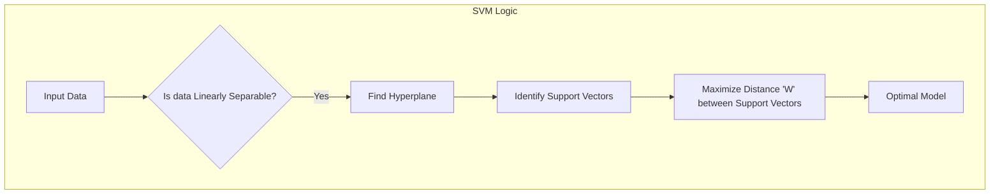
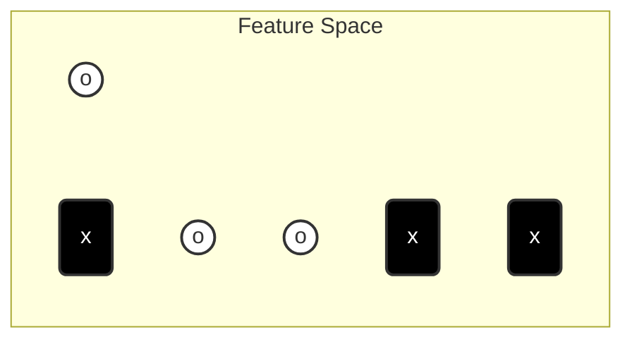
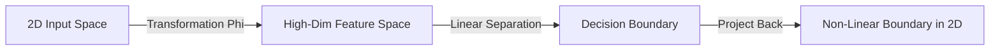

The kernel trick is what turns the strictly linear classifier of [[Support Vector Machines]] into a method that can separate data no straight line can cut. When data is tangled in its current dimension, the idea is to map it into a higher-dimensional space where a flat hyperplane separates it — and then to notice that the mapping never has to be computed at all, because both the training optimization and the classification rule depend only on dot products. A kernel function returns those high-dimensional dot products using nothing but the original coordinates, delivering the benefit of high dimensions without the computational cost. This note develops the problem of non-linear data, the transformation of the space, the trick itself, the common kernels — polynomial and radial basis function — and the overfitting trade-offs governed by the kernel's parameters; it sits alongside [[SVM Lagrangian Dual]] in the SVM area of the [[Machine Learning MOC]].

## The linear machine, in brief

Recall what a linear SVM does. Given two classes of data, it finds the **Hyperplane** — the dividing line — and selects the one that maximizes the distance between the classes; the **Support Vectors** are the points that define the line, the ones closest to it; data that can be cut by a straight line is **Linearly Separable**. The procedure runs:



In a standard 2D graph (Feature $x_1$ vs Feature $x_2$), if you can draw a straight ruler line to separate the two groups completely, the data is linearly separable — circles (`o`) on one side, crosses (`x`) on the other:



> [!WARNING] **Common Misconception**
> Students often think SVM considers *all* data points when calculating the line. It does not. Once the Support Vectors are identified, the rest of the data is mathematically irrelevant to the position of the boundary.

This note is about the other branch of the diamond above: what happens when the answer to "Is data Linearly Separable?" is **No**.

## The problem: linearly inseparable data

What if the data cannot be separated by a straight line — the XOR problem, for example, or a ring of positive samples surrounding negative samples? A standard SVM would fail: we need a non-linear boundary.

In the real world, data is rarely clean enough to be split by a straight line. Imagine a dataset where Class A is a cluster in the center ($0,0$) and Class B is a ring of points surrounding Class A. No straight line (linear hyperplane) can separate the inner cluster from the outer ring without making huge errors. This is called **Non-Linear Data**.

## The solution: transforming the space

The "Kernel Trick" is a method to separate non-linear data without making the math impossible. The concept: project the data from the current space (**Input Space**) into a higher-dimensional space (**Feature Space**). Data that is tangled in 2D might be separable by a flat sheet in 3D. Let $\Phi(\vec{x})$ be a transformation function that maps $\vec{x}$ to a higher dimension.

The analogy: imagine red and blue dots on a flat sheet of paper. You cannot draw a straight line to separate them. Now, imagine lifting the red dots up into the air (adding a 3rd dimension: height). Now, you can slide a flat sheet of plastic (a 2D plane) between the red dots in the air and the blue dots on the table.

Visualizing the transformation:

1. **Input Space (2D):** Data is mixed and inseparable.
2. **Feature Space (3D):** Data is "lifted".
3. **Result:** We can now fit a flat hyperplane to separate them.

```mermaid
flowchart LR
    A[2D Input Space<br/>(Not Separable)] -->|Mapping Function| B[3D Feature Space<br/>(Linearly Separable)]
    B -->|Find Hyperplane| C[Classified Data]
```

And once the flat boundary has been found up there, it is projected back down, where it appears as the curved, non-linear boundary we needed:



## The kernel trick definition

You might ask: *"Isn't calculating 3D coordinates for millions of data points computationally expensive?"* Yes, it is. That is why we use the **Kernel Trick**.

> The Kernel function computes the **similarity** between two points as if they were mapped to a higher-dimensional space, **without actually doing the mapping.**

The mathematical insight behind it: SVM relies on the **Dot Product** of data points to calculate the margin.

- The Kernel function $K(x_1, x_2)$ allows us to calculate the dot product in the high-dimensional space using only the original 2D data.
- **Mathematical Magic:** We get the benefit of high dimensions without the cost of calculating the coordinates.

$$K(x, y) = \langle \phi(x), \phi(y) \rangle$$

*Where $\phi$ represents the mapping to high dimensions.*

## The power of dot products

Usually, calculating in high-dimensional space is computationally expensive (the Curse of Dimensionality). However, remember the "Miracle" from the dual derivation in [[SVM Lagrangian Dual]]: **We only need the dot product.**

We do not need to calculate the transformation $\Phi(\vec{x})$ explicitly. We only need a function $K$ (The Kernel Function) that equals the dot product in that high-dimensional space:

$$ K(\vec{u}, \vec{v}) = \Phi(\vec{u}) \cdot \Phi(\vec{v}) $$

We substitute $K(\vec{x}_i, \vec{x}_j)$ into our optimization equation instead of $(\vec{x}_i \cdot \vec{x}_j)$.

## Common kernels

We don't even need to know what space we are projecting into. We just pick a Kernel function that satisfies certain mathematical properties (Mercer's Theorem). The **Linear Kernel** is used when data is already separable — the case handled directly by the linear machine of [[Support Vector Machines]]. Beyond it, two kernels matter most.

### Polynomial kernel

$$ K(\vec{u}, \vec{v}) = (\vec{u} \cdot \vec{v} + 1)^n $$

- Projects data into a space representing all polynomial combinations of the features.
- $n=2$ allows for curved boundaries (parabolas, circles, etc.).

### Radial basis function (RBF) / Gaussian kernel

$$ K(\vec{u}, \vec{v}) = e^{-\frac{||\vec{u} - \vec{v}||^2}{\sigma}} $$

- **Infinite Dimensions:** This kernel essentially projects data into an infinite-dimensional space.
- It creates "islands" of support around specific data points.
- **Interpretation:** It acts like a nearest-neighbor similarity measure but within the strict mathematical framework of the SVM — a very different use of similarity from the voting of [[K-Nearest Neighbors]].

## Overfitting versus generalization

The $\sigma$ parameter of the RBF kernel controls how tightly the boundary hugs the training data:

- **Low Sigma (RBF):** The kernel wraps tightly around specific data points. High risk of **overfitting** (memorizing the data).
- **High Sigma (RBF):** Smooth, broader boundaries. Better generalization.

This is the same tension tracked in [[Bias Variance Tradeoff]], and choosing $\sigma$ is a complexity-control problem in the same spirit as [[Regularization Techniques]]. The remarkable part is what does *not* change: the Kernel Trick allows SVMs to create highly complex, non-linear boundaries while retaining the guarantee of finding the global optimum — the convexity established in [[SVM Lagrangian Dual]].

## Exam reminder and summary checklist

> [!IMPORTANT] **Exam Reminder**
> If asked "What is the objective of the Kernel function?", the answer is:
> To enhance the dimensionality of data to make it linearly separable, and therefore find the hyperplane to classify them.

The essentials in one place:

- [ ] **Hyperplane:** The dividing line.
- [ ] **Support Vectors:** The points that define the line.
- [ ] **Linearly Separable:** Can be cut by a straight line.
- [ ] **Kernel Trick:** A mathematical shortcut to separate complex (non-linear) data by calculating similarity in higher dimensions without high computational cost.

## See also

- [[Machine Learning MOC]] — the map of machine learning topics.
- [[Support Vector Machines]] — the linear machine: hyperplanes, margins, the widest street, and the mathematics of separation.
- [[SVM Lagrangian Dual]] — why only dot products matter: the dual derivation and the convexity guarantee.
- [[K-Nearest Neighbors]] — the RBF kernel acts like a nearest-neighbor similarity measure.
- [[Bias Variance Tradeoff]] — the general theory behind the low-sigma/high-sigma behavior.
- [[Regularization Techniques]] — other complexity-control mechanisms.
- [[Gradient Descent]] — iterative optimization of unconstrained objectives; the kernel-substituted SVM problem is instead a convex program solved through its dual.
