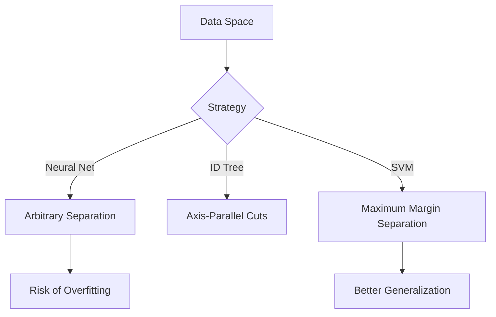
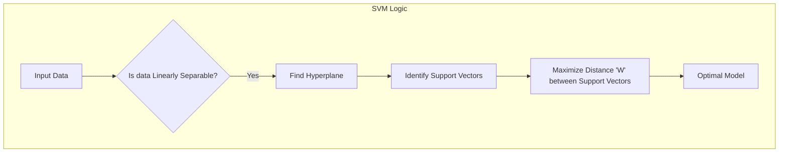
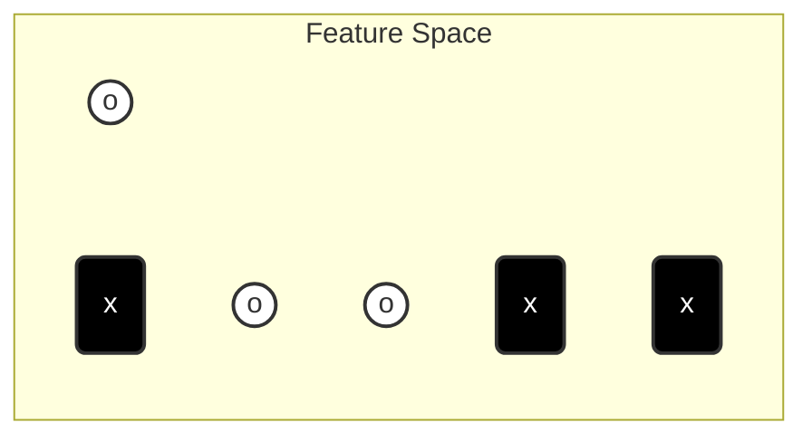

A **Support Vector Machine (SVM)** is a supervised learning algorithm whose fundamental goal is simple but mathematically elegant: find the best possible boundary to separate different classes of data. Where other methods may be satisfied with any line that separates the training points, an SVM asks which line is the *best* line, and answers with the maximum-margin — "widest street" — hyperplane, the boundary kept as far as possible from the nearest points of each class. This note develops the fundamental idea, linear separability, and the full mathematics of separation: the decision rule, the gutter constraints, the width calculation, and the canonical objective that follows from them. The Lagrange-multiplier solution of that objective is derived in [[SVM Lagrangian Dual]], and the extension to non-linear data is the [[Kernel Trick]]; together these notes form the SVM area of the [[Machine Learning MOC]].

## What a support vector machine is

**Support Vector Machine (SVM)** is a powerful **Supervised Learning** algorithm used for both classification (distinguishing between classes) and regression; the classic treatment focuses primarily on its classification capabilities. Everything in the subject rests on three key concepts:

- **The Hyperplane:** This is the "line" (in 2D) or "plane" (in 3D+) that separates your data classes.
- **Support Vectors:** These are the specific data points closest to the hyperplane. They are the "hardest" points to classify. They are called "support" vectors because they literally support or determine the position of the hyperplane.
- **The Margin:** The distance between the hyperplane and the nearest data point (the support vectors).

> [!TIP] **Why "Support" Vectors?**
> Imagine the dataset is a building. Most data points are just interior decorations—they don't affect the structure. The **Support Vectors** are the load-bearing pillars. If you remove a random data point, the decision boundary usually doesn't change. If you move a Support Vector, the whole boundary shifts.

The study of SVMs divides naturally into two halves. The fundamentals — hyperplanes, margins and linear separability, together with the mathematics of separation and its dual — are treated here and in [[SVM Lagrangian Dual]]. Non-linearity — the kernel trick and higher-dimensional feature spaces — is treated in [[Kernel Trick]]. The prerequisites are the general types of learning and the basics of regression, introduced along the [[Machine Learning MOC]] and in [[Regression Fundamentals]].

## SVM among other learning algorithms

Before diving into Support Vector Machines, it is helpful to situate them among other learning algorithms:

| Algorithm | Basic Idea | Limitation |
| :--- | :--- | :--- |
| **Nearest Neighbors** | "Do what your neighbor does." | Can be computationally expensive at runtime; sensitive to noise. |
| **ID Trees** | "Slice the space with axis-parallel cuts." | Greedy approach; doesn't always find the optimal geometric separation. |
| **Neural Networks** | "biologically inspired layering." | Prone to getting stuck in **local maxima**; often considered a "black box." |

The first row is the algorithm behind [[K-Nearest Neighbors]], and the axis-parallel cutting of the second row is the signature of the [[Decision Trees]] family. **Support Vector Machines** represent a sophisticated mathematical approach to dividing a space. While Neural Networks can draw many arbitrary lines to separate data, SVMs ask a fundamental question: **"Which line is the *best* line?"** In the diagram below, a Neural Network might draw any of the lines; an SVM specifically looks for the line that creates the greatest separation — and the strategy chosen decides whether the model risks overfitting or generalizes well, the classic tension of the [[Bias Variance Tradeoff]].



## The objective: maximizing the margin

You might have two classes of data (e.g., circles and crosses). You can draw infinite lines to separate them. **Which one is the best?** The SVM algorithm selects the hyperplane that **maximizes the distance ($W$)** between the classes. The logic:

1. We want the "street" (the gap between classes) to be as wide as possible.
2. The wider the margin, the more confident we are in our classification.
3. A wider margin reduces the risk of **Overfitting**. If the margin is too narrow, the model might be too sensitive to noise in the training data.

### Mathematical representation (simplified)

If we have two support vectors on either side of the boundary, let's call the distance from the centerline to the support vector $W_1$ and $W_2$:

- Ideally, the hyperplane is centered, so **$W_1 = W_2$**.
- The total margin width is $W_1 + W_2$.
- **Goal:** Maximize $(W_1 + W_2)$.

The whole procedure, from data to optimal model, runs as follows:



When the answer to the diamond's question is "No", the route through higher-dimensional feature spaces — the kernel trick — takes over; see [[Kernel Trick]].

## Linear separability

In a standard 2D graph (Feature $x_1$ vs Feature $x_2$), if you can draw a straight ruler line to separate the two groups completely, the data is **Linearly Separable**.

### Diagram: the linear case

A conceptual representation of the scatter plot, with circles (`o`) on one side and crosses (`x`) on the other:



- **$x_1, x_2$**: These are the axes (features).
- **Hyperplane**: The line splitting the `o` and `x`.
- **Support Vectors**: The `o` and `x` closest to the line.

> [!WARNING] **Common Misconception**
> Students often think SVM considers *all* data points when calculating the line. It does not. Once the Support Vectors are identified, the rest of the data is mathematically irrelevant to the position of the boundary.

## The widest street approach

Imagine a 2D space with two classes of data: **Positive Samples (+)** and **Negative Samples (-)**. We want to draw a **Decision Boundary** (a line in 2D, a hyperplane in higher dimensions) that separates these samples. Vapnik (the creator of SVMs) formulated the "Widest Street" intuition: instead of just drawing a thin line, imagine drawing a **street** (or a highway) between the positive and negative samples.

1. **The Median:** The center line of the street is our actual **Decision Boundary**.
2. **The Gutters:** The edges of the street touch the nearest positive and negative samples.
3. **The Goal:** Make the street **as wide as possible**.

### Why the widest street?

If you place a decision boundary excessively close to the negative samples (even if it separates the training data perfectly), it is statistically dangerous. New, unseen data (test data) might fall slightly on the wrong side. A **wider margin** implies greater confidence and better generalization to future data.

### Visualizing the street

Imagine a vector $\vec{w}$ that is perpendicular (normal) to the direction of the street:

```mermaid
graph LR
    subgraph Space
    P1((+))
    P2((+))
    N1((-))
    N2((-))
    
    L1[Left Gutter] --- L2[Median Line] --- L3[Right Gutter]
    end
    
    style P1 fill:#9f9,stroke:#333
    style P2 fill:#9f9,stroke:#333
    style N1 fill:#f99,stroke:#333
    style N2 fill:#f99,stroke:#333
    style L2 stroke-width:4px,stroke:blue
```

The specific data points that touch the "gutters" (the edges of the street) are called **Support Vectors**. The crucial insight: the entire solution depends *only* on these Support Vectors. The data points far away from the street do not influence the position of the boundary.

## The mathematics of separation

To maximize the width of the street, we must first mathematically define the decision rule and the constraints.

### The decision rule

We define a vector $\vec{w}$ that is perpendicular to the median of the street. We also have an unknown vector $\vec{u}$ (a new sample we want to classify). The decision rule is based on the **projection** of $\vec{u}$ onto $\vec{w}$:

$$ \vec{w} \cdot \vec{u} + b \geq 0 $$

- **$\vec{w}$**: The normal vector (orientation of the street).
- **$\vec{u}$**: The vector pointing to the unknown sample.
- **$b$**: A bias term (shifts the line relative to the origin).
- **$\cdot$**: The Dot Product.

**The Rule:** If the result is $\geq 0$, classify as **Positive (+)**. If the result is $< 0$, classify as **Negative (-)**.

### Setting the constraints

We don't just want to classify; we want to enforce the "Widest Street." We assume the street has a measurable width, and we impose strict mathematical constraints on the "gutters":

1. **Positive Constraint:** For all positive samples ($\vec{x}_+$), the value must be greater than or equal to 1 (the right gutter):

$$ \vec{w} \cdot \vec{x}_+ + b \geq 1 $$

2. **Negative Constraint:** For all negative samples ($\vec{x}_-$), the value must be less than or equal to -1 (the left gutter):

$$ \vec{w} \cdot \vec{x}_- + b \leq -1 $$

*Note: The choice of "1" and "-1" is mathematically convenient. It establishes a scale.*

### The mathematical convenience variable ($y_i$)

To avoid carrying two separate equations, we introduce a variable $y_i$: $y_i = +1$ for positive samples, and $y_i = -1$ for negative samples. We can now multiply the equations by $y_i$ to create a single, unified constraint:

$$ y_i (\vec{w} \cdot \vec{x}_i + b) - 1 \geq 0 $$

- **For Positive Samples:** $(1)(\text{something} \geq 1) - 1 \to \geq 0$. (Holds true).
- **For Negative Samples:** $(-1)(\text{something} \leq -1)$. Multiplying by a negative flips the inequality. It becomes $\geq 1$. Subtracting 1 makes it $\geq 0$. (Holds true).

**Important:** For the specific samples that sit *exactly* on the gutters (the **Support Vectors**), this equation equals **zero**. For points further away, it is $>0$.

### Calculating the width

How wide is the street? We calculate this using geometry. Take a positive support vector $\vec{x}_+$ and a negative support vector $\vec{x}_-$. The width is the projection of the difference vector $(\vec{x}_+ - \vec{x}_-)$ onto the unit normal vector.

1. **Unit Normal:** $\frac{\vec{w}}{||\vec{w}||}$
2. **Width Equation:**

$$ \text{Width} = (\vec{x}_+ - \vec{x}_-) \cdot \frac{\vec{w}}{||\vec{w}||} $$

Using our constraints ($\vec{w}\vec{x}_+ = 1-b$ and $\vec{w}\vec{x}_- = -1-b$):

$$ \text{Width} = \frac{\vec{w} \cdot \vec{x}_+ - \vec{w} \cdot \vec{x}_-}{||\vec{w}||} = \frac{(1-b) - (-1-b)}{||\vec{w}||} = \frac{2}{||\vec{w}||} $$

### The optimization goal

To get the **Widest Street**, we need to **MAXIMIZE** the Width:

$$ \text{Maximize } \frac{2}{||\vec{w}||} $$

To make the math easier (for derivatives later), maximizing $\frac{2}{||\vec{w}||}$ is equivalent to:

$$ \text{Minimize } \frac{1}{2} ||\vec{w}||^2 $$

This is the canonical objective function of the Support Vector Machine. Minimizing it under the constraint that every sample sits on the correct side of the street is a classic constrained optimization problem, solved with Lagrange multipliers in [[SVM Lagrangian Dual]] — a derivation whose ending, an objective that depends only on dot products between samples, is precisely what makes the [[Kernel Trick]] possible.

## When data is not linearly separable

In the real world, data is rarely clean enough to be split by a straight line. Imagine a dataset where Class A is a cluster in the center ($0,0$) and Class B is a ring of points surrounding Class A. No straight line (linear hyperplane) can separate the inner cluster from the outer ring without making huge errors. This is called **Non-Linear Data**.

To solve this, SVM uses a technique called the **Kernel Trick**. If we cannot separate the data in the current dimension (2D), we project (map) the data into a **Higher Dimensional Space** (3D, 4D, or infinite dimensions). The analogy: imagine red and blue dots on a flat sheet of paper. You cannot draw a straight line to separate them. Now, imagine lifting the red dots up into the air (adding a 3rd dimension: height). Now, you can slide a flat sheet of plastic (a 2D plane) between the red dots in the air and the blue dots on the table. Data that is mixed and inseparable in the 2D input space is "lifted" into a 3D feature space, where a flat hyperplane can separate it:

```mermaid
flowchart LR
    A[2D Input Space<br/>(Not Separable)] -->|Mapping Function| B[3D Feature Space<br/>(Linearly Separable)]
    B -->|Find Hyperplane| C[Classified Data]
```

You might ask: *"Isn't calculating 3D coordinates for millions of data points computationally expensive?"* Yes, it is. That is why we use the **Kernel Trick**. The Kernel function computes the **similarity** between two points as if they were mapped to a higher-dimensional space, **without actually doing the mapping.** SVM relies on the **Dot Product** of data points to calculate the margin, and the Kernel function $K(x_1, x_2)$ allows us to calculate the dot product in the high-dimensional space using only the original 2D data. **Mathematical Magic:** We get the benefit of high dimensions without the cost of calculating the coordinates:

$$K(x, y) = \langle \phi(x), \phi(y) \rangle$$

*Where $\phi$ represents the mapping to high dimensions.*

The standard kernels are the **Linear Kernel** (used when data is already separable, as in the linear case above), the **Polynomial Kernel** (curves the decision boundary), and the **RBF (Radial Basis Function)** — the most common — which creates circular/complex decision boundaries, perfect for the "circle inside a circle" example. The full treatment — the polynomial and Gaussian kernel formulas, Mercer's theorem, and the overfitting trade-offs of the RBF width parameter — is in [[Kernel Trick]].

> [!IMPORTANT] **Exam Reminder**
> If asked "What is the objective of the Kernel function?", the answer is:
> To enhance the dimensionality of data to make it linearly separable, and therefore find the hyperplane to classify them.

## Recap: the SVM checklist

- [ ] **Hyperplane:** The dividing line.
- [ ] **Support Vectors:** The points that define the line.
- [ ] **Linearly Separable:** Can be cut by a straight line.
- [ ] **Kernel Trick:** A mathematical shortcut to separate complex (non-linear) data by calculating similarity in higher dimensions without high computational cost.


## Historical note

The overview that gathered this material was assembled by referencing two embedded documents, `3.1. SVM Fundamentals & Linear Separability.md` and `3.2. The Kernel Trick & Non-Linearity.md`, each depicted as a quoted file inside the overview. The fundamentals quoted there are developed in this note, and the kernel material serves to illustrate the extension carried by [[Kernel Trick]].

## See also

- [[Machine Learning MOC]] — the map of machine learning topics.
- [[Kernel Trick]] — the full treatment of non-linear separation: kernel functions, the polynomial and RBF kernels, Mercer's theorem, and overfitting versus generalization.
- [[SVM Lagrangian Dual]] — the Lagrange-multiplier derivation of the dual problem, the dot-product "miracle", and the convexity guarantee.
- [[K-Nearest Neighbors]] — the "do what your neighbor does" algorithm compared in the table above.
- [[Decision Trees]] — the axis-parallel-cutting family compared in the table above.
- [[Bias Variance Tradeoff]] — the general theory behind why wider margins generalize better.
- [[Regularization Techniques]] — other mechanisms for controlling overfitting.
- [[Gradient Descent]] — iterative optimization of unconstrained objectives; the SVM problem is instead a constrained program solved through its dual.
- [[Loss Functions]] — the error-based objectives most learners minimize; the SVM minimizes weight magnitude under margin constraints instead.
