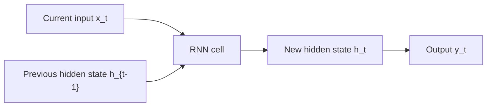
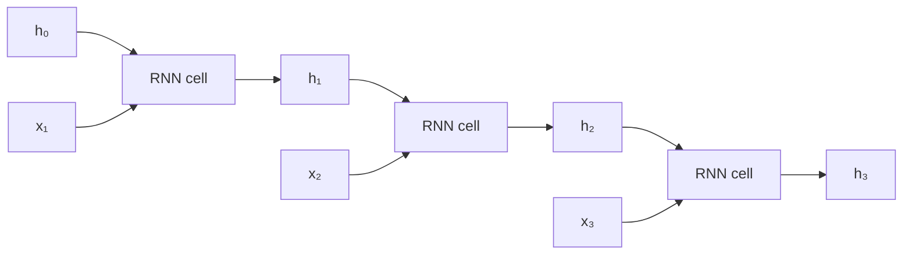

Recurrent Neural Networks (RNNs) process sequences by maintaining a hidden state that is carried from one timestep to the next: at every step, the same cell receives the current input together with the previous hidden state and produces a new one. Vanilla RNNs suffer from vanishing and exploding gradients, which LSTM and GRU address with gating mechanisms that control what is remembered, written, and exposed at each step. Transformers have largely replaced the recurrent family for NLP, but RNNs remain relevant for streaming, low-latency, and small-model use cases — and their gating pattern survives in modern linear-time architectures such as Mamba.

> [!info] TL;DR
> Recurrent Neural Networks (RNNs) process sequences by maintaining a hidden state across timesteps. Vanilla RNNs suffer from vanishing/exploding gradients. **LSTM** and **GRU** add gating mechanisms to control gradient flow. Largely replaced by Transformers for NLP, but still relevant for streaming, low-latency, and small-model use cases.

## The vanilla RNN

A **vanilla RNN (Recurrent Neural Network)** is a neural network whose defining architectural feature is a state that is carried from one timestep to the next. The important idea is not simply that an RNN "processes sequences" — it is that the computation at timestep $t$ receives **both the current input $x_t$ and the previous hidden state $h_{t-1}$**, and produces a new hidden state $h_t$:

$$
(x_t, h_{t-1}) \rightarrow \boxed{\text{RNN cell}} \rightarrow h_t
$$

The hidden state is therefore the mechanism that carries information from the past into the present.

### One cell, applied at every timestep

Consider a sequence:

$$
x_1, x_2, x_3, \ldots, x_T
$$

At every timestep, the **same RNN cell** is applied again. The cell does not get a new set of weights for each position; it reuses the same learned parameters while the hidden state changes. A single timestep looks like this:



The recurrent connection is the path from $h_{t-1}$ into the next application of the same cell. Unrolling the same cell through time makes this explicit:



This is not three different cells with three different parameter sets. It is **one cell reused three times**:

$$
\text{RNN cell}_{\theta}
\rightarrow
\text{RNN cell}_{\theta}
\rightarrow
\text{RNN cell}_{\theta}
$$

where the same parameters $\theta = \{W_x, W_h, b_h, W_y, b_y\}$ are shared across all timesteps.

### What exactly is the hidden state?

The hidden state $h_t$ is a learned vector that represents the information the RNN chooses to carry forward from the sequence processed so far. After processing timestep $t$:

$$
h_t = \text{state summarizing relevant information from } x_1, \ldots, x_t
$$

It is **not** a separate database containing the previous inputs, and it is not a human-readable memory. It is a numerical representation learned during training. For example, if the sequence is "The cat sat on the ...", the hidden state after processing "The cat sat on the" can encode information useful for predicting what comes next. The exact information stored is learned automatically; we do not manually assign meanings to individual dimensions.

The crucial recurrence is:

$$
h_{t-1}
\xrightarrow{\text{combined with }x_t}
h_t
$$

Therefore $h_0$ represents the state **before any input has been processed**; $h_1$ contains information derived from $x_1$ and $h_0$; $h_2$ contains information derived from $x_2$ and $h_1$, and therefore indirectly from $x_1$; $h_3$ depends on $x_3$ and $h_2$, and therefore indirectly on $x_1$ and $x_2$; and this continues through the entire sequence. This is why the hidden state is often called the RNN's **memory**.

### How the hidden state is initialized

Before the first timestep, there is no previous sequence state, so we need $h_0$. The most common choice is a zero vector:

$$
h_0 = \mathbf{0}
$$

For a batch, if the hidden dimension is $d_h$ and the batch size is $B$:

$$
h_0 \in \mathbb{R}^{B \times d_h}
$$

Zero initialization does **not** mean the model has no memory mechanism. It simply means there is no information from an earlier timestep at the beginning of this sequence; the model then builds its state as it processes $x_1, x_2, \ldots$. Some architectures can instead learn an initial state, but zero initialization is the standard conceptual starting point.

### The computation inside the RNN cell

The vanilla RNN first combines the current input with the previous hidden state:

$$
z_t = W_x x_t + W_h h_{t-1} + b_h
$$

and then applies a nonlinear activation, traditionally $\tanh$:

$$
\boxed{
h_t = \tanh(W_x x_t + W_h h_{t-1} + b_h)
}
$$

This is the central equation of a vanilla RNN. The output can then be produced from the new hidden state:

$$
\boxed{
y_t = W_y h_t + b_y
}
$$

The output equation is optional depending on the task — the hidden-state recurrence is the defining part of the RNN.

### Shapes and parameters of the cell

Assume input dimension $d_x$, hidden-state dimension $d_h$, and output dimension $d_y$. For one sample at one timestep:

$$
x_t \in \mathbb{R}^{d_x}
$$

$$
h_{t-1}, h_t \in \mathbb{R}^{d_h}
$$

$$
y_t \in \mathbb{R}^{d_y}
$$

The parameters are:

| Parameter | Shape | Purpose |
|---|---:|---|
| $W_x$ | $d_h \times d_x$ | Transforms the current input into hidden space |
| $W_h$ | $d_h \times d_h$ | Transforms the previous hidden state |
| $b_h$ | $d_h$ | Hidden-layer bias |
| $W_y$ | $d_y \times d_h$ | Maps hidden state to output space |
| $b_y$ | $d_y$ | Output bias |

The dimensions make the recurrence valid:

$$
W_xx_t \in \mathbb{R}^{d_h}
$$

$$
W_hh_{t-1} \in \mathbb{R}^{d_h}
$$

so:

$$
W_xx_t + W_hh_{t-1} + b_h \in \mathbb{R}^{d_h}
$$

and therefore:

$$
h_t \in \mathbb{R}^{d_h}
$$

For a batch, the sequence input is usually represented as:

$$
X \in \mathbb{R}^{B \times T \times d_x}
$$

and the sequence of hidden states as:

$$
H \in \mathbb{R}^{B \times T \times d_h}
$$

where $B$ is batch size and $T$ is sequence length.

### A three-timestep walkthrough

Suppose the input sequence contains three vectors:

$$
x_1, x_2, x_3
$$

Start with:

$$
h_0 = 0
$$

At timestep 1:

$$
h_1 = \tanh(W_xx_1 + W_hh_0 + b_h)
$$

At timestep 2:

$$
h_2 = \tanh(W_xx_2 + W_hh_1 + b_h)
$$

At timestep 3:

$$
h_3 = \tanh(W_xx_3 + W_hh_2 + b_h)
$$

Notice what happens to information from $x_1$. It affects $h_1$, which affects $h_2$, which affects $h_3$:

$$
x_1 \rightarrow h_1 \rightarrow h_2 \rightarrow h_3
$$

So even though the RNN receives $x_3$ at the third timestep, the computation can still depend on information carried from earlier inputs through the hidden state.

### The cell view versus the unrolled view

These are two views of the same network. The **cell view** describes the computation performed once:

$$
(x_t,h_{t-1}) \rightarrow h_t
$$

The **unrolled view** shows what happens when the cell is repeatedly applied to a sequence:

$$
(x_1,h_0) \rightarrow h_1
$$

$$
(x_2,h_1) \rightarrow h_2
$$

$$
(x_3,h_2) \rightarrow h_3
$$

$$
\cdots
$$

The unrolled representation makes the recurrence visible, while the cell representation makes parameter sharing visible.

### Why the architecture is called "recurrent"

A feed-forward layer normally sends information in one direction:

$$
x \rightarrow y
$$

An RNN introduces a recurrence across timesteps:

$$
h_{t-1} \rightarrow \boxed{\text{same RNN cell}} \rightarrow h_t
$$

The state produced at one timestep becomes part of the input to the cell at the next timestep. That recurrence is the architectural feature that distinguishes an RNN from an ordinary feed-forward network.

### Weight sharing across time

The same parameters are used at every timestep:

$$
W_x^{(1)} = W_x^{(2)} = \cdots = W_x
$$

$$
W_h^{(1)} = W_h^{(2)} = \cdots = W_h
$$

There is therefore no separate parameter set for "position 1", "position 2", or "position 100". This gives RNNs two important properties: they naturally handle sequences of different lengths, and the number of learned parameters does not grow with sequence length. The sequence length affects how many times the cell is executed, not how many copies of its parameters are learned.

### Where the output comes from

Different sequence tasks use the hidden states differently. **Many-to-one** uses the final hidden state for a single prediction:

$$
x_1,x_2,\ldots,x_T \rightarrow h_T \rightarrow y
$$

Example: classify an entire sentence as positive or negative. **Many-to-many** produces an output at every timestep:

$$
x_t \rightarrow h_t \rightarrow y_t
$$

Example: assign a label to every token. **Sequence-to-sequence** lets an RNN encoder process one sequence into hidden state(s), which a decoder RNN uses to generate another sequence — the encoder-decoder pattern covered in [[Seq2Seq and the Information Bottleneck]]. The important distinction is that the **hidden-state recurrence is the core RNN architecture**; the way outputs are attached depends on the task.

### Why the hidden state is a bottleneck

The hidden state has a fixed dimension $d_h$, regardless of how long the input sequence becomes. Therefore, after many timesteps, information from the entire prefix:

$$
x_1, x_2, \ldots, x_t
$$

must be represented through the current state:

$$
h_t
$$

This is powerful because it gives the model a compact running state, but it is also a limitation: information can be progressively overwritten or become difficult to preserve over many recurrent updates. This limitation is directly connected to the vanishing-gradient problem and motivates the LSTM and GRU architectures.

## Why vanilla RNNs suffer from vanishing and exploding gradients

When training an RNN, we usually use **Backpropagation Through Time (BPTT)**. Conceptually, the recurrent cell is unrolled into a deep computation graph and ordinary backpropagation is applied through the timesteps (the mechanics of backprop itself are covered in [[Backpropagation]]). Because:

$$
h_t = \tanh(W_hh_{t-1} + W_xx_t + b_h)
$$

the gradient must repeatedly pass through the recurrent transformation $W_h$ and the derivative of $\tanh$. Over many timesteps, this creates a product of Jacobians:

$$
\frac{\partial L}{\partial h_0}
=
\frac{\partial L}{\partial h_T}
\prod_{t=1}^{T}
\frac{\partial h_t}{\partial h_{t-1}}
$$

Repeated multiplication can make gradients shrink toward zero (**vanishing gradients**) or grow uncontrollably (**exploding gradients**). This means that although the hidden state theoretically carries information arbitrarily far into the sequence, vanilla RNNs have difficulty **learning** long-range dependencies reliably. That is the architectural problem that LSTM and GRU attempt to address; the full treatment of the pathologies themselves is in [[05 - Neural Network Foundations/Training Dynamics and Stability/Vanishing and Exploding Gradients|Vanishing and Exploding Gradients]].

## The vanishing gradient derivation

For a vanilla RNN, the hidden state at step $t$ is $h_t = \tanh(W_h h_{t-1} + W_x x_t + b)$. The gradient of the loss $L$ with respect to $h_t$ involves a product of Jacobians:

$$
\frac{\partial L}{\partial h_0} = \frac{\partial L}{\partial h_T} \prod_{t=1}^{T} \frac{\partial h_t}{\partial h_{t-1}} = \frac{\partial L}{\partial h_T} \prod_{t=1}^{T} \text{diag}(\tanh'(z_t)) W_h
$$

The spectral norm $\|W_h\|$ (largest singular value) determines whether this product grows or shrinks. If $\|W_h\| < 1$ (with the tanh' factor, which is $\leq 1$), the product decays exponentially — vanishing gradients, and the model can't learn dependencies past ~20 steps. If $\|W_h\| > 1$, the product grows exponentially — exploding gradients, and training diverges. The condition for stable training is $\|W_h\| \approx 1$, which is hard to maintain across all layers and training steps. This is why vanilla RNNs are rarely used for sequences longer than ~20 tokens.

### How the additive cell state fixes it

The LSTM cell state $c_t = f_t \odot c_{t-1} + i_t \odot \tilde{c}_t$ is an additive update, not a multiplicative one. The gradient through the cell state is:

$$
\frac{\partial c_t}{\partial c_{t-1}} = f_t$$

This is a simple element-wise multiplication by the forget gate $f_t \in [0, 1]$. The product over $T$ steps is $\prod_{t=1}^{T} f_t$. If $f_t \approx 1$ (forget gate mostly open), the gradient flows through unchanged; the model can learn to keep $f_t$ near 1 for long-range dependencies, allowing gradients to flow across hundreds of steps.

This is the key insight of LSTMs: the additive cell state creates a "gradient highway" that bypasses the vanishing gradient problem. The same idea appears in residual connections (which are additive) and in the residual stream of Transformers.

## LSTM (long short-term memory)

Hochreiter & Schmidhuber (1997) introduced LSTMs to solve the vanishing gradient problem. The key idea: **gates** that control what enters, stays in, and exits the memory. LSTM has a **cell state** $\mathbf{c}_t$ (long-term memory) and three gates.

### Forget gate

$$
\mathbf{f}_t = \sigma(\mathbf{W}_f [\mathbf{h}_{t-1}, \mathbf{x}_t] + \mathbf{b}_f)
$$

What fraction of the cell state to forget. Because $\sigma$ outputs values in $[0, 1]$, each dimension of $\mathbf{f}_t$ scales how much of the corresponding cell-state entry survives into the next step.

### Input gate

$$
\mathbf{i}_t = \sigma(\mathbf{W}_i [\mathbf{h}_{t-1}, \mathbf{x}_t] + \mathbf{b}_i)
$$

$$
\tilde{\mathbf{c}}_t = \tanh(\mathbf{W}_c [\mathbf{h}_{t-1}, \mathbf{x}_t] + \mathbf{b}_c)
$$

What new information to write to the cell state. The sigmoid gate $\mathbf{i}_t$ decides how much to write, while the tanh branch produces the candidate content $\tilde{\mathbf{c}}_t$ to write.

### Cell state update

$$
\mathbf{c}_t = \mathbf{f}_t \odot \mathbf{c}_{t-1} + \mathbf{i}_t \odot \tilde{\mathbf{c}}_t
$$

The cell state is a sum — gradients flow through it without multiplication, mitigating vanishing gradients. Concretely, the forget gate scales what is kept, the input gate scales what is written, and the two contributions are added.

### Output gate

$$
\mathbf{o}_t = \sigma(\mathbf{W}_o [\mathbf{h}_{t-1}, \mathbf{x}_t] + \mathbf{b}_o)
$$

$$
\mathbf{h}_t = \mathbf{o}_t \odot \tanh(\mathbf{c}_t)
$$

What to output as the hidden state. The hidden state is a gated, bounded view of the cell state: $\tanh(\mathbf{c}_t)$ keeps it in range and $\mathbf{o}_t$ selects what to expose.

### Why LSTMs work

The cell state $\mathbf{c}_t$ provides an uninterrupted gradient highway (just additions and forget-gate multiplications). Gradients can flow across hundreds of timesteps. LSTMs were SOTA for sequence tasks from ~2014 to 2017, when Transformers took over.

## GRU (gated recurrent unit)

Cho et al. (2014) simplified the LSTM to two gates and no separate cell state. The update gate merges the roles of the LSTM's forget and input gates, and the hidden state itself carries the long-term memory that LSTM stores separately in the cell state.

### Update gate (combines forget + input)

$$
\mathbf{z}_t = \sigma(\mathbf{W}_z [\mathbf{h}_{t-1}, \mathbf{x}_t] + \mathbf{b}_z)
$$

The update gate decides how much of the previous hidden state to keep versus replace with new content, combining the roles of the LSTM's separate forget and input gates.

### Reset gate

$$
\mathbf{r}_t = \sigma(\mathbf{W}_r [\mathbf{h}_{t-1}, \mathbf{x}_t] + \mathbf{b}_r)
$$

The reset gate controls how much of the previous hidden state participates in computing the candidate — when it is closed, the candidate is computed as if the past barely mattered.

### Hidden state update

$$
\tilde{\mathbf{h}}_t = \tanh(\mathbf{W} [\mathbf{r}_t \odot \mathbf{h}_{t-1}, \mathbf{x}_t] + \mathbf{b})
$$

$$
\mathbf{h}_t = (1 - \mathbf{z}_t) \odot \mathbf{h}_{t-1} + \mathbf{z}_t \odot \tilde{\mathbf{h}}_t
$$

The new hidden state is an interpolation: $(1 - \mathbf{z}_t)$ keeps the old state, $\mathbf{z}_t$ blends in the candidate. GRU has fewer parameters than LSTM (no separate cell state, fewer gates) and often matches LSTM quality on practical tasks. Many practitioners default to GRU for simpler deployment.

## GRU versus LSTM: when to choose which

| Aspect                  | LSTM                          | GRU                            |
|-------------------------|-------------------------------|--------------------------------|
| Parameters              | $4(d_h + d_x) d_h + 4 d_h$    | $3(d_h + d_x) d_h + 3 d_h$     |
| Gates                   | 3 (forget, input, output)     | 2 (update, reset)              |
| Cell state              | Separate from hidden state    | Combined with hidden state     |
| Training speed          | Slower (more params)          | Faster                         |
| Quality (most tasks)    | Slightly better               | Comparable                     |
| Long-range dependencies | Better (separate cell state)  | Slightly worse                 |
| Memory                  | More                           | Less                           |

For most modern use cases, GRU is preferred over LSTM because: (1) fewer parameters train faster; (2) quality is comparable; (3) the simpler architecture is easier to reason about. Choose LSTM if you specifically need the separate cell state — for example, on very long sequences where the cell state's gradient highway matters. Both are largely superseded by Transformers for NLP; for streaming, on-device, or tiny models, GRU/LSTM are still relevant; and for research on linear-time sequence models (Mamba, RWKV, RetNet), the gating pattern is the conceptual ancestor.

## Bidirectional RNNs

A bidirectional RNN processes the sequence in both directions and concatenates the hidden states:

$$
\overrightarrow{\mathbf{h}_t} = \text{RNN}(x_1, \ldots, x_t)
$$

$$
\overleftarrow{\mathbf{h}_t} = \text{RNN}(x_T, \ldots, x_t)
$$

$$
\mathbf{h}_t = [\overrightarrow{\mathbf{h}_t}; \overleftarrow{\mathbf{h}_t}]
$$

This is useful for tasks where the whole sequence is available (e.g., classification, NER). It can't be used for generation — you don't know the future.

## Multi-layer (stacked) RNNs

Stack RNN layers like Transformer blocks: the hidden states of layer $l$ become the inputs of layer $l+1$. Typically 2–4 layers are used. Each layer learns a higher-level representation, so a stacked RNN builds increasingly abstract sequence features the way depth does in any deep network.

## Worked examples

Two implementations anchor the theory: a practical bidirectional classifier built on the library LSTM, and an explicit cell that exposes the gate arithmetic one line at a time.

### A bidirectional LSTM classifier

```python
import torch.nn as nn

class LSTMClassifier(nn.Module):
    def __init__(self, vocab_size, embed_dim, hidden_dim, num_classes, num_layers=2):
        super().__init__()
        self.embed = nn.Embedding(vocab_size, embed_dim)
        self.lstm = nn.LSTM(embed_dim, hidden_dim, num_layers=num_layers,
                            batch_first=True, bidirectional=True, dropout=0.3)
        self.fc = nn.Linear(hidden_dim * 2, num_classes)  # *2 for bidirectional
    
    def forward(self, x):
        e = self.embed(x)                       # (B, T, embed_dim)
        out, (h, c) = self.lstm(e)              # out: (B, T, 2*hidden_dim)
        # Concatenate final forward and backward hidden states
        h = torch.cat([h[-2], h[-1]], dim=-1)   # (B, 2*hidden_dim)
        return self.fc(h)
```

The classifier embeds the tokens, runs a two-layer bidirectional LSTM over them, concatenates the final forward and backward hidden states, and projects to class scores. Note the `batch_first=True` convention (input shaped `(B, T, embed_dim)`) and the `*2` sizing of the output layer — both are common sources of shape bugs. The final forward and backward states are the last two entries of `h` (`h[-2]` and `h[-1]`), which is why they are concatenated explicitly.

### An explicit LSTM cell, step by step

```python
import torch
import torch.nn as nn

class LSTMCell(nn.Module):
    """A single LSTM cell, implemented explicitly."""
    def __init__(self, input_dim, hidden_dim):
        super().__init__()
        # All 4 gates in one linear layer for efficiency
        self.W = nn.Linear(input_dim + hidden_dim, 4 * hidden_dim, bias=True)
        self.hidden_dim = hidden_dim

    def forward(self, x, h_prev, c_prev):
        # x: (batch, input_dim), h_prev: (batch, hidden_dim), c_prev: (batch, hidden_dim)
        combined = torch.cat([x, h_prev], dim=-1)
        gates = self.W(combined)

        # Split into 4 gates
        i, f, g, o = gates.chunk(4, dim=-1)

        # Apply activations
        input_gate = torch.sigmoid(i)      # What to write
        forget_gate = torch.sigmoid(f)     # What to keep
        candidate = torch.tanh(g)          # New candidate values
        output_gate = torch.sigmoid(o)     # What to output

        # Cell state update (the additive highway)
        c_new = forget_gate * c_prev + input_gate * candidate

        # Hidden state update
        h_new = output_gate * torch.tanh(c_new)

        return h_new, c_new

# Use it
batch_size, input_dim, hidden_dim = 4, 10, 20
lstm_cell = LSTMCell(input_dim, hidden_dim)

x = torch.randn(batch_size, input_dim)
h = torch.zeros(batch_size, hidden_dim)
c = torch.zeros(batch_size, hidden_dim)

# Process 5 timesteps
for t in range(5):
    h, c = lstm_cell(x, h, c)
    print(f"Step {t}: h_mean={h.mean().item():.4f} c_mean={c.mean().item():.4f}")
```

The key things to notice: (1) the cell state `c` changes additively (forget * old + input * candidate), which is why gradients flow through it well; (2) all 4 gates are computed in a single matmul for efficiency; (3) the hidden state `h` is a gated version of tanh(c), which keeps it bounded. Trace the loop at the bottom to watch the mechanics: with `x` held fixed, each call updates `(h, c)` and prints their means, so five timesteps of state evolution are visible directly.

## Why Transformers replaced RNNs

| Aspect                | RNN/LSTM                  | Transformer                       |
|-----------------------|---------------------------|-----------------------------------|
| Long-range deps       | Limited (~100s of steps)  | Excellent (direct attention)      |
| Parallelism           | Sequential (slow)         | Fully parallel across positions   |
| Memory                | Constant per step         | O(n²) for attention               |
| Sample efficiency     | Reasonable                | Higher (more efficient training)  |

Transformers win on quality and training speed. RNNs win on three fronts: **streaming inference** (RNNs process one token at a time with constant memory), **tiny models** (for small parameter budgets, RNNs can match Transformer quality), and **long sequences with limited memory** (Transformers' O(n²) attention is a problem; RNNs are O(n)). This is why **state space models** (Mamba, S4) — which combine RNN-like linear scaling with Transformer-like quality — became a major research direction in 2023+.

## Why this matters

LSTMs were **SOTA for sequence modeling for years** — translation, speech, text classification — and understanding them helps you read older papers. The gating pattern (input/forget/output gates) appears in modified forms in modern architectures (e.g., Mamba's selective gate). For **streaming ASR** (Whisper), **on-device speech**, and **tiny models**, RNNs/LSTMs are still used. The **ReAct pattern** and many agent loops are conceptually recurrent: state at step $t$ depends on state at step $t-1$.

## Production implications

For most new NLP work, **use Transformers**, not RNNs. For **streaming / low-latency** applications (real-time ASR, on-device), GRU/LSTM may be the right choice. For **tiny models** (mobile, edge), RNNs can be more efficient than Transformers. For **very long sequences with bounded memory**, consider Mamba or other SSMs.

## Common pitfalls and failure modes

Recurrent code fails in characteristic ways: state leaking between sequences, batch-axis confusion, unpadded length mismatches, and bidirectionality applied where it cannot work. The pitfall list gives the recurring coding errors; the failure-mode table maps training symptoms to causes and fixes.

### Common pitfalls

The four classics:

- **Forgetting to detach hidden states between sequences** — gradient flows across sequences, causing instability.
- **Wrong batch dimension** — `batch_first=True` vs `False` is a common bug.
- **Not padding / packing variable-length sequences** — use `pack_padded_sequence` for efficiency.
- **Bidirectional for generation** — can't use bidirectional RNNs for autoregressive generation.

### Common failure modes

The table below pairs each observed symptom with its most likely cause and the standard fix.

| Symptom | Likely cause | Fix |
|---------|--------------|-----|
| Training diverges | Gradient explosion | Gradient clipping (max norm 1-5) |
| Model can't learn long dependencies | Vanishing gradients; sequence too long | Use LSTM/GRU (not vanilla RNN); add residual connections |
| Hidden states blow up | No activation bounding; or bad init | Use tanh for hidden state; proper init (Xavier for tanh) |
| Slow training | Sequential forward (no parallelism) | Use Transformers if you can; or process multiple sequences in parallel |
| Memory grows with sequence length | Storing all hidden states for BPTT | Use truncated BPTT (process in chunks of ~100 steps) |
| Bidirectional on generation | Can't use bidirectional for autoregressive | Use unidirectional for generation; bidirectional only for encoding |

The Xavier initialization referenced in the "hidden states blow up" row is covered in [[05 - Neural Network Foundations/Training Dynamics and Stability/Weight Initialization|Weight Initialization]].

## Interview questions

**Q: Why do vanilla RNNs suffer from vanishing gradients, and how do LSTMs fix this?**
A: Vanilla RNNs: the gradient through $T$ steps is a product of Jacobians $\prod_{t=1}^{T} \text{diag}(\tanh'(z_t)) W_h$. The spectral norm of $W_h$ determines whether this grows (exploding) or shrinks (vanishing). Maintaining $\|W_h\| \approx 1$ across training is hard. LSTMs fix this with an additive cell state: $c_t = f_t \odot c_{t-1} + i_t \odot \tilde{c}_t$. The gradient through the cell state is just $f_t$ (the forget gate), which the model can learn to keep near 1 for long-range dependencies. This creates a "gradient highway" that bypasses the vanishing gradient problem. The same idea appears in residual connections and Transformer residual streams.

**Q: When would you choose GRU over LSTM, and vice versa?**
A: Choose GRU for most modern use cases: fewer parameters (3 gates vs 4), faster training, comparable quality. Choose LSTM if: (1) you need very long-range dependencies (LSTM's separate cell state is a cleaner gradient highway); (2) you're working with legacy code that expects LSTM; (3) you've validated that LSTM outperforms GRU on your specific task (rare). Both are largely superseded by Transformers for NLP. For streaming, on-device, or tiny models, GRU/LSTM are still relevant.

**Q: Explain BPTT (Backpropagation Through Time) and its challenges.**
A: BPTT unfolds the RNN through time into a deep feedforward network with shared weights, then applies standard backprop. Challenges: (1) **Memory** — storing all hidden states for $T$ steps uses $O(T \cdot d_h)$ memory per sequence. Truncated BPTT (process in chunks of ~100 steps) mitigates this. (2) **Vanishing/exploding gradients** — the product of Jacobians over $T$ steps causes the pathologies that motivated LSTMs. (3) **Sequential computation** — you can't parallelize across time steps (each depends on the previous), unlike Transformers which parallelize across positions. This is the main reason Transformers replaced RNNs for training efficiency.

**Q: Why can't you use a bidirectional RNN for generation?**
A: A bidirectional RNN processes the sequence in both directions, so the hidden state at position $t$ depends on positions $t+1, t+2, \ldots$ (the future). For generation, you don't know the future — you're producing it one token at a time. A bidirectional RNN would require knowing the entire sequence before producing the first token, defeating the purpose of autoregressive generation. Use unidirectional RNNs (or causal Transformers) for generation; bidirectional only for encoding (classification, NER, machine translation encoder).

**Q: How do RNNs relate to modern state space models like Mamba?**
A: Mamba is a modern "RNN-like" architecture that fixes RNNs' weaknesses. The connection: (1) Mamba has a hidden state that updates sequentially (like RNNs); (2) Mamba uses selective gating (like LSTM's gates, but input-dependent); (3) Mamba's parallel scan algorithm enables $O(n)$ training (unlike RNNs' $O(n)$ sequential). The differences: Mamba is based on state space models (continuous-time math discretized), not explicit gates; Mamba's selective scan allows input-dependent gating, which vanilla SSMs (S4) lacked. Conceptually, Mamba is what RNNs should have been — linear-time inference with Transformer-like quality.

**Q: Why did Transformers replace RNNs for NLP?**
A: Three reasons. (1) **Parallelism** — Transformers process all positions simultaneously, enabling GPU parallelization. RNNs are sequential (each step depends on the previous), so they can't use GPU parallelism effectively. This makes Transformer training 10-100× faster. (2) **Long-range dependencies** — attention gives direct access to any position, so long-range dependencies are $O(1)$ to learn. RNNs need $O(T)$ steps, with vanishing gradients along the way. (3) **Quality** — Transformers empirically outperform RNNs on most NLP tasks, especially at scale. RNNs still win on: streaming inference (constant memory per step), tiny models (parameter efficiency), and very long sequences where attention's $O(n^2)$ is prohibitive.

## Further reading

The canonical references are Hochreiter & Schmidhuber (1997), *Long Short-Term Memory*; Cho et al. (2014), *Learning Phrase Representations using RNN Encoder-Decoder* (the GRU paper); and Goodfellow et al., *Deep Learning*, Chapter 10 (Sequence Modeling).

## See also

- [[Neural Network Foundations MOC]]
- [[Convolutional Neural Networks]]
- [[Seq2Seq and the Information Bottleneck]]
- [[Backpropagation]]
- [[Activation Functions]]
- [[05 - Neural Network Foundations/Training Dynamics and Stability/Vanishing and Exploding Gradients|Vanishing and Exploding Gradients]]
- [[05 - Neural Network Foundations/Training Dynamics and Stability/Weight Initialization|Weight Initialization]]
- [[05 - Neural Network Foundations/Training Dynamics and Stability/Batch Normalization|Batch Normalization]]
- [[Mamba]]
