Backpropagation ("backprop") is the algorithm that makes neural network training possible: it computes the gradient of the loss with respect to every weight and bias by applying the chain rule backward through the network, so that gradient descent can nudge each parameter downhill. This note develops the full derivation in teaching order — the forward pass that produces a prediction, the error that backpropagation distributes, the output-layer and hidden-layer gradients, the delta rule — and then widens the lens to reverse-mode automatic differentiation, memory costs, gradient-flow pathologies, and the architectural fixes (ReLU, skip connections, residual networks) that keep gradients alive in deep networks. Two complementary presentations run through the derivation: an intuitive "proportional blame" account of how error is pushed backward, and the rigorous calculus that the intuition is approximating.

## What backpropagation computes

> [!info] TL;DR
> Backpropagation ("backprop") is the algorithm used to train neural networks. It computes the gradient of the loss with respect to every parameter by applying the chain rule backward through the network.

Given a loss $L$ that depends on parameters $\boldsymbol{\theta} = \{\mathbf{W}_1, \ldots, \mathbf{W}_L\}$ through a forward computation, backprop computes:

$$
\frac{\partial L}{\partial \mathbf{W}_i} \quad \text{for all } i
$$

These gradients are then used by an optimizer (e.g., AdamW) to update the parameters. **Every neural network is trained with backprop. Every. Single. One.** That makes the algorithm worth understanding on several practical axes: debugging training (why is my loss NaN? why are early layers not learning?), designing custom layers (you need to define `backward()`), and understanding optimizer behavior (AdamW's moments depend on the gradient statistics backprop produces). Inference doesn't use backprop — but understanding backprop is essential for understanding training-time architectural choices that affect inference, such as why pre-norm is preferred to post-norm.

## Study path and prerequisites

Backpropagation sits at the end of a chain of prerequisites, and the dependencies between them fix a natural study order. Start with the math prerequisites — derivatives, the power rule, and the chain rule, then gradients and gradient descent — because these are the engines under the hood. Next comes the network structure itself: neural network architecture and notation, then forward propagation and activation functions, since you cannot go backward until you know how to go forward. Then learn how error is measured with loss functions and error calculation — without error, there is nothing to propagate — and master gradient descent — the update rule and convergence — the mechanism by which the network actually learns. Only then study backpropagation proper: first backpropagating to the output layer, then to the hidden layer, then the matrix implementation and the delta weight formula.

Each stage builds on the concepts introduced in the previous ones, so reading out of order tends to produce confusion rather than saved time. As a historical note, the module that consolidated this treatment was organized as the following directory structure:

```text
01 - Prerequisites/
    1. Derivatives, Power Rule, and the Chain Rule
    2. Gradients and Gradient Descent

02 - Foundations/
    3. Neural Network Architecture and Notation
    4. Forward Propagation and Activation Functions

03 - Error and Optimization/
    5. Loss Functions and Error Calculation
    6. Gradient Descent — The Update Rule and Convergence

04 - Backpropagation/
    7. Backpropagating to the Output Layer
    8. Backpropagating to the Hidden Layer
    9. Matrix Implementation and the Delta Weight Formula
```

The same module consolidated a family of lesson files, each contributing a distinct slice of the treatment:

| Lesson file | Key content |
| --- | --- |
| Backpropagation 1 Coding Training | Intuitive proportional blame, feedforward |
| Backpropagation 2 Coding Training | JS matrix code, transposition, error backprop |
| Backpropagation 3 Coding Training | Architecture, gradient descent, delta weight |
| Backpropagation | Rigorous calculus derivations, delta notation |
| Chatgpt Gradients | Gradient definition, geometric meaning |
| Stat quest Backpropagation 1 | Drug dosage, SSR, chain rule for b3 |
| Stat quest Backpropagation 2 | Multiple parameters, fancy notation, BFEs |
| Stat quest Backpropagation 3 | Hidden layer BFEs, Softplus derivative |
| Stat quest Chain-rule | Derivatives, power rule, chain rule, RSS |

The forward pass is treated in [[Forward Propagation]], the architecture and weight notation in [[Neural Network Architecture and Notation]], the layered structure in [[Artificial Neural Networks]] and [[Perceptrons and Multi-Layer Perceptrons]], and the vectorized matrix form of these same gradients in [[Matrix Implementation of Backpropagation]].

> [!info] Feedforward vs. backpropagation
> **Feedforward** is the process of moving data *forward* (from left to right) through the network to get a guess. **Backpropagation** is the process of moving the error *backward* (from right to left) through the network to update the weights. You cannot have backpropagation without first doing a feedforward pass!

## The network being trained

### The formal neuron

An Artificial Neural Network (ANN) is a computational model inspired by the human brain: layers of artificial neurons that process data and learn patterns automatically. The biological blueprint has four parts. Dendrites are the receivers of electrical signals from other neurons; the soma (cell body) sums the incoming signals, and if the total electrical potential reaches a certain threshold, the neuron "fires"; the axon is the transmission line that sends the signal onward to the next neuron; and the synapse is the connection point where learning happens, by strengthening or weakening the connection. A neuron in the brain receives electrical signals via dendrites, processes them in the soma, and — if the signal is strong enough — fires an output through the axon.

The **formal neuron** (also called the Perceptron) is the mathematical abstraction of this process: a parametric algebraic function that maps an input vector to a single output value. Its output $y$ is calculated as:

$$ y = f\left(\sum_{i=1}^{n} w_i \cdot P_i + b\right) $$

The components are worth naming precisely, because every symbol reappears throughout the derivation. The inputs $P_i$ are the raw data points (e.g., pixel values of an image) or the outputs of a previous layer. The weights $W_i$ determine the **importance** of each input — a high weight means that input strongly influences the output, and *learning* essentially means adjusting these $W$ values; they represent the synaptic strength. The weighted sum is called the **Potential** $n$:

$$ n = (P_1 \cdot W_1) + (P_2 \cdot W_2) + \dots + (P_R \cdot W_R) $$

The bias $b$ is an additional term that allows the activation function to be shifted. Think of it as the intercept $b$ in the line equation $y = ax + b$: without it, the line must always pass through the origin $(0,0)$, which limits flexibility. An alternative analogy is that the bias is a "threshold of stubbornness" — it determines how high the signal must be before the neuron fires. The activation function $f$ defines the final output and introduces non-linearity, and $y$ is the result passed to the next layer.

To make calculations efficient (especially in programming), we treat inputs and weights as vectors: input vector $P = [P_1, P_2, \dots, P_R]^T$, weight vector $W = [W_1, W_2, \dots, W_R]$, so the potential is $n = W \cdot P + b$. With the alternative naming $X = [x_1, x_2, \dots, x_n]^T$ and $W = [w_1, w_2, \dots, w_n]$, the same neuron computes $y = f(W \cdot X + b)$, where the potential expands to:

$$ n = \sum_{i=1}^{k} (w_i \cdot x_i) + b $$

and the output to:

$$ y = f(n) = f\left(\sum w_i x_i + b\right) $$

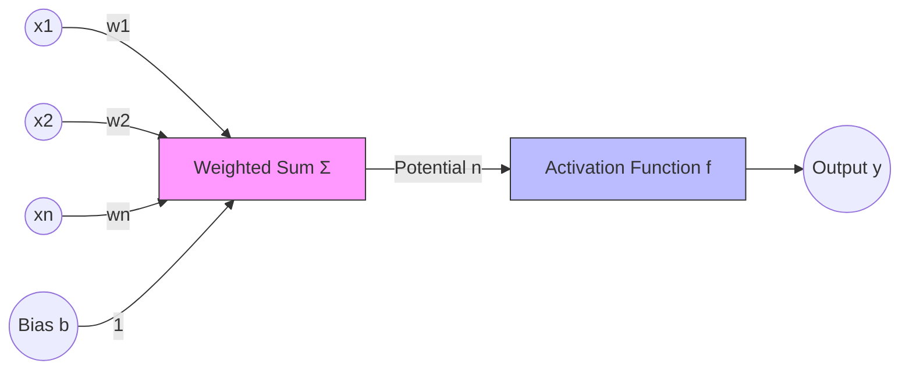

> [!important] The role of learning
> When we say a neural network is "learning," we mean it is iteratively adjusting the values of **$W$ (weights)** and **$b$ (bias)** to minimize the error in its predictions.

The formal neuron is developed hands-on in [[Formal Neuron Lab]].

### Activation functions and their derivatives

The **activation function** (or transfer function) decides the output based on the potential $n$, and its most critical role is introducing **non-linearity**. This role is existential for deep networks: if we stack multiple layers of linear neurons (e.g., $f(x) = ax$), the result is still a linear function, since $f(g(x)) = a(bx) = (ab)x$. **Linear layers cannot learn complex shapes.** Activation functions introduce "bends" and "curves" into the mathematics, allowing the network to approximate any continuous function (the Universal Approximation Theorem) — without one, the network would just be a series of linear regressions.

Five functions dominate practice, and each has a distinct personality. The **linear function** $f(n) = \lambda \cdot n$ (or just $f(n) = n$) is a straight diagonal line; it is rarely used in hidden layers because stacking linear functions just creates another linear function, but it is used in the output layer for regression, where you need to predict a raw number like a price. The **step function** (threshold, Heaviside) is either "ON" or "OFF":

$$ f(n) = \begin{cases} \lambda & \text{if } n \geq 0 \\ 0 & \text{if } n < 0 \end{cases} $$

It powered the early perceptrons for binary logic, but it is not differentiable at 0, and its slope is zero everywhere else — you cannot use it with gradient descent, because backpropagation has nothing to propagate through it. The **sigmoid** (logistic) function is:

$$ f(n) = \frac{1}{1 + e^{-\lambda n}} $$

or with $\lambda = 1$, $\sigma(n) = \frac{1}{1 + e^{-n}}$, an "S" curve with range $[0, 1]$ (more precisely $(0, 1)$). It is good for probability outputs and for binary classification in the output layer, but it is computationally expensive due to the $e$, and for very high or low inputs its slope is almost zero — the seed of the **vanishing gradient** problem, where learning stops. The **hyperbolic tangent** is:

$$ f(n) = \tanh(n) = \frac{e^n - e^{-n}}{e^n + e^{-n}} $$

with range $[-1, 1]$ (more precisely $(-1, 1)$). It is similar to sigmoid but centered at 0, and it often converges faster than sigmoid because the data is centered around zero; it generally performs better than sigmoid in hidden layers because it centers the data for the next layer. Finally, the **ReLU** (Rectified Linear Unit) is:

$$ f(n) = \begin{cases} n & \text{if } n > 0 \\ 0 & \text{if } n \leq 0 \end{cases} $$

equivalently $f(n) = \max(0, n)$, with range $[0, \infty)$. It is flat for negative numbers and linear for positive ones. ReLU is the most popular function for hidden layers in deep learning today: it is computationally very fast (no exponents), it does not saturate for positive values — meaning it learns faster than sigmoid or tanh — and it helps solve the vanishing gradient problem. It is the **default choice** for hidden layers. The full catalogue of activation behavior is treated in [[Activation Functions]].

| Function | Formula | Range | Best For... |
| :--- | :--- | :--- | :--- |
| **Linear** | $n$ | $(-\infty, \infty)$ | Regression Output |
| **Sigmoid**| $1/(1+e^{-n})$ | $(0, 1)$ | Binary Classification Output |
| **Tanh** | $\tanh(n)$ | $(-1, 1)$ | Hidden Layers (Standard) |
| **ReLU** | $\max(0, n)$ | $[0, \infty)$ | Hidden Layers (Modern/Deep) |
| **Softmax**| $e^{z_i}/\sum e^{z_j}$| $(0, 1)$ | Multi-class Classification Output |

> [!tip] Exam tips
> If asked which function to use for hidden layers in a deep network, always answer **ReLU**. If asked for a binary classification output, answer **Sigmoid**. And always check the activation function for the *output* layer: in regression problems it is often Linear; in classification problems (like determining if an image is a cat or dog) it is often Sigmoid or Softmax. Don't blindly apply tanh or ReLU to the final layer unless specified.

### Multi-layer perceptron architecture

A single neuron is limited, so neurons are organized into a **Multi-Layer Perceptron (MLP)**: an input layer, one or more hidden layers, and an output layer. The input layer has one neuron for every feature in the data; no calculations happen there, it just receives and passes values. The hidden layers perform the calculations and feature extraction — they are "hidden" because the user does not see these values directly — and deep learning simply means many hidden layers. The output layer produces the final prediction: one neuron for regression, $N$ neurons for classification with $N$ classes.

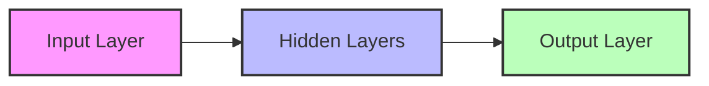

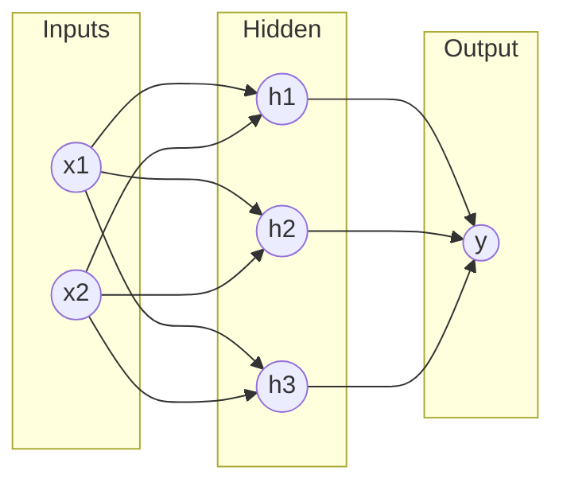

In an MLP, information flows in **one direction** — Input $\to$ Hidden $\to$ Output — with no loops or cycles; this is the **feed-forward** property. The contrasting case is recurrent/feedback architectures, where information can loop back; those are treated separately in [[Recurrent Neural Networks]].

Calculating one neuron at a time is slow, so whole layers are computed at once with matrices. If we have a layer with indices $j$ connecting to a layer with indices $i$:

$$ N = W \cdot A_{prev} + B $$

where $N$ is the vector of potentials for the current layer, $W$ the weight matrix, $A_{prev}$ the output (activation) vector from the previous layer, and $B$ the bias vector. In general layer notation:

$$ A^L = f(W^L \cdot A^{L-1} + B^L) $$

with $A^L$ the output of the current layer, $W^L$ its weight matrix, $A^{L-1}$ the previous layer's output, and $B^L$ its bias vector.

> [!note] Deep learning definition
> A "Deep" Neural Network is simply an MLP with many hidden layers. GPUs are used because they can calculate the matrix multiplication $W \cdot A$ for millions of neurons simultaneously.

### The forward pass

Before error can be distributed, the network must make a guess, so it pays to write the forward pass out in full. Consider a small MLP with inputs $P_1, P_2$, a hidden layer of two neurons with **tanh** activation, and a single linear output. **Step 1 — hidden layer potentials:**

$$ n_1^{hidden} = P_1 W_{11}^1 + P_2 W_{12}^1 + b_1^1 $$
$$ n_2^{hidden} = P_1 W_{21}^1 + P_2 W_{22}^1 + b_2^1 $$

**Step 2 — hidden layer activations:**

$$ a_1^{hidden} = \tanh(n_1^{hidden}) $$
$$ a_2^{hidden} = \tanh(n_2^{hidden}) $$

**Step 3 — output layer potential.** The outputs of the hidden layer become the inputs for the output layer:

$$ n^{output} = a_1^{hidden} W_{11}^2 + a_2^{hidden} W_{12}^2 + b^2 $$

**Step 4 — final output.** With a linear (identity) activation, the network's output $S$ simply equals the potential:

$$ S = \text{Linear}(n^{output}) = n^{output} $$

A larger worked exercise makes the pattern concrete. Take an MLP with an input layer of 3 neurons ($P_1, P_2, P_3$), a hidden layer of 2 neurons ($n_1, n_2$) with **tanh** activation, and an output layer of 3 neurons ($S_1, S_2, S_3$) with **linear** (identity) activation:

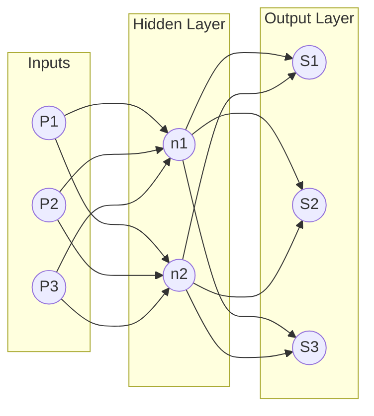

A notation reminder before computing: $W_{ij}^L$ is the weight connecting neuron $j$ of the previous layer to neuron $i$ of layer $L$ — so $W_{12}^1$ means the weight *to* neuron 1 (of layer 1) *from* input 2. **Be careful:** the superscript 1 denotes Layer 1, not an exponent (a power of 1). The potentials of the hidden neurons are:

$$ n_1^1 = P_1 \cdot W_{11}^1 + P_2 \cdot W_{12}^1 + P_3 \cdot W_{13}^1 + b_1^1 $$
$$ n_2^1 = P_1 \cdot W_{21}^1 + P_2 \cdot W_{22}^1 + P_3 \cdot W_{23}^1 + b_2^1 $$

or in matrix form:

$$
\begin{bmatrix} n_1^1 \\ n_2^1 \end{bmatrix} =
\begin{bmatrix} W_{11}^1 & W_{12}^1 & W_{13}^1 \\ W_{21}^1 & W_{22}^1 & W_{23}^1 \end{bmatrix}
\times
\begin{bmatrix} P_1 \\ P_2 \\ P_3 \end{bmatrix}
+
\begin{bmatrix} b_1^1 \\ b_2^1 \end{bmatrix}
$$

Because the hidden activation is tanh, the hidden outputs are:

$$ a_1^1 = f(n_1^1) = \frac{e^{n_1} - e^{-n_1}}{e^{n_1} + e^{-n_1}} $$
$$ a_2^1 = f(n_2^1) = \frac{e^{n_2} - e^{-n_2}}{e^{n_2} + e^{-n_2}} $$

These values ($a_1^1, a_2^1$) become the *inputs* for the next layer. The output layer potentials are then:

$$ n_1^2 = a_1^1 \cdot W_{11}^2 + a_2^1 \cdot W_{12}^2 + b_1^2 $$
$$ n_2^2 = a_1^1 \cdot W_{21}^2 + a_2^1 \cdot W_{22}^2 + b_2^2 $$
$$ n_3^2 = a_1^1 \cdot W_{31}^2 + a_2^1 \cdot W_{32}^2 + b_3^2 $$

and since the output activation is linear, the final outputs are simply the potentials: $S_1 = n_1^2$, $S_2 = n_2^2$, $S_3 = n_3^2$. The complete forward-pass treatment, including the programming view, is in [[Forward Propagation]].

## Measuring error

### Error and the loss function

Learning involves updating the weights ($W$) to minimize the difference between what the network predicts and what the true answer is. Two symbols anchor the discussion: $g_i(k)$ is the **actual/target** output (the ground truth from your dataset), and $a_i(k)$ is the **computed/predicted** output (what your ANN produced). The error for a specific output neuron $i$ on sample $k$ is the simple difference:

$$ e_i(k) = g_i(k) - a_i(k) $$

To evaluate the whole network, we calculate the **Mean Squared Error** — squaring the error eliminates negative signs and penalizes large errors more heavily:

$$ E(k) = \frac{1}{2} \sum_{i=1}^{R} (g_i(k) - a_i(k))^2 $$

The $\frac{1}{2}$ is a mathematical convenience that cancels out when we take the derivative later (the exponent 2 comes down to multiply it). Without the sample index, the same loss reads:

$$ E = \frac{1}{2} \sum_{i=1}^{R} (g_i - a_i)^2 $$

> [!warning] Residuals vs. total error
> A "residual" is simply the difference between the actual observed data point and the prediction the network made: Residual = $(\text{Observed} - \text{Predicted})$. Do not confuse residuals (the individual errors) with the total error (SSR). Each residual tells us about one data point; the SSR — the sum of squared residuals — aggregates them all.

### Output layers for regression and classification

The choice of error measure interacts with the task. **Regression** predicts a continuous number (the price of a house, a temperature), and the output layer usually has 1 neuron with linear activation. **Classification** predicts a category (is this flower Setosa, Versicolor, or Virginica?), and the output layer needs one neuron per class. Neural networks work with numbers, not text labels, so class labels are converted to vectors by **one-hot encoding**: Iris Setosa $\to [1, 0, 0]$, Iris Versicolor $\to [0, 1, 0]$, Iris Virginica $\to [0, 0, 1]$. This requires the output layer to have 3 neurons, one for each class. (Encoding practice is covered in [[Data Cleaning and Encoding Lab]] and [[Data Preparation for Neural Networks]].)

For multi-class classification, the output layer usually uses the **softmax** activation, which converts raw outputs into **probabilities** whose sum equals 1 ($100\%$). As an interpretation example, if the network outputs $[0.62, 0.23, 0.15]$, then neuron 1 (class 0) is at 62% probability, neuron 2 (class 1) at 23%, and neuron 3 (class 2) at 15% — the network classifies this input as **class 0**.

To test how well the resulting classifier works, predicted values are compared against actual values in a **confusion matrix**:

| | Predicted Yes | Predicted No |
| :--- | :---: | :---: |
| **Actual Yes** | True Positive (TP) | False Negative (FN) |
| **Actual No** | False Positive (FP) | True Negative (TN) |

The cells have standard names and standard failure labels: TP is a correctly identified positive; TN a correctly identified negative; FP (a Type 1 error) is a predicted Yes that was actually No; and FN (a Type 2 error) is a predicted No that was actually Yes.

## Gradient descent: the update rule

Imagine you are on a mountain — the error function — and want to get to the bottom, zero error. The **gradient** tells you which way is "up," so to minimize error you step in the **opposite direction** of the gradient. The update rule is:

$$ W_{new} = W_{old} + \Delta W $$
$$ \Delta W = -\eta \cdot \frac{\partial E}{\partial W} $$

Here $\eta$ (eta) is the **learning rate**, usually a small number between 0 and 1 (e.g., 0.01). If it is too big, you overshoot the minimum; if it is too small, learning takes forever. The term $\frac{\partial E}{\partial W}$ is the derivative (gradient) of the error with respect to the weight — exactly what backpropagation supplies. The same rule appears in many texts written with $\mu$ as the learning-rate symbol:

$$ w_{new} = w_{old} - \mu \frac{\partial E}{\partial w} $$

where $\frac{\partial E}{\partial w}$ is "the gradient" — how much the error changes if we wiggle the weight. The derivative carries two critical pieces of information: **direction** (should we increase or decrease the parameter to shrink the loss?) and **magnitude** (how steeply is the error changing, which dictates how big a step to take).

There are two regimes for *when* the update happens. **Incremental (stochastic) learning** updates the weights after *every single sample* is presented — fast, but the error path is noisy and bumpy. **Batch learning** first calculates the error for *all $K$ samples* in the dataset and updates the weights once based on the average error — mathematically stable, but it requires more memory. One complete pass through the entire dataset is called an **epoch**.

> [!warning] The learning rate trap
> If $\mu$ is too high, the weights will oscillate and explode (divergence). If $\mu$ is too low, the network will take weeks to learn (too slow). Standard values: $0.01, 0.001, 0.0001$. Tuning this and related settings is covered in [[05 - Neural Network Foundations/Training Dynamics and Stability/Hyperparameters and Network Configuration|Hyperparameters and Network Configuration]].

## Backpropagating to the output layer

### Supervised learning context

The mechanism operates specifically within the paradigm of **supervised learning**, where the network is trained using a dataset that acts like an answer key. The process has four steps. First, the network is given an input (an image or a data point). Second, it makes a prediction, which we call the **Guess**. Third, we — acting as the "Teacher" — know the actual, correct **Answer** (the target label). Fourth, we compare the Guess to the Answer to calculate the **Error**. Once the error is calculated at the final output layer, backpropagation takes that error and feeds it backwards through the network, layer by layer, adjusting the weights as it goes.

### The feedforward mechanics

Before we can correct a mistake, the network must make one, so the mechanics of a single connection deserve a close look. The hidden node holds a numerical value (a signal) that it needs to pass forward. The signal travels along a connection carrying a **weight** $w$, by which the signal is multiplied; the weight determines how "important" that specific signal is to the final output. The output node collects the incoming multiplied signal along with a bias term — which shifts the activation threshold — and passes the sum through an **activation function** (like a sigmoid), which squishes the number into a predictable range (e.g., between 0 and 1). The final squished number is the network's guess.

> [!tip] Point students often miss
> The weight is just a multiplier. If the weight is high, the input signal strongly affects the output. If the weight is near zero, the network is effectively ignoring that input signal.

### Calculating the error

In a supervised setting the correct target value is provided by the dataset. Suppose the correct answer for the current input should have been `1.0`. The most intuitive error is a simple subtraction:

$$ \text{Error} = \text{Target Answer} - \text{Network Guess} $$

Using specific numbers: $\text{Error} = 1.0 - 0.7 = 0.3$. The error carries two critical pieces of information. **Magnitude:** the network is off by 0.3 — this represents how *much* we need to adjust the weights. **Direction:** the error is positive, meaning the guess was too low, so we need to nudge the weights *higher* so the next time this input is seen, the output is closer to 1.0. Had the guess been 1.2, the error would be $-0.2$, and we would need to nudge the weights lower.

> [!tip] Professional cost functions
> While simple subtraction works for intuition, professional neural networks usually use more complex cost functions (like **Mean Squared Error** or **Categorical Cross-Entropy**) because they provide cleaner mathematical derivatives for the calculus steps later on. The conceptual goal remains identical: finding the difference between the reality and the prediction.

### Distributing the error: proportional blame

Start with the simplest possible scenario: one hidden node connecting to one output node via a single weight. The single weight is 100% responsible for the error, so we simply take the error and use it to nudge that weight.

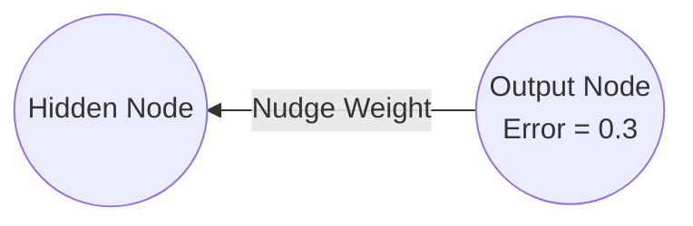

Things get interesting with a second hidden node. Now $H_1$ and $H_2$ both send signals to the same output node through two distinct weights, $w_1 = 0.2$ and $w_2 = 0.1$, and the total error at the output node is `0.3`.

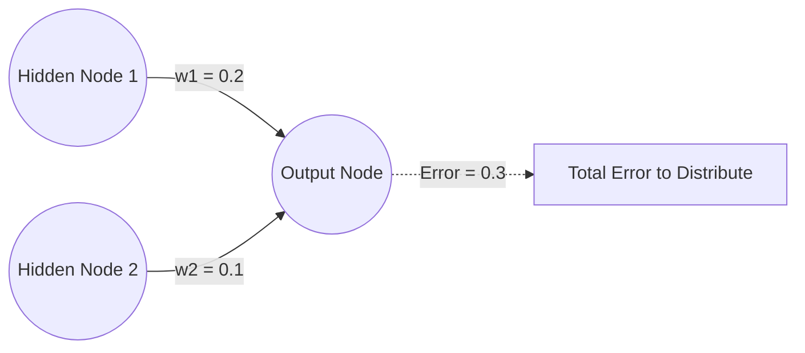

The question is how to hand out the 0.3. Do we add 0.3 to both weights? Split it 50/50? A 50/50 split ignores the fact that one weight might have contributed vastly more to the bad guess than the other. The logical and mathematically sound approach is to distribute the error **proportionally based on the size of the weights**: a weight with a higher value had a larger impact on the final output, so it deserves a larger share of the blame. With $w_1 = 0.2$ and $w_2 = 0.1$:

1. **Sum of the weights:** $w_1 + w_2 = 0.2 + 0.1 = 0.3$
2. **Proportion for $w_1$:** $\frac{w_1}{\text{Sum}} = \frac{0.2}{0.3} \approx 67\%$. We nudge $w_1$ by $67\%$ of the total error ($0.67 \times 0.3 = 0.2$).
3. **Proportion for $w_2$:** $\frac{w_2}{\text{Sum}} = \frac{0.1}{0.3} \approx 33\%$. We nudge $w_2$ by $33\%$ of the total error ($0.33 \times 0.3 = 0.1$).

Why divide by the sum? To **normalize** the fractions. We have exactly 100% of an error to hand out; without normalizing we might distribute 150% or 40% of it, which would make the network adjustments mathematically unstable. Normalizing guarantees the fractions always add up perfectly to 1.

> [!danger] The denominator trap
> When calculating proportional blame for a hidden node connected to multiple output nodes, look very closely at the denominator. Students often mistakenly think they should divide by the sum of weights *leaving* the hidden node. **This is strictly incorrect.** We are trying to distribute the error *of the output node*; therefore, we must normalize using the sum of the weights *entering that specific output node*. The error $e_1$ was caused by the weights entering that output node working together, so those specific weights must share that specific error.

> [!info] Intuition vs. calculus
> The proportional-blame formulas are brilliant for understanding the *logic* and *intuition* of backpropagation. However, in the pure calculus of backpropagation, **the denominators disappear**: the derivative simplifies to just $e_{h1} = (w_{11} \cdot e_1) + (w_{21} \cdot e_2)$. Why? Because the mathematical goal of gradient descent doesn't require us to distribute exactly 100% of the error perfectly; it just requires a vector pointing in the right direction. The scaling provided by the denominator is practically absorbed by the **learning rate** hyperparameter in code. Do not let this confuse you: the proportional logic is entirely correct for understanding *why* the matrix dot product works!

### The chain rule for the output weights

Now the rigorous version. We want the gradient of the loss with respect to the output layer weights and biases — specifically $\frac{\partial L_i}{\partial w^{(2)}_1}$, the gradient for the weight connecting the first hidden node to the output node. If we wiggle $w^{(2)}_1$, three things happen in sequence: it changes the linear combination $z^{(2)}$; $z^{(2)}$ changes the output prediction $\hat{p}_i$; and $\hat{p}_i$ changes the loss $L_i$. By the chain rule, we multiply these three effects:

$$\frac{\partial L_i}{\partial w^{(2)}_1} = \frac{\partial L_i}{\partial \hat{p}_i} \cdot \frac{\partial \hat{p}_i}{\partial z^{(2)}} \cdot \frac{\partial z^{(2)}}{\partial w^{(2)}_1}$$

**Step 1: derivative of loss w.r.t. prediction.** Recall the loss function $L_i = \frac{1}{2}(\hat{p}_i - y_i)^2$. Using the power rule:

$$\frac{\partial L_i}{\partial \hat{p}_i} = 2 \cdot \frac{1}{2} (\hat{p}_i - y_i)^{2-1} \cdot (1) = (\hat{p}_i - y_i)$$

In detailed algebraic steps (StatQuest style) — using the **power rule** and the **chain rule** (at the micro-level): first the **power rule** brings the exponent 2 down to the front, giving $2 \times \frac{1}{2}(\hat{p}_i - y_i)^2$. Second, we reduce the exponent by one: $(\hat{p}_i - y_i)^{2-1} = (\hat{p}_i - y_i)^1$. Third, the **inner derivative**: we multiply by the derivative of the *inside* of the parentheses with respect to $\hat{p}_i$. Since $y_i$ is a constant (it doesn't change), its derivative is 0; the variable $\hat{p}_i$ has a negative sign in front of it, so the derivative of $(-\hat{p}_i)$ is $-1$, and we multiply by this $-1$. Fourth, simplify: $2 \times \frac{1}{2} = 1$, and multiplying by $-1$ flips the sign, leaving $\frac{\partial L_i}{\partial \hat{p}_i} = (\hat{p}_i - y_i)$.

**Step 2: derivative of prediction w.r.t. linear combination.** Recall $\hat{p}_i = \sigma(z^{(2)})$. Using the sigmoid derivative shortcut:

$$\frac{\partial \hat{p}_i}{\partial z^{(2)}} = \hat{p}_i(1 - \hat{p}_i)$$

**Step 3: derivative of linear combination w.r.t. weight.** Recall $z^{(2)} = w^{(2)}_1 h_1 + w^{(2)}_2 h_2 + b^{(2)}$. The derivative with respect to $w^{(2)}_1$ is just the coefficient:

$$\frac{\partial z^{(2)}}{\partial w^{(2)}_1} = h_1$$

**Step 4: combine the pieces.**

$$\frac{\partial L_i}{\partial w^{(2)}_1} = (\hat{p}_i - y_i) \cdot \hat{p}_i(1 - \hat{p}_i) \cdot h_1$$

Rearranging:

$$\frac{\partial L_i}{\partial w^{(2)}_1} = h_1 \cdot \left[ \hat{p}_i(1 - \hat{p}_i)(\hat{p}_i - y_i) \right]$$

### Delta notation

Notice the large bracketed term: it represents "the error at the output node before the weight was applied," and — crucially — we will **reuse** this exact term when calculating gradients for deeper layers. To keep the math clean, we name it Delta:

$$\delta_{\hat{p}_i} = \hat{p}_i(1 - \hat{p}_i)(\hat{p}_i - y_i)$$

The final, elegant equation for the gradient of the output weight is then simply:

$$\frac{\partial L_i}{\partial w^{(2)}_1} = h_1 \cdot \delta_{\hat{p}_i}$$

The intuition: the gradient is the "input to the weight ($h_1$)" multiplied by the "error signal coming backward through the weight ($\delta$)." This is the most important pattern in all of backpropagation.

### The SSR chain rule for output-layer parameters

The same derivation is often written against the **sum of squared residuals (SSR)** with named parameters $w_3$, $w_4$, and $b_3$ — worth working through because it exposes a computational shortcut. For the bias $b_3$ (the chain rule for $b_3$, in the StatQuest presentation):

$$\frac{d(\text{SSR})}{db_3} = \frac{d(\text{SSR})}{d(\text{Predicted})} \times \frac{d(\text{Predicted})}{db_3}$$

The **first half** is $\sum -2(Observed_i - Predicted_i)$, and — importantly — it is exactly the same for all output layer parameters. The **second half**: since $Predicted_i = (y_{1,i} \times w_3) + (y_{2,i} \times w_4) + b_3$, the derivative with respect to $b_3$ is just $1$. The final gradient for $b_3$ is therefore:

$$\frac{d(\text{SSR})}{db_3} = \sum_{i=1}^{n} -2(Observed_i - Predicted_i) \times 1$$

> [!warning] Don't ignore the "times 1"
> Mathematically, multiplying by 1 changes nothing, and you might be tempted to erase it. However, in neural networks you should leave it there conceptually. If we were optimizing a *different* parameter (like a weight), that second part would *not* be 1. Leaving it in reminds us that backpropagation is fundamentally built on the chain rule and consists of distinct parts chained together.

For $w_3$, the chain is:

$$\frac{d(\text{SSR})}{dw_3} = \frac{d(\text{SSR})}{d(\text{Predicted})} \times \frac{d(\text{Predicted})}{dw_3}$$

The derivative of $(y_{1,i} \times w_3)$ with respect to $w_3$ is simply $y_{1,i}$, so:

$$\frac{d(\text{SSR})}{dw_3} = \sum_{i=1}^{n} \left[ -2(Observed_i - Predicted_i) \times y_{1,i} \right]$$

And for $w_4$, symmetrically:

$$\frac{d(\text{SSR})}{dw_4} = \sum_{i=1}^{n} \left[ -2(Observed_i - Predicted_i) \times y_{2,i} \right]$$

> [!success] Critical shortcut
> Because the output layer node combines all parameters to form the prediction, **the first derivative $\frac{d(\text{SSR})}{d(\text{Predicted})}$ is exactly the same for all parameters connected to this output node.** We calculate this *once* and reuse it for $w_3, w_4,$ and $b_3$. This concept of reusing calculated gradients is the secret to why backpropagation is computationally efficient!

> [!info] Gradients scaled by activation outputs
> Notice that the gradient for a weight ($w_3$) is scaled directly by the activation output of the node it connects *from* ($y_{1,i}$). If the top node outputs a very small number (inactive), then $w_3$ won't be updated very much, because that node didn't contribute much to the error. This is exactly how neural networks assign "blame" for incorrect predictions.

### The universal gradient pattern

> **The ultimate backprop trick:** The gradient of **ANY** weight in a feedforward network is simply:
>
> **(The activation of the node the weight comes FROM) × (The accumulated error $\delta$ of the node the weight goes TO)**
>
> - Output weight gradient: FROM ($h_1$) × TO ($\delta_{\hat{p}}$)
> - Hidden weight gradient: FROM ($x_2$) × TO ($\delta_{h_1}$)
>
> Once you understand this, you can write the gradient code for a network of *any* depth!

## Backpropagating to the hidden layer

So far we have the derivatives of the error with respect to the output layer parameters — weight 3, weight 4, and bias 3. Because those parameters do not change during the derivation of the inner layers, we can simply plug the existing derivatives into the gradient descent algorithm. **The goal now is to look deeper into the network and optimize the hidden layer parameters: weight 1, bias 1, weight 2, and bias 2.**

### The dilemma: hidden nodes have no target

We calculated the output error only because we had a target answer from the dataset. But the dataset does not tell us what the hidden nodes *should* have outputted — we have no target answer for the hidden layer! To adjust the deeper weights, we need the error of the hidden nodes themselves.

The solution is to literally push the output error backward across the weights. The error of a hidden node is defined as the exact amount of the output's error that the hidden node was deemed "responsible" for. In the proportional-blame example, Hidden Node 1 was responsible for 67% of the output error, so the "error of Hidden Node 1" ($e_{h1}$) is simply that chunk of the output error. Once $e_{h1}$ is calculated, Hidden Node 1 acts just like an output node for the layer behind it — we repeat the exact same process going further and further back, chaining the errors together.

### The forward pass that produced the prediction

To understand how to backpropagate the error through this network, we must first deeply understand its forward pass — the drug-dosage network, with one input, two hidden nodes, and one output. The **top node (blue curve)**: the input is multiplied by **weight 1**, we add **bias 1**, giving the x-axis coordinate $x_1 = (\text{Input} \times w_1) + b_1$; $x_1$ is passed through the activation function (softplus) to get the y-axis coordinate $y_1 = \log(1 + e^{x_1})$; finally, $y_1$ is multiplied by **weight 3** to form the "blue curve." The **bottom node (orange curve)**: the input is multiplied by **weight 2**, we add **bias 2**, giving $x_2 = (\text{Input} \times w_2) + b_2$; then $y_2 = \log(1 + e^{x_2})$; and $y_2$ is multiplied by **weight 4** to form the "orange curve." The **final output**: the blue curve and orange curve are summed, **bias 3** is added to shift the entire combined curve up or down, and the result is the final predicted value (the "green squiggle"):

$$ \text{Predicted} = (y_1 \times w_3) + (y_2 \times w_4) + b_3 $$

With proportional blame, the hidden error is the output error scaled by the node's share of the incoming weights:

$$ e_{h1} = \left( \frac{w_1}{w_1 + w_2} \right) \times \text{Error}_{\text{output}} $$

### Handling multiple output nodes

The most complex scenario is calculating a hidden node's error when it connects to **multiple** output nodes. Assume an architecture with 2 hidden nodes and 2 output nodes:

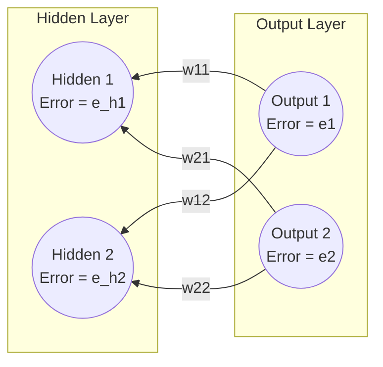

The notation on the weights matters here. In standard matrix notation for neural networks, $w_{ij}$ has $i$ as the destination node (output index) and $j$ as the source node (hidden index): $w_{11}$ connects Hidden 1 to Output 1; $w_{12}$ connects Hidden 2 to Output 1; $w_{21}$ connects Hidden 1 to Output 2; $w_{22}$ connects Hidden 2 to Output 2.

Hidden Node 1 ($H_1$) connects to both $O_1$ and $O_2$, so it contributed to the error at $O_1$ **and** $O_2$. To find the total error for $H_1$, we sum its proportional blame from *every output node it touches*. **Part A — blame from Output 1** ($e_1$):

$$ \text{Blame from } O_1 = \left( \frac{w_{11}}{w_{11} + w_{12}} \right) \times e_1 $$

**Part B — blame from Output 2** ($e_2$):

$$ \text{Blame from } O_2 = \left( \frac{w_{21}}{w_{21} + w_{22}} \right) \times e_2 $$

The **total error for Hidden Node 1** is the sum:

$$ e_{h1} = \left( \frac{w_{11}}{w_{11} + w_{12}} \right) e_1 + \left( \frac{w_{21}}{w_{21} + w_{22}} \right) e_2 $$

and symmetrically, the **total error for Hidden Node 2 ($e_{h2}$)** is:

$$ e_{h2} = \left( \frac{w_{12}}{w_{11} + w_{12}} \right) e_1 + \left( \frac{w_{22}}{w_{21} + w_{22}} \right) e_2 $$

The denominator trap strikes hardest here: look closely at the denominator for $e_{h1}$, namely $(w_{11} + w_{12})$. Students often mistakenly divide by the sum of weights *leaving* $H_1$ (which would be $w_{11} + w_{21}$) — strictly incorrect, because we are distributing the error *of the output node* and must normalize by the weights *entering that specific output node*. And as before, the pure-calculus version drops the denominators entirely, giving simply $e_{h1} = (w_{11} \cdot e_1) + (w_{21} \cdot e_2)$; the normalization is a scaling absorbed by the learning rate.

### The chain rule for hidden layer weights

Why do we need the derivative of SSR at all? Gradient descent relies on knowing the slope (derivative) of the loss function with respect to every single parameter ($w_1, b_1, w_2, b_2, w_3, w_4, b_3$). The derivative gives **direction** (should we increase or decrease the parameter to make the SSR smaller?) and **magnitude** (how steeply is the error changing, which dictates how big a step we take). To find how a change in a hidden layer parameter like $w_1$ affects the final SSR, we must trace the mathematical relationship backwards from the SSR all the way to $w_1$. Because $w_1$ is buried inside multiple functions — linear equation → activation function → output equation → loss function — we absolutely must use the **chain rule** of calculus.

The goal is the gradient for a weight deep in the network: specifically the weight connecting input $x_2$ to hidden node $h_1$, written $w^{(1)}_{21}$:

$$\frac{\partial L_i}{\partial w^{(1)}_{21}}$$

Wiggling $w^{(1)}_{21}$ causes a long ripple effect: it changes $z_1^{(1)}$; $z_1^{(1)}$ changes $h_1$; $h_1$ changes $z^{(2)}$; $z^{(2)}$ changes $\hat{p}_i$; and $\hat{p}_i$ changes $L_i$. Using the Chain Rule, we get a 5-term multiplication:

$$\frac{\partial L_i}{\partial w^{(1)}_{21}} = \left[ \frac{\partial L_i}{\partial \hat{p}_i} \cdot \frac{\partial \hat{p}_i}{\partial z^{(2)}} \right] \cdot \frac{\partial z^{(2)}}{\partial h_1} \cdot \frac{\partial h_1}{\partial z_1^{(1)}} \cdot \frac{\partial z_1^{(1)}}{\partial w^{(1)}_{21}}$$

> **Pro-tip: reusing caches.** The first two terms in the bracket we **already calculated** when deriving the output layer gradient! $\frac{\partial L_i}{\partial \hat{p}_i} \cdot \frac{\partial \hat{p}_i}{\partial z^{(2)}} = \delta_{\hat{p}_i}$. This is why it's called backpropagation — we compute the error at the end, save it, and pass it backward.

**Step 1: derivative of $z^{(2)}$ w.r.t. $h_1$.** Recall $z^{(2)} = w^{(2)}_1 h_1 + w^{(2)}_2 h_2 + b^{(2)}$. The derivative with respect to $h_1$ is just the weight:

$$\frac{\partial z^{(2)}}{\partial h_1} = w^{(2)}_1$$

**Step 2: derivative of $h_1$ w.r.t. $z_1^{(1)}$.** Recall $h_1 = \sigma(z_1^{(1)})$. Using the sigmoid rule:

$$\frac{\partial h_1}{\partial z_1^{(1)}} = h_1(1 - h_1)$$

**Step 3: derivative of $z_1^{(1)}$ w.r.t. $w^{(1)}_{21}$.** Recall $z_1^{(1)} = w^{(1)}_{11}x_1 + w^{(1)}_{21}x_2 + b^{(1)}_1$. The derivative is the input feature attached to it:

$$\frac{\partial z_1^{(1)}}{\partial w^{(1)}_{21}} = x_2$$

**Combining all five terms:**

$$\frac{\partial L_i}{\partial w^{(1)}_{21}} = \delta_{\hat{p}_i} \cdot w^{(2)}_1 \cdot h_1(1 - h_1) \cdot x_2$$

Rearranging:

$$\frac{\partial L_i}{\partial w^{(1)}_{21}} = x_2 \cdot \left[ h_1(1 - h_1) \cdot w^{(2)}_1 \cdot \delta_{\hat{p}_i} \right]$$

### The hidden layer delta

Just as with the output layer, we encapsulate all the error coming backwards into this specific node as a new Delta term:

$$\delta_{h_1} = h_1(1 - h_1) \cdot w^{(2)}_1 \cdot \delta_{\hat{p}_i}$$

The intuition for the hidden delta: the error at the hidden node equals the error from the layer above ($\delta_{\hat{p}_i}$), scaled by the weight connecting them ($w^{(2)}_1$), and squished by the derivative of the node's own activation function ($h_1(1 - h_1)$). The final gradient for the hidden weight is:

$$\frac{\partial L_i}{\partial w^{(1)}_{21}} = x_2 \cdot \delta_{h_1}$$

This confirms the universal pattern: **gradient = (activation FROM) × (delta TO)**. The whole chain, from loss to final gradient, looks like this:

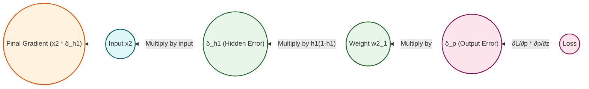

### The big fancy equations

> [!info] Naming convention — "Big Fancy Equation" (BFE)
> The StatQuest series refers to the fully expanded chain rule derivative formulas as **Big Fancy Equations (BFEs)**. This naming convention distinguishes the final, plug-in-the-numbers formula from the intermediate derivation steps. Each hidden layer parameter has its own BFE.

**Deriving Weight 1 ($w_1$).** We need $\frac{\partial \text{SSR}}{\partial w_1}$ — read this as "how much does the Sum of Squared Residuals change when we make a tiny change to Weight 1?" To get to $w_1$, we unpeel the mathematical onion layer by layer using the chain rule:

$$ \frac{\partial \text{SSR}}{\partial w_1} = \frac{\partial \text{SSR}}{\partial \text{Predicted}} \times \frac{\partial \text{Predicted}}{\partial y_1} \times \frac{\partial y_1}{\partial x_1} \times \frac{\partial x_1}{\partial w_1} $$

Each of the four terms is calculated strictly and rigorously, specifying the calculus rule used.

**Term 1: derivative of SSR w.r.t. Predicted.** Equation: $\text{SSR} = \sum (\text{Observed} - \text{Predicted})^2$. Rule: **power rule** and **chain rule**. Derivation: bring the 2 down to the front; the derivative of the inside $(-\text{Predicted})$ is $-1$; multiply them together. Result:

$$\frac{\partial \text{SSR}}{\partial \text{Predicted}} = \sum -2 \times (\text{Observed} - \text{Predicted})$$

**Term 2: derivative of Predicted w.r.t. $y_1$.** Equation: $\text{Predicted} = (y_1 \times w_3) + (y_2 \times w_4) + b_3$. Rule: **basic partial derivative** — treat everything that is *not* $y_1$ as a constant. Derivation: the terms $(y_2 \times w_4)$ and $b_3$ become 0; the derivative of $(y_1 \times w_3)$ with respect to $y_1$ is just $w_3$. Result: $\frac{\partial \text{Predicted}}{\partial y_1} = w_3$.

**Term 3: derivative of $y_1$ w.r.t. $x_1$ — the softplus derivative.** Equation: $y_1 = \log(1 + e^{x_1})$. Rule: **chain rule for natural logarithms and exponentials**. Derivation: let the inside function be $z = 1 + e^{x_1}$. The derivative of the outside function $\log(z)$ is $\frac{1}{z}$, giving $\frac{1}{1 + e^{x_1}}$. The derivative of the inside function $z$ with respect to $x_1$ is $e^{x_1}$ (since the derivative of 1 is 0 and the derivative of $e^{x_1}$ is $e^{x_1}$). Multiply the outside by the inside. Result:

$$\frac{\partial y_1}{\partial x_1} = \frac{e^{x_1}}{1 + e^{x_1}}$$

**Term 4: derivative of $x_1$ w.r.t. $w_1$.** Equation: $x_1 = (\text{Input} \times w_1) + b_1$. Rule: **basic partial derivative**. Derivation: $b_1$ is a constant, so it becomes 0; the derivative of $(\text{Input} \times w_1)$ with respect to $w_1$ is simply the Input. Result: $\frac{\partial x_1}{\partial w_1} = \text{Input}$.

**The Big Fancy Equation for Weight 1:**

$$ \frac{\partial \text{SSR}}{\partial w_1} = \sum_{i=1}^{n} \left[ -2 (\text{Observed}_i - \text{Predicted}_i) \times w_3 \times \left( \frac{e^{x_{1,i}}}{1 + e^{x_{1,i}}} \right) \times \text{Input}_i \right] $$

**Deriving Bias 1 ($b_1$).** The brilliant thing about the chain rule is that much of the path is identical to the path for Weight 1: the first three terms are exactly the same, and only the fourth differs. We are deriving with respect to $b_1$, so the entire term $(\text{Input} \times w_1)$ is a constant (derivative 0) and the derivative of $b_1$ itself is 1:

$$ \frac{\partial x_1}{\partial b_1} = 1 $$

**The BFE for Bias 1:**

$$ \frac{\partial \text{SSR}}{\partial b_1} = \sum_{i=1}^{n} \left[ -2 (\text{Observed}_i - \text{Predicted}_i) \times w_3 \times \left( \frac{e^{x_{1,i}}}{1 + e^{x_{1,i}}} \right) \times 1 \right] $$

> [!tip] Symmetry in neural networks
> Because the bottom node (Node 2) has the exact same mathematical structure as the top node (Node 1), we do not need to completely re-derive the calculus from scratch — we simply swap the specific parameters. The path goes through $x_2$, $y_2$, and $w_4$.

**The BFE for Weight 2:**

$$ \frac{\partial \text{SSR}}{\partial w_2} = \sum_{i=1}^{n} \left[ -2 (\text{Observed}_i - \text{Predicted}_i) \times w_4 \times \left( \frac{e^{x_{2,i}}}{1 + e^{x_{2,i}}} \right) \times \text{Input}_i \right] $$

**The BFE for Bias 2:**

$$ \frac{\partial \text{SSR}}{\partial b_2} = \sum_{i=1}^{n} \left[ -2 (\text{Observed}_i - \text{Predicted}_i) \times w_4 \times \left( \frac{e^{x_{2,i}}}{1 + e^{x_{2,i}}} \right) \times 1 \right] $$

### Numerical example: calculating a hidden layer derivative

To solve the BFEs, we must first pass data through the network to generate the necessary variables. Using the StatQuest drug dosage network with Input = 0.5 and Observed = 1.0, first calculate the predicted values:

- $x_1 = (0.5 \times 2.74) + 0.00 = 1.37$
- $y_1 = \log(1 + e^{1.37}) \approx 1.60$ (passed into the top node)
- $x_2 = (0.5 \times -1.13) + 0.00 = -0.565$
- $y_2 = \log(1 + e^{-0.565}) \approx 0.45$ (passed into the bottom node)
- $\text{Predicted} = (1.60 \times 0.36) + (0.45 \times 0.63) + 0.00 = 0.859$

Now plug these numbers into the BFE for Weight 1:

$$ \frac{\partial \text{SSR}}{\partial w_1} = -2 (1.0 - 0.859) \times 0.36 \times \left( \frac{e^{1.37}}{1 + e^{1.37}} \right) \times 0.5 $$

Doing the math yields a derivative of approximately `0.76`. In reality you sum this equation across **all** data points, not just one — this conceptual step results in a final summed derivative of 0.76.

### Derivation summary flow

The whole derivation for $w_1$ decomposes into four independent pieces, each with its own calculus rule, that are then multiplied together:

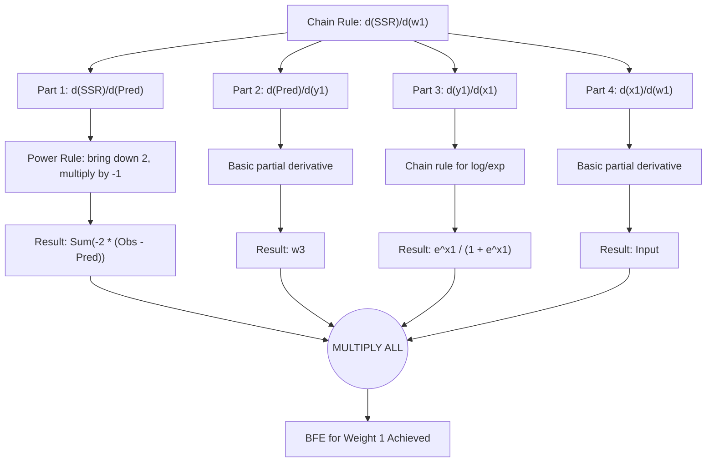

And here is the complete computational graph showing how data flows forward through the network — essential context for understanding the backward chain rule derivations:

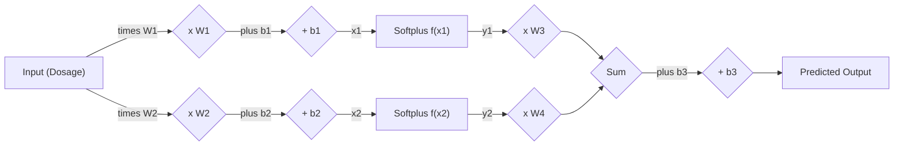

## The delta rule: a compact derivation

The calculus derivations above compress into a classic three-factor formula called the **delta rule**. How do we find the gradient for a weight buried deep in the hidden layers? We use the chain rule to propagate the error backwards from the output. The **chain of influence** runs: Weight $\to$ Potential ($n$) $\to$ Activation ($a$) $\to$ Error ($E$). The error $E$ depends on the output $a$, which depends on the potential $n$, which depends on the weight $W$, so the derivative decomposes as:

$$ \frac{\partial E}{\partial W_{ij}} = \frac{\partial E}{\partial a_i} \cdot \frac{\partial a_i}{\partial n_i} \cdot \frac{\partial n_i}{\partial W_{ij}} $$

or in the un-subscripted form:

$$ \frac{\partial E}{\partial w} = \frac{\partial E}{\partial a} \cdot \frac{\partial a}{\partial n} \cdot \frac{\partial n}{\partial w} $$

**Step A — derivative of error vs. output.** Since $E = \frac{1}{2}(g - a)^2$:

$$ \frac{\partial E}{\partial a} = -(g - a) = -e(k) $$

**Step B — derivative of output vs. potential (the activation derivative).** For $f(n) = \tanh(n)$ we use the identity $f'(n) = 1 - f(n)^2$, so:

$$ \frac{\partial a}{\partial n} = 1 - a^2 $$

**Step C — derivative of potential vs. weight.** Since $n = W \cdot P$:

$$ \frac{\partial n}{\partial W} = P \text{ (the input to that connection)} $$

**Step D — combining them (the delta rule).** Putting it all together for the weight update $\Delta W_{ij}$:

$$ \Delta W_{ij} = \eta \cdot \underbrace{e_i(k)}_{\text{Error}} \cdot \underbrace{(1 - a_i(k)^2)}_{\text{Slope of Tanh}} \cdot \underbrace{P_j(k)}_{\text{Input}} $$

> **Summary:** The change in weight is proportional to the **error**, the **derivative of the activation function**, and the **input** that caused it.

In words, the final weight update is:

$$ \Delta w = \mu \cdot \text{Error} \cdot \text{Slope of Activation} \cdot \text{Input} $$

where the three factors correspond exactly to the three chain-rule pieces: $\frac{\partial E}{\partial a}$ gives the error $-(g-a)$; $\frac{\partial a}{\partial n}$ gives the slope of the activation ($1 - a^2$ for tanh); and $\frac{\partial n}{\partial w}$ gives the input — the signal coming into that connection. Texts differ on whether the learning rate is written $\eta$ or $\mu$; the two symbols play identical roles.

## Backpropagation as reverse-mode automatic differentiation

Backprop is, formally, **reverse-mode automatic differentiation**. Given a computation graph (a DAG of operations, where each node is an operation and edges represent data flow), it computes the gradient of a scalar output with respect to all inputs in a single backward pass. The key data structure is the computation graph itself.

### The forward pass builds the graph

Consider a 3-layer MLP forward pass:

$$
\mathbf{h}_1 = \sigma(\mathbf{W}_1 \mathbf{x} + \mathbf{b}_1) = \sigma(\mathbf{z}_1)
$$

$$
\mathbf{h}_2 = \sigma(\mathbf{W}_2 \mathbf{h}_1 + \mathbf{b}_2) = \sigma(\mathbf{z}_2)
$$

$$
\hat{y} = \mathbf{W}_3 \mathbf{h}_2 + \mathbf{b}_3 = \mathbf{z}_3
$$

$$
L = \ell(\hat{y}, y)
$$

Each layer stores its input (for the backward pass) and computes its output. This recording builds the computation graph:

```python
# Conceptually, each operation records its inputs and outputs
import torch

x = torch.tensor([1.0, 2.0], requires_grad=True)
W = torch.tensor([[1.0, 0.0], [0.0, 1.0]], requires_grad=True)
b = torch.tensor([0.5, 0.5], requires_grad=True)

# Forward pass builds the graph
z = W @ x + b       # node 1: linear
h = torch.sigmoid(z)  # node 2: activation
loss = h.sum()      # node 3: loss (scalar)

# The graph now records: loss <- h <- z <- {W, x, b}
```

### The backward pass

We compute gradients **in reverse topological order**, applying the chain rule at each step. The key quantity at each node is the **upstream gradient** — $\partial L / \partial (\text{node output})$ — which we propagate backward. For the MLP above:

1. $\partial L / \partial \hat{y}$ — gradient of loss wrt final output.
2. $\partial L / \partial \mathbf{z}_3 = \partial L / \partial \hat{y}$ (identity since $\hat{y} = \mathbf{z}_3$).
3. $\partial L / \partial \mathbf{W}_3 = (\partial L / \partial \mathbf{z}_3) \mathbf{h}_2^T$ and $\partial L / \partial \mathbf{h}_2 = \mathbf{W}_3^T (\partial L / \partial \mathbf{z}_3)$.
4. $\partial L / \partial \mathbf{z}_2 = (\partial L / \partial \mathbf{h}_2) \odot \sigma'(\mathbf{z}_2)$ (element-wise — backprop through activation).
5. $\partial L / \partial \mathbf{W}_2 = (\partial L / \partial \mathbf{z}_2) \mathbf{h}_1^T$ and $\partial L / \partial \mathbf{h}_1 = \mathbf{W}_2^T (\partial L / \partial \mathbf{z}_2)$.
6. Continue to layer 1.

The pattern: each layer's gradient wrt its weights is computed from the upstream gradient and the layer's input, while the upstream gradient for the previous layer is computed from the upstream gradient and the layer's weights (transposed). At each node, the engine computes the local Jacobian-vector product (JVP) and propagates the upstream gradient backward:

```python
# PyTorch's autograd does this automatically
loss.backward()

# Gradients are now populated on each leaf tensor
print(x.grad)  # dL/dx
print(W.grad)  # dL/dW
print(b.grad)  # dL/db
```

### Why reverse mode (not forward mode)

Reverse-mode autodiff computes the gradient in **one backward pass**, independent of the number of parameters. **Forward mode** would require one pass per parameter: one pass computes $\partial L / \partial x_i$ for a single input $x_i$, so $n$ inputs need $n$ passes — for a 1B-parameter model, that's $10^9$ passes, which is infeasible. **Reverse mode** computes $\partial L / \partial x_i$ for ALL inputs in a single pass, given a scalar output $L$. Its cost: $O(n)$ memory (store all activations) and $O(n)$ compute (replay the graph backward). For scalar-loss ML — which is almost all ML — reverse mode is optimal. Forward mode is preferred only when you have many outputs and few inputs (e.g., Jacobian computation for a vector-valued function with small input dimension); higher-order derivatives such as Jacobians and Hessians build on the same machinery.

The tradeoff is memory: you must store all intermediate activations (the "forward state") to compute the backward pass. This is why training large models is **memory-bound**, not just compute-bound.

### Worked example in PyTorch

```python
import torch

x = torch.tensor([1.0, 2.0], requires_grad=False)
W = torch.tensor([[1.0, 0.0], [0.0, 1.0]], requires_grad=True)
b = torch.tensor([0.0, 0.0], requires_grad=True)
y_true = torch.tensor([0.0, 1.0])

# Forward
z = W @ x + b
y = torch.sigmoid(z)
loss = ((y - y_true) ** 2).sum()

# Backward — PyTorch's autograd
loss.backward()

# Gradients are now populated
print(W.grad)  # dL/dW
print(b.grad)  # dL/db
```

`loss.backward()` traverses the computation graph in reverse, applying the chain rule at each node. The result is `.grad` on every tensor with `requires_grad=True`.

### The forward state and memory cost

The activations stored during forward are the main memory cost of training. For a Transformer with $L$ layers, hidden dim $d$, sequence length $n$, batch size $B$:

$$
\text{Activation memory} \approx L \cdot B \cdot n \cdot d \cdot \text{(bytes per element)} \cdot c
$$

where $c$ is a constant accounting for QKV, attention scores, FFN intermediates, etc. (typically $c \approx 10$–$20$). For Llama 3 70B: $L = 80$, $d = 8192$, $n = 8192$, $B = 4$, bf16 (2 bytes), $c = 15$: activation memory $\approx 80 \times 4 \times 8192 \times 8192 \times 2 \times 15 \approx 6.4 \times 10^{11}$ bytes = 640 GB per micro-batch. This is why you need multiple GPUs even for inference, and why activation checkpointing is essential for training.

Activation checkpointing stores only a subset of activations and recomputes the rest during the backward pass, trading compute for memory — roughly ~30% more compute for ~50%+ memory savings:

| Strategy                | Memory savings | Compute overhead | When to use                          |
|-------------------------|----------------|------------------|--------------------------------------|
| No checkpointing        | 0%             | 0%               | When memory is sufficient            |
| Every layer checkpoint  | ~50%           | ~30%             | Standard for large models            |
| Every 2 layers          | ~33%           | ~15%             | When you need some memory savings    |
| Selective (skip attention) | ~30%        | ~10%             | When attention is cheap relative to FFN |

Selective checkpointing (skipping cheap layers like attention) gives better tradeoffs, and the technique is critical for long-context training.

## Backpropagation through specific operations

### Matrix multiplication (the workhorse)

For $C = A B$ (with $A \in \mathbb{R}^{m \times k}$, $B \in \mathbb{R}^{k \times n}$, $C \in \mathbb{R}^{m \times n}$):

$$
\frac{\partial L}{\partial A} = \frac{\partial L}{\partial C} B^T, \quad \frac{\partial L}{\partial B} = A^T \frac{\partial L}{\partial C}
$$

Both gradients are themselves matrix multiplications — the same shape of work as the forward pass. This is why backprop is dominated by matrix multiplications, and cuBLAS handles both forward and backward matmuls with equal efficiency; the transpose is free (just a stride change). For batched matmul (used in attention), the same pattern applies with an extra batch dimension.

### Softmax + cross-entropy (the trick)

Softmax followed by cross-entropy has a beautifully simple gradient:

$$
\frac{\partial L}{\partial z} = \text{softmax}(z) - y
$$

where $y$ is the one-hot label. This is much simpler than computing the softmax Jacobian, which is $O(V^2)$ for vocabulary size $V$ — the trick is $O(V)$ per token. PyTorch's `F.cross_entropy` fuses these operations for numerical stability and efficiency, computing the gradient directly without materializing the Jacobian — essential for language-model training where $V$ is large.

### LayerNorm gradient

LayerNorm $y = \gamma \cdot (x - \mu) / \sigma + \beta$ has a complex gradient (it involves the Jacobian of the normalization). Fused kernels (like Apex's `FusedLayerNorm`) compute this efficiently. Gradients through normalization layers are treated in [[05 - Neural Network Foundations/Training Dynamics and Stability/Batch Normalization|Batch Normalization]].

### Attention gradient

The attention $O = \text{softmax}(QK^T / \sqrt{d}) V$ has gradients that flow back to $Q$, $K$, $V$ through the softmax and the matmuls. FlashAttention computes these in a fused kernel, avoiding the $O(n^2)$ memory of the attention matrix.

## Backpropagation through time

For RNNs, the same weights are applied at each timestep, so backprop must run through the time dimension as well — this variant is called **Backpropagation Through Time (BPTT)**. It is mathematically the same as backprop through a deep network with shared weights, and it shares the same vanishing/exploding gradient problems, exacerbated by the long effective depth. LSTM and GRU were specifically designed with gates to control gradient flow and mitigate these issues. Transformers largely replaced RNNs partly because they avoid BPTT's gradient issues. The recurrent architectures themselves are covered in [[Recurrent Neural Networks]].

## Gradient flow through depth

### What gradient flow is

**Gradient flow** describes how gradients propagate backward through layers during training. The difference between healthy and unhealthy flow is stark:

```mermaid
flowchart TB
    subgraph Good[" Good Gradient Flow"]
        G_Input[Input Layer]
        G_H1[Hidden Layer 1]
        G_H2[Hidden Layer 2]
        G_Out[Output Layer]
        
        G_Out -->|Strong| G_H2
        G_H2 -->|Strong| G_H1
        G_H1 -->|Strong| G_Input
    end
    
    subgraph Poor[" Poor Gradient Flow"]
        P_Input[Input Layer]
        P_H1[Hidden Layer 1]
        P_H2[Hidden Layer 2]
        P_Out[Output Layer]
        
        P_Out -->|Strong| P_H2
        P_H2 -->|Weak| P_H1
        P_H1 -->|Tiny| P_Input
    end
    
    style G_Input fill:#90EE90
    style G_H1 fill:#90EE90
    style G_H2 fill:#90EE90
    style G_Out fill:#98FB98
    
    style P_Input fill:#FFB6C1
    style P_H1 fill:#FFA07A
    style P_H2 fill:#90EE90
    style P_Out fill:#98FB98
```

### Factors affecting gradient flow

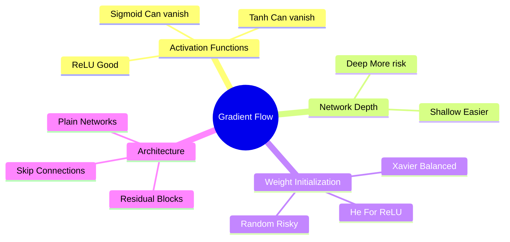

| Factor | Impact |
|--------|--------|
| **Activation Functions** | ReLU improves flow; Sigmoid/Tanh hinder it |
| **Network Depth** | Deeper = more opportunities for degradation |
| **Weight Initialization** | Poor initialization → poor flow from start |
| **Skip Connections** | Provide "highways" for gradients |

Why does this matter? With good gradient flow, all layers learn properly, convergence during training is faster, and training very deep networks (100+ layers) becomes possible. A quick memory aid: **gradient flow** = highway for learning signals → ReLU + skip connections keep it smooth.

### The ReLU advantage

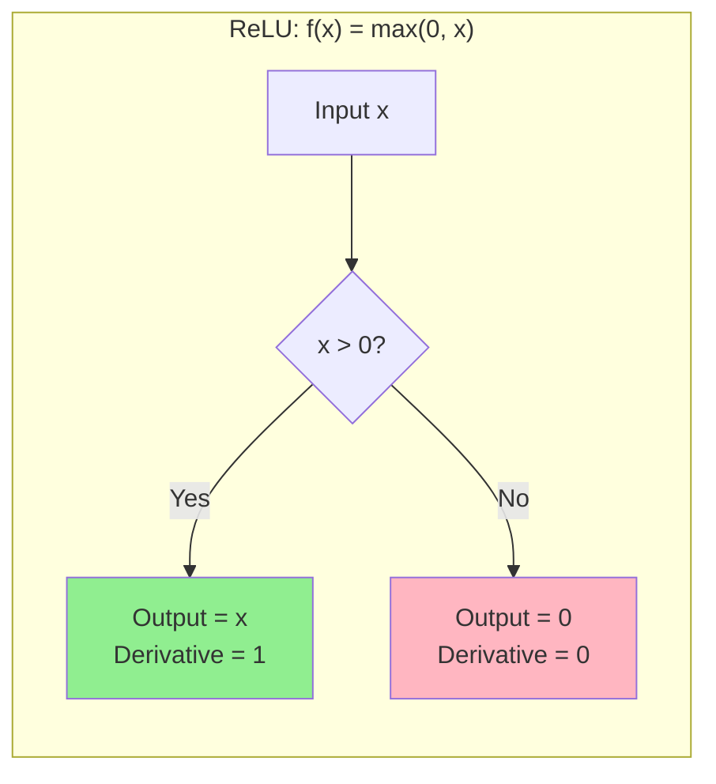

For positive inputs, the gradient is 1 — the signal passes through unchanged! There is no multiplication of small numbers, so the gradient is preserved through many layers. This is the property that makes ReLU the default hidden-layer activation in deep networks.

### How skip connections help

The other structural fix is to route the gradient around layers entirely:

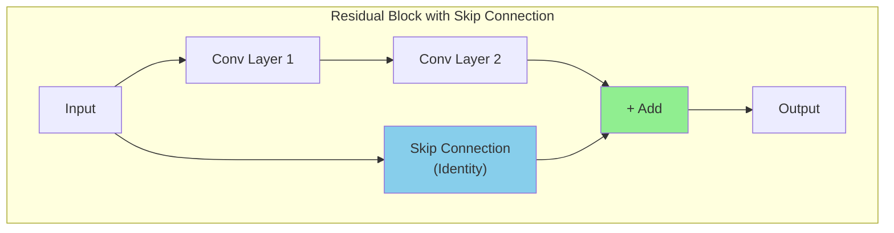

The benefits are direct. The gradient can flow directly through the skip connection; even if the main path has vanishing gradients, the skip path preserves them; and this is what enables the training of 100+ layer networks.

### Sparse activations

ReLU has a side effect worth naming: sparsity. A neural network is **sparse** when **most of its neurons are inactive (output zero) at any given time**. ReLU naturally creates sparsity — negative inputs produce output 0 — and these "dead" neurons don't contribute to the next layer. For example:

```text
Layer with 1000 neurons
Only 300 neurons fire (output > 0) for a given input
→ 70% sparsity
```

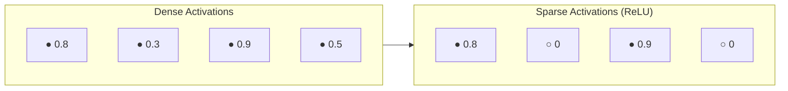

| Benefit | Explanation |
|---------|-------------|
| **Computational Efficiency** | Fewer active neurons → fewer calculations |
| **Better Generalization** | Network focuses on important features, not all neurons |
| **Memory Efficiency** | Sparse matrices can be stored more compactly |
| **Reduced Overfitting** | Less reliance on every neuron reduces memorization |

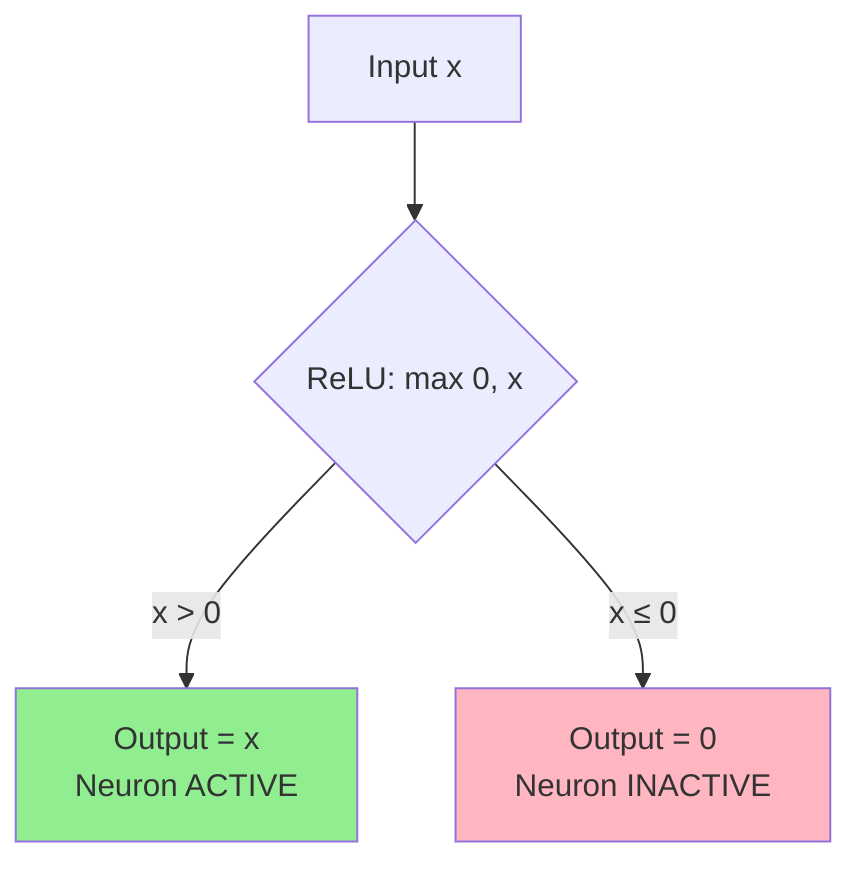

The memory aid is short: **sparse** = many zeros = efficiency + better generalization.

### Vanishing gradients

During backpropagation, **gradients (used to update weights) become extremely small**, often near 0, as they propagate backward through deep networks. The shrinkage is systematic:

```mermaid
flowchart LR
    subgraph Backward["← Backpropagation Direction"]
        L1["Layer 1<br/>Gradient: TINY"]
        L2["Layer 2<br/>Gradient: Small"]
        L3["Layer 3<br/>Gradient: Medium"]
        LN["Layer N (Output)<br/>Gradient: Large"]
    end
    
    L1 <-- L2 <-- L3 <-- LN
    
    style L1 fill:#FFB6C1
    style L2 fill:#FFA07A
    style L3 fill:#90EE90
    style LN fill:#98FB98
```

The root cause is the chain rule itself: it multiplies many factors, and when you multiply many small numbers (each < 1), the product goes to 0. The activation derivative is usually the culprit:

| Activation | Derivative Range | Problem |
|------------|------------------|---------|
| **Sigmoid** | 0 to 0.25 | Derivative ≤ 0.25, multiplies down layers |
| **Tanh** | 0 to 1 | Derivative ≤ 1, still can vanish |
| **ReLU** | 0 or 1 | No vanishing for positive inputs! |

The mathematical explanation, for sigmoid:

```text
For sigmoid: σ'(x) = σ(x) × (1 - σ(x))
Maximum value = 0.25 (when σ(x) = 0.5)

In a 10-layer network:
0.25^10 ≈ 0.0000000009 → gradient is essentially ZERO
```

The shrinking chain in action:

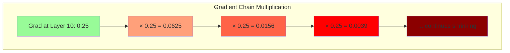

The consequences are severe: early layers learn very slowly or almost not at all; training becomes inefficient or fails entirely; and deep networks become impossible to train. The standard solutions attack the problem from four directions:

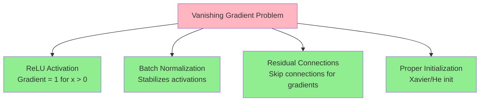

| Solution | How It Helps |
|----------|--------------|
| **ReLU Activation** | Gradient = 1 for positive inputs (no vanishing) |
| **Batch Normalization** | Normalizes activations, stabilizes gradients |
| **Residual Connections** | Skip connections allow gradients to flow directly |
| **Proper Initialization** | Xavier/He initialization prevents early vanishing |

Quick memory aid: **vanishing gradient** = gradients disappear → can't learn → use ReLU to fix. The full treatment of these pathologies is in [[05 - Neural Network Foundations/Training Dynamics and Stability/Vanishing and Exploding Gradients|Vanishing and Exploding Gradients]].

### Exploding gradients

The mirror image is just as real: when you multiply many large numbers (> 1), the product → ∞. The chain rule is a long product of factors, so deep networks are vulnerable to both failure modes at once. With **exploding gradients**, early layers receive huge gradients and the weights diverge — a failure common in RNNs and Transformers. The mitigations mirror the two-sided threat: **ReLU family activations** (gradient is 0 or 1, no saturation for positive inputs), **residual connections** (a "shortcut" path for gradients — critical for Transformer training), **LayerNorm / RMSNorm** (keep activations normalized), **proper initialization** (Xavier, He — keep gradient magnitudes stable across layers), **gradient clipping** (cap the gradient norm to prevent explosions), and **warmup** (gradually ramp up the learning rate to let early training stabilize). Initialization is covered in [[05 - Neural Network Foundations/Training Dynamics and Stability/Weight Initialization|Weight Initialization]]; normalization in [[05 - Neural Network Foundations/Training Dynamics and Stability/Batch Normalization|Batch Normalization]].

## Residual networks (ResNet)

### What ResNet is

**ResNet** (Residual Network) is a family of deep convolutional neural network architectures introduced to make very deep networks trainable by using **skip connections** (also called shortcut connections). It solved the problem that simply stacking more layers often made training **worse** (not better), due to vanishing/exploding gradients and optimization difficulties. ResNet is the canonical architectural answer to the gradient-flow problems above; the broader CNN family is covered in [[Convolutional Neural Networks]] and its gradient specifics in [[05 - Neural Network Foundations/Backpropagation/Backpropagation and Gradient Flow in CNNs|Backpropagation and Gradient Flow in CNNs]].

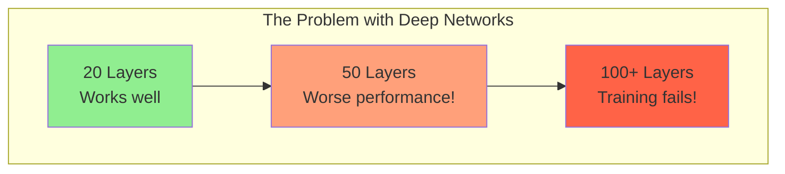

The paradox is that deeper networks *should* perform better, but they often perform **worse**, due to **vanishing gradients** (early layers don't learn) and the **degradation problem** (even with good initialization, deeper = harder to optimize).

### The residual learning idea

When you stack many layers, it becomes hard for SGD to update the weights so that deeper layers improve performance. ResNet instead puts **identity shortcuts** that let gradients and signals flow directly through the network. The key insight: instead of forcing a block to learn a full mapping $H(x)$, you ask it to learn the **residual**:

$$F(x) = H(x) - x$$

Then the block output is:

$$\text{output} = F(x) + x$$

If the block cannot improve on the identity, it can learn $F(x) \approx 0$ so the block behaves like an identity — and this stabilizes very deep nets.

### Skip connections

The residual block routes the input around the weight layers and adds it back:

```mermaid
flowchart TB
    subgraph ResBlock["Residual Block"]
        X["Input x"]
        F1["Weight Layer 1<br/>+ ReLU"]
        F2["Weight Layer 2"]
        Add["+ Add"]
        ReLU["ReLU"]
        Out["Output: F(x) + x"]
        
        X --> F1
        F1 --> F2
        F2 --> Add
        Add --> ReLU
        ReLU --> Out
        
        X -.->|"Skip Connection<br/>(Identity)"| Add
    end
    
    style X fill:#87CEEB
    style Add fill:#90EE90
    style Out fill:#98FB98
```

Contrasted with a plain network, the difference is one dotted line — and it changes everything:

```mermaid
flowchart TB
    subgraph Plain["Plain Network (No Skip)"]
        P1["Input x"]
        P2["Conv + ReLU"]
        P3["Conv"]
        P4["Output H(x)"]
        
        P1 --> P2 --> P3 --> P4
    end
    
    subgraph ResNet["ResNet (With Skip)"]
        R1["Input x"]
        R2["Conv + ReLU"]
        R3["Conv: F(x)"]
        R4["+ Add"]
        R5["Output: F(x) + x"]
        
        R1 --> R2 --> R3 --> R4 --> R5
        R1 -.->|Skip| R4
    end
    
    style P4 fill:#FFA07A
    style R5 fill:#90EE90
```

### Block designs: basic and bottleneck

ResNet ships two block variants. The **Basic Block** (ResNet-18 / ResNet-34) uses two 3×3 convolutions (Conv-BN-ReLU), then adds the input $x$. If spatial or channel dimensions change (stride > 1 or different channels), a **projection** (1×1 conv) is applied to $x$ to match shapes:

```mermaid
flowchart TB
    subgraph Basic["Basic Block"]
        IN["Input"]
        C1["3×3 Conv<br/>+ BN + ReLU"]
        C2["3×3 Conv<br/>+ BN"]
        ADD["+ Add Input"]
        OUT["ReLU<br/>Output"]
        
        IN --> C1 --> C2 --> ADD --> OUT
        IN -.->|Identity| ADD
    end
    
    style ADD fill:#90EE90
```

The **Bottleneck Block** (ResNet-50/101/152) uses 1×1 conv to reduce channels → 3×3 conv to process → 1×1 conv to expand channels. This reduces computation while allowing deeper models:

```mermaid
flowchart TB
    subgraph Bottleneck["Bottleneck Block (1×1, 3×3, 1×1 convs)"]
        IN["Input: 256 channels"]
        C1["1×1 Conv<br/>Reduce to 64"]
        C2["3×3 Conv<br/>Process (64)"]
        C3["1×1 Conv<br/>Expand to 256"]
        ADD["+ Add"]
        OUT["Output: 256 channels"]
        
        IN --> C1 --> C2 --> C3 --> ADD --> OUT
        IN -.->|Skip| ADD
    end
    
    style C1 fill:#87CEEB
    style C2 fill:#98FB98
    style C3 fill:#87CEEB
```

### ResNet versions

```mermaid
graph LR
    subgraph Variants["ResNet Variants"]
        R18["ResNet-18<br/>Basic Block"]
        R34["ResNet-34<br/>Basic Block"]
        R50["ResNet-50<br/>Bottleneck "]
        R101["ResNet-101<br/>Bottleneck"]
        R152["ResNet-152<br/>Bottleneck"]
    end
    
    R18 --> R34 --> R50 --> R101 --> R152
    
    style R50 fill:#90EE90
```

| Model | Layers | Block Type | Use Case |
|-------|--------|------------|----------|
| ResNet-18 | 18 | Basic | Small datasets, fast training |
| ResNet-34 | 34 | Basic | Medium complexity tasks |
| **ResNet-50** | 50 | Bottleneck | **Most popular, good balance** |
| ResNet-101 | 101 | Bottleneck | Complex tasks, more compute |
| ResNet-152 | 152 | Bottleneck | Research, maximum accuracy |

**ResNet-v2 (pre-activation)** reorders the block as **BN → ReLU → Conv**, which helps optimization and generalization in very deep models. In the broader arc of architecture history, ResNet sits between the very-deep-but-slow VGG (2014, no skip connections) and DenseNet (2017, dense connections with even better gradient flow) — deeper AND faster than the former, and the foundation for much that followed:

```mermaid
flowchart TB
    subgraph Comparison["Evolution of Deep Networks"]
        VGG["VGG (2014)<br/>Very deep but slow<br/>No skip connections"]
        ResNet["ResNet (2015)<br/>Deeper AND faster<br/>Skip connections "]
        DenseNet["DenseNet (2017)<br/>Dense connections<br/>Even better gradient flow"]
    end
    
    VGG --> ResNet --> DenseNet
    
    style ResNet fill:#90EE90
```

### Why skip connections help gradients

```mermaid
flowchart LR
    subgraph Gradient["Gradient Flow Benefits"]
        GC["Gradient can flow<br/>directly through skip"]
        GM["Derivative of addition = 1<br/>for shortcut path"]
        GL["Deeper layers receive<br/>stronger learning signal"]
    end
    
    GC --> GM --> GL
    
    style GL fill:#90EE90
```

Three mechanisms do the work. First, the **gradient highway**: the skip connection acts as a "gradient superhighway" — gradients flow backward without being multiplied by small numbers, because the derivative of the addition is 1 for the shortcut path. Second, **easy identity learning**: if the best solution is to pass the input unchanged, the network can learn $F(x) = 0$, so that $H(x) = 0 + x = x$ (an identity mapping). Third, it **solves the degradation problem**: adding more layers doesn't hurt performance, because the network can always learn to ignore extra layers if needed.

### Practical details and training tips

```mermaid
mindmap
    root((ResNet Training))
        Normalization
            BatchNorm after Conv
            Essential for ResNets
        Initialization
            He/Kaiming init
            Standard for ReLU nets
        Learning Rate
            Step decay
            Cosine annealing
            Warmup
        Skip Connection
            Identity if same shape
            Projection 1×1 if changed
        Transfer Learning
            Remove final FC
            Attach your head
```

| Tip | Details |
|-----|---------|
| **BatchNorm** | Use after convolutions (ResNets rely on it) |
| **Initialization** | He initialization (Kaiming) is standard |
| **Learning Rate** | Typical schedules: step decay, cosine, warmup |
| **Projection** | If channels/stride change, use 1×1 conv in shortcut |
| **Transfer Learning** | Remove final FC layer and attach your custom head |

### Uses, strengths, and limitations

```mermaid
flowchart TB
    subgraph Uses["ResNet Applications"]
        IC["Image Classification<br/>(ImageNet)"]
        DET["Detection Backbones<br/>(Faster R-CNN, Mask R-CNN)"]
        SEG["Segmentation<br/>(FCN, DeepLab)"]
        TL["Transfer Learning<br/>(Vision & Multi-modal)"]
        NV["Non-Vision Domains<br/>(Deep feedforward nets)"]
    end
    
    style IC fill:#90EE90
    style TL fill:#98FB98
```

ResNets serve as image classification models (ImageNet), as detection and segmentation backbones (Faster R-CNN, Mask R-CNN), as transfer-learning backbones in many vision and multi-modal architectures, and even in non-vision domains where very deep feedforward nets are helpful. Its impact is hard to overstate: it won ImageNet 2015, trained 152 layers successfully, and became the foundation for many architectures.

| Strength | Explanation |
|----------|-------------|
| **Elegant Design** | Simple trick with outsized impact — fundamentally changed deep learning |
| **Robust Backbone** | Very reliable for transfer learning |
| **Scalable** | Scales to deep models (100+ layers) while remaining trainable |
| **Must-Know Baseline** | Understanding residual connections is essential for modern architectures |

| Limitation | Explanation |
|------------|-------------|
| **Compute Heavy** | Still heavy compute for large models |
| **Newer Architectures** | Swin, ConvNeXt, Vision Transformers can outperform ResNets on some tasks |
| **May Need Modifications** | Pre-activation, layer scaling, improved normalization can provide better performance |

```mermaid
mindmap
    root((ResNet))
        Core Idea
            Skip Connections
            Learn Residual F(x)
            Output = F(x) + x
        Benefits
            Train Very Deep Networks
            Solve Vanishing Gradients
            Easy Identity Learning
        Variants
            ResNet-18 to ResNet-152
            Basic vs Bottleneck Blocks
            Pre-activation ResNet v2
        Impact
            Won ImageNet 2015
            152 layers trained
            Foundation for many architectures
```

| Term | Meaning |
|------|---------|
| **ResNet** | Residual Network with skip connections |
| **Skip Connection** | Direct path that adds input to output |
| **Residual** | What the network learns (F(x) = H(x) - x) |
| **Bottleneck** | 1×1 → 3×3 → 1×1 conv block for efficiency |
| **Basic Block** | Two 3×3 convs (ResNet-18/34) |
| **Projection** | 1×1 conv to match dimensions when needed |

The one-line summary: **ResNet = skip connections let gradients flow → train 100+ layers successfully!**

## Practical training considerations

### Common pitfalls

Backprop as exposed by frameworks has a set of recurring footguns. **Forgetting `zero_grad()`**: PyTorch accumulates gradients, so you must zero them before each `backward()` call. **Calling `backward()` on a non-scalar**: by default, `backward()` requires a scalar loss; use the `gradient=...` argument for vector losses. **Modifying tensors in-place**: this can break the computation graph — use a functional style or `torch.no_grad()` for in-place ops. **Detaching the wrong tensor**: `.detach()` cuts the gradient flow, which is useful for deliberate stops and fatal when unintended. **Memory leaks from retaining the graph**: `retain_graph=True` keeps the computation graph for re-use, and usually you don't need it.

### Common failure modes

| Symptom | Likely cause | Fix |
|---------|--------------|-----|
| `RuntimeError: Trying to backward through the graph a second time` | Didn't call `optimizer.zero_grad()`; or `retain_graph=True` was set | Call `optimizer.zero_grad()` before each `backward()`; don't use `retain_graph` unless needed |
| CUDA OOM during backward | Activations too large | Use activation checkpointing; reduce batch size; use FSDP |
| NaN gradients | Numerical instability (e.g., log(0), division by 0) | Use `F.cross_entropy` (handles log(0)); add epsilon; use bf16 instead of fp16 |
| Gradient is None | Tensor doesn't have `requires_grad=True`; or `.detach()` was called | Check `requires_grad`; remove unnecessary `.detach()` |
| Slow backward pass | Non-contiguous tensors; or unfused ops | Call `.contiguous()` before custom kernels; use fused ops (FlashAttention, fused LayerNorm) |
| Memory leak | `retain_graph=True` keeping the graph alive | Don't use `retain_graph`; or call `loss.backward(retain_graph=False)` explicitly |
| In-place operation breaks graph | Modified a tensor in-place after it was used | Use functional style; or wrap in `torch.no_grad()` for in-place ops |

### Production implications

Activation memory dominates training memory: storing activations for backprop is the main cost, which is why gradient checkpointing (recomputing activations during backward) matters — it trades ~30% more compute for ~50%+ memory savings, critical for long-context training. **Mixed precision** (fp16/bf16) halves activation memory but requires care for small gradients (use loss scaling in fp16). **Distributed training** shards activations across GPUs (sequence parallel, context parallel) for very large models or long contexts. **Inference doesn't need backprop** — you can free activations eagerly — but for spec-decoding or ranking you may need a backward pass on a draft model. Backprop with quantized weights is a related topic where the same gradient machinery applies under reduced precision.

### Distributed backprop

For models too large for one GPU, parallelizing backprop becomes its own discipline, with four main strategies. **Data parallel**: each GPU has a full model copy and processes a different micro-batch; gradients are averaged via All-Reduce. Simple, but limited by model size (must fit on one GPU). **Tensor parallel** (Megatron-LM): split each weight matrix across GPUs; forward and backward involve All-Gather and Reduce-Scatter. Scales to larger models but adds communication overhead. **Pipeline parallel**: split layers across GPUs — forward passes through GPU 0, then GPU 1, and so on, with backward reversing the order; bubbles (idle time) are the main inefficiency. **FSDP** (Fully Sharded Data Parallel): shard parameters, gradients, and optimizer states; all-gather parameters for forward/backward, then free — the modern default for large models. Most large-scale training combines all four (3D parallelism).

## Interview questions

**Q: Why does backprop use reverse-mode autodiff instead of forward-mode?**
A: Forward mode computes $\partial L / \partial x_i$ for one input per pass. For a model with $n$ parameters, you need $n$ passes — infeasible for $n = 10^9$. Reverse mode computes $\partial L / \partial x_i$ for ALL inputs in a single backward pass, given a scalar loss $L$. The cost: $O(n)$ memory (store all activations) and $O(n)$ compute (replay the graph backward). For scalar-loss ML (which is almost all ML), reverse mode is optimal. Forward mode is preferred when you have many outputs and few inputs (e.g., Jacobian computation for a vector-valued function with small input dimension).

**Q: Explain the memory cost of backprop and how activation checkpointing helps.**
A: Backprop must store all intermediate activations from the forward pass (the "forward state") to compute gradients. For a Transformer, this is $O(L \cdot B \cdot n \cdot d)$ — for Llama 3 70B, ~640 GB per micro-batch. Activation checkpointing stores only a subset of activations and recomputes the rest during backward. Tradeoff: ~50% memory savings for ~30% more compute. This is essential for training large models on limited GPU memory. Selective checkpointing (skip cheap layers like attention) gives better tradeoffs.

**Q: What is the softmax + cross-entropy gradient trick, and why does it matter?**
A: Naively, computing the gradient of softmax + cross-entropy involves the softmax Jacobian, which is $O(V^2)$ for vocabulary size $V$. For $V = 50K$, that's $2.5 \times 10^9$ entries per token. The trick: the gradient simplifies to $\partial L / \partial z = \text{softmax}(z) - y$, which is $O(V)$ per token. PyTorch's `F.cross_entropy` fuses these operations, computing the gradient directly without materializing the Jacobian. This is essential for LLM training where $V$ is large.

**Q: How does backprop work through a matrix multiplication?**
A: For $C = AB$, the gradients are $\partial L / \partial A = (\partial L / \partial C) B^T$ and $\partial L / \partial B = A^T (\partial L / \partial C)$. Both are matrix multiplications — same as forward. This is why backprop is dominated by matmuls (cuBLAS handles both directions efficiently). The transpose is free (just a stride change). For batched matmul (used in attention), the same pattern applies with an extra batch dimension.

**Q: What goes wrong if you forget `optimizer.zero_grad()`?**
A: PyTorch accumulates gradients by default — each `backward()` call adds to the existing `.grad` tensor. Without `zero_grad()`, the gradient from step $t$ is added to the gradient from step $t-1$, so the effective gradient grows linearly with the number of steps. This causes the optimizer to take huge steps and training diverges. The fix: call `optimizer.zero_grad()` (or `optimizer.zero_grad(set_to_none=True)` for efficiency) before each `backward()`. The accumulation behavior is intentional for gradient accumulation (compute gradients on multiple micro-batches before stepping), but you must zero after stepping.

**Q: How is backprop parallelized in distributed training?**
A: Four strategies. (1) **Data parallel** — each GPU has a full model copy, processes a different micro-batch, gradients are averaged via All-Reduce. Simple, limited by single-GPU model size. (2) **Tensor parallel** (Megatron) — split each weight matrix across GPUs; forward/backward involve All-Gather and Reduce-Scatter. Scales to larger models. (3) **Pipeline parallel** — split layers across GPUs; forward passes through GPU 0, 1, ...; backward reverses. Bubbles (idle time) are the inefficiency. (4) **FSDP** — shard parameters, gradients, and optimizer states; all-gather parameters for forward/backward, then free. The modern default for large models. Most large-scale training combines all four (3D parallelism).

## Further reading

The canonical references are Goodfellow et al., *Deep Learning*, Chapter 6.5; Rumelhart, Hinton, Williams (1986), *Learning representations by back-propagating errors* — the original paper; and Paszke et al. (2017), *Automatic Differentiation in PyTorch*.

## See also

- [[Neural Network Foundations MOC]]
- [[Forward Propagation]]
- [[Matrix Implementation of Backpropagation]]
- [[05 - Neural Network Foundations/Backpropagation/Backpropagation and Gradient Flow in CNNs|Backpropagation and Gradient Flow in CNNs]]
- [[Activation Functions]]
- [[Artificial Neural Networks]]
- [[Perceptrons and Multi-Layer Perceptrons]]
- [[Neural Network Architecture and Notation]]
- [[Formal Neuron Lab]]
- [[Data Cleaning and Encoding Lab]]
- [[Data Preparation for Neural Networks]]
- [[Convolutional Neural Networks]]
- [[Recurrent Neural Networks]]
- [[05 - Neural Network Foundations/Training Dynamics and Stability/Vanishing and Exploding Gradients|Vanishing and Exploding Gradients]]
- [[05 - Neural Network Foundations/Training Dynamics and Stability/Weight Initialization|Weight Initialization]]
- [[05 - Neural Network Foundations/Training Dynamics and Stability/Batch Normalization|Batch Normalization]]
- [[05 - Neural Network Foundations/Training Dynamics and Stability/Dropout and Regularization|Dropout and Regularization]]
- [[05 - Neural Network Foundations/Training Dynamics and Stability/Hyperparameters and Network Configuration|Hyperparameters and Network Configuration]]
