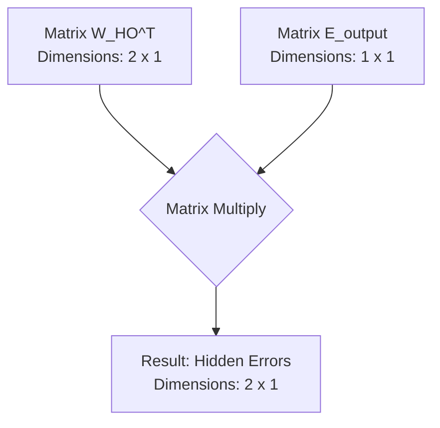
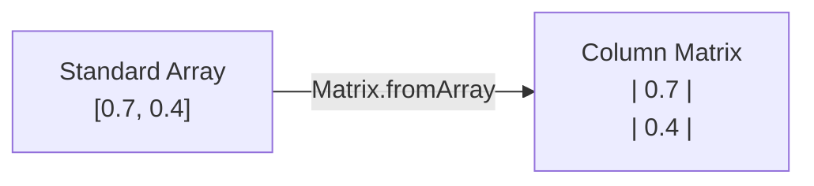
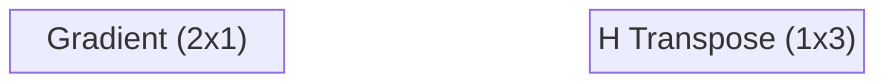

Backpropagation only becomes practical when it is expressed in linear algebra: instead of nudging weights one at a time, every input, weight, and error is stored in a matrix, and the entire backward pass of a network like those in [[Artificial Neural Networks]] collapses into a few matrix products. This note is the implementation-focused companion to [[Backpropagation]] — it derives the matrix form of error propagation and the delta weight formula, the rule that specifies exactly how much every weight in a layer must change. Because the derivation is written for code, it also builds the supporting operations a custom linear algebra library needs — matrix subtraction and matrix transposition — together with the dimension bookkeeping that makes the transpose unavoidable.

## Why matrices

In code, we do not calculate weights one by one using loops; that would be computationally disastrous. Instead, all inputs, weights, and errors are stored in matrices, and the backward pass is expressed through dot products and transpositions rather than per-weight arithmetic. You must understand how to perform dot products and matrix transpositions to implement backpropagation efficiently.

The simplified formula for backpropagating error in matrix form is:

$$ \text{Error}_{hidden} = W_{hidden\_to\_output}^T \cdot \text{Error}_{output} $$

Notice that no normalization appears in this formula, and none is needed: later in the process, the learning rate will scale these numbers down to microscopic levels anyway. The transposed weight matrix carries the output errors back into the hidden layer, and everything that follows in this note is machinery for making that multiplication — and the weight update built on top of it — work in code.

## Matrix subtraction for the error term

When building a custom linear algebra library from scratch, you will often find you are missing basic utility functions. To calculate $Error = Target - Output$ — the quantity that drives the entire backward pass — we need to subtract two matrices. The design question is not just *how* to subtract, but *which kind of method* should do it.

### Static versus instance methods

This is a critical programming concept that students often miss. A matrix library typically offers two flavors of operation, and they differ in what happens to the operands:

| Aspect | Instance Method | Static Method |
|--------|----------------|---------------|
| **Syntax** | `matrixA.add(matrixB)` | `Matrix.subtract(matrixA, matrixB)` |
| **Effect** | Modifies `matrixA` *in place* | Leaves both matrices untouched |
| **Return** | Returns reference to modified `matrixA` | Returns a **brand new** Matrix |
| **Use Case** | When you want to update existing data | When you need to preserve original data |

For error calculation, we *must* use a static method, because we do not want to destroy our original Target or Output matrices — we might need them later! An in-place subtraction would silently consume the very data that the later steps of backpropagation depend on.

### Implementing the static subtract

Here is the rigorous, step-by-step implementation of matrix subtraction. The method allocates a brand-new matrix with the same dimensions, walks every cell with a nested row/column loop, and fills the result with the element-wise difference:

```javascript
class Matrix {
    // ... other methods ...

    static subtract(a, b) {
        // Step 1: Create a new blank matrix with the exact same dimensions
        let result = new Matrix(a.rows, a.cols);
        
        // Step 2: Loop through every row
        for (let i = 0; i < result.rows; i++) {
            // Step 3: Loop through every column
            for (let j = 0; j < result.cols; j++) {
                // Step 4: Subtract the element in matrix 'b' from matrix 'a'
                result.data[i][j] = a.data[i][j] - b.data[i][j];
            }
        }
        
        // Step 5: Return the brand new matrix
        return result;
    }
}
```

> [!danger] Crucial error check missing!
> It is tempting to skip error checking for brevity, but it *should* be done. **Important reminder:** matrix subtraction is only mathematically valid if matrix A and matrix B have the **exact same dimensions**. You cannot subtract a $3 \times 1$ matrix from a $2 \times 1$ matrix. A robust library would include a check at the top:
> `if (a.rows !== b.rows || a.cols !== b.cols) { throw new Error("Columns and Rows must match!"); }`

The new-matrix-not-in-place discipline is exactly what lets the error computed here be reused freely by every later step of the backward pass.

## Matrix transposition

### What transposition is

Matrix transposition is a fundamental operation in linear algebra, denoted by a superscript $T$ (e.g., $W^T$). Transposing a matrix simply means flipping it over its main diagonal — the rows become columns, and the columns become rows. A $2 \times 3$ weight matrix becomes a $3 \times 2$ matrix, with every entry migrating to its mirrored position:

```mermaid
graph TD
    subgraph Original Matrix 2x3
        A["| W11  W12  W13 |<br>| W21  W22  W23 |"]
    end
    
    subgraph Transposed Matrix 3x2
        B["| W11  W21 |<br>| W12  W22 |<br>| W13  W23 |"]
    end
    
    Original Matrix 2x3 -->|Transpose Operation| Transposed Matrix 3x2
```

The flip is the entire operation — no values change, only their addresses in the grid.

### Why transposition matters: forward versus backward flow

In [[Forward Propagation|feedforward]], data flows *forward* through the network: we multiply our inputs by our weights to get outputs. In backpropagation, we need data (the errors) to flow *backward* through the exact same network. To reverse a matrix multiplication operation geometrically and calculate proportional blame, we must use the transpose of the weight matrix.

The intuition: think of the weight matrix as a one-way street connecting hidden nodes to output nodes. In the forward pass, traffic flows from hidden → output. In the backward pass, we need traffic to flow from output → hidden. The transpose is what "reverses the direction" of the matrix so the math works in the opposite direction.

### Implementing transpose

The implementation mirrors the definition exactly — allocate a result with the dimensions swapped, then copy every element to its mirrored position:

```javascript
static transpose(matrix) {
    // Notice the arguments are flipped: matrix.cols becomes rows, matrix.rows becomes cols
    let result = new Matrix(matrix.cols, matrix.rows);
    
    for (let i = 0; i < matrix.rows; i++) {
        for (let j = 0; j < matrix.cols; j++) {
            // The mapping is inverted: [j][i] gets [i][j]
            result.data[j][i] = matrix.data[i][j];
        }
    }
    return result;
}
```

Note the constructor call `new Matrix(matrix.cols, matrix.rows)` — the argument order is deliberately flipped, which is precisely the flip that turns a tall matrix into a wide one and vice versa. Like the subtraction method, this static operation never touches the original matrix, so the untransposed weights remain available for the forward pass of the next training step.

## The dimensionality puzzle: why transpose is required

This is the single most confusing concept for students learning backpropagation math: *why do we transpose the matrix instead of just multiplying them normally?* The answer is pure dimension bookkeeping. The rule: you can only multiply Matrix $A$ and Matrix $B$ if the *columns of A match the rows of B*.

Let's look at a network with **2 hidden nodes** and **1 output node**.

### Without the transpose: guaranteed to fail

Work through the shapes of the two matrices involved in sending the output error backward:

1. $W_{HO}$ (Hidden to Output Weights): Since there is 1 output node receiving data from 2 hidden nodes, this matrix is $1 \times 2$.
2. $E_{output}$ (Output Errors): Since there is 1 output node, this is a $1 \times 1$ matrix.

Can we multiply a $(1 \times 2)$ matrix by a $(1 \times 1)$ matrix? **No.** The inner dimensions (2 and 1) do not match. The math will literally crash your program.

### With the transpose: perfect harmony

Transpose the weight matrix first, and the shapes fall into place:

1. **Transpose $W_{HO}$:** We turn the $1 \times 2$ matrix into a $2 \times 1$ matrix.
2. $E_{output}$: Remains a $1 \times 1$ matrix.

Can we multiply a $(2 \times 1)$ matrix by a $(1 \times 1)$ matrix? **Yes!** The inner dimensions (1 and 1) match perfectly.



The beauty of the result: the resulting matrix dimension is $2 \times 1$ — exactly 2 rows and 1 column. This is perfect, because we have exactly **2 hidden nodes**, and each node now has its very own error calculated and stored in this resulting matrix! The math naturally self-organizes the data perfectly, *but only if you transpose the weight matrix first*.

## Backpropagating the error in code

### What does `feedforward` return?

Students often forget the data types being passed around in custom neural network libraries. In this specific implementation, the user passes in standard JavaScript `Arrays` (e.g., `[1, 0]`); internally, however, neural networks rely on **linear algebra**. The `feedforward` function processes the data using internal `Matrix` objects, but it ends with `return output.toArray();`.

**Reminder:** at this stage, `outputs` is a standard 1-dimensional array, *not* a Matrix object. We must deal with this data type conversion to perform our error calculations:

```javascript
// Convert arrays to Matrix objects
outputs = Matrix.fromArray(outputs);
targets = Matrix.fromArray(targets);
```

The conversion is visualized below:



This round trip — matrices inside, plain arrays at the boundaries — keeps the library convenient to call while all of the heavy lifting still happens in linear algebra.

### The training function setup

When constructing a neural network class, we require a dedicated `train(inputs, targets)` method. **`inputs`** are the raw data being fed into the network; **`targets`** are the known, correct answers (labels) we want the network to eventually produce. The skeleton of the method chains together the pieces built so far — a forward pass, the array-to-matrix conversion, and the static subtraction that yields the output error:

```javascript
train(inputs, targets) {
    // Step 1: Generate the neural network's guess
    let outputs = this.feedforward(inputs);
    
    // Step 2: Convert arrays to Matrix objects
    outputs = Matrix.fromArray(outputs);
    targets = Matrix.fromArray(targets);
    
    // Step 3: Calculate the error
    let output_errors = Matrix.subtract(targets, outputs);
    
    // Future steps will go here...
}
```

> [!tip] Naming conventions
> Names like `weights_ho_t` (or `who_t`) follow a strict convention: `h` = hidden, `o` = output, `_t` = transposed. Adopting strict naming conventions like this will save you hours of debugging when you have multiple layers.

We use the static methods to grab the transposed weights and perform matrix multiplication:

```javascript
// Step 1: Get the transpose of the hidden-to-output weights
let weights_ho_t = Matrix.transpose(this.weights_ho);

// Step 2: Multiply the transposed weights by the output layer's errors
let hidden_errors = Matrix.multiply(weights_ho_t, output_errors);
```

These two lines are the opening formula of this note made executable: the output error is pushed backward through $W_{ho}^T$ to produce the hidden layer's error. The same caution about dimensions applies here as everywhere else — the shapes only line up because the transpose came first.

## The delta weight formula

The ultimate goal of the backpropagation step is to calculate the matrix $\Delta W$. This matrix contains the exact amount every single weight in a given layer needs to be adjusted by to reduce the total error. The resulting formula for calculating the change in weights for a layer is:

$$ \Delta W = \text{learning\_rate} \times \left( E \circ S'(Y) \right) \cdot X^T $$

Every symbol in this formula carries a specific role, and the formula quietly contains *two different kinds of multiplication* — mixing them up is the classic implementation bug. It is therefore worth breaking the formula down component by component.

### Component breakdown

**1. $\text{learning\_rate}$ (scalar).** A standard floating-point number (e.g., $0.1$). It scales down the entire matrix operation so the network doesn't overcorrect — the same scaling that made normalization unnecessary when backpropagating the error. As a training hyperparameter, its value is treated in detail in [[05 - Neural Network Foundations/Training Dynamics and Stability/Hyperparameters and Network Configuration|Hyperparameters and Network Configuration]].

**2. $E$ (the error vector).** A single-column matrix containing the error for the current layer we are calculating.

**3. $S'(Y)$ (the derivative of the activation function).** The derivative of the sigmoid function $S(x)$ at the current output point (see [[Activation Functions]]):

$$ S'(x) = S(x) \times (1 - S(x)) $$

Since $Y$ is *already* the result of the sigmoid function, we simply apply: $Y \circ (1 - Y)$.

**4. The Hadamard product ($\circ$).**

> [!warning] Element-wise vs. matrix multiplication
> Look closely at the formula: $E \circ S'(Y)$. The $\circ$ symbol represents the **Hadamard Product** (Element-wise multiplication). You are NOT doing a matrix dot product here. You are taking the Error of Node 1 and multiplying it by the Derivative of Node 1. Error of Node 2 times Derivative of Node 2. The result is a new single-column vector. This resultant vector is called the **Gradient**.
>
> Mixing up Hadamard product with matrix dot product is one of the most common bugs in neural network code. Always check: if you see $\circ$, it's element-wise. If you see $\cdot$, it's a dot product.

**5. $X^T$ (the transposed input matrix).** Once we have our Gradient vector, we must multiply it by the inputs that fed into this layer. We must **transpose** the input matrix, turning our $3 \times 1$ column into a $1 \times 3$ row. Now, a $(2 \times 1) \cdot (1 \times 3)$ multiplication results in a $2 \times 3$ matrix — exactly the same shape as the original Weight Matrix we are trying to update!

Seen as a whole, the component view exposes the architecture of the formula: the inner element-wise product builds a per-node gradient, and the outer dot product against the transposed inputs spreads that gradient across every weight feeding into the layer.

## Hidden-to-output weight deltas

Applying the universal delta weight formula to the weights connecting the hidden layer to the output layer ($W_{ho}$) gives the layer-specific form:

$$ \Delta W_{ho} = lr \times \left( E_o \circ (O \circ (1 - O)) \right) \cdot H^T $$

where the symbols specialize to this layer:

- $E_o$: Output Error (Target - Output)
- $O$: Final output guess (after sigmoid activation)
- $H$: Values from the hidden layer (which act as the "inputs" to the output layer)
- $lr$: Learning Rate

The hidden layer's activations play the role of inputs here because, from the output layer's point of view, the hidden layer *is* the input. Everything else is the universal pattern: error, derivative, learning rate, transposed inputs.

### Visualizing the matrix math

For a concrete network with **3 hidden nodes** and **2 output nodes**, the computation runs in three moves:

1. **Calculate the Gradient:** Element-wise multiply the Error ($2 \times 1$) by the derivative of the outputs ($2 \times 1$). Multiply by the scalar learning rate. Result: Gradient vector ($2 \times 1$).
2. **Transpose the Input:** $H$ originally a $3 \times 1$ column vector, transposed to $1 \times 3$ row vector.
3. **The Matrix Dot Product:**



$$\begin{bmatrix} g_1 \\ g_2 \end{bmatrix} \cdot \begin{bmatrix} h_1 & h_2 & h_3 \end{bmatrix} = \begin{bmatrix} \Delta w_{11} & \Delta w_{12} & \Delta w_{13} \\ \Delta w_{21} & \Delta w_{22} & \Delta w_{23} \end{bmatrix}$$

The result is a $2 \times 3$ matrix — our $\Delta W_{ho}$.

> [!tip] The beauty of the result
> Look at the resulting matrix dimension: **$2 \times 3$**. This is exactly 2 rows and 3 columns. This is perfect, because we have exactly **2 output nodes** and **3 hidden nodes**, and each weight connection now has its very own delta calculated and stored in this resulting matrix! The math naturally self-organizes the data perfectly, *but only if you transpose the input matrix first*.

### The final update step

With the delta matrix in hand, the update itself is a plain matrix addition:

$$ W_{ho(new)} = W_{ho(old)} + \Delta W_{ho} $$

Each weight moves by exactly its own delta, and the learning rate baked into $\Delta W_{ho}$ keeps every one of those steps small enough to avoid overcorrection.

### Updating the bias

The output layer's bias reuses the same gradient term, with no outer product against the layer's inputs — its delta is just the learning-rate-scaled, element-wise combination of error and output derivative:

$$ \Delta B_o = lr \times \left( E_o \circ (O \circ (1 - O)) \right) $$
$$ B_{o(new)} = B_{o(old)} + \Delta B_o $$

The additive form mirrors the weight update, so biases and weights move together as training proceeds.

## Input-to-hidden weight deltas

Once the hidden-to-output weights are updated, the algorithm steps backwards to update the input-to-hidden weights ($W_{ih}$). The process is exactly the same, but we swap the variables:

$$ \Delta W_{ih} = lr \times \left( E_h \circ (H \circ (1 - H)) \right) \cdot I^T $$

where:

- $E_h$: Hidden Error (calculated by passing output errors backwards through the transposed weight matrix: $E_h = W_{ho}^T \cdot E_o$)
- $H$: Values from the hidden layer (the "outputs" of this specific section)
- $I$: The raw inputs to the network
- $lr$: Learning Rate

Notice how the hidden layer's outputs and its backpropagated errors occupy exactly the positions that the output layer's outputs and errors held one step earlier. The pattern is identical — only the variables swap.

### Execution steps

Concretely, the input-to-hidden update runs as follows:

1. **Calculate the Hidden Gradient:** $H \circ (1 - H)$, then multiply element-wise by $E_h$, then scale by $lr$.
2. **Transpose the Inputs:** $I^T$.
3. **Multiply:** Perform the matrix dot product of the Hidden Gradient and $I^T$. This generates the $\Delta W_{ih}$ matrix.
4. **Update Weights:** $W_{ih(new)} = W_{ih(old)} + \Delta W_{ih}$
5. **Update Hidden Bias:** $\Delta B_h = lr \times \left( E_h \circ (H \circ (1 - H)) \right)$, then $B_{h(new)} = B_{h(old)} + \Delta B_h$

Steps 1 through 3 build the delta exactly as visualized in the previous section, and steps 4 and 5 commit it to the layer's parameters. Nothing new is introduced — the same three-move pattern of gradient, transpose, and dot product repeats.

## Summary of the epoch

Once you have executed these steps for the hidden layer and the output layer, the network has successfully learned from one piece of training data. Doing this repeatedly across the entire training dataset over multiple iterations (epochs) allows the gradient descent algorithm to slowly navigate the multi-dimensional error space until the network becomes highly accurate. One full sweep through the cycle looks like this:

1. **Forward Pass:** Use the current parameters ($W_{ih}, B_h, W_{ho}, B_o$) to calculate the $Predicted$ values for all data points.
2. **Calculate Error:** Compute the output error ($E_o = Target - Output$).
3. **Backward Pass — Output Layer:** Use the Delta Weight formula to calculate the gradient for $W_{ho}$ and $B_o$. Update these parameters.
4. **Backward Pass — Hidden Layer:** Propagate the output error backward through the transposed weight matrix to get hidden errors ($E_h = W_{ho}^T \cdot E_o$). Calculate the gradient for $W_{ih}$ and $B_h$. Update these parameters.
5. **Repeat:** The cycle repeats until convergence (the step sizes become so close to 0 that predictions no longer improve).

### The complete training function

Assembled end to end, the training function shows the full architecture — forward pass, error calculation, output-layer update, hidden-error propagation, and hidden-layer update:

```javascript
train(inputs, targets) {
    // === FORWARD PASS ===
    let outputs = this.feedforward(inputs);
    
    // Convert to matrices
    outputs = Matrix.fromArray(outputs);
    targets = Matrix.fromArray(targets);
    
    // === ERROR CALCULATION ===
    let output_errors = Matrix.subtract(targets, outputs);
    
    // === OUTPUT LAYER WEIGHT UPDATE ===
    // Calculate gradients and deltas for hidden-to-output weights
    // Update W_ho and B_o
    
    // === HIDDEN LAYER ERROR ===
    let weights_ho_t = Matrix.transpose(this.weights_ho);
    let hidden_errors = Matrix.multiply(weights_ho_t, output_errors);
    
    // === HIDDEN LAYER WEIGHT UPDATE ===
    // Calculate gradients and deltas for input-to-hidden weights
    // Update W_ih and B_h
}
```

This function is called repeatedly in a training loop, once for each training example (or batch), across many epochs, until convergence is achieved.

## See also

- [[Neural Network Foundations MOC]]
- [[Backpropagation]]
- [[Forward Propagation]]
- [[Artificial Neural Networks]]
- [[Activation Functions]]
- [[Neural Network Architecture and Notation]]
- [[Perceptrons and Multi-Layer Perceptrons]]
- [[05 - Neural Network Foundations/Backpropagation/Backpropagation and Gradient Flow in CNNs|Backpropagation and Gradient Flow in CNNs]]
- [[05 - Neural Network Foundations/Training Dynamics and Stability/Hyperparameters and Network Configuration|Hyperparameters and Network Configuration]]
- [[05 - Neural Network Foundations/Training Dynamics and Stability/Vanishing and Exploding Gradients|Vanishing and Exploding Gradients]]
