An Artificial Neural Network (ANN) is a computational model inspired by the human brain: layers of artificial neurons that process data and learn patterns automatically. At their most fundamental level, neural networks are powerful tools for **fitting a curve (a "squiggle") to data** — while they are often described as "black boxes" or modeled after the brain, mathematically they function as complex curve-fitting machines. This note is the comprehensive reference for ANN fundamentals: the curve-fitting motivation, the formal neuron and its weights and biases, network architecture and the Multi-Layer Perceptron (MLP), activation functions, fully worked forward-pass examples, learning through error measurement and the delta rule, classification with softmax and the confusion matrix, and the training-stability machinery — sparse activations, gradient flow, the vanishing gradient problem, and residual networks (ResNet) — that makes very deep networks trainable. It anchors the [[Neural Network Foundations MOC]] alongside [[Perceptrons and Multi-Layer Perceptrons]] and [[Forward Propagation]].

## Why neural networks: fitting squiggles, not lines

Imagine a dataset representing the effectiveness of a drug at different dosages: a **low dosage** is not effective (value 0), a **medium dosage** is effective (value 1), and a **high dosage** is again not effective (value 0). If we try to fit this data using standard **linear regression** (fitting a straight line), we fail. No matter how you rotate a straight line, it can only pass through or near two of the three groups — it cannot go up from low to medium and then back down from medium to high.

```mermaid
graph LR
    A[Low Dosage (0)] -->|Line goes here?| B[Misses High/Med]
    C[Med Dosage (1)] -->|Line goes here?| D[Misses Low/High]
    E[High Dosage (0)] -->|Line goes here?| F[Misses Low/Med]
    style A fill:#ffcccc,stroke:#333
    style C fill:#ccffcc,stroke:#333
    style E fill:#ffcccc,stroke:#333
```

> [!failure] Linear regression limitation
> No matter how you rotate a straight line, it can only pass through or near two of these three groups. It cannot go up (low to medium) and then down (medium to high).

A neural network solves this by creating a curve (a "squiggle") rather than a straight line: at low dosage the curve stays near 0, at medium dosage the curve rises up near 1, and at high dosage the curve goes back down near 0. This "squiggle" allows the model to capture accurate predictions for complex datasets where the relationship between input (dosage) and output (effectiveness) is not linear. Everything else in this note — neurons, weights, activation functions, layers — is the machinery for producing and tuning that squiggle.

## The formal neuron

### From biology to mathematics

Artificial neural networks are a branch of machine learning inspired by the architecture of the human brain; the goal is to simulate the massive parallelism and learning capability of biological neurons. To understand the math, we must look at the biological architecture. A biological neuron **receives** electrical signals from other neurons through its **dendrites**; the **soma** (cell body) sums the incoming signals, and if the total electrical potential reaches a certain threshold, the neuron "fires"; the **axon** is the transmission line that sends the signal to the next neuron; and the **synapse** is the connection point, where learning happens by strengthening or weakening the connections.

The mathematical counterpart of this process is the **formal neuron** (also called the Perceptron, treated historically in [[Perceptrons and Multi-Layer Perceptrons]]). Where the biological neuron receives, integrates, and fires, the formal neuron is a parametric algebraic function: it acts on input values to compute an output value, a parametric function that maps an input vector to a single output.

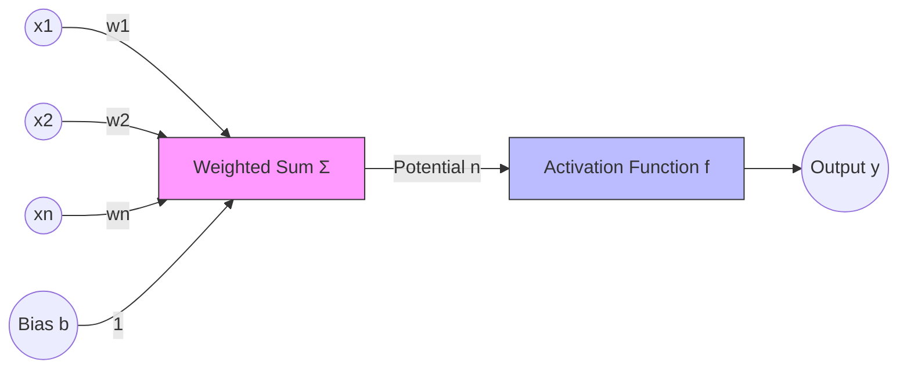

### The neuron equation

The output $y$ of a single neuron is calculated as:

$$ y = f\left(\sum_{i=1}^{n} w_i \cdot P_i + b\right) $$

Each symbol plays a distinct role, and together they are the complete vocabulary of neural network computation:

1. **$P_i$ (inputs):** the raw data points (e.g., pixel values of an image) or outputs from a previous layer.
2. **$W_i$ (weights):** determine the **importance** of each input. A high weight means that specific input strongly influences the output; the weights represent the synaptic strength. *Learning* essentially means adjusting these $W$ values.
3. **$\Sigma$ (weighted sum):** the linear combination of inputs and weights, with formula $n = (P_1 \cdot W_1) + (P_2 \cdot W_2) + \dots + (P_R \cdot W_R)$. This is often called the **potential ($n$)**.
4. **$b$ (bias):** an additional term that allows the activation function to be shifted. Think of bias as the intercept $b$ in the line equation $y = ax + b$: without it, the line must always pass through the origin $(0,0)$, which limits flexibility. A memorable analogy is that the bias is a "threshold of stubbornness" — it determines how high the signal must be before the neuron fires.
5. **$f$ (activation function):** defines the final output; it introduces non-linearity (developed in detail below).
6. **$y$ (output):** the final result passed to the next layer.

Writing the potential and the output separately makes the two-stage structure explicit — first the linear combination, then the non-linear transform:

$$ n = \sum_{i=1}^{k} (w_i \cdot x_i) + b $$

$$ y = f(n) = f\left(\sum w_i x_i + b\right) $$

### Weights and biases as slope and intercept

Recall the equation for a straight line:

$$y = m \cdot x + b$$

Here $m$ is the slope and $b$ is the y-intercept. In a neural network we use different terms for the same mathematical concepts along the connections. The **weight ($w$)** corresponds to the slope ($m$): it determines how much influence the input has on the output, and the numbers written *on the lines* connecting nodes are weights. The **bias ($b$)** corresponds to the intercept ($b$): it shifts the activation function left or right (or up and down at the output), and the numbers added to the calculation *inside* or *before* the node are biases. When data flows from one node to another, the following calculation occurs:

$$ \text{Node Input} = (\text{Input Data} \times \text{Weight}) + \text{Bias} $$

> [!info] Where do these numbers come from?
> When a network is created, weights and biases are unknown. They are estimated (learned) by fitting the network to data using a process called **backpropagation** (see [[Backpropagation]]). For the purpose of understanding *how* the network works (inference), we assume these numbers have already been calculated.

### Vector notation

In practice, calculating neurons individually is inefficient, so to make calculations efficient (especially in programming) we treat inputs and weights as vectors:

- Input vector $P = [P_1, P_2, \dots, P_R]^T$
- Weight vector $W = [W_1, W_2, \dots, W_R]$
- Potential $n = W \cdot P + b$

The same construction appears with $x$-notation: input vector $X = [x_1, x_2, \dots, x_n]^T$, weight vector $W = [w_1, w_2, \dots, w_n]$, and the whole neuron collapses to the single vector equation $y = f(W \cdot X + b)$. This vectorized form is what makes real implementations fast, and it is the notational foundation developed further in [[Neural Network Architecture and Notation]].

> [!important] The role of learning
> When we say a neural network is "learning," we mean it is iteratively adjusting the values of $W$ (weights) and $b$ (bias) to minimize the error in its predictions.

## Network architecture

### Anatomy of a network

A neural network is composed of discrete components that pass information forward.

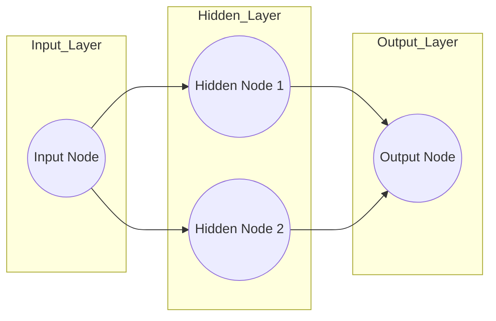

The **input node** is where the data enters the network — for example, a numerical value representing "dosage" (e.g., 0.5); in simple networks, raw data is fed here without calculation. The **hidden layer(s)** are the layers between input and output — this is where the magic happens. They are called "hidden" simply because we do not see their inputs/outputs directly in the final result; they are internal processing steps. A hidden layer can consist of one or many nodes; the running example in this note uses 1 layer with 2 nodes. The **output node** consolidates the information from the hidden layer to produce the final prediction, such as a value representing "effectiveness." Finally, the **connections (synapses)** are the lines connecting nodes; each connection carries a specific mathematical operation involving **weights**.

> [!tip] Terminology alert
> While inspired by biological neurons (nodes) and synapses (connections), modern neural networks are best understood as **math operations**, not biological simulations. Think of the network as a "big fancy squiggle fitting machine."

### The multi-layer perceptron

A single neuron is limited; to solve complex problems, we organize neurons into a structure called a **Multi-Layer Perceptron (MLP)**. An MLP consists of three types of layers. The **input layer** has one neuron for every feature in your data; no computation happens here, it just receives the data (e.g., the pixels of an image) and passes the values on. The **hidden layers** — one or more layers between input and output — are where calculations and feature extraction happen; they are "hidden" because the user does not see these values directly, and deep learning simply means many hidden layers. The **output layer** produces the final result (prediction or classification): one neuron for regression, or $N$ neurons for classification, where $N$ is the number of classes.

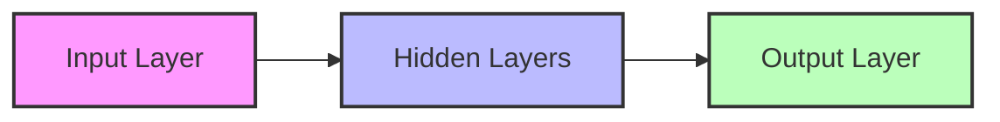

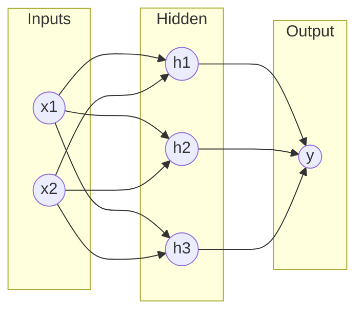

### Direction of flow

In an MLP, information flows in **one direction**: input $\to$ hidden $\to$ output. This is the **feed-forward** property — there are no loops or cycles. The alternative is **recurrent/feedback** architecture, where information can loop back; it is mentioned here only as a comparison and is treated in [[Recurrent Neural Networks]].

### Matrix notation

Calculating one neuron at a time is slow, so we use matrices to calculate whole layers at once. If we have a layer with indices $j$ connecting to a layer with indices $i$:

$$ N = W \cdot A_{prev} + B $$

where $N$ is the vector of potentials for the current layer, $W$ is the weight matrix, $A_{prev}$ is the output (activation) vector from the previous layer, and $B$ is the bias vector. Stacking this layer by layer gives the general vectorized form of the whole network:

$$ A^L = f(W^L \cdot A^{L-1} + B^L) $$

with $A^L$ the output of the current layer, $W^L$ the matrix of weights for the current layer, $A^{L-1}$ the output of the previous layer, and $B^L$ the vector of biases for the current layer.

> [!note] Deep learning definition
> A "deep" neural network is simply an MLP with many hidden layers. GPUs are used because they can calculate the matrix multiplication $W \cdot A$ for millions of neurons simultaneously.

## Activation functions

### Why non-linearity is essential

Inside the nodes of the hidden layer there is a specific component that transforms the linear math (weights and biases) into a non-linear shape: the **activation function** (or transfer function), which decides the output based on the potential $n$. Without activation functions, a neural network would essentially just be linear regression — it could only draw straight lines. The activation function introduces the **bend** or **curve**, and this is its most critical role: introducing **non-linearity**, allowing the network to learn complex curves rather than just straight lines.

The necessity is easy to demonstrate. If we stack multiple layers of linear neurons (e.g., $f(x) = ax$), the result is still a linear function: $f(g(x)) = a(bx) = (ab)x$. **Linear layers cannot learn complex shapes.** Activation functions introduce "bends" and "curves" in the math, allowing the network to approximate any continuous function — the content of the Universal Approximation Theorem. In this sense the activation function is the most critical component for making a neural network "deep"; without it, the network would just be a series of linear regressions. The individual functions are catalogued in depth in [[Activation Functions]].

### The common families

**Linear function.** Formula: $f(n) = \lambda \cdot n$ (or just $f(n) = n$). Its graph is a straight diagonal line. It is rarely used in hidden layers because stacking linear functions just creates another linear function; it is used sometimes in the output layer for regression, where you need to predict a raw number like a price.

**Step function (threshold / Heaviside).** Formula:

$$ f(n) = \begin{cases} \lambda & \text{if } n \geq 0 \\ 0 & \text{if } n < 0 \end{cases} $$

or more simply $f(n) = 1$ if $n \ge 0$, else $0$. The neuron is either "ON" or "OFF," which is why early perceptrons used it for binary logic. Its limitation is fatal for modern training: it is not differentiable at 0, and the "slope" is zero everywhere else, making it hard to use with gradient descent.

**ReLU (rectified linear unit).** Formula:

$$ f(n) = \begin{cases} n & \text{if } n > 0 \\ 0 & \text{if } n \leq 0 \end{cases} $$

equivalently $f(x) = \max(0, x)$. Its shape is a sharp bend — flat at 0, then going up linearly; flat for negative numbers, linear for positive, with range $[0, \infty)$. It is the most popular function for hidden layers in deep learning today, for three reasons: it is computationally very fast (no exponents), it does not saturate for positive values — meaning it learns faster than sigmoid or tanh — and it solves the "vanishing gradient" problem. It is the default choice for hidden layers. (Mnemonic: sounds like a robot.)

**Sigmoid (logistic).** The sources give three presentations of the same S-shaped curve: $f(x) = \frac{e^x}{e^x + 1}$, $f(n) = \frac{1}{1 + e^{-\lambda n}}$, and $\sigma(n) = \frac{1}{1 + e^{-n}}$. Its range is $(0, 1)$ (written $[0, 1]$ in some treatments). It is good for probability outputs and is the classic output layer choice for binary classification, but it is computationally expensive due to $e$. It is a classic, used often in teaching, but less common in the hidden layers of deep networks now. Its drawback: for very high or low inputs, the slope is almost zero, which causes the **vanishing gradient** problem (learning stops).

**Hyperbolic tangent (tanh).** Formula: $f(n) = \tanh(n) = \frac{e^n - e^{-n}}{e^n + e^{-n}}$, range $(-1, 1)$ (written $[-1, 1]$ in some treatments). Its graph is similar to sigmoid but centered at 0. The advantage: it often converges faster than sigmoid because the data is centered around zero; being zero-centered, it generally performs better than sigmoid in hidden layers because it centers the data for the next layer.

**Softplus.** Formula: $f(x) = \ln(1 + e^x)$ (natural log). Its shape is a smooth curve that looks like a transition from 0 to a linear increase; it is smooth and differentiable everywhere. It is the activation used in the worked examples below. (Mnemonic: sounds like a brand of toilet paper.)

**Softmax.** For multi-class classification output layers, $e^{z_i}/\sum e^{z_j}$ converts raw outputs into probabilities; it is treated fully in the classification section below.

### Comparison at a glance

| Function | Formula | Range | Best For... |
| :--- | :--- | :--- | :--- |
| **Linear** | $n$ | $(-\infty, \infty)$ | Regression Output |
| **Sigmoid**| $1/(1+e^{-n})$ | $(0, 1)$ | Binary Classification Output |
| **Tanh** | $\tanh(n)$ | $(-1, 1)$ | Hidden Layers (Standard) |
| **ReLU** | $\max(0, n)$ | $[0, \infty)$ | Hidden Layers (Modern/Deep) |
| **Softmax**| $e^{z_i}/\sum e^{z_j}$| $(0, 1)$ | Multi-class Classification Output |

> [!tip] Exam tip
> If asked which function to use for hidden layers in a deep network, always answer **ReLU**. If asked for binary classification output, answer **Sigmoid**.

### How activation works in context

The math $(\text{Input} \times \text{Weight}) + \text{Bias}$ produces an **X-axis coordinate**. We plug that coordinate into the activation function to get the **Y-axis value**. In other words, the linear part of the neuron selects *where* on the activation curve to read off the output, and the weights and biases let the network move and reshape that read-off point as learning proceeds.

> [!example]
> If our linear math gives us $x = 2.14$, and we use **softplus**:
> $$y = \ln(1 + e^{2.14}) \approx 2.25$$

## The mechanics of a single node

This section walks through the exact mathematical sequence required to get a value out of a single hidden node. The scenario is:

- **Input (dosage):** $0$
- **Weight (connection):** $-34.4$
- **Bias:** $+2.14$
- **Activation function:** softplus

### Step 1: linear combination

First, we apply the weight and bias to the input. This creates the **X-coordinate** for the activation function.

$$ x_{coord} = (\text{Dosage} \times \text{Weight}) + \text{Bias} $$
$$ x_{coord} = (0 \times -34.4) + 2.14 $$
$$ x_{coord} = 0 + 2.14 $$
$$ \mathbf{x_{coord} = 2.14} $$

### Step 2: activation

Next, we plug the $x_{coord}$ into the softplus equation to find the node's activation value (the **Y-coordinate**).

$$ y = \ln(1 + e^x) $$
$$ y = \ln(1 + e^{2.14}) $$

Working through the arithmetic: $e^{2.14} \approx 8.499$, so $1 + 8.499 = 9.499$, and $\ln(9.499) \approx 2.25$:

$$ \mathbf{y = 2.25} $$

This value ($2.25$) is the output of this specific hidden node when the dosage is $0$ — the number that will be passed forward along the connection to the next layer.

> [!important] Sensitivity to input
> Because of the weight ($-34.4$), this node is highly sensitive.
> - If dosage moves from **0 to 0.1**:
> - $x_{coord} = (0.1 \times -34.4) + 2.14 = -3.44 + 2.14 = \mathbf{-1.3}$
> - $y = \ln(1 + e^{-1.3}) \approx \mathbf{0.24}$
>
> The output dropped drastically from **2.25 to 0.24** with a small change in input. This ability to change values rapidly allows the network to create sharp curves.

## Building a curve step by step

We can now see how a simple network with **2 hidden nodes** creates a complex curve to fit the dosage data — a detailed breakdown of the exercise presented in the StatQuest video. The network slices, flips, and stretches the softplus curve in each node, then adds the pieces together.

### The architecture setup

- **Input:** dosage (values 0 to 1).
- **Hidden node 1 (top):** input weight $-34.4$, bias $+2.14$, output weight $-1.30$.
- **Hidden node 2 (bottom):** input weight $-2.52$, bias $+1.29$, output weight $+2.28$.
- **Final output bias:** $-0.58$.

### The top node: the blue curve

The top node uses the softplus function, but the weights transform this shape significantly. The input weight ($-34.4$) and bias ($+2.14$) process inputs from dosage 0 to 1; because the weight is large and negative, as dosage increases, the input to the activation function becomes essentially negative infinity very quickly. The result is that this node selects a specific "slice" of the softplus curve. The output weight ($-1.30$) then multiplies the activation, which **flips** the curve upside down (negative) and **scales** it (stretches it). The visual result is a "blue curve" that starts high and plummets to zero.

**Example calculation (dosage = 0):**

1. $x = (0 \times -34.4) + 2.14 = 2.14$
2. Activation = $\text{Softplus}(2.14) = 2.25$
3. Weighted output = $2.25 \times -1.30 = \mathbf{-2.93}$

### The bottom node: the orange curve

The bottom node is identical in structure but has different parameters, and the contrast between the two nodes is the whole lesson. Its input weight ($-2.52$) is smaller than the top node's, so it traverses the activation function shape more slowly and selects a wider, smoother slice of the softplus curve. The output weight ($+2.28$) is positive, which keeps the curve upright and stretches it taller. The visual result is an "orange curve" that starts moderately high and gently curves down.

**Example calculation (dosage = 0):**

1. $x = (0 \times -2.52) + 1.29 = 1.29$
2. Activation = $\text{Softplus}(1.29) = 1.53$
3. Weighted output = $1.53 \times 2.28 = \mathbf{3.49}$

### The combination: the green squiggle

The neural network's power comes from **adding** these nodes together. At dosage = 0: the blue curve value is $-2.93$ and the orange curve value is $3.49$, so the sum is $-2.93 + 3.49 = 0.56$. The final bias of $-0.58$ means the network subtracts 0.58 from the total, giving the result $0.56 - 0.58 = \mathbf{-0.02}$ (approximately 0). Interpretation: low dosage = not effective.

At dosage = 0.5 (medium), running the math shows the blue curve drops to near zero (the weight $-34.4$ kills it), while the orange curve is still active (the weight $-2.52$ is gentler), so the sum results in a high positive number. Interpretation: medium dosage = effective (high value). At dosage = 1.0 (high), both curves have decayed significantly and the result returns to near zero. Interpretation: high dosage = not effective.

By adding the **blue curve** (sharp drop) to the **orange curve** (gentle drop) and adjusting with the **bias**, we create a new shape — **the green squiggle** — that starts at 0, goes up to 1, and goes back down to 0.

> [!summary] The big picture
> The neural network didn't memorize the data. It used **weights** to slice and stretch basic activation functions into new shapes, and then added them together to fit a curve that matches the data pattern perfectly. This is how "big fancy squiggle fitting machines" work.

## A complete forward pass

The single-node arithmetic scales up to full networks. This section works through a classic "exo examen" (exam exercise) — a crucial practical example of how a forward pass works over an entire MLP, layer by layer.

### The exam exercise setup

We have an MLP with the following structure:

- **Input layer:** 3 neurons ($P_1, P_2, P_3$).
- **Hidden layer:** 2 neurons ($n_1, n_2$), with activation function **hyperbolic tangent (tanh)**.
- **Output layer:** 3 neurons ($S_1, S_2, S_3$), with activation function **linear** (identity).

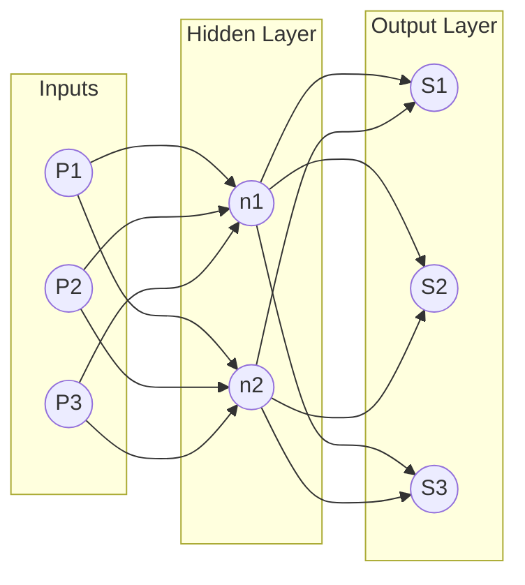

### Notation reminder

Throughout the calculation, $W_{ij}^L$ denotes the weight connecting neuron $j$ of the previous layer to neuron $i$ of layer $L$. For example, $W_{12}^1$ means the weight *to* neuron 1 (layer 1) *from* input 2. Be careful: do not confuse the superscript 1 (layer 1) with an exponent (power of 1) — a classic exam trap.

### Step 1: the hidden layer

We need to calculate the *potential* ($n$) and the *activation* ($a$) for the hidden neurons. The potentials are:

$$ n_1^1 = P_1 \cdot W_{11}^1 + P_2 \cdot W_{12}^1 + P_3 \cdot W_{13}^1 + b_1^1 $$
$$ n_2^1 = P_1 \cdot W_{21}^1 + P_2 \cdot W_{22}^1 + P_3 \cdot W_{23}^1 + b_2^1 $$

**Matrix form:**

$$
\begin{bmatrix} n_1^1 \\ n_2^1 \end{bmatrix} =
\begin{bmatrix} W_{11}^1 & W_{12}^1 & W_{13}^1 \\ W_{21}^1 & W_{22}^1 & W_{23}^1 \end{bmatrix}
\times
\begin{bmatrix} P_1 \\ P_2 \\ P_3 \end{bmatrix}
+
\begin{bmatrix} b_1^1 \\ b_2^1 \end{bmatrix}
$$

The problem states the hidden activation function is **tanh**, so the activations are:

$$ a_1^1 = f(n_1^1) = \frac{e^{n_1} - e^{-n_1}}{e^{n_1} + e^{-n_1}} $$
$$ a_2^1 = f(n_2^1) = \frac{e^{n_2} - e^{-n_2}}{e^{n_2} + e^{-n_2}} $$

These values ($a_1^1, a_2^1$) become the *inputs* for the next layer.

### Step 2: the output layer

Now we compute the final outputs using the activations from the hidden layer:

$$ n_1^2 = a_1^1 \cdot W_{11}^2 + a_2^1 \cdot W_{12}^2 + b_1^2 $$
$$ n_2^2 = a_1^1 \cdot W_{21}^2 + a_2^1 \cdot W_{22}^2 + b_2^2 $$
$$ n_3^2 = a_1^1 \cdot W_{31}^2 + a_2^1 \cdot W_{32}^2 + b_3^2 $$

The problem states the output activation function is **linear**, so the final output $S$ is equal to the potential $n$:

$$ S_1 = n_1^2 $$
$$ S_2 = n_2^2 $$
$$ S_3 = n_3^2 $$

> [!tip] Important tip for exams
> Always check the activation function for the *output* layer. In regression problems, it is often linear. In classification problems (like determining if an image is a cat or dog), it is often sigmoid or softmax. Don't blindly apply tanh or ReLU to the final layer unless specified.

### A second exhaustive pass

A second, more compact example shows the same four-step rhythm on a smaller network. Imagine an MLP with inputs $P_1, P_2$, a hidden layer $n_1, n_2$ with tanh activation, and an output layer $S$ with linear activation.

**Step 1: hidden layer potentials ($n$)**

$$ n_1^{hidden} = P_1 W_{11}^1 + P_2 W_{12}^1 + b_1^1 $$
$$ n_2^{hidden} = P_1 W_{21}^1 + P_2 W_{22}^1 + b_2^1 $$

**Step 2: hidden layer activations ($a$)**

$$ a_1^{hidden} = \tanh(n_1^{hidden}) $$
$$ a_2^{hidden} = \tanh(n_2^{hidden}) $$

**Step 3: output layer potential ($n$).** The outputs of the hidden layer ($a$) become the inputs for the output layer:

$$ n^{output} = a_1^{hidden} W_{11}^2 + a_2^{hidden} W_{12}^2 + b^2 $$

**Step 4: final output ($S$)**

$$ S = \text{Linear}(n^{output}) = n^{output} $$

Every feed-forward network, however large, is this same loop: potentials, activations, and hand-off to the next layer, exactly as formalized in [[Forward Propagation]] and [[Matrix Implementation of Backpropagation]].

## Learning: error and loss

Learning involves updating the weights ($W$) to minimize the difference between what the network predicts and what the true answer is. Two symbols anchor the discussion: $g_i(k)$ is the **actual/target** output (the ground truth from your dataset), and $a_i(k)$ is the **computed/predicted** output (what your ANN produced). The error for a specific output neuron $i$ on sample $k$ is simply their difference:

$$ e_i(k) = g_i(k) - a_i(k) $$

To evaluate the whole network, we calculate the **mean squared error (MSE)**. We square the error to eliminate negative signs and to penalize large errors more heavily (in the second formulation below: to make it positive):

$$ E(k) = \frac{1}{2} \sum_{i=1}^{R} (g_i(k) - a_i(k))^2 $$

or equivalently, dropping the sample index:

$$ E = \frac{1}{2} \sum_{i=1}^{R} (g_i - a_i)^2 $$

The $\frac{1}{2}$ is a mathematical convenience that cancels out when we take the derivative later — it cancels the 2 from the exponent, keeping the gradient expressions clean.

## Training modes and the learning rate

There are two ways to schedule the weight updates, and the trade-off between them recurs throughout deep learning practice.

**Incremental learning (stochastic)** updates the weights after *every single sample* is presented. It is fast, but the error path is noisy/bumpy — the optimization trajectory jitters toward the minimum. **Batch learning** instead calculates the error for *all $K$ samples* in the dataset first, then updates the weights once based on the average error. It is mathematically stable, but requires more memory and more time per update. An **epoch** is one complete pass through the entire dataset — the natural unit for counting batch learning progress.

> [!warning] The learning rate trap
> - If the learning rate $\mu$ is too high: the weights will oscillate and explode (divergence).
> - If $\mu$ is too low: the network will take weeks to learn (too slow).
> - Standard values: $0.01, 0.001, 0.0001$.

The learning rate and its schedules are treated at length in [[05 - Neural Network Foundations/Training Dynamics and Stability/Hyperparameters and Network Configuration|Hyperparameters and Network Configuration]].

## Gradient descent and the delta rule

This is the most technically complex part of the subject: how we actually calculate the change in weights ($\Delta W$). Learning in a neural network is the process of minimizing a **loss function** by adjusting weights using the **backpropagation** algorithm and **gradient descent**.

### Gradient descent

Imagine you are on a mountain (the error function) and want to get to the bottom (zero error). The **gradient** tells you which way is "up"; to minimize error, we go in the **opposite direction** of the gradient. The update rule is:

$$ W_{new} = W_{old} + \Delta W $$
$$ \Delta W = -\eta \cdot \frac{\partial E}{\partial W} $$

Here $\eta$ (eta) is the **learning rate**, usually a small number between 0 and 1 (e.g., 0.01); if it is too big you overshoot the minimum, and if it is too small learning takes forever. And $\frac{\partial E}{\partial W}$ is the derivative (gradient) of the error with respect to the weight. An equivalent formulation writes the same rule with learning rate $\mu$ and the update folded into one line — update each weight $w_{ij}$ in the direction that reduces the error $E$:

$$ w_{new} = w_{old} - \mu \frac{\partial E}{\partial w} $$

where $\frac{\partial E}{\partial w}$ is the **gradient** — how much the error changes if we wiggle the weight.

### The chain rule derivation

To find $\Delta W$, we must use the **chain rule** of calculus, because the error $E$ depends on the output $a$, which depends on the potential $n$, which depends on the weight $W$. The chain of influence runs:

Weight $\to$ Potential ($n$) $\to$ Activation ($a$) $\to$ Error ($E$)

Expanding the chain rule for a single weight:

$$ \frac{\partial E}{\partial W_{ij}} = \frac{\partial E}{\partial a_i} \cdot \frac{\partial a_i}{\partial n_i} \cdot \frac{\partial n_i}{\partial W_{ij}} $$

or in the compact notation:

$$ \frac{\partial E}{\partial w} = \frac{\partial E}{\partial a} \cdot \frac{\partial a}{\partial n} \cdot \frac{\partial n}{\partial w} $$

**Step A: derivative of error vs output.** Since $E = \frac{1}{2}(g - a)^2$:

$$ \frac{\partial E}{\partial a} = -(g - a) = -e(k) $$

**Step B: derivative of output vs potential (the activation derivative).** For the tanh activation, $f(n) = \tanh(n)$. We need the derivative $f'(n)$, and the useful identity is $f'(n) = 1 - f(n)^2$, so:

$$ \frac{\partial a}{\partial n} = 1 - a^2 $$

**Step C: derivative of potential vs weight.** Since $n = W \cdot P$:

$$ \frac{\partial n}{\partial W} = P $$

Result: $Input$ (the signal coming into that connection).

**Step D: combining them (the delta rule).** Putting it all together for the weight update $\Delta W_{ij}$:

$$ \Delta W_{ij} = \eta \cdot \underbrace{e_i(k)}_{\text{Error}} \cdot \underbrace{(1 - a_i(k)^2)}_{\text{Slope of Tanh}} \cdot \underbrace{P_j(k)}_{\text{Input}} $$

In words: the change in weight is proportional to the **error**, the **derivative of the activation function**, and the **input** that caused it. The same result is sometimes written symbolically as the final weight update:

$$ \Delta w = \mu \cdot \text{Error} \cdot \text{Slope of Activation} \cdot \text{Input} $$

The three factors break down as: $\frac{\partial E}{\partial a}$ gives $-(g - a)$; $\frac{\partial a}{\partial n}$ gives $(1 - a^2)$ when using tanh; and $\frac{\partial n}{\partial w}$ gives the input — the signal coming into that connection. How these per-layer gradients are propagated backward through many layers at once is the subject of [[Backpropagation]].

## ANNs for classification

### Regression vs classification

**Regression** predicts a continuous number (e.g., the price of a house, temperature); the output layer usually has 1 neuron with linear activation. **Classification** predicts a category (e.g., is this flower Setosa, Versicolor, or Virginica?), and it needs a different output arrangement.

### One-hot encoding

Neural networks work with numbers, not text labels like "Setosa," so we convert labels into vectors. For the Iris dataset:

- Iris Setosa $\to [1, 0, 0]$
- Iris Versicolor $\to [0, 1, 0]$
- Iris Virginica $\to [0, 0, 1]$

This requires the output layer to have **3 neurons** (one for each class), each slot of the one-hot vector corresponding to one output neuron. The broader data-side machinery of encoding categorical variables is covered in [[Data Preparation for Neural Networks]] and [[Data Cleaning and Encoding Lab]].

### Softmax outputs

For multi-class classification, we usually use the **softmax** activation function in the output layer. It converts raw outputs into **probabilities**, and the sum of all outputs will equal 1 ($100\%$).

If the network outputs $[0.62, 0.23, 0.15]$, then neuron 1 (class 0) has 62% probability, neuron 2 (class 1) has 23% probability, and neuron 3 (class 2) has 15% probability. Conclusion: the network classifies this input as **class 0** — the argmax of the softmax vector is the predicted class.

### The confusion matrix

To test how well the classification works, we compare predicted vs. actual values using a matrix:

| | Predicted Yes | Predicted No |
| :--- | :---: | :---: |
| **Actual Yes** | True Positive (TP) | False Negative (FN) |
| **Actual No** | False Positive (FP) | True Negative (TN) |

- **TP:** correctly identified positive.
- **TN:** correctly identified negative.
- **FP (Type 1 Error):** predicted yes, but it was no.
- **FN (Type 2 Error):** predicted no, but it was yes.

The four cells give a complete accounting of a binary classifier's behavior, and the Type 1/Type 2 distinction is worth memorizing: they are asymmetric mistakes with different real-world costs.

## Sparse activations

A neural network is **sparse** when **most of its neurons are inactive (output zero) at any given time**. This is a property that emerges naturally from certain activation choices rather than something that is imposed by hand.

### How ReLU creates sparsity

ReLU naturally creates sparsity: negative inputs produce output = 0, and these "dead" neurons don't contribute to the next layer. A concrete feel for the numbers:

```text
Layer with 1000 neurons
Only 300 neurons fire (output > 0) for a given input
→ 70% sparsity
```

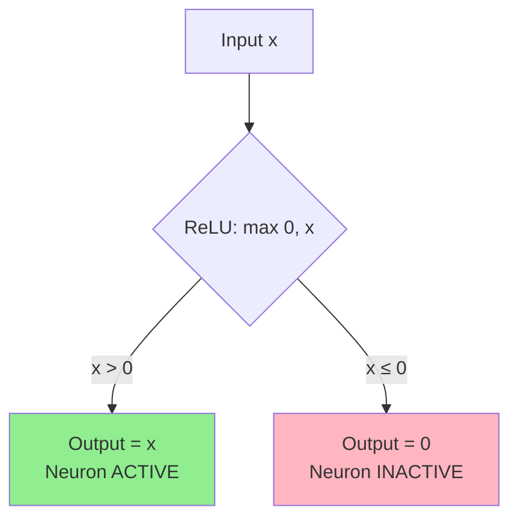

The contrast with a fully dense layer makes the effect visible:

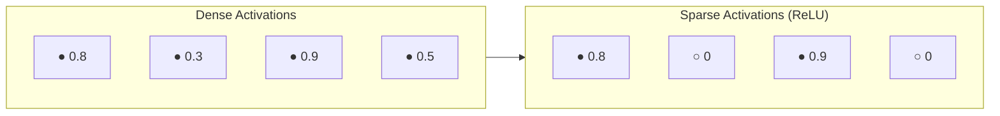

### Why sparsity matters

| Benefit | Explanation |
|---------|-------------|
| **Computational Efficiency** | Fewer active neurons → fewer calculations |
| **Better Generalization** | Network focuses on important features, not all neurons |
| **Memory Efficiency** | Sparse matrices can be stored more compactly |
| **Reduced Overfitting** | Less reliance on every neuron reduces memorization |

As a quick memory aid: **sparse** = many zeros = efficiency + better generalization.

## Gradient flow

**Gradient flow** describes how gradients propagate backward through layers during training. It is the property that determines whether every layer of a deep network actually receives a usable learning signal, and it is worth keeping the whole area's stability picture — normalization, initialization, and residuals — in mind when reading this section (see [[05 - Neural Network Foundations/Training Dynamics and Stability/Batch Normalization|Batch Normalization]] and [[05 - Neural Network Foundations/Training Dynamics and Stability/Weight Initialization|Weight Initialization]]).

### Good vs poor gradient flow

```mermaid
flowchart TB
    subgraph Good[" Good Gradient Flow"]
        G_Input[Input Layer]
        G_H1[Hidden Layer 1]
        G_H2[Hidden Layer 2]
        G_Out[Output Layer]
        
        G_Out -->|Strong| G_H2
        G_H2 -->|Strong| G_H1
        G_H1 -->|Strong| G_Input
    end
    
    subgraph Poor[" Poor Gradient Flow"]
        P_Input[Input Layer]
        P_H1[Hidden Layer 1]
        P_H2[Hidden Layer 2]
        P_Out[Output Layer]
        
        P_Out -->|Strong| P_H2
        P_H2 -->|Weak| P_H1
        P_H1 -->|Tiny| P_Input
    end
    
    style G_Input fill:#90EE90
    style G_H1 fill:#90EE90
    style G_H2 fill:#90EE90
    style G_Out fill:#98FB98
    
    style P_Input fill:#FFB6C1
    style P_H1 fill:#FFA07A
    style P_H2 fill:#90EE90
    style P_Out fill:#98FB98
```

In a healthy network the gradient arrives at every layer with roughly its original strength; in an unhealthy one it decays layer by layer until the earliest layers see almost nothing.

### Factors affecting gradient flow

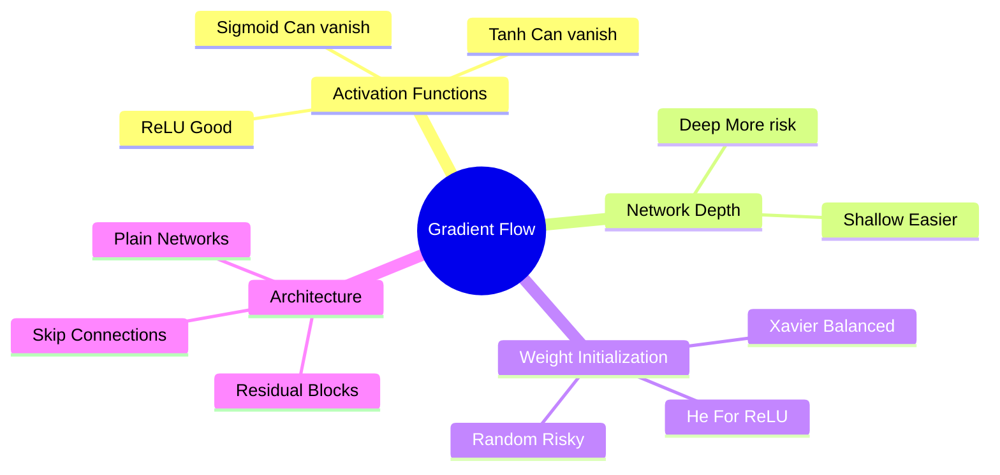

| Factor | Impact |
|--------|--------|
| **Activation Functions** | ReLU improves flow; Sigmoid/Tanh hinder it |
| **Network Depth** | Deeper = more opportunities for degradation |
| **Weight Initialization** | Poor initialization → poor flow from start |
| **Skip Connections** | Provide "highways" for gradients |

### Why it matters

Good gradient flow matters for three reasons. First, **all layers learn properly** with good gradient flow. Second, it produces **faster convergence** during training. Third, it **enables training very deep networks** (100+ layers) — the difference between a 5-layer toy network and the architectures that define modern deep learning.

### The ReLU advantage

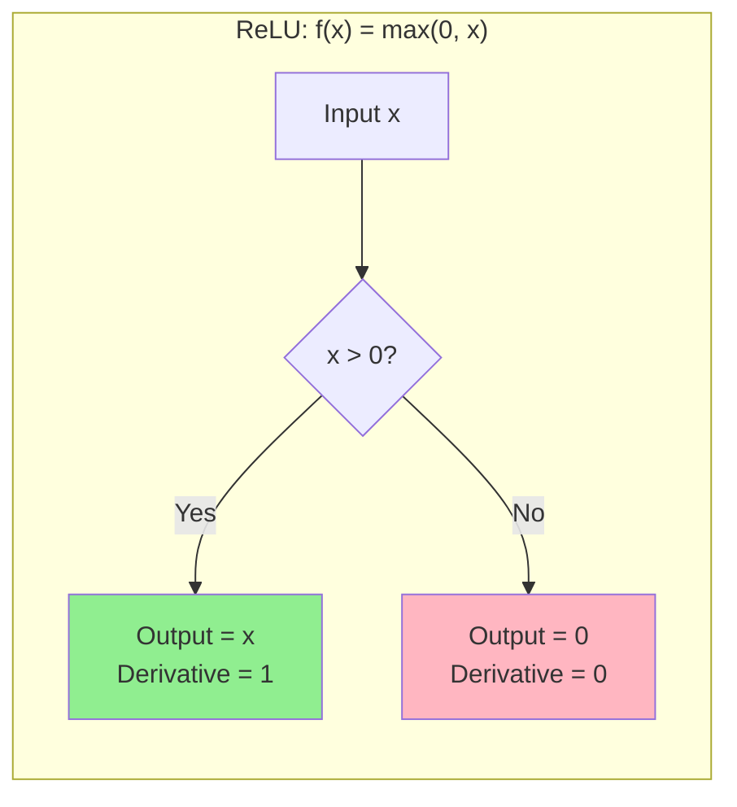

For positive inputs, the gradient is 1 — it passes through unchanged. There is no multiplication of small numbers as the gradient crosses each layer, so the gradient is preserved through many layers. This single property is why ReLU became the default hidden-layer activation for deep networks.

### How skip connections help

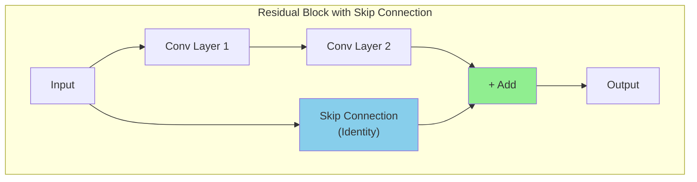

The benefits are threefold: the gradient can flow directly through the skip connection; even if the main path has vanishing gradients, the skip path preserves them; and this enables training of 100+ layer networks. As a quick memory aid: **gradient flow** = highway for learning signals → ReLU + skip connections keep it smooth.

## The vanishing gradient problem

### Definition and mechanism

During backpropagation, **gradients (used to update weights) become extremely small**, often near 0, as they propagate backward through deep networks. The problem is that backpropagation multiplies derivatives layer by layer, so each layer's small derivative shrinks the signal further:

```mermaid
flowchart LR
    subgraph Backward["← Backpropagation Direction"]
        L1["Layer 1<br/>Gradient: TINY"]
        L2["Layer 2<br/>Gradient: Small"]
        L3["Layer 3<br/>Gradient: Medium"]
        LN["Layer N (Output)<br/>Gradient: Large"]
    end
    
    L1 <-- L2 <-- L3 <-- LN
    
    style L1 fill:#FFB6C1
    style L2 fill:#FFA07A
    style L3 fill:#90EE90
    style LN fill:#98FB98
```

The activation function choice drives the shrinkage, because each activation contributes its own derivative to the chain:

| Activation | Derivative Range | Problem |
|------------|------------------|---------|
| **Sigmoid** | 0 to 0.25 | Derivative ≤ 0.25, multiplies down layers |
| **Tanh** | 0 to 1 | Derivative ≤ 1, still can vanish |
| **ReLU** | 0 or 1 | No vanishing for positive inputs! |

### The mathematics

```text
For sigmoid: σ'(x) = σ(x) × (1 - σ(x))
Maximum value = 0.25 (when σ(x) = 0.5)

In a 10-layer network:
0.25^10 ≈ 0.0000000009 → gradient is essentially ZERO
```

The sigmoid derivative chain makes the decay visible step by step:

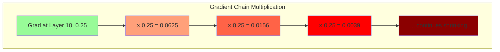

### Consequences and solutions

The consequences are severe. Early layers learn very slowly or almost not at all; training becomes inefficient or fails entirely; and deep networks become impossible to train. The standard remedies each attack a different link in the failure chain:

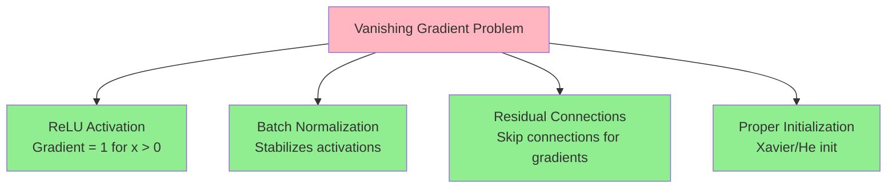

| Solution | How It Helps |
|----------|--------------|
| **ReLU Activation** | Gradient = 1 for positive inputs (no vanishing) |
| **Batch Normalization** | Normalizes activations, stabilizes gradients |
| **Residual Connections** | Skip connections allow gradients to flow directly |
| **Proper Initialization** | Xavier/He initialization prevents early vanishing |

As a quick memory aid: **vanishing gradient** = gradients disappear → can't learn → use ReLU to fix. The exploding-gradient twin of this problem, together with the initialization mathematics, is treated in [[05 - Neural Network Foundations/Training Dynamics and Stability/Vanishing and Exploding Gradients|Vanishing and Exploding Gradients]] and [[05 - Neural Network Foundations/Training Dynamics and Stability/Weight Initialization|Weight Initialization]].

## Residual networks (ResNet)

### What ResNet is

**ResNet** (Residual Network) is a family of deep convolutional neural network architectures introduced to make very deep networks trainable by using **skip connections** (also called shortcut connections). It solved the problem that simply stacking more layers often made training **worse** (not better) due to vanishing/exploding gradients and optimization difficulties. Its influence on the field is hard to overstate — residual connections are now a standard component well beyond the original vision setting (see [[05 - Neural Network Foundations/Architectures/Convolutional Neural Networks|Convolutional Neural Networks]]).

### Why deeper is not always better

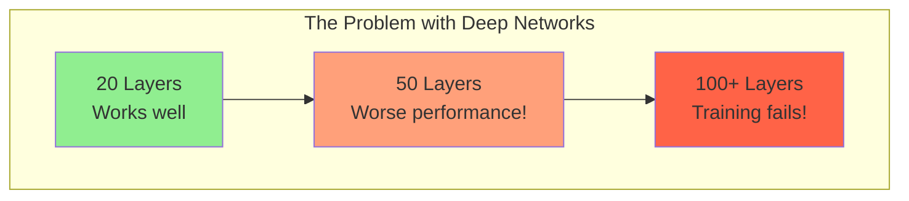

The paradox: deeper networks should perform better, but they often perform **worse**, due to **vanishing gradients** (early layers don't learn) and the **degradation problem** — even with good initialization, deeper is harder to optimize. When you stack many layers, it becomes hard for SGD to update weights so that deeper layers improve performance.

### Residual learning

ResNet's key insight is a reformulation of what each block must learn. Instead of forcing a block to learn a full mapping $H(x)$, you ask it to learn the **residual**:

$$F(x) = H(x) - x$$

Then the block output is:

$$\text{output} = F(x) + x$$

If the block cannot improve on identity, it can learn $F(x) \approx 0$ so the block behaves like an identity — and this fallback is exactly what stabilizes very deep nets. ResNet puts **identity shortcuts** that let gradients and signals flow directly through the network.

### The solution: skip connections

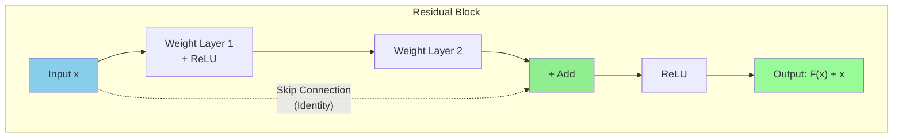

Contrasting a plain network with a ResNet makes the structural difference concrete: the plain stack must express everything through its weight layers, while the residual stack always carries the input forward alongside them.

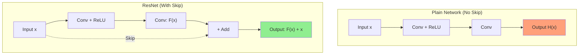

### The residual block: two variants

The **basic block** (ResNet-18 / ResNet-34) uses two 3×3 convolutions (Conv-BN-ReLU), then adds the input $x$:

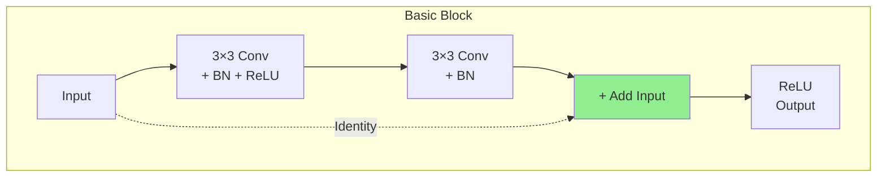

If spatial or channel dimensions change (stride > 1 or different channels), a **projection** (1×1 conv) is applied to $x$ to match shapes.

The **bottleneck block** (ResNet-50/101/152) sandwiches the 3×3 convolution between two 1×1 convolutions: the 1×1 conv reduces channels, the 3×3 conv processes, and the 1×1 conv expands channels back. This reduces computation while allowing deeper models.

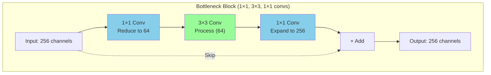

### Why skip connections help: the gradient view

```mermaid
flowchart LR
    subgraph Gradient["Gradient Flow Benefits"]
        GC["Gradient can flow<br/>directly through skip"]
        GM["Derivative of addition = 1<br/>for shortcut path"]
        GL["Deeper layers receive<br/>stronger learning signal"]
    end
    
    GC --> GM --> GL
    
    style GL fill:#90EE90
```

Three mechanisms are at work. First, the **gradient highway**: the skip connection acts as a "gradient superhighway" — gradients flow backward without being multiplied by small numbers, because the derivative of addition is 1 for the shortcut path. Second, **easy identity learning**: if the best solution is to pass the input unchanged, the network can learn $F(x) = 0$, and then $H(x) = 0 + x = x$ (an identity mapping). Third, it **solves the degradation problem**: adding more layers doesn't hurt performance, because the network can always learn to ignore extra layers if needed.

### ResNet versions

```mermaid
graph LR
    subgraph Variants["ResNet Variants"]
        R18["ResNet-18<br/>Basic Block"]
        R34["ResNet-34<br/>Basic Block"]
        R50["ResNet-50<br/>Bottleneck "]
        R101["ResNet-101<br/>Bottleneck"]
        R152["ResNet-152<br/>Bottleneck"]
    end
    
    R18 --> R34 --> R50 --> R101 --> R152
    
    style R50 fill:#90EE90
```

| Model | Layers | Block Type | Use Case |
|-------|--------|------------|----------|
| ResNet-18 | 18 | Basic | Small datasets, fast training |
| ResNet-34 | 34 | Basic | Medium complexity tasks |
| **ResNet-50** | 50 | Bottleneck | **Most popular, good balance** |
| ResNet-101 | 101 | Bottleneck | Complex tasks, more compute |
| ResNet-152 | 152 | Bottleneck | Research, maximum accuracy |

**ResNet-v2 (pre-activation)** reorders the block as **BN → ReLU → Conv**, which helps optimization and generalization in very deep models.

### ResNet vs previous architectures

```mermaid
flowchart TB
    subgraph Comparison["Evolution of Deep Networks"]
        VGG["VGG (2014)<br/>Very deep but slow<br/>No skip connections"]
        ResNet["ResNet (2015)<br/>Deeper AND faster<br/>Skip connections "]
        DenseNet["DenseNet (2017)<br/>Dense connections<br/>Even better gradient flow"]
    end
    
    VGG --> ResNet --> DenseNet
    
    style ResNet fill:#90EE90
```

The progression is one of steadily better gradient plumbing: VGG showed that depth helps but paid for it in trainability, ResNet made depth cheap with identity shortcuts, and DenseNet pushed the idea to dense connections with even better gradient flow.

### Practical training tips

```mermaid
mindmap
    root((ResNet Training))
        Normalization
            BatchNorm after Conv
            Essential for ResNets
        Initialization
            He/Kaiming init
            Standard for ReLU nets
        Learning Rate
            Step decay
            Cosine annealing
            Warmup
        Skip Connection
            Identity if same shape
            Projection 1×1 if changed
        Transfer Learning
            Remove final FC
            Attach your head
```

| Tip | Details |
|-----|---------|
| **BatchNorm** | Use after convolutions (ResNets rely on it) |
| **Initialization** | He initialization (Kaiming) is standard |
| **Learning Rate** | Typical schedules: step decay, cosine, warmup |
| **Projection** | If channels/stride change, use 1×1 conv in shortcut |
| **Transfer Learning** | Remove final FC layer and attach your custom head |

### Common uses

```mermaid
flowchart TB
    subgraph Uses["ResNet Applications"]
        IC["Image Classification<br/>(ImageNet)"]
        DET["Detection Backbones<br/>(Faster R-CNN, Mask R-CNN)"]
        SEG["Segmentation<br/>(FCN, DeepLab)"]
        TL["Transfer Learning<br/>(Vision & Multi-modal)"]
        NV["Non-Vision Domains<br/>(Deep feedforward nets)"]
    end
    
    style IC fill:#90EE90
    style TL fill:#98FB98
```

ResNets serve as **image classification** models (ImageNet); as **detection and segmentation backbones** (Faster R-CNN, Mask R-CNN); as a **transfer learning backbone** in many vision and multi-modal architectures; and in **non-vision domains** wherever very deep feedforward nets are helpful.

### Strengths and limitations

| Strength | Explanation |
|----------|-------------|
| **Elegant Design** | Simple trick with outsized impact — fundamentally changed deep learning |
| **Robust Backbone** | Very reliable for transfer learning |
| **Scalable** | Scales to deep models (100+ layers) while remaining trainable |
| **Must-Know Baseline** | Understanding residual connections is essential for modern architectures |

| Limitation | Explanation |
|------------|-------------|
| **Compute Heavy** | Still heavy compute for large models |
| **Newer Architectures** | Swin, ConvNeXt, Vision Transformers can outperform ResNets on some tasks |
| **May Need Modifications** | Pre-activation, layer scaling, improved normalization can provide better performance |

### Key takeaways

```mermaid
mindmap
    root((ResNet))
        Core Idea
            Skip Connections
            Learn Residual F(x)
            Output = F(x) + x
        Benefits
            Train Very Deep Networks
            Solve Vanishing Gradients
            Easy Identity Learning
        Variants
            ResNet-18 to ResNet-152
            Basic vs Bottleneck Blocks
            Pre-activation ResNet v2
        Impact
            Won ImageNet 2015
            152 layers trained
            Foundation for many architectures
```

| Term | Meaning |
|------|---------|
| **ResNet** | Residual Network with skip connections |
| **Skip Connection** | Direct path that adds input to output |
| **Residual** | What the network learns (F(x) = H(x) - x) |
| **Bottleneck** | 1×1 → 3×3 → 1×1 conv block for efficiency |
| **Basic Block** | Two 3×3 convs (ResNet-18/34) |
| **Projection** | 1×1 conv to match dimensions when needed |

The one-line summary: ResNet = skip connections let gradients flow → train 100+ layers successfully.

## See also

- [[Neural Network Foundations MOC]]
- [[Perceptrons and Multi-Layer Perceptrons]]
- [[Forward Propagation]]
- [[Activation Functions]]
- [[Neural Network Architecture and Notation]]
- [[Backpropagation]]
- [[Matrix Implementation of Backpropagation]]
- [[Backpropagation and Gradient Flow in CNNs]]
- [[05 - Neural Network Foundations/Architectures/Convolutional Neural Networks|Convolutional Neural Networks]]
- [[Recurrent Neural Networks]]
- [[Data Preparation for Neural Networks]]
- [[Data Cleaning and Encoding Lab]]
- [[Formal Neuron Lab]]
- [[05 - Neural Network Foundations/Training Dynamics and Stability/Hyperparameters and Network Configuration|Hyperparameters and Network Configuration]]
- [[05 - Neural Network Foundations/Training Dynamics and Stability/Batch Normalization|Batch Normalization]]
- [[05 - Neural Network Foundations/Training Dynamics and Stability/Weight Initialization|Weight Initialization]]
- [[05 - Neural Network Foundations/Training Dynamics and Stability/Vanishing and Exploding Gradients|Vanishing and Exploding Gradients]]
- [[05 - Neural Network Foundations/Training Dynamics and Stability/Dropout and Regularization|Dropout and Regularization]]
- [[05 - Neural Network Foundations/Training Dynamics and Stability/Data Augmentation|Data Augmentation]]
