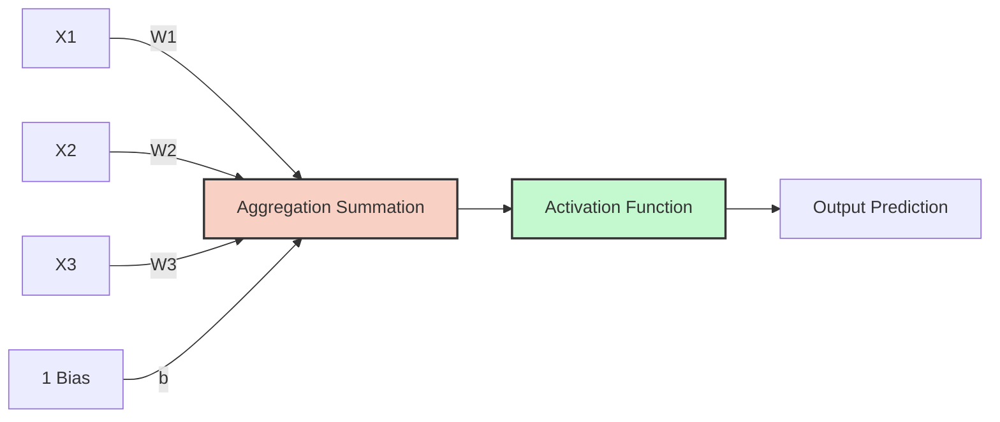
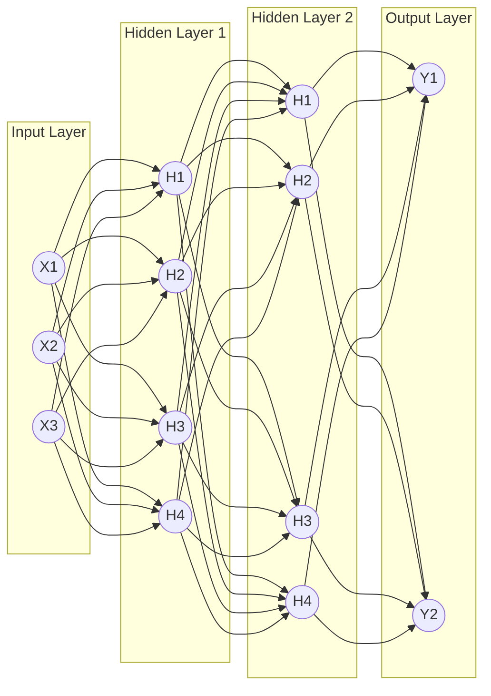

The perceptron is the simplest neural unit: a weighted sum of inputs plus a bias, passed through an activation, and the multi-layer perceptron (MLP) stacks perceptrons into layers and layers into a network. The MLP is the universal building block of deep learning — every deep neural network, no matter how complex, is ultimately a stack of perceptron-like units connected together, and every Transformer's feed-forward layer is an MLP. This note develops the topic in teaching order: the perceptron and its architecture, the original perceptron learning rule, the chain-rule derivation behind gradient-based training, the limitations that motivated multi-layer networks, MLP architecture and notation, backpropagation, XOR, universal approximation, activation functions, the feed-forward network in Transformers, Mixture-of-Experts variants, worked PyTorch examples, production considerations, and the historical context from Rosenblatt to SwiGLU.

## The perceptron

The perceptron is the most simplistic neural network possible: a single layer with a single neuron. It forms the foundational building block of deep learning, and understanding it in depth is non-negotiable — every deep neural network, no matter how complex, is ultimately a stack of perceptron-like units connected together. The perceptron separates linearly separable data, which is both its purpose and, as discussed later, its fundamental limitation.

Conceptually, the perceptron is a mathematical model inspired by a biological neuron. It takes multiple inputs, multiplies them by weights, adds a bias, and passes the result through an activation function to get a prediction. The biological analogy is powerful: just as a biological neuron receives signals through dendrites, processes them in the cell body, and fires an output through the axon, the artificial perceptron receives inputs, computes a weighted sum, and produces an output through an activation function (see [[Formal Neuron Lab]] for the historical mathematical neuron model).



```mermaid
flowchart LR
    X1((X1)) -- w1 --> Sum((Z = Wx + b))
    X2((X2)) -- w2 --> Sum
    X3((X3)) -- w3 --> Sum
    Bias((Bias b)) --> Sum
    Sum --> Act[Activation Function f(z)]
    Act --> Out((Output y))
```

### The two steps of a neuron

**Step 1 — aggregation (the linear step).** The neuron receives multiple inputs $x_j$ (features). Each connection has a weight $w_j$ representing its importance. The neuron calculates the weighted sum, plus a bias $b$. This equation defines a linear decision boundary:

$$ z = \sum_{j=1}^{m} w_j x_j + b = W^T X + b $$

Each symbol carries a precise meaning. The inputs $x$ are the raw data values fed into the neuron (the features). The weights $w$ are the learnable parameters that determine how much each input influences the output — a large positive weight means the corresponding input strongly pushes the output toward class 1, while a large negative weight pushes toward class 0. The bias $b$ shifts the activation threshold and allows the boundary to shift away from the origin; without the bias, the decision boundary would always pass through the origin, severely limiting what the model can represent.

**Step 2 — activation (the non-linear step).** The raw sum $z$ is just a number, and we need to convert it into a classification decision. The activation function $a(z)$ applies a threshold: the aggregated sum $z$ is passed through an activation function $f()$ to produce the final output $a$:

$$ a = f(z) $$

For the basic perceptron, this is a step function — if $z \ge 0$, output 1; if $z < 0$, output 0. In modern neural networks, we use smoother activation functions (Sigmoid, ReLU, etc.) that are differentiable, enabling gradient-based training; see [[Activation Functions]] for the full treatment.

### Geometric interpretation

A single perceptron computes:

$$ y = \sigma\left( \sum_{i=1}^{n} w_i x_i + b \right) = \sigma(\mathbf{w} \cdot \mathbf{x} + b) $$

where $\mathbf{x} \in \mathbb{R}^n$ is the input vector, $\mathbf{w} \in \mathbb{R}^n$ is the weight vector, $b \in \mathbb{R}$ is the bias, and $\sigma$ is a (possibly nonlinear) activation function.

Without the activation, $\mathbf{w} \cdot \mathbf{x} + b$ is a linear function. The set $\{\mathbf{x} : \mathbf{w} \cdot \mathbf{x} + b = 0\}$ is a **hyperplane** that divides $\mathbb{R}^n$ into two half-spaces. A perceptron with a step activation is a linear classifier — it labels points based on which side of the hyperplane they fall. The weight vector $\mathbf{w}$ is the **normal vector** to the hyperplane — it points in the direction the perceptron is "looking for". The bias $b$ shifts the hyperplane away from the origin.

### The decision rule

For binary classification, with step activation $\sigma(z) = \mathbb{1}[z > 0]$:

$$ y = \begin{cases} 1 & \text{if } \mathbf{w} \cdot \mathbf{x} + b > 0 \\ 0 & \text{otherwise} \end{cases} $$

The perceptron fires (outputs 1) when the input is on the "positive" side of the hyperplane.

## The perceptron learning rule

The perceptron was introduced by Rosenblatt in 1958, and it was the first machine learning model with a learning algorithm that could learn from data. The original perceptron learning rule (Rosenblatt, 1958) is:

$$ \mathbf{w}_{t+1} = \mathbf{w}_t + \eta (y - \hat{y}) \mathbf{x} $$

where $\eta$ is the learning rate, $y$ is the true label, and $\hat{y}$ is the predicted label.

The behavior of this rule is intuitive. If the prediction is correct ($y = \hat{y}$), no update happens. If the prediction is wrong, the weight vector moves toward the input (when $y = 1, \hat{y} = 0$) or away from it (when $y = 0, \hat{y} = 1$).

The **perceptron convergence theorem** guarantees that if the data is linearly separable, the perceptron learning rule converges in a finite number of steps. This was a remarkable result for its time: a provable learning guarantee for a machine that learns from data.

## Training the perceptron with gradient descent

Rosenblatt's rule works with the hard step activation, but modern training swaps the step for a differentiable activation and a smooth loss so that gradient descent applies. To train a perceptron using gradient descent, we must find the derivative of the loss function ($\mathcal{L}$) with respect to the weights ($W$). Because the loss function relies on the activation ($a$), and the activation relies on the summation ($z$), we must use the **chain rule of calculus** to decompose this derivative into manageable pieces. Understanding this derivation is essential because the exact same chain-rule mechanism is what powers backpropagation through deep neural networks with hundreds of layers — if you understand this single-neuron case, you understand the core mechanism of all deep learning.

### The core equations

The perceptron computes its output through three sequential steps, each depending on the previous:

1. **Aggregation:** $z = W X + b$ — the weighted sum of inputs.
2. **Activation (Sigmoid):** $a = \frac{1}{1 + e^{-z}}$ — the non-linear transformation.
3. **Loss (Log Loss):** $\mathcal{L} = -\frac{1}{n} \sum [y \log(a) + (1 - y) \log(1 - a)]$ — the error measurement.

### Applying the chain rule

To find how much a change in a weight ($w_1$) affects the final loss ($\mathcal{L}$), we multiply the partial derivatives backward through the network. This is the chain rule: the derivative of a composition of functions equals the product of the derivatives of each function.

$$ \frac{\partial \mathcal{L}}{\partial w_1} = \frac{\partial \mathcal{L}}{\partial a} \times \frac{\partial a}{\partial z} \times \frac{\partial z}{\partial w_1} $$

Each of the three factors can be computed separately.

**Part A: derivative of the loss with respect to the activation.** We need to differentiate $\mathcal{L} = -[y \log(a) + (1 - y) \log(1 - a)]$ with respect to $a$:

$$ \frac{\partial \mathcal{L}}{\partial a} = -\frac{y}{a} + \frac{1 - y}{1 - a} = \frac{-(y)(1-a) + (1-y)(a)}{a(1-a)} = \frac{-y + ya + a - ya}{a(1-a)} = \frac{a - y}{a(1 - a)} $$

This result makes intuitive sense: the gradient of the loss with respect to the activation is proportional to the error $(a - y)$ — how far the prediction is from the truth. The denominator $a(1-a)$ is a scaling factor that adjusts the gradient based on the confidence of the prediction.

**Part B: derivative of the activation (sigmoid) with respect to $z$.** The derivative of the sigmoid function has a beautiful, well-known property:

$$ \frac{\partial a}{\partial z} = a(1 - a) $$

This can be derived by differentiating $a = \frac{1}{1+e^{-z}}$: $\frac{da}{dz} = \frac{e^{-z}}{(1+e^{-z})^2} = \frac{1}{1+e^{-z}} \cdot \frac{e^{-z}}{1+e^{-z}} = a \cdot (1-a)$. This elegant result means the sigmoid derivative can be computed directly from the sigmoid output itself — no need to recalculate the exponential.

**Part C: derivative of $z$ with respect to the weight.** Since $z = w_1 x_1 + w_2 x_2 + b$, the derivative with respect to $w_1$ simply leaves the constant attached to it:

$$ \frac{\partial z}{\partial w_1} = x_1 $$

This is the most straightforward part: increasing $w_1$ by a small amount increases $z$ by $x_1$ times that amount.

### The magical cancellation

Now we multiply the three parts together:

$$ \frac{\partial \mathcal{L}}{\partial w_1} = \left[ \frac{a - y}{a(1 - a)} \right] \times \left[ a(1 - a) \right] \times [x_1] $$

Notice how the complex denominator $a(1-a)$ perfectly cancels out the sigmoid derivative $a(1-a)$! This is not a coincidence — it's the reason why cross-entropy loss is paired with sigmoid activation. The two are mathematically designed to simplify each other. We are left with the final, elegant gradient formula for a single weight:

$$ \frac{\partial \mathcal{L}}{\partial w_1} = (a - y)x_1 $$

This is remarkably simple: the gradient for a weight is just the prediction error $(a - y)$ multiplied by the corresponding input $x_1$. When summed over all $n$ samples in the dataset:

$$ \frac{\partial \mathcal{L}}{\partial w_1} = \frac{1}{n} \sum_{i=1}^{n} (a_i - y_i)x_{i1} $$

### The vectorized Jacobian form

Writing out loops to calculate this for every weight is inefficient, so the ultimate vectorized form of this system uses the **Jacobian** matrix ($\nabla \mathcal{L}$). Let $A$ be the vector of all predictions, $Y$ be the true labels, and $X$ be the matrix of inputs:

$$ \nabla \mathcal{L} = \frac{1}{n} X^T \cdot (A - Y) $$
$$ W_{new} = W_{old} - \alpha \cdot \nabla \mathcal{L} $$

This single matrix operation computes the gradient for **all** weights simultaneously — no loops required. This is the computational foundation that makes neural network training feasible on modern hardware.

> [!tip] Why this matters
> This mathematical proof demonstrates exactly why neural networks are computationally feasible. Despite the complexity of logarithms and exponentials in the loss and activation functions, the final gradient calculation boils down to a simple subtraction ($A-Y$) and a matrix multiplication ($X^T$). Without this cancellation, training deep networks would require computing and propagating enormously complex expressions through millions of parameters — an intractable problem. The chain rule + cross-entropy + sigmoid combination ensures that gradient computation remains simple and efficient regardless of network depth.

### Update rules and their intuition

Having derived the gradient using the chain rule, we can now write the explicit update rules for training the perceptron. If using the log loss (BCE) and sigmoid activation, the partial derivatives simplify to:

$$ \frac{\partial \text{Loss}}{\partial w_j} = (\hat{y} - y) x_j $$
$$ \frac{\partial \text{Loss}}{\partial b} = (\hat{y} - y) $$

The derivative with respect to the bias $b$ is just the error $(\hat{y} - y)$ without the input multiplier, because $\frac{\partial z}{\partial b} = 1$ (the bias has a constant coefficient of 1 in the aggregation step). The update rules at iteration $h$ are:

$$ w_j^{(h+1)} = w_j^{(h)} - \alpha (\hat{y} - y) x_j $$
$$ b^{(h+1)} = b^{(h)} - \alpha (\hat{y} - y) $$

The behavior of these updates is easy to read off the sign of the error. If $\hat{y} = y$ (the prediction is correct), the error is 0, and the weights are not updated — the neuron has already learned the correct response for this input. If $\hat{y} > y$ (the prediction is too high), the error is positive and the weights are decreased, which pulls the prediction down toward the correct value. If $\hat{y} < y$ (the prediction is too low), the error is negative, and subtracting a negative number increases the weights, pushing the prediction up toward the correct value. The magnitude of the update is proportional to the input $x_j$: features with larger values cause larger weight adjustments, which is appropriate because they have more influence on the output.

> [!tip] Why is the derivative so simple?
> The mathematical beauty of combining the sigmoid activation with the log loss derivative cancels out all complex terms, leaving just the error term $(\hat{y} - y)$. The sigmoid derivative $a(1-a)$ perfectly cancels the denominator from the log loss derivative $\frac{a-y}{a(1-a)}$. This is why cross-entropy is the natural pairing for sigmoid outputs — they are mathematically designed to simplify each other. Without this cancellation, the gradient would involve complex logarithmic and exponential terms that would make training significantly more computationally expensive.

### Vectorizing the aggregation step

In Python, calculating $z = \sum_{j=1}^{m} w_j x_j + b$ with a `for` loop over $m$ features is computationally tragic. A Python `for` loop executes roughly 100 times slower than the equivalent C code because of Python's dynamic typing and interpretation overhead. In deep learning, where we must compute millions of such operations per training step, this performance difference is the difference between training in minutes versus training in days.

We use **vectorization** via NumPy (which runs in optimized C/Fortran code under the hood). We define $W$ as a column vector of shape $(m, 1)$ and $X$ as a column vector of shape $(m, 1)$:

$$ z = W^T X + b $$

where $W^T X$ is the dot product (a single matrix operation that replaces $m$ multiplications and $m-1$ additions). For a batch of $n$ samples, $X$ becomes a matrix of shape $(n, m)$, and:

$$ Z = XW + b $$

computes all $n$ aggregations simultaneously in microseconds. This is the fundamental operation that makes deep learning computationally feasible — instead of processing one sample at a time through a Python loop, we process an entire batch at once through a single optimized matrix multiplication. The approximate performance comparison makes the point concrete: a Python `for` loop over 1 million samples takes ~10 seconds, a vectorized NumPy operation takes ~0.01 seconds (1,000x faster), and a GPU-accelerated operation (PyTorch on CUDA) takes ~0.0001 seconds (100,000x faster). This is why vectorization is not optional in deep learning — it is the difference between a model that trains in hours and one that would take years.

## Limitations of the single perceptron

The single perceptron has three fundamental limitations. First, it is **linear only**: a single perceptron can only learn linearly separable functions, and it cannot learn XOR. Second, there is **no probabilistic output**: the step activation gives 0 or 1, not a probability. Third, there are **no hidden representations**: the perceptron is a single layer, so it cannot learn features. These limitations are what motivated multi-layer networks.

The history here is instructive. Early excitement about the perceptron was dampened by Minsky and Papert's 1969 book *Perceptrons*, which showed that perceptrons couldn't learn XOR (a function that's not linearly separable). This led to the "AI winter" of the 1970s. The fix — stacking perceptrons into multi-layer networks — was known at the time, but training such networks was hard. The resurgence came with backpropagation in the 1980s (Rumelhart, Hinton, Williams, 1986), which made training multi-layer networks practical.

## Why non-linearity is crucial

Without activation functions, stacking 100 hidden layers is mathematically identical to having 1 hidden layer: the network would only be capable of linear transformations. If we only used linear aggregation ($Wx + b$) and stacked 100 layers on top of each other, mathematically it would collapse down to a single linear equation, and the network could only ever learn straight lines.

The proof is direct. If each layer performs a linear transformation $z = Wx + b$, then composing two layers gives $z_2 = W_2(W_1 x + b_1) + b_2 = (W_2 W_1)x + (W_2 b_1 + b_2)$. This is still a linear transformation — it can be rewritten as $z = W'x + b'$ where $W' = W_2 W_1$ and $b' = W_2 b_1 + b_2$. No matter how many linear layers you stack, the result is always equivalent to a single linear layer, and the network could only ever learn straight-line decision boundaries.

**Activation functions introduce non-linearity.** Non-linear activation functions multiply the geometric complexity of the model, allowing it to warp a flat plane into a highly complex sculpted surface capable of separating intricate data patterns. This allows the neural network to warp, bend, and sculpt decision boundaries into incredibly complex shapes, enabling it to learn anything (images, languages, audio). The universal approximation theorem states that a neural network with a single hidden layer and a non-linear activation function can approximate any continuous function to arbitrary precision — but only if the activation function is non-linear.

## The multi-layer perceptron

A multi-layer perceptron (MLP), also known as an artificial neural network (ANN), is a feedforward neural network capable of solving non-linearly separable problems by utilizing multiple layers of neurons via dense connections. The MLP overcomes the fundamental limitation of the single perceptron: while a single perceptron can only separate linearly separable data (like AND/OR), an MLP with at least one hidden layer can approximate any continuous function, including non-linear ones like XOR. See [[Artificial Neural Networks]] for the broader context and [[Neural Network Architecture and Notation]] for general notation conventions.

### Architecture of an MLP

An MLP is organized into three kinds of layers. The **input layer** receives the raw data (flattened into a 1D array); no math happens here — it just passes the values forward, and it is simply a 1D array representing features. The **hidden layers** are the "brain" of the network: each neuron connects to all neurons in the previous layer (dense/fully connected), and they apply weights, biases, and non-linear activation functions to learn complex patterns — each neuron applies $W^T X + b$ followed by an activation function. The number of layers and neurons are **hyperparameters** (settings you choose before training) — they are not learned from data but must be chosen by the practitioner (see [[05 - Neural Network Foundations/Training Dynamics and Stability/Hyperparameters and Network Configuration|Hyperparameters and Network Configuration]]). The **output layer** produces the final prediction; its size depends on the task (1 neuron for binary classification, $N$ neurons for multi-class).



### Dense connectivity

**Dense/fully connected** means every neuron in one layer connects to every neuron in the next layer. If layer 1 has 100 neurons and layer 2 has 50 neurons, there are $100 \times 50 = 5,000$ weight connections (plus 50 bias terms) between just these two layers. This dense connectivity allows the network to learn any combination of features from the previous layer.

### The forward pass in detail

An MLP stacks layers of perceptrons, each applying a linear transformation (matrix multiplication) followed by a nonlinearity (the activation):

$$ \mathbf{h}_1 = \sigma(\mathbf{W}_1 \mathbf{x} + \mathbf{b}_1) $$

$$ \mathbf{h}_2 = \sigma(\mathbf{W}_2 \mathbf{h}_1 + \mathbf{b}_2) $$

$$ \vdots $$

$$ \mathbf{y} = \mathbf{W}_L \mathbf{h}_{L-1} + \mathbf{b}_L $$

More generally, for an MLP with $L$ layers the forward pass is written as:

$$ \mathbf{h}^{(0)} = \mathbf{x} $$
$$ \mathbf{h}^{(l)} = \sigma(\mathbf{W}^{(l)} \mathbf{h}^{(l-1)} + \mathbf{b}^{(l)}) \quad \text{for } l = 1, \ldots, L-1 $$
$$ \mathbf{y} = \mathbf{W}^{(L)} \mathbf{h}^{(L-1)} + \mathbf{b}^{(L)} $$

The last layer typically has no activation (or a softmax for classification) because the output is a prediction, not a hidden representation. The full mechanics of computing these layer outputs in order are covered in [[Forward Propagation]].

### Why hidden layers

Without the nonlinearity, a stack of linear layers collapses to a single linear layer: $\mathbf{W}_2 \mathbf{W}_1 = \mathbf{W}$. The nonlinearity is what gives MLPs their power — it allows the network to learn nonlinear functions. With nonlinearity, each layer can learn a transformation that the next layer composes with. Depth enables hierarchical feature composition: early layers learn simple features, later layers compose them into complex ones.

### Solving XOR

XOR is the classic example that motivated MLPs. XOR is not linearly separable — no single hyperplane can separate {(0,0), (1,1)} from {(0,1), (1,0)}. A 2-layer MLP with 2 hidden units can solve XOR:

```text
Hidden layer:
  h1 = σ(w11*x1 + w12*x2 + b1)   # detects (1,0) or (0,1)
  h2 = σ(w21*x1 + w22*x2 + b2)   # detects (1,1)
Output layer:
  y = σ(v1*h1 + v2*h2 + c)       # combines
```

With appropriate weights, this computes XOR. The key insight is that the hidden layer learns a nonlinear representation that makes XOR linearly separable in the hidden space — the hidden layer re-represents the inputs so that the output layer's linear boundary suffices. A complete PyTorch implementation is given in the worked examples below.

### Parameter count

For an MLP with layers of sizes $d_0, d_1, \ldots, d_L$, layer $l$ has $d_{l-1} \times d_l$ weights + $d_l$ biases, for a total of $\sum_{l=1}^L (d_{l-1} d_l + d_l)$ parameters. This count grows fast with width, which is why MLP parameter budgets dominate modern architectures.

The Transformer feed-forward network makes this concrete. For a Transformer FFN with $d = 4096$ and hidden $4d = 16384$: layer 1 has $4096 \times 16384 + 16384 \approx 67M$ parameters, layer 2 has $16384 \times 4096 + 4096 \approx 67M$ parameters, for a total of ~134M parameters per FFN. For a 32-layer model: $32 \times 134M \approx 4.3B$ parameters — more than half of an 8B model's parameters.

## The four steps of training: backpropagation

Training a neural network is an iterative process governed by an algorithm called **backpropagation**. The term "backpropagation" specifically refers to the efficient computation of gradients using the chain rule, not the entire training loop. _This process is repeated for thousands of **Epochs** until the loss is minimized._ The full algorithm is developed in [[Backpropagation]]; the four steps are:

1. **Forward pass:** Data flows from input to output. The network makes a prediction based on its current, random weights — data flows through the network to generate a prediction (actual outputs vs desired outputs), and each layer computes its output and passes it to the next layer.
2. **Calculate loss:** We compare the prediction to the true target using a loss function (e.g., Cross-Entropy, MSE, BCE, CCE). This single number quantifies how wrong the entire network is on the current batch of data.
3. **Backward pass (backpropagation):** The core algorithm of deep learning. The network calculates the **gradient** (the derivative of the loss) for every single weight and bias in the network, starting from the output and moving backward to the input using the _chain rule of calculus_. It reuses the same rule to calculate the gradient (partial derivative) of the loss function with respect to _every single weight and bias_ in the network. This is the computationally brilliant part — instead of computing each gradient independently, backpropagation reuses intermediate results, making the entire gradient computation roughly the same cost as the forward pass.
4. **Update weights:** The optimizer (like SGD or Adam) uses the gradients to adjust the weights slightly to reduce the error. Using SGD or Adam on mini-batches, the weights are shifted slightly to decrease the error, with the direction and magnitude of each update determined by the gradient and the learning rate.

## MLP notation and deep backpropagation

### Understanding the notation

When dealing with a multi-layer perceptron, the notation becomes more complex because we are tracking hundreds of weights across multiple layers, and having a consistent notation system is essential for understanding and implementing backpropagation correctly. A standard visual representation of an ANN carries specific mathematical annotations:

- **Inputs:** $x_1, x_2$
- **Hidden layer activations:** $a_1^{(h)}, a_2^{(h)}, a_3^{(h)}$ — the superscript $(h)$ denotes that this belongs to the **h**idden layer, and the subscript denotes which neuron in that layer (neuron 1, 2, or 3).
- **Output layer activations:** $a_1^{(out)}, a_2^{(out)}$ — the superscript $(out)$ denotes that this belongs to the **out**put layer.
- **Weights:** $w_{1,2}^{(h)}$ — the weight connecting input $x_2$ to hidden neuron $a_1^{(h)}$. The format is $w_{\text{destination\_neuron}, \text{source\_input}}^{(\text{layer})}$: the first subscript is the destination (which neuron receives this signal), and the second subscript is the source (which neuron or input sends this signal).

This notation allows us to precisely identify every single connection in the network, which is essential for computing gradients during backpropagation. The matrix-form generalization of this layer notation is treated in [[Matrix Implementation of Backpropagation]].

### Backpropagating through multiple layers

The chain rule applies exactly as it did in the perceptron, but now it extends backward across multiple layers. This is where backpropagation gets its name — the errors "propagate backward" from the output through each hidden layer to the input.

If we want to update the weight connecting the first hidden neuron to the first output neuron ($w_{1,1}^{(out)}$), we calculate:

$$ \frac{\partial \mathcal{L}}{\partial w_{1,1}^{(out)}} = \frac{\partial \mathcal{L}}{\partial a_1^{(out)}} \times \frac{\partial a_1^{(out)}}{\partial w_{1,1}^{(out)}} $$

This is relatively simple — only two factors, because the output layer is directly connected to the loss. However, if we want to update a weight deep inside the network (e.g., in the very first hidden layer), the chain rule must multiply backward through the _entire_ network, accumulating gradients from every path that weight influenced. For a weight $w$ in the first hidden layer, the gradient depends on:

1. The loss gradient with respect to the output.
2. The output gradient with respect to the last hidden layer.
3. The last hidden layer gradient with respect to the second-to-last hidden layer.
4. ... and so on back to the first hidden layer.
5. The first hidden layer gradient with respect to the weight $w$.

Each layer in between contributes a multiplication factor to the chain.

### The vanishing gradient in deep networks

This is where the **vanishing gradient** problem occurs. If we use the sigmoid activation function, every time we multiply backward through a layer, we multiply by a number smaller than $0.25$ (the maximum derivative of the sigmoid). By the time the gradient reaches the first layer of a deep network, it is effectively zero, and the first layer never learns. This is why **ReLU** was invented — its gradient is either 0 or 1 for positive inputs, so the gradient doesn't shrink as it passes through layers.

**Concrete example:** Consider a 10-layer network using sigmoid activation. The gradient for a weight in layer 1 would be multiplied by at most $0.25^{10} \approx 0.00000095$ as it propagates through the 10 layers. This means layer 1 receives a gradient that is less than one-millionth of the original signal — far too small to produce meaningful weight updates, and the network effectively stops learning in its early layers. See [[05 - Neural Network Foundations/Training Dynamics and Stability/Vanishing and Exploding Gradients|Vanishing and Exploding Gradients]] for the full treatment.

## The universal approximation theorem

A feedforward network with a single hidden layer of sufficient width can approximate any continuous function on a compact domain to arbitrary accuracy (Cybenko 1989, Hornik 1991). Formally: for any continuous function $f: [0,1]^n \to \mathbb{R}^m$ and any $\epsilon > 0$, there exists an MLP with one hidden layer of width $N$ such that:

$$ \sup_{\mathbf{x} \in [0,1]^n} \|f(\mathbf{x}) - \text{MLP}(\mathbf{x})\| < \epsilon $$

The theorem comes with important caveats. First, it says an MLP *can* approximate any function, not that you can *train* one to do so — finding the right weights is hard. Second, the required width $N$ may be exponentially large; a single hidden layer wide enough to approximate a complex function may be impractical. Third, in practice, deep narrow networks are easier to train than wide shallow ones, and depth provides hierarchical feature composition.

## Why depth

The "depth vs. width" question asks: for the same parameter count, is it better to have many shallow layers or fewer deep ones? Empirically, deep networks are more parameter-efficient for complex functions. Theoretical results (Telgarani, 2016; Eldan & Shamir, 2016) show that some functions require exponential width with shallow networks but only polynomial width with deep networks.

The intuition is that depth enables **hierarchical composition**. Each layer builds on the previous layer's features. For functions with hierarchical structure (which most natural functions have), this is exponentially more efficient.

## Activation functions

The choice of activation function matters, and the trade-offs are best seen side by side; see [[Activation Functions]] for the full treatment. The common choices:

| Activation | Formula | Pros | Cons |
|------------|---------|------|------|
| ReLU | $\max(0, x)$ | Simple, fast, no saturation | "Dying ReLU" (neurons can go to 0 forever) |
| GELU | $x \cdot \Phi(x)$ | Smooth, works well in Transformers | Slightly more compute |
| SwiGLU | $\text{SwiGLU}(x) = \text{SiLU}(\mathbf{W}_1 x) \odot \mathbf{W}_2 x$ | Gating improves quality | 3 matrices instead of 2 |
| Sigmoid | $\frac{1}{1 + e^{-x}}$ | Smooth, bounded | Vanishing gradient for large inputs |
| Tanh | $\tanh(x)$ | Zero-centered | Vanishing gradient |
| Leaky ReLU | $\max(0.01x, x)$ | No dying ReLU | Slightly more compute |

For Transformer FFNs, **SwiGLU** is the modern default (Llama, Mistral, Qwen). For general MLPs, GELU or ReLU are common.

## The feed-forward network in Transformers

The feed-forward sublayer of a Transformer block is a 2-layer MLP with a wider hidden dimension:

$$ \text{FFN}(\mathbf{x}) = \mathbf{W}_2 \, \sigma(\mathbf{W}_1 \mathbf{x} + \mathbf{b}_1) + \mathbf{b}_2 $$

The hidden dimension is typically 4× the model dimension (e.g., 4096 → 16384). Modern LLMs use SwiGLU or GEGLU activations instead of plain ReLU/GELU.

### SwiGLU

SwiGLU (Swish-Gated Linear Unit) replaces the standard FFN with a gated version:

$$ \text{SwiGLU}(\mathbf{x}) = \text{SiLU}(\mathbf{W}_1 \mathbf{x}) \odot (\mathbf{W}_2 \mathbf{x}) $$

where $\text{SiLU}(x) = x \cdot \sigma(x)$ is the SiLU (Swish) activation. This requires **three** matrices (gate $\mathbf{W}_1$, up $\mathbf{W}_2$, down $\mathbf{W}_3$) instead of two, but the gating improves quality. To keep the parameter count constant, the hidden dimension is reduced by a factor of $\frac{2}{3}$ (so $d_{ff} = \frac{8}{3} d \approx 2.67 d$ instead of $4d$).

### Why the FFN matters

The FFN is where the Transformer does most of its "computation". Attention is routing; FFN is transformation. Empirically, the FFN accounts for ~2/3 of the FLOPs in a Transformer forward pass, ~2/3 of the parameters, and it is where most "knowledge" is stored (per mechanistic interpretability research). This is why MoE models replace the FFN with multiple experts — it's the highest-leverage place to add capacity.

Beyond Transformers, the MLP is the universal function approximator that all deep learning rests on. MLPs are also used as standalone models (tabular data, classical supervised learning), as classification heads (pooling + linear), and as the readout layer in most architectures. Understanding MLPs is foundational for understanding any neural network — they are the building block of everything else.

## Mixture of experts

MoE replaces the single FFN with multiple parallel FFNs ("experts") and routes each token to a subset:

$$ \text{MoE}(\mathbf{x}) = \sum_{i \in \text{top-k}} \text{gate}(\mathbf{x})_i \cdot \text{FFN}_i(\mathbf{x}) $$

The gating function (router) decides which experts to use for each token. Only the top-k experts (typically k=2) are evaluated per token, so compute scales with k, not with the number of experts. MoE models (Mixtral 8x7B, DeepSeek-V3) have many more parameters than dense models of the same compute, because most experts are inactive per token. This enables larger model capacity at fixed inference cost.

## Worked examples

### A two-layer MLP in PyTorch

A minimal 2-layer MLP with a selectable activation, dimensioned like a Transformer FFN:

```python
import torch.nn as nn

class MLP(nn.Module):
    def __init__(self, in_dim, hidden_dim, out_dim, activation='gelu'):
        super().__init__()
        self.fc1 = nn.Linear(in_dim, hidden_dim)
        self.fc2 = nn.Linear(hidden_dim, out_dim)
        if activation == 'gelu':
            self.act = nn.GELU()
        elif activation == 'relu':
            self.act = nn.ReLU()
        elif activation == 'silu':
            self.act = nn.SiLU()
        else:
            raise ValueError(f"Unknown activation: {activation}")
    
    def forward(self, x):
        return self.fc2(self.act(self.fc1(x)))

model = MLP(768, 3072, 768)  # like a transformer FFN
```

### A Transformer-style FFN with SwiGLU

The gated FFN used by modern LLMs, with the hidden dimension scaled by the 2/3 factor so the three-matrix parameter count matches a two-matrix FFN:

```python
class SwiGLUFFN(nn.Module):
    def __init__(self, d_model, d_ff=None):
        super().__init__()
        d_ff = d_ff or int(8 * d_model / 3)  # SwiGLU uses 2/3 factor
        self.w_gate = nn.Linear(d_model, d_ff, bias=False)
        self.w_up = nn.Linear(d_model, d_ff, bias=False)
        self.w_down = nn.Linear(d_ff, d_model, bias=False)
        self.act = nn.SiLU()
    
    def forward(self, x):
        gated = self.act(self.w_gate(x)) * self.w_up(x)
        return self.w_down(gated)
```

### Solving XOR in PyTorch

The classic demonstration that a 2-layer MLP with 2 hidden units learns what no single perceptron can:

```python
import torch
import torch.nn as nn
import torch.optim as optim

# XOR data
X = torch.tensor([[0., 0.], [0., 1.], [1., 0.], [1., 1.]])
y = torch.tensor([[0.], [1.], [1.], [0.]])

# 2-layer MLP with 2 hidden units
model = nn.Sequential(
    nn.Linear(2, 2),
    nn.Tanh(),
    nn.Linear(2, 1),
    nn.Sigmoid()
)

optimizer = optim.Adam(model.parameters(), lr=0.1)
loss_fn = nn.BCELoss()

for epoch in range(1000):
    optimizer.zero_grad()
    pred = model(X)
    loss = loss_fn(pred, y)
    loss.backward()
    optimizer.step()

print(model(X))  # should be ~[[0], [1], [1], [0]]
```

## Production implications

MLPs are compute-dense, and this shapes how they are engineered in practice. The FFN typically accounts for ~2/3 of the FLOPs in a Transformer forward pass, so optimizing FFN computation (kernel fusion, quantization) has high impact. MLP weights are the largest portion of model parameters, which is where quantization and pruning have the most impact — INT4 FFN quantization can halve model size with minimal quality loss. Sparse MLPs (MoE) let you scale parameters without scaling compute, which is the highest-leverage architectural use of this property.

FFN width is a key architectural choice: a wider FFN means more capacity but more compute, and the 4× ratio (or 8/3× for SwiGLU) is empirically optimal for most models. Initialization matters more for MLPs than for attention — use He initialization for ReLU and Glorot for tanh/sigmoid (see [[05 - Neural Network Foundations/Training Dynamics and Stability/Weight Initialization|Weight Initialization]]). Dropout in the FFN (typically 0.0-0.1 in modern LLMs) helps regularization, but don't overdo it — too much dropout hurts quality (see [[05 - Neural Network Foundations/Training Dynamics and Stability/Dropout and Regularization|Dropout and Regularization]]).

## Common pitfalls

MLPs fail in recognizable ways, and most of the failures trace back to one of the following mistakes. Each pitfall below is stated with its symptom and its fix.

- **Forgetting the activation**: without it, your "deep" network is just a linear model. Always check that the activation is applied between layers.
- **Wrong hidden dimension**: too small → underfits; too large → overfits and slow. For Transformer FFNs, 4× (or 8/3× for SwiGLU) is a good default.
- **Forgetting bias**: bias terms are small but matter. Some modern architectures (e.g., Llama) omit bias entirely — be intentional about this choice.
- **Initialization matters**: random small weights are fine for shallow MLPs but cause training instability in deep ones. Use proper initialization.
- **Vanishing gradients**: deep MLPs with sigmoid/tanh activations suffer from vanishing gradients. Use ReLU/GELU/SiLU and residual connections.
- **Dying ReLU**: ReLU neurons can output 0 forever if their input is always negative. Use Leaky ReLU or GELU to avoid.
- **Too many layers**: very deep MLPs (without residual connections) are hard to train. For standalone MLPs, 3-5 layers is usually enough. Deeper networks need residual connections (ResNet-style).
- **Wrong learning rate**: MLPs are sensitive to LR. Too high → divergence; too low → slow convergence. Use learning rate warmup and cosine decay.
- **Forgetting normalization**: for deep MLPs, add LayerNorm or BatchNorm between layers to stabilize training (see [[05 - Neural Network Foundations/Training Dynamics and Stability/Batch Normalization|Batch Normalization]]).

## Historical timeline

The perceptron-to-Transformer arc spans eight decades, and each milestone answers a question raised by the previous one. The timeline below is the compressed history of that progression.

- **1943**: McCulloch & Pitts introduce the first mathematical model of a neuron.
- **1958**: Rosenblatt introduces the perceptron with a learning rule.
- **1969**: Minsky & Papert's *Perceptrons* shows perceptrons can't learn XOR. AI winter begins.
- **1986**: Rumelhart, Hinton, Williams publish backpropagation, making multi-layer networks trainable.
- **1989**: Cybenko proves the universal approximation theorem for sigmoid networks.
- **1991**: Hornik extends universal approximation to arbitrary activations.
- **2012**: AlexNet (deep CNN) wins ImageNet, kicking off the deep learning era.
- **2017**: Transformer paper shows MLP + attention is enough for sequence modeling.
- **2024+**: SwiGLU becomes the standard FFN activation for LLMs.

## Interview questions

The distinctions in this note are frequent interview material, because they separate memorization from understanding. The five questions below cover the core ones, with the answers that demonstrate genuine understanding.

- **Q: Why can't a single perceptron learn XOR?**
  A: XOR is not linearly separable — no single hyperplane can separate {(0,0), (1,1)} from {(0,1), (1,0)}. A perceptron is a linear classifier; it can only learn linearly separable functions.

- **Q: What does the universal approximation theorem say, and what are its caveats?**
  A: A single-hidden-layer MLP can approximate any continuous function to arbitrary accuracy. Caveats: (1) it says "can", not "can train to"; (2) the required width may be exponential; (3) in practice, deep narrow networks are easier to train.

- **Q: Why does the FFN in Transformers use a wider hidden dimension (4×)?**
  A: The wider hidden dimension gives the FFN more capacity to learn complex transformations. 4× is empirically optimal — smaller underfits, larger overfits and is wasteful.

- **Q: What is SwiGLU, and why is it used in modern LLMs?**
  A: SwiGLU is a gated FFN: $\text{SiLU}(\mathbf{W}_1 \mathbf{x}) \odot \mathbf{W}_2 \mathbf{x}$. The gating mechanism improves quality over plain ReLU/GELU FFNs. It requires 3 matrices instead of 2, but the hidden dimension is reduced by 2/3 to keep the parameter count constant.

- **Q: Why does the FFN account for most of a Transformer's parameters?**
  A: The FFN has two (or three for SwiGLU) large matrices: $d \times 4d$ and $4d \times d$. For $d = 4096$, that's $2 \times 4096 \times 16384 = 134M$ per layer. Attention has smaller matrices ($d \times d$ for Q, K, V, O), totaling ~67M per layer. FFN is ~2× the attention parameter count.

## Further reading

The primary sources behind the results above are worth reading directly, especially for the approximation theorems and the gated-FFN variant. The key references are:

- Goodfellow et al., *Deep Learning* — Chapter 6 (Deep Feedforward Networks).
- Cybenko (1989), *Approximation by superpositions of a sigmoidal function*.
- Hornik (1991), *Approximation capabilities of multilayer feedforward networks*.
- Shazeer (2020), *GLU Variants Improve Transformer* (SwiGLU paper).
- Rumelhart, Hinton, Williams (1986), *Learning representations by back-propagating errors*.

## See also

- [[Neural Network Foundations MOC]]
- [[Artificial Neural Networks]]
- [[Forward Propagation]]
- [[Activation Functions]]
- [[Backpropagation]]
- [[Matrix Implementation of Backpropagation]]
- [[Neural Network Architecture and Notation]]
- [[Formal Neuron Lab]]
- [[05 - Neural Network Foundations/Training Dynamics and Stability/Hyperparameters and Network Configuration|Hyperparameters and Network Configuration]]
- [[05 - Neural Network Foundations/Training Dynamics and Stability/Vanishing and Exploding Gradients|Vanishing and Exploding Gradients]]
- [[05 - Neural Network Foundations/Training Dynamics and Stability/Weight Initialization|Weight Initialization]]
- [[05 - Neural Network Foundations/Training Dynamics and Stability/Dropout and Regularization|Dropout and Regularization]]
- [[05 - Neural Network Foundations/Training Dynamics and Stability/Batch Normalization|Batch Normalization]]
