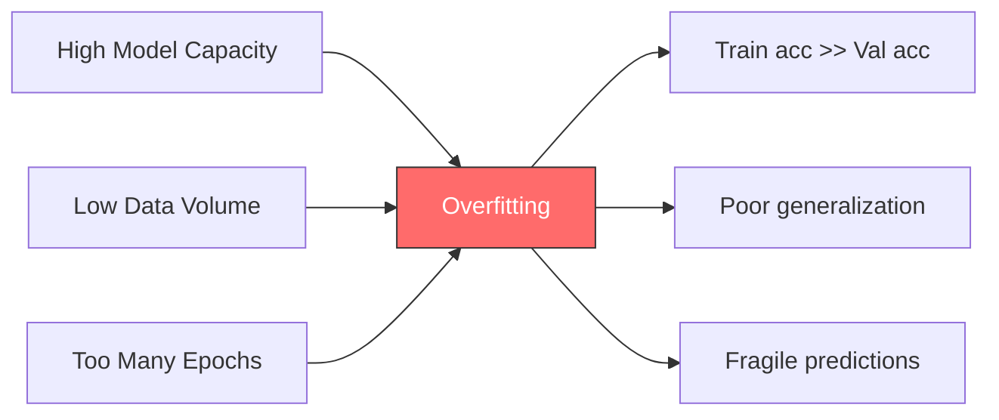
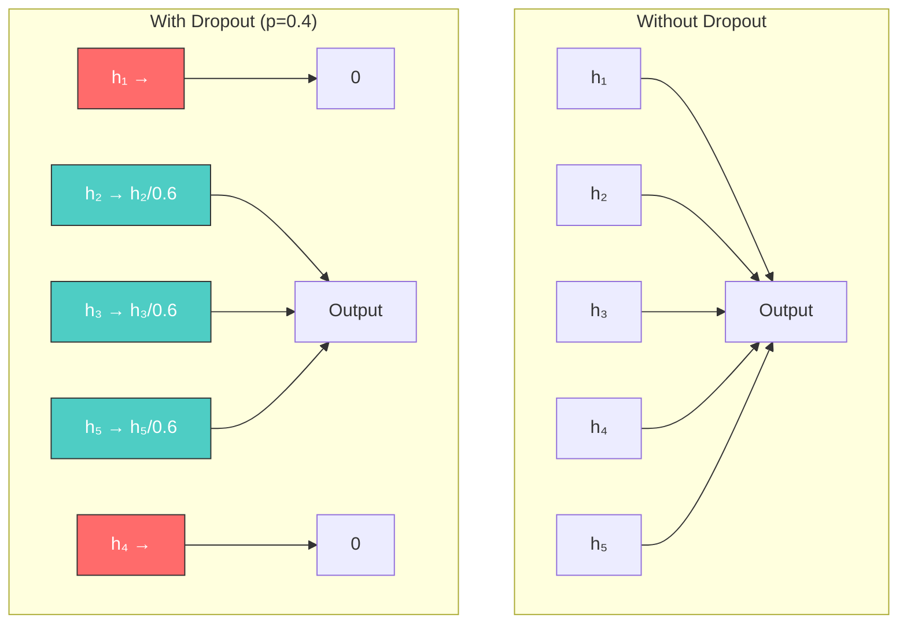
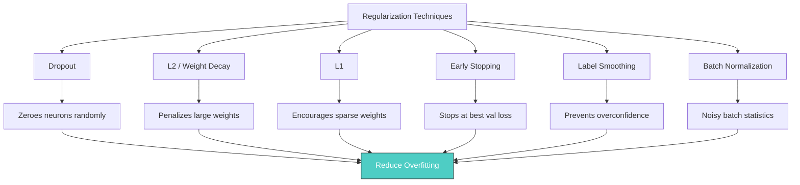

Regularization is the set of techniques that prevents a neural network from overfitting to its training data, and overfitting is the single most common failure mode in deep learning: the model memorizes the training examples so thoroughly that it fails to generalize to unseen data. Among the family's members — weight penalties, early stopping, label smoothing, data augmentation, and the incidental regularization of batch statistics — dropout stands out as one of the most elegant, effective, and widely used methods, introduced by Nitish Srivastava, Geoffrey Hinton, and colleagues in their 2014 paper *"Dropout: A Simple Way to Prevent Neural Networks from Overfitting"*. This note treats overfitting as the central problem first, then develops dropout in depth: its mechanism, its mathematics, the reasons it works, its training-versus-evaluation behavior, its PyTorch implementation, and the practical questions of dropout rate and placement. It then covers the weight-penalty family (L2/weight decay, L1/lasso, elastic net), early stopping, and label smoothing, and closes with the surrounding discipline — data splits, feature scaling, capacity choice, weight initialization, and systematic hyperparameter tuning — that determines when regularization is needed at all.

## Overfitting: the central problem

### What overfitting is

Overfitting occurs when a model learns patterns that are specific to the training data but do not generalize to unseen data. The model has memorized the training examples — including their noise and idiosyncrasies — rather than learning the underlying patterns that would allow it to make accurate predictions on new inputs. An overfit model performs exceptionally well on the training set but poorly on the validation and test sets; this gap between training performance and validation performance is the hallmark of overfitting and the primary diagnostic signal that regularization is needed.

The exam memorization analogy makes the failure concrete. A student who memorizes the exact answers to every question on a practice exam, without understanding the underlying concepts, fails catastrophically when the actual exam arrives with different questions testing the same concepts — they never learned the general principles, only specific input–output pairs. A student who understands the concepts can answer new questions correctly because they learned the underlying patterns, not just the specific examples. A neural network that overfits is the memorizing student: it has stored the training data rather than extracting the generalizable features. Nor is this an exotic corner case — deep learning models are so powerful that they can easily memorize the training data and fail on new data (in French, *surapprentissage*), which is why overfitting, not optimization failure, is the everyday enemy of deep learning practice.

### Detecting overfitting

The most reliable way to detect overfitting is to monitor both the training loss (or accuracy) and the validation loss (or accuracy) during training. In a well-generalizing model, both training and validation metrics improve steadily and converge to similar values. In an overfitting model, the training metrics continue to improve while the validation metrics plateau and then begin to degrade; the point at which validation loss starts increasing while training loss continues decreasing is called the **divergence point**, and it marks the onset of overfitting. Mathematically, overfitting is indicated when:

$$\text{Training Accuracy} \gg \text{Validation Accuracy}$$

For example, a training accuracy of 99% against a validation accuracy of 75% is severe overfitting. A healthy gap is roughly 2–5 percentage points; a gap of 20 or more points indicates serious overfitting that needs to be addressed.

Always plot the training loss and validation loss together — the relationship between the two curves tells you exactly what is happening and what to do about it. If both are high, the model is **underfitting**: it has not learned the patterns in the data, and the remedies are to increase model capacity (more layers, more neurons), train longer, or reduce regularization. If training loss is low but validation loss is high, the model is **overfitting** — it has memorized the training data but cannot generalize, and the remedies are to add regularization (L2, dropout), get more data, use data augmentation, or reduce model capacity. If both are low and close together, the model is well fit: it has learned the patterns without memorizing the noise, which is the ideal scenario.

> [!warning] Overfitting is not always obvious
> Overfitting can be subtle. A model that achieves 92% training accuracy and 88% validation accuracy may seem fine, but if a properly regularized version of the same model achieves 89% training accuracy and 89% validation accuracy, the regularized model is actually better — it generalizes more reliably even though its training accuracy is lower. Always compare validation metrics, not training metrics.

### Why overfitting happens

Overfitting occurs due to a fundamental imbalance between model capacity and data availability. It has three primary causes, each of which points to its own remedy:

1. **Too many parameters relative to training data.** A model with millions of parameters can easily memorize a dataset of only thousands of examples. The model has so many degrees of freedom that it can fit the training data perfectly without needing to learn generalizable features — the "death by capacity" problem, where the model is powerful enough to memorize rather than generalize.
2. **Too little training data.** Even a moderately-sized model will overfit if the training dataset is too small. With insufficient examples, the model cannot learn the true data distribution; it can only learn the specific examples it has seen, so its representation of the data is built on an inadequate sample, leading to poor generalization.
3. **Training for too many epochs.** Even with an appropriate model size and sufficient data, training for too long will eventually cause overfitting. As training progresses, the model transitions from learning generalizable features to fitting the noise in the training data — which is exactly why early stopping is an effective regularization technique.

All three causes push in the same direction: the model ends up fitting the specific training sample rather than the underlying distribution. The diagram below summarizes how capacity, data volume, and training length converge on the same failure.



## Data splits and preparation

### Train, validation, and test sets

Never train and test on the same data. The standard split reserves about 70% of the data for the **training set**, used to update the weights — to learn them; 15% for the **validation set**, used to evaluate hyperparameter choices such as the number of layers and the learning rate, to prevent overfitting during training, and to trigger early stopping; and 15% for the **test set**, kept strictly isolated and used only once, at the very end, to evaluate final real-world performance on untouched data. These roles are what make the diagnostics above meaningful: without an honest validation signal there is no divergence point to observe and no early stopping to trigger. Rotating, flipping, or zooming images to artificially create more training data — data augmentation — is a complementary route to better generalization, treated in [[05 - Neural Network Foundations/Training Dynamics and Stability/Data Augmentation|Data Augmentation]].

> [!tip] Dataset splitting
> Never train and test on the same data. Split your data:
>
> - **Train (70%):** To learn the weights.
> - **Validation (15%):** To tune hyperparameters (number of layers, learning rate) and trigger Early Stopping.
> - **Test (15%):** Untouched data for final evaluation.

### Preparing raw features

Before training, the raw inputs must be made usable. Missing values must be handled, by imputing or deleting them. Categorical variables must be numericized using **one-hot encoding**, the standard treatment for categorical text data. And the data **must** be scaled — min-max or z-score — because unscaled data will cause gradient descent to explode or stall; scaling is crucial for convergence, not a cosmetic step. The pairings matter in practice: standardization (z-score) is usually paired with ReLU, while min-max scaling is paired with sigmoid or tanh. The full cleaning and encoding workflow is treated in [[Data Preparation for Neural Networks]] and [[Data Cleaning and Encoding Lab]].

### Feature scaling mathematics

Neural networks are highly sensitive to the scale and distribution of input data. If Feature A ranges from 0–1 and Feature B ranges from 0–1,000,000, gradient descent will create elongated contour plots, oscillating wildly and converging extremely slowly; scaling creates circular contours, allowing the optimizer to take a direct path to the minimum. Preprocessing is not optional — it is mandatory for convergence.

**Standardization (z-score normalization)** transforms the data to have a mean of 0 and a standard deviation of 1:

$$ x' = \frac{x - \mu}{\sigma} $$

Here $\mu$ is the mean of the feature and $\sigma$ is the standard deviation of the feature. Standardization is always preferred when using ReLU: it centers the data around zero, which helps gradient descent navigate efficiently, and it handles outliers better than min-max because it does not bound the data to a specific range — an outlier at 1000 will be mapped to a high z-score but will not compress all other values into a tiny range. After standardization, approximately 68% of values fall within $[-1, 1]$, 95% within $[-2, 2]$, and 99.7% within $[-3, 3]$.

**Normalization (min-max scaling)** squeezes the data into a fixed range, typically $[0, 1]$:

$$ x' = \frac{x - x_{min}}{x_{max} - x_{min}} $$

Min-max scaling is preferred when using sigmoid or tanh activations, as their active, non-saturating regions are explicitly bounded between 0 and 1 (or −1 and 1). Its vulnerability is a single extreme outlier, which will compress all other values into a tiny range: if one house costs $10,000,000 while all others are under $500,000, min-max scaling would map 99% of the data to values between 0 and 0.05, losing most of the discriminative information.

> [!warning] Critical pitfall: data leakage
> You must fit the scaler (calculate $\mu, \sigma, x_{min}, x_{max}$) on the **training set only**. Then, use those exact parameters to transform the validation and test sets. If you calculate the min/max or mean/std on the entire dataset, you commit "data leakage" — giving the model hints about the test data during training. This results in artificially high performance that will not hold in production. The test set must remain completely unseen during all preprocessing decisions.

## Dropout: the technique

### What dropout does

Dropout is a regularization technique that, during each forward pass in training (see [[Forward Propagation]]), randomly "drops" (sets to zero) a fraction of the neurons in a layer. Each neuron is independently dropped with probability $p$ (called the dropout rate), and the remaining neurons have their outputs scaled up by a factor of $\frac{1}{1-p}$. This scaling is critical and is called **inverted dropout** — it ensures that the expected value of each neuron's output remains the same whether or not dropout is applied, which simplifies the transition between training and evaluation modes. The learning effect matters as much as the arithmetic: randomly turning off a percentage of neurons during training prevents the network from becoming overly reliant on any specific feature or neuron, forcing it not to rely on any single unit.

### The mathematics of inverted dropout

For a layer with activations $\mathbf{h} = (h_1, h_2, \ldots, h_n)$, dropout applies a random binary mask $\mathbf{r} = (r_1, r_2, \ldots, r_n)$ where each $r_i$ is drawn independently from a Bernoulli distribution:

$$r_i \sim \text{Bernoulli}(1 - p)$$

Each $r_i$ is 1 with probability $(1-p)$ and 0 with probability $p$. The dropout output is then:

$$\tilde{h}_i = \frac{r_i \cdot h_i}{1 - p}$$

When $r_i = 0$ (dropped), $\tilde{h}_i = 0$. When $r_i = 1$ (kept), $\tilde{h}_i = \frac{h_i}{1-p}$, which scales up the output to compensate for the missing neurons. The expected value is preserved:

$$E[\tilde{h}_i] = E\left[\frac{r_i \cdot h_i}{1-p}\right] = \frac{h_i}{1-p} \cdot E[r_i] = \frac{h_i}{1-p} \cdot (1-p) = h_i$$

This preservation of expected value is what makes dropout work seamlessly: at test time, we use all neurons with no scaling, and the expected output matches the expected output during training. The diagram below shows a five-neuron layer under dropout rate $p = 0.4$: two units are zeroed, and the three survivors are scaled by $1/0.6$.



## Why dropout works

Randomly zeroing neurons looks destructive, and that is precisely the point: the destruction is what forces the network into more robust learning behavior. Three complementary mechanisms explain why dropout improves generalization — the prevention of co-adaptation, an implicit ensemble effect, and noise that drives redundant representations. Each is worth understanding on its own terms.

### Preventing co-adaptation

In an unregularized network, neurons can develop **co-adaptations**: complex interdependencies where certain neurons only produce useful outputs when specific other neurons are also active. For example, neuron A might learn to detect "pointy ears" and neuron B might learn to detect "whiskers," but neuron C might only activate when both A and B are active, meaning C is essentially a "cat face" detector that relies on A and B being present. This co-adaptation is problematic because if A or B is somehow disrupted — by input noise, distribution shift, or simply being in a different context — C also fails, creating a fragile cascade of dependencies.

Dropout breaks these co-adaptations by making it impossible for any neuron to rely on any specific other neuron being present. Since each neuron has a probability $p$ of being dropped during any given forward pass, no neuron can afford to depend on a specific partner. Each neuron must learn features that are **individually useful** — features that contribute meaningfully to the output regardless of which other neurons are active. This makes the network more robust because the learned features are independently meaningful rather than only meaningful in specific combinations.

### The ensemble effect

Dropout effectively trains an **ensemble** of neural networks during a single training run. Consider a fully connected layer with $n$ neurons: with dropout rate $p$, each neuron can be either present or absent, giving $2^n$ possible sub-network configurations (though in practice, most of these will never be explicitly visited during training). Each training forward pass uses a different random subset of neurons, which corresponds to training a different sub-network, and the gradient update for each sub-network is applied only to the neurons that were active during that forward pass.

At test time, when all neurons are active, the full network can be interpreted as an **approximate ensemble average** of all the sub-networks seen during training. Ensemble averaging is a well-established technique in machine learning: the average prediction of many models is consistently more accurate and more robust than the prediction of any single model, because different models make different errors and averaging tends to cancel out individual errors. Dropout provides this ensemble benefit at the cost of training only one model — with shared weights across sub-networks — which is far more efficient than training $2^n$ independent models.

### Noise and redundant representations

The random zeroing of neurons during training injects stochastic noise into the network's forward pass. This noise forces the network to learn **redundant representations** — multiple independent pathways for computing the same information. If there is only one pathway for detecting a particular feature, and the neurons in that pathway are dropped, the network has no alternative and produces a poor prediction. By contrast, if the network has learned multiple redundant pathways, dropping any subset of neurons merely degrades the prediction slightly rather than catastrophically failing.

This redundant representation is directly analogous to biological neural systems, where the brain maintains robustness despite the constant death of individual neurons. The stochasticity of dropout also has a Bayesian interpretation: dropout can be viewed as performing approximate Bayesian inference, where the random masks represent sampling from a distribution over model weights. This interpretation was formalized by Gal and Ghahramani (2016) in their work on "Dropout as a Bayesian Approximation."

> [!tip] All three reasons work together
> The three reasons are not independent — they are three perspectives on the same underlying mechanism. Preventing co-adaptation leads to individually useful features, which naturally form an ensemble, which is made robust by redundant representations. Dropout's effectiveness comes from this combined effect.

## Dropout in training versus evaluation

Just like [[05 - Neural Network Foundations/Training Dynamics and Stability/Batch Normalization|Batch Normalization]], dropout behaves completely differently during training and evaluation. Understanding this distinction is absolutely critical — getting it wrong will produce silently incorrect results. The table below summarizes the two modes side by side after each is described.

### Training mode

During training, dropout is active. Each neuron is independently dropped with probability $p$, and the surviving neurons have their outputs scaled by $\frac{1}{1-p}$ (inverted dropout). The dropout mask is resampled for every forward pass, meaning the specific set of dropped neurons changes from one training step to the next. This constant variation is what provides the regularization benefit.

### Evaluation mode

During evaluation (inference), dropout is **completely disabled**. No neurons are dropped — every neuron is active and uses its full, unmodified output. No scaling is applied either, because the inverted dropout scaling during training already ensured that the expected output matches the full-network output. The network uses its full capacity at test time, which is essential because we want the most accurate predictions possible.

### Why model.eval() is mandatory

If you forget to call `model.eval()` before inference, dropout will continue dropping neurons during evaluation. This means your predictions will be stochastic (different runs produce different results) and suboptimal (you are throwing away information); for a single prediction, dropping neurons is catastrophic because you are intentionally degrading the model's capability. For ensemble predictions — averaging over multiple stochastic forward passes — this can actually be useful as a form of uncertainty estimation (Monte Carlo dropout), but this is an advanced technique that must be done intentionally, not accidentally.

| Behavior | Training Mode | Evaluation Mode |
|----------|--------------|-----------------|
| Dropout active? | Yes | **No** |
| Neurons dropped? | Yes, with probability $p$ | **No, all active** |
| Scaling applied? | Yes, multiply by $\frac{1}{1-p}$ | **No scaling needed** |
| Output deterministic? | No (random each pass) | **Yes (same input → same output)** |
| Purpose | Regularization | **Best possible prediction** |

> [!warning] Forgetting model.eval() before inference
> This is one of the most common bugs in deep learning. If you forget `model.eval()`, Dropout will randomly zero out neurons during inference, making your predictions noisy and unreliable. The bug is particularly insidious because it does not raise any error — the model simply produces inconsistent outputs. Always, always call `model.eval()` before running inference, and `model.train()` before resuming training.

## Implementing dropout in PyTorch

### Basic dropout usage

PyTorch's `nn.Dropout` implements inverted dropout directly: you set the dropout probability $p$, and the module zeroes each element with that probability during training while automatically scaling the survivors by $\frac{1}{1-p}$. The example below creates a dropout layer with $p=0.5$ (each neuron has a 50% chance of being zeroed during training; the remaining neurons are automatically scaled by $1/(1-0.5) = 2.0$) and runs a small batch of activations through it in both modes. In training mode roughly half the values are zeroed and the rest are doubled; in evaluation mode the output is identical to the input.

```python
import torch
import torch.nn as nn

# Create a Dropout layer with dropout probability p=0.5
# This means each neuron has a 50% chance of being zeroed during training
# The remaining neurons are automatically scaled by 1/(1-0.5) = 2.0
dropout = nn.Dropout(p=0.5)

# Create a random input tensor simulating activations from a fully connected layer
# Shape: (batch_size=4, features=6) — 4 samples, each with 6 features
x = torch.tensor([
    [1.0, 2.0, 3.0, 4.0, 5.0, 6.0],
    [0.5, 1.5, 2.5, 3.5, 4.5, 5.5],
    [0.1, 0.2, 0.3, 0.4, 0.5, 0.6],
    [10.0, 20.0, 30.0, 40.0, 50.0, 60.0]
])

# --- Training Mode (default) ---
# Dropout is active: some elements will be zeroed, others scaled up
dropout.train()  # Explicitly set to training mode (this is the default)
y_train = dropout(x)
print("Training mode output:")
print(y_train)
# You will see approximately half the values zeroed out
# The non-zero values will be multiplied by 1/(1-0.5) = 2.0
# For example, if x[0,0] = 1.0 and it's kept, y_train[0,0] = 2.0
# If x[0,1] = 2.0 and it's dropped, y_train[0,1] = 0.0

# --- Evaluation Mode ---
# Dropout is disabled: all elements are kept, no scaling
dropout.eval()  # Switch to evaluation mode
y_eval = dropout(x)
print("\nEvaluation mode output:")
print(y_eval)
# Output will be identical to the input — no elements dropped, no scaling
# y_eval == x for all elements
```

### Dropout in a CNN architecture

The placement principles show up concretely in a typical convolutional classifier, as in [[Convolutional Neural Networks]]. Dropout is applied after the fully connected layers, which are the most parameter-heavy and overfitting-prone parts of the network, while the convolutional blocks use none because weight sharing already provides implicit regularization. The classifier below uses the classic VGG-style rate of $p=0.5$ on its FC layers — the first of which maps $128 \times 4 \times 4 = 2048$ inputs to 512 outputs, a single layer with $2048 \times 512 = 1{,}048{,}576$ parameters — and deliberately omits dropout on the output layer so the final logits stay reliable.

```python
import torch
import torch.nn as nn


class CNNWithDropout(nn.Module):
    """
    A CNN that demonstrates proper Dropout placement.

    Dropout is applied after the fully connected (FC) layers,
    which are the most parameter-heavy and overfitting-prone parts
    of the network. Convolutional layers typically use less aggressive
    dropout (or none) because weight sharing already provides
    implicit regularization.
    """

    def __init__(self, num_classes=10):
        # Call the parent class constructor — REQUIRED for nn.Module subclasses
        super(CNNWithDropout, self).__init__()

        # --- Feature Extraction (Convolutional) Layers ---
        # These layers extract spatial features from the input image
        # We use a standard Conv → BN → ReLU block pattern

        # Block 1: 3 input channels (RGB) → 32 output channels
        self.features = nn.Sequential(
            # Conv Block 1: 3 → 32 channels
            nn.Conv2d(3, 32, kernel_size=3, padding=1, bias=False),
            nn.BatchNorm2d(32),
            nn.ReLU(inplace=True),
            nn.MaxPool2d(2, 2),  # Downsample: 32×32 → 16×16

            # Conv Block 2: 32 → 64 channels
            nn.Conv2d(32, 64, kernel_size=3, padding=1, bias=False),
            nn.BatchNorm2d(64),
            nn.ReLU(inplace=True),
            nn.MaxPool2d(2, 2),  # Downsample: 16×16 → 8×8

            # Conv Block 3: 64 → 128 channels
            nn.Conv2d(64, 128, kernel_size=3, padding=1, bias=False),
            nn.BatchNorm2d(128),
            nn.ReLU(inplace=True),
            nn.MaxPool2d(2, 2),  # Downsample: 8×8 → 4×4
        )

        # --- Classifier (Fully Connected) Layers ---
        # These layers map extracted features to class predictions
        # This is where Dropout is MOST important because FC layers
        # have the most parameters and are most prone to overfitting

        self.classifier = nn.Sequential(
            # FC Layer 1: 128 * 4 * 4 = 2048 → 512
            # This is a large layer with 2048 × 512 = 1,048,576 parameters!
            # Definitely needs Dropout to prevent overfitting
            nn.Linear(128 * 4 * 4, 512),
            nn.ReLU(inplace=True),
            # Dropout with p=0.5: drop 50% of neurons in this FC layer
            # This is the classic VGG-style dropout rate for FC layers
            nn.Dropout(p=0.5),

            # FC Layer 2: 512 → 256
            nn.Linear(512, 256),
            nn.ReLU(inplace=True),
            # Dropout with p=0.5: again, aggressive dropout for FC layer
            nn.Dropout(p=0.5),

            # Output Layer: 256 → num_classes
            # NO DROPOUT HERE! The output layer must produce reliable logits
            # Applying Dropout here would randomly zero out predictions
            nn.Linear(256, num_classes),
        )

    def forward(self, x):
        """
        Forward pass through the network.

        Args:
            x: input images of shape (B, 3, 32, 32)

        Returns:
            logits of shape (B, num_classes)
        """
        # Extract features using convolutional layers
        # Output shape: (B, 128, 4, 4)
        x = self.features(x)

        # Flatten the feature maps for the FC classifier
        # (B, 128, 4, 4) → (B, 128*4*4) = (B, 2048)
        x = x.view(x.size(0), -1)

        # Classify using FC layers with Dropout
        # During training: Dropout is active
        # During evaluation: Dropout is disabled
        x = self.classifier(x)

        return x


# --- Example Usage ---
model = CNNWithDropout(num_classes=10)
dummy_input = torch.randn(32, 3, 32, 32)  # Batch of 32 RGB 32×32 images

# Training mode: Dropout is active
model.train()
train_output = model(dummy_input)  # Some neurons zeroed in FC layers

# Evaluation mode: Dropout is disabled
model.eval()
eval_output = model(dummy_input)  # All neurons active, no zeroing
```

### Dropout2d for convolutional layers

When applying dropout to convolutional layers, use `nn.Dropout2d` instead of `nn.Dropout`. The difference is that `Dropout2d` drops entire **channels** (feature maps) rather than individual elements. This makes more sense for convolutional features, because spatially adjacent elements within a channel are highly correlated — dropping individual elements would likely have little effect, since neighboring elements would compensate. Dropping an entire channel forces the network not to rely on any single feature detector, which is the true intent of dropout.

```python
# Dropout2d: drops entire feature channels
# Each channel (across all spatial locations) is either entirely kept or entirely zeroed
# p=0.2: each channel has a 20% chance of being dropped
# This is less aggressive than the p=0.5 used for FC layers
conv_dropout = nn.Dropout2d(p=0.2)

# Example: feature maps from a convolutional layer
# Shape: (B, C, H, W) = (32, 64, 28, 28)
feature_maps = torch.randn(32, 64, 28, 28)

# Training mode: some channels will be entirely zeroed
conv_dropout.train()
output = conv_dropout(feature_maps)
# If channel 5 is dropped, output[:, 5, :, :] will be all zeros
# Remaining channels are scaled by 1/(1-0.2) = 1.25
```

## Choosing a dropout rate

Choosing the right dropout rate $p$ is important. Too little dropout provides insufficient regularization, while too much dropout destroys the network's capacity and prevents learning. The standard values have been established through extensive empirical research.

### Fully connected layers: p = 0.5

The value $p = 0.5$ was the original recommendation from the dropout paper and remains the standard default for fully connected layers. At $p = 0.5$, the maximum amount of information is destroyed during training (since half the neurons are dropped), which provides the strongest regularization. This is appropriate for FC layers because they typically have the most parameters and are most prone to overfitting. The classic VGG networks use dropout with $p = 0.5$ on their FC layers, and this value has been validated across countless architectures and datasets.

### Convolutional layers: p = 0.2–0.3

Convolutional layers require less aggressive dropout than FC layers for several reasons. First, convolutional layers have far fewer parameters due to **weight sharing** — each filter's weights are shared across all spatial positions, which provides an implicit form of regularization. Second, the spatial structure of convolutional features means that adjacent pixels are highly correlated, so even without dropout the network cannot easily memorize individual training examples. Third, batch normalization, which is almost always used with convolutional layers, already provides a regularizing effect. A lighter dropout rate of $p = 0.2$ to $p = 0.3$ is therefore typically sufficient for convolutional layers.

### Special cases

Three special cases round out the picture. With $p = 0$, dropout is completely disabled — equivalent to not using dropout at all — and some modern architectures (ResNet, EfficientNet) achieve sufficient regularization through batch normalization alone. Values above $p = 0.5$ are very aggressive and can prevent the network from learning effectively; they are used only in extreme overfitting scenarios where the dataset is tiny relative to model size. Finally, some practitioners use progressively higher dropout rates in deeper FC layers, on the theory that deeper layers are more prone to overfitting because they receive more abstract, dataset-specific features.

| Layer Type | Recommended $p$ | Rationale |
|-----------|-----------------|-----------|
| FC (large, >512 units) | 0.5 | Most parameters, highest overfitting risk |
| FC (small, <512 units) | 0.3–0.5 | Moderate overfitting risk |
| Convolutional | 0.2–0.3 | Weight sharing provides implicit regularization |
| Output layer | 0.0 | Never apply dropout to output predictions |

## Where to place dropout

The placement of dropout within a network architecture matters significantly. The key principle is: **apply dropout where overfitting risk is highest**, which typically means the largest fully connected layers. Placed well, dropout protects exactly the parameters that would otherwise memorize the training set; placed badly — for instance on the output layer — it damages the predictions themselves.

### Most effective on large fully connected layers

Fully connected layers are the most overfitting-prone components of a CNN because they contain the vast majority of parameters. In a typical CNN, the FC layers might contain 90% or more of the total parameters. For example, in VGG-16, the first FC layer alone has $7 \times 7 \times 512 \times 4096 = 102,760,448$ parameters — over 100 million weights in a single layer. This massive parameter count makes FC layers extremely prone to memorizing training examples, and this is precisely where dropout is most needed and most effective.

### Never after the output layer

Dropout should **never** be applied after the final output layer. The reason is straightforward: the output layer produces the network's predictions (logits or probabilities), and randomly zeroing out these predictions would make the output meaningless. For a 10-class classification problem, dropping output neurons would randomly remove class predictions, which is never desirable. The output layer must produce complete, reliable predictions, and dropout has no role there.

### Placement relative to the activation

The most common placement is: `Linear → ReLU → Dropout`. This applies dropout after the activation function, which means the zeroed values are clean (ReLU outputs are non-negative). Some practitioners place dropout before the activation (`Linear → Dropout → ReLU`), which is also valid but less common. The difference is subtle and rarely matters in practice, but the post-activation placement is the standard convention.

## Weight penalties: L2 and L1

When an MLP (see [[Perceptrons and Multi-Layer Perceptrons]]) has too many parameters relative to the data, it memorizes the training set: near-zero training loss but poor performance on new, unseen data. Regularization adds a penalty to the cost function to force the network to keep its weights small and simple, preventing it from fitting the noise in the training data. While dropout is the most popular explicit regularization technique, it is part of a broader family of methods that combat overfitting — understanding these alternatives and complements is essential for building robust models, and the classical weight penalties are the core of that family.

### L2 regularization (ridge, weight decay)

L2 regularization adds the squared magnitude of the weights to the loss function:

$$ J_{regularized} = J_{original} + \lambda \sum_{j=1}^{m} w_j^2 $$

Here $\lambda$ (lambda) is the regularization strength hyperparameter: a larger $\lambda$ forces the weights to be smaller, while a smaller $\lambda$ allows them to grow freely. The same penalty is often written in modern notation as:

$$\mathcal{L}_{\text{total}} = \mathcal{L}_{\text{original}} + \lambda \sum_{j} w_j^2$$

where $\lambda$ is the regularization strength (a hyperparameter) and the sum runs over all weights in the network — biases are typically excluded from the penalty.

The effect of L2 is to force weights to be small but rarely exactly zero; it smooths the model by preventing any single weight from becoming too large and dominating the prediction. This is the most common form of regularization in deep learning, where it is often called **weight decay**. The reason it works: large weights indicate that the model is relying heavily on specific features, which is a sign of overfitting. By penalizing large weights, L2 regularization forces the model to spread importance across many features, leading to more robust predictions; small weights produce smoother, less complex decision boundaries, which tend to generalize better, whereas large weights allow the network to make very sharp, confident predictions that fit the training data perfectly but fail on new data. The gradient of the regularization term is $2\lambda w_j$, which is added to the gradient of the original loss — the regularization effect is proportional to the current weight value, so larger weights are penalized more. In the weight update, this gradient term acts as a constant decay toward zero:

$$w_j \leftarrow w_j - \eta \frac{\partial \mathcal{L}_{\text{original}}}{\partial w_j} - 2\eta\lambda w_j = (1 - 2\eta\lambda)w_j - \eta \frac{\partial \mathcal{L}_{\text{original}}}{\partial w_j}$$

The factor $(1 - 2\eta\lambda)$ shrinks the weight slightly at every step, which is why the technique is called "weight decay."

In PyTorch, weight decay is specified as a parameter in the optimizer, not as a modification to the loss function. This is because PyTorch implements weight decay as a decoupled weight update rather than adding a term to the loss gradient. Common values range from 1e-4 (mild) to 1e-2 (strong); for most CNN training, 1e-4 to 5e-4 is a good starting point, and adaptive optimizers typically call for the decoupled variant with a larger decay constant, as in the example below.

```python
import torch.optim as optim

# SGD optimizer with weight decay (L2 regularization)
# weight_decay = λ in the L2 penalty formula
# Common values: 1e-4 (mild) to 1e-2 (strong)
# For most CNN training, 1e-4 to 5e-4 is a good starting point
optimizer = optim.SGD(
    model.parameters(),
    lr=0.01,
    momentum=0.9,
    weight_decay=1e-4  # L2 regularization strength
)

# Adam optimizer with weight decay
# NOTE: For Adam, use AdamW instead of Adam + weight_decay
# AdamW implements decoupled weight decay, which is more effective
optimizer_adamw = optim.AdamW(
    model.parameters(),
    lr=0.001,
    weight_decay=1e-2  # AdamW typically uses larger weight_decay than SGD
)
```

> [!tip] AdamW vs Adam + weight_decay
> The standard Adam optimizer with weight_decay implements L2 regularization by adding the penalty to the gradient, which interacts badly with Adam's adaptive learning rates. AdamW (Loshchilov & Hutter, 2019) implements **decoupled weight decay**, applying the decay directly to the weights rather than through the gradient. This produces more consistent and effective regularization. Always prefer AdamW over Adam + weight_decay.

### L1 regularization (lasso)

L1 regularization adds the absolute magnitude of the weights to the loss function:

$$ J_{regularized} = J_{original} + \lambda \sum_{j=1}^{m} |w_j| $$

or, in the same notation as the L2 penalty above:

$$\mathcal{L}_{\text{total}} = \mathcal{L}_{\text{original}} + \lambda \sum_{j} |w_j|$$

The key difference from L2 regularization is that L1 encourages **exact zeros** in the weight matrix, producing **sparse** models where many weights are exactly zero. This happens because the gradient of $|w_j|$ is $\pm 1$ (for $w_j \neq 0$), which applies a constant force toward zero regardless of the current weight magnitude; in contrast, L2's gradient of $2w_j$ applies a force proportional to the weight, so it gets weaker as the weight approaches zero and never quite reaches it. Because L1's force is constant, even very small weights are pushed all the way to zero. The sparsity effectively performs feature selection — the network learns to ignore useless features by setting their weights to exactly 0.

L1 is the right tool when you suspect many features are irrelevant and want the model to automatically identify and discard them; it is popular in interpretability-critical applications where you need to know which features matter, and it can help where computational efficiency requires a smaller effective model size. L1 is less commonly used in deep learning than L2, primarily because the sparsity it induces can be too aggressive for the dense, distributed representations that neural networks typically rely on. Unlike L2, it is not built into PyTorch optimizers and must be implemented manually by adding the penalty to the loss:

```python
# L1 regularization is NOT built into PyTorch optimizers
# It must be implemented manually by adding the penalty to the loss

def l1_penalty(model, lambda_l1):
    """
    Compute the L1 penalty for all weight parameters in the model.

    Args:
        model: the neural network
        lambda_l1: L1 regularization strength

    Returns:
        The L1 penalty: λ * Σ|w|
    """
    l1_sum = 0.0
    for name, param in model.named_parameters():
        # Only apply L1 to weight parameters, not biases
        if 'weight' in name:
            l1_sum += param.abs().sum()  # Sum of absolute values of all weights
    return lambda_l1 * l1_sum


# Usage during training loop
# for inputs, targets in dataloader:
#     outputs = model(inputs)
#     loss = criterion(outputs, targets)  # Original loss (e.g., CrossEntropy)
#     loss_total = loss + l1_penalty(model, lambda_l1=1e-5)  # Add L1 penalty
#     optimizer.zero_grad()
#     loss_total.backward()
#     optimizer.step()
```

### Choosing between L1 and L2

The choice follows from what you believe about your features. Use L2 (ridge) when you believe all features contribute somewhat and you want to prevent any one from dominating — this is the default choice in most deep learning applications. Use L1 (lasso) when you want feature selection: a sparse model where many weights are exactly zero, which is useful when interpretability is important. Elastic net (L1 + L2) combines both penalties, $J_{reg} = J_{original} + \lambda_1 \sum |w_j| + \lambda_2 \sum w_j^2$, getting the sparsity of L1 with the stability of L2.

## Early stopping

Early stopping (in French, *arrêt précoce*) is perhaps the simplest and most intuitive regularization technique: monitor the validation loss during training, and stop training when the validation loss stops improving and starts increasing. The key insight is that the divergence point — where validation loss begins to increase while training loss continues to decrease — is exactly the point where the model begins to overfit; by stopping at this point, we prevent the model from memorizing the training data and preserve its ability to generalize. In practice, early stopping is implemented with a **patience** parameter: training continues until the validation loss has failed to improve for `patience` consecutive epochs, which prevents premature stopping due to temporary fluctuations in validation loss. Common patience values range from 5 to 20 epochs, depending on the dataset and training dynamics.

```python
# Early stopping implementation
best_val_loss = float('inf')  # Initialize to infinity
patience = 10  # Number of epochs to wait for improvement
patience_counter = 0  # Counter for epochs without improvement

for epoch in range(num_epochs):
    # Training phase
    model.train()
    train_loss = train_one_epoch(model, train_loader, optimizer, criterion)

    # Validation phase
    model.eval()  # IMPORTANT: switch to eval mode for validation
    val_loss = evaluate(model, val_loader, criterion)

    # Check if validation loss improved
    if val_loss < best_val_loss:
        best_val_loss = val_loss
        patience_counter = 0
        # Save the best model weights
        torch.save(model.state_dict(), 'best_model.pth')
    else:
        patience_counter += 1

    # Early stopping condition
    if patience_counter >= patience:
        print(f"Early stopping at epoch {epoch}")
        print(f"Best validation loss: {best_val_loss:.4f}")
        break

# Load the best model weights (from the epoch with lowest validation loss)
model.load_state_dict(torch.load('best_model.pth'))
```

> [!info] Early stopping always saves the best model
> When using early stopping, you should always save the model weights from the epoch with the best validation loss, not from the final epoch. The final epoch may have worse validation performance due to overfitting that occurred after the divergence point. The saved best model is the one with the best generalization ability.

## Label smoothing

Label smoothing replaces hard 0/1 target labels with soft targets that distribute a small amount of probability mass across all classes. For a classification problem with $K$ classes, instead of the hard target vector $[0, 0, 1, 0, \ldots, 0]$ — which puts all probability on the correct class — label smoothing uses:

$$y_i^{\text{smooth}} = \begin{cases} 1 - \alpha + \frac{\alpha}{K} & \text{if } i \text{ is the correct class} \\ \frac{\alpha}{K} & \text{otherwise} \end{cases}$$

where $\alpha$ is the smoothing parameter (typically 0.1). For a 10-class problem with $\alpha = 0.1$, the correct class target becomes $0.9 + 0.01 = 0.91$ by the formula. The worked arithmetic is often walked through as: the correct class target is $1 - 0.1 = 0.9$, and each incorrect class target is $0.1 / 10 = 0.01$, so the smoothed label is $[0.01, 0.01, 0.9, 0.01, \ldots, 0.01]$ instead of $[0, 0, 1, 0, \ldots, 0]$. The two readings differ by the $\alpha/K$ mass that the formula adds back to the correct class; an implementation of $\text{label smoothing} = 0.1$ produces the $0.91$ value.

Hard targets encourage the model to become extremely confident in its predictions, pushing logits to very large magnitudes. This overconfidence makes the model fragile — a small perturbation to the input can cause a large change in the prediction. Label smoothing prevents this by distributing some probability mass to incorrect classes, which prevents the logits from growing too large and encourages the model to maintain a small degree of uncertainty. This uncertainty is actually desirable because it makes the model more robust to input noise and distribution shift. PyTorch's `CrossEntropyLoss` exposes the smoothing parameter directly:

```python
import torch.nn as nn

# PyTorch's CrossEntropyLoss has a built-in label_smoothing parameter
# label_smoothing = α in the formula above (default: 0.0, no smoothing)
criterion_smooth = nn.CrossEntropyLoss(label_smoothing=0.1)

# Compare with standard (no smoothing) loss
criterion_hard = nn.CrossEntropyLoss(label_smoothing=0.0)

# Example: 3 samples, 5 classes
logits = torch.randn(3, 5)  # Raw model outputs (before softmax)
targets = torch.tensor([0, 2, 4])  # Correct class indices

loss_smooth = criterion_smooth(logits, targets)  # With label smoothing
loss_hard = criterion_hard(logits, targets)      # Without label smoothing

# The smoothed loss will typically be slightly larger because it penalizes
# overconfident predictions that put all probability on one class
```

## Comparing and combining regularization techniques

The techniques in this note attack overfitting from different directions, and they differ in where they apply, how strong their effect is, and what values are commonly used. The table summarizes the toolkit; the diagram shows how each mechanism contributes to the same goal.

| Technique | How It Works | Where to Apply | Strength | Common Value |
|-----------|-------------|----------------|----------|-------------|
| **Dropout** | Randomly zeros neurons during training | FC layers (p=0.5), Conv layers (p=0.2) | Strong | p=0.5 (FC), p=0.2 (Conv) |
| **L2 (Weight Decay)** | Penalizes large weights in loss function | All weight layers (via optimizer) | Moderate | λ=1e-4 to 5e-4 |
| **L1** | Penalizes weights, encourages sparsity | All weight layers (manual) | Moderate | λ=1e-5 |
| **Early Stopping** | Stops training when val loss increases | Training loop | Strong | patience=10 |
| **Label Smoothing** | Softens hard 0/1 targets | Loss function | Mild | α=0.1 |
| **Batch Normalization** | Noisy batch stats add regularization | After conv/FC layers | Mild | (built into BN) |



Dropout's power comes from three complementary mechanisms — preventing neuron co-adaptation, creating an implicit ensemble of sub-networks, and adding training noise that forces redundant representations — and its training/evaluation discipline (drop and scale during training; full network, no dropout, at inference) must always be respected by calling `model.eval()` before inference. Standard dropout rates are $p=0.5$ for fully connected layers and $p=0.2\text{–}0.3$ for convolutional layers. Beyond dropout, the toolkit includes L2 weight decay (penalizing large weights), L1 regularization (encouraging sparsity), early stopping (halting training at the optimal point), and label smoothing (preventing overconfidence), while batch normalization contributes mild regularization as a side effect of its noisy batch statistics. In practice, the best results typically come from combining multiple regularization techniques — for example, batch normalization + moderate dropout + weight decay + early stopping is a common and effective combination used in most modern CNN training pipelines. The unifying principle is that regularization deliberately trades training performance for generalization: a regularized model can be the better model even when its training accuracy is lower.

## Capacity, initialization, and tuning discipline

Building an effective network requires a disciplined, iterative approach; throwing a massive network at a problem and hoping for the best is a recipe for wasted time and poor results. Regularization decisions do not happen in a vacuum — how much capacity the model has, how its weights are initialized, and how hyperparameters are tuned together determine whether and where regularization is needed.

### Start simple and match capacity to the task

Always start with a very simple model — one hidden layer — and only add complexity if the model fails to capture the data relationships or if the simple model underfits. A simple model that works is always preferable to a complex model that might work: if a single hidden layer achieves 95% accuracy, adding more layers might only improve it to 95.5% while making training slower and more prone to overfitting. The architecture should be proportional to the complexity of the problem: simple problems (tabular data with few features) need 1–2 hidden layers with 32–128 neurons each; medium problems (small images, short text) need 2–4 hidden layers with 128–512 neurons each; and complex problems (large images, long sequences) call for deep architectures — CNNs, RNNs, Transformers — rather than simple MLPs, which are rarely used raw for these tasks. The full treatment of sizing and configuration lives in [[05 - Neural Network Foundations/Training Dynamics and Stability/Hyperparameters and Network Configuration|Hyperparameters and Network Configuration]].

### Weight initialization mathematics

Never initialize weights to zero: this causes symmetrical calculations where neurons learn the exact same things. If all weights start at 0, every neuron in a layer computes the same output, receives the same gradient during [[Backpropagation]], and updates identically — the layer acts as a single neuron, a phenomenon called **symmetry breaking failure**. Weights must therefore be initialized randomly, but carefully: the initialization must ensure that the variance of activations and gradients remains stable as they pass through the network. Naive random initialization fails in both directions — too-large values make activations grow exponentially through the layers (exploding gradients), while too-small values make activations shrink to zero through the layers (vanishing gradients); both scenarios prevent the network from learning, as detailed in [[05 - Neural Network Foundations/Training Dynamics and Stability/Vanishing and Exploding Gradients|Vanishing and Exploding Gradients]].

**Xavier (Glorot) initialization** is designed for sigmoid and tanh activations. It ensures that the variance of the outputs of a layer is roughly equal to the variance of its inputs:

$$ W \sim \mathcal{N}\left(0, \sqrt{\frac{1}{n_{in}}}\right) $$

Or using a uniform distribution:

$$ W \sim \mathcal{U}\left(-\sqrt{\frac{6}{n_{in} + n_{out}}}, +\sqrt{\frac{6}{n_{in} + n_{out}}}\right) $$

Here $n_{in}$ is the number of input neurons to the layer and $n_{out}$ is the number of output neurons from the layer. By scaling the initial weights inversely with the number of inputs, the variance of each neuron's output is approximately equal to the variance of its input. This prevents activations from growing or shrinking as they pass through the network, maintaining a stable signal throughout the forward pass.

**He initialization** is designed specifically for ReLU and its variants (see [[Activation Functions]]). Since ReLU zeros out half of the inputs (the negative ones), the variance of the output is effectively halved compared to the input; He initialization compensates by doubling the variance:

$$ W \sim \mathcal{N}\left(0, \sqrt{\frac{2}{n_{in}}}\right) $$

This prevents the signal from dying out (vanishing) or exploding (exploding gradients) as it passes through dozens of deep layers — the factor of 2 compensates for the fact that ReLU discards approximately half of the activations. The rule of thumb: always use He initialization with ReLU/Leaky ReLU/PReLU/ELU, and always use Xavier initialization with sigmoid/tanh; using the wrong initialization can cause the network to fail to converge entirely. The dedicated treatment of initialization schemes lives in [[05 - Neural Network Foundations/Training Dynamics and Stability/Weight Initialization|Weight Initialization]].

> [!warning] Never initialize weights to zero
> If all weights start at 0, every neuron in a layer computes the same output $z = 0 \cdot x_1 + 0 \cdot x_2 + \dots + b = b$, receives the same gradient during backpropagation (because the gradient depends on the same inputs and same errors), and updates by the same amount. After one update, all neurons still have identical weights. The layer effectively acts as a single neuron regardless of how many neurons it contains. This symmetry must be broken by random initialization.

### Change one hyperparameter at a time

Deep learning is highly empirical. If you change the learning rate, batch size, and number of layers all at once and the model improves, you won't know which change caused the improvement. The systematic approach is: start with a baseline architecture and default hyperparameters; change one hyperparameter (for example, the learning rate from 0.01 to 0.001); train and evaluate; keep the change if performance improved, revert if it got worse; then move to the next hyperparameter.

By importance, the hyperparameter search order is:

1. **Learning rate** — the most impactful. Start with 0.001 (the Adam default) and try log-scale variations.
2. **Batch size** — affects generalization and training speed. Try 32, 64, 128, 256.
3. **Number of hidden layers and neurons** — determines model capacity. Start small and grow.
4. **Regularization strength** ($\lambda$, dropout rate) — prevents overfitting. Add only if overfitting is observed.
5. **Activation function** — ReLU is the default; try Leaky ReLU or GELU only if ReLU underperforms.

Note where regularization sits in this order: late, and conditional on an observed overfitting problem. Regularization is the response to a diagnosed failure mode, not a default ingredient — and once it is needed, the techniques in this note are the toolkit to reach for.

## See also

- [[Neural Network Foundations MOC]]
- [[05 - Neural Network Foundations/Training Dynamics and Stability/Batch Normalization|Batch Normalization]]
- [[05 - Neural Network Foundations/Training Dynamics and Stability/Data Augmentation|Data Augmentation]]
- [[05 - Neural Network Foundations/Training Dynamics and Stability/Hyperparameters and Network Configuration|Hyperparameters and Network Configuration]]
- [[05 - Neural Network Foundations/Training Dynamics and Stability/Vanishing and Exploding Gradients|Vanishing and Exploding Gradients]]
- [[05 - Neural Network Foundations/Training Dynamics and Stability/Weight Initialization|Weight Initialization]]
- [[Activation Functions]]
- [[Data Preparation for Neural Networks]]
- [[Perceptrons and Multi-Layer Perceptrons]]
- [[Convolutional Neural Networks]]
- [[Backpropagation]]
- [[Forward Propagation]]
- [[Data Cleaning and Encoding Lab]]
