Deep networks learn by backpropagation, and backpropagation hands each early layer a gradient that is a product of many per-layer factors — one for every layer between the loss and that parameter. When those factors are mostly smaller than one, the product collapses exponentially toward zero (the vanishing gradient problem); when they are mostly larger than one, it grows exponentially toward infinity (the exploding gradient problem). Both failure modes are fundamental to the mathematics of backpropagating through deep compositions of functions, and the deep-learning revolution of the 2010s was largely driven by the techniques that tame them: ReLU activations, batch normalization, residual connections, gradient clipping, and related remedies. This note develops the full picture — the network machinery gradients flow through, the product mathematics behind both problems, their symptom signatures, diagnostic tooling, and the complete remedies catalog.

> [!info] Prerequisites
> Before reading this note, you should be comfortable with:
> - [[Backpropagation and Gradient Flow in CNNs]] — the chain rule, gradient computation, how gradients propagate backward
> - [[05 - Neural Network Foundations/Training Dynamics and Stability/Weight Initialization|Weight Initialization]] — Xavier/Glorot and Kaiming/He initialization and why they matter
> - [[Activation Functions]] — properties of Sigmoid, Tanh, ReLU, and Leaky ReLU

## The machinery gradients flow through

Vanishing and exploding gradients are properties of the chain of computations a network performs, so the analysis has to start from the objects being differentiated: neurons, activations, and layered networks. A neuron is where the two ingredients of every gradient factor — a weight and an activation derivative — live, and the way layers are stacked determines how many of those factors get multiplied together during backpropagation. This section reviews that machinery; the full treatments live in [[Artificial Neural Networks]], [[Perceptrons and Multi-Layer Perceptrons]], and [[Forward Propagation]].

### The formal neuron

An Artificial Neural Network (ANN) is a computational model inspired by the human brain: it consists of layers of artificial neurons that process data and learn patterns automatically. Biologically, a neuron receives electrical signals via dendrites, processes them in the cell body (soma), and if the signal is strong enough, fires an output through the axon; the synapse, the connection point, is where learning happens by strengthening or weakening connections. Mathematically, the "formal neuron" abstracts this into a parametric algebraic function that acts on input values to compute an output value. The output $y$ of a single neuron is calculated as:

$$ y = f\left(\sum_{i=1}^{n} w_i \cdot P_i + b\right) $$

Each component plays a distinct role. The inputs $P_i$ are the raw data points (e.g., pixel values of an image) or outputs from a previous layer. The weights $W_i$ determine the **importance** of each input — a high weight means that input strongly influences the output, and *learning* essentially means adjusting these $W$ values. The weighted sum $\Sigma$ — the linear combination of inputs and weights — is given by $n = (P_1 \cdot W_1) + (P_2 \cdot W_2) + \dots + (P_R \cdot W_R)$ and is often called the **potential** $n$. The bias $b$ is an additional term that allows the activation function to be shifted — think of it as the intercept $b$ in the line equation $y = ax + b$; without it, the line must always pass through the origin $(0,0)$, which limits flexibility (another framing: the bias is a "threshold of stubbornness" that determines how high the signal must be before the neuron fires). Finally, $f$ is the activation function, which defines the final output and introduces non-linearity, and $y$ is the result passed to the next layer. In vector notation, with input vector $P = [P_1, P_2, \dots, P_R]^T$ and weight vector $W = [W_1, W_2, \dots, W_R]$, the potential is simply $n = W \cdot P + b$; equivalently, for inputs $x_i$, $n = \sum_{i=1}^{k} (w_i \cdot x_i) + b$ and $y = f(n) = f\left(\sum w_i x_i + b\right)$, or in vector form $y = f(W \cdot X + b)$ with $X = [x_1, x_2, \dots, x_n]^T$ and weight vector $W = [w_1, w_2, \dots, w_n]$.

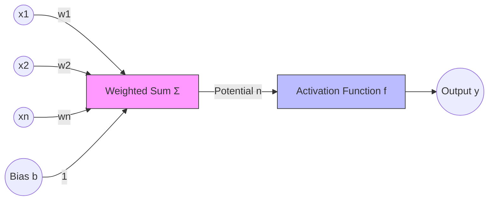

> [!IMPORTANT] The Role of Learning
> When we say a Neural Network is "learning," we mean it is iteratively adjusting the values of **$W$ (weights)** and **$b$ (bias)** to minimize the error in its predictions.

### Activation functions and their derivatives

The activation function (also called the transfer function) decides the output based on the potential $n$, and its most critical role is introducing **non-linearity**, allowing the network to learn complex curves rather than just straight lines. If we stack multiple layers of linear neurons (e.g., $f(x) = ax$), the result is still a linear function: $f(g(x)) = a(bx) = (ab)x$. Linear layers cannot learn complex shapes; activation functions introduce "bends" and "curves" in the math, allowing the network to approximate any continuous function (the Universal Approximation Theorem).

The classic catalog, with the derivative behavior that matters for gradient flow:

- **Linear:** $f(n) = \lambda \cdot n$ (or just $f(n) = n$). A straight diagonal line. Rarely used in hidden layers because stacking linear functions just creates another linear function; used sometimes in the output layer for regression, where you need to predict a raw number (like price).
- **Step function (threshold / Heaviside):** $f(n) = 1$ if $n \ge 0$, else $0$; formally $$ f(n) = \begin{cases} \lambda & \text{if } n \geq 0 \\ 0 & \text{if } n < 0 \end{cases} $$ The neuron is either "ON" or "OFF". Its limitation is decisive for this note: it is not differentiable at 0, and the "slope" is zero everywhere else, so you cannot use it with Gradient Descent. Early perceptrons used it for binary logic.
- **ReLU (Rectified Linear Unit):** $f(n) = \max(0, n)$, i.e. $$ f(n) = \begin{cases} n & \text{if } n > 0 \\ 0 & \text{if } n \leq 0 \end{cases} $$ Flat for negative numbers, linear for positive. It is the most popular function for hidden layers in Deep Learning today because it is computationally very fast (no exponents), does not saturate for positive values, and solves the vanishing gradient problem. It is the default choice for hidden layers of deep networks.
- **Sigmoid (logistic):** the transfer function is $\sigma(n) = \frac{1}{1 + e^{-n}}$, or with a slope parameter $f(n) = \frac{1}{1 + e^{-\lambda n}}$; range $[0, 1]$, an "S" curve. Good for probability outputs (the output layer for binary classification), but computationally expensive due to $e$, and for very high or low inputs the slope is almost zero — which causes the **vanishing gradient** problem (learning stops).
- **Hyperbolic tangent (tanh):** the formula is $f(n) = \frac{e^n - e^{-n}}{e^n + e^{-n}}$, i.e. $f(n) = \tanh(n)$; range $[-1, 1]$, similar to sigmoid but zero-centered. It often converges faster than sigmoid because the data is centered around zero, and it generally performs better than sigmoid in hidden layers — but it still saturates.

| Function | Formula | Range | Best For... |
| :--- | :--- | :--- | :--- |
| **Linear** | $n$ | $(-\infty, \infty)$ | Regression Output |
| **Sigmoid**| $1/(1+e^{-n})$ | $(0, 1)$ | Binary Classification Output |
| **Tanh** | $\tanh(n)$ | $(-1, 1)$ | Hidden Layers (Standard) |
| **ReLU** | $\max(0, n)$ | $[0, \infty)$ | Hidden Layers (Modern/Deep) |
| **Softmax**| $e^{z_i}/\sum e^{z_j}$| $(0, 1)$ | Multi-class Classification Output |

> [!TIP] Exam Tip
> If asked which function to use for hidden layers in a Deep Network, always answer **ReLU**. If asked for binary classification output, answer **Sigmoid**.

### Multi-layer networks and the forward pass

A single neuron is limited, so neurons are organized into a **Multi-Layer Perceptron (MLP)** with three types of layers. The input layer receives raw data (e.g., pixels of an image) — no calculations happen here, it just passes values, with one neuron for every feature. The hidden layers perform calculations and feature extraction; they are "hidden" because the user does not see these values directly, and Deep Learning simply means many hidden layers. The output layer produces the final result (prediction or classification): 1 neuron for regression, $N$ neurons for classification (where $N$ is the number of classes).

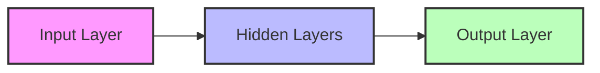

In an MLP, information flows in **one direction** — Input $\to$ Hidden $\to$ Output. There are no loops or cycles in the feed-forward direction; by contrast, recurrent/feedback architectures allow information to loop back, which is exactly why they suffer the most severe gradient pathologies (treated later in this note). A small network with two inputs and three hidden units shows the shape:

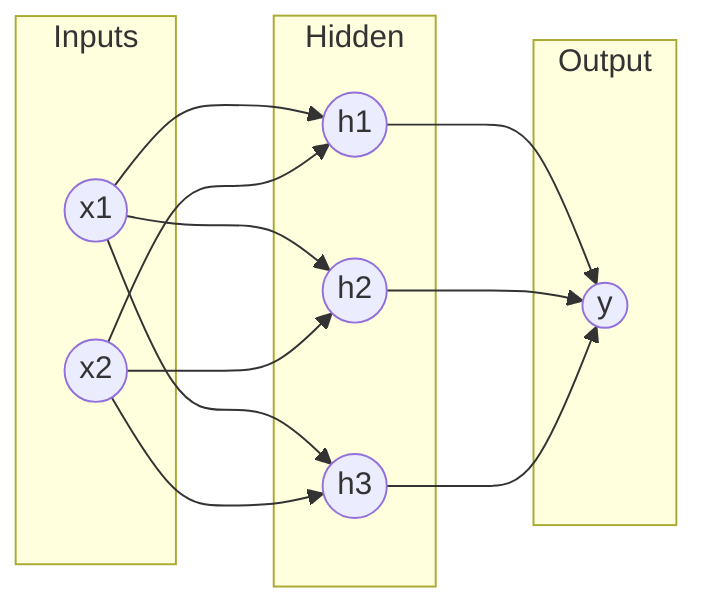

Calculating one neuron at a time is slow, so whole layers are computed at once with matrices. If a layer with indices $j$ connects to a layer with indices $i$:

$$ N = W \cdot A_{prev} + B $$

where $N$ is the vector of potentials for the current layer, $W$ the weight matrix, $A_{prev}$ the output (activation) vector from the previous layer, and $B$ the bias vector. More generally, the whole forward pass of a layer vectorizes as:

$$ A^L = f(W^L \cdot A^{L-1} + B^L) $$

with $A^L$ the output of the current layer, $W^L$ its weight matrix, $A^{L-1}$ the previous layer's output, and $B^L$ its bias vector. A concrete forward pass through a small MLP with inputs $P_1, P_2$, a hidden layer $n_1, n_2$ with Tanh activation, and a linear output $S$ runs in four steps. First the hidden-layer potentials: $n_1^{hidden} = P_1 W_{11}^1 + P_2 W_{12}^1 + b_1^1$ and $n_2^{hidden} = P_1 W_{21}^1 + P_2 W_{22}^1 + b_2^1$. Then the hidden-layer activations $a_1^{hidden} = \tanh(n_1^{hidden})$ and $a_2^{hidden} = \tanh(n_2^{hidden})$. The hidden activations become the inputs of the output layer, whose potential is $n^{output} = a_1^{hidden} W_{11}^2 + a_2^{hidden} W_{12}^2 + b^2$, and the final output is $S = \text{Linear}(n^{output}) = n^{output}$.

> [!NOTE] Deep Learning Definition
> A "Deep" Neural Network is simply an MLP with many hidden layers. GPUs are used because they can calculate the matrix multiplication $W \cdot A$ for millions of neurons simultaneously.

### A worked forward pass

A worked exam exercise makes the layer-by-layer bookkeeping concrete. Take an MLP with an input layer of 3 neurons ($P_1, P_2, P_3$), a hidden layer of 2 neurons ($n_1, n_2$) with **hyperbolic tangent (tanh)** activation, and an output layer of 3 neurons ($S_1, S_2, S_3$) with **linear** (identity) activation:

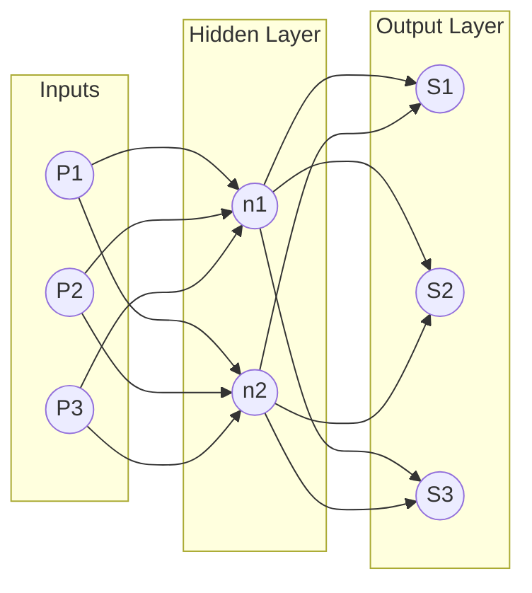

For each layer we calculate the *potential* ($n$) and then the *activation* ($a$). The notation $W_{ij}^L$ denotes the weight connecting neuron $j$ of the previous layer to neuron $i$ of layer $L$ — beware the standard trap: the superscript 1 in $W_{12}^1$ is the *layer index*, not an exponent. The hidden-layer potentials are:

$$ n_1^1 = P_1 \cdot W_{11}^1 + P_2 \cdot W_{12}^1 + P_3 \cdot W_{13}^1 + b_1^1 $$
$$ n_2^1 = P_1 \cdot W_{21}^1 + P_2 \cdot W_{22}^1 + P_3 \cdot W_{23}^1 + b_2^1 $$

or in matrix form:

$$
\begin{bmatrix} n_1^1 \\ n_2^1 \end{bmatrix} =
\begin{bmatrix} W_{11}^1 & W_{12}^1 & W_{13}^1 \\ W_{21}^1 & W_{22}^1 & W_{23}^1 \end{bmatrix}
\times
\begin{bmatrix} P_1 \\ P_2 \\ P_3 \end{bmatrix}
+
\begin{bmatrix} b_1^1 \\ b_2^1 \end{bmatrix}
$$

The hidden activation function is tanh, so:

$$ a_1^1 = f(n_1^1) = \frac{e^{n_1} - e^{-n_1}}{e^{n_1} + e^{-n_1}} $$
$$ a_2^1 = f(n_2^1) = \frac{e^{n_2} - e^{-n_2}}{e^{n_2} + e^{-n_2}} $$

These values ($a_1^1, a_2^1$) become the *inputs* for the next layer, whose potentials are:

$$ n_1^2 = a_1^1 \cdot W_{11}^2 + a_2^1 \cdot W_{12}^2 + b_1^2 $$
$$ n_2^2 = a_1^1 \cdot W_{21}^2 + a_2^1 \cdot W_{22}^2 + b_2^2 $$
$$ n_3^2 = a_1^1 \cdot W_{31}^2 + a_2^1 \cdot W_{32}^2 + b_3^2 $$

Because the output activation is **linear**, the final outputs equal the potentials: $S_1 = n_1^2$, $S_2 = n_2^2$, $S_3 = n_3^2$.

> **Important Tip for Exams:** Always check the activation function for the *Output* layer. In regression problems, it is often Linear. In classification problems (like determining if an image is a cat or dog), it is often Sigmoid or Softmax. Don't blindly apply Tanh or ReLU to the final layer unless specified.

### Classification outputs and evaluation context

When the network is used for classification, the output side has its own conventions that matter when you later inspect a training run. Regression predicts a continuous number (e.g., price of a house, temperature) with a single linear output neuron; classification predicts a category (e.g., is this flower Setosa, Versicolor, or Virginica?). Neural networks work with numbers, not text labels, so labels are converted to vectors by one-hot encoding: Iris Setosa $\to [1, 0, 0]$, Iris Versicolor $\to [0, 1, 0]$, Iris Virginica $\to [0, 0, 1]$ — which requires the output layer to have 3 neurons (one for each class).

For multi-class classification the output layer usually uses the **softmax** function, which converts raw outputs into **probabilities** whose sum equals 1 ($100\%$). If the network outputs $[0.62, 0.23, 0.15]$, then neuron 1 (class 0) has 62% probability, neuron 2 (class 1) has 23%, and neuron 3 (class 2) has 15% — the network classifies this input as **class 0**. Once predictions exist, quality is checked against ground truth with a confusion matrix, comparing predicted vs. actual values:

| | Predicted Yes | Predicted No |
| :--- | :---: | :---: |
| **Actual Yes** | True Positive (TP) | False Negative (FN) |
| **Actual No** | False Positive (FP) | True Negative (TN) |

Here TP is a correctly identified positive, TN a correctly identified negative, FP (Type 1 error) is "predicted Yes, but it was No", and FN (Type 2 error) is "predicted No, but it was Yes". These evaluation quantities complement the loss-based diagnostics developed later in this note: the confusion matrix tells you *what* the network gets wrong after training, while gradient norms and loss curves tell you *whether* training itself is healthy.

## Learning by gradient descent

Learning involves updating the weights ($W$) to minimize the difference between what the network predicts and what the true answer is. The gradient that performs this update is exactly the quantity that later vanishes or explodes, so its definition and derivation belong here; the full backpropagation treatment is in [[Backpropagation]], with the CNN-specific development in [[Backpropagation and Gradient Flow in CNNs]] and the matrix formulation in [[Matrix Implementation of Backpropagation]].

### Measuring error

For a given input sample $k$, the error for a specific output neuron $i$ is the difference between the actual/target output $g_i(k)$ (the ground truth from your dataset) and the computed/predicted output $a_i(k)$ (what your ANN produced):

$$ e_i(k) = g_i(k) - a_i(k) $$

To evaluate the whole network, we calculate the **Mean Squared Error (MSE)**. We square the error to eliminate negative signs and penalize large errors more heavily:

$$ E(k) = \frac{1}{2} \sum_{i=1}^{R} (g_i(k) - a_i(k))^2 $$

The $\frac{1}{2}$ is a mathematical convenience that cancels out when we take the derivative later. (The same MSE appears in the complementary formulation $E = \frac{1}{2} \sum_{i=1}^{R} (g_i - a_i)^2$; squaring makes the error positive and the $\frac{1}{2}$ cancels the 2 from the power rule when differentiated.)

### The delta rule: deriving the weight update

Imagine you are on a mountain (the error function) and want to get to the bottom (zero error). The **gradient** tells you which way is "up"; to minimize error, we go in the **opposite direction** of the gradient. The update rule is:

$$ W_{new} = W_{old} + \Delta W $$
$$ \Delta W = -\eta \cdot \frac{\partial E}{\partial W} $$

where $\eta$ (eta) is the **learning rate**, usually a small number between 0 and 1 (e.g., 0.01), and $\frac{\partial E}{\partial W}$ is the derivative (gradient) of the error with respect to the weight. If the learning rate is too big, you overshoot the minimum; if it is too small, learning takes forever.

To find $\Delta W$ we must use the **chain rule** of calculus, because the error $E$ depends on the output $a$, which depends on the potential $n$, which depends on the weight $W$. The chain of influence is Weight $\to$ Potential ($n$) $\to$ Activation ($a$) $\to$ Error ($E$), and the gradient decomposes as:

$$ \frac{\partial E}{\partial W_{ij}} = \frac{\partial E}{\partial a_i} \cdot \frac{\partial a_i}{\partial n_i} \cdot \frac{\partial n_i}{\partial W_{ij}} $$

or, for a single weight $w_{ij}$, in the equivalent scalar form:

$$ \frac{\partial E}{\partial w} = \frac{\partial E}{\partial a} \cdot \frac{\partial a}{\partial n} \cdot \frac{\partial n}{\partial w} $$

We want to update each weight $w_{ij}$ in the direction that reduces the error $E$, so the three factors of the chain are worth naming individually. First, $\frac{\partial E}{\partial a}$ is the derivative of error vs. output; second, $\frac{\partial a}{\partial n}$ is the derivative of the activation function — if using tanh, $(1 - a^2)$; third, $\frac{\partial n}{\partial w}$ is the derivative of the potential vs. weight, which returns the input signal coming into that connection. The derivation (shown for tanh) breaks into four steps. **Step A — error vs. output:** since $E = \frac{1}{2}(g - a)^2$,

$$ \frac{\partial E}{\partial a} = -(g - a) = -e(k) $$

**Step B — output vs. potential (the activation derivative):** with $f(n) = \tanh(n)$, the identity is $f'(n) = 1 - f(n)^2$, so $\frac{\partial a}{\partial n} = 1 - a^2$. **Step C — potential vs. weight:** since $n = W \cdot P$,

$$ \frac{\partial n}{\partial W} = P \text{ (the input to that connection)} $$

**Step D — combining them (the delta rule):** putting it all together for the weight update $\Delta W_{ij}$:

$$ \Delta W_{ij} = \eta \cdot \underbrace{e_i(k)}_{\text{Error}} \cdot \underbrace{(1 - a_i(k)^2)}_{\text{Slope of Tanh}} \cdot \underbrace{P_j(k)}_{\text{Input}} $$

Equivalently, in the sign convention $w_{new} = w_{old} - \mu \frac{\partial E}{\partial w}$ (with $\mu$ the learning rate and $\frac{\partial E}{\partial w}$ "how much the error changes if we wiggle the weight"), the final weight update is $\Delta w = \mu \cdot \text{Error} \cdot \text{Slope of Activation} \cdot \text{Input}$. The summary worth memorizing: **the change in weight is proportional to the error, the derivative of the activation function, and the input that caused it.** Notice that the activation derivative sits directly inside every weight update — this is the exact factor whose smallness, multiplied across many layers, produces vanishing gradients.

### Training modes and the learning-rate trap

There are two classic regimes for applying these updates. **Incremental (stochastic) learning** updates the weights after *every single sample* is presented — fast, but the error path is noisy/bumpy. **Batch learning** calculates the error for *all K samples* in the dataset first and updates the weights once based on the average error — mathematically stable, but requiring more memory and time per update. One complete pass through the entire dataset is an **epoch**.

> [!WARNING] The Learning Rate Trap
> - **If $\mu$ is too high:** The weights will oscillate and explode (divergence).
> - **If $\mu$ is too low:** The network will take weeks to learn (too slow).
> - **Standard values:** $0.01, 0.001, 0.0001$.

## Gradient flow

**Gradient flow** describes how gradients propagate backward through layers during training. It is the connective tissue between the delta rule above (one layer) and the deep-network pathologies below (many layers multiplied together): whether the learning signal arrives at early layers at usable magnitude is entirely a question of gradient flow.

### Good vs. poor gradient flow

In a healthy network, the gradient retains similar strength at every depth; in an unhealthy one, it decays layer by layer until the earliest layers effectively stop participating in learning:

```mermaid
flowchart TB
    subgraph Good[" Good Gradient Flow"]
        G_Input[Input Layer]
        G_H1[Hidden Layer 1]
        G_H2[Hidden Layer 2]
        G_Out[Output Layer]
        
        G_Out -->|Strong| G_H2
        G_H2 -->|Strong| G_H1
        G_H1 -->|Strong| G_Input
    end
    
    subgraph Poor[" Poor Gradient Flow"]
        P_Input[Input Layer]
        P_H1[Hidden Layer 1]
        P_H2[Hidden Layer 2]
        P_Out[Output Layer]
        
        P_Out -->|Strong| P_H2
        P_H2 -->|Weak| P_H1
        P_H1 -->|Tiny| P_Input
    end
    
    style G_Input fill:#90EE90
    style G_H1 fill:#90EE90
    style G_H2 fill:#90EE90
    style G_Out fill:#98FB98
    
    style P_Input fill:#FFB6C1
    style P_H1 fill:#FFA07A
    style P_H2 fill:#90EE90
    style P_Out fill:#98FB98
```

Good gradient flow matters for three reasons: with it, **all layers learn properly**; it produces **faster convergence** during training; and it is what **enables training very deep networks** (100+ layers). The factors that govern it are the four levers this note returns to repeatedly:

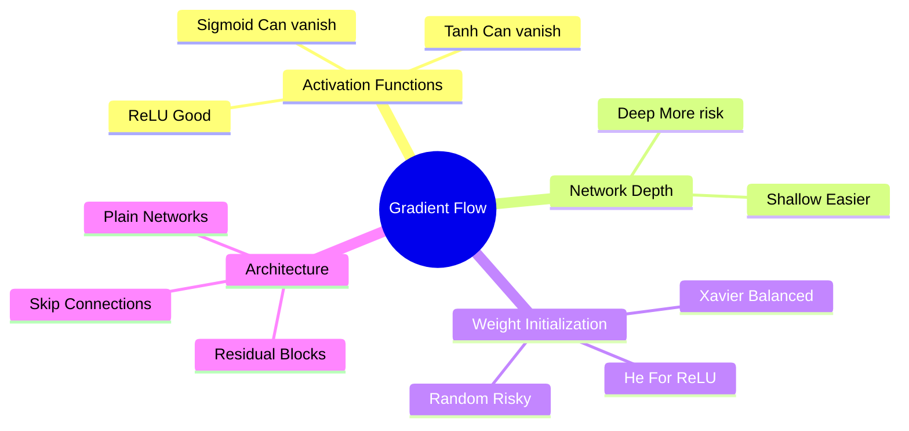

| Factor | Impact |
|--------|--------|
| **Activation Functions** | ReLU improves flow; Sigmoid/Tanh hinder it |
| **Network Depth** | Deeper = more opportunities for degradation |
| **Weight Initialization** | Poor initialization → poor flow from start |
| **Skip Connections** | Provide "highways" for gradients |

### The ReLU advantage

The single most important activation-side fact about gradient flow is ReLU's derivative. For positive inputs the derivative is exactly 1, so the gradient passes through unchanged — there is no multiplication of small numbers, and the gradient is preserved through many layers:

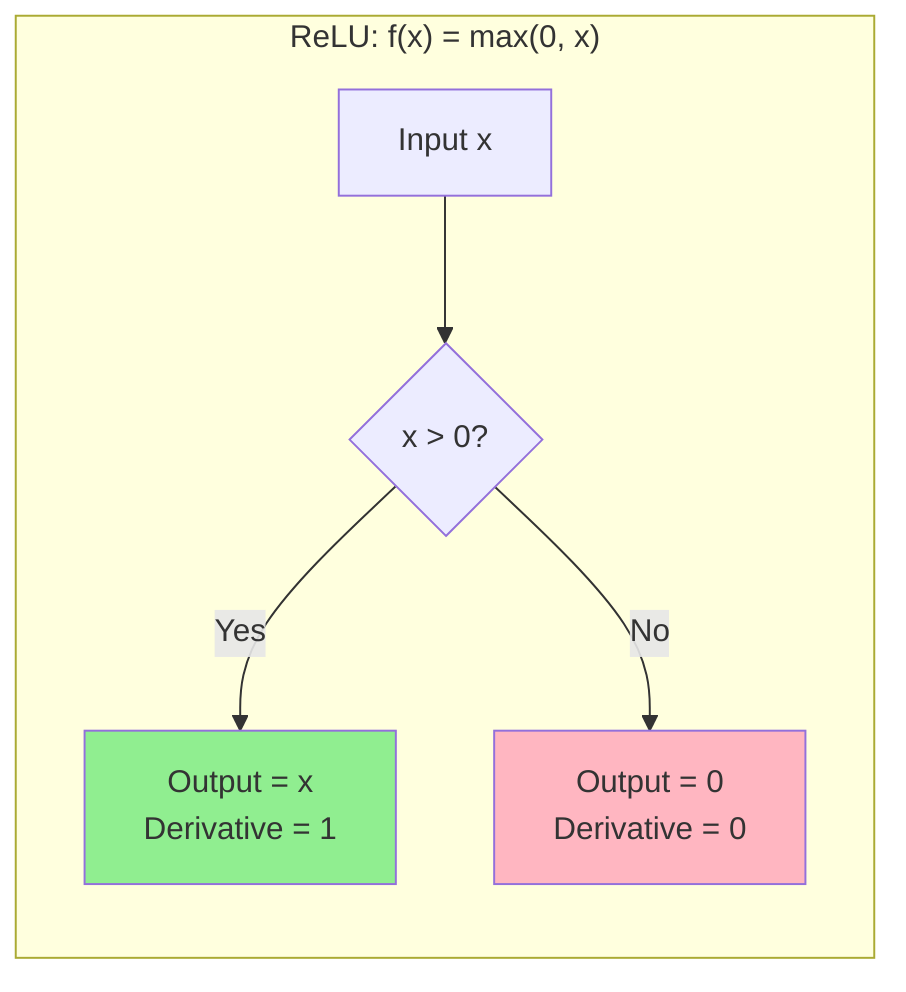

For positive inputs the gradient is 1 (it "passes through unchanged!"), no small numbers get multiplied together, and the gradient is preserved through many layers. Sigmoid and tanh, by contrast, have derivatives bounded well below 1 away from the origin, so each layer multiplies the signal by a fraction.

### How skip connections help

The second architectural lever for gradient flow is the skip connection. In a residual block, the input is routed both through the transformation layers and around them, so the backward pass always has a direct route back to the early layers:

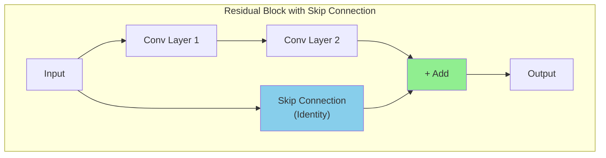

The benefits for gradient flow are direct: the gradient can flow directly through the skip connection; even if the main path has vanishing gradients, the skip path preserves them; and this is what enables the training of 100+ layer networks. The full treatment of residual connections as a solution — including the mathematical guarantee — is in the solutions section below.

### Sparse activations

ReLU's behavior on the negative side has a systematic side effect: sparsity. A neural network is **sparse** when **most of its neurons are inactive (output zero) at any given time**. ReLU naturally creates sparsity, because negative inputs produce output 0, and these "dead" neurons don't contribute to the next layer:

```text
Layer with 1000 neurons
Only 300 neurons fire (output > 0) for a given input
→ 70% sparsity
```

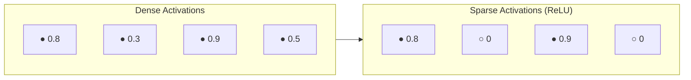

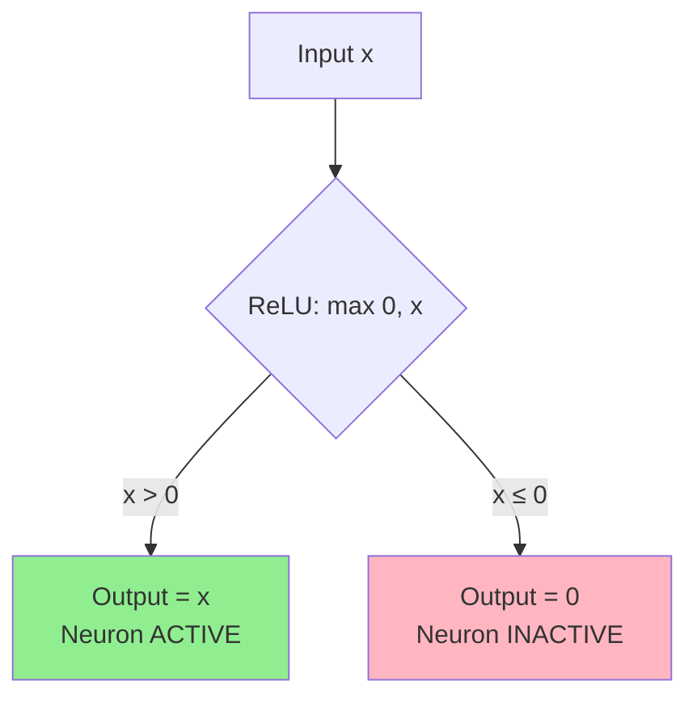

| Benefit | Explanation |
|---------|-------------|
| **Computational Efficiency** | Fewer active neurons → fewer calculations |
| **Better Generalization** | Network focuses on important features, not all neurons |
| **Memory Efficiency** | Sparse matrices can be stored more compactly |
| **Reduced Overfitting** | Less reliance on every neuron reduces memorization |

As a quick memory aid: **sparse** = many zeros = efficiency + better generalization. Sparsity is a double-edged sword for gradient flow, though — inactive neurons pass zero gradient, and if a neuron is inactive for every training example it can never recover, a failure mode treated below as the *dying ReLU* problem.

## The core mechanism: gradients as products

The vanishing and exploding gradient problems are the two most fundamental obstacles to training deep neural networks. Both arise from the same mathematical mechanism: during backpropagation, the gradient of the loss with respect to the weights in an early layer is computed as a **product of many terms**, one for each layer between the loss and the target weights. When each term in this product is less than one, the product shrinks exponentially toward zero (vanishing). When each term is greater than one, the product grows exponentially toward infinity (exploding). This seemingly simple observation has profound consequences for the trainability of deep networks.

To understand why this is such a pervasive problem, consider the analogy of a long telephone game. In the children's game "telephone," a message is whispered from person to person down a line. If each person slightly mishears or distorts the message (multiplying it by a factor slightly different from 1), the message at the end of the line bears little resemblance to the original. If each person consistently muffles the message (factor < 1), the last person hears nothing. If each person amplifies the message (factor > 1), the last person is deafened by noise. Backpropagation through a deep network is exactly this game — the "message" is the gradient, and each "person" is a layer that multiplies the gradient by its local derivative.

### The gradient as a product of Jacobians

Consider a deep feedforward network with $L$ layers. The forward pass computes:

$$\mathbf{a}^{(1)} = f_1\left(W^{(1)} \mathbf{x} + \mathbf{b}^{(1)}\right)$$
$$\mathbf{a}^{(2)} = f_2\left(W^{(2)} \mathbf{a}^{(1)} + \mathbf{b}^{(2)}\right)$$
$$\vdots$$
$$\mathbf{a}^{(L)} = f_L\left(W^{(L)} \mathbf{a}^{(L-1)} + \mathbf{b}^{(L)}\right)$$
$$\mathcal{L} = \ell\left(\mathbf{a}^{(L)}, \mathbf{y}\right)$$

where $f_l$ is the activation function at layer $l$, $W^{(l)}$ is the weight matrix, $\mathbf{b}^{(l)}$ is the bias vector, $\mathbf{a}^{(l)}$ is the activation vector, and $\mathcal{L}$ is the loss function. During backpropagation, the gradient of the loss with respect to the activations at layer $l$ is:

$$\frac{\partial \mathcal{L}}{\partial \mathbf{a}^{(l)}} = \frac{\partial \mathcal{L}}{\partial \mathbf{a}^{(L)}} \cdot \prod_{k=l+1}^{L} \frac{\partial \mathbf{a}^{(k)}}{\partial \mathbf{a}^{(k-1)}}$$

This product of Jacobians — the gradient of the loss w.r.t. early-layer weights — is the source of both the vanishing and exploding gradient problems. Each Jacobian $\frac{\partial \mathbf{a}^{(k)}}{\partial \mathbf{a}^{(k-1)}}$ is a matrix that depends on the weight matrix $W^{(k)}$ and the derivative of the activation function $f_k'$ at the current activations. The same structure appears in the equivalent formulation

$$
\frac{\partial L}{\partial \mathbf{x}_0} = \frac{\partial L}{\partial \mathbf{x}_N} \prod_{l=1}^{N} \frac{\partial \mathbf{x}_l}{\partial \mathbf{x}_{l-1}}
$$

where each factor $\frac{\partial \mathbf{x}_l}{\partial \mathbf{x}_{l-1}}$ is a Jacobian whose norm depends on the weights of layer $l$, the activation function's derivative, and the architecture (residual? normalization?). And applied to the weights of the first layer, the product runs through every intermediate layer:

$$
\frac{\partial L}{\partial \mathbf{W}_1} = \frac{\partial L}{\partial \mathbf{x}_L} \prod_{l=2}^{L} \frac{\partial \mathbf{x}_l}{\partial \mathbf{x}_{l-1}} \cdot \frac{\partial \mathbf{x}_2}{\partial \mathbf{W}_1}
$$

If most factors have norm < 1, the product decays exponentially with depth — gradients reaching early layers are near zero, so those layers don't learn: **vanishing gradient**. If most factors have norm > 1, the product grows exponentially — gradients reach early layers as huge values, weights explode, training diverges: **exploding gradient**.

### The scalar case

To build intuition, consider a simplified scalar network where each layer has a single neuron, and the activation function at each layer is some differentiable function $f$. The forward pass is:

$$a^{(l)} = f\left(w^{(l)} \cdot a^{(l-1)}\right)$$

The gradient of the loss with respect to the activation at layer $l$ is:

$$\frac{\partial \mathcal{L}}{\partial a^{(l)}} = \frac{\partial \mathcal{L}}{\partial a^{(L)}} \cdot \prod_{k=l+1}^{L} \frac{\partial a^{(k)}}{\partial a^{(k-1)}}$$

Each term in the product is:

$$\frac{\partial a^{(k)}}{\partial a^{(k-1)}} = f'\left(z^{(k)}\right) \cdot w^{(k)}$$

where $z^{(k)} = w^{(k)} \cdot a^{(k-1)}$ is the pre-activation. Therefore:

$$\boxed{\frac{\partial \mathcal{L}}{\partial a^{(l)}} = \frac{\partial \mathcal{L}}{\partial a^{(L)}} \cdot \prod_{k=l+1}^{L} f'\left(z^{(k)}\right) \cdot w^{(k)}}$$

This is the fundamental equation. The gradient is a product of $L - l$ terms, each of which is the product of an activation derivative and a weight. The behavior of this product determines whether gradients vanish or explode:

- If $\left|f'(z^{(k)}) \cdot w^{(k)}\right| < 1$ for most layers $k$, then the product **vanishes** as $L - l$ grows.
- If $\left|f'(z^{(k)}) \cdot w^{(k)}\right| > 1$ for most layers $k$, then the product **explodes** as $L - l$ grows.
- If $\left|f'(z^{(k)}) \cdot w^{(k)}\right| \approx 1$ for most layers $k$, then the product is **stable**.

This analysis reveals that the gradient behavior is determined by the interaction between the activation function and the weight magnitude — exactly the two factors addressed by proper initialization (see [[05 - Neural Network Foundations/Training Dynamics and Stability/Weight Initialization|Weight Initialization]]).

### Exponential compounding

The key word is **exponential**. If each term in the product has magnitude $\alpha$, then after $L - l$ layers:

$$\left|\frac{\partial \mathcal{L}}{\partial a^{(l)}}\right| \approx \alpha^{L-l}$$

The numbers are stark:

| $\alpha$ | After 5 layers | After 10 layers | After 20 layers | After 50 layers |
|---|---|---|---|---|
| 0.9 | 0.59 | 0.35 | 0.12 | 0.005 |
| 0.5 | 0.03 | 0.001 | $10^{-6}$ | $10^{-15}$ |
| 0.25 | 0.001 | $10^{-6}$ | $10^{-12}$ | $10^{-30}$ |
| 1.1 | 1.61 | 2.59 | 6.73 | 117.4 |
| 1.5 | 7.59 | 57.67 | 3325 | $6.4 \times 10^8$ |
| 2.0 | 32 | 1024 | $10^6$ | $10^{15}$ |

Even a small deviation from $\alpha = 1$ compounds catastrophically over many layers. With $\alpha = 0.5$ (which is typical for sigmoid networks), the gradient after just 10 layers is $0.5^{10} \approx 0.001$ of its original value. After 50 layers, it is $0.5^{50} \approx 10^{-15}$, which is well below the resolution of 32-bit floating-point numbers (approximately $10^{-7}$). The gradient has effectively vanished to zero as far as the computer is concerned, and the early layers receive no learning signal whatsoever.

> [!warning] This Is Not a Theoretical Curiosity
> The vanishing and exploding gradient problems are not edge cases that only affect poorly designed networks. They are fundamental to the mathematics of backpropagation through deep compositions of functions. Every deep network must address these problems, either implicitly (through architectural choices like ReLU and batch normalization) or explicitly (through techniques like gradient clipping and residual connections). Ignoring them guarantees training failure.

### The spectral radius view

A more general way to state the same analysis uses linear algebra. Each Jacobian $\frac{\partial \mathbf{x}_l}{\partial \mathbf{x}_{l-1}}$ has a spectral radius (largest eigenvalue magnitude) $\rho_l$, and the product's norm is bounded by $\prod_l \rho_l$. If $\rho_l < 1$ for most layers (typical for sigmoid/tanh in saturation, or bad init), the product $\prod \rho_l \to 0$ exponentially — the gradient at early layers is exponentially small and they don't learn. If $\rho_l > 1$ (typical for RNNs with large weights, or bad init), the product $\prod \rho_l \to \infty$ exponentially — the gradient at early layers is exponentially large and training diverges. The condition number of the Jacobians tells a similar story: ill-conditioned Jacobians (high condition number) are the linear-algebra signature of vanishing/exploding behavior. This view makes clear that the problem is not about any single layer but about the *product* of many layer-Jacobians — which is why fixes target either the individual factors (activations, initialization, normalization) or the structure of the product itself (skip connections, attention).

## Vanishing gradients

During backpropagation, **gradients (used to update weights) become extremely small**, often near 0, as they propagate backward through deep networks. The signal decays from the output layer toward the input layer, layer by layer:

```mermaid
flowchart LR
    subgraph Backward["← Backpropagation Direction"]
        L1["Layer 1<br/>Gradient: TINY"]
        L2["Layer 2<br/>Gradient: Small"]
        L3["Layer 3<br/>Gradient: Medium"]
        LN["Layer N (Output)<br/>Gradient: Large"]
    end
    
    L1 <-- L2 <-- L3 <-- LN
    
    style L1 fill:#FFB6C1
    style L2 fill:#FFA07A
    style L3 fill:#90EE90
    style LN fill:#98FB98
```

The root cause is the size of the activation derivatives that get multiplied at every layer:

| Activation | Derivative Range | Problem |
|------------|------------------|---------|
| **Sigmoid** | 0 to 0.25 | Derivative ≤ 0.25, multiplies down layers |
| **Tanh** | 0 to 1 | Derivative ≤ 1, still can vanish |
| **ReLU** | 0 or 1 | No vanishing for positive inputs! |

### The sigmoid problem: a derivative ceiling of 0.25

The sigmoid activation function, defined as $\sigma(x) = \frac{1}{1 + e^{-x}}$, was the default activation function in early neural networks. Unfortunately, it is also one of the primary causes of vanishing gradients. The derivative of the sigmoid function is:

$$\sigma'(x) = \sigma(x)(1 - \sigma(x))$$

This derivative has a **maximum value of 0.25**, which occurs at $x = 0$ where $\sigma(0) = 0.5$. For any other value of $x$, the derivative is even smaller. Verify this by finding the maximum:

$$\frac{d}{dx}\sigma'(x) = \frac{d}{dx}[\sigma(x)(1-\sigma(x))] = \sigma'(x)(1 - 2\sigma(x)) = 0$$

This is zero when $\sigma(x) = 0.5$, i.e., at $x = 0$. At this point:

$$\sigma'(0) = 0.5 \times 0.5 = 0.25$$

For all other values of $x$, the derivative is less than 0.25. Specifically:

- At $x = 1$: $\sigma(1) \approx 0.731$, $\sigma'(1) \approx 0.731 \times 0.269 \approx 0.197$
- At $x = 2$: $\sigma(2) \approx 0.881$, $\sigma'(2) \approx 0.881 \times 0.119 \approx 0.105$
- At $x = 5$: $\sigma(5) \approx 0.993$, $\sigma'(5) \approx 0.993 \times 0.007 \approx 0.007$
- At $x = -5$: $\sigma(-5) \approx 0.007$, $\sigma'(-5) \approx 0.007 \times 0.993 \approx 0.007$

In the saturation regions (where $|x|$ is large), the derivative is extremely close to zero. The sigmoid function "saturates" — it flattens out — and the gradient through the saturated region is negligible. The whole story fits in one compact calculation:

```text
For sigmoid: σ'(x) = σ(x) × (1 - σ(x))
Maximum value = 0.25 (when σ(x) = 0.5)

In a 10-layer network:
0.25^10 ≈ 0.0000000009 → gradient is essentially ZERO
```

### The devastating compounding effect

The maximum derivative of 0.25 means that every time the gradient passes through a sigmoid activation, it is multiplied by at most 0.25 (and often much less). Consider a 10-layer network where each layer uses a sigmoid activation. Even in the best case — where every neuron is exactly at $x = 0$, giving the maximum derivative — the gradient after passing through 10 sigmoid layers is:

$$0.25^{10} = \left(\frac{1}{4}\right)^{10} = \frac{1}{4^{10}} = \frac{1}{1{,}048{,}576} \approx 9.5 \times 10^{-7}$$

The gradient is reduced to roughly one-millionth of its original value. In practice, the situation is even worse because neurons are rarely at $x = 0$ — they are often in the saturated tails, where the derivative is much smaller. A more realistic estimate, using an average derivative of about 0.1 (which is typical for initialized networks), gives:

$$0.1^{10} = 10^{-10}$$

This is far below the precision of 32-bit floating-point numbers (which have approximately 7 decimal digits of precision). The gradient has effectively been rounded to zero, and the weights in the early layers will never be updated. Watching the chain multiply makes the decay visceral:

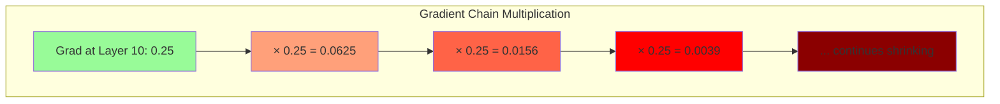

### The tanh variant: better, but still problematic

The hyperbolic tangent activation function, $\tanh(x) = \frac{e^x - e^{-x}}{e^x + e^{-x}}$, is a zero-centered alternative to sigmoid. Its derivative is:

$$\tanh'(x) = 1 - \tanh^2(x)$$

The maximum derivative of tanh is 1.0 (at $x = 0$), which is four times better than sigmoid's maximum of 0.25. However, tanh still saturates for large $|x|$, and the derivative drops rapidly:

- At $x = 0$: $\tanh'(0) = 1.0$
- At $x = 1$: $\tanh'(1) \approx 0.42$
- At $x = 2$: $\tanh'(2) \approx 0.07$
- At $x = 3$: $\tanh'(3) \approx 0.01$

Even with tanh, the average derivative across all neurons in a typical network is well below 1, and the gradient still vanishes through many layers — just more slowly than with sigmoid.

### Consequence: early layers receive no learning signal

The practical consequence of vanishing gradients is that **early layers learn extremely slowly or not at all**. In a deep network with vanishing gradients, a characteristic pattern emerges. **Late layers** (close to the output) receive strong gradients and learn quickly; they can adjust their weights to reduce the loss effectively. **Middle layers** receive moderate gradients and learn more slowly; their updates are small but still meaningful. **Early layers** (close to the input) receive negligible gradients and learn almost nothing; their weights remain essentially at their random initial values.

This creates a pathological situation: the early layers, which are responsible for extracting low-level features (edges, textures, patterns), are stuck at their random initialization, while the late layers try to compensate by learning complex mappings from random features to the correct output. The network is fundamentally handicapped because it cannot learn a good feature hierarchy. The problem is especially severe in CNNs, where the early convolutional layers are supposed to learn general feature detectors (edges, corners, textures) that are useful for all visual tasks; if these layers cannot learn, the entire network operates on essentially random features, and its performance is severely limited. In short: early layers learn very slowly or almost not at all, training becomes inefficient or fails entirely, and deep networks become impossible to train.

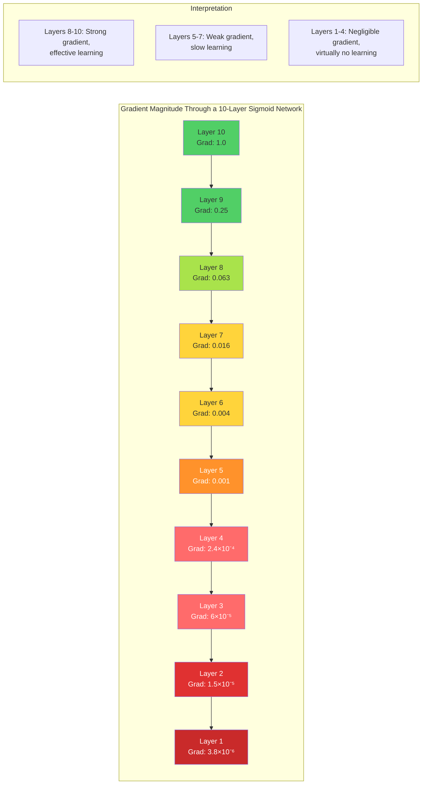

> [!tip] Visualizing Vanishing Gradients
> The gradient at layer $l$ in a sigmoid network with $L$ total layers is approximately $0.25^{L-l}$ times the gradient at the output. After just 6 layers, the gradient is reduced by a factor of $0.25^6 = 2.4 \times 10^{-4}$. This means a gradient of 1.0 at the output becomes 0.00024 at layer $l = L-6$, which is far too small to produce meaningful weight updates with any reasonable learning rate.

### A worked example: gradient norms in a 20-layer sigmoid network

Train a 20-layer plain MLP (no residuals, sigmoid activations) on MNIST and log the gradient norm at each layer:

| Layer | Gradient norm (epoch 1) |
|-------|--------------------------|
| 20    | 1.0                      |
| 15    | 0.1                      |
| 10    | 0.001                    |
| 5     | 1e-5                     |
| 1     | 1e-8                     |

Layer 1's gradients are 8 orders of magnitude smaller than layer 20's — it's effectively not learning. The same network with ReLU + residuals + LayerNorm keeps gradient norms within 1 order of magnitude across layers: healthy training.

### Where vanishing gradients strike

Three settings account for most vanishing-gradient incidents. **Sigmoid/tanh networks:** their derivatives are ≤ 0.25 (sigmoid) or ≤ 1 (tanh), and saturate to 0 away from the origin; multiplying many small derivatives drives the product to 0. **RNNs:** the same weights are applied at each timestep, so backpropagation through time multiplies the same Jacobian $T$ times — after 100 timesteps, even a small per-step factor becomes negligible. **Deep plain networks** (no residuals): each layer's contribution to the gradient shrinks geometrically. The classic remedies for all three — ReLU-family activations, residual connections, LayerNorm, careful initialization — are treated in the solutions catalog below.

## Exploding gradients

### When each derivative exceeds 1

Exploding gradients occur when the terms in the gradient product consistently have magnitude greater than 1. This happens when the weights are too large (poor initialization) or when the activation derivatives are consistently greater than 1 (which is rare for standard activations but can happen with certain configurations). The most common cause of exploding gradients is **poor weight initialization** combined with **learning rates that are too high**. When the weights are initialized with a variance that is too large (e.g., $\mathcal{N}(0, 1)$ for a deep network), the product $|f'(z^{(k)}) \cdot w^{(k)}| > 1$ for many layers, and the gradient grows exponentially during backpropagation.

Even with good initialization, exploding gradients can emerge during training if the learning rate is too high. Large weight updates can push the weights into a regime where the gradients are even larger, creating a positive feedback loop: large gradients → large updates → even larger weights → even larger gradients. This self-reinforcing cycle can cause the network to diverge within a single training step.

### Symptoms

Exploding gradients produce several distinctive and unmistakable symptoms during training:

1. **NaN loss**: The loss function returns `NaN` (Not a Number), which occurs when the activations or gradients overflow beyond the range of floating-point numbers. This is the most dramatic symptom and the one most frequently encountered by practitioners. Once the loss becomes `NaN`, all subsequent weight updates are also `NaN`, and training is permanently stuck.
2. **NaN weights**: The weight values themselves become `NaN`, which can happen even before the loss becomes `NaN` if the gradient overflow occurs in a specific part of the network. Once any weight is `NaN`, every computation involving that weight produces `NaN`, and the corruption spreads to the entire network.
3. **Wildly oscillating loss**: Before the loss reaches `NaN`, it may exhibit violent oscillations — jumping from very small values to very large values and back, with no discernible downward trend. The loss curve looks like a seismograph reading during an earthquake rather than the smooth descent expected during training.
4. **Extremely large weight values**: Examining the model's parameters reveals that some weights have grown to values orders of magnitude larger than their initial values. This is a sign that the gradient updates have been consistently too large.
5. **Sudden spikes in the loss curve**: Even if the loss is generally decreasing, occasional massive spikes indicate that the gradient has temporarily exploded in some part of the network. These spikes are warning signs that the network is on the edge of instability.

### Common causes

Several specific conditions can lead to exploding gradients. **Uncalibrated random initialization** — using $\mathcal{N}(0, 1)$ or any initialization with too-large variance — causes the gradient product to grow with depth; the variance of the activations grows as $(n \cdot \text{Var}(w))^L$, where $n$ is the layer width and $L$ is the depth. **A learning rate that is too high** means weight updates overshoot the minimum, pushing the weights into a region of the loss landscape with even steeper gradients; the positive feedback loop of large gradients → large updates → larger gradients can cause divergence within a few steps. **Missing or incorrect normalization** — no batch normalization or layer normalization — leaves no mechanism to re-scale the activations and gradients at each layer, so the network relies entirely on the initial weight scale to maintain signal flow, and any perturbation that increases the weights can trigger an explosion. Finally, **recurrent networks processing long sequences** apply the same weight matrix at every time step, so the gradient product involves the same matrix raised to a high power; if the largest singular value of this matrix is greater than 1, the gradient grows exponentially with the sequence length. This is the vanishing/exploding gradient problem in RNNs, which is closely related to but distinct from the problem in feedforward networks.

> [!warning] Exploding Gradients Can Happen Suddenly
> Unlike vanishing gradients, which cause a slow, gradual deterioration of learning in the early layers, exploding gradients can occur suddenly and catastrophically. A network can be training normally for hundreds of epochs and then suddenly produce `NaN` loss in a single step. This makes exploding gradients harder to anticipate but easier to detect — the symptoms are unmistakable.

On the "where it happens" question, exploding gradients concentrate in three settings: **RNNs**, where eigenvalues of the recurrent weight matrix greater than 1 make gradients explode; **large learning rates**, where each step overshoots, weights grow, and the next step's gradients grow more (positive feedback); and **bad initialization**, where weights are simply too large at the start.

## Recurrent networks: vanishing and exploding through time

RNNs are especially vulnerable because the **same** weight matrix is applied at every timestep: $\mathbf{h}_t = f(\mathbf{W}\mathbf{h}_{t-1})$. The Jacobian product is $\prod_t \frac{\partial \mathbf{h}_t}{\partial \mathbf{h}_{t-1}} = \prod_t \mathbf{W}^T \text{diag}(f')$. The spectral radius of $\mathbf{W}$ determines everything:

- $\rho(\mathbf{W}) < 1$: vanishing — can't learn long-range dependencies.
- $\rho(\mathbf{W}) > 1$: exploding — training diverges.
- $\rho(\mathbf{W}) = 1$: stable — but hard to achieve in practice.

This is why RNNs can't remember dependencies > 20-50 timesteps. LSTMs and GRUs mitigate — their gates control the effective Jacobian — but don't fully solve the problem. Transformers (with attention) bypass it entirely, since there is no sequential Jacobian product. The sequence-modeling consequences are developed in [[Recurrent Neural Networks]].

The LSTM/GRU mitigation deserves a precise statement, because it is the *additive* structure that matters, not the gates' nonlinearity: LSTM's cell state provides an additive gradient highway (the forget gate controls flow, but it's a multiplication by ≤ 1, not a tanh derivative). This is why LSTMs could learn longer dependencies than vanilla RNNs — the same "additive path preserves the gradient" principle that residual connections exploit in feedforward networks, discussed below.

## Diagnosing gradient problems

### Reading the symptoms

The two failure modes announce themselves differently, and reading the signs correctly is the first diagnostic step. **Vanishing gradients:** early layers don't change during training (their gradient norms are near zero); the loss decreases slowly or plateaus. **Exploding gradients:** the loss becomes NaN or spikes wildly, and gradient norms are huge. The decisive habit is to log gradient norms per layer per step — a healthy training run has roughly constant gradient norms across layers. Sudden spikes indicate instability; a steady decline from output to input indicates vanishing.

### Monitoring gradient norms per layer

The most direct diagnostic is to measure the norm of the gradients at each layer during training. This reveals whether gradients are vanishing (decreasing across layers from output to input) or exploding (increasing across layers from output to input):

```python
import torch                                    # Import PyTorch library
import torch.nn as nn                           # Import neural network module


def monitor_gradient_norms(model,               # The neural network model
                           dataloader,          # Data loader for training data
                           criterion,           # Loss function
                           num_batches=5):      # Number of batches to average over
    """
    Monitor the gradient norm at each layer of the model.
    This function runs a few forward-backward passes and reports
    the average gradient norm for each named parameter.
    
    Diagnostic guide:
    - Gradient norms decreasing by orders of magnitude from
      late layers to early layers → VANISHING GRADIENTS
    - Gradient norms increasing by orders of magnitude from
      late layers to early layers → EXPLODING GRADIENTS
    - Gradient norms approximately constant across layers → HEALTHY
    - Any gradient norm = NaN → CATASTROPHIC EXPLOSION
    """
    model.train()                               # Set model to training mode
    gradient_norms = {}                         # Dictionary: param_name → list of norms
    
    for i, (inputs, targets) in enumerate(dataloader):  # Iterate over batches
        if i >= num_batches:                    # Only process a few batches
            break
        
        model.zero_grad()                       # Reset all gradients
        outputs = model(inputs)                 # Forward pass
        loss = criterion(outputs, targets)      # Compute loss
        loss.backward()                         # Backward pass: compute gradients
        
        # Record gradient norm for each parameter
        for name, param in model.named_parameters():  # Iterate over all parameters
            if param.grad is not None:          # Check if gradient exists
                norm = param.grad.norm().item() # Compute L2 norm of gradient
                if name not in gradient_norms:  # Initialize list if first time
                    gradient_norms[name] = []
                gradient_norms[name].append(norm)  # Append norm to list

    # Print average gradient norms
    print("=" * 70)
    print(f"{'Layer Name':<45} {'Avg Grad Norm':>12} {'Status':>12}")
    print("=" * 70)
    
    for name, norms in gradient_norms.items():  # Iterate over all parameters
        avg_norm = sum(norms) / len(norms)      # Compute average norm
        
        # Determine status based on gradient magnitude
        if any(n != n for n in norms):          # Check for NaN (NaN ≠ NaN in Python)
            status = " NaN!"                   # Catastrophic explosion
        elif avg_norm < 1e-7:                   # Very small gradient
            status = " Vanishing"              # Gradient effectively zero
        elif avg_norm > 1e3:                    # Very large gradient
            status = " Exploding"              # Gradient dangerously large
        else:
            status = " OK"                     # Gradient in healthy range
        
        print(f"  {name:<43} {avg_norm:>12.6f} {status:>12}")
    
    print("=" * 70)
    
    return gradient_norms                        # Return norms for further analysis
```

### Monitoring the loss for NaN

A simpler but equally important diagnostic is to monitor the loss value during training. If the loss becomes `NaN` at any point, it indicates that the gradients have exploded and corrupted the weights. This is a critical failure that requires immediate intervention:

```python
import torch                                    # Import PyTorch library
import math                                     # Import math module


def safe_train_step(model,                      # The neural network model
                    optimizer,                   # The optimizer
                    criterion,                   # Loss function
                    inputs,                      # Input data
                    targets,                     # Target labels
                    max_grad_norm=1.0,           # Gradient clipping threshold
                    nan_check=True):             # Whether to check for NaN
    """
    A single training step with built-in safeguards against
    vanishing and exploding gradients.
    
    Returns:
        loss_value: The loss value, or None if training failed
        grad_norm: The total gradient norm before clipping
        status: A string indicating the training step status
    """
    optimizer.zero_grad()                       # Reset all gradients
    
    # Forward pass
    outputs = model(inputs)                     # Forward pass
    loss = criterion(outputs, targets)          # Compute loss
    
    # Check for NaN loss
    loss_value = loss.item()                    # Get loss as Python float
    if nan_check and math.isnan(loss_value):    # Check if loss is NaN
        print(" NaN loss detected! Skipping this batch.")
        return None, 0.0, "NaN_LOSS"           # Return failure status
    
    # Check for infinite loss
    if math.isinf(loss_value):                  # Check if loss is infinite
        print(" Inf loss detected! Skipping this batch.")
        return None, 0.0, "INF_LOSS"           # Return failure status
    
    # Backward pass
    loss.backward()                             # Compute gradients
    
    # Check for NaN gradients
    grad_norm = 0.0                             # Initialize gradient norm
    has_nan_grad = False                        # Flag for NaN gradient detection
    for param in model.parameters():            # Iterate over all parameters
        if param.grad is not None:              # Check if gradient exists
            if torch.isnan(param.grad).any():   # Check for NaN in gradient
                has_nan_grad = True             # Set NaN flag
                break                           # No need to check further
            grad_norm += param.grad.norm().item() ** 2  # Accumulate squared norms
    
    if has_nan_grad:                            # If NaN gradient found
        print(" NaN gradient detected! Skipping this batch.")
        model.zero_grad()                       # Clear corrupted gradients
        return None, 0.0, "NaN_GRAD"           # Return failure status
    
    grad_norm = math.sqrt(grad_norm)            # Compute total gradient norm
    
    # Gradient clipping (safety net)
    torch.nn.utils.clip_grad_norm_(             # Clip gradients by norm
        model.parameters(),                     # All model parameters
        max_norm=max_grad_norm                  # Maximum allowed norm
    )
    
    # Weight update
    optimizer.step()                            # Update weights with clipped gradients
    
    # Determine status
    if grad_norm > max_grad_norm * 10:          # Gradient much larger than threshold
        status = "EXPLODING"                    # Gradient explosion warning
    elif grad_norm < 1e-7:                      # Gradient very small
        status = "VANISHING"                    # Gradient vanishing warning
    else:
        status = "OK"                           # Healthy gradient flow
    
    return loss_value, grad_norm, status        # Return diagnostics
```

### A comprehensive diagnostic dashboard

Wrapping the per-step safeguards into a short training probe produces a full report — loss statistics, total gradient norm statistics, and per-layer average gradient norms — that localizes where in the network the trouble lives:

```python
def diagnose_training(model,                    # The neural network model
                      dataloader,               # Training data loader
                      num_steps=20):            # Number of steps to diagnose
    """
    Run a comprehensive diagnostic of gradient flow through the model.
    This function produces a summary report that helps identify
    vanishing or exploding gradient problems.
    """
    import torch.nn.functional as F             # Import functional interface
    
    criterion = nn.CrossEntropyLoss()           # Loss function
    optimizer = torch.optim.SGD(model.parameters(), lr=0.01)  # Simple optimizer
    
    print("=" * 70)
    print("TRAINING DIAGNOSTICS REPORT")
    print("=" * 70)
    
    loss_history = []                           # Track loss over steps
    grad_norm_history = []                      # Track total gradient norm
    layer_grad_norms = {}                       # Track per-layer gradient norms
    
    for step, (inputs, targets) in enumerate(dataloader):
        if step >= num_steps:                   # Only run for num_steps
            break
        
        loss_val, grad_norm, status = safe_train_step(
            model, optimizer, criterion,
            inputs, targets,
            max_grad_norm=5.0                   # Moderate clipping threshold
        )
        
        if loss_val is not None:                # If step succeeded
            loss_history.append(loss_val)       # Record loss
            grad_norm_history.append(grad_norm) # Record gradient norm
            
            # Record per-layer gradient norms
            for name, param in model.named_parameters():
                if param.grad is not None:
                    if name not in layer_grad_norms:
                        layer_grad_norms[name] = []
                    layer_grad_norms[name].append(param.grad.norm().item())
    
    # --- Print summary ---
    print(f"\nSteps completed: {len(loss_history)}/{num_steps}")
    
    if len(loss_history) > 0:
        print(f"\nLoss statistics:")
        print(f"  Initial loss: {loss_history[0]:.4f}")
        print(f"  Final loss:   {loss_history[-1]:.4f}")
        print(f"  Min loss:     {min(loss_history):.4f}")
        print(f"  Max loss:     {max(loss_history):.4f}")
        
        print(f"\nGradient norm statistics:")
        print(f"  Mean:   {sum(grad_norm_history)/len(grad_norm_history):.4f}")
        print(f"  Min:    {min(grad_norm_history):.4f}")
        print(f"  Max:    {max(grad_norm_history):.4f}")
        
        print(f"\nPer-layer average gradient norms:")
        for name, norms in layer_grad_norms.items():
            avg = sum(norms) / len(norms)
            print(f"  {name:<40s} {avg:.6f}")
    
    print("=" * 70)
```

### A quick diagnostic routine

For a fast read on a single batch, compare the gradient norms across layers and their ratio — the ratio between the largest and smallest layer norms is the giveaway:

```python
import torch
import torch.nn as nn

def diagnose_gradients(model, input_batch, target_batch):
    """Diagnose vanishing/exploding gradients."""
    loss = model(input_batch).loss(target_batch)
    loss.backward()

    print("Gradient norms per layer:")
    for name, param in model.named_parameters():
        if param.grad is not None:
            grad_norm = param.grad.norm().item()
            print(f"  {name}: {grad_norm:.6f}")

    # Check for vanishing (early layers << late layers)
    grad_norms = [param.grad.norm().item() for param in model.parameters()
                  if param.grad is not None and param.dim() > 1]
    if grad_norms:
        ratio = max(grad_norms) / (min(grad_norms) + 1e-10)
        print(f"\nMax/min gradient ratio: {ratio:.2f}")
        if ratio > 1000:
            print("  Likely vanishing or exploding gradients!")
        elif ratio > 100:
            print(" Gradient imbalance — monitor training.")

# Symptoms:
# - All grad norms ~0: vanishing (check init, activations, residual connections)
# - Some grad norms >> 1: exploding (add gradient clipping)
# - Large ratio between layers: gradient imbalance (add LayerNorm)
```

> [!tip] Early Detection Saves Training Runs
> The most common mistake practitioners make is not monitoring gradient norms and loss values during the first few epochs of training. By the time the loss becomes `NaN`, it is too late — the weights are corrupted and the model must be re-initialized. By monitoring gradient norms from the very first step, you can detect vanishing or exploding gradients early and adjust your initialization, learning rate, or architecture before wasting hours of training time.

When the loss does go NaN, the diagnostic priority matters: suspect exploding gradients / too-large weights first (check init, add clipping, reduce LR) before blaming the data pipeline or loss function.

### Common failure modes

| Symptom | Likely Cause | Fix |
|---------|--------------|-----|
| Early layers don't learn (grad ~0) | Vanishing gradients | Add residual connections; use ReLU; check init |
| Training diverges (loss → NaN) | Exploding gradients | Add gradient clipping; reduce LR; check init |
| Loss plateaus quickly | Vanishing in deep layers | Add LayerNorm; reduce depth; use residual connections |
| RNN can't learn long dependencies | Vanishing through time | Use LSTM/GRU; use attention; use Transformer |
| Different runs give very different results | Init variance; no seed | Set seed; use He/Xavier init |
| FP16 training NaNs | Gradient overflow in FP16 | Use BF16; add gradient scaling |

The last two rows are worth internalizing. Run-to-run variance traces to unfixed seeds and initialization schemes — reproduce results with the same init scheme and random seed. And FP16 training NaNs are gradient overflow: switch to BF16 or add gradient (loss) scaling, a distinct numerical-precision failure mode that mimics exploding gradients.

## The solution families

The deep learning community has developed a set of major solutions to these problems. One taxonomy counts four families — ReLU activations, batch normalization, residual connections, and gradient clipping — each addressing the issue from a different angle; a wider enumeration adds proper initialization, gated architectures (LSTM/GRU), and attention, for seven families in total. In practice, modern architectures deliberately use all of them together for maximum effectiveness. The map of remedies against the two failure modes:

| Solution | Mechanism | Vanishing? | Exploding? | Cost |
|----------|-----------|------------|------------|------|
| ReLU family | Derivative = 1 in active regime |  Fixes |  | Free |
| Residual connections | Additive skip (gradient flows directly) |  Fixes | Partial | +Memory |
| LayerNorm / BatchNorm | Normalize activations (control scale) |  Helps |  Helps | +Compute |
| He / Xavier init | Control initial spectral radius |  Prevents |  Prevents | Free |
| Gradient clipping | Cap gradient norm |  |  Fixes | Free |
| LSTM / GRU gates | Control information flow |  Mitigates |  | +Complexity |
| Attention (no recurrence) | No sequential Jacobian product |  Bypasses |  Bypasses | +$O(n^2)$ |

### ReLU and its variants

**How ReLU solves vanishing gradients.** The Rectified Linear Unit (ReLU), defined as $\text{ReLU}(z) = \max(0, z)$, has a derivative that is either 0 or 1:

$$\text{ReLU}'(z) = \begin{cases} 1 & \text{if } z > 0 \\ 0 & \text{if } z \leq 0 \end{cases}$$

For active neurons ($z > 0$), the derivative is exactly 1, which means the gradient passes through unchanged. Unlike sigmoid (maximum derivative 0.25) or tanh (maximum derivative 1.0 but typically much less), ReLU's derivative of 1 does not attenuate the gradient at all. Through a chain of active ReLU neurons, the gradient is preserved:

$$\prod_{k=1}^{L} \text{ReLU}'(z^{(k)}) = 1 \times 1 \times \cdots \times 1 = 1$$

This is the fundamental reason ReLU enables training of very deep networks. The gradient does not vanish through the activation functions — it is preserved exactly for all active neurons. Combined with proper initialization (Kaiming/He initialization, which accounts for the fact that roughly half the neurons are inactive), ReLU allows stable gradient flow through networks with hundreds of layers.

**The dying ReLU problem.** However, ReLU introduces a new problem: the **dying ReLU**. When a neuron's pre-activation $z$ is negative for all training examples, its gradient is zero for all examples, and the neuron can never recover. This happens when (1) the weights are initialized or updated such that the pre-activation is always negative, or (2) a large gradient update pushes the weights so far in the negative direction that the neuron's pre-activation becomes negative for all inputs, and it can never recover because the gradient is zero. The probability of a neuron dying depends on the initialization and the data distribution; with Kaiming initialization and standard data, roughly 50% of neurons are active on average (since the pre-activations are approximately normally distributed around zero). However, in deep networks with many layers, a significant fraction of neurons can die during training, reducing the effective width of the network. A neuron that has died is permanently useless — it contributes nothing to the network's computation and receives no gradient signal. If too many neurons die, the network's capacity is severely reduced; in extreme cases, entire layers can die, creating an effective "shortcut" through the network that bypasses important computations.

**Leaky ReLU.** The **Leaky ReLU** activation function modifies ReLU to allow a small, non-zero gradient for negative inputs:

$$\text{LeakyReLU}(z) = \begin{cases} z & \text{if } z > 0 \\ \alpha z & \text{if } z \leq 0 \end{cases}$$

where $\alpha$ is a small positive constant, typically $\alpha = 0.01$ or $\alpha = 0.2$. The derivative is:

$$\text{LeakyReLU}'(z) = \begin{cases} 1 & \text{if } z > 0 \\ \alpha & \text{if } z \leq 0 \end{cases}$$

For negative inputs, the gradient is $\alpha$ instead of 0. This ensures that even neurons with negative pre-activations receive a small but non-zero gradient, allowing them to potentially recover from a bad configuration. The trade-off is that the gradient for negative inputs is small ($\alpha \ll 1$), so these neurons learn much more slowly than active neurons — but slow learning is infinitely better than no learning at all. A dead neuron learns nothing; a "leaky" neuron at least has the possibility of recovery.

**Parametric ReLU (PReLU).** PReLU takes Leaky ReLU one step further by making $\alpha$ a learnable parameter rather than a fixed hyperparameter:

$$\text{PReLU}(z) = \begin{cases} z & \text{if } z > 0 \\ \alpha z & \text{if } z \leq 0 \end{cases}$$

where $\alpha$ is learned via backpropagation along with the other weights. This allows the network to automatically determine the optimal negative slope for each neuron. PReLU was introduced in the same paper as Kaiming initialization (He et al., 2015) and was used to achieve human-level performance on ImageNet for the first time.

**Measuring the effect empirically.** The following code builds the same deep 20-layer network with different activation functions, applies Kaiming initialization, runs a forward and backward pass, and measures the gradient norm at each layer — revealing directly whether gradients vanish or explode:

```python
import torch                                    # Import PyTorch library
import torch.nn as nn                           # Import neural network module
import torch.nn.functional as F                 # Import functional interface

# --- Define a deep network with different activation functions ---
class DeepNetwork(nn.Module):                   # Custom module class
    def __init__(self, activation='relu',       # Activation function choice
                 num_layers=20,                 # Number of hidden layers
                 hidden_dim=256):               # Width of each hidden layer
        super().__init__()                      # Call parent constructor
        
        layers = []                             # List to hold layer components
        for _ in range(num_layers):             # Build each hidden layer
            layers.append(nn.Linear(hidden_dim, hidden_dim))  # Linear transformation
            # Choose activation function
            if activation == 'relu':            # Standard ReLU
                layers.append(nn.ReLU())
            elif activation == 'leaky_relu':    # Leaky ReLU with slope 0.01
                layers.append(nn.LeakyReLU(negative_slope=0.01))
            elif activation == 'sigmoid':       # Sigmoid (problematic)
                layers.append(nn.Sigmoid())
            elif activation == 'tanh':          # Tanh (less problematic)
                layers.append(nn.Tanh())
        
        layers.append(nn.Linear(hidden_dim, 10))  # Output layer: 10 classes
        
        self.network = nn.Sequential(*layers)   # Wrap all layers in Sequential

    def forward(self, x):                       # Forward pass
        return self.network(x)                  # Pass input through all layers


# --- Compare gradient norms across layers for different activations ---
def measure_gradient_norms(activation, num_layers=20):  # Function to measure gradients
    """
    Create a deep network with the specified activation function,
    run a forward and backward pass, and measure the gradient norm
    at each layer. This reveals whether gradients vanish or explode.
    """
    model = DeepNetwork(activation=activation,  # Create model with specified activation
                        num_layers=num_layers)  # Number of layers
    
    # Apply Kaiming initialization (appropriate for all activations tested)
    for m in model.modules():                   # Iterate over all modules
        if isinstance(m, nn.Linear):            # Only initialize Linear layers
            nn.init.kaiming_normal_(m.weight,   # Kaiming Normal initialization
                                     mode='fan_in',
                                     nonlinearity='relu')
            if m.bias is not None:
                nn.init.zeros_(m.bias)          # Zero bias

    # Forward pass with random input
    x = torch.randn(8, 256)                     # Random input (batch=8, features=256)
    output = model(x)                           # Forward pass through the network
    
    # Compute loss and backward pass
    target = torch.randint(0, 10, (8,))         # Random target labels
    loss = F.cross_entropy(output, target)      # Cross-entropy loss
    loss.backward()                             # Backward pass: compute all gradients

    # Measure gradient norm at each Linear layer
    gradient_norms = []                         # List to store gradient norms
    for i, m in enumerate(model.modules()):     # Iterate over all modules
        if isinstance(m, nn.Linear):            # Only check Linear layers
            if m.weight.grad is not None:       # Check if gradient exists
                grad_norm = m.weight.grad.norm().item()  # Compute L2 norm of gradient
                gradient_norms.append((i, grad_norm))     # Store (layer_index, norm)

    return gradient_norms                        # Return list of (layer, norm) pairs


# --- Run comparison ---
for act in ['sigmoid', 'tanh', 'relu', 'leaky_relu']:  # Test all four activations
    norms = measure_gradient_norms(act)          # Measure gradient norms
    print(f"\n{act.upper()} - Gradient norms by layer:")
    for layer_idx, norm in norms[:5]:            # Show first 5 layers
        print(f"  Layer {layer_idx}: {norm:.6f}")
    print("  ...")
    for layer_idx, norm in norms[-3:]:           # Show last 3 layers
        print(f"  Layer {layer_idx}: {norm:.6f}")
    
    # Check ratio of first to last layer gradient
    if len(norms) >= 2:                          # Need at least 2 layers
        first_norm = norms[0][1]                 # Gradient norm of first layer
        last_norm = norms[-1][1]                 # Gradient norm of last layer
        ratio = first_norm / (last_norm + 1e-10) # Ratio (small = vanishing)
        print(f"  First/Last ratio: {ratio:.2e}")
        if ratio < 1e-3:                         # Threshold for "vanishing"
            print(f"   VANISHING GRADIENTS detected!")
        elif ratio > 1e3:                        # Threshold for "exploding"
            print(f"   EXPLODING GRADIENTS detected!")
        else:
            print(f"   Gradient flow is healthy")
```

> [!tip] ReLU Is the Single Most Important Innovation for Deep Networks
> While Kaiming initialization, batch normalization, and residual connections all contribute to solving the vanishing gradient problem, ReLU is the foundational innovation that makes deep learning possible. Without ReLU's gradient-preserving property (derivative = 1 for active neurons), none of the other techniques would be sufficient to train very deep networks. If you take away only one lesson from this section, it should be: **always use ReLU or its variants for the hidden layers of deep networks**.

Note the asymmetry in the table above: ReLU fixes vanishing but not exploding. The Jacobian product through ReLU is a product of 1s (for active neurons) — no exponential decay — but nothing about ReLU caps large *weights*; and if too many neurons are inactive ("dead ReLUs"), the gradient is 0 — a different problem, which Leaky ReLU (derivative = 0.01 for $x < 0$) avoids.

### Batch normalization and LayerNorm

Batch normalization (BatchNorm), introduced by Ioffe and Szegedy in 2015, addresses the vanishing and exploding gradient problems from a completely different angle than ReLU. Instead of modifying the activation function, BatchNorm **normalizes the pre-activations** at each layer to have zero mean and unit variance, preventing them from entering the saturated regions of the activation function where gradients are small.

The batch normalization operation for a single feature $z$ is:

$$\hat{z} = \frac{z - \mu_B}{\sqrt{\sigma_B^2 + \epsilon}}$$

where $\mu_B$ is the batch mean, $\sigma_B^2$ is the batch variance, and $\epsilon$ is a small constant (typically $10^{-5}$) added for numerical stability. The normalized value $\hat{z}$ is then scaled and shifted by learnable parameters:

$$y = \gamma \hat{z} + \beta$$

The key insight is that by centering the pre-activations around zero and scaling them to unit variance, BatchNorm ensures that the activations are always in the **linear region** of the activation function (for sigmoid/tanh) or in the **active region** (for ReLU, where $z > 0$). This prevents saturation, which is the primary mechanism of vanishing gradients.

**How BatchNorm stabilizes gradient flow.** Three mechanisms are at work. First, **preventing saturation**: by keeping the pre-activations in a controlled range, BatchNorm prevents them from entering the saturated tails of sigmoid or tanh, where the gradient is near zero; even though modern networks use ReLU (which doesn't saturate for positive inputs), BatchNorm still helps by ensuring that a consistent fraction of neurons are active (approximately 50%, since the pre-activations are centered at zero). Second, **controlling the scale of the gradient**: the normalization step re-scales the pre-activations, which effectively re-scales the gradients flowing through them — if the weights in a particular layer grow large, the normalization automatically reduces the scale of the pre-activations, preventing the gradient from exploding; conversely, if the weights shrink, the normalization amplifies the pre-activations, preventing the gradient from vanishing. This self-correcting behavior is the key to BatchNorm's effectiveness. Third, **reducing dependence on initialization**: by re-normalizing the activations at every layer, BatchNorm makes the network far less sensitive to the initial weight scale — even if the initialization is off by a significant factor, BatchNorm will correct the scale within the first few training iterations. This is why practitioners often report that "with BatchNorm, initialization doesn't matter much" — while not strictly true (the symmetry problem still requires random initialization), the scale of the initialization is much less critical.

**The mathematical argument.** To see why BatchNorm helps with gradient flow, consider the gradient of the loss with respect to the pre-activation $z$ at some layer. Without BatchNorm:

$$\frac{\partial \mathcal{L}}{\partial z} = \frac{\partial \mathcal{L}}{\partial a} \cdot f'(z) \cdot W$$

The scale of this gradient depends on the product of the weight scale $W$ and the activation derivative $f'(z)$. If $W$ is large, the gradient explodes; if $z$ is in the saturated region of $f$, the gradient vanishes. With BatchNorm, the pre-activation is replaced by the normalized value $\hat{z}$, and the gradient becomes:

$$\frac{\partial \mathcal{L}}{\partial z} = \frac{\partial \mathcal{L}}{\partial y} \cdot \gamma \cdot \frac{1}{\sqrt{\sigma_B^2 + \epsilon}}$$

The scale of this gradient is controlled by $\gamma / \sqrt{\sigma_B^2 + \epsilon}$. If the variance $\sigma_B^2$ is large (indicating that the weights have grown), the denominator grows proportionally, keeping the gradient bounded. If $\sigma_B^2$ is small (indicating that the weights have shrunk), the denominator is small, amplifying the gradient. This automatic scaling ensures that gradients remain in a healthy range regardless of the weight magnitudes.

> [!info] BatchNorm and Initialization: Partners, Not Substitutes
> Batch normalization and proper initialization are complementary, not alternatives. BatchNorm reduces the network's sensitivity to the scale of initialization, but it does not break symmetry — only random initialization can do that. You still need Kaiming or Xavier initialization to ensure that different neurons start in different parts of the parameter space. Think of it this way: initialization determines *which* region of the loss landscape you start in, while BatchNorm ensures that you stay in a well-conditioned region as you train.

In sequence models and Transformers, the same stabilizing role is played by **LayerNorm and RMSNorm**: normalizing activations keeps them at a stable scale, preventing the multiplicative blow-up or shrinkage that compounds across layers. The full treatment of the batch-statistics machinery — the four-step transform, training/evaluation modes, and the alternatives — is in [[05 - Neural Network Foundations/Training Dynamics and Stability/Batch Normalization|Batch Normalization]].

### Residual connections: the gradient highway

Residual connections, introduced by He et al. in the seminal ResNet paper (2015), are perhaps the most elegant solution to the vanishing gradient problem. The idea is deceptively simple: instead of learning the direct mapping $\mathbf{a}^{(l)} = F(\mathbf{a}^{(l-1)})$, the network learns the **residual** mapping:

$$\mathbf{a}^{(l)} = F(\mathbf{a}^{(l-1)}) + \mathbf{a}^{(l-1)}$$

The $+\mathbf{a}^{(l-1)}$ term is the "skip connection" — it allows the input to bypass the transformation $F$ and be added directly to the output. The same scheme is often written as $\mathbf{y} = \mathbf{x} + F(\mathbf{x})$: the gradient through the residual highway is 1 (identity), so even if $F$'s gradient is tiny, the total gradient is at least 1 — early layers still receive gradient. This seemingly minor modification has a profound effect on gradient flow.

**Adding a +1 term to the gradient.** During backpropagation, the gradient of the loss with respect to the input $\mathbf{a}^{(l-1)}$ is:

$$\frac{\partial \mathcal{L}}{\partial \mathbf{a}^{(l-1)}} = \frac{\partial \mathcal{L}}{\partial \mathbf{a}^{(l)}} \cdot \frac{\partial \mathbf{a}^{(l)}}{\partial \mathbf{a}^{(l-1)}}$$

For the residual block, $\mathbf{a}^{(l)} = F(\mathbf{a}^{(l-1)}) + \mathbf{a}^{(l-1)}$, so:

$$\frac{\partial \mathbf{a}^{(l)}}{\partial \mathbf{a}^{(l-1)}} = \frac{\partial F(\mathbf{a}^{(l-1)})}{\partial \mathbf{a}^{(l-1)}} + \mathbf{I}$$

where $\mathbf{I}$ is the identity matrix (the derivative of $\mathbf{a}^{(l-1)}$ with respect to itself). Therefore:

$$\boxed{\frac{\partial \mathcal{L}}{\partial \mathbf{a}^{(l-1)}} = \frac{\partial \mathcal{L}}{\partial \mathbf{a}^{(l)}} \cdot \left(\frac{\partial F(\mathbf{a}^{(l-1)})}{\partial \mathbf{a}^{(l-1)}} + \mathbf{I}\right)}$$

The critical term is the **$+\mathbf{I}$** (the identity matrix). Even if the Jacobian $\frac{\partial F}{\partial \mathbf{a}^{(l-1)}}$ is very small (which would cause vanishing gradients in a plain network), the identity term ensures that the gradient is at least $\frac{\partial \mathcal{L}}{\partial \mathbf{a}^{(l)}}$, which is the gradient from the next layer. The gradient cannot vanish to zero because it always has the contribution from the skip connection.

**Proof: the gradient cannot vanish through residual blocks.** Let us prove rigorously that the gradient cannot vanish through a stack of residual blocks. Consider a network with $L$ residual blocks:

$$\mathbf{a}^{(l)} = F_l(\mathbf{a}^{(l-1)}) + \mathbf{a}^{(l-1)}, \quad l = 1, 2, \ldots, L$$

The gradient at the input is:

$$\frac{\partial \mathcal{L}}{\partial \mathbf{a}^{(0)}} = \frac{\partial \mathcal{L}}{\partial \mathbf{a}^{(L)}} \cdot \prod_{l=L}^{1} \left(\frac{\partial F_l}{\partial \mathbf{a}^{(l-1)}} + \mathbf{I}\right)$$

Let us denote $J_l = \frac{\partial F_l}{\partial \mathbf{a}^{(l-1)}}$ for brevity. The product expands to:

$$\prod_{l=L}^{1} (J_l + \mathbf{I}) = (J_L + \mathbf{I})(J_{L-1} + \mathbf{I}) \cdots (J_1 + \mathbf{I})$$

Even in the worst case where all $J_l = 0$ (meaning the residual functions $F_l$ are completely "flat" and provide no gradient), this product reduces to:

$$\prod_{l=L}^{1} \mathbf{I} = \mathbf{I}$$

So the gradient is simply:

$$\frac{\partial \mathcal{L}}{\partial \mathbf{a}^{(0)}} = \frac{\partial \mathcal{L}}{\partial \mathbf{a}^{(L)}}$$

The gradient from the output is transmitted **perfectly** to the input through the skip connections, regardless of how many layers the network has. This is the mathematical guarantee that makes ResNet possible — the skip connections provide a "gradient highway" that ensures the learning signal always reaches the early layers. In practice, the Jacobians $J_l$ are not zero — they contribute additional gradient information from the residual function $F_l$. The total gradient is the sum of contributions from all possible paths through the network (direct paths through skip connections and indirect paths through the residual functions). The skip connection paths provide a strong baseline gradient, while the residual function paths add task-specific gradient information.

The contrast between a plain stack and a residual stack, in pictures:

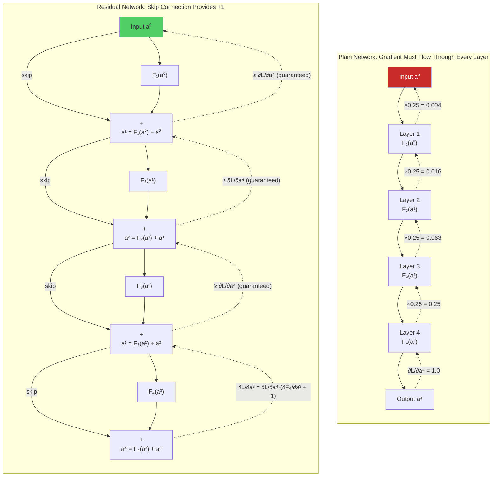

> [!tip] Why Skip Connections Are Called "Gradient Highways"
> The skip connection creates a direct path from the loss to every layer in the network, bypassing all intermediate computations. This path has a gradient of exactly 1 (the identity mapping), so the gradient signal is transmitted without any attenuation. The residual function $F$ can then add task-specific gradient information on top of this baseline. The skip connections are like highway lanes that allow fast, direct travel (gradient flow), while the residual functions are like local roads that provide access to specific destinations (feature learning).

**Implementation.** A basic residual block with two convolutional layers and a skip connection, plus a deep ResNet assembled from such blocks and a gradient-norm probe:

```python
import torch                                    # Import PyTorch library
import torch.nn as nn                           # Import neural network module


class ResidualBlock(nn.Module):                 # Residual block module
    """
    A basic residual block with two convolutional layers and a skip connection.
    The skip connection ensures that the gradient always has a path
    that bypasses the convolutional layers, preventing vanishing gradients.
    """
    def __init__(self, channels):               # Constructor
        super().__init__()                      # Call parent constructor
        self.conv1 = nn.Conv2d(channels,        # First convolution: same in/out channels
                               channels,
                               kernel_size=3,   # 3×3 kernel
                               padding=1,       # Same padding (output size = input size)
                               bias=False)      # No bias (BatchNorm handles the shift)
        self.bn1 = nn.BatchNorm2d(channels)     # Batch normalization after first conv
        self.relu = nn.ReLU(inplace=True)       # ReLU activation (in-place saves memory)
        self.conv2 = nn.Conv2d(channels,        # Second convolution: same channels
                               channels,
                               kernel_size=3,
                               padding=1,
                               bias=False)
        self.bn2 = nn.BatchNorm2d(channels)     # Batch normalization after second conv

    def forward(self, x):                       # Forward pass
        """
        Compute: output = F(x) + x
        
        The '+ x' is the skip connection. Even if F(x) is zero
        (at initialization, this is approximately true with Kaiming init),
        the gradient can still flow through x, ensuring no vanishing.
        """
        identity = x                            # Save the input for the skip connection

        # Compute F(x): the residual function
        out = self.conv1(x)                     # First convolution
        out = self.bn1(out)                     # Batch normalization
        out = self.relu(out)                    # ReLU activation
        out = self.conv2(out)                   # Second convolution
        out = self.bn2(out)                     # Batch normalization

        # Add the skip connection: output = F(x) + x
        out = out + identity                    # This is the key line!
        # The gradient of (out + identity) w.r.t. identity is I + ∂F/∂x
        # The I term guarantees the gradient is at least 1

        out = self.relu(out)                    # Final ReLU after addition

        return out                              # Return the output


# --- Demonstrate gradient flow through a deep residual network ---
class DeepResNet(nn.Module):                    # Deep ResNet model
    """
    A deep network built from many residual blocks.
    Despite having many layers, the skip connections ensure
    that gradients flow all the way back to the input.
    """
    def __init__(self, num_blocks=20,           # Number of residual blocks
                 channels=64):                  # Number of channels
        super().__init__()                      # Call parent constructor
        self.input_conv = nn.Conv2d(3,          # Initial convolution: 3 → 64 channels
                                     channels,
                                     kernel_size=3,
                                     padding=1,
                                     bias=False)
        self.input_bn = nn.BatchNorm2d(channels)  # Batch norm for initial conv
        self.relu = nn.ReLU(inplace=True)       # ReLU activation

        # Stack of residual blocks
        self.blocks = nn.Sequential(            # Sequential container for blocks
            *[ResidualBlock(channels) for _ in range(num_blocks)]  # Create num_blocks blocks
        )

        self.output_conv = nn.Conv2d(channels,  # Final convolution: 64 → 10 channels
                                      10,
                                      kernel_size=1)

    def forward(self, x):                       # Forward pass
        x = self.input_conv(x)                  # Initial convolution
        x = self.input_bn(x)                    # Batch normalization
        x = self.relu(x)                        # ReLU activation
        x = self.blocks(x)                      # Pass through all residual blocks
        x = self.output_conv(x)                 # Final convolution
        x = x.mean(dim=[2, 3])                  # Global average pooling
        return x                                # Return logits (batch_size, 10)


# --- Compare gradient norms: ResNet vs. Plain network ---
def compare_gradient_flow():                    # Function to compare gradient flow
    """
    Compare the gradient norms at each layer between a deep ResNet
    and a deep plain network, demonstrating that skip connections
    prevent gradient vanishing.
    """
    # Create both networks
    resnet = DeepResNet(num_blocks=20)          # ResNet with 20 residual blocks (≈40 layers)
    
    # Count total parameters
    total_params = sum(p.numel() for p in resnet.parameters())  # Total number of parameters
    print(f"ResNet total parameters: {total_params:,}")        # Print parameter count

    # Forward pass
    x = torch.randn(4, 3, 32, 32)              # Random input (batch=4, RGB, 32×32)
    output = resnet(x)                          # Forward pass through ResNet
    target = torch.randint(0, 10, (4,))         # Random target labels
    loss = F.cross_entropy(output, target)      # Cross-entropy loss
    loss.backward()                             # Backward pass

    # Measure gradient norms for convolutional layers
    print("\nGradient norms by layer (ResNet):")
    for name, param in resnet.named_parameters():  # Iterate over all named parameters
        if param.grad is not None and 'conv' in name and 'weight' in name:
            grad_norm = param.grad.norm().item()    # Compute L2 norm of gradient
            print(f"  {name:40s}  grad_norm = {grad_norm:.6f}")


compare_gradient_flow()                         # Run the comparison
```

This is the single biggest fix for vanishing gradients in deep networks. ResNet enabled 100+ layer CNNs; Transformers rely on residuals for the same reason. Without residuals, 50+ layer networks are untrainable; with residuals, 1000+ layer networks work.

### ResNet: residual networks in practice

**ResNet** (Residual Network) is a family of deep convolutional neural network architectures introduced to make very deep networks trainable by using **skip connections** (also called shortcut connections). It solved the problem that simply stacking more layers often made training **worse** (not better) due to vanishing/exploding gradients and optimization difficulties. The paradox it confronts: deeper networks should perform better, but they often perform **worse** due to vanishing gradients (early layers don't learn) and the **degradation problem** — even with good initialization, deeper = harder to optimize:

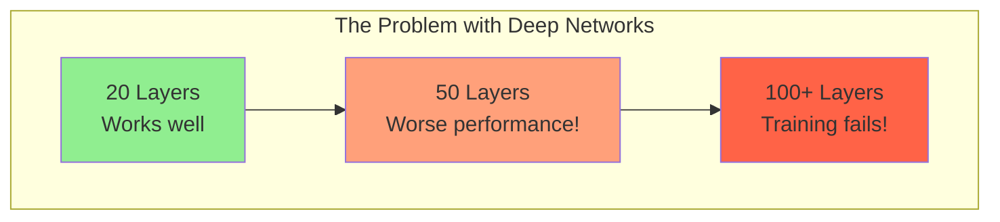

When you stack many layers, it becomes hard for SGD to update weights so deeper layers improve performance. ResNet puts **identity shortcuts** that let gradients and signals flow directly through the network. The key insight: instead of forcing a block to learn a full mapping **H(x)**, you ask it to learn the **residual**:

$$F(x) = H(x) - x$$

Then the block output is:

$$\text{output} = F(x) + x$$

If the block cannot improve on identity, it can learn $F(x) \approx 0$ so the block behaves like an identity — this stabilizes very deep nets. A residual block therefore looks like this:

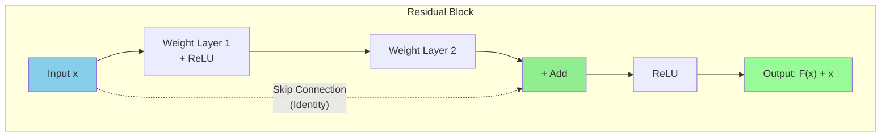

Plain vs. residual, side by side:

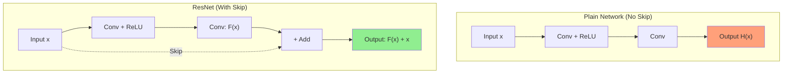

**Why skip connections help, from the gradient viewpoint.** First, the **gradient highway**: the skip connection acts as a "gradient superhighway" — gradients flow backward without being multiplied by small numbers, because the derivative of addition is 1 for the shortcut path. Second, **easy identity learning**: if the best solution is to pass input unchanged, the network can learn $F(x) = 0$, and then $H(x) = 0 + x = x$ (identity mapping). Third, it **solves the degradation problem**: adding more layers doesn't hurt performance, because the network can always learn to ignore extra layers if needed.

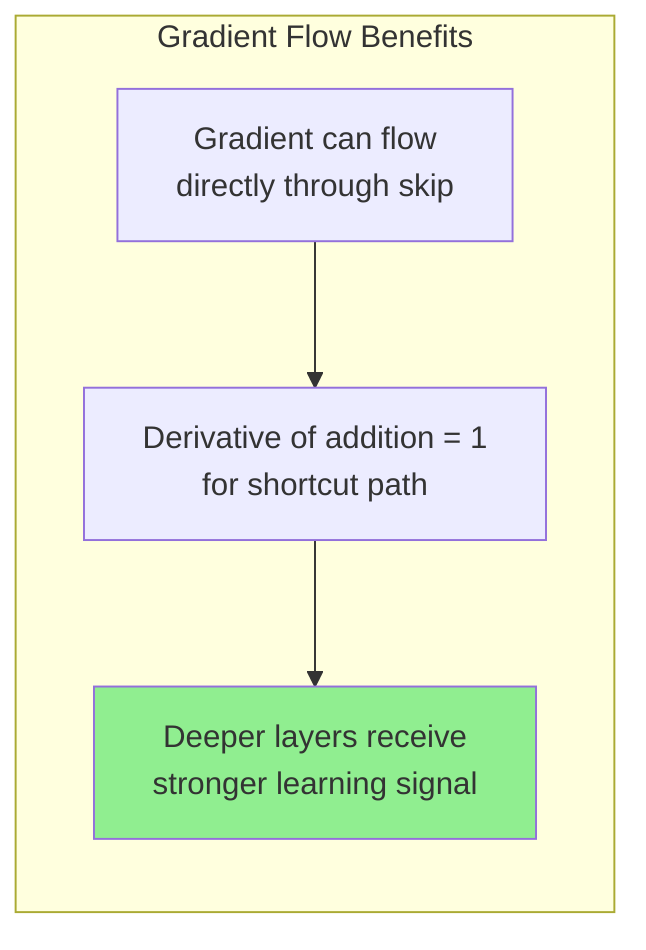

**The residual block: two variants.** The *basic block* (ResNet-18 / ResNet-34) uses two 3×3 convolutions (Conv-BN-ReLU), then adds the input $x$:

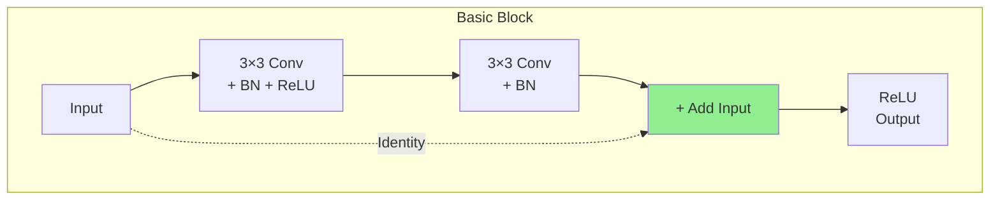

If spatial or channel dimensions change (stride > 1 or different channels), a **projection** (1×1 conv) is applied to $x$ to match shapes. The *bottleneck block* (ResNet-50/101/152) uses a 1×1 conv to reduce channels, a 3×3 conv to process, and a 1×1 conv to expand channels again — reducing computation while allowing deeper models:

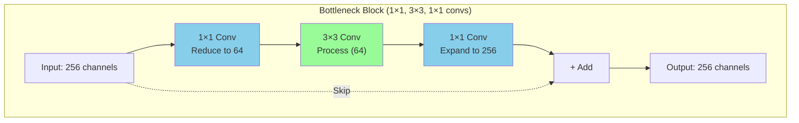

**Versions and differences.** The family scales from ResNet-18 to ResNet-152, switching from basic to bottleneck blocks at ResNet-50:

```mermaid
graph LR
    subgraph Variants["ResNet Variants"]
        R18["ResNet-18<br/>Basic Block"]
        R34["ResNet-34<br/>Basic Block"]
        R50["ResNet-50<br/>Bottleneck "]
        R101["ResNet-101<br/>Bottleneck"]
        R152["ResNet-152<br/>Bottleneck"]
    end
    
    R18 --> R34 --> R50 --> R101 --> R152
    
    style R50 fill:#90EE90
```

| Model | Layers | Block Type | Use Case |
|-------|--------|------------|----------|
| ResNet-18 | 18 | Basic | Small datasets, fast training |
| ResNet-34 | 34 | Basic | Medium complexity tasks |
| **ResNet-50** | 50 | Bottleneck | **Most popular, good balance** |
| ResNet-101 | 101 | Bottleneck | Complex tasks, more compute |
| ResNet-152 | 152 | Bottleneck | Research, maximum accuracy |

ResNet-v2 (pre-activation) reorders the block as **BN → ReLU → Conv**, which helps optimization and generalization in very deep models. Historically, ResNet sits between VGG (2014; very deep but slow, no skip connections) and DenseNet (2017; dense connections, even better gradient flow):

```mermaid
flowchart TB
    subgraph Comparison["Evolution of Deep Networks"]
        VGG["VGG (2014)<br/>Very deep but slow<br/>No skip connections"]
        ResNet["ResNet (2015)<br/>Deeper AND faster<br/>Skip connections "]
        DenseNet["DenseNet (2017)<br/>Dense connections<br/>Even better gradient flow"]
    end
    
    VGG --> ResNet --> DenseNet
    
    style ResNet fill:#90EE90
```

**Practical training tips.** ResNets rely on a specific, reproducible recipe — BatchNorm after convolutions, He/Kaiming initialization (standard for ReLU nets), a scheduled learning rate, dimension-matched shortcuts, and a transfer-learning workflow:

```mermaid
mindmap
    root((ResNet Training))
        Normalization
            BatchNorm after Conv
            Essential for ResNets
        Initialization
            He/Kaiming init
            Standard for ReLU nets
        Learning Rate
            Step decay
            Cosine annealing
            Warmup
        Skip Connection
            Identity if same shape
            Projection 1×1 if changed
        Transfer Learning
            Remove final FC
            Attach your head
```

| Tip | Details |
|-----|---------|
| **BatchNorm** | Use after convolutions (ResNets rely on it) |
| **Initialization** | He initialization (Kaiming) is standard |
| **Learning Rate** | Typical schedules: step decay, cosine, warmup |
| **Projection** | If channels/stride change, use 1×1 conv in shortcut |
| **Transfer Learning** | Remove final FC layer and attach your custom head |

**Common uses.** ResNet is a workhorse backbone: image classification (ImageNet); detection and segmentation backbones (Faster R-CNN, Mask R-CNN, FCN, DeepLab); a transfer-learning backbone in many vision and multi-modal architectures; and non-vision domains where very deep feedforward nets are helpful. The CNN context is in [[Convolutional Neural Networks]].

```mermaid
flowchart TB
    subgraph Uses["ResNet Applications"]
        IC["Image Classification<br/>(ImageNet)"]
        DET["Detection Backbones<br/>(Faster R-CNN, Mask R-CNN)"]
        SEG["Segmentation<br/>(FCN, DeepLab)"]
        TL["Transfer Learning<br/>(Vision & Multi-modal)"]
        NV["Non-Vision Domains<br/>(Deep feedforward nets)"]
    end
    
    style IC fill:#90EE90
    style TL fill:#98FB98
```

**Strengths and limitations.** Its strengths: an elegant design — a simple trick with outsized impact that fundamentally changed deep learning; a robust backbone, very reliable for transfer learning; scalability to deep models (100+ layers) while remaining trainable; and status as a must-know baseline, since understanding residual connections is essential for modern architectures.

| Strength | Explanation |
|----------|-------------|
| **Elegant Design** | Simple trick with outsized impact — fundamentally changed deep learning |
| **Robust Backbone** | Very reliable for transfer learning |
| **Scalable** | Scales to deep models (100+ layers) while remaining trainable |
| **Must-Know Baseline** | Understanding residual connections is essential for modern architectures |

Its limitations: it is still compute-heavy for large models; newer architectures (Swin, ConvNeXt, Vision Transformers) can outperform ResNets on some tasks; and it may need modifications — pre-activation, layer scaling, improved normalization can provide better performance.

| Limitation | Explanation |
|------------|-------------|
| **Compute Heavy** | Still heavy compute for large models |
| **Newer Architectures** | Swin, ConvNeXt, Vision Transformers can outperform ResNets on some tasks |
| **May Need Modifications** | Pre-activation, layer scaling, improved normalization can provide better performance |

The key takeaways, in map form — core idea, benefits, variants, and impact (including winning ImageNet 2015 with a 152-layer trained model, and serving as the foundation for many architectures):

```mermaid
mindmap
    root((ResNet))
        Core Idea
            Skip Connections
            Learn Residual F(x)
            Output = F(x) + x
        Benefits
            Train Very Deep Networks
            Solve Vanishing Gradients
            Easy Identity Learning
        Variants
            ResNet-18 to ResNet-152
            Basic vs Bottleneck Blocks
            Pre-activation ResNet v2
        Impact
            Won ImageNet 2015
            152 layers trained
            Foundation for many architectures
```

| Term | Meaning |
|------|---------|
| **ResNet** | Residual Network with skip connections |
| **Skip Connection** | Direct path that adds input to output |
| **Residual** | What the network learns (F(x) = H(x) - x) |
| **Bottleneck** | 1×1 → 3×3 → 1×1 conv block for efficiency |
| **Basic Block** | Two 3×3 convs (ResNet-18/34) |
| **Projection** | 1×1 conv to match dimensions when needed |

**ResNet = Skip connections let gradients flow → Train 100+ layers successfully!**

### Gradient clipping

**The idea: put a ceiling on gradient magnitude.** While ReLU, BatchNorm, and residual connections address the **root causes** of vanishing and exploding gradients, gradient clipping is a **symptomatic treatment** that directly prevents gradients from becoming too large. After computing the gradients via backpropagation, but before applying the weight update, we check if the total gradient magnitude exceeds a threshold, and if it does, we scale it down to the threshold value. Gradient clipping does not prevent gradients from being large — it merely limits their maximum magnitude. This is like installing a speed limiter on a car: the car can still go fast, but it cannot exceed the speed limit. In the context of deep learning, this prevents the catastrophic weight updates that cause `NaN` loss and training divergence.

There are two main variants. **Clip by value**: clip each individual gradient element to a range $[-c, c]$ — this prevents any single gradient component from being too large, but it can change the direction of the gradient vector. **Clip by norm**: scale the entire gradient vector so that its L2 norm does not exceed a threshold — this preserves the direction of the gradient while limiting its magnitude, and is the more commonly used variant.

**How clipping by norm works.** Given the total gradient vector $\mathbf{g} = \nabla_\theta \mathcal{L}$ (which concatenates the gradients of all parameters into a single vector), gradient clipping by norm computes:

$$\mathbf{g}_{\text{clipped}} = \begin{cases} \mathbf{g} & \text{if } \|\mathbf{g}\| \leq c \\ \frac{c}{\|\mathbf{g}\|} \cdot \mathbf{g} & \text{if } \|\mathbf{g}\| > c \end{cases}$$

where $c$ is the clipping threshold (a hyperparameter) and $\|\mathbf{g}\| = \sqrt{\sum_i g_i^2}$ is the L2 norm of the gradient vector. When the gradient norm exceeds $c$, the gradient is scaled down so that its norm is exactly $c$; the direction of the gradient is preserved — only its magnitude is reduced. An equivalent compact statement: $\text{if } \|\nabla L\| > c: \nabla L \leftarrow c \cdot \frac{\nabla L}{\|\nabla L\|}$. This ensures that the maximum size of the weight update (in the L2 norm sense) is bounded by $\eta \cdot c$, where $\eta$ is the learning rate. Even if the gradients explode by a factor of 1000, the weight update will be no larger than $\eta \cdot c$, preventing the catastrophic divergence that would otherwise occur. Gradient clipping is essential for transformer training, with a typical $c = 1.0$; it doesn't fix the underlying cause but prevents training divergence.

**PyTorch implementation.** PyTorch provides a built-in function for gradient clipping by norm, called **after** `loss.backward()` and **before** `optimizer.step()`:

```python
import torch                                    # Import PyTorch library
import torch.nn as nn                           # Import neural network module
import torch.nn.utils as utils                  # Import utility functions


# --- Create a simple model and training setup ---
model = nn.Sequential(                          # Sequential model
    nn.Linear(784, 512),                        # First layer: 784 → 512
    nn.ReLU(),                                  # ReLU activation
    nn.Linear(512, 256),                        # Second layer: 512 → 256
    nn.ReLU(),                                  # ReLU activation
    nn.Linear(256, 10),                         # Output layer: 256 → 10
)

optimizer = torch.optim.SGD(model.parameters(), # SGD optimizer
                             lr=0.01)           # Learning rate
criterion = nn.CrossEntropyLoss()               # Cross-entropy loss

# --- Training loop with gradient clipping ---
max_grad_norm = 1.0                             # Maximum allowed gradient norm
# Typical values: 0.5, 1.0, 5.0, or 10.0
# Too small: training becomes very slow (gradients always clipped)
# Too large: clipping is ineffective (gradients rarely clipped)

for epoch in range(100):                        # Training loop
    optimizer.zero_grad()                       # Reset all gradients to zero

    x = torch.randn(32, 784)                   # Random input batch
    y = torch.randint(0, 10, (32,))            # Random target labels

    output = model(x)                           # Forward pass
    loss = criterion(output, y)                 # Compute loss

    loss.backward()                             # Backward pass: compute gradients
    # At this point, model.parameters() all have their .grad attributes set

    # --- GRADIENT CLIPPING: The critical step ---
    # clip_grad_norm_ clips the gradient norm in-place
    # It returns the total norm BEFORE clipping, which is useful for monitoring
    grad_norm = utils.clip_grad_norm_(           # Clip gradients by norm
        model.parameters(),                     # All model parameters
        max_norm=max_grad_norm,                 # Maximum allowed gradient norm
        norm_type=2.0                           # L2 norm (most common choice)
        # norm_type=2.0 means L2 norm: sqrt(sum(g_i^2))
        # norm_type=float('inf') means L-inf norm: max(|g_i|)
    )
    # After this call, if grad_norm > max_grad_norm, all gradients have been
    # scaled by (max_grad_norm / grad_norm), preserving direction but limiting magnitude

    # Monitor gradient norm for debugging
    if epoch % 10 == 0:                         # Print every 10 epochs
        print(f"Epoch {epoch}: Loss = {loss.item():.4f}, "
              f"Grad norm = {grad_norm:.4f}, "
              f"Clipped = {'YES' if grad_norm > max_grad_norm else 'no'}")

    optimizer.step()                            # Update weights using clipped gradients
    # The weight update is now bounded: ||Δθ|| ≤ lr × max_grad_norm
```

For day-to-day use, the one-liner form is:

```python
torch.nn.utils.clip_grad_norm_(model.parameters(), max_norm=1.0)
```

**Choosing the clipping threshold.** The clipping threshold $c$ is a hyperparameter that must be chosen carefully. If $c$ is too small (e.g., 0.01), gradients are almost always clipped, which severely limits the learning speed — the optimizer takes tiny steps even when the loss landscape has steep, informative gradients, and training becomes unreasonably slow. If $c$ is too large (e.g., 1000.0), gradients are rarely clipped, which means the clipping provides no protection — the threshold is so high that even catastrophically large gradients pass through unmodified. If $c$ is just right (e.g., 1.0–5.0), gradients are clipped only when they become unusually large, which typically happens during the occasional spikes that precede divergence; the clipping acts as a safety net that prevents catastrophic updates without interfering with normal training. The best way to choose $c$ is to monitor the gradient norm during training and set $c$ to be slightly larger than the typical gradient norm. If the gradient norm is usually around 1.0–5.0, setting $c = 5.0$ will rarely clip the gradient during normal training but will prevent occasional spikes from causing divergence.

**Clipping by value.** PyTorch also provides `clip_grad_value_`, which clips each individual gradient element to the range $[-c, c]$:

```python
# Clip each gradient element to [-0.5, 0.5]
utils.clip_grad_value_(model.parameters(),     # All model parameters
                       clip_value=0.5)          # Clip value range: [-0.5, 0.5]
# After this call, every element g_i of every gradient tensor satisfies:
# -0.5 ≤ g_i ≤ 0.5
```

This is less commonly used than norm clipping because it can distort the direction of the gradient: if the gradient vector has one very large component and many small components, value clipping will reduce the large component while leaving the small components unchanged, changing the direction of the gradient. Norm clipping, by contrast, scales all components proportionally, preserving the direction. However, value clipping can be useful in specific situations, such as when training recurrent networks where individual gradient elements can become extremely large.

**Clipping in context.** Gradient clipping is not a substitute for the other solutions. It does not address the root cause of exploding gradients (poor initialization, bad architecture, or excessively high learning rate) — it merely prevents the most catastrophic symptom (divergence to `NaN`). The recommended approach is to use all four solutions together: ReLU/Leaky ReLU (prevents vanishing gradients through the activation function), batch normalization (keeps activations and gradients in a healthy range), residual connections (provides a gradient highway that guarantees gradient flow), and gradient clipping (a safety net against occasional gradient explosions). With the first three solutions in place, gradient explosions are rare, and gradient clipping may never actually be triggered; but when it is triggered (e.g., due to an unusual batch of data, a temporary numerical instability, or a learning rate that is slightly too high), it prevents a single bad step from destroying the entire training run.

> [!warning] Gradient Clipping Is Not a Silver Bullet
> Some practitioners use gradient clipping as a crutch to mask the symptoms of deeper problems — a too-high learning rate, a poor initialization, or an unstable architecture. If you find that your gradients are frequently being clipped (more than 10% of the time), this is a sign that something else is wrong. Investigate the root cause before relying on clipping as a permanent solution.

The asymmetry is worth stating precisely, because it is a common interview trap: gradient clipping fixes exploding but not vanishing — you can't clip a 0 gradient to be larger. Norm clipping preserves gradient direction; value clipping (per-element) can distort direction.

### Proper initialization

Xavier (for tanh) and He (for ReLU) initializations are designed to keep activation and gradient variances roughly constant across layers — they control the initial spectral radius of every layer's Jacobian, preventing both vanishing and exploding from the very first step. The derivations and the full scheme catalog are in [[05 - Neural Network Foundations/Training Dynamics and Stability/Weight Initialization|Weight Initialization]]. Historically, this mattered enormously: before 2010, ad-hoc/uncalibrated initialization kept deep networks untrainable, and principled initialization (Glorot & Bengio 2010; He et al. 2015) was a prerequisite for the deep-learning revolution. A practical pairing warning: the wrong activation + init combination (sigmoid + He, ReLU + Xavier) invites vanishing gradients — match the scheme to the activation.

### Attention: the Transformer route

Attention provides direct, non-sequential paths between any two positions. The gradient between distant tokens doesn't have to flow through many intermediate layers — it flows directly through attention. This is part of why Transformers handle long sequences better than RNNs, and it is why "attention (no recurrence)" appears in the solutions table as *bypassing* both failure modes (at the cost of $O(n^2)$ attention).

Transformers are less susceptible to vanishing/exploding than RNNs, but not immune. On the **vanishing** side: deep Transformers (50+ layers) need residual connections, without which gradients vanish — residuals are essential. And **attention saturation**: if $QK^T / \sqrt{d_k}$ has very large entries, softmax saturates (one entry → 1, others → 0); the gradient through saturated softmax is ~0 — this is why we scale by $1/\sqrt{d_k}$. On the **exploding** side: without scaling, $QK^T$ can have very large entries, causing softmax to output near-one-hot and gradients to explode (scaling fixes this); bad (too-large) init causes activation explosion, which He/Xavier init prevents; and attention over very long sequences can produce large gradients, for which gradient clipping is essential.

Even with good init and scaling, Transformers can have occasional large gradients from rare but high-loss training examples, numerical instability in attention (especially with FP16), and bad mini-batches (outlier data). Gradient clipping (norm 1.0) is standard in all Transformer training recipes (GPT, Llama, Mistral).

## Combining the solutions

The vanishing and exploding gradient problems are two sides of the same coin: both arise from the multiplicative structure of backpropagation through deep networks. The four core solutions address different aspects of these problems, and the complete remedy map looks like this:

```mermaid
graph TD
    A["Vanishing/Exploding<br/>Gradient Problem"] --> B["Root Cause:<br/>Gradient = Product of<br/>L−1 Jacobian terms"]
    
    B --> C["Solution 1:<br/>ReLU/Leaky ReLU"]
    B --> D["Solution 2:<br/>Batch Normalization"]
    B --> E["Solution 3:<br/>Residual Connections"]
    B --> F["Solution 4:<br/>Gradient Clipping"]
    
    C --> C1["Activation derivative = 1<br/>for active neurons<br/> Prevents vanishing<br/> Dying ReLU trade-off"]
    D --> D1["Re-normalizes activations<br/>at every layer<br/> Prevents saturation<br/> Reduces init sensitivity"]
    E --> E1["Adds +I to Jacobian<br/>Gradient ≥ ∂L/∂a_L<br/> Guarantees gradient flow<br/> Enables 100+ layer nets"]
    F --> F1["Caps gradient norm<br/>at threshold c<br/> Prevents NaN<br/> Symptomatic, not causal"]
    
    style C fill:#51cf66,color:#333
    style D fill:#a9e34b,color:#333
    style E fill:#339af0,color:#fff
    style F fill:#ffd43b,color:#333
```

| Solution | Problem Addressed | Mechanism | Trade-off |
|---|---|---|---|
| ReLU/Leaky ReLU | Vanishing gradients | Derivative = 1 (active), α (inactive) | Dying ReLU (fixed by Leaky ReLU) |
| Batch Normalization | Both (primarily vanishing) | Re-normalizes activations to prevent saturation | Computational overhead, train/test discrepancy |
| Residual Connections | Vanishing gradients | +I in gradient ensures minimum gradient of 1 | Slight architectural complexity |
| Gradient Clipping | Exploding gradients | Caps gradient norm at threshold | Does not fix root cause; threshold must be tuned |

A compact remedies map for the vanishing side, with proper initialization added as a fourth branch:

```mermaid
flowchart TD
    VG[Vanishing Gradient Problem]
    
    VG --> R[ReLU Activation<br/>Gradient = 1 for x > 0]
    VG --> BN[Batch Normalization<br/>Stabilizes activations]
    VG --> RC[Residual Connections<br/>Skip connections for gradients]
    VG --> PI[Proper Initialization<br/>Xavier/He init]
    
    style VG fill:#FFB6C1
    style R fill:#90EE90
    style BN fill:#90EE90
    style RC fill:#90EE90
    style PI fill:#90EE90
```

| Solution | How It Helps |
|----------|--------------|
| **ReLU Activation** | Gradient = 1 for positive inputs (no vanishing) |
| **Batch Normalization** | Normalizes activations, stabilizes gradients |
| **Residual Connections** | Skip connections allow gradients to flow directly |
| **Proper Initialization** | Xavier/He initialization prevents early vanishing |

Modern deep learning architectures use **all four solutions together**: ReLU (or Leaky ReLU/PReLU) as the activation function, ensuring the activation derivative does not attenuate the gradient; batch normalization after each convolution, keeping activations in a healthy range and reducing sensitivity to initialization; residual connections between blocks, providing a guaranteed gradient path from the loss to every layer; and gradient clipping during training, providing a safety net against occasional gradient explosions. This combination of techniques is what enables the training of networks with hundreds or even thousands of layers, such as ResNet-152, DenseNet-264, and the deep transformers used in modern NLP and computer vision models.

Three one-line memory aids tie the whole catalog together. **Gradient flow** = highway for learning signals → ReLU + skip connections keep it smooth. **Vanishing gradient** = gradients disappear → can't learn → use ReLU to fix. **ResNet** = skip connections let gradients flow → train 100+ layers successfully.

## Practical guidance

### Production implications

Working backwards from these failure modes gives a short checklist of production habits. Always use gradient clipping for transformer training — max norm 1.0 is standard. Monitor gradient norms per layer: sudden spikes mean instability, steady decline means vanishing. Use a known-good architecture (Transformer with residuals + RMSNorm + SwiGLU) rather than inventing your own — the vanishing/exploding gradient issues have been engineered out. For RNNs, use LSTM/GRU, not vanilla RNN; even better, use a Transformer or SSM. And treat loss spikes during training as what they usually are — gradient explosions — and investigate before continuing.

The classic pitfalls are the exact negatives of those habits. No gradient clipping in transformer training → almost guaranteed to diverge. Wrong activation + init combo (sigmoid + He, ReLU + Xavier) → vanishing gradients. Removing residuals as an "optimization" → kills deep networks. Ignoring loss spikes as "training noise" → often a sign of impending divergence. No gradient logging → can't diagnose issues when they appear.

### Why this matters

Every Transformer architecture choice — residuals, LayerNorm, ReLU/SwiGLU, init scheme — is partly motivated by avoiding vanishing/exploding gradients; understanding this makes the architecture make sense. Training stability is the number-one practical challenge in LLM training: loss spikes, divergence, "the model just stopped learning" — these are gradient issues. For fine-tuning, vanishing gradients are less of a concern (the network is shallower in effect), but gradient clipping is still standard practice. For inference, gradient issues don't apply directly — but understanding them explains architectural choices. In the widest frame: without ReLU, batch normalization, residual connections, and gradient clipping, training networks deeper than a few layers would remain essentially impossible — understanding the vanishing and exploding gradient problems is the key to understanding why modern deep learning works at all.

## Historical notes and further reading

The problem is older than the fixes. Sepp Hochreiter's 1991 diploma thesis, *Untersuchungen zu dynamischen neuronalen Netzen* (in German), is the original analysis of vanishing gradients. The standard mathematical treatment of the recurrent case is Pascanu et al. (2013), *On the Difficulty of Training Recurrent Neural Networks*. He et al. (2015), *Delving Deep into Rectifiers*, introduced He initialization together with PReLU, with an explicit analysis of gradient flow. Before 2010, ad-hoc and uncalibrated initialization kept deep networks untrainable; principled initialization (Glorot & Bengio 2010, He et al. 2015) was a prerequisite for the deep-learning revolution that followed.

## Interview questions

These six questions and model answers cover the distinctions interviewers most often probe.

**Why do vanishing gradients happen in deep networks?** Backpropagation multiplies many Jacobians: $\nabla = \prod_l J_l$. If each Jacobian has spectral radius < 1 (typical for sigmoid/tanh in saturation, or bad init), the product $\to 0$ exponentially. The gradient at early layers is exponentially small — they don't learn. The chain rule, which makes deep learning possible, also causes this fundamental problem.

**How do residual connections fix vanishing gradients?** The residual connection $\mathbf{y} = \mathbf{x} + F(\mathbf{x})$ has Jacobian $\frac{\partial \mathbf{y}}{\partial \mathbf{x}} = \mathbf{I} + \frac{\partial F}{\partial \mathbf{x}}$. The identity term $\mathbf{I}$ ensures the gradient can flow directly through the network, even if $\frac{\partial F}{\partial \mathbf{x}}$ vanishes. Without residuals, 50+ layer networks are untrainable; with residuals, 1000+ layer networks work.

**Why are RNNs especially vulnerable to vanishing gradients?** RNNs apply the **same** weight matrix at every timestep: $\mathbf{h}_t = f(\mathbf{W}\mathbf{h}_{t-1})$. The Jacobian product is $\prod_t \mathbf{W}^T \text{diag}(f')$. If $\rho(\mathbf{W}) < 1$ (vanishing) or > 1 (exploding), the product diverges exponentially. This is why RNNs can't remember dependencies > 20-50 timesteps. LSTMs mitigate (gates control the Jacobian) but don't fully solve; Transformers bypass entirely (no sequential product).

**Why does self-attention scale by $1/\sqrt{d_k}$?** Without scaling, $QK^T$ has variance $\propto d_k$. For large $d_k$, softmax saturates (one entry → 1, others → 0). In saturation, softmax's gradient is ~0 — vanishing gradient. Scaling by $1/\sqrt{d_k}$ brings variance back to 1, keeping softmax in its non-saturated regime where gradients flow. This is a gradient-stability fix, not just a numerical stability fix.

**How does gradient clipping work, and when should you use it?** Gradient clipping caps $\|\nabla\|$ at a threshold $c$: $\nabla \leftarrow \nabla \cdot \min(1, c / \|\nabla\|)$. This prevents exploding gradients from causing divergence. Use it always for Transformers (typical $c = 1.0$). It doesn't fix vanishing (you can't clip a 0 gradient to be larger). Norm clipping preserves gradient direction; value clipping (per-element) can distort direction.

**Why don't Transformers have vanishing gradients like RNNs?** Three reasons: (1) attention has no sequential Jacobian product — each position attends directly to all others, no chain of multiplications; (2) residual connections provide a direct gradient path; (3) LayerNorm controls activation scale. But Transformers still need gradient clipping for occasional large gradients (rare high-loss examples, numerical instability, long sequences).

## Key takeaways

1. **Gradients are products of many terms** in deep networks. If each term is less than 1, the product vanishes exponentially. If each term is greater than 1, the product explodes exponentially. This is the fundamental mechanism behind both problems.
2. **Sigmoid's maximum derivative is 0.25**, which means the gradient shrinks by at least a factor of 4 at every sigmoid layer. Through 10 layers: $0.25^{10} \approx 10^{-7}$, effectively zero.
3. **Vanishing gradients cause early layers to learn nothing**, because the gradient signal reaching them is too small to produce meaningful weight updates. The network's feature extraction hierarchy breaks down.
4. **Exploding gradients cause NaN loss and training divergence**, because the gradient signal grows so large that the weight updates are catastrophically destructive. The loss oscillates wildly or becomes `NaN`.
5. **ReLU solves vanishing gradients** by having a derivative of exactly 1 for active neurons, but introduces the dying ReLU problem. **Leaky ReLU** fixes this by allowing a small gradient for inactive neurons.
6. **Batch normalization prevents saturation** by re-normalizing activations to have zero mean and unit variance at every layer, keeping them in the active region of the activation function.
7. **Residual connections add a +1 term** to the gradient at every layer, mathematically guaranteeing that the gradient cannot vanish below the value coming from the next layer.
8. **Gradient clipping caps the gradient norm** at a threshold, preventing catastrophic weight updates that cause divergence. It is a safety net, not a root cause solution.
9. **Diagnose problems by monitoring gradient norms** per layer and checking for NaN loss. Early detection allows you to adjust initialization, learning rate, or architecture before wasting training time.
10. **Modern architectures use all four solutions together**: ReLU + BatchNorm + Residual Connections + Gradient Clipping. This combination enables training of networks with hundreds or thousands of layers.

## See also

[[Neural Network Foundations MOC]] maps the whole area. The algorithm whose gradients are at stake is developed in [[Backpropagation]], with the CNN-specific treatment in [[Backpropagation and Gradient Flow in CNNs]] and the vectorized formulation in [[Matrix Implementation of Backpropagation]]; the activation functions whose derivative bounds drive the whole analysis are cataloged in [[Activation Functions]]. The two sibling remedies most intertwined with this note are [[05 - Neural Network Foundations/Training Dynamics and Stability/Weight Initialization|Weight Initialization]] (Xavier/He schemes and the pre-2010 history) and [[05 - Neural Network Foundations/Training Dynamics and Stability/Batch Normalization|Batch Normalization]] (the full normalization machinery, including LayerNorm alternatives); learning-rate and clipping-threshold choices connect to [[05 - Neural Network Foundations/Training Dynamics and Stability/Hyperparameters and Network Configuration|Hyperparameters and Network Configuration]]. The networks these pathologies strike are covered in [[Artificial Neural Networks]], [[Perceptrons and Multi-Layer Perceptrons]], [[Forward Propagation]], [[Neural Network Architecture and Notation]], [[Convolutional Neural Networks]], and [[Recurrent Neural Networks]], and the regularization perspective on the same training-dynamics territory is in [[05 - Neural Network Foundations/Training Dynamics and Stability/Dropout and Regularization|Dropout and Regularization]].

