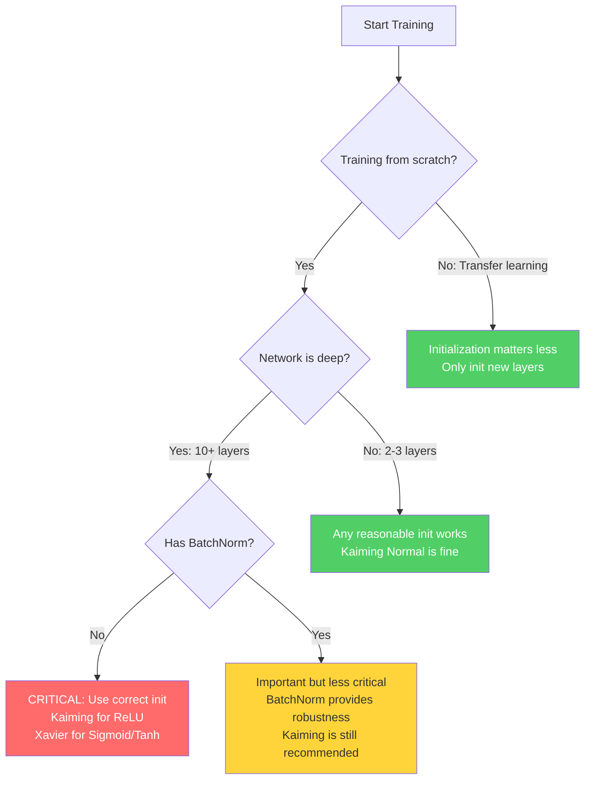

Before a single gradient is ever computed, a neural network runs a forward pass with whatever weight values it was handed, and those starting values decide whether training converges quickly, converges at all, or diverges into overflow within the first few steps. Weight initialization is the discipline of choosing those starting values: random enough to break symmetry between neurons, and scaled so that neither activations nor gradients explode or vanish as signals traverse the network's depth. Two families of principled schemes dominate practice — Xavier/Glorot initialization for symmetric activations such as sigmoid and tanh, and He/Kaiming initialization for the ReLU family — with modern Transformers adding their own scaled variants of He init.

> [!info] Prerequisites
> Before digging into initialization schemes, you should be comfortable with how gradients propagate through layers ([[05 - Neural Network Foundations/Backpropagation/Backpropagation and Gradient Flow in CNNs|Backpropagation and Gradient Flow in CNNs]], [[Backpropagation]]), the properties of activation functions — especially ReLU, Sigmoid, and Tanh ([[Activation Functions]]) — and basic probability and statistics: mean, variance, the normal distribution, and the uniform distribution.

## Why initialization matters

### The starting point on a non-convex loss landscape

Training a deep neural network is an optimization problem over a loss landscape that is **non-convex**, meaning it contains many local minima, saddle points, and flat regions. Unlike convex optimization — where any local minimum is guaranteed to be the global minimum and gradient descent will always converge — non-convex optimization offers no such guarantees. The point where you start on this landscape, determined entirely by the initial values of the weights, profoundly influences which region of the landscape you will explore, how quickly you will converge, and whether you will converge at all.

To understand why initialization is so critical, consider the following analogy. Imagine you are parachuted onto a vast mountain range at night, and your goal is to reach the lowest valley. You can only feel the slope beneath your feet (the gradient) and take small steps downhill. If you land on a gentle slope near a deep valley, you will quickly find a good solution. If you land on a plateau, you will wander aimlessly with near-zero gradients. If you land on a steep cliff, your steps will be erratic and you may overshoot valleys entirely. The parachute landing point is your weight initialization, and the mountain range is the loss landscape.

There are three concrete reasons why initialization determines training outcomes. First, **convergence speed**: a good initialization places the network in a region where gradients are informative and well-scaled, allowing the optimizer to make rapid progress. A bad initialization may require thousands of additional epochs just to escape a flat or chaotic region. Second, **convergence at all**: some initializations lead to regions from which the optimizer cannot escape — for example, when all activations are saturated in the flat tails of sigmoid functions, producing near-zero gradients that make learning impossible. Third, **final performance**: even when the network converges from different initializations, the quality of the local minimum reached can vary dramatically. Well-initialized networks tend to find wider, more generalizable minima, while poorly initialized networks may converge to sharp, poorly generalizing minima.

> [!tip] The non-convex reality
> A modern CNN with millions of parameters defines a loss landscape in a space of millions of dimensions. In such high-dimensional spaces, the landscape is overwhelmingly complex — it has been estimated that a network with $N$ parameters has roughly $2^N$ saddle points for every local minimum. Initialization is your only control over where you begin exploring this landscape, which makes it one of the most impactful design choices you can make.

### What the initialization controls at step zero

At step 0, before any training, the network does a forward pass with random weights, and the initialization determines three things. It controls **activation magnitudes**: do they stay roughly constant across layers, or grow/shrink exponentially? It controls **gradient magnitudes**: the same question, but for the backward pass. And it handles **symmetry breaking**: if all weights are equal, all neurons in a layer compute the same thing — wasted capacity. Bad initialization means training never converges, or converges to a bad solution; bad init causes vanishing or exploding gradients from the very first step, which is why the two main schemes — **Xavier (Glorot)** for tanh/sigmoid and **He (Kaiming)** for ReLU — are worth understanding rather than accepting as framework magic. Modern Transformers typically use a scaled variant of He init.

### The goal of good init

The entire subject can be compressed into one variance requirement. For a layer $\mathbf{y} = \mathbf{W} \mathbf{x}$ with $\mathbf{x} \in \mathbb{R}^{n_{\text{in}}}$:

$$
\text{Var}(\mathbf{y}) = n_{\text{in}} \cdot \text{Var}(W_{ij}) \cdot \text{Var}(\mathbf{x})
$$

We want $\text{Var}(\mathbf{y}) \approx \text{Var}(\mathbf{x})$ — activations should not blow up or vanish. This gives:

$$
\text{Var}(W_{ij}) = \frac{1}{n_{\text{in}}}
$$

For the backward pass, gradients flow through $\mathbf{W}^T$, and the analogous condition gives $\text{Var}(W_{ij}) = \frac{1}{n_{\text{out}}}$. Everything that follows — Xavier's compromise, He's factor of 2, Transformer scaling tricks — is an attempt to satisfy these two conditions simultaneously for a particular activation function and architecture.

The same requirement can be derived coordinate by coordinate. For a linear layer $\mathbf{y} = \mathbf{W}\mathbf{x}$ where $\mathbf{x} \in \mathbb{R}^{n_{\text{in}}}$, $\mathbf{W} \in \mathbb{R}^{n_{\text{out}} \times n_{\text{in}}}$, with $W_{ij} \sim \mathcal{N}(0, \sigma_W^2)$ i.i.d. and $\mathbb{E}[x_i] = 0$, $\text{Var}(x_i) = \sigma_x^2$:

$$
\text{Var}(y_j) = \sum_{i=1}^{n_{\text{in}}} \text{Var}(W_{ji} x_i) = n_{\text{in}} \sigma_W^2 \sigma_x^2
$$

To keep $\text{Var}(y) = \text{Var}(x)$ — activations that neither grow nor shrink — we need $\sigma_W^2 = 1/n_{\text{in}}$ on the forward pass and $\sigma_W^2 = 1/n_{\text{out}}$ on the backward pass, where gradients flow through $\mathbf{W}^T$: $\frac{\partial L}{\partial \mathbf{x}} = \mathbf{W}^T \frac{\partial L}{\partial \mathbf{y}}$. Initialization uses Gaussians throughout, which is why the normal distribution's variance arithmetic underpins every scheme.

## Failure modes of bad initialization

Weight initialization is one of the most underappreciated yet critically important aspects of training deep networks. The choice of initial values for the weights can mean the difference between a network that trains successfully and one that never learns anything at all; despite this, many practitioners simply use the default initialization provided by their framework without understanding why it works or what would happen without it. The failure modes come in two distinct flavors. Identical values (zeros or any shared constant) destroy the network through symmetry, while badly *scaled* values — whether constant or random — destroy it through exponentially growing or shrinking signals. If all weights start at 0, every neuron in a layer computes the same output, receives the same gradient, and updates identically; the layer acts as a single neuron, a phenomenon called **symmetry breaking failure**. We must therefore initialize weights randomly, but carefully: the initialization must ensure that the variance of activations and gradients remains stable as they pass through the network. A standard uncalibrated Gaussian initialization also fails in deep architectures, because variance destructively shrinks or violently explodes as data continuously passes through 50+ sequentially connected layers — the vanishing and exploding gradients problem covered in [[05 - Neural Network Foundations/Training Dynamics and Stability/Vanishing and Exploding Gradients|Vanishing and Exploding Gradients]]. If weights are initialized with too-large values, activations grow exponentially through the layers (exploding gradients); if weights are initialized with too-small values, activations shrink to zero through the layers (vanishing gradients). Both scenarios prevent the network from learning. With too-small a variance, the activations at each layer have progressively smaller variance, until after 50 layers they may be effectively zero; during backpropagation the gradients are also extremely small (because the chain rule multiplies many small numbers together), making learning impossibly slow — the network appears to train, but the early layers never actually learn meaningful features. With too-large a variance, the activations grow progressively larger until they overflow the numerical representation (becoming NaN or Infinity), crashing the entire training process; even if overflow does not occur, the gradients are extremely large, causing the optimizer to take massive, unstable steps that prevent convergence.

### Zero initialization: the symmetry problem

The most naive approach to initialization is to set all weights to zero: $w_{ij} = 0$ for every weight in every layer. At first glance, this might seem reasonable — start from a neutral point and let gradient descent figure out the right values. However, this approach fails catastrophically due to the **symmetry problem**, which prevents the network from ever breaking out of a degenerate state where all neurons in a layer behave identically. In a CNN the same catastrophe applies to filters: you cannot initialize the raw architecture's weights to all zeros, otherwise every single filter computes the identical gradients and therefore learns the identical features.

Consider a fully-connected layer with $n$ inputs and $m$ outputs. The $j$-th output neuron computes:

$$a_j = f\left(\sum_{i=1}^{n} w_{ij} x_i + b_j\right)$$

where $f$ is the activation function and $x_i$ are the inputs. If all weights are initialized to zero ($w_{ij} = 0$) and all biases are initialized to zero ($b_j = 0$), then every output neuron receives the exact same input:

$$a_j = f\left(\sum_{i=1}^{n} 0 \cdot x_i + 0\right) = f(0) \quad \text{for all } j$$

This means every neuron in the layer produces the **identical output** — all zeros before bias, all equal to the bias value after bias. Now consider what happens during backpropagation. The gradient of the loss with respect to weight $w_{ij}$ is:

$$\frac{\partial L}{\partial w_{ij}} = \frac{\partial L}{\partial a_j} \cdot f'(z_j) \cdot x_i$$

Since all neurons $j$ produce the same activation $a_j = f(0)$, and since the loss function processes all outputs symmetrically (at least initially), the upstream gradient $\frac{\partial L}{\partial a_j}$ is the same for all $j$. Similarly, $f'(z_j) = f'(0)$ is the same for all $j$. Therefore:

$$\frac{\partial L}{\partial w_{ij}} = \text{same value for all } j$$

This means that for a fixed input $i$, every weight $w_{ij}$ (across all neurons $j$) receives the **same gradient update**. Since they all started at zero and all receive the same update, they all move to the same new value. After the update, all neurons still produce identical outputs, receive identical gradients, and make identical updates. This cycle repeats forever — no matter how many training iterations you run — and the network is permanently stuck in a symmetric state, effectively making the layer no more powerful than a single filter or neuron.

> [!warning] Never initialize weights to zero
> If all weights start at 0, every neuron in a layer computes the same output $z = 0 \cdot x_1 + 0 \cdot x_2 + \dots + b = b$, receives the same gradient during backpropagation (because the gradient depends on the same inputs and same errors), and updates by the same amount. After one update, all neurons still have identical weights. The layer effectively acts as a single neuron regardless of how many neurons it contains. This symmetry must be broken by random initialization.

### Why symmetry collapses a layer to a single neuron

The symmetry problem is not merely a theoretical curiosity — it fundamentally cripples the network. A layer with $m$ neurons that all produce identical outputs and receive identical updates is functionally equivalent to a layer with a single neuron that has been replicated $m$ times. The expressive power of the layer — its ability to learn diverse, complementary features — is completely wasted. The entire advantage of having multiple neurons, which is that they can learn to detect different patterns in the input, is negated by the fact that symmetry forces them all to learn the same pattern.

Even worse, this problem compounds across layers. If the first hidden layer produces identical outputs from all its neurons, then the second hidden layer receives identical inputs from all its connections to the first layer, and the same symmetry argument applies. The entire network collapses to a function no more expressive than a single-neuron-per-layer network, regardless of how wide or deep it actually is. This is why random initialization is essential: it breaks the symmetry by giving each neuron a different starting point, which leads to different outputs, different gradients, and ultimately different learned features.

> [!warning] The symmetry problem applies to any identical initialization
> The symmetry problem is not unique to zero initialization. Any initialization where all weights in a layer are set to the same constant value (e.g., all weights = 0.5) produces the same problem. The key requirement for breaking symmetry is that different weights must start with different values — which is why random initialization is essential.

### Large-constant initialization: the explosion problem

Now consider initializing all weights to a large constant value, say $w_{ij} = c$ where $c \gg 1$ (for example, $c = 10$). While this does break symmetry if the constant is applied uniformly (though, as noted above, identical values still cause the symmetry problem), the more fundamental issue is that large weights cause activations and gradients to **explode** exponentially as they propagate through the layers.

Consider a deep network with $L$ layers, each with $n$ neurons. For simplicity, assume linear activations (the problem is even worse with activations that don't saturate, like ReLU). The output of layer $l$ is:

$$\mathbf{a}^{(l)} = W^{(l)} \mathbf{a}^{(l-1)}$$

Each element of $\mathbf{a}^{(l)}$ is a sum of $n$ terms, each of which is a product of a weight (approximately $c$) and an activation from the previous layer. If the activations in layer $l-1$ have magnitude $O(m)$, then the activations in layer $l$ have magnitude $O(n \cdot c \cdot m)$. After $L$ layers, the magnitude of the activations grows as:

$$\|\mathbf{a}^{(L)}\| \sim O((n \cdot c)^L)$$

This is exponential growth in the depth of the network. For a network with 10 layers, $n = 1000$ neurons per layer, and $c = 10$, the activation magnitude would be on the order of $10{,}000^{10} = 10^{40}$, which is far beyond the range of 32-bit floating-point numbers (maximum $\approx 3.4 \times 10^{38}$). The activations will overflow to `inf` (infinity), and the loss will become `NaN` (Not a Number).

The same exponential growth afflicts the gradients during backpropagation. The gradient of the loss with respect to the weights in layer $l$ involves a product of Jacobians from all subsequent layers:

$$\frac{\partial L}{\partial W^{(l)}} = \frac{\partial L}{\partial \mathbf{a}^{(L)}} \cdot \prod_{k=l+1}^{L} \frac{\partial \mathbf{a}^{(k)}}{\partial \mathbf{a}^{(k-1)}}$$

When the weights are large, each Jacobian $\frac{\partial \mathbf{a}^{(k)}}{\partial \mathbf{a}^{(k-1)}} = W^{(k)}$ has large entries, and the product grows exponentially. The result is that gradients are astronomically large, causing weight updates so massive that the parameters bounce wildly around the loss landscape without ever settling into a minimum. The loss curve will show violent oscillations, often diverging to infinity or collapsing to `NaN` within the first few training steps.

With exploding gradients, a single gradient descent step can change the weights by enormous amounts. The network's output after such a step bears no resemblance to its output before the step, and the loss can swing from one extreme to another. This oscillatory behavior prevents the optimizer from making steady progress downhill — it is like trying to walk down a mountain by taking million-mile leaps in random directions. The loss plot during training will show sharp spikes rather than a smooth decline, and the model will never converge.

> [!warning] NaN loss is often a weight initialization problem
> If your training loop produces `NaN` loss within the first few iterations, the most common cause is that the weights are too large, causing activation and gradient overflow. Before debugging your data pipeline or loss function, check your weight initialization. When loss goes `NaN`, suspect exploding gradients / too-large weights first — check the initialization, add gradient clipping, or reduce the learning rate — before blaming the data pipeline or loss function.

### Small-constant initialization: the vanishing problem

At the other extreme, consider initializing all weights to a very small constant, say $w_{ij} = \epsilon$ where $\epsilon \ll 1$ (for example, $\epsilon = 0.001$). While this avoids the explosion problem, it introduces an equally devastating problem: activations and gradients **vanish** exponentially.

Using the same analysis as before, the magnitude of the activations after $L$ layers is:

$$\|\mathbf{a}^{(L)}\| \sim O((n \cdot \epsilon)^L)$$

When $\epsilon$ is very small, this quantity shrinks exponentially with depth. For a 10-layer network with $n = 1000$ and $\epsilon = 0.001$, the activation magnitude would be on the order of $1^{10} = 1$ — but this is the magnitude at the output. The intermediate activations at earlier layers are even smaller relative to what they should be, and the gradient signal becomes astronomically tiny. More precisely, with small weights, each layer essentially multiplies its input by a very small number. After several layers, the output of the network is approximately zero regardless of the input. The network has collapsed to a constant function — it predicts the same output for every input — and the loss is constant, providing no useful gradient signal for learning.

During backpropagation, the gradient with respect to the weights in the early layers involves a product of Jacobians, each of which has very small entries when the weights are tiny. The gradient decays exponentially:

$$\left\|\frac{\partial L}{\partial W^{(1)}}\right\| \sim O((n \cdot \epsilon)^{L-1})$$

For deep networks with small weights, this gradient is so close to zero that it provides essentially no learning signal. The weights in the early layers remain virtually unchanged by gradient descent, while the weights in the later layers (which receive stronger gradients because the chain of multiplications is shorter) may learn slowly. The result is a network where the early feature extraction layers are frozen at their (terrible) initial values, while only the later layers can adapt. This fundamentally undermines the purpose of depth — the whole point of deep networks is to learn hierarchical features, but if the early layers cannot learn, the hierarchy is broken. The network appears to train, but the early layers never actually learn meaningful features.

### The Goldilocks principle

These two failure modes — explosion with large weights and vanishing with small weights — illustrate the **Goldilocks principle** of weight initialization: the weights must be **just right**. Too large, and the network explodes; too small, and it vanishes. The correct scale depends on the network architecture, the activation function, and the depth. Finding this correct scale is the central challenge of weight initialization, and the principled solutions — Xavier and Kaiming initialization — are methods for determining the right scale analytically.

> [!tip] Intuition: weights are like volume knobs
> Think of each weight as a volume knob. If all knobs are turned up too high (large weights), the signal gets louder and louder through each layer until it becomes deafening noise (overflow). If all knobs are turned down too low (small weights), the signal gets quieter and quieter until it becomes silence (underflow). Good initialization sets the knobs so the signal maintains a consistent volume throughout the network.

### Random but uncalibrated: why $\mathcal{N}(0, 0.01)$ and $\mathcal{N}(0, 1)$ fail

The previous sections establish that identical initialization causes symmetry problems and extreme magnitudes cause explosion or vanishing. The natural next step is to initialize weights randomly — which breaks symmetry — but with a variance that is not carefully calibrated. Two common but problematic choices are $\mathcal{N}(0, 0.01)$ (standard deviation 0.01) and $\mathcal{N}(0, 1)$ (standard deviation 1.0). Both fail, but for opposite reasons.

Using a normal distribution with standard deviation 0.01 means each weight is a tiny random number near zero. While this does break symmetry, it suffers from the same vanishing problem described in Section 14.4. Consider a layer with $n = 512$ inputs. The pre-activation for one neuron is:

$$z = \sum_{i=1}^{512} w_i x_i + b$$

If $w_i \sim \mathcal{N}(0, 0.01)$ and $x_i \sim \mathcal{N}(0, 1)$, then by the variance formula for sums of independent random variables:

$$\text{Var}(z) = \sum_{i=1}^{512} \text{Var}(w_i x_i) = \sum_{i=1}^{512} \text{Var}(w_i) \cdot \text{Var}(x_i) = 512 \times 0.0001 \times 1 = 0.0512$$

So $\text{Std}(z) \approx 0.23$. The pre-activation has a very small variance, meaning all neurons produce values near zero. After several layers, the variance shrinks further, and the network effectively computes the zero function. The gradients will be negligibly small, and learning will be extremely slow or nonexistent. This initialization was common in the early days of deep learning (before 2010) and is one reason why deep networks were considered impossible to train — the weights were simply too small for gradients to propagate through many layers.

At the other extreme, initializing with $\mathcal{N}(0, 1)$ means each weight has unit variance. Using the same analysis:

$$\text{Var}(z) = \sum_{i=1}^{512} \text{Var}(w_i) \cdot \text{Var}(x_i) = 512 \times 1 \times 1 = 512$$

So $\text{Std}(z) \approx 22.6$. The pre-activation has enormous variance, and after just a few layers the values will overflow. Even if they don't overflow numerically, they will push the activations into the saturated regions of sigmoid or tanh functions (where the gradient is nearly zero), effectively creating the vanishing gradient problem through saturation rather than through small weights.

```mermaid
graph TB
    subgraph "Effect of Initialization on Activation Variance"
        A["Input<br/>Var = 1"] --> B["Layer 1"]
        B --> C["Layer 2"]
        C --> D["Layer 3"]
        D --> E["Layer 4"]
        E --> F["Output"]
    end

    subgraph "N(0, 0.01): Vanishing"
        A1["Var = 1"] --> B1["Var ≈ 0.05"]
        B1 --> C1["Var ≈ 0.003"]
        C1 --> D1["Var ≈ 0.0001"]
        D1 --> E1["Var ≈ 0"]
        E1 --> F1["≈ 0"]
    end

    subgraph "N(0, 1): Exploding"
        A2["Var = 1"] --> B2["Var ≈ 512"]
        B2 --> C2["Var ≈ 262,144"]
        C2 --> D2["Var ≈ 1.3×10⁸"]
        D2 --> E2["Var → ∞"]
        E2 --> F2["Overflow/NaN"]
    end

    subgraph "Xavier/He: Stable"
        A3["Var = 1"] --> B3["Var ≈ 1"]
        B3 --> C3["Var ≈ 1"]
        C3 --> D3["Var ≈ 1"]
        D3 --> E3["Var ≈ 1"]
        E3 --> F3["Var ≈ 1"]
    end
```



> [!warning] A common misconception
> Some practitioners believe that "any random initialization will work because symmetry is broken." While it is true that random initialization breaks symmetry, the magnitude of the random values critically determines whether the network can learn. Symmetry breaking is a necessary condition, but it is far from sufficient — the variance must also be calibrated to maintain signal flow through the network.

The fundamental problem with uncalibrated random initialization is that the **variance of the activations changes from layer to layer**. If the variance grows with each layer, we get explosion; if it shrinks, we get vanishing. The key insight that leads to principled initialization schemes is this: **we should initialize weights so that the variance of the activations remains approximately constant as signals propagate forward through the network, and the variance of the gradients remains approximately constant as they propagate backward**. This is the central idea behind Xavier/Glorot initialization and Kaiming/He initialization.

## Xavier/Glorot initialization

In their landmark 2010 paper "Understanding the Difficulty of Training Deep Feedforward Neural Networks," Xavier Glorot and Yoshua Bengio provided the first principled analysis of weight initialization. Their method, known as **Xavier initialization** or **Glorot initialization**, is derived from the requirement that the variance of activations and gradients should be preserved across layers.

### Core idea: constant variance across layers

The fundamental insight of Xavier initialization is that for effective training, the scale of the signals flowing through the network should be maintained. Specifically, we want two conditions to hold. First, on the **forward pass**, the variance of the activations should be the same at every layer: $\text{Var}(a^{(l)}) = \text{Var}(a^{(l-1)})$ for all layers $l$. Second, on the **backward pass**, the variance of the gradients should be the same at every layer: $\text{Var}\left(\frac{\partial L}{\partial a^{(l)}}\right) = \text{Var}\left(\frac{\partial L}{\partial a^{(l-1)}}\right)$ for all layers $l$.

If these conditions are satisfied, neither the forward signal nor the backward gradient will grow or shrink exponentially with depth, and the network will be trainable regardless of how many layers it has.

### Forward pass derivation

Consider a single neuron in layer $l$ that computes:

$$z^{(l)} = \sum_{i=1}^{n_{\text{in}}} w_i^{(l)} \cdot a_i^{(l-1)} + b^{(l)}$$

where $n_{\text{in}}$ is the number of inputs (fan-in), $w_i^{(l)}$ are the weights, $a_i^{(l-1)}$ are the activations from the previous layer, and $b^{(l)}$ is the bias. We make the following assumptions:

1. The weights $w_i$ are independent and identically distributed (i.i.d.).
2. The activations $a_i$ are independent and identically distributed (i.i.d.).
3. The weights and activations are independent of each other.
4. All weights have zero mean: $E[w_i] = 0$.
5. All activations have zero mean: $E[a_i] = 0$ (approximately true for symmetric activations like tanh).
6. Biases are initialized to zero: $b = 0$.

Under these assumptions, the variance of the pre-activation is:

$$\text{Var}(z^{(l)}) = \text{Var}\left(\sum_{i=1}^{n_{\text{in}}} w_i \cdot a_i\right)$$

Since $w_i$ and $a_i$ are independent and zero-mean, the variance of a product is $\text{Var}(w_i \cdot a_i) = \text{Var}(w_i) \cdot \text{Var}(a_i) + E[w_i]^2 \cdot \text{Var}(a_i) + E[a_i]^2 \cdot \text{Var}(w_i)$. Since $E[w_i] = E[a_i] = 0$, this simplifies to:

$$\text{Var}(w_i \cdot a_i) = \text{Var}(w_i) \cdot \text{Var}(a_i)$$

And since the terms in the sum are independent:

$$\text{Var}(z^{(l)}) = \sum_{i=1}^{n_{\text{in}}} \text{Var}(w_i) \cdot \text{Var}(a_i) = n_{\text{in}} \cdot \text{Var}(w) \cdot \text{Var}(a^{(l-1)})$$

For the activation to have the same variance as the input (assuming the activation function approximately preserves variance, which is true for linear activations and approximately true for tanh near zero), we want:

$$\text{Var}(a^{(l)}) = \text{Var}(z^{(l)}) = n_{\text{in}} \cdot \text{Var}(w) \cdot \text{Var}(a^{(l-1)})$$

Setting $\text{Var}(a^{(l)}) = \text{Var}(a^{(l-1)})$ and solving for $\text{Var}(w)$:

$$\boxed{\text{Var}(w) = \frac{1}{n_{\text{in}}}}$$

This is the **forward pass condition**: the variance of the weights should be the reciprocal of the fan-in to maintain activation variance during the forward pass.

### Backward pass derivation

A symmetric argument applies to the backward pass. The gradient flowing backward through layer $l$ involves the output dimension $n_{\text{out}}$ (fan-out); gradients flow through $\mathbf{W}^T$, since $\frac{\partial L}{\partial \mathbf{x}} = \mathbf{W}^T \frac{\partial L}{\partial \mathbf{y}}$. By the same logic:

$$\boxed{\text{Var}(w) = \frac{1}{n_{\text{out}}}}$$

This is the **backward pass condition**: the variance of the weights should be the reciprocal of the fan-out to maintain gradient variance during the backward pass.

### The Xavier compromise

In general, $n_{\text{in}} \neq n_{\text{out}}$, so the forward and backward conditions cannot be satisfied simultaneously. Glorot and Bengio proposed a **compromise** that satisfies both conditions on average by taking the harmonic mean of the two constraints — averaging the forward and backward conditions:

$$\boxed{\text{Var}(w) = \frac{2}{n_{\text{in}} + n_{\text{out}}}}$$

In element notation, the same compromise reads:

$$
\text{Var}(W_{ij}) = \frac{2}{n_{\text{in}} + n_{\text{out}}}
$$

This is the celebrated **Xavier/Glorot initialization** formula. It ensures that the geometric mean of the forward and backward variance ratios is approximately 1, providing a balanced trade-off that works well in practice: neither forward nor backward stability is perfect, but both are acceptable.

### Xavier uniform initialization

One way to instantiate this variance is with a uniform distribution. For a uniform distribution $U(-a, a)$, the variance is $\frac{a^2}{3}$. Setting this equal to the Xavier variance:

$$\frac{a^2}{3} = \frac{2}{n_{\text{in}} + n_{\text{out}}}$$

Solving for $a$:

$$a = \sqrt{\frac{6}{n_{\text{in}} + n_{\text{out}}}}$$

Therefore, **Xavier Uniform** initialization samples each weight from:

$$\boxed{w \sim U\left(-\sqrt{\frac{6}{n_{\text{in}} + n_{\text{out}}}}, \;\; \sqrt{\frac{6}{n_{\text{in}} + n_{\text{out}}}}\right)}$$

The uniform distribution is sometimes preferred because it has a hard bound on the maximum weight value, which can provide a slight safety margin against outlier weights.

### Xavier normal initialization

Alternatively, we can use a normal (Gaussian) distribution with the Xavier variance. The standard deviation is the square root of the variance:

$$\boxed{w \sim \mathcal{N}\left(0, \;\; \sqrt{\frac{2}{n_{\text{in}} + n_{\text{out}}}}\right)}$$

Note: The notation $\mathcal{N}(0, \sigma)$ means a normal distribution with mean 0 and standard deviation $\sigma$. Some references write $\mathcal{N}(0, \sigma^2)$ where the second parameter is the variance — this is why some treatments write the Xavier normal sampling distribution directly as $\mathcal{N}\left(0, \frac{2}{n_{\text{in}} + n_{\text{out}}}\right)$ with the variance as the second argument. We use the standard deviation convention here, consistent with PyTorch's `nn.init.xavier_normal_`.

### Introductory formulas and the fan-in/fan-out vocabulary

Introductory treatments often present the same idea with slightly simpler formulas, and they are worth seeing because they make the fan-in/fan-out vocabulary explicit. Designed for Sigmoid and Tanh activations, the scheme ensures the variance of the outputs of a layer is roughly equal to the variance of its inputs, using a normal distribution scaled only by the fan-in:

$$ W \sim \mathcal{N}\left(0, \sqrt{\frac{1}{n_{in}}}\right) $$

Or using a uniform distribution:

$$ W \sim \mathcal{U}\left(-\sqrt{\frac{6}{n_{in} + n_{out}}}, +\sqrt{\frac{6}{n_{in} + n_{out}}}\right) $$

In the concise sampling form: sample from $\mathcal{N}\left(0, \frac{2}{n_{\text{in}} + n_{\text{out}}}\right)$ or $\mathcal{U}\left(-\sqrt{\frac{6}{n_{\text{in}} + n_{\text{out}}}}, \sqrt{\frac{6}{n_{\text{in}} + n_{\text{out}}}}\right)$.

Here $n_{in}$ is the number of input neurons to the layer and $n_{out}$ is the number of output neurons from the layer; notice that the normal variant corresponds to the forward-pass condition $\text{Var}(w) = 1/n_{\text{in}}$ derived above, while the uniform variant instantiates the full Glorot compromise. By scaling the initial weights inversely with the number of inputs, the variance of each neuron's output is approximately equal to the variance of its input. This prevents activations from growing or shrinking as they pass through the network, maintaining a stable signal throughout the forward pass.

### When to use Xavier initialization

Xavier initialization is designed for **symmetric activation functions** that are approximately linear near zero, specifically:

- **Sigmoid**: $\sigma(x) = \frac{1}{1 + e^{-x}}$, which is approximately linear near $x = 0$ with $\sigma'(0) = 0.25$.
- **Tanh**: $\tanh(x)$, which is approximately linear near $x = 0$ with $\tanh'(0) = 1$.
- **Softsign**: $\frac{x}{1 + |x|}$, another symmetric activation.

These are activations where the function is roughly linear near 0 and saturates away from 0; Xavier keeps activations in the linear regime. The key property that makes Xavier initialization work with these activations is that they are **approximately variance-preserving** near zero. Tanh is particularly well-suited because it is zero-centered and its derivative at zero is 1, meaning it perfectly preserves the variance of small signals. Sigmoid is less well-suited because it is not zero-centered (its output is always positive, with $\sigma(0) = 0.5$), which violates assumption 5 in our derivation. Xavier initialization still works with sigmoid, but it is less effective than with tanh.

> [!info] Historical significance
> Xavier initialization was one of the key breakthroughths that enabled training of deep feedforward networks. Before 2010, practitioners used ad-hoc initializations that often failed for networks deeper than 3-4 layers. Glorot and Bengio's analysis showed that the failure was not fundamental to deep learning — it was simply a matter of choosing the right initial scale for the weights. This insight opened the door to the very deep architectures (VGG, ResNet, etc.) that followed.

## He/Kaiming initialization

While Xavier initialization works beautifully with sigmoid and tanh, it is **suboptimal for ReLU** and its variants. The reason is that ReLU is not a symmetric, variance-preserving activation — it zeros out all negative values, which systematically reduces the variance of the signal. Kaiming He et al. addressed this in their 2015 paper "Delving Deep into Rectifiers: Surpassing Human-Level Performance on ImageNet Classification," proposing what is now known as **Kaiming initialization** or **He initialization**. It was developed specifically for modern CNN architectures using ReLU non-linearities, and it solves the vanishing/exploding gradient problem by carefully controlling the variance of the initialization distribution.

### Why Xavier is suboptimal for ReLU

The ReLU activation function is defined as $a = \max(0, z)$. This is fundamentally asymmetric: positive inputs pass through unchanged, but negative inputs are set to zero. If the pre-activation $z$ has a symmetric distribution around zero (which it does, given our assumptions), then **roughly half the values are zeroed out** by ReLU.

To quantify this effect, consider the variance of the ReLU output. If $z$ is symmetric with zero mean, then:

$$E[\text{ReLU}(z)] = E[z \cdot \mathbb{1}(z > 0)] = \frac{1}{2}E[|z|] > 0$$

More importantly, the variance of the ReLU output is approximately half the variance of the input:

$$\text{Var}(\text{ReLU}(z)) \approx \frac{1}{2} \text{Var}(z)$$

This is because ReLU discards all negative values, effectively halving the "energy" of the signal. A more precise derivation: if $z \sim \mathcal{N}(0, \sigma^2)$, then:

$$E[\text{ReLU}(z)^2] = E[z^2 \cdot \mathbb{1}(z > 0)] = \frac{1}{2}E[z^2] = \frac{\sigma^2}{2}$$

since $z^2$ is symmetric and we're taking half the distribution. Therefore:

$$\text{Var}(\text{ReLU}(z)) = E[\text{ReLU}(z)^2] - E[\text{ReLU}(z)]^2 = \frac{\sigma^2}{2} - \left(\frac{\sigma}{\sqrt{2\pi}}\right)^2 = \frac{\sigma^2}{2}\left(1 - \frac{1}{\pi}\right) \approx \frac{\sigma^2}{2}$$

The dominant term is $\frac{\sigma^2}{2}$. This means that if we use Xavier initialization (which assumes the activation preserves variance), the actual variance of the activations will **shrink by a factor of 2 at each layer**. After 10 layers, the variance will be $\left(\frac{1}{2}\right)^{10} \approx 0.001$ of its original value — the signal has effectively vanished.

### The Kaiming correction: factor of 2

To compensate for the halving of variance by ReLU, we need to double the variance of the weights. Recall the forward pass variance equation:

$$\text{Var}(z^{(l)}) = n_{\text{in}} \cdot \text{Var}(w) \cdot \text{Var}(a^{(l-1)})$$

After ReLU, the variance becomes approximately:

$$\text{Var}(a^{(l)}) \approx \frac{1}{2} \text{Var}(z^{(l)}) = \frac{1}{2} n_{\text{in}} \cdot \text{Var}(w) \cdot \text{Var}(a^{(l-1)})$$

For the variance to be preserved ($\text{Var}(a^{(l)}) = \text{Var}(a^{(l-1)})$), we need:

$$1 = \frac{1}{2} n_{\text{in}} \cdot \text{Var}(w)$$

Solving for $\text{Var}(w)$:

$$\boxed{\text{Var}(w) = \frac{2}{n_{\text{in}}}}$$

This is the **Kaiming/He initialization** formula. The extra factor of 2 in the numerator (compared to the forward-only Xavier condition $\text{Var}(w) = \frac{1}{n_{\text{in}}}$) compensates for the factor of $\frac{1}{2}$ introduced by ReLU.

### Kaiming normal and uniform initialization

The most commonly used form of Kaiming initialization draws weights from a normal distribution with the appropriate variance:

$$\boxed{w \sim \mathcal{N}\left(0, \;\; \sqrt{\frac{2}{n_{\text{in}}}}\right)}$$

This is the default initialization for convolutional layers in PyTorch (with a slight modification for the uniform distribution, discussed below). Equivalently, the variance can be stated as $\text{Var}(W_{ij}) = \frac{2}{n_{\text{in}}}$, sampled from $\mathcal{N}\left(0, \frac{2}{n_{\text{in}}}\right)$ in variance-parameterized notation.

We can also use a uniform distribution. For $U(-a, a)$ with variance $\frac{a^2}{3} = \frac{2}{n_{\text{in}}}$:

$$a = \sqrt{\frac{6}{n_{\text{in}}}}$$

$$\boxed{w \sim U\left(-\sqrt{\frac{6}{n_{\text{in}}}}, \;\; \sqrt{\frac{6}{n_{\text{in}}}}\right)}$$

An introductory form of He initialization for ReLU and its variants states the same principle directly. He et al. (2015) observed that ReLU zeros out ~half the inputs: $y_j = \text{ReLU}(\sum_i W_{ji} x_i)$; the variance of the active (non-zero) outputs is halved. To compensate, the initialization doubles the variance:

$$ W \sim \mathcal{N}\left(0, \sqrt{\frac{2}{n_{in}}}\right) $$

In the concise sampling form: sample from $\mathcal{N}\left(0, \frac{2}{n_{\text{in}}}\right)$ or $\mathcal{U}\left(-\sqrt{\frac{6}{n_{\text{in}}}}, \sqrt{\frac{6}{n_{\text{in}}}}\right)$.

The effect is to prevent the signal from dying out (vanishing) or exploding as it passes through dozens of deep layers; the factor of 2 compensates for the fact that ReLU discards approximately half of the activations.

### Convolutional layers: the effective fan-in

For convolutional layers, the fan-in is the size of the filter rather than the layer width. Kaiming initialization initializes the weights randomly but strictly scales the variance of the randomness based on the size of the filter ($K \times K \times C_{in}$). This mathematically ensures that the variance of the feature maps remains stable from layer 1 all the way to layer 100. The initialization distribution is set so that:

$$ \text{Var}(W) = \frac{2}{K \times K \times C_{in}} $$

Where $K$ is the kernel size and $C_{in}$ is the number of input channels (also called the "fan-in"). The factor of 2 accounts for the fact that ReLU zeroes out approximately half of the activations, effectively halving the variance at each layer; without this factor of 2, the variance would halve at each ReLU, leading to vanishing activations over many layers.

The derivation comes from analyzing the variance of the output of a convolutional layer. If the input has variance $\sigma_x^2$ and the weights have variance $\sigma_w^2$, then the output variance (before ReLU) is approximately:

$$ \sigma_y^2 = K \times K \times C_{in} \times \sigma_w^2 \times \sigma_x^2 $$

For the variance to remain stable across layers (i.e., $\sigma_y^2 = \sigma_x^2$), we need:

$$ K \times K \times C_{in} \times \sigma_w^2 = 1 $$

$$ \sigma_w^2 = \frac{1}{K \times K \times C_{in}} $$

But after ReLU (which zeros out approximately half the values), we need to compensate by multiplying by 2:

$$ \sigma_w^2 = \frac{2}{K \times K \times C_{in}} $$

This ensures that the variance of the feature maps remains approximately constant throughout the entire depth of the network. In the vocabulary of the comparison tables: $fan_{in} = K \times K \times C_{in}$ (number of input connections per neuron) and $fan_{out} = K \times K \times C_{out}$ (number of output connections per neuron).

### Fan-in and fan-out modes

Kaiming initialization can be computed using either the fan-in ($n_{\text{in}}$) or fan-out ($n_{\text{out}}$) of the layer. The choice affects whether the initialization preserves variance in the forward pass or the backward pass:

- **`fan_in` mode** (default in PyTorch): Uses $\text{Var}(w) = \frac{2}{n_{\text{in}}}$. This preserves variance in the **forward pass**. It is the recommended mode for most use cases because it ensures that activations have consistent magnitude across layers during inference, which is when the forward pass matters most.
- **`fan_out` mode**: Uses $\text{Var}(w) = \frac{2}{n_{\text{out}}}$. This preserves variance in the **backward pass**. It can be beneficial when you want to ensure that gradients have consistent magnitude, particularly for very deep networks where gradient vanishing is the primary concern.

For a convolutional layer with kernel size $k \times k$, input channels $C_{\text{in}}$, and output channels $C_{\text{out}}$:

$$n_{\text{in}} = C_{\text{in}} \times k \times k$$
$$n_{\text{out}} = C_{\text{out}} \times k \times k$$

For example, a `Conv2d(64, 128, kernel_size=3)` has $n_{\text{in}} = 64 \times 3 \times 3 = 576$ and $n_{\text{out}} = 128 \times 3 \times 3 = 1152$. The fan_in Kaiming initialization would use $\text{Var}(w) = \frac{2}{576} \approx 0.00347$, while the fan_out mode would use $\text{Var}(w) = \frac{2}{1152} \approx 0.00174$.

### When to use Kaiming initialization

Kaiming initialization should be used with **ReLU and its variants**, which includes essentially all modern CNNs:

- **ReLU**: $a = \max(0, z)$ — the original and most common case.
- **Leaky ReLU**: $a = \max(\alpha z, z)$ where $\alpha$ is a small positive constant (typically 0.01 or 0.2). The derivation is slightly modified: $\text{Var}(w) = \frac{2}{(1 + \alpha^2) n_{\text{in}}}$, but since $\alpha^2 \ll 1$, the standard ReLU formula is often used in practice.
- **PReLU**: Parametric ReLU, where $\alpha$ is learned. Same formula as Leaky ReLU.
- **ELU, SELU**: These have different saturation properties, and specialized initializations exist (especially for SELU, which has its own self-normalizing initialization called LeCun normal, with $\text{Var}(W) = \frac{1}{fan_{in}}$ for self-normalizing networks).

It is the default choice for ReLU-based networks, and it is also used for GELU and SiLU/Swish, which are ReLU-like in their effective behavior. If your network uses ReLU-family activations (which it almost certainly does if it's a modern CNN), you should use Kaiming initialization.

> [!tip] Quick rule of thumb
> - **Sigmoid or Tanh activations** → Xavier/Glorot initialization
> - **ReLU or Leaky ReLU activations** → Kaiming/He initialization
> - When in doubt, use Kaiming (since modern networks almost always use ReLU-family activations)

The pairing rule matters in both directions. Using the wrong initialization can cause the network to fail to converge entirely: always use He initialization with ReLU/Leaky ReLU/PReLU/ELU, and always use Xavier initialization with Sigmoid/Tanh. Xavier-on-ReLU "works" but suboptimally — ReLU halves the effective variance, so Xavier's $\sigma_W^2 = 2/(n_{\text{in}} + n_{\text{out}})$ is too small by roughly $2\times$, and the network trains slower and may converge to worse solutions. Conversely, Kaiming-on-sigmoid can push activations into saturation.

## Bias initialization

Weights get all the attention, but biases need initial values too. The standard practice is simple: initialize biases to zeros. It is simple and works fine, and PyTorch zeroes the biases of its convolutional layers by default. The general principle is to *be intentional* — forgetting to initialize biases is usually harmless, but you should know what the default is.

A few documented exceptions exist where a non-zero bias is deliberately chosen:

- **LSTM forget gate bias**: initialized to 1.0 (so the forget gate starts "open" — gradient flows easily early in training). Critical for LSTM training.
- **Output layer bias**: sometimes initialized to the inverse frequency of classes (helps with class imbalance).
- **Final unembedding bias**: usually zeros.

These exceptions share a common logic: the bias is set to the value that makes the layer's initial behavior the most useful, neutral starting point, rather than a random one.

## PyTorch default initializations

PyTorch uses specific default initializations for its layer types, and they're well-chosen for the standard architectures — in production, use the default inits from PyTorch/HuggingFace rather than hand-rolling your own for a standard model. Understanding these defaults is still important because they determine the starting point of your network when you don't explicitly set the initialization.

### Conv2d default: Kaiming uniform

PyTorch initializes `Conv2d` weights using **Kaiming Uniform** with `fan_in` mode and `a = sqrt(5)` (where `a` is the negative slope of the Leaky ReLU, used to compute the gain). Specifically:

$$w \sim U\left(-\sqrt{\frac{6}{(1 + a^2) \cdot n_{\text{in}}}}, \;\; \sqrt{\frac{6}{(1 + a^2) \cdot n_{\text{in}}}}\right)$$

where $a = \sqrt{5}$ by default, giving $(1 + a^2) = 6$. This simplifies to:

$$w \sim U\left(-\sqrt{\frac{1}{n_{\text{in}}}}, \;\; \sqrt{\frac{1}{n_{\text{in}}}}\right)$$

This is actually a slightly more conservative initialization than the standard Kaiming Uniform (which would use $\sqrt{\frac{6}{n_{\text{in}}}}$ as the bound). The choice of $a = \sqrt{5}$ is a historical artifact of PyTorch's implementation, but it works well in practice. Biases are initialized to zero.

In other words, the weights are initialized from a uniform distribution $U(-a, a)$ where $a = \sqrt{6 / ((1 + a^2) \times fan_{in})}$ and $a^2$ is the negative slope of the ReLU (default 0 for standard ReLU), and the bias is initialized from a uniform distribution $U(-1/\sqrt{fan_{in}}, 1/\sqrt{fan_{in}})$. You generally don't need to change this default unless you're using non-ReLU activations (like sigmoid or tanh), in which case Xavier initialization is typically preferred because it accounts for the different statistical properties of those activation functions.

### Linear default: same Kaiming uniform

Fully-connected (`Linear`) layers use the same initialization as `Conv2d`: Kaiming Uniform with $a = \sqrt{5}$. For a `Linear(m, n)` layer, $n_{\text{in}} = m$, so:

$$w \sim U\left(-\frac{1}{\sqrt{m}}, \;\; \frac{1}{\sqrt{m}}\right)$$

Biases are initialized using $U\left(-\frac{1}{\sqrt{m}}, \frac{1}{\sqrt{m}}\right)$.

### BatchNorm2d default: gamma = 1, beta = 0

Batch normalization has two learnable parameters: $\gamma$ (weight/scale) and $\beta$ (bias/shift). The default initialization is $\gamma = 1$, meaning the normalization initially has no scaling effect, and $\beta = 0$, meaning it initially has no shifting effect. The running statistics start the same way: `running_mean` at all zeros and `running_var` at all ones.

This is a deliberate and important choice. Since batch normalization already centers the activations to zero mean and unit variance, initializing $\gamma = 1$ and $\beta = 0$ means the batch norm layer initially just performs the standard normalization without any learnable modification. The network can then learn to adjust $\gamma$ and $\beta$ as needed during training, but the initial behavior is the well-understood normalization. This is far superior to random initialization of $\gamma$ and $\beta$, which would disrupt the carefully normalized distribution.

### Verifying the defaults

The defaults can be verified empirically by constructing a layer and inspecting its weight statistics:

```python
import torch                                # Import PyTorch library
import torch.nn as nn                       # Import neural network module

# --- Create a Conv2d layer and check its initialization ---
conv = nn.Conv2d(in_channels=3,             # 3 input channels (RGB)
                 out_channels=64,           # 64 output channels
                 kernel_size=3,             # 3x3 kernel
                 padding=1)                 # Same padding

# Check weight statistics
print(f"Weight shape: {conv.weight.shape}")      # [64, 3, 3, 3]
print(f"Weight mean: {conv.weight.mean().item():.6f}")  # ≈ 0 (symmetric distribution)
print(f"Weight std: {conv.weight.std().item():.6f}")    # ≈ sqrt(1/n_in) ≈ 0.192

# Expected n_in for fan_in mode
n_in = 3 * 3 * 3  # = 27 (in_channels × kernel_h × kernel_w)
print(f"Expected std (Kaiming w/ a=sqrt(5)): {1/n_in**0.5:.6f}")  # ≈ 0.192

# Check bias
print(f"Bias: {conv.bias}")                       # Should be zeros or small uniform

# --- Create a BatchNorm2d layer and check its initialization ---
bn = nn.BatchNorm2d(num_features=64)        # 64 features (matches conv output)

print(f"BN gamma (weight): {bn.weight[:5]}")      # All 1s
print(f"BN beta (bias): {bn.bias[:5]}")            # All 0s
print(f"BN running_mean: {bn.running_mean[:5]}")   # All 0s
print(f"BN running_var: {bn.running_var[:5]}")     # All 1s
```

> [!info] Why PyTorch uses Kaiming uniform by default
> PyTorch adopted Kaiming Uniform as the default because it works well for the majority of modern architectures that use ReLU-family activations. The choice of uniform over normal distribution is partly historical and partly practical — uniform distributions have bounded support, which means there are no extremely large outlier weights that could destabilize training. However, the difference between uniform and normal is typically negligible in practice.

> [!tip] Practical takeaway
> If you are building a standard CNN with ReLU activations, **use the default Kaiming initialization** provided by your framework. Do not initialize weights to zeros, ones, or standard normal values. If you are using non-ReLU activations, switch to Xavier initialization. The correct initialization can mean the difference between a network that converges in 10 epochs and one that never converges at all.

## Manual initialization in PyTorch

While PyTorch's defaults are reasonable, you will often need to override them — for example, when using a different initialization scheme, when implementing a custom architecture, or when reproducing results from a paper. PyTorch provides the `torch.nn.init` module with convenient functions for common initialization schemes.

### Initializing a single layer

```python
import torch                                # Import PyTorch library
import torch.nn as nn                       # Import neural network module
import torch.nn.init as init                # Import initialization functions

# --- Create a linear layer ---
linear = nn.Linear(in_features=512,         # 512 input features
                   out_features=256)        # 256 output features

# --- Xavier Normal initialization ---
# Sets weights from N(0, sqrt(2 / (fan_in + fan_out)))
init.xavier_normal_(linear.weight)          # In-place operation on weight tensor
# After this call, linear.weight contains samples from N(0, sqrt(2/768))
# where 768 = 512 + 256 = fan_in + fan_out

# --- Xavier Uniform initialization ---
# Sets weights from U(-sqrt(6/(fan_in+fan_out)), sqrt(6/(fan_in+fan_out)))
init.xavier_uniform_(linear.weight)         # Overwrites previous initialization

# --- Kaiming Normal initialization (fan_in mode, for ReLU) ---
# Sets weights from N(0, sqrt(2 / fan_in))
init.kaiming_normal_(linear.weight,         # In-place operation on weight tensor
                     mode='fan_in',         # Use fan_in for forward pass stability
                     nonlinearity='relu')   # Specify ReLU activation (factor of 2)

# --- Kaiming Uniform initialization (fan_in mode, for ReLU) ---
# Sets weights from U(-sqrt(6/fan_in), sqrt(6/fan_in))
init.kaiming_uniform_(linear.weight,        # In-place operation on weight tensor
                      mode='fan_in',        # Use fan_in mode
                      nonlinearity='relu')  # Specify ReLU activation

# --- Initialize bias to zero ---
init.zeros_(linear.bias)                    # Set all bias values to exactly 0
```

### Initializing an entire model

When you have a model with many layers, you need a systematic way to initialize all layers. The standard approach is to define an initialization function that recursively visits every module in the model and applies the appropriate initialization based on the module type.

```python
import torch                                # Import PyTorch library
import torch.nn as nn                       # Import neural network module
import torch.nn.init as init                # Import initialization functions


def init_weights(m):                        # m is a module (layer) in the model
    """
    Initialize weights for a model module-by-module.
    
    This function is designed to be passed to model.apply(),
    which recursively applies it to every submodule.
    
    Args:
        m: A PyTorch nn.Module (e.g., nn.Linear, nn.Conv2d, nn.BatchNorm2d)
    """
    if isinstance(m, nn.Linear):            # Check if module is a fully-connected layer
        init.kaiming_normal_(m.weight,      # Kaiming Normal for ReLU networks
                             mode='fan_in', # Preserve forward pass variance
                             nonlinearity='relu')  # Account for ReLU's variance halving
        if m.bias is not None:              # Check if the layer has a bias parameter
            init.zeros_(m.bias)             # Initialize bias to zero

    elif isinstance(m, nn.Conv2d):          # Check if module is a 2D convolution
        init.kaiming_normal_(m.weight,      # Kaiming Normal for ReLU networks
                             mode='fan_in', # Preserve forward pass variance
                             nonlinearity='relu')  # Account for ReLU's variance halving
        if m.bias is not None:              # Check if the convolution has a bias parameter
            init.zeros_(m.bias)             # Initialize bias to zero

    elif isinstance(m, nn.BatchNorm2d):     # Check if module is 2D batch normalization
        init.ones_(m.weight)                # gamma (scale) = 1 (identity scaling)
        init.zeros_(m.bias)                 # beta (shift) = 0 (identity shifting)

    elif isinstance(m, nn.BatchNorm1d):     # Check if module is 1D batch normalization
        init.ones_(m.weight)                # gamma (scale) = 1
        init.zeros_(m.bias)                 # beta (shift) = 0


# --- Create a model and apply initialization ---
model = nn.Sequential(                      # Simple sequential model
    nn.Conv2d(3, 64, 3, padding=1),         # Conv: 3→64 channels, 3×3 kernel
    nn.BatchNorm2d(64),                     # Batch norm: 64 features
    nn.ReLU(),                              # ReLU activation
    nn.Flatten(),                           # Flatten spatial dimensions
    nn.Linear(64 * 32 * 32, 128),           # FC: 65536→128 features
    nn.ReLU(),                              # ReLU activation
    nn.Linear(128, 10),                     # FC: 128→10 classes
)

model.apply(init_weights)                   # Apply init_weights to EVERY submodule
# model.apply() recursively traverses all modules in the model
# and calls init_weights() on each one
```

### Xavier initialization for sigmoid and tanh networks

If your network uses sigmoid or tanh activations (for example, in certain recurrent architectures or older CNN designs), you should use Xavier initialization instead:

```python
def init_weights_xavier(m):                # Initialization function for sigmoid/tanh
    """
    Initialize weights using Xavier/Glorot initialization.
    Use this for networks with Sigmoid or Tanh activations.
    """
    if isinstance(m, nn.Linear):            # Check if module is a fully-connected layer
        init.xavier_normal_(m.weight)       # Xavier Normal: N(0, sqrt(2/(fan_in+fan_out)))
        if m.bias is not None:              # Check for bias parameter
            init.zeros_(m.bias)             # Initialize bias to zero

    elif isinstance(m, nn.Conv2d):          # Check if module is a 2D convolution
        init.xavier_normal_(m.weight)       # Xavier Normal for convolution weights
        if m.bias is not None:              # Check for bias parameter
            init.zeros_(m.bias)             # Initialize bias to zero

    elif isinstance(m, (nn.BatchNorm2d,     # Check for any batch norm variant
                        nn.BatchNorm1d)):
        init.ones_(m.weight)                # gamma = 1
        init.zeros_(m.bias)                 # beta = 0
```

### Custom initialization: orthogonal and sparse

For specific architectures, other initialization schemes may be beneficial:

```python
def init_weights_advanced(m):               # Advanced initialization function
    """
    Advanced initialization schemes for specific use cases.
    """
    if isinstance(m, nn.Linear):            # Check if module is a fully-connected layer
        # Orthogonal initialization: rows of the weight matrix are orthogonal
        # Helps preserve gradient magnitude in very deep networks
        init.orthogonal_(m.weight,          # Sample from orthogonal matrix
                         gain=1.0)          # gain controls the overall scale
        if m.bias is not None:
            init.zeros_(m.bias)

    elif isinstance(m, nn.Conv2d):          # Check if module is a 2D convolution
        # Sparse initialization: only a fraction of weights are non-zero
        # Inspired by biological neural networks (sparse connectivity)
        init.kaiming_normal_(m.weight,      # Start with Kaiming Normal
                             mode='fan_in',
                             nonlinearity='relu')
        # Apply sparsity by zeroing out 90% of weights
        sparsity = 0.9                      # Fraction of weights to zero out
        mask = torch.rand_like(m.weight) > sparsity  # Boolean mask: True for kept weights
        m.weight.data *= mask.float()       # Zero out 90% of weights
        # Scale remaining weights to compensate for sparsity
        m.weight.data /= (1 - sparsity)     # Multiply by 1/0.1 = 10 to preserve variance
        if m.bias is not None:
            init.zeros_(m.bias)
```

Orthogonal initialization makes the rows of the weight matrix orthogonal, which helps preserve gradient magnitude in very deep networks (initialization affects the singular values of the weight matrices, which is why matrix structure matters). Sparse initialization, inspired by the sparse connectivity of biological neural networks, keeps only a fraction of the weights non-zero and scales the survivors to preserve variance.

### A compact worked example

The three most common calls in practice fit in a few lines — Xavier for a tanh linear layer, He for a ReLU convolution, and a GPT-2-style fixed-std normal for a Transformer-style layer:

```python
import torch
import torch.nn as nn

# Xavier (for tanh)
linear = nn.Linear(100, 50)
nn.init.xavier_normal_(linear.weight)

# He (for ReLU)
conv = nn.Conv2d(3, 64, 3)
nn.init.kaiming_normal_(conv.weight, mode='fan_in', nonlinearity='relu')

# Transformer-style
embedding = nn.Linear(768, 768)
nn.init.normal_(embedding.weight, mean=0, std=0.02)
nn.init.zeros_(embedding.bias)
```

### Verifying initialization with variance tracking

One of the best ways to verify that your initialization is correct is to track the variance of activations at each layer during a forward pass with random input. If the variance remains roughly constant across layers, the initialization is well-calibrated.

```python
import torch                                # Import PyTorch library
import torch.nn as nn                       # Import neural network module


class VarianceTracker(nn.Module):           # Module that tracks activation variance
    """
    A wrapper that records the variance of activations at each layer
    during a forward pass. Used to verify that initialization preserves
    variance across layers.
    """
    def __init__(self, model):              # Constructor
        super().__init__()                  # Call parent constructor
        self.model = model                  # Store the wrapped model
        self.variances = {}                 # Dictionary to store variances
        self.hooks = []                     # List to store hook handles

        # Register forward hooks on all layers that have weight parameters
        for name, module in model.named_modules():  # Iterate over all named modules
            if hasattr(module, 'weight'):   # Only track modules with weights
                # Create a hook that records the variance of the output
                hook = module.register_forward_hook(
                    self._make_hook(name)   # Create a closure that captures the name
                )
                self.hooks.append(hook)     # Store the hook handle for later removal

    def _make_hook(self, name):            # Factory function for creating hooks
        """Create a forward hook that records output variance."""
        def hook(module, input, output):    # Hook function signature
            self.variances[name] = output.var().item()  # Record variance of output
        return hook                         # Return the hook function

    def forward(self, x):                   # Forward pass
        self.variances = {}                 # Reset variance dictionary
        return self.model(x)                # Run the model and record variances

    def remove_hooks(self):                 # Clean up hooks
        for hook in self.hooks:             # Iterate over all hooks
            hook.remove()                   # Remove each hook


# --- Usage example ---
model = nn.Sequential(                      # Create a deep model to test
    nn.Linear(784, 512),                    # Layer 1: 784 → 512
    nn.ReLU(),                              # ReLU activation
    nn.Linear(512, 256),                    # Layer 2: 512 → 256
    nn.ReLU(),                              # ReLU activation
    nn.Linear(256, 128),                    # Layer 3: 256 → 128
    nn.ReLU(),                              # ReLU activation
    nn.Linear(128, 64),                     # Layer 4: 128 → 64
    nn.ReLU(),                              # ReLU activation
    nn.Linear(64, 10),                      # Layer 5: 64 → 10 (output)
)

# Apply Kaiming initialization
model.apply(init_weights)                   # Use the init_weights function from earlier

# Track variance across layers
tracker = VarianceTracker(model)            # Wrap model with variance tracker
x = torch.randn(32, 784)                   # Random input (batch=32, features=784)
output = tracker(x)                         # Forward pass with variance tracking

# Print results
print("Variance of activations across layers:")
print("=" * 50)
for name, var in tracker.variances.items(): # Iterate over all tracked layers
    print(f"  {name:30s}  Var = {var:.4f}") # Print layer name and variance
# With good initialization, all variances should be approximately 1.0
# If variances decrease → vanishing problem (weights too small)
# If variances increase → exploding problem (weights too large)

tracker.remove_hooks()                      # Clean up hooks to prevent memory leaks
```

> [!tip] Debugging initialization with variance tracking
> If you notice that the variance systematically decreases across layers, your initialization is too conservative — try increasing the weight scale (e.g., switch from Xavier to Kaiming). If the variance systematically increases, your initialization is too aggressive — try decreasing the weight scale. The goal is to see approximately constant variance throughout the network. For custom architectures, forward a random input and log per-layer activation norms to test that magnitudes stay roughly constant across layers at initialization.

## When initialization matters (and when it matters less)

Not every training scenario requires careful attention to initialization. Understanding when it matters and when it doesn't can save you significant debugging time.

### When initialization matters

**Training from scratch** is the most common scenario where you need to think carefully about initialization. When you initialize a model with random weights and train it on a dataset from scratch, the starting point on the loss landscape determines convergence speed and final performance.

**Very deep networks** amplify everything. The deeper the network, the more sensitive it is to initialization. In a 3-layer network, even a poor initialization may allow convergence (albeit slowly). In a 100-layer network, a poor initialization can make training completely impossible. The exponential nature of variance propagation means that initialization errors compound with depth — which is exactly why a 50+ layer network that won't train is often suffering from bad initialization with no residual scaling.

**Networks without batch normalization** depend entirely on the initial weight scale to maintain signal flow. Batch normalization acts as an "adaptive re-initialization" at every layer during training, which dramatically reduces the network's sensitivity to initialization (see [[05 - Neural Network Foundations/Training Dynamics and Stability/Batch Normalization|Batch Normalization]]). Without it, initialization is critical.

**Specific activation functions** require matched initialization. The choice between Xavier and Kaiming initialization depends on the activation function. Using Xavier with ReLU will cause the activations to vanish over many layers, while using Kaiming with sigmoid may cause them to saturate. The initialization must be matched to the activation.

**Reproducing research results** demands the same starting point. Different initializations can lead to different final accuracies, even when all other hyperparameters are identical. If you need to reproduce a specific result, you must use the same initialization scheme and the same random seed — run-to-run variance usually traces to unfixed seeds, so set `torch.manual_seed` and document the seed in your config.

### When initialization matters less

**Transfer learning and fine-tuning** start from pre-trained weights (e.g., a ResNet trained on ImageNet); the initialization *is* the pre-trained weights, which are already in a good region of the loss landscape, and you do not re-init them. You only need to initialize the **new** layers that you add on top of the pre-trained model (e.g., a new classification head), and the initialization of these few layers is much less critical because the features from the pre-trained backbone are already well-scaled.

**Networks with batch normalization** re-normalize the activations at every layer during training, effectively correcting for any variance mismatch introduced by the initialization. While a poor initialization can still slow down the early stages of training, batch normalization makes the network far more robust to the specific initialization scheme used. In practice, with batch normalization, the difference between Xavier and Kaiming initialization is often negligible.

**Shallow networks** (2-3 layers) experience minimal exponential effects: almost any reasonable random initialization will work, and the choice between schemes will have little impact on convergence speed or final performance.

**Learning rate warmup** (starting with a very small learning rate and gradually increasing it) can help the network adjust its weights from a poor initialization before full-speed training begins. This doesn't eliminate the need for good initialization, but it can mitigate some of its effects.



> [!warning] Don't ignore initialization just because you have BatchNorm
> While batch normalization reduces the sensitivity to initialization, it does not eliminate it entirely. A very poor initialization (e.g., all zeros) will still cause problems even with batch normalization, because the symmetry problem prevents different neurons from learning different features. Batch normalization helps with the *scale* of the signal, but it does not break *symmetry* — only random initialization can do that.

Two production rules follow from all this. First, bad initialization is a silent killer: training "works" but converges to poor solutions, and it is hard to diagnose without comparing against a good initialization — loss-curve spikes are instability warnings to be investigated, not dismissed as training noise. Second, when training a Transformer from scratch, follow a published recipe (e.g., GPT-2's `std=0.02` for linear layers, scaled by $1/\sqrt{N}$ for residuals) rather than designing your own; small init mistakes cause training to never converge or to converge to bad solutions.

## Initialization for Transformers

Modern Transformers (GPT-2, Llama, Mistral) use a specific init recipe built on a modified He init. These choices are subtle and matter — most public models document their init in the config or the paper.

### Embedding initialization

Token embeddings are usually initialized as $\mathcal{N}(0, d_{\text{model}}^{-1/2})$ — scaled so the embedding norm is ~1 — or $\mathcal{N}(0, d_{\text{model}}^{-1})$. Positional embeddings are usually learned, initialized $\mathcal{N}(0, d_{\text{model}}^{-1/2})$, or sinusoidal (no learning at all).

### Linear layer initialization

The projections inside each block use either a fixed small standard deviation or He-style scaling: QKV projections are initialized as $\mathcal{N}(0, 0.02)$ (GPT-2) or $\mathcal{N}(0, (2/n_{\text{in}})^{1/2})$ (He-style); output projections as $\mathcal{N}(0, 0.02)$; and FFN layers as $\mathcal{N}(0, 0.02)$ or He init. A residual-scaling variant uses $\mathcal{N}(0, \frac{2}{n_{\text{in}} \cdot \text{depth}})$ so that each layer's contribution shrinks with depth.

### Residual stream scaling

The residual stream accumulates contributions from all layers, and it is especially sensitive to initialization — bad init causes the residual to grow or shrink across layers. Without scaling, the variance of the residual grows linearly with $N$ (the variance of a sum of $N$ i.i.d. terms). GPT-2-style training therefore scales each residual branch by $1/\sqrt{2 N}$ where $N$ is the number of residual layers — the $2N$ accounts for each layer having both an attention and an FFN contribution — which keeps the residual variance constant across depth. The alternative, used by most modern models, is to place LayerNorm before each residual addition (pre-norm), which sidesteps much of the scaling problem. Failing to scale residual branches in deep networks lets the residual highway dominate or be dominated by the sublayer outputs.

### Output projection: why zeros

The final unembedding is often initialized to zeros, so the initial output is uniform over the vocabulary. This ensures the initial loss is exactly $\log(\text{vocab})$ — the entropy of the uniform distribution — rather than some random value. It gives a clean starting point: any reduction in loss is real learning, not an artifact of random init. If the unembedding were random, the initial loss would be a random value, making it harder to detect training issues.

## LoRA initialization

LoRA (low-rank adaptation) has a unique init: the $A$ matrix is Kaiming-initialized, and the $B$ matrix is zero. So $\Delta \mathbf{W} = \mathbf{B}\mathbf{A} = 0$ at start — the model behaves exactly like the base model initially:

```python
class LoRALinear(nn.Module):
    def __init__(self, in_features, out_features, rank=8):
        super().__init__()
        self.A = nn.Parameter(torch.randn(rank, in_features) * (1.0 / in_features) ** 0.5)
        self.B = nn.Parameter(torch.zeros(out_features, rank))

    def forward(self, x):
        return self.B @ self.A @ x  # = 0 at init
```

This is critical — if both A and B were random, the initial output would be a random perturbation of the base model, causing unstable early training. The zero-init ensures a smooth start: the LoRA contribution grows gradually as B learns. The asymmetry (A random, B zero) is essential.

## Modern initialization research

Three lines of post-2019 research extend the classic schemes. **MuP** (Maximum Update Parameterization, Yang et al. 2021) is a parameterization that makes hyperparameters — learning rate, init scale — transferable across model sizes. With MuP, you can tune hyperparameters on a small model (cheap) and transfer them to a large model (expensive); without it, the optimal learning rate changes with model width, requiring expensive re-tuning at each scale, which matters because tuning learning rates on 100B-parameter models is prohibitively expensive. **Tensor Programs** (Yang et al. 2022-2024) generalize MuP to broader architectural choices; the key insight is that with the right parameterization, $\mu$P ensures that as model width grows, the update size stays stable, enabling principled scaling without re-tuning init. **Fixup** (Zhang et al. 2019) is an init scheme for residual networks without normalization layers: it scales residual branches to compensate for the absence of LayerNorm. It is useful for understanding why LayerNorm matters, even if rarely used in practice.

## Initialization in the training workflow

Building an effective network requires a disciplined, iterative approach; throwing a massive network at a problem and hoping for the best is a recipe for wasted time and poor results. Initialization is one design choice inside that workflow, and it interacts with several neighboring decisions — how the inputs are scaled, how the data is split, how weight magnitudes are constrained during training, and how the architecture is grown.

### Scale and prepare the inputs

Neural networks are highly sensitive to the scale and distribution of input data, and input scale interacts directly with initialization scale in determining the magnitude of pre-activations. Missing values must be imputed or dropped, and categorical variables must be numericized using **One-Hot Encoding**. Beyond that, you **must** scale the data (Min-Max or Z-Score): unscaled data will cause gradient descent to explode or stall. If Feature A ranges from 0-1 and Feature B ranges from 0-1,000,000, gradient descent will trace elongated contour plots, oscillating wildly and converging extremely slowly; scaling creates circular contours, allowing gradient descent to take a direct path to the minimum. Preprocessing is not optional — it is mandatory for convergence. Full treatment of the data side is in [[Data Preparation for Neural Networks]].

**Standardization (Z-score normalization)** transforms the data to have a mean of 0 and a standard deviation of 1:

$$ x' = \frac{x - \mu}{\sigma} $$

where $\mu$ is the mean of the feature and $\sigma$ is the standard deviation of the feature. It is always preferred when using **ReLU** activation: it centers the data around zero, which helps gradient descent navigate efficiently, and it handles outliers better than Min-Max because it doesn't bound the data to a specific range — an outlier at 1000 will be mapped to a high z-score but won't compress all other values into a tiny range. After standardization, approximately 68% of values fall within $[-1, 1]$, 95% within $[-2, 2]$, and 99.7% within $[-3, 3]$.

**Normalization (Min-Max scaling)** squeezes the data into a fixed range, typically $[0, 1]$:

$$ x' = \frac{x - x_{min}}{x_{max} - x_{min}} $$

It is preferred when using **Sigmoid** or **Tanh** activations, as their active, non-saturating regions are explicitly bounded between 0 and 1 (or -1 and 1). Its vulnerability is that a single extreme outlier will compress all other values into a tiny range: if one house costs $10,000,000 while all others are under $500,000, Min-Max scaling would map 99% of the data to values between 0 and 0.05, losing most of the discriminative information.

> [!warning] Critical pitfall: data leakage
> You must fit the scaler (calculate $\mu, \sigma, x_{min}, x_{max}$) on the **training set only**. Then, use those exact parameters to transform the validation and test sets. If you calculate the min/max or mean/std on the entire dataset, you commit "data leakage" — giving the model hints about the test data during training. This results in artificially high performance that will not hold in production. The test set must remain completely unseen during all preprocessing decisions.

### Split data before tuning anything

Never train and test on the same data. Split your data: a **train set (70%)** is used to update the weights — to learn the weights; a **validation set (15%)** is used to evaluate hyperparameter choices (number of layers, learning rate) and to prevent overfitting during training — to tune hyperparameters and trigger early stopping; and a **test set (15%)** is kept strictly isolated, used only once at the very end to evaluate final real-world performance. Initialization choices are among the things validated on the validation split, which is another reason to fix seeds and schemes when comparing architectures. **Data augmentation** — rotating, flipping, or zooming images to artificially create more data — is a complementary way to improve generalization, covered in [[05 - Neural Network Foundations/Training Dynamics and Stability/Data Augmentation|Data Augmentation]].

### Regularization and weight scale

Initialization sets the *starting* weight scale; regularization constrains how large weights are allowed to *become*. The two ideas work at opposite ends of training, and both exist because weight magnitude matters. When an MLP has too many parameters relative to the data, it memorizes the training set (overfitting — *surapprentissage*): the model achieves near-zero training loss but performs poorly on new, unseen data. Regularization adds a penalty to the cost function to force the network to keep weights small and simple, preventing it from fitting the noise in the training data.

**L2 regularization (Ridge / weight decay)** adds the squared magnitude of the weights to the loss function:

$$ J_{regularized} = J_{original} + \lambda \sum_{j=1}^{m} w_j^2 $$

Here $\lambda$ is the regularization strength hyperparameter — a larger $\lambda$ forces the weights to be smaller. The effect is to force weights to be small but rarely exactly zero, smoothing the model by preventing any single weight from becoming too large and dominating the prediction. This is the most common form of regularization in deep learning, where it is often called **weight decay**. It works because large weights indicate that the model is relying heavily on specific features, a sign of overfitting; by penalizing large weights, L2 forces the model to spread importance across many features, leading to more robust predictions. The gradient of the regularization term is $2\lambda w_j$, added to the gradient of the original loss, so the regularization effect is proportional to the current weight value — larger weights are penalized more.

**L1 regularization (Lasso)** adds the absolute magnitude of the weights:

$$ J_{regularized} = J_{original} + \lambda \sum_{j=1}^{m} |w_j| $$

The absolute value derivative is constant (either +1 or -1), which causes many weights to be pushed exactly to zero. This creates a **sparse** model, effectively performing feature selection — the network learns to ignore useless features by setting their weights to exactly 0. Unlike L2, where the penalty decreases as the weight approaches zero (proportional to $w$), L1 applies a constant force toward zero regardless of the weight's current value, so even very small weights are pushed all the way to zero. Use L2 when you believe all features contribute somewhat and you want to prevent any one from dominating (the default in most deep learning applications); use L1 when you want a sparse model and interpretability; and **Elastic Net** combines both penalties, $J_{reg} = J_{original} + \lambda_1 \sum |w_j| + \lambda_2 \sum w_j^2$, getting the sparsity of L1 with the stability of L2. **Dropout** randomly deactivates a percentage of neurons during training, preventing the network from becoming overly reliant on any specific feature or neuron, and **early stopping** (*arrêt précoce*) monitors the validation loss and stops training when it starts to rise while the training loss keeps dropping. All of these are developed in [[05 - Neural Network Foundations/Training Dynamics and Stability/Dropout and Regularization|Dropout and Regularization]].

### Build incrementally and change one thing at a time

**Start simple**: build a network with just 1 hidden layer and see how it performs before adding complexity. A simple model that works is always preferable to a complex model that might work — if a single hidden layer achieves 95% accuracy, adding more layers might only improve it to 95.5% while making training slower and more prone to overfitting. **Adapt to the task**: the architecture should be proportional to the complexity of the problem — simple problems (tabular data with few features) need 1-2 hidden layers with 32-128 neurons each; medium problems (small images, short text) need 2-4 hidden layers with 128-512 neurons each; complex problems (large images, long sequences) call for deep architectures (CNNs, RNNs, Transformers) rather than simple MLPs, since raw MLPs are rarely used for these tasks.

**Track metrics**: always plot training loss and validation loss together. If both are high, the model is **underfitting** — increase capacity, train longer, or reduce regularization. If training loss is low but validation loss is high, the model is **overfitting** — add regularization (L2, dropout), get more data, use data augmentation, or reduce capacity. If both are low and close together, the model is well-fit — the ideal scenario. **Iterate one change at a time**: deep learning is highly empirical, and if you change the learning rate, batch size, and number of layers all at once, you won't know which change caused an improvement. Start from a baseline, change one hyperparameter (e.g., learning rate from 0.01 to 0.001), train and evaluate, keep the change if it improves and revert if not, then move to the next. The hyperparameter search order, by importance: learning rate first (the most impactful — start with 0.001, the Adam default, and try log-scale variations), then batch size (32, 64, 128, 256 — affects generalization and training speed), then the number of hidden layers and neurons (capacity — start small and grow), then regularization strength ($\lambda$, dropout rate — add only if overfitting is observed), and finally the activation function (ReLU is the default; try Leaky ReLU or GELU only if ReLU underperforms). Since the activation choice dictates the initialization scheme, it belongs early in that loop; the broader hyperparameter treatment is in [[05 - Neural Network Foundations/Training Dynamics and Stability/Hyperparameters and Network Configuration|Hyperparameters and Network Configuration]].

## Comparison of initialization schemes

The full landscape of schemes — broken and working — compresses into two tables. The first focuses on the failure modes and the variance each working scheme preserves:

| Initialization | Formula | For Activations | Preserves | Notes |
|---|---|---|---|---|
| Zero | $w = 0$ | None (broken) | Nothing | Symmetry problem: all neurons identical |
| Large constant | $w = c, c \gg 1$ | None (broken) | Nothing | Activations/gradients explode |
| Small constant | $w = \epsilon, \epsilon \ll 1$ | None (broken) | Nothing | Activations/gradients vanish |
| $\mathcal{N}(0, 0.01)$ | $w \sim \mathcal{N}(0, 0.01)$ | None (broken) | Nothing | Too small for deep networks |
| $\mathcal{N}(0, 1)$ | $w \sim \mathcal{N}(0, 1)$ | None (broken) | Nothing | Too large for deep networks |
| Xavier Normal | $w \sim \mathcal{N}(0, \sqrt{2/(n_{\text{in}}+n_{\text{out}})})$ | Sigmoid, Tanh | Forward + backward variance | Best for symmetric activations |
| Xavier Uniform | $w \sim U(-\sqrt{6/(n_{\text{in}}+n_{\text{out}})}, \sqrt{6/(n_{\text{in}}+n_{\text{out}})})$ | Sigmoid, Tanh | Forward + backward variance | Bounded weights, same principle |
| Kaiming Normal | $w \sim \mathcal{N}(0, \sqrt{2/n_{\text{in}}})$ | ReLU, Leaky ReLU | Forward variance (fan_in) | Default choice for modern CNNs |
| Kaiming Uniform | $w \sim U(-\sqrt{6/n_{\text{in}}}, \sqrt{6/n_{\text{in}}})$ | ReLU, Leaky ReLU | Forward variance (fan_in) | PyTorch Conv2d/Linear default |

The second table adds the activation-matched view, including the SELU-specific scheme:

| Method | Best For | Key Formula | Key Insight |
|---|---|---|---|
| **Kaiming (He) Normal** | ReLU activations | $\text{Var}(W) = \frac{2}{fan_{in}}$ | Compensates for ReLU zeroing half the values |
| **Kaiming (He) Uniform** | ReLU activations | $W \sim U(-\sqrt{6/fan_{in}}, \sqrt{6/fan_{in}})$ | Uniform distribution version of He init |
| **Xavier (Glorot) Normal** | Sigmoid / Tanh activations | $\text{Var}(W) = \frac{2}{fan_{in} + fan_{out}}$ | Balances variance preservation in both directions |
| **LeCun Normal** | SELU activations | $\text{Var}(W) = \frac{1}{fan_{in}}$ | Designed for self-normalizing networks |
| **Random Normal (naive)** | Never | $W \sim N(0, 1)$ | Causes vanishing/exploding in deep networks |
| **Zeros** | Never | $W = 0$ | Symmetry breaking failure |

> [!tip] The takeaway
> Weight initialization is about **scale** and **symmetry breaking**. You need randomness to break symmetry (so neurons learn different features) and the right variance to maintain signal flow (so neither activations nor gradients vanish or explode). Xavier and Kaiming initialization provide principled formulas for choosing this variance based on the network architecture and activation function. When in doubt, use Kaiming Normal with `fan_in` mode for ReLU networks — it is the safest default for modern deep learning.

## Common pitfalls and failure modes

The recurring mistakes are few but expensive. **Using Xavier for ReLU** — it works "okay" but He is strictly better. **Zero init for all weights** — every neuron computes the same thing (symmetric), no learning; always use random init for weights. **Forgetting to init biases** — usually fine (zeros), but be intentional. **Init too large** — activations explode, gradients explode, training diverges. **Init too small** — activations vanish, gradients vanish, training stalls. **Not scaling residual branches** — in deep networks, the residual highway can dominate or be dominated by the sublayer outputs. Each of these shows up in the loss curve in a characteristic way:

| Symptom | Likely Cause | Fix |
|---------|--------------|-----|
| Loss doesn't decrease from initial value | Init too large (activations explode) or too small (gradients vanish) | Use He init for ReLU; check activation norms per layer |
| Loss starts high and stays flat | Output layer init wrong (e.g., not zero for unembedding) | Init final projection to zeros; check initial loss = log(vocab) |
| Training unstable (loss spikes) | Init variance too high | Reduce init std; use residual scaling |
| Different runs give very different results | Init seed not fixed | Set torch.manual_seed; document seed in config |
| Fine-tune degrades base model | LoRA B not zero-initialized | Ensure B is zero-init so ΔW = 0 at start |
| Deep network (50+ layers) won't train | No residual scaling; bad init | Use pre-norm + residual scaling; follow published recipe |

## Historical context and further reading

Without principled schemes, deep networks (10+ layers) were untrainable — activations exploded or vanished, and before 2010 practitioners used ad-hoc initializations that failed beyond 3-4 layers. Xavier/He init was a prerequisite for the deep learning revolution: it showed the failure was not fundamental to depth, only a matter of the initial scale, opening the door to VGG, ResNet, and everything after. Modern Transformers extend the idea with modified He init and additional scaling for residual streams. The three papers to read in the original are:

- Glorot & Bengio (2010), *Understanding the Difficulty of Training Deep Feedforward Neural Networks*.
- He et al. (2015), *Delving Deep into Rectifiers* (Kaiming init).
- GPT-2 paper (Radford et al. 2019) — Transformer init recipe.

## Interview questions

Initialization is a favorite interview topic because it forces a candidate to connect linear algebra, probability, and backpropagation into one argument. The questions below are the ones that come up repeatedly, with the expected answers.

1. **Q: Derive He initialization for ReLU networks.**
   A: For $\mathbf{y} = \mathbf{W}\mathbf{x}$ with $W_{ij} \sim \mathcal{N}(0, \sigma_W^2)$, $\text{Var}(y_j) = n_{\text{in}} \sigma_W^2 \sigma_x^2$. To keep $\text{Var}(y) = \text{Var}(x)$, need $\sigma_W^2 = 1/n_{\text{in}}$. But ReLU zeros out ~half the inputs, halving the effective variance. Compensate by doubling: $\sigma_W^2 = 2/n_{\text{in}}$. This is He init.

2. **Q: Why is the final unembedding often initialized to zeros?**
   A: So the initial output is uniform over the vocabulary — the initial loss is exactly $\log(\text{vocab})$, the entropy of the uniform distribution. This gives a clean starting point: any reduction in loss is real learning, not artifact of random init. If the unembedding were random, the initial loss would be a random value, making it harder to detect training issues.

3. **Q: Why does LoRA initialize B to zero and A to random?**
   A: So $\Delta \mathbf{W} = \mathbf{B}\mathbf{A} = 0$ at start — the model behaves exactly like the base model initially. This ensures a smooth start: the LoRA contribution grows gradually as B learns. If both were random, the initial output would be a random perturbation, causing unstable early training. The asymmetry (A random, B zero) is essential.

4. **Q: What is MuP, and why does it matter?**
   A: MuP (Maximum Update Parameterization, Yang et al. 2021) is a parameterization that makes hyperparameters (LR, init scale) transferable across model sizes. With MuP, you can tune hyperparameters on a small model (cheap) and transfer them to a large model (expensive). Without MuP, optimal LR changes with model width, requiring expensive re-tuning at each scale.

5. **Q: Why do Transformers scale residual branches by $1/\sqrt{2N}$?**
   A: The residual stream accumulates contributions from $N$ layers. Without scaling, the variance of the residual grows linearly with $N$ (variance of sum of $N$ i.i.d. terms). Scaling by $1/\sqrt{2N}$ keeps the residual variance constant across depth ($2N$ because each layer has attention + FFN contributions). This stabilizes training of deep Transformers.

6. **Q: What happens if you use Xavier init for a ReLU network?**
   A: It "works" but suboptimally. Xavier assumes symmetric activations (tanh/sigmoid) where the derivative is ~1 near 0. ReLU zeros out half its inputs, so the effective variance is halved — Xavier's $\sigma_W^2 = 2/(n_{\text{in}} + n_{\text{out}})$ is too small by ~2×. The network trains but slower and may converge to worse solutions. He init ($\sigma_W^2 = 2/n_{\text{in}}$) is the correct choice for ReLU.

## Key takeaways

The whole note compresses into ten statements, ordered the way the argument was built.

1. **Initialization determines your starting point** on the non-convex loss landscape, profoundly affecting convergence speed, convergence at all, and final performance.
2. **Zero initialization fails** because it creates perfect symmetry — all neurons in a layer produce identical outputs, receive identical gradients, and make identical updates, effectively reducing the network to a single neuron per layer.
3. **Large weights cause explosion** — activations and gradients grow exponentially with depth, leading to overflow, `NaN` loss, and violent oscillations.
4. **Small weights cause vanishing** — activations and gradients shrink exponentially with depth, leading to near-zero learning signal, especially in early layers.
5. **Uncalibrated random initialization** ($\mathcal{N}(0, 0.01)$ or $\mathcal{N}(0, 1)$) either vanishes or explodes because the variance is not matched to the network's architecture.
6. **Xavier/Glorot initialization** ($\text{Var}(w) = \frac{2}{n_{\text{in}} + n_{\text{out}}}$) preserves activation and gradient variance for symmetric activations like sigmoid and tanh.
7. **Kaiming/He initialization** ($\text{Var}(w) = \frac{2}{n_{\text{in}}}$) compensates for ReLU's variance-halving effect and is the correct choice for all ReLU-family activations.
8. **PyTorch defaults** are Kaiming Uniform for Conv2d and Linear, and $\gamma=1, \beta=0$ for BatchNorm — reasonable defaults for most modern architectures.
9. **Initialization matters most** when training from scratch, especially for deep networks without batch normalization. It matters less for transfer learning or shallow networks with batch normalization.
10. **Always verify** your initialization by tracking activation variance across layers — constant variance confirms correct scaling, while systematic drift indicates a mismatch between the initialization and the activation function.

## See also

[[Neural Network Foundations MOC]] maps the whole area. The gradient-scale pathologies that bad initialization triggers are dissected in [[05 - Neural Network Foundations/Training Dynamics and Stability/Vanishing and Exploding Gradients|Vanishing and Exploding Gradients]], the normalization technique that reduces initialization sensitivity in [[05 - Neural Network Foundations/Training Dynamics and Stability/Batch Normalization|Batch Normalization]], and the gradient computation that makes weight scale matter in [[Backpropagation]] and [[05 - Neural Network Foundations/Backpropagation/Backpropagation and Gradient Flow in CNNs|Backpropagation and Gradient Flow in CNNs]]. The activation functions whose variance behavior dictates Xavier-vs-He are covered in [[Activation Functions]], the architectures that standardized Kaiming defaults in [[Convolutional Neural Networks]] and [[Recurrent Neural Networks]], and the neuron models that the symmetry argument reduces to in [[Perceptrons and Multi-Layer Perceptrons]] and [[Forward Propagation]]. The weight-magnitude side of training — L1/L2, dropout, early stopping — is treated in [[05 - Neural Network Foundations/Training Dynamics and Stability/Dropout and Regularization]], the input-scaling prerequisites in [[Data Preparation for Neural Networks]], the overfitting-remedy that augments data in [[05 - Neural Network Foundations/Training Dynamics and Stability/Data Augmentation|Data Augmentation]], and the broader hyperparameter loop that initialization sits inside in [[05 - Neural Network Foundations/Training Dynamics and Stability/Hyperparameters and Network Configuration|Hyperparameters and Network Configuration]].


