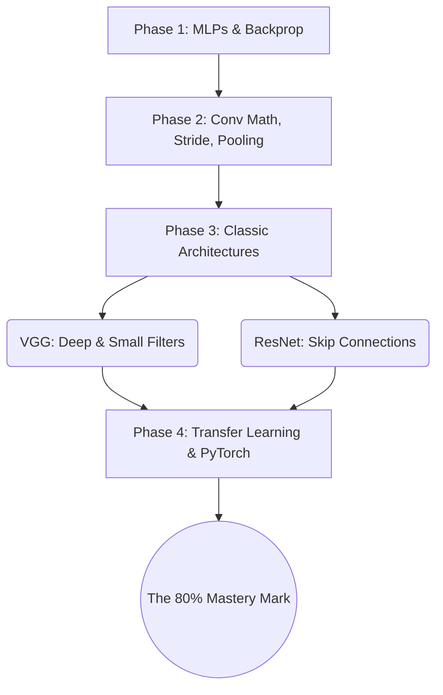

This roadmap is the practical learning path through the CNN course: a four-phase progression from deep-learning fundamentals to confident framework engineering in PyTorch. It is designed to build knowledge systematically — each phase depends on mastery of the previous one, and jumping ahead without building the foundation will leave you unable to debug when things inevitably go wrong. Every step below links to the notes where that material is treated in depth.

## Phase 1: deep learning fundamentals (do not skip)

Before touching CNNs, you must have a solid foundation in standard deep learning. Many students rush past these fundamentals and then find themselves unable to understand why their CNN isn't training — every problem you encounter in CNN training, from vanishing gradients to exploding losses to shape mismatches, traces back to concepts that are introduced at the MLP level.

### Tensor math

Master Numpy: dot products, broadcasting, axes, and transpositions. Practice reshaping arrays, understanding which axis is which, and computing dot products by hand. This is not optional — tensor manipulation is the basic literacy of deep learning, and if you cannot confidently manipulate multi-dimensional arrays in Numpy, you will struggle with PyTorch tensors. The CNN-side treatment of tensors as volumes, including the NCHW and NHWC formats, is [[Demystifying Tensors - Volumes, Depth, and Data Formats]].

### The MLP framework

Build a simple feed-forward network and understand activation functions (ReLU, Sigmoid, Softmax) and loss functions (Cross-Entropy, Mean Squared Error). You should be able to implement a basic neural network from scratch using only Numpy — no PyTorch, no TensorFlow. If you cannot do this, you do not truly understand how neural networks compute their outputs. The from-first-principles treatment on the CNN side is [[06 - Computer Vision/CNN Foundations and Philosophy/Introduction and Foundations of CNNs|Introduction and Foundations of CNNs]], and the deep dive into loss functions is in [[Hyperparameters and Basic PyTorch Summary]].

### Backpropagation

Understand exactly how gradients flow backward through the chain rule to update weights. You should be able to manually compute the gradient of a 2-layer MLP for a single training example on paper. If you cannot do this, you will not understand why your CNN's loss plateaus or why certain layers fail to learn. [[06 - Computer Vision/CNN Foundations and Philosophy/Introduction and Foundations of CNNs|Introduction and Foundations of CNNs]] develops backpropagation from the ground up, and [[Transfer Learning and ResNet Summary]] carries it into a step-by-step hand-calculated example and PyTorch autograd mechanics.

### Optimization

Understand SGD, Adam, and exactly how the learning rate scales the gradient. Know the difference between batch gradient descent, stochastic gradient descent, and mini-batch gradient descent. Understand why Adam is generally preferred over vanilla SGD, but also why SGD with momentum can sometimes achieve better final accuracy. The optimizer mechanics are laid out in [[From Basic Convolution to Learned Weights]] (in the context of how filters learn) and in [[Hyperparameters and Basic PyTorch Summary]], and the worked training-loop practice is [[06 - Computer Vision/Training and Transfer Learning/PyTorch Implementation Basics|PyTorch Implementation Basics]].

## Phase 2: CNN micro-mechanics (manual calculation)

You must mathematically understand the operations happening inside the tensors. This phase is about building intuition through manual calculation — not about writing code.

### The forward pass

Draw out a $5 \times 5$ grid and manually calculate a $3 \times 3$ convolution on paper. Understand the depth summation rule implicitly. Compute every multiplication, every addition, and verify that your hand-calculated output matches the formula $O = (W - K + 2P)/S + 1$. This exercise takes 30 minutes but will give you more intuition than hours of reading. The operation itself is dissected in [[The Convolution Operation]], the depth summation rule in [[Processing 3D Volumes, Depth Summation, and Biases]], and the formula with its edge cases in [[The Output Spatial Dimension Formula]].

### Spatial math

Memorize the $O = \lfloor(W - K + 2P)/S\rfloor + 1$ formula. Practice calculating tensor shapes through a mock 5-layer network: given an input tensor `[3, 224, 224]`, trace the shape through each layer — including padding, stride, and pooling operations — until you reach the final output. If you cannot track tensor shapes mentally, you will spend hours debugging shape mismatch errors. [[The Output Spatial Dimension Formula]], [[Padding - Mathematics, Edge Effects, and Valid vs Same]], and [[Strides - Skipping Pixels and Downsampling]] cover the three knobs that change tensor shapes.

### Receptive fields

Understand how strides and pooling exponentially increase the receptive field. Calculate the receptive field of the final layer in a sample architecture, and verify that it covers the entire input image — if it doesn't, the network cannot detect global features. The iterative receptive-field formula, the worked 5-layer example, and the stacking-small-filters proof are in [[Receptive Fields and 1x1 Convolutions]].

### Backpropagation intuition

Understand that gradients flow backward via convolutions and flipped filters, and know the difference between the weight gradient (how to update the filter weights) and the input gradient (how to route errors to previous layers). You don't need to implement these manually, but you should understand the mathematical principles well enough to explain them to someone else. The explicit derivations of both gradients through convolutional layers are in [[Transfer Learning and ResNet Summary]], and the flipped-kernel mathematics in [[The Convolution Operation]].

## Phase 3: architectural history (macro-mechanics)

Do not try to invent your own architectures yet. Study how the pioneers did it: they reveal the evolution of deep learning thought, and each architecture solved a specific problem that the previous one could not.

### LeNet-5 (1998): the grandfather

LeNet-5 teaches the basic `Conv -> Pool -> Conv -> Pool -> Flatten -> Dense` paradigm. Study it to understand the fundamental CNN pipeline — it is simple enough to implement in an afternoon, and every subsequent architecture builds on the same basic pattern. The full lineage is walked in [[06 - Computer Vision/Architecture and Connectivity/Evolution of CNN Architectures|Evolution of CNN Architectures]].

### AlexNet (2012): the breakthrough

AlexNet introduced ReLU (replacing sigmoid and tanh, which suffered from vanishing gradients), Dropout (randomly disabling neurons during training to prevent co-adaptation and overfitting), and heavy data augmentation (artificially expanding the training set through random transformations). Understand *why* it beat traditional computer vision: it was the first network to demonstrate that learned features could comprehensively outperform hand-crafted features on a large-scale benchmark (ImageNet). Its story is told in [[06 - Computer Vision/Architecture and Connectivity/Evolution of CNN Architectures|Evolution of CNN Architectures]].

### VGG-16 (2014): the elegance of simplicity

VGG-16 proved that stacking many small ($3 \times 3$) filters is mathematically superior to using few large ($7 \times 7$ or $11 \times 11$) filters. Understand the mathematical argument: three $3 \times 3$ layers have the same receptive field as one $7 \times 7$ layer, but with fewer parameters (27 vs 49) and more non-linearities (3 ReLUs vs 1). This is one of the most important architectural insights in deep learning. The complete dissection is [[06 - Computer Vision/Architecture and Connectivity/VGG16 Architecture Deep Dive|VGG16 Architecture Deep Dive]].

### ResNet (2015): the deepest breakthrough

Understand the **vanishing gradient problem** — as networks get deeper, gradients become exponentially smaller as they propagate backward through hundreds of layers, causing early layers to learn extremely slowly or not at all. Then understand how **skip connections (residual blocks)** bypass layers by adding the input directly to the output ($y = F(x) + x$), creating a "gradient superhighway" that allows gradients to flow unimpeded through the shortcut path. This single innovation unlocked 150+ layer depths and won the 2015 ImageNet competition by a massive margin. The degradation problem and the residual argument are in [[06 - Computer Vision/Architecture and Connectivity/The Degradation Problem and Residual Connections|The Degradation Problem and Residual Connections]], and the block designs and variant family in [[06 - Computer Vision/Architecture and Connectivity/ResNet Bottleneck Blocks and Architectural Variants|ResNet Bottleneck Blocks and Architectural Variants]].

The four phases close on each other as follows:

## Phase 4: modern practical implementation

The final phase turns understanding into working engineering: PyTorch fluency, transfer learning from pre-trained backbones, disciplined augmentation, and the countermeasures against overfitting.

### Framework mastery

Pick PyTorch (recommended). Learn to build custom `Dataset` and `DataLoader` classes for images. Master `torch.nn.Conv2d` and `torch.nn.MaxPool2d`. Understand the `NCHW` tensor format. Know how to inspect tensor shapes at every layer of your network using `.shape`, and how to debug shape mismatches by tracing the shapes manually through the forward pass. The implementation walkthroughs are [[06 - Computer Vision/Training and Transfer Learning/PyTorch Implementation Basics|PyTorch Implementation Basics]] and [[06 - Computer Vision/Training and Transfer Learning/PyTorch Advanced - VGG16 and Pre-trained Models|PyTorch Advanced - VGG16 and Pre-trained Models]], with the tensor formats in [[Demystifying Tensors - Volumes, Depth, and Data Formats]].

### Transfer learning

You will rarely train from scratch. Learn to load a pre-trained ResNet, freeze the early convolutional layers (which detect universal edges and shapes that are useful for all vision tasks), and replace or train only the final classification head for your specific dataset. This allows you to achieve high accuracy on small datasets by leveraging the features learned from millions of images on ImageNet. The three strategies and the decision matrix are in [[06 - Computer Vision/Training and Transfer Learning/Transfer Learning and Fine-Tuning|Transfer Learning and Fine-Tuning]]; the complete step-by-step workflow code is in [[06 - Computer Vision/Training and Transfer Learning/PyTorch Advanced - VGG16 and Pre-trained Models|PyTorch Advanced - VGG16 and Pre-trained Models]] and [[Transfer Learning and ResNet Summary]].

### Data augmentation

Understand how to dynamically rotate, flip, and color-jitter images during training (`torchvision.transforms`) to artificially expand your dataset and prevent overfitting. Know the difference between training transforms (which include random augmentations) and validation transforms (which only include deterministic normalization). Understand why augmentations must be random — if they are deterministic, the network will memorize the augmented images just as easily as the originals. The transform catalog and the pipeline discipline are collected in [[Normalization, Regularization, and Augmentation Summary]], and applying augmentation to the validation set is one of the classic errors cataloged in [[06 - Computer Vision/Pipeline Evaluation and Interpretability/Common Mistakes and How to Fix Them|Common Mistakes and How to Fix Them]].

### Handling overfitting

Master batch normalization (normalizes activations within each mini-batch to stabilize training and add slight regularization), dropout (randomly disables neurons during training), and weight decay (adds an L2 penalty to the loss function to prevent weights from growing too large). Know when to use each technique and how to diagnose which type of overfitting your network is suffering from. All three are treated in [[Normalization, Regularization, and Augmentation Summary]], with the diagnostic workflow in [[06 - Computer Vision/Pipeline Evaluation and Interpretability/The Full Training Pipeline End-to-End Checklist|The Full Training Pipeline End-to-End Checklist]].

> [!info] The key principle
> Jumping straight into PyTorch code without understanding the math will leave you unable to debug when things go wrong. The roadmap is designed to build understanding from the ground up — each phase depends on the previous one. If you skip Phase 1, you won't understand Phase 2. If you skip Phase 2, you won't understand Phase 3. If you skip Phase 3, you won't understand why modern architectures are designed the way they are.

## Beyond the 80 percent mark

The roadmap ends at the 80 percent mastery mark — the point where the core mechanics, the classic architectures, and the practical PyTorch workflow are all in place. The course continues past it with material that builds on the same foundations: [[Advanced Convolutional Operators - Depthwise, Dilated, Transposed, Grouped]] re-engineers convolution itself for modern architectures, [[Detection and Segmentation]] moves from classification to the harder visual tasks, [[CNN Interpretability]] shows how to inspect what a trained network actually learned, and [[CNN Solved Exercises]] works five complete problems end to end. The full map of the course is [[CNN Course Overview]].

## See also

- [[CNN Course Overview]] — the full map of the CNN course.
- [[Image Processing Global Index]] — the classical image-processing side of the area, whose hand-designed filters are the ancestors of learned kernels.
- [[06 - Computer Vision/Architecture and Connectivity/Evolution of CNN Architectures|Evolution of CNN Architectures]] — the Phase 3 lineage in one note.
- [[06 - Computer Vision/Pipeline Evaluation and Interpretability/The Full Training Pipeline End-to-End Checklist|The Full Training Pipeline End-to-End Checklist]] — the Phase 4 material as a checkable pipeline.
- [[Transfer Learning and ResNet Summary]] — the under-the-hood companion to the roadmap: chain rule, gradient flow in CNN layers, and weight initialization.
