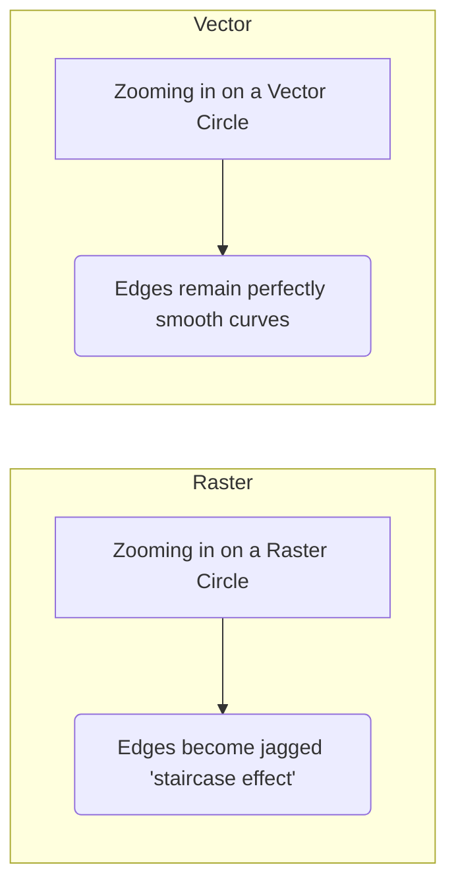

There are two fundamentally different ways to instruct a computer to display an image: bitmap (raster) graphics, which store a grid of colored pixels, and vector graphics, which store mathematical instructions for drawing shapes. Understanding the difference is vital for knowing when to use which format. This note defines both representation types, compares their characteristics and trade-offs, and explains the rasterization process that connects the two worlds. It is the natural companion to [[What is a Digital Image]], which covers how the pixel grid itself comes to be.

## Bitmap images (raster graphics)

A bitmap is a grid of pixels: the file stores color information for each individual pixel, making it essentially a "map of bits." Raster graphics are the primary focus of image processing — photographs, scans, and camera frames all arrive in this form, and the representation is what makes notions like resolution and bits per pixel meaningful (see [[Resolution and Bit Depth]]).

### Characteristics

Bitmaps are **resolution dependent**: the image has a fixed number of pixels, so if you zoom in, the computer must interpolate (guess) new pixels, leading to blockiness or blur (pixelation). File size is proportional to the resolution — a $1000 \times 1000$ image stores 1 million pixels, regardless of whether the image is a complex photo or a plain white square (before compression). The natural use cases are photographs, photorealistic art, and detailed textures, saved in the common raster formats `.jpg`, `.png`, `.bmp`, `.tiff`, and `.gif` (see [[Image File Formats]]).

### Pros and cons

| Pros | Cons |
| :--- | :--- |
| Can represent subtle color gradations (continuous tone) perfectly. | Loses quality when scaled up. |
| Standard output for all digital cameras. | Large file sizes for high resolutions. |
| Precise pixel-by-pixel editing is possible. | |

The table captures the essential trade-off: rasters are unmatched for continuous-tone detail and direct pixel manipulation, but that fidelity is locked to one size. The cons only bite when an image is scaled up beyond its native resolution or stored at very high resolutions.

## Vector images

A vector image is composed of **mathematical primitives**: points, lines, curves, and polygons. The file contains a set of instructions rather than a pixel grid — for example: "Draw a circle, center at (100,100), radius 50, fill color red." Vector graphics are the focus of computer graphics and design, not image processing, but the two representations meet whenever images are stored, exchanged, or displayed.

### Characteristics

Vector images are **resolution independent**: because the image is math-based, scaling it up by 1000% simply means the computer recalculates the curve equation, and the edges remain perfectly crisp and sharp at any size. File size is proportional to the *complexity* of the image, not its size — a huge simple circle takes bytes to store, while a tiny complex drawing takes kilobytes. The typical use cases are logos, fonts (typography), icons, and technical drawings (CAD), saved in formats such as `.svg`, `.ai`, `.eps`, and `.pdf`.

### Visual comparison

The contrast is easiest to see by zooming in on the same circle drawn both ways:

The raster circle degrades into a staircase of blocks, because zooming magnifies fixed pixels. The vector circle stays smooth, because its edges are recalculated from the underlying equations rather than magnified.

## The rasterization process

Monitors and printers are inherently raster devices (they have a grid of pixels or dots). Therefore, even vector images must be converted into pixels to be displayed. This process is called **rasterization**, and it defines the division of labor between the two representations: vectors are for *storage* and *manipulation*, while rasters are for *display* and *capture*. For image processing this means the pixel grid is always the final common representation — analysis begins once rasterization (or direct capture) has produced the bitmap.

## See also

- [[Image Processing Global Index]]
- [[What is a Digital Image]]
- [[Resolution and Bit Depth]]
- [[Image File Formats]]
- [[Color Spaces and Models]]
- [[Image Fundamentals and Histograms Quiz]]
