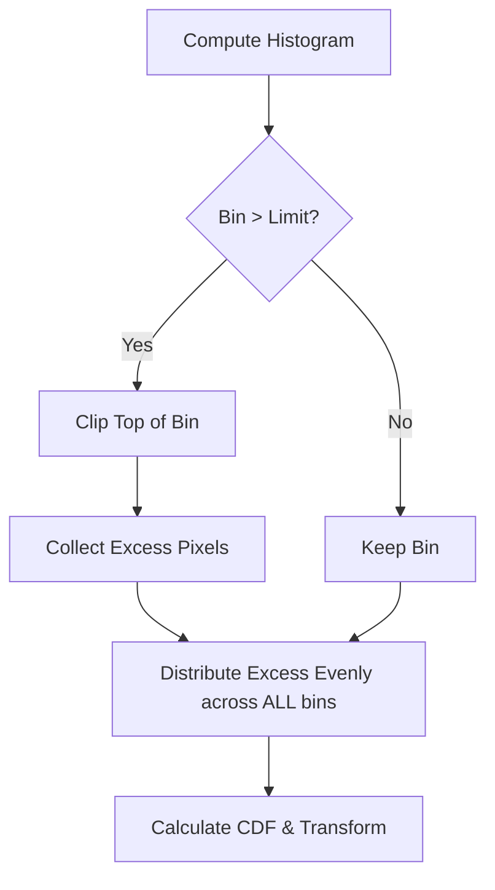

Standard [[Histogram Equalization]] is a global operation: it derives one transformation from the statistics of the entire image and applies the same mapping to every pixel. That single curve is exactly what fails on images whose content varies significantly in brightness, and the failure motivates the three refinements collected here. Adaptive histogram equalization (AHE) equalizes locally, CLAHE repairs AHE's noise problem with clipping, and histogram specification (matching) targets an arbitrary histogram instead of the uniform one.

## The limits of global equalization

Global HE applies the same transformation to every pixel based on the entire image's statistics, so when image content varies significantly in brightness, the single mapping must compromise — and global HE can wash out local details. The canonical failure is a photo of a person standing in a dark tunnel with a bright light at the end: to balance the average, global HE will make the light blinding or the tunnel pitch black. The locally important content — the person in the tunnel — is sacrificed to the global statistic.

## Adaptive histogram equalization (AHE)

### The algorithm

AHE replaces the single global histogram with many local ones. The procedure runs as follows:

1. Divide the image into a grid of rectangular sub-regions (tiles or blocks).
2. For each block, calculate the histogram and the CDF.
3. Use the local CDF to equalize the center pixel of that block.
4. **Interpolation:** to prevent visible "checkerboard" artifacts at the block boundaries, the transformation for a pixel is computed by interpolating the results from the nearest neighboring blocks.

Each tile is thus stretched according to its own content rather than the image-wide average, which is what recovers the local details that global HE washes out.

### The problem: noise amplification in flat regions

AHE's price is that it amplifies noise in homogeneous (flat) regions. The mechanism is worth tracing precisely:

> [!warning] Why flat regions break AHE
> If a block is purely sky (all blue), the histogram is a single spike. Equalization forces this spike to spread across 0-255. Tiny random noise variations (sensor grain) are stretched to become massive black and white speckles.

Any homogeneous block invites this failure, and it is the specific problem CLAHE is designed to fix.

## Contrast limited adaptive histogram equalization (CLAHE)

CLAHE (Contrast Limited Adaptive Histogram Equalization) is the industry standard, used in medical imaging, underwater photography, and similar applications. It fixes the noise amplification problem of AHE by clipping.

### The mechanism

The pipeline inserts one extra stage between computing a tile's histogram and equalizing it:

1. **Grid:** divide the image into tiles (e.g., $8 \times 8$).
2. **Histogram:** compute the histogram for a tile.
3. **Clip:** set a clip limit (e.g., 2.0 or 40 pixels). Any histogram bin that is taller than this limit is cut off. This limits the slope of the CDF transformation, which limits contrast enhancement.
4. **Redistribute:** the pixels that were cut off (the "excess") are not discarded. They are distributed evenly (uniformly) to all other bins in that histogram. The total number of pixels must remain constant (the area under the histogram is 1).
5. **Equalize:** compute the CDF of this modified histogram and apply it.

The clip limit is the tuning knob: it caps the height of any bin, which caps the slope of the CDF, which caps how far any local contrast can be stretched. Redistribution preserves the histogram's normalization — the area under the histogram stays 1 — while ensuring that no single dominant bin (like the sky's spike) drives the mapping. Noise in flat tiles is still enhanced, but only up to the bound the clip limit allows.

## Histogram specification (matching)

Equalization forces the output to be uniform. What if we want the output to match a specific style instead — for example, "make this sunny photo look like this sunset photo"? Histogram specification, also called matching, targets an arbitrary histogram: the goal is to transform image $A$ so its histogram matches the histogram of image $B$.

### The algorithm

We cannot transform $A$ directly to $B$. Instead, we use the uniform distribution as a bridge, since both images can be equalized onto it:

1. **Equalize $A$:** compute $s = T(r)$, where $T$ is the CDF of image $A$. Now $A$ is flat.
2. **Equalize $B$:** compute $v = G(z)$, where $G$ is the CDF of image $B$. Now $B$ is flat.
3. **Inverse mapping:** since both are now flat (approximately equal), we can equate them: $s \approx v$.

$$ v = G(z) \implies z = G^{-1}(v) $$

Since $s = v$:

$$ z = G^{-1}(s) = G^{-1}(T(r)) $$

In summary, to match image $A$ to $B$, we apply the CDF of $A$, then apply the **inverse CDF** of $B$.

## See also

- [[Image Processing Global Index]]
- [[Histogram Equalization]]
- [[Contrast Stretching]]
- [[The Image Histogram]]
- [[Point Processing Operations]]
- [[Image Fundamentals and Histograms Quiz]]
