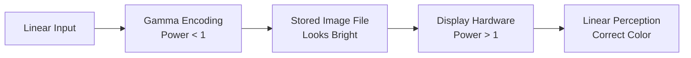

Point processing techniques are the simplest form of image processing: they transform a pixel's value based solely on its current value, with no influence from neighboring pixels. The entire family reduces to a single function applied identically at every coordinate. This note covers the three classical point operations — image negatives, log transformations, and power-law (gamma) transformations — each with its formula, visual effect, and canonical use case.

## The transformation function

Every point operation has the same algebraic shape:

$$ s = T(r) $$

Here $r$ is the intensity of the input pixel, $s$ is the intensity of the output pixel, and $T$ is the transformation function. Because $T$ depends only on the intensity value and not on the pixel's position or neighborhood, the same mapping applies at every coordinate. The three operations that follow differ only in the choice of $T$.

## Image negatives (inversion)

The negative is the digital equivalent of a photographic negative: black becomes white, and white becomes black.

$$ s = (L - 1) - r $$

For 8-bit images ($L=256$): $s = 255 - r$.

The classic use case is enhancing white or gray detail embedded in dark regions of an image, especially in medical imaging — for example, analyzing breast tissue in mammograms. Inverting the intensities lifts that embedded detail out of its dark surround.

## Log transformations

The log transformation takes the form:

$$ s = c \cdot \log(1 + r) $$

This function maps a narrow range of low gray-level values in the input image into a wider range of output levels. Its visual effect is to expand the values of dark pixels while compressing the values of bright pixels. That behavior makes it essential for displaying the **Fourier spectrum**: Fourier spectra often have pixel values ranging from 0 to $10^6$, and on a standard monitor (0-255) everything would look black except the center dot. The log transform brings these massive values down to a visible range. The spectra in question are produced by the transform covered in [[The Fourier Transform]].

## Power-law (gamma) transformations

$$ s = c \cdot r^{\gamma} $$

Here $c$ and $\gamma$ are positive constants, and the exponent $\gamma$ selects the curve. The family includes both brightening and darkening mappings, and the two regimes are the subject of gamma correction.

### Gamma correction

Gamma correction is the most common form of point processing in consumer electronics, and its behavior splits cleanly by exponent. With $\gamma < 1$ (e.g., 0.5), the function maps a narrow range of dark inputs into a wider range of outputs — similar to the log transform — and **brightens the image**. With $\gamma > 1$ (e.g., 2.5), it maps a wide range of dark inputs into a narrow range of dark outputs, and **darkens the image**.

### Why gamma correction is critical

Cathode ray tube (CRT) monitors and modern LCDs have an intensity response that is a power function with exponents varying from roughly 1.8 to 2.5. If you send a linear signal to a monitor, the image will look dark. The fix is to apply the inverse gamma ($\gamma \approx 0.45$) to the image file *before* displaying it, so that the monitor's darkening effect cancels out and the result is correct color. The full pipeline looks like this:

A linear input is gamma-encoded (power < 1) so that the stored image file looks bright; the display hardware then applies its power > 1 response, and the two effects cancel, delivering linear perception and correct color to the eye. Gamma encoding in a complete color pipeline is discussed in [[The Color Image Processing Pipeline]].

## See also

- [[Image Processing Global Index]]
- [[The Image Histogram]]
- [[Contrast Stretching]]
- [[Histogram Equalization]]
- [[The Fourier Transform]]
- [[The Color Image Processing Pipeline]]
