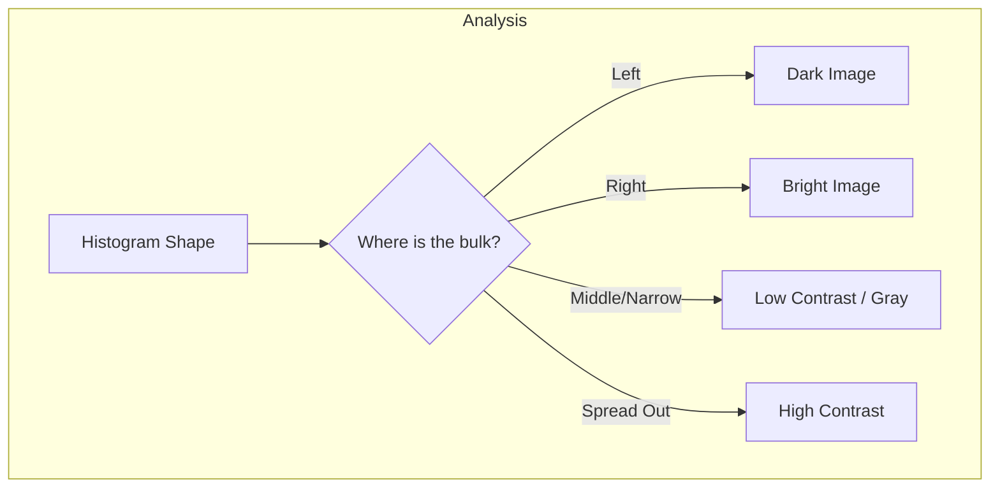

The histogram is the most fundamental tool for image analysis: it provides a global description of the appearance of an image as a single plot of how many pixels hold each gray level. From that one plot you can read an image's brightness, contrast, and dynamic range. This note defines the histogram and its normalized form, shows how to read one at a glance, and gives the implementation logic for computing it.

## Definition and significance

For a digital image with gray levels in the range $[0, L-1]$, the histogram is a discrete function:

$$ h(r_k) = n_k $$

Here $r_k$ is the $k$-th gray level (for an 8-bit image, $r_0=0$ and $r_{255}=255$), and $n_k$ is the number of pixels in the image having gray level $r_k$. The histogram is a *global* description: it records how intensities are distributed across the whole image, but not where in the image they occur. It is also the foundation the rest of the intensity-transformations family builds on, from [[Point Processing Operations]] to [[Histogram Equalization]].

### Normalization (the PDF)

To compare images of different sizes, we normalize the histogram by dividing each count by the total number of pixels ($M \times N$). This gives the probability density function (PDF):

$$ p(r_k) = \frac{n_k}{M \times N} $$

Here $p(r_k)$ represents the probability that a randomly selected pixel has the intensity $r_k$, and the sum of all components of a normalized histogram is exactly 1. This normalized form is the probability distribution that [[Histogram Equalization]] accumulates into its transformation.

## Visual analysis: reading a histogram

A histogram tells you about the **brightness**, **contrast**, and **dynamic range** of an image. Reading one amounts to asking two questions: where does the bulk of the mass sit, and how widely does it spread?

### Brightness (exposure)

Brightness is the horizontal position of the histogram's mass. A dark image (underexposed) has its components concentrated on the low (left) side of the gray scale; a bright image (overexposed) has its components concentrated on the high (right) side; and a well-exposed image has components covering a broad range of the gray scale. Exposure problems are therefore visible as pileups at one end of the axis.

### Contrast and dynamic range

Contrast is the width and shape of the distribution. A low-contrast image has a histogram that is narrow and centered — the pixels are all a similar shade of gray, like a photo taken in heavy fog. A high-contrast image has a histogram that covers a broad range of the gray scale *and* a distribution that is not uniform, often bimodal, with peaks at black and white. Dynamic range is read at the ends of the axis: if the histogram touches both 0 and 255, the image uses the full dynamic range; if it has gaps at the ends, the dynamic range is compressed.

The whole reading procedure compresses into one decision tree:

## Practical implementation

In Python (OpenCV/NumPy), computing a histogram is efficient. The logic is a single pass over the image:

1. Create an array of size 256 (initialized to zeros).
2. Iterate through every pixel in the image.
3. Read the pixel value $v$.
4. Increment the array index $v$ by 1.

Each pixel is visited exactly once, so the performance is $O(N)$, where $N$ is the number of pixels. The cost is therefore linear in image size, and the result — a 256-bin count array or its normalized PDF — is all that the analysis above needs.

## See also

- [[Image Processing Global Index]]
- [[Point Processing Operations]]
- [[Contrast Stretching]]
- [[Histogram Equalization]]
- [[Advanced Histogram Techniques]]
- [[Image Fundamentals and Histograms Quiz]]
