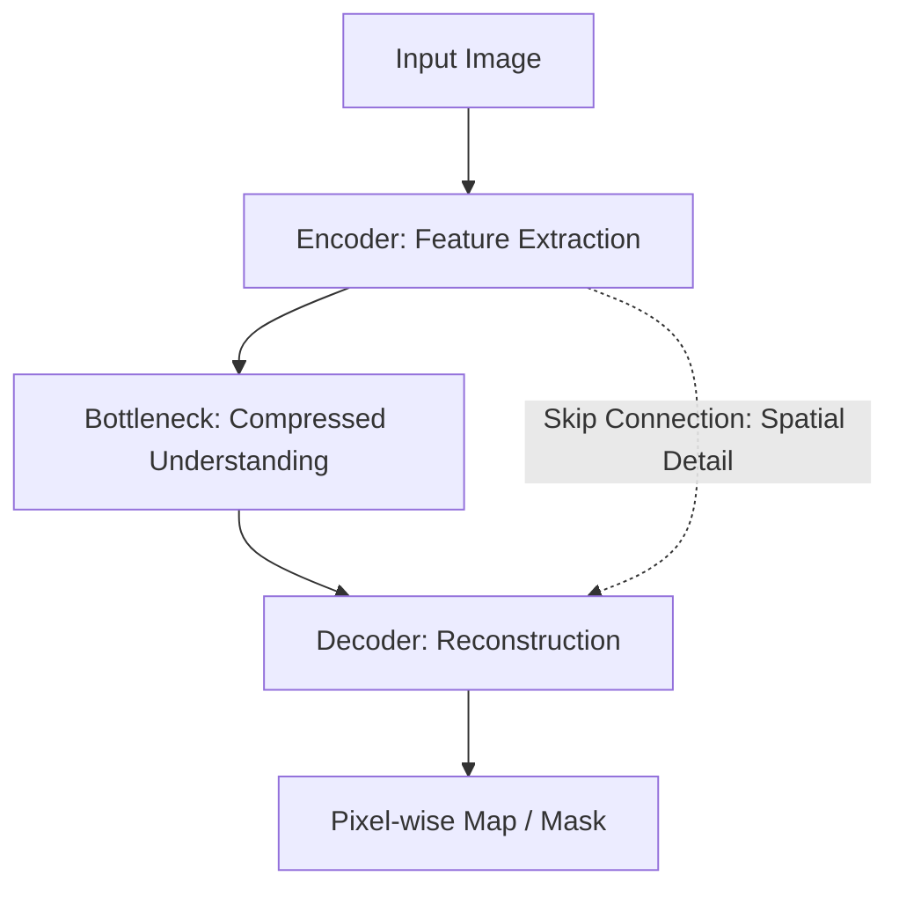

Modern image processing has moved from "hand-crafting" kernels to **learning** them from data using neural networks. The same sliding-window convolution that carried the classical toolbox becomes a bank of learned filters inside a CNN, and two architectures show what that shift buys in practice: DnCNN for denoising and U-Net for segmentation. This note covers both and closes with the three-era evolution of the field, from mathematical operators through hand-designed features to deep learning. It is the deep-learning exit point of the classical chapter catalogued in [[Image Processing Global Index]] and it opens onto the CNN side introduced in [[CNN Course Overview]].

## Convolutional neural networks as learned filter banks

A CNN is essentially a stack of hundreds of spatial filters. The mechanics are the classical ones — a small kernel slides over the image and combines neighborhood pixels — but the coefficients in the kernels are not set by a human (like the Sobel or Gaussian kernels); they are optimized using **backpropagation**. Instead of a handful of designed operators, the network learns its entire filter bank from the training data, so the filters end up matched to whatever the task needs: removing noise, finding boundaries, or labeling tissue. How this shift works in detail — and how it relates to the classical filters — is the subject of [[From Basic Convolution to Learned Weights]].

## Deep learning for denoising (restoration)

Traditional filters (Median/Nagao) work well but often blur textures: the smoothing that suppresses the noise also smooths away fine structure. The classical denoising toolbox and its noise models are covered in [[Non-Linear Smoothing Filters]], [[Edge Preserving Filters]], and [[Image Degradation and Noise Models]]. Deep learning takes a different route to the same goal — not a better smoother, but a network that learns what noise looks like.

### DnCNN

A famous architecture that uses **residual learning**. Instead of trying to predict the "Clean Image," the network is trained to predict the **Noise** ($V$). The logic rests on the additive degradation model:

$$Y (\text{Noisy}) = X (\text{Clean}) + V (\text{Noise})$$

The network predicts $\hat{V}$, and the output is $Y - \hat{V}$. Why predict the noise rather than the image? It is mathematically easier for a network to isolate random noise than to reconstruct complex human faces or landscapes from scratch. The clean image is then recovered by simple subtraction, so the network never has to synthesize the structured content at all.

## Deep learning for segmentation

Segmentation is the process of labeling every pixel (e.g., "This pixel is a tumor," "This pixel is healthy tissue"). Where classical pipelines reach pixel-level decisions through thresholds or region growing ([[Thresholding and Otsu's Method]], [[Watershed Segmentation]]), the deep-learning route is a single network trained end to end for the pixel-labeling task. The dominant architecture for that route is U-Net.

### The U-Net architecture

The most successful architecture for medical imaging. It has a "U" shape:

1. **Encoder (downsampling):** like a standard CNN. It captures the "context" (What is in the image?) but loses "localization" (Where is it?).
2. **Decoder (upsampling):** it reconstructs the spatial resolution.
3. **Skip connections:** this is the "secret sauce." They pass high-resolution information directly from the encoder to the decoder.

The result: the network knows *what* the object is (from the bottom of the U) and exactly *where* the boundaries are (from the skip connections). The flow from input to output makes the division of labor explicit:

The encoder extracts features and compresses them into a bottleneck understanding; the decoder reconstructs a pixel-wise map or mask from that compressed representation. The dashed skip connection is the critical extra path, carrying the spatial detail that the bottleneck has thrown away — which is why the decoder can place boundaries precisely. The wider task landscape that U-Net sits in — semantic, instance, and panoptic segmentation — is covered in [[Detection and Segmentation]].

## The evolution of the field

The history of image processing and computer vision falls into three eras, each with its own focus and its own price:

| Era | Focus | Trade-off |
| :--- | :--- | :--- |
| 1970s-90s | Math (Fourier, Morphology) | Precise but limited to simple scenes |
| 2000s | Features (SIFT, Gabor) | Better at object detection |
| 2012-Present | Deep learning | Massive performance gains, but requires high computing power (GPUs) and massive datasets |

The 1970s-90s focused on math — the Fourier transform and mathematical morphology are the emblematic tools ([[The Fourier Transform]], [[Mathematical Morphology Basics]]) — precise, but limited to simple scenes. The 2000s shifted the focus to features — SIFT, Gabor, and their kin made systems better at object detection ([[Feature Descriptors - SIFT, SURF, ORB, HOG]], [[Gabor Filters]]). From 2012 to the present, the focus is deep learning: massive performance gains, bought at the price of high computing power (GPUs) and massive datasets. The through-line is the one this note opened with — the operators stay recognizably the same, but who sets their coefficients moves from the mathematician, to the feature engineer, to the data.

## See also

- [[Image Processing Global Index]]
- [[CNN Course Overview]]
- [[Detection and Segmentation]] — the modern task suite built on these architectures
- [[From Basic Convolution to Learned Weights]] — the classical-to-deep bridge in full
- [[Advanced Convolutional Operators - Depthwise, Dilated, Transposed, Grouped]] — the operators behind modern decoders
- [[Image Degradation and Noise Models]]
- [[Non-Linear Smoothing Filters]]
- [[Edge Preserving Filters]]
- [[Watershed Segmentation]]
- [[Thresholding and Otsu's Method]]
