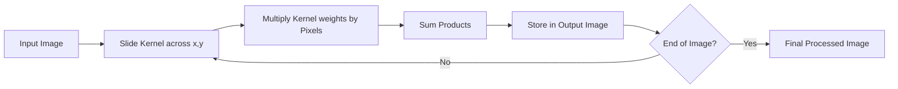

Spatial filtering is a technique in which a small matrix — called a **kernel**, **mask**, or **window** — is passed over every pixel of an image to perform a mathematical operation. It is the foundation of the entire spatial-filtering toolkit: smoothing, sharpening, edge detection, and the specialized filters built on top of them all reduce to this one mechanic. This note defines the kernel, draws the line between correlation and convolution, and covers the boundary strategies that decide what happens when the kernel overhangs the edge of the image.

## The kernel (filter mask)

A kernel is typically a small, square matrix — for example $3 \times 3$ or $5 \times 5$. Its **origin** is usually the center of the kernel; this is the pixel we are currently "calculating." The numbers inside the kernel are its **coefficients**: weights that determine the effect of the filter — blurring, sharpening, and so on.

## Correlation versus convolution

In the image processing literature, these two terms are often used interchangeably, but there is a mathematical difference between them. The difference is small — a 180° rotation of the kernel — yet it matters whenever the kernel is asymmetric or filters are composed. It is also a distinction that is frequently asked in exams.

> [!note] The distinction in one sentence
> Correlation computes the sum of products with the kernel exactly as written; convolution computes the same sum of products after rotating the kernel by 180 degrees.

### Correlation

Correlation is the process of moving the kernel over the image and calculating the sum of products. Concretely, at each position:

1. Place the kernel center over pixel $(x,y)$.
2. Multiply each kernel coefficient by the image pixel it overlaps.
3. Sum all the results. This is the new value for $(x,y)$.

Repeating these three steps at every position produces the filtered output image, one output pixel per kernel placement.

### Convolution

Convolution is the same as correlation, except the **kernel is rotated by 180 degrees** (flipped horizontally and vertically) before the sum of products is calculated. Why flip? Convolution is a fundamental operation in signal processing and satisfies the **associative property** ($f * (g * h) = (f * g) * h$). In many symmetric filters (like the Gaussian), correlation and convolution yield identical results because the kernel looks the same flipped — which is why the two terms are so often used interchangeably in practice.

## Boundary (padding) strategies

When the kernel center is at the edge of the image, part of the kernel hangs "outside" the image boundaries, and we must decide what values to use for these missing pixels. Four conventions dominate:

| Method | Description | Student tip |
| :--- | :--- | :--- |
| **Zero padding** | Assume all pixels outside are 0 (black). | Easiest to implement, but creates dark borders. |
| **Replicate (clamp)** | Repeat the last known border pixel. | Good for preserving edge intensity. |
| **Reflect (mirror)** | Mirror the pixels from inside the image. | Best for maintaining texture and preventing artifacts. |
| **Wrap** | Take pixels from the opposite side of the image. | Mostly used in periodic frequency domain operations. |

The choice is not cosmetic: zero padding can visibly darken the borders of the filtered image, reflect keeps local texture intact near the boundary, and wrap matches the periodicity assumed by frequency-domain operations, which is why it appears mostly there.

## The computational process

The whole procedure is a loop over the image:

The kernel slides across every $(x,y)$ position; at each position the kernel weights are multiplied by the pixels they overlap and the products are summed; the sum is stored in the output image at that position. The loop repeats until the end of the image is reached, at which point the final processed image is complete.

## See also

- [[Image Processing Global Index]] — the orientation note for the classical image-processing chapter.
- [[Linear Smoothing Filters]] — the first filter family built on these mechanics.
- [[Non-Linear Smoothing Filters]] — when the sum of products gives way to order statistics.
- [[Edge Preserving Filters]] — neighborhood filters that protect edges while smoothing.
- [[Sharpening and Edge Detection]] — difference kernels and gradient operators.
- [[Gabor Filters]] — a specialized kernel whose weights come from a Gaussian-modulated sinusoid.
- [[The Convolution Operation]] — the mathematical properties of convolution (commutativity, distributivity, separability), treated on the CNN side.
- [[Introduction to the Frequency Domain]] — where the same filtering reappears as multiplication on the spectrum.
- [[Spatial Filtering and Convolution Quiz]] — flashcards on this material.
