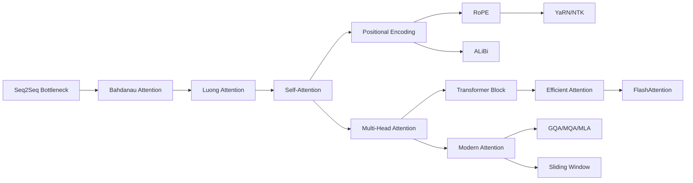

This map of content is the entry point to the attention and Transformers area: the complete attention roadmap, from Bahdanau's origins through self-attention and multi-head attention to the modern efficient and long-context variants, together with the Transformer architecture built on top of them. It indexes every note in the area, organizes them into five subfamilies, and carries a suggested reading order for each of the three natural paths through the territory. Attention is the most important concept in modern AI, and the Transformer is the single most important idea built on it — this page is the map for both.

> [!info] TL;DR
> Attention is the most important concept in modern AI; the Transformer is the single most important idea in modern AI. This area covers the complete attention roadmap in learning order — from Bahdanau's origins, through self-attention and multi-head attention, to modern efficient and long-context variants — and then assembles the full Transformer architecture from those parts. Read in the suggested order.

## Why this area is the centerpiece

If you study only one area in depth, make it this one. The Transformer is not just another architecture: it is the architecture that unified natural language processing, computer vision, speech, and protein structure prediction under a single computational primitive — attention. Every state-of-the-art model since 2020 — GPT, BERT, T5, ViT, DALL-E, Stable Diffusion's text encoder, AlphaFold 2, Whisper — is built on Transformers.

The area is built so that nothing feels arbitrary. Every component of the Transformer — the Query/Key/Value projection, the $\sqrt{d_k}$ scaling, the multi-head structure, the positional encodings, the LayerNorm, the residual connections — is presented as the response to a specific problem. By the end, you should be able to look at the famous "Attention Is All You Need" architecture diagram and explain every arrow.

## What to know first

Two bodies of background feed this area. The first is the sequence-models material in full — especially [[From RNNs to Attention]], the historical bridge — because the attention mechanism is derived from the encoder-decoder bottleneck of that world; [[The Encoder-Decoder Pattern]] and [[The Bottleneck Problem]] are the specific notes to have at your fingertips. Start from [[07 - Sequence Models/Chapter Overview|Chapter Overview]] if the recurrence background needs refreshing. The second is the neural-network fundamentals: matrix multiplication, softmax, and layer composition, plus [[05 - Neural Network Foundations/Training Dynamics and Stability/Batch Normalization|Batch Normalization]] — why LayerNorm replaces BatchNorm here is itself one of this area's design lessons, and [[Neural Network Foundations MOC]] maps that ground.

## The map of the territory

The area follows the historical and logical trajectory in four movements. The attention mechanism covers what attention *is*, derived from the encoder-decoder bottleneck of sequence models: it starts from Bahdanau attention — the 2015 version that fixed RNN translation — and generalizes to dot-product attention, then scaled dot-product attention, then multi-head attention. The Transformer architecture covers how to assemble attention into a full sequence model: the encoder block and decoder block are built piece by piece, positional encoding is explained, and the path arrives at the full Vaswani et al. 2017 architecture. Vision transformers cover how an NLP architecture conquered computer vision — patch embedding, the CLS token, the inductive bias comparison with CNNs, and why ViTs need more data than CNNs. The encoder-decoder design space covers why BERT is encoder-only, why GPT is decoder-only, why T5 is encoder-decoder, and what each design is good for; the information bottleneck, latent space, and autoregressive vs parallel encoding all live there.

On the shelves, those movements sort into five subfamilies:

- **Attention mechanism** (twelve notes) — the origins, the query/key/value abstraction, scaled dot-product and self-attention, multi-head attention, and the positional-information family.
- **Efficient attention** (five notes) — FlashAttention, sparse and linear attention, and the modern inference-focused variants.
- **Transformer architecture** (twelve notes) — the block anatomy, the full encoder-decoder assembly, and the per-model families built from it.
- **Encoder-decoder design space** (four notes) — the trade-off map for encoder-only, decoder-only, and encoder-decoder designs.
- **Vision transformers** (four notes) — patch tokenization, the CLS token, inductive bias, and the ViT architecture.

The two halves reinforce each other: attention is the core operation of every Transformer, and modern LLMs are decoder-only Transformers that use every attention variant collected here. Running them affordably is what the efficient and modern attention notes are for — the KV cache is attention's memory, and shrinking it is the biggest single inference lever.

## Suggested reading order

Three reading orders thread through this territory, and the map keeps all three. The core path is the four-movement sequence through the whole area; the attention roadmap and the transformer assembly path are the specialist sequences, one for each half. They overlap — the core path's first movement is the head of the attention roadmap, its second movement the head of the assembly path — so pick whichever matches your goal and follow it; the per-subfamily lists further down are the complete index either way.

### The core path

The chapter-style sequence through the whole area; each note assumes the previous one.

| # | Note | Stage | What it covers |
|---|---|---|---|
| 01 | [[Origins of Attention]] | Attention mechanism | Attention as soft lookup — from Bahdanau to dot-product. |
| 02 | [[Queries Keys and Values]] | Attention mechanism | The database analogy. |
| 03 | [[Scaled Dot-Product Attention]] | Attention mechanism | Why the square root. |
| 04 | [[Multi-Head Attention]] | Attention mechanism | Parallel relationship patterns. |
| 05 | [[Self-Attention]] | Transformer architecture | When the sequence attends to itself. |
| 06 | [[Positional Encoding]] | Transformer architecture | Injecting order into a set. |
| 07 | [[Transformer Block]] | Transformer architecture | The encoder block, piece by piece. |
| 08 | [[Transformer Decoder Block]] | Transformer architecture | Masking and cross-attention. |
| 09 | [[The Transformer]] | Transformer architecture | Assembling the pieces — the full architecture. |
| 10 | [[Patch Tokenization]] | Vision transformers | From words to patches: how a ViT tokenizes an image. |
| 11 | [[CLS Token]] | Vision transformers | The CLS token and why it works. |
| 12 | [[Inductive Bias]] | Vision transformers | CNNs vs ViTs and why ViTs need more data. |
| 13 | [[ViT Architecture]] | Vision transformers | Architecture and design decisions. |
| 14 | [[BERT vs GPT vs T5]] | Design space | The encoder-decoder design space. |
| 15 | [[Information Bottleneck and Latent Space]] | Design space | The information bottleneck and latent space. |
| 16 | [[Autoregressive vs Parallel Encoding]] | Design space | Autoregressive vs parallel encoding. |
| 17 | [[Choosing the Right Architecture]] | Design space | Choosing the right architecture for the task. |

### The attention roadmap

The attention-side sequence in learning order — from the bottleneck that motivated attention to the inference levers of modern LLMs.

| # | Note | Sub-domain | Purpose |
|---|---|---|---|
| 01 | [[Origins of Attention]] | Origins | The seq2seq bottleneck attention was invented to fix. |
| 02 | [[08 - Attention and Transformers/Attention Mechanism/Bahdanau Attention\|Bahdanau Attention]] | Origins | Additive attention; the original. |
| 03 | [[08 - Attention and Transformers/Attention Mechanism/Luong Attention\|Luong Attention]] | Origins | Multiplicative attention; the Transformer's ancestor. |
| 04 | [[Self-Attention]] | Self-attention | **The big idea.** Scaled dot-product, full derivation. |
| 05 | [[Multi-Head Attention]] | Multi-head | Why multiple heads; head specialization. |
| 06 | [[Positional Encoding]] | Positional information | Survey of all positional encodings. |
| 07 | [[Sinusoidal and Learned Positional Encodings]] | Positional information | The two earliest encodings. |
| 08 | [[RoPE]] | Positional information | **The modern default.** Deep treatment. |
| 09 | [[ALiBi]] | Positional information | Linear bias; true extrapolation. |
| 10 | [[YaRN and NTK-Aware Scaling]] | Positional information | Extending RoPE to longer contexts. |
| 11 | [[08 - Attention and Transformers/Efficient Attention/FlashAttention\|FlashAttention]] | Efficient attention | **The IO-aware exact attention.** Critical. |
| 12 | [[Sparse Attention]] | Efficient attention | Longformer, BigBird; structured sparsity. |
| 13 | [[Linear Attention]] | Efficient attention | Performer, Linformer; linear-time approximations. |
| 14 | [[GQA MQA and MLA]] | Modern attention | **The biggest inference lever.** Llama/DeepSeek. |
| 15 | [[Sliding Window Attention]] | Modern attention | Mistral/Gemma; constant-memory cache. |

### The transformer assembly path

The architecture-side sequence, read in numbered order: first the repeatable unit and its stability machinery, then the components inside it, then the model families built from it.

| # | Note | Sub-domain | Purpose |
|---|---|---|---|
| 01 | [[Transformer Block]] | Architecture | The repeatable unit; the whole picture. |
| 02 | [[Pre-Norm vs Post-Norm]] | Architecture | Critical stability decision. |
| 03 | [[Residual Connections]] | Architecture | Why deep Transformers train. |
| 04 | [[Normalization Layers]] | Components | LayerNorm, RMSNorm. |
| 05 | [[Feed-Forward Network]] | Components | FFN, SwiGLU, GEGLU; where params live. |
| 06 | [[Embedding Layer]] | Components | Token ID → vector; tied vs untied. |
| 07 | [[08 - Attention and Transformers/Transformer Architecture/BERT\|BERT]] | Encoder models | Bidirectional encoder; still useful. |
| 08 | [[GPT Family]] | Decoder models | Modern LLM architecture recipe. |
| 09 | [[T5 and BART]] | Encoder-decoder | Text-to-text; denoising autoencoder. |
| 10 | [[ViT Architecture]] | Variants | Transformers for images. |
| 11 | [[Mixture of Experts]] | Variants | MoE; scale params without scaling compute. |

## Attention mechanism

Everything in this subfamily answers one question: what, mechanically, is attention? The story opens with the sequence-to-sequence bottleneck that attention was invented to fix, moves through the two historical forms — Bahdanau's additive attention and Luong's multiplicative attention, the Transformer's ancestor — and then makes the modern abstraction: queries, keys and values as three different projections of the same input, scored by the scaled dot-product in which dividing by $\sqrt{d_k}$ keeps the softmax usable. Self-attention is the big idea — the sequence attends to itself, which is what kills the RNN — and multi-head attention runs the mechanism in parallel so that different heads specialize in different relationship patterns. The positional notes close the loop, because attention by itself is blind to order: a survey of the options, the two earliest encodings, and the modern defaults — RoPE, ALiBi, and the YaRN/NTK-aware tricks that stretch RoPE-trained models to longer contexts.

- [[Origins of Attention]] — the seq2seq bottleneck attention was invented to fix.
- [[08 - Attention and Transformers/Attention Mechanism/Bahdanau Attention|Bahdanau Attention]] — additive attention; the original.
- [[08 - Attention and Transformers/Attention Mechanism/Luong Attention|Luong Attention]] — multiplicative attention; the Transformer's ancestor.
- [[Queries Keys and Values]] — the database analogy: three projections of one input.
- [[Scaled Dot-Product Attention]] — why the square root.
- [[Self-Attention]] — when the sequence attends to itself; the big idea, full derivation.
- [[Multi-Head Attention]] — parallel relationship patterns; head specialization.
- [[Positional Encoding]] — the survey of all positional encodings.
- [[Sinusoidal and Learned Positional Encodings]] — the two earliest encodings.
- [[RoPE]] — rotary position embedding; the modern default.
- [[ALiBi]] — linear bias; true extrapolation.
- [[YaRN and NTK-Aware Scaling]] — extending RoPE to longer contexts.

## Efficient attention

This is the running-Transformers-cheaply layer, and it is deliberately the area's second layer: the core first, then the variants. The costs under attack are attention's quadratic scaling and the KV cache — attention's memory at inference. FlashAttention is the IO-aware exact attention and the critical one: same mathematics, tiled to fit the GPU memory hierarchy, which is what makes long-context training and serving practical. The sparse family (Longformer, BigBird) buys sub-quadratic cost with structured sparsity; the linear family (Performer, Linformer) with linear-time approximations. On the modern side, GQA/MQA/MLA share keys and values across heads to shrink the KV cache — the biggest single inference lever, standardized by Llama and DeepSeek — and sliding window attention bounds each layer to a fixed window for a constant-memory cache, as in Mistral and Gemma.

- [[08 - Attention and Transformers/Efficient Attention/FlashAttention|FlashAttention]] — the IO-aware exact attention; critical.
- [[Sparse Attention]] — Longformer, BigBird; structured sparsity.
- [[Linear Attention]] — Performer, Linformer; linear-time approximations.
- [[GQA MQA and MLA]] — grouped-query, multi-query, and multi-head latent attention; the biggest inference lever (Llama, DeepSeek).
- [[Sliding Window Attention]] — Mistral/Gemma; constant-memory cache.

## Transformer architecture

Attention alone is not a sequence model; this subfamily assembles one. The transformer block is the repeatable unit — attention plus a feed-forward network, held together by residual connections and a normalization layer — and the first engineering decision is where that normalization sits: pre-norm vs post-norm, a critical stability choice. The component notes go inside the block: the normalization layers themselves (LayerNorm, RMSNorm), the feed-forward network (FFN, SwiGLU, GEGLU — where most of the parameters live), and the embedding layer that turns a token ID into a vector, tied or untied. The decoder block adds masking and cross-attention, and the full Transformer assembles the pieces into the Vaswani et al. 2017 architecture. From there the per-model deep dives: BERT the bidirectional encoder, the GPT family — the modern LLM architecture recipe, since modern LLMs are decoder-only Transformers — T5 and BART as text-to-text and denoising-autoencoder encoder-decoders, and Mixture of Experts for scaling parameters without scaling compute.

- [[Transformer Block]] — the repeatable unit; the whole picture.
- [[Pre-Norm vs Post-Norm]] — the critical stability decision.
- [[Residual Connections]] — why deep Transformers train.
- [[Normalization Layers]] — LayerNorm, RMSNorm.
- [[Feed-Forward Network]] — FFN, SwiGLU, GEGLU; where the parameters live.
- [[Embedding Layer]] — token ID to vector; tied vs untied.
- [[Transformer Decoder Block]] — masking and cross-attention.
- [[The Transformer]] — assembling the pieces: the full Vaswani et al. 2017 architecture.
- [[08 - Attention and Transformers/Transformer Architecture/BERT|BERT]] — the bidirectional encoder; still useful.
- [[GPT Family]] — the modern LLM architecture recipe.
- [[T5 and BART]] — text-to-text; the denoising autoencoder.
- [[Mixture of Experts]] — MoE; scale parameters without scaling compute.

## Encoder-decoder design space

Once the block exists, the design question is how many of each kind to stack, and this subfamily is the deep dive on it: why BERT is encoder-only, why GPT is decoder-only, why T5 is encoder-decoder, and what each design is good for. The information bottleneck and latent space explain what each choice compresses the input into; autoregressive vs parallel encoding contrasts the two regimes in which a sequence can be turned into representations; and the closing note turns the whole comparison into task-to-architecture guidance.

- [[BERT vs GPT vs T5]] — the encoder-decoder design space.
- [[Information Bottleneck and Latent Space]] — what each design compresses the input into.
- [[Autoregressive vs Parallel Encoding]] — the two encoding regimes.
- [[Choosing the Right Architecture]] — choosing the right architecture for the task.

## Vision transformers

How an NLP architecture conquered computer vision. The move is to make an image a sequence: patch tokenization cuts the image into patches and embeds them, and the CLS token gives the model a summary slot to read out. The inductive bias note stages the CNN-vs-ViT comparison that explains why ViTs need more data than CNNs — a CNN hard-codes locality and translation equivariance, while a ViT must learn those priors from data — and the architecture note collects the design decisions. The vision counterpart being challenged is the convolutional family mapped in [[06 - Computer Vision/CNN Foundations and Philosophy/Introduction and Foundations of CNNs|Introduction and Foundations of CNNs]].

- [[Patch Tokenization]] — from words to patches: how a ViT tokenizes an image.
- [[CLS Token]] — the CLS token and why it works.
- [[Inductive Bias]] — CNNs vs ViTs and why ViTs need more data.
- [[ViT Architecture]] — the architecture and its design decisions.

## The big picture

One graph compresses the attention-side story — from the seq2seq bottleneck, through the historical and modern forms, to the efficient and inference-oriented variants:

Read it left to right: the bottleneck motivates Bahdanau and Luong; self-attention generalizes them; multi-head attention and positional encoding branch off self-attention (RoPE and ALiBi from positional encoding, YaRN/NTK from RoPE); the transformer block consumes multi-head attention; and efficient attention (FlashAttention) and modern attention (GQA/MQA/MLA, sliding window) complete the map.

## How to read this area

The core path is sequential — each note assumes the previous one — but the intuition matters more than the math. If you understand:

- why attention is a "soft lookup" (08.1.01);
- why Q, K, V are three different projections of the same input (08.1.02);
- why we divide by $\sqrt{d_k}$ (08.1.03);
- why we need multiple heads (08.1.04);
- why self-attention kills the RNN (08.2.01);
- why positional encoding is necessary (08.2.02);
- how a ViT turns an image into a sequence (08.3.01);
- why ViTs need more data than CNNs (08.3.03);
- why BERT and GPT make opposite design choices (08.4.01);

…then you understand Transformers well enough to read any modern paper in the field. The remaining detail is engineering.

## What this area deliberately leaves out

The goal is deep understanding of the core Transformer, not exhaustive coverage of every variant; once you understand the core, the variants are incremental. A few boundaries follow from that. Efficient attention variants (sparse, linear, flash, flash-decoding) are important but advanced — they are mentioned in [[The Transformer]] (course note 08.2.05) as a research direction and are collected here as a second-layer subfamily rather than part of the core path. Reinforcement learning from human feedback (RLHF) and instruction tuning are *training* methods for LLMs, not architectural components; they belong with LLM post-training, not with architecture. Mixture-of-experts and sparse models are kept at variant depth — linked and ordered among the variants, but not required for the core. State-space models (Mamba, RWKV) as Transformer alternatives are deliberately not treated in depth: the field is moving fast and a definitive treatment would be premature (they are mentioned in 08.4.04) — [[Choosing the Right Architecture]] is where they get weighed. Long-context architectures and cross-modal fusion attention likewise reach past this area's borders.

## See also

- [[07 - Sequence Models/Chapter Overview|Chapter Overview]] — the prequel area: recurrence, LSTM and GRU, and the sequence-to-sequence machinery attention grew out of.
- [[From RNNs to Attention]] — the historical bridge into this area.
- [[The Encoder-Decoder Pattern]] and [[The Bottleneck Problem]] — the architecture whose fixed-vector bottleneck motivated attention.
- [[Neural Network Foundations MOC]] — matrix multiplication, softmax, and layer composition: the math behind attention.
- [[05 - Neural Network Foundations/Training Dynamics and Stability/Batch Normalization|Batch Normalization]] — the normalization scheme LayerNorm replaces in Transformers.
- [[06 - Computer Vision/CNN Foundations and Philosophy/Introduction and Foundations of CNNs|Introduction and Foundations of CNNs]] — the vision counterpart ViT challenges.
- [[NLP and Language Models MOC]] — modern LLMs use all of these attention variants; tokenization and language-modeling evaluation continue there.
- [[Mathematics MOC]]
- [[Attention and Transformers MOC]]
- [[Large Language Models MOC]]
- [[Inference and Production MOC]]
- [[Interpretability and Research MOC]]

The next architectural family — generative models, where decoder-only Transformers power autoregressive generation — begins where this area ends.
