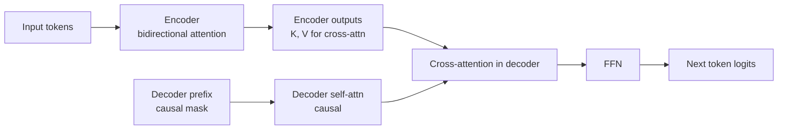

T5 (Raffel et al. 2019) and BART (Lewis et al. 2019) are the two canonical encoder-decoder Transformers: the third major Transformer family, distinct from BERT-style encoder-only models and GPT-style decoder-only models. T5 unified all of NLP under a single "text-to-text" interface, while BART pretrains a standard sequence-to-sequence Transformer as a denoising autoencoder. Decoder-only LLMs have largely displaced both for general-purpose work, but they remain standard choices for translation and summarization, and their pretraining ideas shaped everything that followed. This note covers both objectives in detail, the encoder-decoder information flow that powers them, and when to pick them over a decoder-only LLM.

> [!info] TL;DR
> T5 and BART pair a bidirectional encoder (which reads the whole input once) with an autoregressive decoder (which writes the output while cross-attending to the encoder's representations). T5's span corruption and task-prefix framing turned every NLP task into text-to-text generation and inspired instruction tuning; BART's aggressive noising-and-reconstruction objective made it the summarization workhorse. Choose encoder-decoder when input and output differ in length and structure, when the input needs bidirectional context, or when a small specialized model wins on cost and latency.

## Why encoder-decoder

The three Transformer architectures split the task space between them:

| Architecture    | Best for                        | Examples            |
|-----------------|---------------------------------|---------------------|
| Encoder-only    | Classification, NER, embeddings | BERT, RoBERTa       |
| Decoder-only    | Generation, chat, code          | GPT, Llama, Mistral |
| Encoder-decoder | Translation, summarization      | T5, BART, Whisper   |

Encoder-decoder shines when the input and output have different lengths and structures (translation), when the input needs full bidirectional context (summarization needs to read the whole document before writing anything), and when you want a separate encoding phase (Whisper encodes audio once, then decodes text). For most modern tasks, decoder-only LLMs such as Llama and GPT match or beat encoder-decoder quality, so T5/BART-style models survive in niches rather than as defaults — see [[BERT vs GPT vs T5]] for the full design space and [[The Encoder-Decoder Pattern]] for the sequence-to-sequence setup these models implement.

## T5: text-to-text transfer transformer

### The text-to-text framing

T5 frames every NLP task as "text in → text out":

- Translation: `"translate English to French: Hello" → "Bonjour"`
- Summarization: `"summarize: <article>" → "<summary>"`
- Classification: `"question: ...? context: ..." → "yes"/"no"`
- Regression: `"...": "0.7"`

Same model, same training, same loss — just different task prefixes. This unification was elegant and influential: it is the direct ancestor of the instruction-following interface of modern chat models.

### Pretraining: span corruption

T5 was pretrained with span corruption: mask random spans (multiple consecutive tokens) and predict them:

```
Input:  Thank you for <X> me to your <Y> party
Target: <X> inviting <Y> birthday
```

The model learns to fill in arbitrary-length spans. This is different from BERT's single-token masking, and it is what makes T5 a generation model rather than a representation model.

### Span corruption in detail

T5's pretraining objective is more sophisticated than BERT's masked language modeling:

```
Original:    "The quick brown fox jumps over the lazy dog"
Corrupted:   "The quick <X> jumps over the <Y>"
Target:      "<X> brown fox <Y> lazy dog"
```

The sentinel tokens `<X>`, `<Y>` are unique tokens added to the vocabulary. The model learns to predict the spans (one or more tokens) that were masked, separated by sentinels. This teaches three things at once: multi-token prediction (unlike BERT's single-token MLM), span boundaries (the model must figure out where a span ends), and generation (the target is a sequence, not a single token, so the model learns autoregressive generation).

The objective's hyperparameters: a corruption rate of 15% of tokens (same as BERT), an average span length of 3 tokens (drawn from a geometric distribution), and 100 unique sentinel tokens (`<extra_id_0>` to `<extra_id_99>`).

T5's choice of span corruption (over BERT's MLM and GPT's CLM) was empirical — the authors tried multiple objectives and span corruption won. Later work (UL2) showed that mixing objectives (a "mixture of denoisers") gives even better results.

### T5 variants

The T5 family spans several scales and successors. T5-small/base/large/3B/11B differ only in scale; mT5 is the multilingual version, trained on 101 languages; FLAN-T5 is instruction-tuned T5 and one of the first instruction-tuned open models; and UL2 is a successor that unifies multiple pretraining objectives. Later variants also adopt a simplified RMSNorm-like normalization in place of the original LayerNorm — see [[Pre-Norm vs Post-Norm]] for that design axis.

## BART: bidirectional and auto-regressive transformers

### The denoising autoencoder objective

BART uses a standard seq2seq Transformer (encoder + decoder) with a denoising autoencoder pretraining objective:

1. Corrupt the input (token masking, sentence shuffling, token deletion, document rotation).
2. Reconstruct the original.

BART's corruptions are more aggressive than T5's span corruption — they include sentence-level and document-level corruption, not just token-level spans. BART was state of the art for summarization when released (2019) and is still used in production summarization systems.

### BART's corruptions in detail

Multiple corruption types are combined:

| Corruption           | Description                            | Why                                           |
|----------------------|----------------------------------------|-----------------------------------------------|
| Token masking        | Random tokens replaced with `<mask>`   | Like BERT — basic denoising                   |
| Token deletion       | Random tokens removed entirely         | Model learns length                           |
| Text infilling       | Spans replaced with a single `<mask>`  | Like T5, but single-mask for variable length  |
| Sentence permutation | Sentences shuffled                     | Document-level coherence                      |
| Document rotation    | Pick a random split point, swap halves | Encourages finding the start of the document  |

The model must reconstruct the original text, not just fill in spans. This is harder than T5: the model must track sentence order, length, and content simultaneously. BART's pretraining is closer to the "general sequence-to-sequence" task than T5's span corruption, which is why BART excels at summarization (where the output is a coherent reconstruction of the input) and at translation after fine-tuning.

## Information flow in encoder-decoder

The encoder-decoder architecture has a fundamentally different information flow than decoder-only models:



Three differences from the decoder-only flow matter. First, the encoder is bidirectional: every input token attends to every other input token, which is critical for tasks like summarization where the entire input must be understood before any output is generated. Second, cross-attention is unidirectional: decoder tokens attend to encoder outputs, but the encoder never sees decoder tokens. This is what makes the architecture "translation-like" — read the input fully, then write the output. Third, the KV cache is split: the encoder's KV cache is computed once and shared across all decoder steps, while the decoder's own KV cache grows during generation.

## Cross-attention in detail

In encoder-decoder models, the decoder has two attention layers per block: self-attention (causal, over the decoder's own prefix) and cross-attention (full, over the encoder outputs):

```python
class DecoderBlock(nn.Module):
    def forward(self, x_dec, enc_out, dec_mask, enc_mask=None):
        # Self-attention (causal)
        x = x_dec + self.self_attn(
            self.q_norm(x_dec), self.k_norm(x_dec), self.v_norm(x_dec),
            attn_mask=dec_mask,
        )
        x = self.self_attn_norm(x)

        # Cross-attention (decoder queries, encoder keys/values)
        x = x + self.cross_attn(
            self.q_norm(x),         # queries from decoder
            self.k_norm(enc_out),   # keys from encoder
            self.v_norm(enc_out),   # values from encoder
            attn_mask=enc_mask,
        )
        x = self.cross_attn_norm(x)
        x = x + self.ffn(x)
        return self.ffn_norm(x)
```

Self-attention has Q, K, and V all from the same sequence; cross-attention takes Q from one sequence (the decoder) and K, V from another (the encoder). The encoder is computed once and the decoder cross-attends to it at every layer. The cross-attention KV cache — the encoder outputs — is computed once during the prefill and reused for every generated token. This is why encoder-decoder models are efficient when the input is fixed and the output is short: you pay the encoder cost once. The block anatomy itself is covered in [[Transformer Decoder Block]] and [[Transformer Block]].

## Why decoder-only won, and when encoder-decoder still wins

The trend 2018-2026 has been toward decoder-only, for five reasons: simplicity (one architecture, one set of weights, no cross-attention to manage); scaling (decoder-only scales predictably with parameter count and tokens, per Chinchilla, while encoder-decoder scaling is less studied); in-context learning (decoder-only models learn ICL spontaneously, while encoder-decoder models need explicit fine-tuning for it); unified training (a single causal LM objective suffices for pretraining, with no separate corruption objective to design); and the modern recipes — Llama 3, DeepSeek, and essentially all current LLM training pipelines are decoder-only.

Encoder-decoder still wins in specific niches. In speech recognition, Whisper's input is audio (encoded once) and its output is text (autoregressive); the encoder is a log-mel spectrogram Transformer and the decoder cross-attends to it. In translation at production scale, specialized MT models (NLLB, mBART) are smaller, faster, and often higher-quality than general LLMs. In summarization at scale, BART-large can outperform a 7B decoder-only LLM for high-throughput summarization with strict latency constraints. In scientific sequence modeling, protein sequences (ProtTrans) and molecule generation have asymmetric input/output structures that suit the pattern. And in code infilling (FIM — fill-in-the-middle), some encoder-decoder formulations are natural for the task.

## Comparing the families

| Aspect                | T5 family              | BART family            | Decoder-only (Llama, GPT)  |
|-----------------------|------------------------|------------------------|----------------------------|
| Architecture          | Encoder-decoder        | Encoder-decoder        | Decoder only               |
| Pretraining objective | Span corruption        | Denoising autoencoder  | Causal LM                  |
| Bidirectional input   | Yes (encoder)          | Yes (encoder)          | No                         |
| Generation            | Yes                    | Yes                    | Yes                        |
| Best at               | Translation, multitask | Summarization          | Chat, code, reasoning      |
| In-context learning   | Limited                | Limited                | Strong                     |
| Scales cleanly        | Yes                    | Yes                    | Yes (better studied)       |
| Served by             | TGI, vLLM (partial)    | TGI, vLLM (partial)    | vLLM, TGI, TRT-LLM, SGLang |
| Modern usage          | Specialized tasks      | Specialized tasks      | Default for new apps       |
| Notable variants      | FLAN-T5, mT5, UL2      | BART-large, mBART      | Llama, Qwen, DeepSeek      |

Choosing by use case:

| Use case                             | Best choice                           |
|--------------------------------------|---------------------------------------|
| General chat / instruction-following | Decoder-only LLM (Llama 3, GPT-4)     |
| Translation (production)             | Specialized MT model or LLM           |
| Summarization (high-volume)          | BART or T5 (smaller, faster than LLM) |
| Multilingual NLP                     | mT5 / multilingual LLM                |
| Speech-to-text                       | Whisper (encoder-decoder)             |
| General-purpose NLP with one model   | Decoder-only LLM (more flexible)      |

For most modern use cases, decoder-only LLMs are the default. T5 and BART earn their keep when you need a smaller, specialized model (BART for summarization), when latency and cost matter more than flexibility, or when you are working within the original T5 ecosystem (FLAN-T5 is still popular). Understanding this family still matters for four reasons: encoder-decoder is the third major Transformer architecture and completes the picture; T5's text-to-text framing influenced modern instruction tuning (every task → text generation); BART-style denoising autoencoders are the conceptual ancestor of diffusion models for text (rare but emerging); and for speech (Whisper) and some multimodal models, encoder-decoder is still the right architecture. See [[Choosing the Right Architecture]] for the decision framework.

## Worked examples

### Translation with FLAN-T5

```python
from transformers import T5ForConditionalGeneration, T5Tokenizer

model_id = "google/flan-t5-base"
tokenizer = T5Tokenizer.from_pretrained(model_id)
model = T5ForConditionalGeneration.from_pretrained(model_id)

input_text = "Translate to French: Hello, how are you?"
inputs = tokenizer(input_text, return_tensors="pt")
outputs = model.generate(**inputs, max_new_tokens=50)
print(tokenizer.decode(outputs[0], skip_special_tokens=True))
# "Bonjour, comment allez-vous?"
```

The task prefix in `input_text` is doing real work: without a prefix like `"translate: "` or `"Translate to French: "`, the model has no way to know which task to perform.

### Summarization with BART

```python
from transformers import BartForConditionalGeneration, BartTokenizer

model_id = "facebook/bart-large-cnn"
tokenizer = BartTokenizer.from_pretrained(model_id)
model = BartForConditionalGeneration.from_pretrained(model_id)

article = """
The tower is 324 metres (1,063 ft) tall, about the same height as an 81-storey building,
and is the tallest structure in Paris. Its base is square, measuring 125 metres (410 ft)
on each side. During its construction, the Eiffel Tower surpassed the Washington Monument
to become the tallest man-made structure in the world, a title it held for 41 years until
the Chrysler Building in New York City was finished in 1930.
"""

# Tokenize (encoder input)
inputs = tokenizer(article, max_length=1024, truncation=True, return_tensors="pt")

# Generate (decoder)
summary_ids = model.generate(
    inputs["input_ids"],
    num_beams=4,
    max_length=150,
    min_length=50,
    length_penalty=2.0,
    early_stopping=True,
    no_repeat_ngram_size=3,
)
print(tokenizer.decode(summary_ids[0], skip_special_tokens=True))
# "The Eiffel Tower is 324 metres tall..."
```

Three of the generation kwargs deserve attention: `num_beams=4` uses beam search, which is better than greedy decoding for summarization; `length_penalty=2.0` encourages longer summaries, since BART tends to be terse; and `no_repeat_ngram_size=3` prevents repetitive summaries.

## Production implications

For summarization at scale, BART-large or T5-large can be more cost-effective than a 7B LLM. For translation, specialized MT models (NLLB, mBART) often beat general LLMs on both quality and cost. FLAN-T5 remains a solid choice for a small, instruction-tuned model that runs on a single GPU. For most new applications, start with a decoder-only LLM and move to T5/BART only if cost or latency demands it.

When deploying T5/BART in production, use specialized servers — TGI supports T5/BART, vLLM has partial support, and full-featured encoder-decoder serving is less mature than decoder-only serving. Pin the model version: T5/BART weights are stable, but the transformers library API changes, so pin both. Quantize carefully: T5/BART quantize well to INT8 with bitsandbytes, while INT4 quantization (GPTQ) is less reliable for encoder-decoder — test thoroughly. For multilingual coverage, NLLB-200 (200 languages) and mT5 are the best open options. For summarization, BART-large-cnn is a strong baseline, and fine-tuning on your domain helps — generic summarization doesn't transfer perfectly to legal, medical, or scientific text.

## Common pitfalls

Four mistakes come up repeatedly with these models. Using encoder-decoder for chat is possible but awkward — the encoder doesn't help for autoregressive conversation. Forgetting that T5 needs task prefixes means the model doesn't know what to do without `"translate: "` and friends. Setting the wrong max length bites long documents: T5's default is 512, so long inputs need explicit truncation or a long-context variant. And comparing T5/BART to modern LLMs on raw quality is a losing frame — the LLMs usually win; use T5/BART for cost, not quality.

## Interview questions

**What is span corruption, and how does it differ from BERT's MLM?**
T5's span corruption masks consecutive spans of tokens (average length 3) and predicts the entire span, separated by unique sentinel tokens. BERT's MLM masks individual tokens (15% of tokens, with 80% replace, 10% random, 10% keep). Span corruption teaches multi-token generation; MLM teaches single-token prediction. T5's objective is closer to the generation task; BERT's is closer to representation learning.

**When does encoder-decoder beat decoder-only?**
Three cases: the input is fundamentally different from the output (audio → text in Whisper); the input needs full bidirectional context (long documents for summarization); or you need a small specialized model with high throughput (BART-large for summarization is roughly 5× faster than a 7B LLM). For general-purpose chat, code, and reasoning, decoder-only is the default.

**Why does decoder-only dominate modern LLMs?**
Five reasons: simpler architecture, cleaner scaling laws, spontaneous in-context learning, a unified causal LM training objective, and the network effect — most serving frameworks, fine-tuning recipes, and research are decoder-only first. The architectural advantage is small; the ecosystem advantage is large.

**What is cross-attention, and how is it different from self-attention?**
Self-attention has Q, K, V all from the same sequence. Cross-attention has Q from one sequence (the decoder) and K, V from another (the encoder). The encoder is computed once; the decoder cross-attends to it at every layer. This is what enables translation-like "read input fully, then write output."

**How would you choose between FLAN-T5, BART-large-cnn, and a 7B decoder-only LLM for a high-volume summarization task?**
Start with FLAN-T5-large or BART-large-cnn if latency and cost are critical — they are roughly 5-10× cheaper per request than a 7B model. Move to a 7B LLM only if you need broader capabilities beyond summarization, need abstractive summarization that captures subtle semantics, or have a fine-tuning pipeline that can adapt the 7B to your domain. For pure summarization throughput, encoder-decoder still wins.

**Why is T5's "text-to-text" framing historically important?**
T5 was the first major model to frame every NLP task as text-to-text, unifying classification, translation, summarization, and even regression under one objective. This framing influenced instruction tuning (FLAN, InstructGPT), where every task is "instruction → response" — the same idea generalized. Modern LLMs are direct descendants of T5's text-to-text framing.

## Further reading

- Raffel et al. (2019), *Exploring the Limits of Transfer Learning with a Unified Text-to-Text Transformer* (T5).
- Lewis et al. (2019), *BART: Denoising Sequence-to-Sequence Pre-training for Natural Language Generation, Translation, and Comprehension*.
- Xue et al. (2021), *mT5*.

## See also

- [[Attention and Transformers MOC]]
- [[08 - Attention and Transformers/Transformer Architecture/BERT|BERT]] — the encoder-only bidirectional baseline T5 builds on
- [[GPT Family]] — the decoder-only architecture that displaced T5 and BART
- [[BERT vs GPT vs T5]] and [[Choosing the Right Architecture]]
- [[The Transformer]], [[Transformer Block]], [[Transformer Decoder Block]]
- [[Pre-Norm vs Post-Norm]] — T5's later variants adopt simplified RMSNorm-like normalization
- [[The Encoder-Decoder Pattern]], [[Autoregressive vs Parallel Encoding]], [[Beam Search and Decoding Strategies]]
