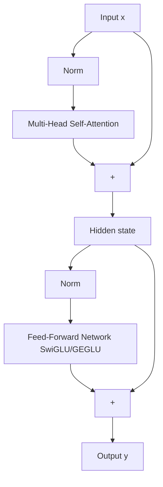

The Transformer block is the repeatable unit from which every Transformer is built. It has exactly two sublayers — multi-head self-attention and a position-wise feed-forward network — each wrapped in a residual connection and a normalization. A block takes a sequence $X \in \mathbb{R}^{T \times d}$ and produces a sequence of the same shape, so blocks stack cleanly: stack $N$ of them (6 in the original Transformer, typically 6–24 for BERT-era encoders, and up to 80+ in modern LLMs) and you have a complete model. This note dissects each piece, reconciles the original post-LN wiring with the modern pre-norm form, and records the hyperparameter, implementation, and production details of the block.

> [!info] TL;DR
> A Transformer block is: multi-head self-attention → residual + norm → feed-forward network → residual + norm. Attention is the "communication" sublayer that moves information across positions; the FFN is the "computation" sublayer that transforms each position independently. Residual connections keep deep stacks trainable; LayerNorm (or RMSNorm in modern models) keeps activations stable; and the modern pre-norm placement of the normalization is more stable to train than the original post-norm form.

## The block in one diagram

The original post-LN wiring, as introduced by Vaswani et al. (2017):

```
        X
        │
        ▼
┌───────────────────┐
│  Multi-Head       │── residual
│  Self-Attention   │
└───────────────────┘
        │
        ▼
┌───────────────────┐
│  LayerNorm        │
└───────────────────┘
        │
        ▼
┌───────────────────┐
│  Feedforward      │── residual
│  (MLP)            │
└───────────────────┘
        │
        ▼
┌───────────────────┐
│  LayerNorm        │
└───────────────────┘
        │
        ▼
      Output
```

In equations:

$$Z = \text{LayerNorm}(X + \text{MultiHeadSelfAttention}(X))$$
$$\text{Output} = \text{LayerNorm}(Z + \text{FFN}(Z))$$

where FFN is a position-wise feedforward network (a small MLP applied independently to each position). That is the entire block. The rest of this note dissects each piece, then turns to the modern variant.

## The modern pre-norm form

Modern Transformers (GPT-2 onward, including Llama and Mistral) apply the normalization *before* each sublayer instead of after the residual addition:



In equations (pre-norm):

$$
\mathbf{h} = \mathbf{x} + \text{MHA}(\text{Norm}(\mathbf{x}))
$$

$$
\mathbf{y} = \mathbf{h} + \text{FFN}(\text{Norm}(\mathbf{h}))
$$

A full Transformer is $N$ stacked blocks:

$$
\mathbf{h}_0 = \text{Embed}(\text{tokens}) + \text{PositionalEncoding}
$$

$$
\mathbf{h}_l = \text{Block}_l(\mathbf{h}_{l-1}) \quad \text{for } l = 1, \ldots, N
$$

$$
\text{output} = \text{Head}(\mathbf{h}_N)
$$

The first diagram shows the post-LN order for historical fidelity; in practice, use pre-norm — the reasons are given in "Pre-LN vs Post-LN" below.

## Sublayer 1: multi-head self-attention

This is the self-attention operation wrapped in multi-head form: it contextualizes each token's representation by letting it attend to all other tokens (or, with causal masking, all previous tokens). The input $X$ is projected to Q, K, V, the attention is computed, and the output is projected back to dimension $d$. The output has the same shape as the input — a sequence of $T$ vectors of dimension $d$ — but each vector is now a contextualized representation that incorporates information from all other positions. This is the "routing" or "communication" sublayer: it lets information flow across positions. See [[Self-Attention]] and [[Multi-Head Attention]] for the underlying operation.

## Sublayer 2: position-wise feedforward network

After attention, each position passes through a small MLP independently — there is no interaction between positions in this sublayer. The standard FFN is:

$$\text{FFN}(x) = \text{ReLU}(x W_1 + b_1) W_2 + b_2$$

where $W_1 \in \mathbb{R}^{d \times d_{ff}}$, $W_2 \in \mathbb{R}^{d_{ff} \times d}$, and $d_{ff}$ is typically $4d$ (so $d_{ff} = 2048$ when $d = 512$). The FFN expands the dimension by 4×, applies ReLU, and projects back. Written in the general form, with the activation as an explicit free choice:

$$
\text{FFN}(\mathbf{x}) = \mathbf{W}_2 \, \sigma(\mathbf{W}_1 \mathbf{x} + \mathbf{b}_1) + \mathbf{b}_2
$$

where $\sigma$ is an activation — ReLU in the original Transformer, GELU in BERT/GPT-2, SwiGLU in Llama/Mistral. The hidden dimension is typically 4× the model dimension, so a 4096-dim model has a 16384-dim FFN hidden layer. This is where most of the parameters live. The FFN is the "computation" sublayer: it transforms each token's representation.

Why have an FFN at all? Self-attention is a linear operation (ignoring the softmax) — it computes weighted averages of values, which are linear combinations. The FFN provides the nonlinearity that lets the model compute complex functions of its input. Without the FFN, a stack of self-attention layers would collapse to a linear model, just like a stack of linear layers without activations (see [[06 - Computer Vision/Core Operators and Geometry/Activation and Pooling Layers|Activation and Pooling Layers]]).

Why "position-wise"? The same FFN is applied to each position independently, and this is intentional: attention handles inter-position interactions, the FFN handles intra-position transformations. Separating these concerns is cleaner than mixing them. Modern variants (GELU in ViT/BERT, SwiGLU in LLaMA) replace ReLU with smoother activations and sometimes use a gated structure, but the role is the same: provide per-position nonlinearity after the linear attention operation. See [[Feed-Forward Network]].

## Why two sublayers

MHA alone is linear in V (for fixed attention weights) — without the FFN's nonlinearity, the model couldn't compute complex functions per token. The FFN alone has no cross-token communication — without MHA, the model couldn't share information across positions. Together they cover both needs: MHA routes information; the FFN computes per-token transformations.

## Residual connections

Each sublayer is wrapped in a residual (skip) connection: $\text{Output} = X + \text{Sublayer}(X)$ in the post-LN formulation, or $\mathbf{y} = \mathbf{x} + \text{Sublayer}(\text{Norm}(\mathbf{x}))$ in the pre-norm one — the input is added directly to the sublayer's output. This is the same idea as ResNet ([[06 - Computer Vision/Architecture and Connectivity/The Degradation Problem and Residual Connections|The Degradation Problem and Residual Connections]]).

Residuals do three things. They stabilize training of deep networks by giving gradients a shortcut path. They let the model learn incremental updates — the sublayer learns the *delta* from the input, not the full output. And they enable very deep networks: without residuals, networks beyond ~10 layers are untrainable due to vanishing gradients. The residual connections are essential in the Transformer specifically: without them, a 24-layer Transformer would be untrainable. With them, gradients flow through the additive paths and training is stable. This is the same lesson as ResNet (2015) and the LSTM (1997) — additive paths preserve gradient flow — applied to the Transformer. See [[Residual Connections]].

## Normalization

Each sublayer's input is normalized (LayerNorm or RMSNorm) before being processed in the modern form; the original applies it after the residual addition. LayerNorm normalizes across the feature dimension for each token independently:

$$\text{LayerNorm}(x) = \gamma \cdot \frac{x - \mu}{\sigma} + \beta$$

where $\mu, \sigma$ are the mean and std of $x$ across the feature dimension, and $\gamma, \beta$ are learnable.

Why LayerNorm, not BatchNorm? Three reasons. First, batch independence: BatchNorm depends on batch statistics, which are ill-defined for variable-length sequences and small batches; LayerNorm uses only per-token statistics, so it is batch-independent. Second, no train/test discrepancy: BatchNorm has different behavior in training (batch stats) and inference (running stats), which is a source of bugs; LayerNorm behaves identically in training and inference. Third, sequence-length independence: BatchNorm on sequence data would need to normalize over the time dimension, which conflates position and batch; LayerNorm normalizes only over features, so it works at any sequence length. This is the same reason RNNs use LayerNorm — the constraints are identical. See [[05 - Neural Network Foundations/Training Dynamics and Stability/Batch Normalization|Batch Normalization]] for the broader normalization comparison and [[Normalization Layers]] for the Transformer-specific layer zoo.

### Pre-LN vs Post-LN

The original Transformer applies LayerNorm *after* the residual addition ("Post-LN"):

$$Z = \text{LayerNorm}(X + \text{Sublayer}(X))$$

Modern Transformers (GPT-2 onward) apply LayerNorm *before* the sublayer ("Pre-LN"):

$$Z = X + \text{Sublayer}(\text{LayerNorm}(X))$$

Pre-LN is more stable to train in deep stacks because the residual path is purely additive (no normalization in the gradient highway), which preserves gradient flow better. Most modern Transformers use Pre-LN. The post-LN diagram earlier in this note shows the historical form; in practice, use Pre-LN. See [[Pre-Norm vs Post-Norm]] for the full treatment.

## Stacking blocks

A single block transforms the input but does not dramatically change its representational power — the block is a contextualizer (attention) plus a nonlinear transform (FFN), both of which are relatively shallow operations. The power comes from stacking $N$ blocks.

Each block refines the contextualization: block 1 lets each token attend to its immediate neighbors, block 2 lets each token attend to tokens that have already incorporated their neighbors' information (effectively a 2-hop neighborhood), and so on. After $N$ blocks, each token's representation incorporates information from across the entire sequence, mediated by $N$ rounds of attention.

This is structurally analogous to stacked CNN layers, where each layer expands the receptive field. In a CNN, the receptive field grows linearly with depth (for fixed kernel size); in a Transformer, the receptive field is global from block 1, but the *complexity* of the relationships that can be modeled grows with depth. A 1-block Transformer can model "token A attends to token B"; a 12-block Transformer can model "token A attends to the token that itself attended to the token that resolved the coreference of token B."

Typical stack depths: BERT-base = 12, BERT-large = 24, GPT-2 small = 12, GPT-3 = 96, ViT-Base = 12. Classic encoder stacks live in the 6–24 range, while modern LLM stacks run to 80+ layers.

## Variants across the model families

The same block skeleton adapts to each Transformer family. The encoder block (BERT) uses bidirectional attention (no causal mask), is designed for representation learning (MLM), and its output is a per-token contextual embedding. The decoder block (GPT, Llama) uses causal attention (mask the future), is designed for autoregressive generation, and its output is the next-token logits. The encoder-decoder block (T5, BART) combines the two: the encoder is bidirectional and processes the source, while the decoder is causal over the target plus cross-attention to the encoder output — the cross-attention sublayer is a third sublayer (after self-attention and FFN). See [[08 - Attention and Transformers/Transformer Architecture/BERT|BERT]], [[GPT Family]], and [[T5 and BART]]; the decoder-side anatomy is detailed in [[Transformer Decoder Block]].

## Hyperparameter choices

| Hyperparameter      | Original (Vaswani) | GPT-2 small | Llama 2 7B | Llama 3 8B |
|---------------------|--------------------|-------------|------------|------------|
| `d_model`           | 512                | 768         | 4096       | 4096       |
| `n_heads`           | 8                  | 12          | 32         | 32         |
| `d_k` (head dim)    | 64                 | 64          | 128        | 128        |
| `d_ff` (FFN hidden) | 2048               | 3072        | 11008      | 14336      |
| `n_layers`          | 6                  | 12          | 32         | 32         |
| Norm                | LayerNorm (post)   | LayerNorm (pre) | RMSNorm (pre) | RMSNorm (pre) |
| Activation          | ReLU               | GELU        | SwiGLU     | SwiGLU     |
| Positional          | Sinusoidal         | Learned abs | RoPE       | RoPE       |
| Attention           | MHA                | MHA         | GQA        | GQA        |

The table shows how the block's knobs moved over time — RMSNorm replaced LayerNorm, SwiGLU replaced ReLU/GELU, RoPE replaced sinusoidal and learned absolute encodings, and GQA replaced plain MHA — while the two-sublayer residual skeleton stayed fixed. See [[Sinusoidal and Learned Positional Encodings]], [[Positional Encoding]], [[RoPE]], and [[GQA MQA and MLA]].

## Worked implementation

A minimal modern (Llama-style) implementation makes the pre-norm skeleton concrete:

```python
import torch
import torch.nn as nn

class TransformerBlock(nn.Module):
    def __init__(self, d_model, n_heads, d_ff, norm_eps=1e-5):
        super().__init__()
        self.norm1 = nn.RMSNorm(d_model, eps=norm_eps)  # modern Llama-style
        self.attn  = MultiHeadAttention(d_model, n_heads)
        self.norm2 = nn.RMSNorm(d_model, eps=norm_eps)
        self.ffn   = SwiGLUFFN(d_model, d_ff)
    
    def forward(self, x, mask=None):
        # Pre-norm residual
        x = x + self.attn(self.norm1(x), mask=mask)[0]
        x = x + self.ffn(self.norm2(x))
        return x

class Transformer(nn.Module):
    def __init__(self, vocab, d_model, n_heads, d_ff, n_layers, max_len):
        super().__init__()
        self.tok_emb = nn.Embedding(vocab, d_model)
        self.pos_emb = RoPE(d_model, max_len)  # modern default
        self.blocks  = nn.ModuleList([
            TransformerBlock(d_model, n_heads, d_ff) for _ in range(n_layers)
        ])
        self.norm_f  = nn.RMSNorm(d_model)
        self.head    = nn.Linear(d_model, vocab, bias=False)
    
    def forward(self, tokens):
        x = self.tok_emb(tokens)
        # RoPE applied inside attention, not here
        for block in self.blocks:
            x = block(x)
        x = self.norm_f(x)
        return self.head(x)
```

Reading the implementation against the anatomy: `norm1`/`norm2` are RMSNorm instances (the modern normalization), the FFN is a SwiGLU variant, RoPE is applied inside attention rather than to the embeddings, and a final RMSNorm (`norm_f`) sits after the last block before the bias-free output head. Token embeddings come from `nn.Embedding` — see [[Embedding Layer]].

## Production implications

Parameter count scales as $\approx 12 N d^2$ for an $N$-layer, $d$-dim decoder-only model (where $d \gg d_k$), and the 4× FFN expansion is the dominant contributor. Inference FLOPs per token scale as $\approx 2 \cdot \text{params}$ for a forward pass (1 MAC = 2 FLOPs), so a 7B model costs roughly 14 GFLOPs per token. Memory at inference is the parameters plus the KV cache, which grows with context length. Block-level parallelism is limited because each block depends on the previous one; pipeline parallelism splits blocks across GPUs.

## Common pitfalls

Four implementation traps recur. Forgetting the final norm: most modern models have a final LayerNorm/RMSNorm after the last block, and omitting it causes subtle quality loss. Using the wrong mask: a bidirectional mask in a decoder (or vice versa) breaks everything. Breaking causality through norm placement: the FFN is position-wise, so it is always "causal" by construction — but if you accidentally let future tokens influence the FFN input (e.g., through wrong norm placement), you've broken causality. And weight tying without scaling: when sharing input/output embeddings, multiply the output by $\sqrt{d_{\text{model}}}$ (or use no scaling, depending on the paper).

## Why the block matters

The Transformer block is the universal building block of modern AI: vision Transformers, audio Transformers, code Transformers, multimodal Transformers, and diffusion Transformers are all stackings of this same block with minor variations. Understanding the block lets you read model configs (`n_layers`, `n_heads`, `d_model`, `d_ff`), compute parameter counts and FLOPs estimates from a model's width and depth, identify which architectural choices distinguish model families, and debug training issues (norm placement matters for stability).

## Further reading

- Vaswani et al. (2017), *Attention Is All You Need* — the original.
- Xiong et al. (2020), *On Layer Normalization in the Transformer Architecture* — pre-norm vs post-norm.
- Llama 2 paper — modern default recipe (RMSNorm, SwiGLU, RoPE, GQA).
- Karpathy's nanoGPT — minimal clean implementation.

## See also

- [[Attention and Transformers MOC]]
- [[Self-Attention]], [[Multi-Head Attention]]
- [[Residual Connections]], [[Normalization Layers]], [[Pre-Norm vs Post-Norm]], [[Feed-Forward Network]]
- [[Transformer Decoder Block]], [[The Transformer]]
- [[08 - Attention and Transformers/Transformer Architecture/BERT|BERT]], [[GPT Family]], [[T5 and BART]]
- [[Positional Encoding]], [[RoPE]], [[GQA MQA and MLA]]
- [[06 - Computer Vision/Architecture and Connectivity/The Degradation Problem and Residual Connections|The Degradation Problem and Residual Connections]]
- [[06 - Computer Vision/Core Operators and Geometry/Activation and Pooling Layers|Activation and Pooling Layers]]
- [[05 - Neural Network Foundations/Training Dynamics and Stability/Batch Normalization|Batch Normalization]]
- [[Large Language Models MOC]]
