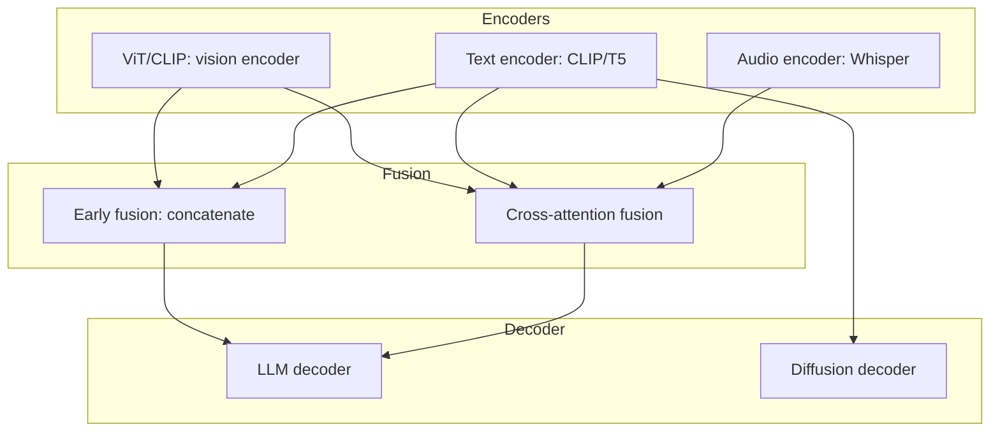

This map of content is the entry point to the Foundation Models and Multimodal area. One half of the area is the foundation-model family — models pretrained on massive data and adaptable to many downstream tasks — covering the major categories beyond text LLMs: vision, embedding, reasoning, code, and multimodal foundation models. The other half is the multimodal AI family: models that handle multiple modalities — text, image, audio, and video — from vision-language models and diffusion-based image generation to speech and video. Thirteen notes span the two sub-families, and each doubles as a per-model deep dive (ViT, CLIP, DINOv2, BGE, o1, DeepSeek-R1, Codex, StarCoder, LLaVA, Whisper, FLUX).

> [!info] TL;DR
> Foundation models — pretrained on massive data, adaptable to many downstream tasks — plus multimodal AI across text, image, audio, and video. Read the notes in table order: foundation-model categories first, multimodal deep dives second.

## Reading order

| # | Note | Sub-family | Sub-domain | Purpose |
|---|------|------------|------------|---------|
| 01 | [[Foundation Models and Multimodal MOC]] | Area map | Orientation | This map: reading order, sub-families, and why the area matters. |
| 02 | [[Vision Foundation Models]] | Foundation models | Vision | ViT, CLIP, DINOv2, SigLIP, SAM. |
| 03 | [[Embedding Models for Retrieval]] | Foundation models | Embedding models | BGE, E5, GTE; the backbone of RAG. |
| 04 | [[Reasoning Models]] | Foundation models | Reasoning | o1, R1, Claude thinking; test-time compute. |
| 05 | [[Code Models]] | Foundation models | Code models | Codex, StarCoder, Code Llama, DeepSeek-Coder. |
| 06 | [[Multimodal Foundation Models]] | Foundation models | Multimodal | GPT-4V, Gemini, Claude, Llama-Vision, Qwen-VL. |
| 07 | [[Embedding Model Training]] | Foundation models | Embedding models | Contrastive learning recipe; hard negatives. |
| 08 | [[Multimodal AI Overview]] | Multimodal AI | Vision-language | Survey of VLMs, diffusion, audio, video. |
| 09 | [[CLIP]] | Multimodal AI | Vision-language | Contrastive vision-language pretraining. |
| 10 | [[LLaVA]] | Multimodal AI | Vision-language | Open-source multimodal LLM template. |
| 11 | [[Whisper]] | Multimodal AI | Audio | Open-source ASR on 99 languages. |
| 12 | [[DiT and FLUX]] | Multimodal AI | Diffusion | Transformer-based diffusion models. |
| 13 | [[Cross-Modal Attention]] | Multimodal AI | Fusion architectures | How modalities are fused via attention. |

The order runs the foundation-model categories first — vision and embedding models are the most reusable building blocks, reasoning and code models are the task-specialized categories, and multimodal foundation models bridge into the second half — then the multimodal deep dives: the survey first, the vision-language stack (CLIP, then LLaVA), audio (Whisper), diffusion (DiT and FLUX), and finally the fusion mechanism that ties modalities together (Cross-Modal Attention). Readers who only want the multimodal half can start at note 08 and follow its links; readers building retrieval systems can jump straight to notes 03 and 07.

## Sub-families

### Foundation models

Foundation models are pretrained on massive data and adaptable to many downstream tasks, and this family collects the major categories beyond text LLMs. Each note is both a category survey and the per-model deep dive for that category:

- **Vision** — [[Vision Foundation Models]]: ViT, CLIP, DINOv2, SigLIP, SAM.
- **Embedding models** — [[Embedding Models for Retrieval]] (BGE, E5, GTE; the backbone of RAG) and [[Embedding Model Training]] (the contrastive learning recipe; hard negatives).
- **Reasoning models** — [[Reasoning Models]]: o1, R1, Claude thinking; test-time compute.
- **Code models** — [[Code Models]]: Codex, StarCoder, Code Llama, DeepSeek-Coder.
- **Multimodal** — [[Multimodal Foundation Models]]: GPT-4V, Gemini, Claude, Llama-Vision, Qwen-VL.

### Multimodal AI

Multimodal AI is AI that handles multiple modalities: text, image, audio, video. Its sub-domains are:

- **Vision-language** — [[Multimodal AI Overview]] (the survey of VLMs, diffusion, audio, video), [[CLIP]] (contrastive vision-language pretraining), and [[LLaVA]] (the open-source multimodal LLM template).
- **Audio** — [[Whisper]]: open-source ASR on 99 languages.
- **Video** — Sora and Veo, covered by the survey in [[Multimodal AI Overview]]; a dedicated video note does not exist yet.
- **Diffusion** — [[DiT and FLUX]]: transformer-based diffusion models.
- **Fusion architectures** — [[Cross-Modal Attention]]: how modalities are fused via attention.

## Why this area matters

Foundation models are the substrate of modern AI engineering. Understanding their categories, capabilities, and limitations is essential for choosing the right model for a task:

- **Vision tasks** (image classification, object detection): use vision foundation models.
- **Multimodal tasks** (VQA, document AI, UI agents): use multimodal foundation models.
- **Code tasks** (completion, generation, agentic coding): use code models.
- **Retrieval tasks** (RAG, semantic search): use embedding models.
- **Reasoning tasks** (math, multi-step problems): use reasoning models.

Choosing the wrong category (e.g., a general LLM for code, or a text-only LLM for vision) produces dramatically worse results than choosing the right one.

The multimodal half of the area matters for its own reasons. Multimodal capability is now a default expectation for frontier LLMs (GPT-4V, Claude 3, Gemini, Llama 3.2). CLIP is the default visual encoder — most multimodal LLMs use CLIP or a successor (SigLIP, EVA-CLIP). LLaVA's architecture (vision encoder + projection + LLM) is the template for open-source multimodal LLMs. Cross-modal attention is the key fusion mechanism — it lets text tokens attend to relevant image regions. And DiT/FLUX established Transformers as the default for diffusion-based image generation, unifying the architecture across modalities.

## The multimodal stack

The multimodal notes describe one shared stack: modality-specific encoders, a fusion stage, and a decoder that generates the output. Vision and text encoders can be fused by simple concatenation or by cross-attention; the fused representation feeds either an LLM decoder or a diffusion decoder:

Read the diagram against the notes: the vision encoder is [[Vision Foundation Models]] or [[CLIP]], the audio encoder is [[Whisper]], the fusion stage is [[Cross-Modal Attention]] (with [[LLaVA]] as the canonical early-fusion model), and the diffusion decoder is [[DiT and FLUX]].

## Cross-domain connections

The families in this area are connected rather than isolated; each builds on something outside itself:

- Code models often share architecture with text LLMs but differ in training data and tokenization — see [[Code Models]] alongside [[Large Language Models MOC]].
- Multimodal models build on vision encoders and text LLMs — see [[Multimodal Foundation Models]] with [[Vision Foundation Models]].
- Embedding models are the foundation of retrieval-augmented generation — see [[Embedding Model Training]] and [[Embedding Models for Retrieval]].
- Reasoning models build on the test-time compute paradigm — see [[Reasoning Models]].

## Production implications

For deploying this area's models, the practical defaults are:

- **For vision-language applications**: LLaVA-family models are the open-source default. CLIP/SigLIP for visual embeddings.
- **For ASR**: Whisper (specifically Faster-Whisper or whisper.cpp) is the standard. Run locally with Ollama for privacy.
- **For image generation**: FLUX is the strongest open-source model; Stable Diffusion 3 for more options.
- **For fusion**: choose early fusion (concatenation, LLaVA-style) for simplicity, cross-attention (Flamingo-style) for fine-grained control.

## Future directions

The roadmap beyond the current notes is where emerging multimodal research is concentrated: audio foundation models (a deeper Whisper deep dive, music models), video foundation models (Sora-class), 3D foundation models (NeRF, Gaussian Splatting), and multimodal embedding models (CLIP-style joint embeddings). None of these has a dedicated note yet; the survey in [[Multimodal AI Overview]] is the current coverage point for the video frontier.

## See also

- [[Multimodal AI Overview]] — start here for the multimodal sub-family survey.
- [[Large Language Models MOC]] — text foundation models; the architecture code models share.
- [[Attention and Transformers MOC]] — the architecture underneath every model in this area.
- [[Inference and Production MOC]] — running these models in production.
- [[ViT Architecture]] — the underlying vision architecture, from the Vision Transformer paper (2020).
- [[Embedding Models for Retrieval]] — where embedding models matter most: retrieval-augmented generation.
- [[Interpretability and Research MOC]]
- [[Agents and Tooling MOC]]
- [[Vision Transformer]]
