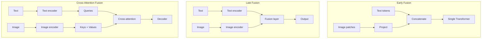

> [!info] TL;DR
> Cross-modal attention is the mechanism by which a model in one modality (e.g., text) attends to representations in another modality (e.g., image). The three fusion patterns are: **early fusion** (combine raw features before processing), **late fusion** (process modalities separately, combine at the end), and **cross-attention fusion** (use one modality's tokens as queries, another's as keys/values). Cross-attention is the dominant pattern in modern multimodal LLMs — it's how vision-language models, video-language models, and audio-language models integrate information.

Cross-modal attention is the mechanism by which a model operating in one modality (typically text) attends to representations in another (typically images), and it is the dominant integration pattern in modern multimodal LLMs. This note explains why fusing modalities is hard — they differ in dimensionality, spatial structure, and information density — and lays out the three canonical fusion patterns that answer it: early fusion, late fusion, and cross-attention fusion. It then covers the mechanics of cross-modal attention itself, the central architectural decision between cross-attention and concatenation, the main applications, implementation considerations, and the pitfalls that bite in practice. It sits between the encoders that produce representations ([[CLIP]], [[Vision Foundation Models]]) and the models that consume them ([[Multimodal Foundation Models]]); the area orientation is [[Foundation Models and Multimodal MOC]].

## The problem being solved

Multimodal models must combine information from different modalities (text, image, audio, video). The modalities have different **dimensionalities**: text is discrete tokens; images are continuous pixels or patch embeddings; audio is spectrograms. They have different **spatial structures**: text is 1D sequences; images are 2D grids; video is 3D (space + time). And they have different **information densities**: a single image token carries more information than a single text token.

The question: how do you fuse these different representations into a single coherent model?

## The three fusion patterns

### Early fusion

Combine raw features from different modalities before any processing:

```text
text_features = tokenize(text)
image_features = patchify(image)
combined = concat(text_features, image_features)
output = transformer(combined)
```

The canonical example is LLaVA: CLIP image embeddings are projected and concatenated with text tokens, then processed by a single LLM. Early fusion's strengths are a simple architecture (one Transformer processes everything), maximum interaction — modalities can influence each other from the start — and efficiency (no separate encoders for each modality after the initial projection). Its weaknesses are the flip side: it requires aligned representations from the start, so if the vision encoder produces poor embeddings, the LLM can't recover; and it is less modular — hard to swap out one modality's encoder independently.

### Late fusion

Process each modality separately, combine only at the final layer:

```text
text_features = text_encoder(text)
image_features = image_encoder(image)
combined = fusion_layer(text_features, image_features)
output = classifier(combined)
```

The typical example is classical multimodal classifiers (visual question answering with separate vision and language models). Late fusion is modular — each encoder can be improved independently, each modality is processed by a specialized model, and it's easy to add new modalities (just add another encoder). But cross-modal interaction is limited — modalities only meet at the end — it cannot leverage fine-grained alignments (e.g., "this word refers to that image region"), and the total parameter count is larger (a separate encoder per modality).

### Cross-attention fusion

Use one modality's tokens as queries, another's as keys and values. This is the standard attention mechanism applied across modalities:

```text
text_features = text_encoder(text)        # N_text tokens
image_features = image_encoder(image)      # N_image tokens

# Cross-attention: text queries attend to image keys/values
attended = cross_attention(
    Q=text_features,  # queries from text
    K=image_features,  # keys from image
    V=image_features,  # values from image
)  # N_text tokens, each enriched with relevant image info

output = decoder(attended)
```

Flamingo, BLIP-2, and many vision-language models use cross-attention to let the text decoder attend to image features. The pattern buys fine-grained alignment — each text token can attend to specific image regions — plus flexibility, because the model learns which cross-modal connections matter, and it preserves modality-specific processing (separate encoders) while enabling interaction. The costs are a more complex architecture (separate encoders + cross-attention layers), a higher parameter count, and the compute that cross-attention layers add (especially for long sequences).



## How cross-modal attention works

### The mechanism

Cross-modal attention is just standard [[Scaled Dot-Product Attention]], but with queries from one modality and keys/values from another:

```text
Attention(Q_text, K_image, V_image) = softmax(Q_text K_image^T / sqrt(d)) V_image
```

Each text token (query) computes a similarity with each image patch (key), and the output is a weighted sum of image patches (values). The text token's representation is enriched with the most relevant visual information.

### Multi-head cross-attention

Like [[Self-Attention]], cross-modal attention uses multiple heads. Different heads can specialize in different types of cross-modal relationships: one head might attend to spatial location (which part of the image does this word refer to?), another might attend to color or texture, and another might attend to object categories. The general mechanism is covered in [[Multi-Head Attention]].

### Conditioning the LLM on visual input

In vision-language models like Flamingo and BLIP-2, cross-attention layers are interleaved with the LLM's self-attention layers:

```text
For each layer in the LLM:
    1. Self-attention over text tokens (standard LLM operation)
    2. Cross-attention: text tokens attend to image features
    3. Feed-forward network
```

This lets the LLM access visual information at every layer, enabling fine-grained vision-language reasoning.

## Cross-attention vs. concatenation (early fusion)

The choice between cross-attention and concatenation is the central architectural decision in multimodal LLMs.

**Concatenation (LLaVA-style)**: image features are treated as additional input tokens; the LLM's self-attention naturally handles cross-modal interaction (image tokens and text tokens attend to each other); the architecture is simpler, with no separate cross-attention layers; and it works well when image features are already aligned with text (e.g., CLIP embeddings).

**Cross-attention (Flamingo-style)**: image features are kept separate, and the LLM attends to them via cross-attention; the parameter count is higher (cross-attention layers); it is better when image features are not pre-aligned, because the cross-attention can learn the alignment; and it is more flexible — you can use different image encoders without retraining the LLM.

Modern multimodal LLMs use both patterns. LLaVA and its successors use concatenation; Flamingo, BLIP-2, and Qwen-VL use cross-attention. The choice depends on the training data, model size, and whether the vision encoder produces aligned embeddings.

## Applications

### Visual question answering

The model answers questions about an image. Cross-attention lets each word in the question attend to relevant image regions: for "What color is the car?", "color" attends to the car region and extracts the color; for "How many people are there?", "how many" attends to person regions and counts.

### Image captioning

The model generates a description of an image. Cross-attention lets each generated word attend to the relevant image region: for "A dog", "dog" attends to the dog region; for "running through", "running" attends to the dog's pose and "through" attends to the background.

### Text-to-image generation

In diffusion models, cross-attention lets the image generation process attend to the text prompt: for "A red car", image patches attend to "red" (color) and "car" (object). The model learns to generate red cars, not just any car. [[DiT and FLUX]] covers the Transformer-backbone generation models built on this kind of conditioning.

### Video understanding

Cross-attention lets text queries attend to specific video frames: for "What happens at the end?", text attends to later frames; for "Describe the action", text attends to frames with high motion.

### Audio-language models

Cross-attention lets text attend to audio features: in speech recognition, text tokens attend to audio frames; in music description, text attends to musical features (tempo, instruments). [[Whisper]] is the canonical model on this side of the modality divide.

## Implementation considerations

### Positional encoding for cross-modal

Cross-modal attention needs positional information for both modalities. Three approaches exist: **separate positional encodings**, where text has 1D positions and image has 2D positions; a **relative position bias** that encodes the relative position between a text token and an image patch; and **no positional encoding** at all, relying on the encoders to produce position-informed features.

### Sequence length management

Image and video sequences can be very long (576 patches for a 336×336 image, thousands of frames for video), and cross-attention with long sequences is expensive. Three mitigations: **token reduction** (pool or downsample image features before cross-attention); **Perceiver-style** designs that use a fixed number of learned "latent" tokens that attend to the image, reducing the sequence length; and **sparse cross-attention**, which attends only to a subset of image patches per text token.

### Freezing vs. fine-tuning encoders

For multimodal models with pretrained vision/text encoders, three training regimes exist. **Freeze both** and train only the cross-attention layers — cheap, preserves pretrained features. **Freeze vision, fine-tune text** — common when the text encoder is the LLM being aligned. **Fine-tune both** — most expressive but most expensive, with a risk of catastrophic forgetting.

## Common pitfalls

### Misaligned embedding spaces

If the vision encoder produces embeddings in a different "space" than the text encoder, cross-attention struggles. Solution: use encoders trained with contrastive loss (like [[CLIP]]) which produces aligned embeddings, or train a projection layer to align them.

### Too many cross-attention layers

Adding cross-attention to every LLM layer is expensive and may not improve quality. Many models add cross-attention only to every other layer, or use a "gated" cross-attention that learns when to use visual information.

### Ignoring sequence length

Video models that attend to every frame at every layer are prohibitively expensive. Use temporal downsampling, sparse attention, or hierarchical processing.

### No modality dropout

If the model always sees both modalities, it may learn to rely on one and ignore the other. Modality dropout (randomly mask one modality during training) forces the model to use both.

## See also

- [[Foundation Models and Multimodal MOC]] — orientation for this area.
- [[Multimodal AI Overview]] — the wider multimodal context.
- [[CLIP]] — the contrastive encoder that produces aligned embedding spaces.
- [[LLaVA]] — the concatenation-style counterpoint.
- [[Multimodal Foundation Models]] — the models built on these fusion patterns.
- [[DiT and FLUX]] — cross-attention conditioning in generation.
- [[Whisper]] — audio-language attention.
- [[Scaled Dot-Product Attention]] and [[Multi-Head Attention]] — the underlying attention machinery.
- [[Self-Attention]] — the single-modality counterpart.
