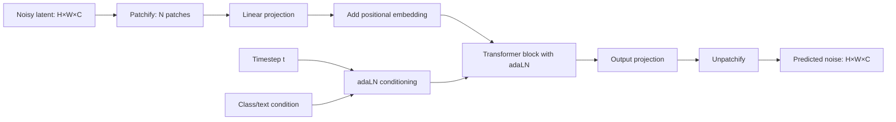

> [!info] TL;DR
> DiT (Diffusion Transformer) replaced the U-Net (the standard diffusion model backbone) with a Transformer architecture, showing that Transformers work for diffusion-based image generation. FLUX (Black Forest Labs, 2024) scaled this approach with flow matching and produced state-of-the-art text-to-image quality. Together, DiT and FLUX established that the same Transformer architecture that dominates text and vision also dominates image generation — unifying the field around a single architecture.

Diffusion Transformers (DiT) and FLUX are the text-to-image generation family that replaced the convolutional U-Net backbone with a pure Transformer and then scaled it with flow matching. This note covers the DiT architecture and its adaLN conditioning, FLUX's multimodal diffusion Transformer design, the underlying diffusion and flow-matching mathematics, the scaling laws that made the architectural shift decisive, and latent-space operation. It closes with the practical details engineers need: a worked generation example, fine-tuning techniques, the model landscape, and the interview-level distinctions people are usually expected to know. The diffusion fundamentals behind this note are covered in [[The Forward Process]] and [[The Reverse Process]], and the broader multimodal context in [[Multimodal AI Overview]].

## DiT (Peebles & Xie, 2023)

### Citation

Peebles, W., & Xie, S. (2023). *Scalable Diffusion Models with Transformers*. ICCV 2023. arXiv:2212.09748.

### The problem being solved

Diffusion models (DDPM, Stable Diffusion) used U-Net architectures — convolutional networks with skip connections between encoder and decoder layers. U-Nets worked well but had two limitations. First, they are **architecture-specific**: U-Nets are designed for dense prediction (images), not general sequence modeling, so the architectural improvements developed for Transformers (better attention, scaling laws) didn't transfer. Second, there was **scaling uncertainty**: it was unclear how U-Nets scale. Do they follow predictable scaling laws like Transformers? Can you train a 10× larger U-Net and expect proportional quality improvement?

DiT asked: what if you replace the U-Net with a Transformer? The patch-based approach from ViT makes this straightforward — treat the noisy image (during diffusion) as a sequence of patches, process with a Transformer, predict the noise.

### The architecture

DiT is a Transformer that operates on noisy image latents, and its pipeline is the ViT recipe applied to diffusion:

1. **Input**: the noisy latent (from the diffusion forward process), shape `(H, W, C)`.
2. **Patchify**: split into patches (typically 2×2 or 4×4), flatten, linearly project to `d_model`. Same as ViT.
3. **Positional embedding**: added to patch tokens.
4. **Conditioning**: the diffusion timestep and class/text conditioning are injected via adaptive layer norm (adaLN) — the conditioning vector predicts scale and shift parameters for each LayerNorm.
5. **Transformer blocks**: standard Transformer encoder layers (self-attention + MLP).
6. **Output**: linear projection back to patch shape, unpatchify to the predicted noise.



### Key design choice: adaLN conditioning

Standard LayerNorm applies fixed scale and shift. adaLN (adaptive Layer Norm) makes these parameters functions of the conditioning (timestep, class, text):

```text
adaLN(h, c) = γ(c) · LayerNorm(h) + β(c)
```

where `γ(c)` and `β(c)` are predicted from the conditioning vector `c` via an MLP. This lets the model modulate its activations based on the diffusion timestep and conditioning — essential for diffusion, where the model must behave differently at different noise levels.

### Key results

DiT-XL/2 (the largest variant) achieved SOTA on class-conditional ImageNet generation (FID 2.27), beating prior U-Net-based diffusion models. More importantly, DiT showed clean scaling laws: larger models + more compute = better quality, following predictable power laws. This was the key finding — DiT scales like a Transformer, unlike U-Nets which had unclear scaling.

### Why it worked

**Transformer scaling laws apply**. DiT demonstrated that Transformers scale for diffusion, just as they do for text and vision. This enabled principled capacity planning — you could predict how good a 10× larger model would be.

**adaLN is effective conditioning**. The adaLN mechanism provided a clean way to inject conditioning without modifying the Transformer architecture. This became the standard conditioning approach for diffusion Transformers.

**Patchification reuses ViT infrastructure**. Treating images as patches (like ViT) meant all the ViT research (positional encodings, scaling, data augmentation) transferred to DiT.

## FLUX (Black Forest Labs, 2024)

### The problem being solved

Stable Diffusion 3 and earlier text-to-image models used U-Nets or hybrid architectures. The DiT paper showed Transformers work for class-conditional generation, but it wasn't clear they would work for text-to-image (which requires complex text conditioning). FLUX demonstrated that a pure Transformer architecture, scaled up and trained with flow matching, achieves SOTA text-to-image quality.

### Architecture

FLUX is a MMDiT (Multimodal Diffusion Transformer). The noisy latent is patchified into tokens (like DiT), and the text prompt is encoded by a text encoder (T5 or CLIP) and tokenized; image and text tokens are then processed together in the same Transformer (via cross-attention or mixed self-attention). Instead of standard diffusion (predict noise), FLUX uses flow matching (predict a velocity vector field), which has better theoretical properties and trains faster. How the two token streams interact is the fusion question taken up in [[Cross-Modal Attention]], and [[CLIP]] is one of the text encoders that can supply the conditioning.

### Key results

FLUX.1 [dev] (12B parameters) achieved state-of-the-art text-to-image quality, matching or exceeding DALL-E 3, Midjourney v6, and Stable Diffusion 3. FLUX.1 [schnell] is a 4-step distilled version for fast generation.

FLUX was released as open weights, making it the strongest open-source text-to-image model as of 2024.

### Why it worked

**Scale**. FLUX is 12B parameters — much larger than typical U-Net diffusion models (~1B). The scaling laws DiT identified held: larger model = better quality.

**Flow matching**. Flow matching is a more principled training objective than standard diffusion. It converges faster and produces better samples.

**Joint multimodal processing**. Processing image and text tokens in the same Transformer (rather than separate encoders with cross-attention) allows richer interaction between modalities.

**Strong text encoder**. Using T5 (a powerful text encoder) for the text prompt gives FLUX strong text understanding, which translates to better adherence to complex prompts.

## Comparison: U-Net vs. diffusion Transformer

The contrast that motivated the whole shift, aspect by aspect:

| Aspect                | U-Net (Stable Diffusion 1/2) | DiT/FLUX             |
|-----------------------|------------------------------|----------------------|
| Architecture          | Convolutional + attention    | Pure Transformer     |
| Scaling               | Unclear                      | Power-law (predictable) |
| Conditioning          | Cross-attention              | adaLN + cross-attention |
| Text encoder          | CLIP                         | T5 + CLIP            |
| Training objective    | Diffusion (predict noise)    | Diffusion or flow matching |
| Maximum scale tested  | ~1B parameters               | 12B (FLUX)           |
| State-of-the-art      | SDXL (2023)                  | FLUX, SD3 (2024)     |

## Diffusion mathematics refresher

Standard diffusion (DDPM): given data $\mathbf{x}_0$, the forward process adds Gaussian noise over $T$ steps:

$$
q(\mathbf{x}_t | \mathbf{x}_0) = \mathcal{N}(\mathbf{x}_t; \sqrt{\bar{\alpha}_t} \mathbf{x}_0, (1 - \bar{\alpha}_t) \mathbf{I})
$$

The model learns to predict the noise $\epsilon$ that was added, allowing reverse denoising:

$$
\mathbf{x}_{t-1} = \frac{1}{\sqrt{\alpha_t}} \left( \mathbf{x}_t - \frac{1 - \alpha_t}{\sqrt{1 - \bar{\alpha}_t}} \epsilon_\theta(\mathbf{x}_t, t) \right) + \sigma_t \mathbf{z}
$$

where $\epsilon_\theta$ is the neural network (DiT in our case). Training loss:

$$
\mathcal{L} = \mathbb{E}_{t, \mathbf{x}_0, \epsilon} \left[ \| \epsilon - \epsilon_\theta(\mathbf{x}_t, t, \mathbf{c}) \|^2 \right]
$$

where $\mathbf{c}$ is the conditioning (text prompt, class).

## Flow matching vs. standard diffusion

FLUX uses **flow matching** instead of standard diffusion. The key difference: **standard diffusion** learns to predict the noise $\epsilon$ at each step, and the reverse process is iterative denoising. **Flow matching** learns a velocity field $\mathbf{v}_\theta(\mathbf{x}_t, t)$ that defines a continuous-time flow from noise to data. The ODE is:

$$
\frac{d\mathbf{x}}{dt} = \mathbf{v}_\theta(\mathbf{x}_t, t)
$$

Training: minimize $\| \mathbf{v}_\theta(\mathbf{x}_t, t) - (\mathbf{x}_1 - \mathbf{x}_0) \|^2$ where $\mathbf{x}_t = (1-t) \mathbf{x}_0 + t \mathbf{x}_1$ (linear interpolation between data $\mathbf{x}_0$ and noise $\mathbf{x}_1$).

Why flow matching is better: the training objective is simpler (no noise schedule to tune); the theoretical properties are better (an optimal transport interpretation); fewer steps are needed for sampling (FLUX-schnell does 4 steps vs. 20-50 for standard diffusion); and training is more stable at scale. Most 2024+ diffusion models (FLUX, SD3, Stable Cascade) use flow matching or variants.

## adaLN-Zero initialization

A critical detail in DiT: the adaLN layers use **zero initialization**. The MLP that predicts $\gamma$ and $\beta$ from the conditioning is initialized so that the initial output is exactly 0. This means at initialization, every DiT block is the identity function; the model starts as a simple linear projection (patch embed → unpatch); gradient flows cleanly through the residual connections; and training is more stable than random initialization.

This trick is essential for stable DiT training at scale. Without it, early training is unstable and quality suffers.

## Scaling laws for DiT

DiT demonstrated clean scaling laws. The relationship between compute $C$ (FLOPs) and validation loss $L$ is approximately:

$$
L(C) = a C^{-b} + L_\infty
$$

where $a$, $b$, and $L_\infty$ are fitted constants. For DiT on ImageNet, $b \approx 0.3$ — meaning 10× more compute gives ~50% loss reduction.

This predictability is the key finding. It means you can predict how good a 10× larger DiT will be without training it; compute-optimal training (when to stop) is well-defined; and architecture comparisons are easier — train at small scale, predict at large scale.

These scaling laws generalize to text-to-image (FLUX) and video (Sora). The unified Transformer scaling law (text, vision, image generation, video) is one of the most important empirical findings of 2023-2026.

## Latent diffusion: why DiT operates on latents, not pixels

FLUX and SD3 operate on **latent** representations, not raw pixels. The pipeline runs in three steps: a VAE encoder compresses the 512×512×3 image into a 64×64×4 latent (compression: 48×); DiT operates on the latent, processing 64×64 = 4096 latent tokens with the Transformer; and a VAE decoder decompresses the 64×64×4 latent back into the 512×512×3 image.

Why latents? **Efficiency**: 4096 tokens vs. 196K pixels (48× reduction). **Quality**: the VAE learns a semantically meaningful latent space; diffusion in this space is more efficient. **Memory**: 4 channels vs. 3 channels (with spatial compression, net memory reduction).

This is the **latent diffusion** innovation (Rombach et al. 2022, Stable Diffusion). DiT applies it to Transformers; FLUX scales it up. The framework itself is covered in [[Score-Based and Latent Diffusion]].

## Worked example: generating an image with FLUX

```python
import torch
from diffusers import FluxPipeline

pipe = FluxPipeline.from_pretrained(
    "black-forest-labs/FLUX.1-dev",
    torch_dtype=torch.bfloat16,
    device_map="auto",
)

prompt = "A serene mountain landscape at sunset, with a lake in the foreground reflecting the orange and pink sky. The mountains are snow-capped. High detail, photorealistic."

image = pipe(
    prompt,
    num_inference_steps=28,  # standard for FLUX-dev
    guidance_scale=3.5,      # FLUX-specific; lower than SD
    height=1024,
    width=1024,
    generator=torch.Generator("cuda").manual_seed(42),
).images[0]

image.save("mountain_sunset.png")
```

Notable FLUX-specific settings: `guidance_scale=3.5` — FLUX uses lower guidance than SD (which typically uses 7-10); higher values burn out details. `num_inference_steps=28` — FLUX-dev converges in 20-30 steps (vs. 30-50 for SD). For FLUX-schnell (4-step distilled): `num_inference_steps=4`, `guidance_scale=0`.

## Fine-tuning diffusion transformers

The common fine-tuning techniques for DiT/FLUX, and what each costs:

| Technique                | What It Does                              | Compute Needed |
|--------------------------|-------------------------------------------|----------------|
| LoRA fine-tune           | Add low-rank adapters to DiT layers       | 1-8 GPUs, hours |
| Textual Inversion        | Learn a new token for a concept           | 1 GPU, minutes |
| DreamBooth               | Fine-tune on a few images of a subject    | 1-8 GPUs, hours |
| ControlNet               | Add conditioning (pose, depth, edges)     | 8+ GPUs, days  |
| Full fine-tune           | Update all DiT weights                    | 32+ GPUs, days |

LoRA is the most popular — it lets you add a style or subject to FLUX with 5-20 reference images in a few hours on a single H100. The LoRA adapter is ~100MB and can be shared/loaded independently of the base model. The mechanics of low-rank adaptation are covered in [[13 - Training and Adaptation/Fine-Tuning/LoRA|LoRA]].

## Comparison of image generation models (2026)

The broader landscape, with architectures, parameter counts, and openness:

| Model              | Year | Architecture       | Params | Open? | Strengths                              |
|--------------------|------|--------------------|--------|-------|----------------------------------------|
| Stable Diffusion 1.5 | 2022 | U-Net + CLIP       | 870M   | Yes   | First major open model; huge ecosystem |
| SDXL               | 2023 | U-Net + dual CLIP  | 3.5B   | Yes   | Better quality than SD1.5              |
| Stable Diffusion 3 | 2024 | MMDiT              | 2-8B   | Yes   | Better text rendering, DiT-based       |
| FLUX.1-dev         | 2024 | MMDiT + flow match | 12B    | Yes   | SOTA open text-to-image                |
| FLUX.1-schnell     | 2024 | Distilled FLUX     | 12B    | Yes   | 4-step fast generation                 |
| DALL-E 3            | 2023 | Unknown (closed)   | Unknown| No    | Strong prompt adherence via GPT rewrite|
| Midjourney v6       | 2024 | Unknown (closed)   | Unknown| No    | Best aesthetic quality                 |
| Imagen 3            | 2024 | Unknown (closed)   | Unknown| No    | Strong text understanding              |

For most open-source users in 2026, FLUX-dev is the default. Midjourney leads on aesthetics; DALL-E 3 leads on prompt adherence; FLUX leads on overall open-source quality.

## Impact and legacy

DiT and FLUX established Transformers as the default architecture for diffusion-based image generation. Stable Diffusion 3 uses an MMDiT architecture, directly influenced by DiT. Sora (OpenAI's video generation model) uses a DiT-based architecture, scaled to video. FLUX is the leading open-source text-to-image model, used in production by many applications. And the unification runs deeper than image generation: the same Transformer architecture now dominates text (GPT, Llama), vision (ViT), and image generation (DiT, FLUX), which simplifies research and infrastructure.

For AI engineers, DiT/FLUX matters if you're working with image generation. Understanding the architecture clarifies how text-to-image models work, why they scale, and how to fine-tune or modify them. The shift from U-Net to Transformer also means that techniques developed for text Transformers — [[08 - Attention and Transformers/Efficient Attention/FlashAttention|FlashAttention]], quantization, efficient inference — apply to image generation, with INT8/FP8 [[Quantization]] for FLUX inference as the standard example. Attention is not the only possible backbone, though: state-space models such as Mamba have been explored as an alternative to attention for diffusion.

## Interview questions

**What is adaLN, and why is it needed for diffusion Transformers?** adaLN (adaptive Layer Norm) makes the LayerNorm's scale and shift parameters functions of the conditioning (timestep, class, text). It is needed because diffusion models must behave differently at different noise levels — early denoising steps focus on global structure, late steps on detail. adaLN lets the model modulate its activations based on the timestep, which cross-attention alone can't do efficiently.

**Why does DiT scale better than U-Net for diffusion?** Three reasons. (1) Transformers have well-understood scaling laws (predictable improvement with more compute); U-Nets had unclear scaling. (2) DiT reuses ViT infrastructure (patchify, positional embeddings, attention mechanisms); improvements in vision Transformers transfer directly. (3) DiT's architecture is uniform (all Transformer blocks), making it easier to optimize for hardware (FlashAttention, tensor parallelism). U-Net's heterogeneous structure (encoder, decoder, skip connections) is harder to optimize.

**What is flow matching, and why does FLUX use it instead of standard diffusion?** Flow matching learns a velocity field that defines a continuous-time ODE from noise to data, instead of predicting noise at discrete timesteps. It is better because (1) the training objective is simpler, (2) the theoretical properties are better (optimal transport), (3) fewer sampling steps are needed (4 steps for FLUX-schnell vs. 20-50 for standard diffusion), and (4) training is more stable at scale. Most 2024+ diffusion models use flow matching.

**Why does FLUX operate on latents, not pixels?** Latent diffusion (Rombach 2022) compresses images via a VAE before diffusion: a 512×512×3 image becomes a 64×64×4 latent (48× compression). The benefits are (1) efficiency (4096 tokens vs. 196K pixels), (2) quality (the VAE learns a semantically meaningful space), and (3) memory (4 channels vs. 3 + spatial compression). All modern diffusion models (SD, FLUX, SD3) use latent diffusion.

**How would you fine-tune FLUX to generate images in a specific style?** LoRA fine-tuning. Collect 10-50 high-quality images in the target style and caption each image. Train LoRA adapters (rank 16-64) on FLUX's attention layers for 1000-5000 steps with the images and captions. The resulting LoRA (~100MB) can be loaded on top of FLUX at inference time: `pipe.load_lora_weights("my-style-lora")`. This gives you FLUX-quality images in your style without retraining the 12B base model.

**What's the significance of DiT's clean scaling laws?** They show that diffusion models, like text Transformers, scale predictably with compute. This enables principled capacity planning (predict how good a 10× larger model will be without training it), architecture comparison (train at small scale, predict at large scale), and unified understanding (the same scaling laws apply to text, vision, image generation, video). The unified Transformer scaling law is one of the most important empirical findings of 2023-2026.

## Further reading

The original DiT paper is arXiv:2212.09748. FLUX weights and documentation live at blackforestlabs.ai, with model weights on HuggingFace. Stable Diffusion 3 is arXiv:2403.03206, and the Flow Matching paper is arXiv:2210.02747.

## See also

- [[Foundation Models and Multimodal MOC]] — orientation for this area.
- [[Multimodal AI Overview]] — the broader multimodal context.
- [[CLIP]] — provides text conditioning for FLUX.
- [[Cross-Modal Attention]] — how text conditioning reaches the image stream.
- [[Score-Based and Latent Diffusion]] — the latent diffusion framework DiT builds on.
- [[The Forward Process]] and [[The Reverse Process]] — the diffusion mathematics in full.
- [[ViT Architecture]] — DiT's patchify is borrowed from ViT.
- [[13 - Training and Adaptation/Fine-Tuning/LoRA|LoRA]] — the standard fine-tuning technique for DiT/FLUX.
- [[Quantization]] — INT8/FP8 quantization for FLUX inference.
- [[Multimodal Foundation Models]] and [[LLaVA]] — the understanding side of multimodal models.
- [[Vision Foundation Models]] — the vision encoder landscape.
