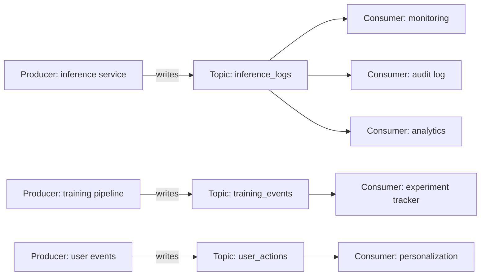
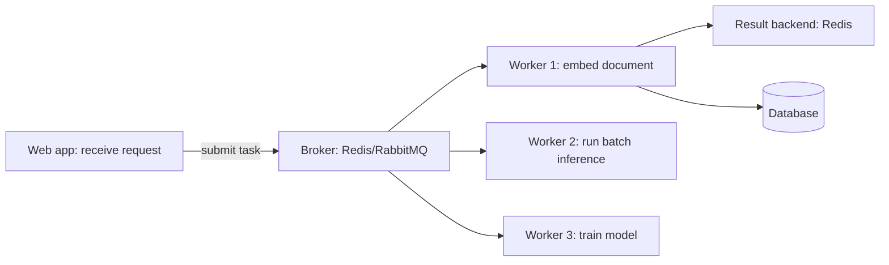
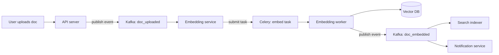

AI workloads are long-running and bursty, and synchronous request/response breaks down the moment embedding a corpus, training a model, or running a batch evaluation enters the picture. Production systems therefore lean on two distinct messaging patterns: event streams (Kafka) for moving high volumes of durable events between services, and task queues (Celery and its relatives) for distributing discrete units of work to workers. This note covers both patterns — their architectures, AI-specific use cases, production considerations, and worker sizing — plus how the two combine, the failure modes of using each tool for the other's job, and the surrounding tooling; see [[Inference and Production MOC]] for the area overview.

> [!info] TL;DR
> Production AI systems need async messaging for two distinct workloads: **event streams** (Kafka — high-throughput, durable, multi-consumer) and **task queues** (Celery/RabbitMQ/SQS — point-to-point work distribution, retry semantics). Kafka is for moving large volumes of events between services; Celery is for distributing discrete units of work to workers. Most AI platforms need both.

## Why messaging matters for AI

AI workloads are often long-running and bursty. Embedding a corpus of 1M documents takes hours; you don't want to do it synchronously. Training a model takes days, so you need to queue jobs and distribute across GPUs. Inference requests can take 10+ seconds, so you need streaming or async patterns. Batch evaluation runs need to be triggered, monitored, and retried. Synchronous request/response works for interactive queries but breaks down for all of these.

Messaging systems decouple producers from consumers, which buys five things at once: **async processing** (the producer doesn't wait for the consumer), **work distribution** (multiple consumers process work in parallel), **retry semantics** (failed messages are retried automatically), **decoupling** (producer and consumer can be deployed independently), and **buffering** (the consumer processes at its own pace while the producer doesn't block).

## Two distinct patterns

### Event streams (Kafka)

The event-stream pattern has many producers writing events to a topic while many consumers read independently. Its semantics are durable, ordered within a partition, and replayable. Typical use cases are audit logs, click streams, model inference logs, and training data pipelines. The tool is Apache Kafka, or managed equivalents such as AWS MSK, Confluent Cloud, and Upstash.

### Task queues (Celery, RabbitMQ, SQS)

The task-queue pattern has a producer submit a task to a queue and one consumer pick it up and process it. Its semantics are at-least-once delivery, retry on failure, and a dead-letter queue for poison messages. Typical use cases are embedding generation, batch inference, model training, and email sending. Tools: Celery (Python over RabbitMQ/Redis), AWS SQS, Google Cloud Tasks, and RabbitMQ directly.

The two patterns overlap but are not interchangeable. Kafka can do task-queue semantics with consumer groups, but it's awkward. Celery can do event-stream semantics by publishing to a topic, but it's not designed for it. Most production systems use both.

## Kafka for AI workloads

### Architecture



Kafka topics are partitioned. Each partition is an ordered, append-only log. Consumers in a consumer group split partitions among themselves for parallel processing.

### Common AI use cases

**Inference logging**: every LLM call produces a log entry (prompt, response, model, tokens, cost, latency). Producers are inference services; consumers are monitoring, audit, and analytics systems. Kafka handles the volume (millions of entries per day) and lets multiple consumers read independently.

**Training data pipelines**: raw data (web crawls, user interactions) flows through Kafka topics. Consumers clean, filter, deduplicate, and write to training data stores, building the curated training set. Kafka's durability lets you replay the pipeline if you change the cleaning logic — the property that makes event-sourced data pipelines safe to iterate on.

**Model event streams**: every model training run emits events (started, checkpoint saved, eval results, completed). Downstream systems — experiment trackers, dashboards, alerting — consume these events.

**RAG ingestion**: documents to be indexed flow through Kafka. Consumers chunk, embed, and write to the vector DB. If the vector DB needs rebuilding (e.g., an embedding model change), replay the topic.

### Production considerations

**Partitioning**: choose a partition key that distributes evenly (e.g., `user_id`, `document_id`). Hot partitions cause skew. **Retention**: configure based on use case — audit logs 7+ days, training data indefinite (until consumed), inference logs 24–48 hours. **Consumer groups**: each consumer group has its own offset, so multiple consumer groups can read the same topic independently. **Exactly-once vs. at-least-once**: Kafka supports exactly-once semantics with idempotent producers and transactions, but most use cases work fine with at-least-once. **Schema management**: use a schema registry (Confluent Schema Registry, Apicurio) to enforce Avro/Protobuf schemas — without it, producers and consumers drift.

### Managed versus self-hosted

Managed options (AWS MSK, Confluent Cloud, Upstash, Aiven) offer zero ops and automatic scaling, but get expensive at high throughput. Self-hosted Kafka is cheaper and gives full control, but requires Kafka expertise to operate — it is not recommended for teams without dedicated infrastructure engineers.

## Celery for AI workloads

### Architecture



Celery is a Python task queue. Producers submit tasks (function calls) to a broker (Redis or RabbitMQ). Workers pick up tasks, execute them, and store results in a result backend.

### Common AI use cases

**Embedding generation**: when a document is uploaded, submit a Celery task to embed it. The web request returns immediately; the embedding is stored when the task completes. **Batch inference**: submit a task per inference request. Workers process in parallel; results are stored as they complete. **Model training**: submit a long-running training task. Workers report progress via task state; the web app can poll or subscribe to updates. **Scheduled jobs**: Celery Beat schedules periodic tasks (e.g., "every night at 2am, re-embed documents updated in the last 24 hours").

### Production considerations

**Broker choice**: Redis is fast but has limited durability; RabbitMQ is more durable with better retry semantics. For AI workloads — which can be expensive to redo — prefer RabbitMQ. **Worker concurrency**: Celery workers can use prefork (process-based), eventlet (green threads), or gevent. For CPU-bound AI workloads, prefork is the right choice — one process per core. **Task timeouts**: always set them; a hung task without a timeout blocks a worker indefinitely. **Retries**: configure max retries and exponential backoff; tasks that fail repeatedly should go to a dead-letter queue. **Idempotency**: Celery delivers at-least-once, so if a task is retried (because the worker crashed), it runs twice — design tasks to be idempotent. **Result backend**: for long-running tasks, results may expire before they're read. Use a durable backend (database) for important results; Redis for ephemeral ones.

### Worker sizing for AI

AI workloads have unusual resource profiles. Embedding workers are CPU-bound with ~1GB RAM and fast (milliseconds per task) — run many per machine. CPU inference workers are CPU-bound with ~4GB RAM and moderate latency (seconds) — run a few per machine. GPU inference workers are GPU-bound with ~16GB RAM + 1 GPU — one per GPU. Training workers are GPU-bound with ~64GB RAM + multiple GPUs — one per node.

Celery's worker classes route tasks to appropriately-sized workers via queues:

```python
@celery.task(queue='embedding')
def embed_document(doc_id): ...

@celery.task(queue='gpu_inference')
def run_inference(model_id, input_data): ...

@celery.task(queue='training')
def train_model(config): ...

# Run workers per queue:
# celery -A app worker -Q embedding --concurrency=8
# celery -A app worker -Q gpu_inference --concurrency=1
```

The pattern separates the fast, cheap queues (high concurrency on CPU machines) from the expensive GPU queues (concurrency 1, one worker per device) — see [[GPU Infrastructure and Sizing]] for the hardware these workers occupy.

## Combining Kafka and Celery

Most production AI systems use both: **Kafka** for event streams (logs, audit, analytics) and **Celery** for task queues (embedding, inference, training). A typical pattern is an event in Kafka triggering a Celery task. For example, a "document uploaded" event in Kafka is consumed by a service that submits a Celery task to embed the document; the task result is published back to Kafka as a "document embedded" event.



This architecture gives you four properties at once. **Decoupling**: each service can be deployed and scaled independently. **Replayability**: if the embedding model changes, replay the Kafka topic to re-embed everything. **Observability**: every event is logged, so you can trace the full pipeline. **Scalability**: add more workers, more partitions, more consumers as needed.

## Common pitfalls

**Using Kafka as a task queue.** Kafka can do task-queue semantics, but it's awkward: tasks have complex retry, timeout, and dead-letter requirements that Kafka doesn't natively support. Use Celery or SQS for task queues.

**Using Celery for event streams.** Celery can publish events, but it's not designed for high-throughput, multi-consumer streaming. Use Kafka for event streams.

**No dead-letter queue.** Tasks that fail repeatedly block workers and never complete. Always configure a dead-letter queue for poison messages.

**No idempotency.** A retried task runs twice. If it has side effects (e.g., creates a database row), you get duplicates. Design tasks to be idempotent — use deterministic IDs, check before writing.

**No task timeouts.** A hung task blocks a worker forever. Always set timeouts.

**Synchronous calls in workers.** A Celery worker that calls another service synchronously (e.g., an LLM API) blocks the worker for the duration. Use async patterns or increase concurrency.

**No backpressure.** Producers submit tasks faster than workers can process them; the queue grows unboundedly, eventually OOMing. Use rate limiting or backpressure signals.

## Tooling and alternatives

### Kafka ecosystem

**Confluent Platform** is the commercial Kafka distribution with management tools. **AWS MSK** is managed Kafka on AWS. **Strimzi** runs Kafka on Kubernetes. A **Schema Registry** enforces Avro/Protobuf schemas. **Kafka UI** (various open-source projects) provides a web UI for browsing topics.

### Celery ecosystem

**Flower** gives real-time Celery monitoring. **Celery Beat** is the scheduler for periodic tasks. **Django-Q2 / RQ** are alternatives with simpler APIs, though less feature-rich than Celery.

### Alternatives

**AWS SQS + Lambda** is a serverless task queue with no workers to manage. **Google Cloud Tasks** is similar to SQS. **Temporal** is a workflow engine for complex, long-running processes — more powerful than Celery for multi-step workflows. **Dramatiq** is a Python task queue, an alternative to Celery with a simpler API.

## See also

- [[Inference and Production MOC]] — orientation for the area
- [[Production AI Stack]] — where Kafka and Celery sit in the end-to-end stack
- [[GPU Infrastructure and Sizing]] — the hardware behind GPU and training workers
- [[Observability Stack]] — tracing and logging the events that flow through these pipelines
- [[Vector Storage with pgvector]] — where RAG ingestion lands
- [[Embedding Models for Retrieval]] — the models the embedding workers run
- [[Failure Modes and Graceful Degradation]] — what happens when queues back up or workers die
- [[Cost Optimization]], [[Production Monitoring]], [[Reference Production Architectures]] — the operational context
- [[LLMOps vs MLOps]] — where messaging fits the operational discipline
