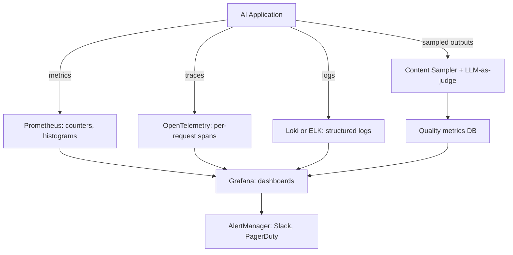

Classical observability rests on three pillars — metrics, logs, and traces — and AI workloads add a fourth: content sampling, the capture and evaluation of actual LLM inputs and outputs. The reference stack combines Prometheus (metrics), OpenTelemetry (traces), Loki or ELK (logs), and a content-sampling pipeline that runs LLM-as-judge on 1–5% of traffic; without content sampling you cannot detect quality regressions in production. This note walks through each pillar — its signals, tooling, and retention — then assembles them into dashboards and alerting practice, and closes with the pitfalls that sink AI deployments; [[Inference and Production MOC]] orients the wider area.

> [!info] TL;DR
> AI observability extends classical three-pillar observability (metrics, logs, traces) with **content sampling** — capturing actual LLM inputs and outputs for quality monitoring. The reference stack combines Prometheus (metrics), OpenTelemetry (traces), Loki/ELK (logs), and a content sampling pipeline that runs LLM-as-judge on 1–5% of traffic. Without content sampling, you cannot detect quality regressions in production.

## The three pillars plus one

Classical observability has three pillars: metrics, logs, traces. AI workloads add a fourth: content sampling.



The first three pillars are inherited from web/SRE observability. The fourth — content sampling — is unique to AI and exists because LLM outputs are open-ended, and metrics alone cannot tell you if quality has degraded.

## Pillar one: metrics

Metrics are numerical measurements aggregated over time. They are cheap to collect, store, and query — use them for dashboards and alerting.

### Key metrics for AI systems

The metric families worth instrumenting, with the conventional names:

| Family | Metric | Type and labels | What it captures |
|---|---|---|---|
| Latency | `llm_request_duration_seconds` | histogram | end-to-end request latency |
| Latency | `llm_time_to_first_token_seconds` | histogram | TTFT |
| Latency | `llm_tokens_per_second` | histogram | generation speed |
| Latency | `tool_call_duration_seconds` | histogram | per-tool latency |
| Volume | `llm_requests_total` | counter, model/tenant labels | request count |
| Volume | `llm_tokens_total` | counter, direction input/output | token volume |
| Volume | `llm_tool_calls_total` | counter, tool name | tool invocation count |
| Errors | `llm_errors_total` | counter, error_type | error count |
| Errors | `llm_refusals_total` | counter | model refusal count |
| Errors | `llm_timeouts_total` | counter | timeout count |
| Cost | `llm_cost_usd_total` | counter, model/tenant | cumulative cost |
| Cost | `llm_cost_per_request_usd` | histogram | per-request cost distribution |
| Quality | `llm_quality_score` | gauge, by model/feature | LLM-as-judge score |
| Quality | `llm_faithfulness_score` | gauge | RAG faithfulness |
| Quality | `llm_toxicity_score` | gauge | toxicity classifier output |
| Resources | `gpu_utilization_percent` | gauge, by GPU | GPU compute utilization |
| Resources | `gpu_memory_used_bytes` | gauge | GPU memory usage |
| Resources | `kv_cache_hit_rate` | gauge | cache effectiveness |

The quality family comes from content sampling (below); the resource family connects to the GPU fleet discussed in [[GPU Infrastructure and Sizing]] and to the KV cache mechanics behind `kv_cache_hit_rate`.

### Metrics tools

**Prometheus** is the open-source metrics database and the industry standard. **Datadog** is the commercial all-in-one, popular with enterprises. The cloud providers each ship their own metrics (AWS CloudWatch, GCP Cloud Monitoring, Azure Monitor). **Grafana** does the dashboarding and works with all of the above.

### Metrics best practices

Use histograms — not just averages — for latency: p50, p95, and p99 tell different stories. Label metrics with tenant, model, feature, and error_type; high-cardinality labels like `user_id` are problematic, so use them sparingly. Set retention based on need: 15 days for routine metrics, 13 months for compliance.

## Pillar two: logs

Logs are timestamped text records. Use them for debugging individual requests and for auditing.

### Structured logging

Always log in structured format (JSON), not free-form text:

```json
{
  "timestamp": "2026-08-07T12:34:56.789Z",
  "level": "info",
  "trace_id": "abc123",
  "tenant_id": "acme",
  "user_id": "user_42",
  "event": "llm_request",
  "model": "gpt-4o-2024-08-06",
  "prompt_tokens": 1234,
  "completion_tokens": 567,
  "latency_ms": 2340,
  "cost_usd": 0.0234
}
```

Structured logs are queryable ("show me all requests from tenant X with latency > 5s"). Free-form text is not — that one query is the entire argument for JSON logging.

### Log levels

**ERROR** means something failed and needs investigation. **WARN** means something unusual but handled that may indicate a problem. **INFO** covers normal operations and is useful for audit and debugging. **DEBUG** is detailed diagnostic info, off in production.

### What to log — and what not to

On the "log it" side: every LLM request (prompt summary, response summary, model, tokens, cost, latency); every tool call (tool name, arguments summary, result summary, latency); every error (with stack trace and context); every state transition (agent moved from state A to state B); and every policy decision (allowed/denied, reason).

> [!warning]
> On the "don't log it" side: full prompts and responses (privacy, PII — log summaries or hashes instead); full tool arguments (may contain PII — log types and sizes); secrets (API keys, passwords — never); and user data not relevant to the operation.

### Log tools

**Loki** is open-source log aggregation that integrates with Grafana. The **ELK Stack** (Elasticsearch, Logstash, Kibana) is full-featured but expensive at scale. **Datadog Logs** is commercial and integrated with metrics. The cloud providers offer AWS CloudWatch Logs, GCP Cloud Logging, and Azure Monitor Logs. **Splunk** is enterprise log management — expensive but feature-rich.

### Log retention

Plan for 7–30 days of routine logs and 1–7 years of audit logs (a compliance requirement). Archive old logs to cold storage (S3 Glacier) to reduce costs.

## Pillar three: traces

Traces show the full execution path of a request across services. Each request has a trace ID; each component adds spans to the trace.

### Why traces matter for AI

An AI request might invoke: the API gateway (auth, rate limit); the orchestrator (agent graph traversal); Agent A (LLM call); a retrieval system (vector search); Agent B (LLM call, with retrieved context); a tool (database query); and Agent A again (final response synthesis). Without traces, debugging a slow request is a nightmare — with traces, you can see exactly which span took the most time.

### Span structure

Each span carries a Trace ID (shared across all spans in a request), a Span ID (unique per span), a Parent span ID (for nesting), an operation name ("llm_request", "tool_call", "vector_search"), start and end times, attributes (model, tokens, cost, etc.), and events (errors, log messages).

### OpenTelemetry

OpenTelemetry is the standard for distributed tracing. It is vendor-neutral: instrument once, export to any backend (Jaeger, Zipkin, Datadog, Honeycomb, Tempo).

```python
from opentelemetry import trace

tracer = trace.get_tracer(__name__)

def handle_request(request):
    with tracer.start_as_current_span("llm_request") as span:
        span.set_attribute("model", "gpt-4o")
        span.set_attribute("prompt_tokens", len(prompt))
        response = llm.chat(messages=...)
        span.set_attribute("completion_tokens", len(response))
        span.set_attribute("cost_usd", calculate_cost(response))
        return response
```

### Trace tools

**OpenTelemetry** is the instrumentation standard. **Jaeger** is open-source trace storage and UI. **Tempo** is Grafana's trace backend. **Datadog APM** is commercial and integrated with metrics and logs. **Honeycomb** is commercial and optimized for high-cardinality queries. **LangSmith** does LLM-specific tracing and includes content capture.

### Trace sampling

Traces are expensive to store (kilobytes per request), so sample them. **Head sampling** samples at the entry point (e.g., 10% of requests) — simple, but it cannot sample based on later events. **Tail sampling** samples based on the full trace (e.g., keep all error traces, sample 1% of success traces) — more flexible, but it requires buffering. For AI systems, tail sampling is valuable: keep all error traces, all high-latency traces, all high-cost traces, and a small sample of normal traces.

## Pillar four: content sampling

The AI-specific pillar. Capture actual LLM inputs and outputs, run quality evaluators, store quality scores.

### Why content sampling is necessary

Metrics tell you *that* something happened (latency, cost, error rate). They don't tell you *what* the model said. A model can have perfect metrics — fast, cheap, no errors — while producing low-quality or hallucinated outputs. Content sampling closes this gap by capturing a sample of inputs and outputs, running LLM-as-judge (or other evaluators) on the sample, storing quality scores as metrics, and alerting on quality regression.

### Implementation

```python
import random

def maybe_sample(request, response):
    if random.random() < 0.01:  # 1% sample
        quality_score = llm_as_judge(request, response)
        prom_quality_score.set(quality_score, labels={
            "model": request.model,
            "feature": request.feature,
        })
        # Also store the actual content for offline analysis
        content_store.save({
            "request": request,
            "response": response,
            "quality_score": quality_score,
            "timestamp": now(),
        })
```

### Sampling strategies

**Uniform** sampling takes N% of all requests — simple and unbiased. **Stratified** sampling takes more from rare categories (e.g., sample all errors, 10% of edge cases, 1% of normal). **Active** sampling keys on uncertainty (e.g., sample requests where the model's confidence was low). **New-feature** sampling takes 100% of new features during canary, dropping to 1% after promotion — which pairs naturally with [[A-B Testing and Shadow Deployment]].

### Content storage

Three constraints shape where sampled content lives. **PII risk**: captured content may contain user PII — scrub before storage and restrict access. **Cost**: content is large (kilobytes per sample), so use a cost-effective store (S3, BigQuery). **Retention**: 30–90 days for routine samples, longer for audit.

### Quality evaluators

**LLM-as-judge**: a GPT-4-class model scores the output (see [[LLM-as-Judge Evaluation]]). **Toxicity classifier**: a smaller, faster model checks for hate speech, PII, etc. **Faithfulness checker**: for RAG, verifies claims are grounded in retrieved documents. **Custom evaluators**: domain-specific checks (e.g., "does this response mention the return policy?").

## Putting it together: the dashboard

A production AI dashboard shows six panels: **latency** (p50, p95, p99 over time, by model and feature), **volume** (requests per second, tokens per second), **errors** (error rate, error types, recent error traces), **cost** (cumulative spend, spend per tenant, spend per feature), **quality** (LLM-as-judge score over time, faithfulness, toxicity), and **resources** (GPU utilization, KV cache hit rate, queue depth).

Each panel should link to traces and logs for debugging. A latency spike should be one click away from "show me the slow traces" → "show me the log for this trace."

## Alerting

### Alert on symptoms, not causes

"p99 latency > 5s for 5 minutes" is a symptom worth alerting on. "GPU utilization > 80%" is a cause, not a symptom — it may be perfectly normal. The distinction determines whether an alert is actionable.

### Multi-level alerts

**Warning** means investigate soon (Slack notification). **Critical** pages on-call (PagerDuty). **Emergency** triggers automatic mitigation (failover, rate limit).

### Alert runbooks

Every alert should link to a runbook covering what the alert means, how to investigate, common causes, mitigation steps, and when to escalate.

### Alert fatigue

Bad alerts cause fatigue, which causes real alerts to be ignored. Review alert history monthly and silence or fix noisy alerts; target a <5% false positive rate.

## Common pitfalls

**No content sampling** is the most common gap: metrics, logs, and traces are set up, but content sampling is missing, and quality regressions go undetected until users complain. **No distributed tracing** makes debugging multi-agent or multi-service requests nearly impossible — each component logs in isolation with no way to correlate. **Free-form logs** cannot be queried effectively; always use structured (JSON) logs. **Logging PII** in prompt and response logs is a compliance violation — scrub before logging and restrict access. **No alert runbooks** means alerts fire but no one knows what to do; document every alert. **Too many alerts** — alerting on every metric and every threshold — trains people to ignore them; tune to focus on actionable alerts. **No trace sampling** means storing 100% of traces at full cost; use tail sampling to keep the interesting traces (errors, slow requests) and sample the rest.

## See also

- [[Inference and Production MOC]] — orientation for the area
- [[Production Monitoring]] — the practice built on this stack
- [[LLM-as-Judge Evaluation]] — the evaluator behind quality scores
- [[Production AI Stack]] — the services being observed
- [[GPU Infrastructure and Sizing]] — the resource metrics' subject
- [[Messaging with Kafka and Celery]] — the event streams feeding logs and audit
- [[Cost Optimization]] — acting on the cost panels
- [[Failure Modes and Graceful Degradation]] — what alerts should catch
- [[Vector Storage with pgvector]] and [[LLMOps vs MLOps]] — the wider production context
- [[KV Cache Mechanics]] — the cache behind `kv_cache_hit_rate`
