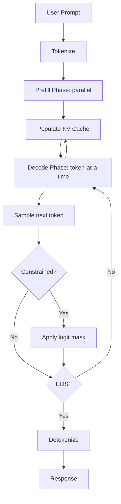
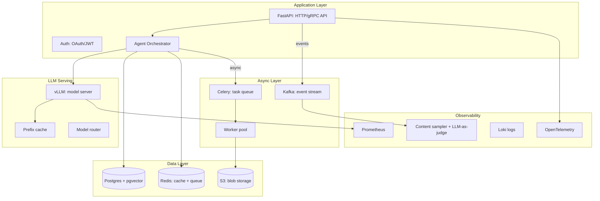
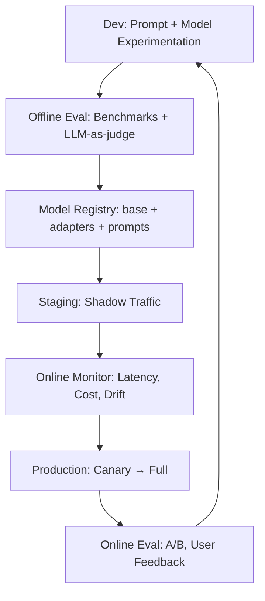
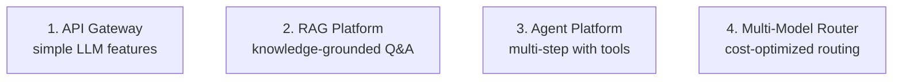

This area covers everything between a trained model and a running product: how large language models are served at low cost and low latency, what infrastructure surrounds them, how they are operated day to day, and how the resulting system is architected for reliability and security. It spans four sub-families — Inference, AI Infrastructure, LLMOps and MLOps, and Production AI — that together follow a request from the moment it enters a serving engine to the moment its quality, cost, and safety sit under continuous monitoring. The reading order below covers all 26 notes of the area, and the sub-family sections then explain what each family contributes and why.

> [!info] Scope
> Running LLMs in production, end to end. **Inference** covers the scheduling, memory, and decoding techniques behind all modern serving engines. **AI Infrastructure** covers the infrastructure required to deploy production AI systems: storage (Postgres + pgvector), messaging (Kafka + Celery), compute (GPU sizing), and observability (metrics + logs + traces + content sampling). **LLMOps and MLOps** covers MLOps adapted for LLMs, with the new challenges of prompt management, model versioning (base + adapter), LLM-as-judge evaluation, hallucination monitoring, token-cost tracking, and prompt-injection defense. **Production AI** covers running AI in production: architectures, reliability, security, scaling, and patterns.

## Reading order

The order moves from the inside out: first the techniques that make a single serving engine fast and cheap, then the infrastructure those engines run on, then the operational discipline that keeps the service healthy, and finally the architecture, reliability, and security patterns that hold the whole product together. The table covers all 26 notes of this area — this map plus the 25 content notes — and opens with the one prerequisite that lives in the neighboring LLM area.

| # | Note | Sub-family | Sub-domain | Purpose |
|---|------|------------|------------|---------|
| 00 | [[Inference and Production MOC\|This note]] | Orientation | — | The area map; start here. |
| 01 | [[KV Cache Mechanics]] | Prerequisite | KV Cache | The foundation. |
| 02 | [[PagedAttention]] | Inference | KV Cache | vLLM's memory management breakthrough. |
| 03 | [[Quantization]] | Inference | Quantization | INT8/INT4/FP8/GPTQ/AWQ/GGUF. |
| 04 | [[14 - Inference and Production/Inference/vLLM\|vLLM]] | Inference | Serving | The dominant serving engine. |
| 05 | [[Speculative Decoding]] | Inference | Speculative Decode | 2-3x speedup via draft model. |
| 06 | [[Continuous Batching]] | Inference | Serving | Iteration-level batching algorithm. |
| 07 | [[Constrained Decoding]] | Inference | Decoding | JSON/regex/grammar-constrained output. |
| 08 | [[14 - Inference and Production/Inference/TensorRT-LLM\|TensorRT-LLM]] | Inference | Serving | NVIDIA-optimized serving engine. |
| 09 | [[Production AI Stack]] | AI Infrastructure | Serving | The end-to-end production stack overview. |
| 10 | [[Vector Storage with pgvector]] | AI Infrastructure | Storage | pgvector setup, indexing, hybrid search. |
| 11 | [[Messaging with Kafka and Celery]] | AI Infrastructure | Messaging | Event streams + task queues. |
| 12 | [[GPU Infrastructure and Sizing]] | AI Infrastructure | Compute | GPU types, sizing, deployment models. |
| 13 | [[Observability Stack]] | AI Infrastructure | Observability | Metrics, logs, traces, content sampling. |
| 14 | [[LLMOps vs MLOps]] | LLMOps and MLOps | Pipelines | What's different about LLM ops. |
| 15 | [[Prompt Management]] | LLMOps and MLOps | Pipelines | Versioning, A/B testing prompts. |
| 16 | [[Model Registry and Versioning]] | LLMOps and MLOps | Pipelines | Base + adapter versioning as a deployment unit. |
| 17 | [[LLM-as-Judge Evaluation]] | LLMOps and MLOps | Evaluation | Using LLMs to evaluate LLMs. |
| 18 | [[Production Monitoring]] | LLMOps and MLOps | Monitoring | Latency, cost, drift, hallucination. |
| 19 | [[Cost Optimization]] | LLMOps and MLOps | Cost | Token economics, model routing, caching. |
| 20 | [[A-B Testing and Shadow Deployment]] | LLMOps and MLOps | Deployment | Safe rollout of new models. |
| 21 | [[LLM Security and Prompt Injection]] | Production AI | Security | The #1 production AI threat; defense in depth. |
| 22 | [[Reference Production Architectures]] | Production AI | Architecture | Four canonical patterns. |
| 23 | [[Gateway and Router Patterns]] | Production AI | Architecture | Centralized control + model routing. |
| 24 | [[Guardrails]] | Production AI | Security | Input/output filtering frameworks. |
| 25 | [[PII and Data Leakage]] | Production AI | Security | Three leakage paths + mitigations. |
| 26 | [[Failure Modes and Graceful Degradation]] | Production AI | Reliability | Fallbacks, circuit breakers, bulkheads. |

Read the families in sequence for a complete course, or enter through whichever family matches the problem at hand; each section below says what its notes cover and how they fit together.

## Sub-families

### Inference

The inference family is about running LLMs in production: making serving fast, cheap, and reliable. Its notes fall into five sub-domains. The KV cache sub-domain pairs the prerequisite [[KV Cache Mechanics]] — the foundation — with [[PagedAttention]], vLLM's memory management breakthrough. The quantization sub-domain is one deep note, [[Quantization]]: INT8/INT4/FP8/GPTQ/AWQ/GGUF. The serving sub-domain holds [[14 - Inference and Production/Inference/vLLM|vLLM]] (the dominant serving engine), [[Continuous Batching]] (the iteration-level batching algorithm — the scheduling technique behind all modern serving engines), and [[14 - Inference and Production/Inference/TensorRT-LLM|TensorRT-LLM]] (NVIDIA's serving engine); together they survey the wider engine landscape of vLLM, TGI, TensorRT-LLM, and SGLang. [[Speculative Decoding]] covers the 2-3x speedup via draft model, and [[Constrained Decoding]] covers forcing structured output (JSON/regex/grammar). An optimization sub-domain — kernel fusion and torch.compile — is planned but not yet written.

The life of a single request shows where the techniques bite:

Modern inference has three optimization layers:

1. **Memory** (KV cache, PagedAttention): fit more requests per GPU.
2. **Compute** ([[08 - Attention and Transformers/Efficient Attention/FlashAttention|FlashAttention]], FP8): faster matrix multiplications.
3. **Scheduling** (continuous batching, prefix caching): higher throughput via better request management.

Across all three layers, matrix multiplication is the core operation being optimized.

### AI Infrastructure

This family is where inference runs: the infrastructure required to deploy production AI systems. Its five sub-domains map to one note each — serving ([[Production AI Stack]], the end-to-end production stack overview), storage ([[Vector Storage with pgvector]] — pgvector setup, indexing, hybrid search), messaging ([[Messaging with Kafka and Celery]] — event streams + task queues), compute ([[GPU Infrastructure and Sizing]] — GPU types, sizing, deployment models), and observability ([[Observability Stack]] — metrics, logs, traces, content sampling). The inference server at the heart of the LLM-serving layer is [[14 - Inference and Production/Inference/vLLM|vLLM]], [[Quantization]] handles model compression, and [[LLM-as-Judge Evaluation]] provides the quality monitoring that observability depends on.

The production AI stack the family documents:

From the top down: an application layer (FastAPI for HTTP/gRPC, auth, and the agent orchestrator), an LLM-serving layer (the vLLM model server with its prefix cache and model router), a data layer (Postgres + pgvector, Redis for cache and queue, S3 blob storage), an async layer (a Kafka event stream and a Celery task queue feeding a worker pool), and an observability layer (Prometheus, OpenTelemetry, Loki logs, and a content sampler with LLM-as-judge).

### LLMOps and MLOps

LLMOps is MLOps adapted for LLMs — the place where AI engineering meets SRE. The new challenges (prompt management, model versioning of base + adapter, LLM-as-judge evaluation, hallucination monitoring, token-cost tracking, prompt-injection defense) organize the family into five sub-domains: pipelines ([[LLMOps vs MLOps]] — what's different about LLM ops; [[Prompt Management]] — versioning, A/B testing prompts; [[Model Registry and Versioning]] — base + adapter versioning as a deployment unit), evaluation ([[LLM-as-Judge Evaluation]] — using LLMs to evaluate LLMs), monitoring ([[Production Monitoring]] — latency, cost, drift, hallucination), cost ([[Cost Optimization]] — token economics, model routing, caching), and deployment ([[A-B Testing and Shadow Deployment]] — safe rollout of new models). Offline evaluation builds on [[LLM Benchmarks]], [[Hallucination]] is the failure mode monitoring watches for, and prompt-injection defense is detailed in [[LLM Security and Prompt Injection]].

The operating loop the family runs:

Dev-time prompt and model experimentation feeds offline eval (benchmarks + LLM-as-judge), which gates the model registry (base + adapters + prompts); promotion runs through staging on shadow traffic into production via canary, while online monitoring (latency, cost, drift) and online eval (A/B, user feedback) feed back into dev.

What actually changes relative to classical MLOps:

| Aspect | Classical ML | LLMOps |
|--------|--------------|--------|
| Model artifact | One model file | Base model + adapter + prompts + tools |
| Evaluation | Held-out accuracy | Benchmarks + LLM-as-judge + human eval |
| Retraining frequency | Monthly / weekly | Continuous (prompts), occasional (model) |
| Failure modes | Drift, accuracy drop | Hallucination, prompt injection, cost |
| Cost driver | Compute (training + inference) | Tokens (per-request, scales with usage) |
| Versioning unit | Model + features | Prompt + model + adapter + system msg |

Every row is an operational consequence: more artifacts to version, harder evaluation, a faster change cadence, stranger failure modes, and a cost driver that scales with usage rather than with training runs.

### Production AI

The final family covers production deployment patterns themselves — architectures, reliability, security, scaling, and patterns. Architecture holds [[Reference Production Architectures]] (four canonical patterns) and [[Gateway and Router Patterns]] (centralized control + model routing); reliability holds [[Failure Modes and Graceful Degradation]] (fallbacks, circuit breakers, bulkheads); security holds [[LLM Security and Prompt Injection]] (the #1 production AI threat; defense in depth), [[Guardrails]] (input/output filtering frameworks), and [[PII and Data Leakage]] (three leakage paths + mitigations). A scaling sub-domain is planned, and the patterns material is covered inside the architecture notes. Agent platforms — one of the four reference patterns — deserve particular care, because agents in production need extra security.

The four reference architectures:

In words: the API Gateway pattern for simple LLM features, the RAG Platform for knowledge-grounded Q&A, the Agent Platform for multi-step work with tools, and the Multi-Model Router for cost-optimized routing.

## Why this area matters

Inference cost is the dominant cost in production AI, and a poorly-optimized inference setup costs 5-10× more than a well-optimized one for the same workload. The same asymmetry repeats a level up: production AI is 90% infrastructure and systems engineering, 10% model — the model is the easiest part to get right, and the surrounding systems are where most teams struggle. Most production AI failures are ops failures, not model failures, which is why operations and architecture are first-class topics here rather than afterthoughts.

Understanding the techniques in this area is essential for four engineering levers:

- **Cost optimization**: choosing the right engine, quantization, and batching strategy; the token-cost dimension is new and significant, and a single LLM feature can cost $10k+/month at scale without optimization.
- **Latency optimization**: choosing the right kernels, decoding strategy, and caching.
- **Capacity planning**: estimating how many GPUs you need for a given QPS — GPU sizing determines cost, and mismatched sizing (too big or too small) is a common waste.
- **Production reliability**: understanding failure modes and mitigation — graceful degradation (fallbacks, circuit breakers) is what separates production AI from demos, and without it a single provider outage takes down the application.

Several structural facts cut across those levers. pgvector is the right default for vector storage — integrated, transactional, and sufficient for most use cases. Async messaging (Kafka + Celery) is essential for long-running workloads such as training, batch inference, and embedding. Content sampling is the AI-specific observability pillar — without it, quality regressions go undetected. LLM-as-judge evaluation enables fast iteration without human labelers, but introduces its own biases. Prompt management is a new artifact type that needs versioning, review, and rollback. The gateway/router pattern decouples clients from providers, enabling multi-provider strategies and cost optimization. And guardrails are essential — LLMs hallucinate, leak data, and can be prompt-injected — so defense-in-depth is required.

## Production implications

The practical guidance distilled across the area converges on a short list of defaults:

- **Start with pgvector** for vector storage; migrate to a dedicated DB only when you hit real scale limits.
- **Use Kafka for events, Celery for tasks** — they are not interchangeable.
- **Quantize models for inference** (INT8 or INT4) — a 2–4× cost reduction with minimal quality loss.
- **Implement content sampling from day one** — retrofitting is painful.
- **Monitor GPU utilization** — underutilized GPUs are wasted spend.
- **Invest in eval first**: without a reliable eval pipeline, you can't iterate safely.
- **Track token cost per request, per user, per feature**: cost is the #1 surprise for new LLM deployments.
- **Treat prompts like code**: git-track, review, test.
- **Shadow-deploy new models**: send production traffic to the new model in parallel, compare outputs, and don't serve to users until you're confident.
- **Use LLM-as-judge for online quality monitoring**: sample 1% of traffic, judge quality, alert on degradation.
- **Start with the API Gateway pattern** for simple features; add RAG when knowledge grounding is needed.
- **Always have fallbacks**: single-provider setups fail completely on provider outage.
- **Implement guardrails from day one**: retrofitting safety is painful and risky.
- **Track PII**: compliance regulations (GDPR, HIPAA) require strict PII handling.
- **Plan for failure**: documented incident response, tested rollback, post-mortem culture.

None of these are one-time setup decisions; each is a standing practice that the monitoring, registry, and failure-mode notes turn into concrete pipelines.

## Future expansion

The area's frontier, in rough order of likely impact:

- A kernel fusion deep dive, plus torch.compile and graph compilation — filling in the inference family's planned optimization sub-domain.
- Disaggregated inference (DeepSeek, Mooncake).
- Multi-modal inference (VLM serving).
- Edge inference (mobile, browser).
- A scaling sub-domain for the production family, complementing the pattern coverage that already lives in the architecture notes.

## See also

- [[Large Language Models MOC]] — what we're running: the models this area serves, their context and KV cache mechanics, benchmarks, and failure modes.
- [[Training and Adaptation MOC]] — how those models were built; fine-tuned models may need different inference settings.
- [[KV Cache Mechanics]] — the foundation the inference family builds on.
- [[LLM Benchmarks]] — the offline evaluation signal that feeds the LLMOps loop.
- [[Hallucination]] — the failure mode that monitoring, judges, and guardrails all watch for.
- [[Production AI Stack]] — the end-to-end stack that ties the infrastructure family together.
- [[LLMOps vs MLOps]] — the operations entry point for the LLMOps family.
- [[Reference Production Architectures]] — the four canonical production patterns.
